# The RH Atlas — full public edition

Version 1.19 · 7 Nov 2026 (UTC) · J. W. McGreevy; formalization by Grok Bot

> **The Riemann Hypothesis is NOT proved here.** This atlas is a classification of known structures, criteria and open problems, not a proof.

## Latest results (v1.19)

> **The Riemann Hypothesis is not proved.** Session night of 6 Nov 2026 (America/Chicago), released 7 Nov 2026 (UTC). Structural refinements and consistency tests. No new independent positivity theorem. No ample class, no compatible J, and no metric that reproduces the Weil form were constructed. Rank 1 is unchanged: `kahler_triple_polarization`.

**Analogy.** Weil’s form wants to be the energy of many springs, minus a counterterm. Every spring that the identity writes down is nonnegative. Whether the springs dominate the counterterm for every test function is the open comparison, and it is Weil positivity on the pole annihilator, rewritten. A Galerkin margin that shrinks toward zero shows how tight the balance is. It does not certify the inequality.

**Two groupings, kept apart.** For real F extended by zero outside a window of full width A, and for a cutoff N ≥ e^A, the spring energy E_N is an archimedean integral plus Σ_{n≤N} a_n ‖F − T_{log n} F‖². Each piece is ≥ 0. The counterterm is the finite sum M_N = −K(0) + 2 Σ_{n≤N} a_n, with K(0) = Re ψ(1/4) − log π. The sum over all n would diverge. Couplings that leave the window cancel. After M_N takes the diagonal, each prime leaves −2 a_n ρ(log n). The autocorrelation ρ can help or hurt. That signed net term is not the spring energy. An anharmonic functional whose Hessian at the origin equals W restates the same form and does not sign it. The archimedean Lévy piece is prior.

**Boundary.** Tate’s two numbers b(f) = (f(0), ∫ f), for a Schwartz–Bruhat function f, are not the log-line moments ev₀(F) and ev₁(F). Smearing links them: b(Θ_F f) = diag(ev₀ F, ev₁ F) b(f). The only Hermitian form on b invariant under Fourier swap and unitary scaling is hyperbolic of signature (1, 1), or zero. That boundary does not give a positive sign. On the log line, those exponential moments are unbounded on L², so E0 is dense and not closed. On one log-line window the kernel is closed of codimension 2. A in the spring scripts is the full width of [−A/2, A/2]. L in the boundary checks is the half-width of [−L, L]. The bijection by ∂² − 1/4 is Connes–Consani 2021, Lemma 3.3, prior. The amber points on the figure are q = 5 Frobenius iterates n = 0, 1, 2, discrete samples, not Mellin integrals.

**Cousins, not one formula.** A Robertson–Schrödinger Gram, a BPS norm on a Kähler surface, the Hodge index on an algebraic surface over a finite field, and a no-ghost quotient are related architectures. A covariance Gram is positive because a state or a weight is positive. A generic positive Gram need not include a commutator; a nonzero Robertson–Schrödinger commutator needs noncommuting operators. A commutative positive functional can still be independent of the zeros. W is unbounded, so a covariance realization would be a weight on test functions, not a normalized state on bounded translations. That positivity is not established: W is the target, not a weight already known to be positive. Neither a positive representation nor the reference form G0 selects W. The pole plane as an II₁,₁ lattice is an analogy. No arithmetic lattice is constructed. Clifford multiplication exists for an indefinite metric. Torsion corrections are convention-dependent. The ratio Λ(1/2 − it)/Λ(1/2 + it) equals 1 by the functional equation, so it has no group delay. The local archimedean delay remains the kernel K.

**The target, at the right strength.** For ζ, W ≥ 0 on all compactly supported tests in E0, on every window, is Weil positivity. An abstract GNS factorization assuming that positivity can inherit covariance, window compatibility, and the zeros-blind prime and Γ data already in the explicit formula. Those formal compatibilities are not the missing source of the sign, and the construction is circular as a proof. This does not say that no compatibility follows from RH, and it does not say that an unspecified Hecke action or a Beurling control follows automatically. What is missing is positivity of H₊ identified with W without assuming W ≥ 0. Place-local squares cannot match the signed local terms one place at a time. Primes, Euler factors, and Γ data remain legitimate zeros-blind inputs. Connes 1999: the global trace formula is equivalent to RH for all Grössencharakter L-functions (over ℚ, ζ and every Dirichlet L-function). In characteristic p, Δ_Λ subtracts the projection Q′_{Λ,0} from S_Λ; the projection order makes the difference positive. Subtracting a positive operator does not by itself. The sought arithmetic correspondence geometry is not built. Deninger’s positive leafwise star remains conjectural.

**Numbers, with the certificate rule.** K = 8, exact E0, reproduced: smallest Rayleigh quotient 0.06734 at full width A = 1, and 1.65×10⁻⁸ at A = 2. Positive finite minima are upper bounds, not certificates, and they do not control K → ∞. On a free basis, off E0, at the same K, the matrix of W minus the pole term has exactly one negative Galerkin eigenvalue (about −1.52 and −3.28) with an explicit eigenvector. That count is numerical, not a certified enclosure, and it is not the exact-E0 spring computation. W’s own Galerkin minimum on that free basis is positive and is not a certificate. The finite-field split D² = 2 b₀ b₁ + D_⊥² was re-checked: inertia, not the determinant, tracks Hasse (151 traces). A trace-norm leakage cannot be negative. The draft test that looked for one was not run.

**Read next.** The corrected narrative is [notes/v119/SYNTHESIS_CORRECTED.md](notes/v119/SYNTHESIS_CORRECTED.md). The reusable prompt is [notes/v119/OVERVIEW_PROMPT.md](notes/v119/OVERVIEW_PROMPT.md). Sources, limitations, and scripts sit beside them. A browser copy of this front section, with the same three figures and one optional motion that stops under reduced motion, is [figures/v119/overview.html](figures/v119/overview.html). Raw session notes are archived as superseded: [notes/v119/provenance/SUPERSEDED.md](notes/v119/provenance/SUPERSEDED.md).

<a href="figures/v119/fig1_spring_balance.svg">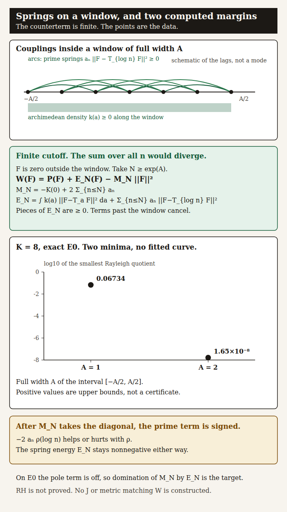</a> Figure 1. Couplings on a window, and the finite identity W = P + E_N − M_N ‖F‖² with M_N = −K(0) + 2 Σ_{n≤N} a_n, N ≥ e^A, F zero outside the window. Two K = 8 points only, no fitted curve. Upper bounds, not a certificate. <b>The Riemann Hypothesis is not proved.</b> <a href="figures/v119/fig1_spring_balance.svg">SVG</a>.

<a href="figures/v119/fig2_boundary_topology.svg">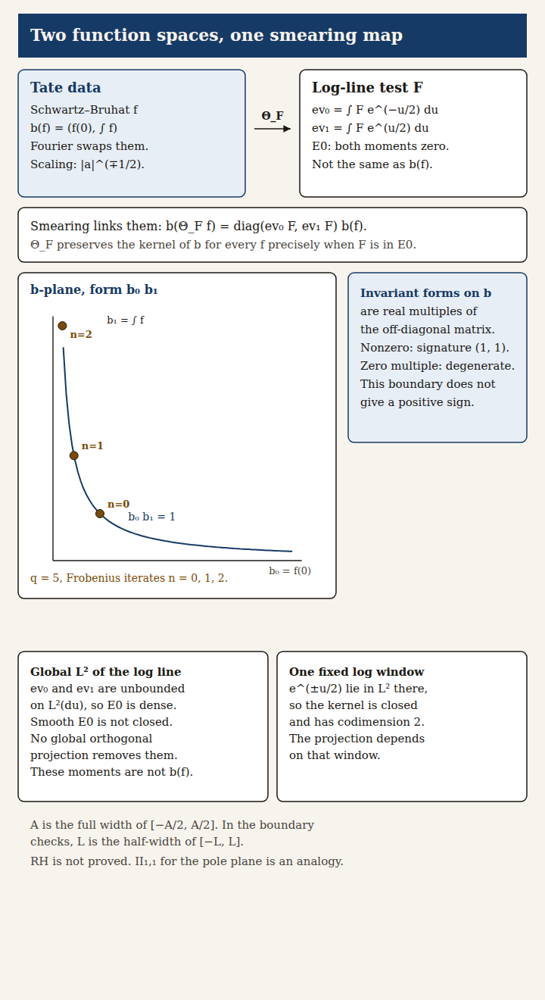</a> Figure 2. Tate’s b(f) and the log-line moments are different spaces, linked by smearing. The form on b is hyperbolic or zero. Amber points are q = 5, n = 0, 1, 2. On the log line, E0 is dense in L² and closed of codimension 2 on one window. <b>The Riemann Hypothesis is not proved.</b> <a href="figures/v119/fig2_boundary_topology.svg">SVG</a>.

<a href="figures/v119/fig3_architectures.svg">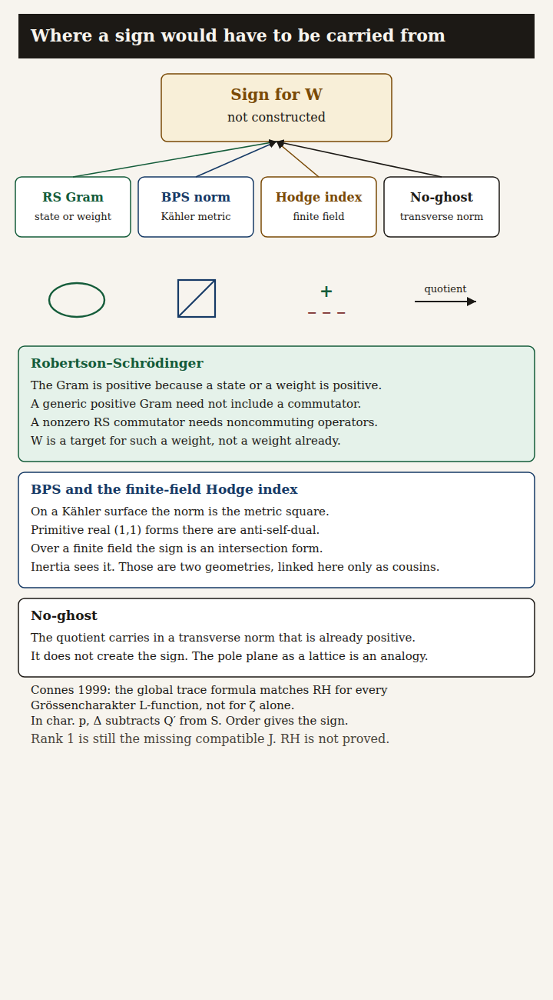</a> Figure 3. A Gram of a positive state or weight, a BPS metric square, the finite-field Hodge index, and a no-ghost quotient. W is the target of such a weight, not a weight already known to be positive. <b>The Riemann Hypothesis is not proved.</b> <a href="figures/v119/fig3_architectures.svg">SVG</a>.

Entries: [spring split](ATLAS.md#spring-energy-counterterm-split), [signed autocorrelation](ATLAS.md#signed-prime-autocorrelation), [Galerkin witness](ATLAS.md#spring-galerkin-near-cancellation), [hyperbolic boundary](ATLAS.md#tate-boundary-only-hyperbolic), [dense versus closed](ATLAS.md#e0-dense-window-kernel-closed), [weight, not a state](ATLAS.md#positive-weight-not-normalized-state), [related architectures](ATLAS.md#quadratic-architectures-related), [norm identity](ATLAS.md#norm-identity-iff-weil-not-four-criteria), [E×E inertia](ATLAS.md#fq-split-inertia-not-determinant), [free-basis witness](ATLAS.md#window-signature-numerical-witness).

## Latest results (v1.18)

> **The Riemann Hypothesis is not proved.** Night of 5–6 Nov 2026. Rank 1 is unchanged: `kahler_triple_polarization`. What is still missing over ℚ is a zeros-blind arithmetic pair (ω, J) whose compatible metric g reproduces the Weil form W_L. Open ~1.8.

**Dictionary.** The Weil window form on the pole annihilator is a Morse-index / discriminant criterion (a restatement, not a sign source). On mixes in S₂(Γ₀(23)) the discriminant wall Σ is a U-curve with a fold and a ghost-recombination branch switch; Levinson’s 1 − |k_M|² is a local defining function of that wall. Over 𝔽_q, Levinson / PARCOR steps are Cauchy–Schwarz in the Hodge-index / Rosati product. An alias lock splits the analytic half (U) — functional equation, Toeplitz structure, Kramers–Kronig — from the sign half (P) — Hodge, Rosati, a compatible J, with Källén–Lehmann as the name of the output.

**No combinatorial toy certificate.** On the genus-1 Beurling pencil, Waterhouse occupancy against integer fakes (931 genuine / 72 interior / 312 exterior, across 39 prime powers) shows that face-incidence of the Hasse walls does not certify a curve. The 72 interior gaps sit inside formal Q = m² − tmn + qn² ≽ 0, with Morse index 0 and a compatible J, and still are not curves. Maxwell–Cremona on the discretized Σ graph is too thin to lift. Wall rigidity is a shadow of (P), not a source.

**Overnight packaging.** (P) is the symmetric partner g of a skew form ω, glued by a compatible J via g(u, v) = ω(u, Jv). The Weil form W_L is that g on ker P, not the canonical symplectic 2-form (a name collision with Weil–Petersson / phase-space area). An occupied lattice does not force holes; a positive metric forces topological holes to sit as harmonic classes in a Euclidean chamber. A CR3BP dictionary — Hessian of U_eff, Morse index, Hill zero-velocity pinches — is the classical shape of that chamber and its valve. Zeros-blind input is the data package “masses + force law,” not a literal equation. Cusp-form vanishing is not the geometric cusp; a residual congruence in Spec T is a pinch-twin of Σ.

<a href="figures/v118/figA_beurling_chamber.png">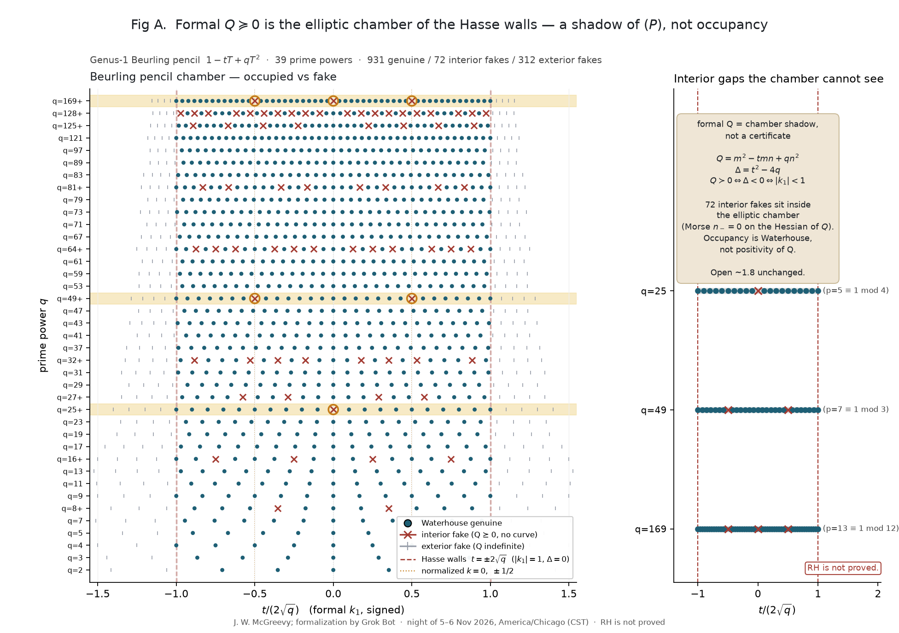</a> 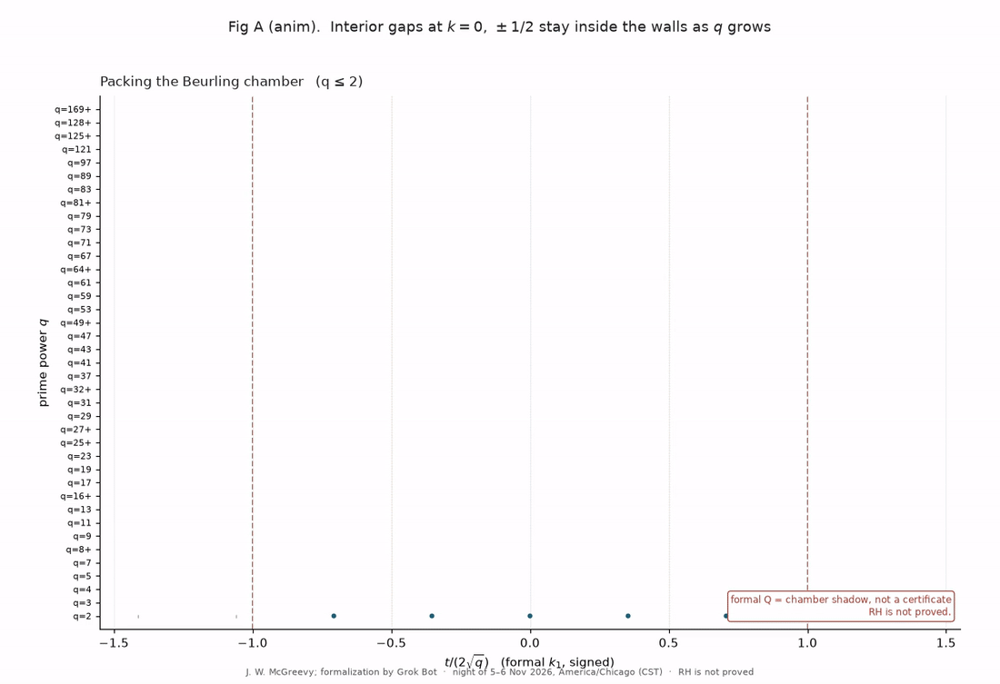 Beurling chamber versus occupancy. Formal Q ≽ 0 is the elliptic chamber of the Hasse walls, a shadow of (P), not a certificate of a curve. Interior Waterhouse gaps (red crosses), including the normalized gaps at k = 0 and k = ±1/2, sit inside the chamber and still are not curves. <b>The Riemann Hypothesis is not proved.</b> Animation: <a href="figures/v118/figA_beurling_chamber.gif">GIF</a> · <a href="figures/v118/figA_beurling_chamber.mp4">MP4</a> · <a href="figures/v118/figA_beurling_chamber.pdf">PDF</a>.

<a href="figures/v118/figB_kahler_zvc.png">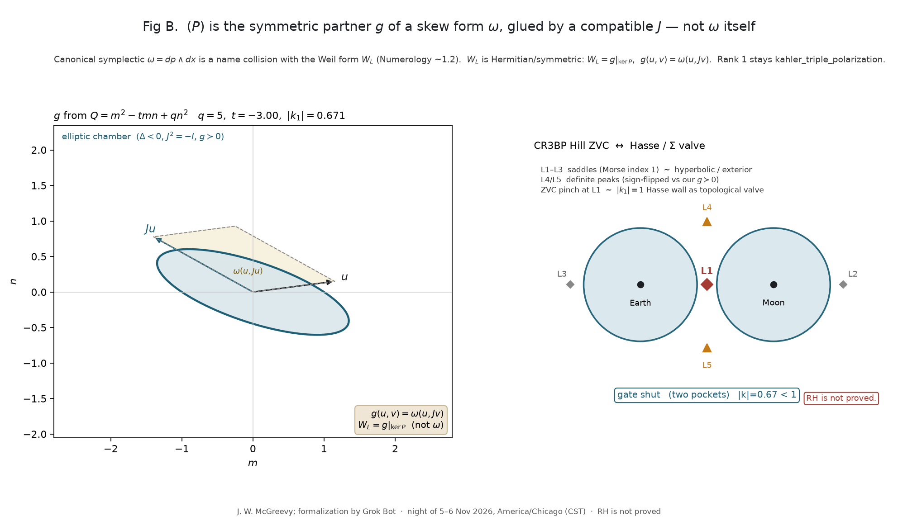</a> 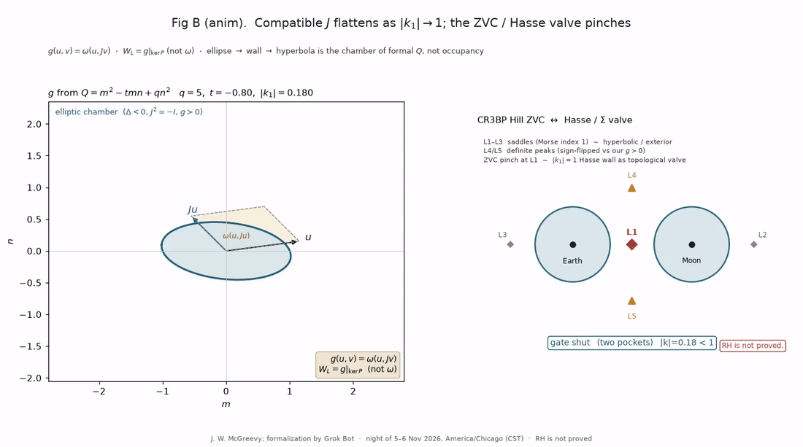 Kähler triple: g(u, v) = ω(u, Jv). W_L is that compatible metric on ker P, not the canonical symplectic form. Right: a Hill zero-velocity pinch as the classical shape of the Hasse / Σ valve. <b>The Riemann Hypothesis is not proved.</b> Animation: <a href="figures/v118/figB_kahler_zvc.gif">GIF</a> · <a href="figures/v118/figB_kahler_zvc.mp4">MP4</a> · <a href="figures/v118/figB_kahler_zvc.pdf">PDF</a>.

## Most significant findings (v1.17)

> **The Riemann Hypothesis is not proved.** These are the results of the latest round of research notes and external review that most sharpen the target, ordered by research-note score (0.6·significance + 0.4·probability of progress, on 0–4). This list is editorial; the computed atlas ranking is unchanged in method (see “Rank 1” below).

| # | finding | label · score | what it says |
|---|---|---|---|
| 1 | **Euler product ⇔ Hecke eigenform is the only ζ-vs-Davenport–Heilbronn discriminator found.** [entry](ATLAS.md#euler-iff-hecke-dh-not-eigen) | Theorem 3.50 | Davenport–Heilbronn is a fixed combination of L(χ) and L(χ̄) mod 5 and is not a Hecke eigenform; the free energy of the prime comb is additive over primes exactly for an Euler product. Any forcing mechanism must use multiplicativity. |
| 2 | **The Weil form splits as the pole plane (signature (1,1)) plus its complement.** [entry](ATLAS.md#haynsworth-pole-plane-split-windows) | Theorem 3.50 | Scaling acts on the pole plane as a Lorentz boost. ζ’s complement is ≥ 0 in every window tested; Davenport–Heilbronn has two negative directions from L ≈ 3.8, half its four off-line zeros. “Complement ≥ 0 for all L” is RH itself. |
| 3 | **Over 𝔽_q, positivity of point counts does not force RH; the surface does.** [entry](ATLAS.md#beurling-curve-fakes) | Numerical 3.50 | Davenport–Heilbronn-type fakes built from two genuine L-polynomials over 𝔽₉₇ keep the functional equation and positive, integral, subfield-monotone point counts (m ≤ 40), yet have roots off the circle (25×25 Toeplitz λ_min down to −2·10²²). What forces RH for curves is the Hodge index on C×C. |
| 4 | **RH for Fermat curves is a degree-one phenomenon.** [entry](ATLAS.md#degree-one-accident) | Theorem 3.40 | Each Hecke-character L-polynomial of a Fermat curve over 𝔽_q is 1 − J·T, and |J| = √q follows from the Gauss-sum identity |g|² = q. Unitarity pins one root. For ζ the same unitarity (|ε| = 1) also holds for Davenport–Heilbronn, so phase arguments are ghost-blind. |
| 5 | **Each prime extends positivity by exactly its own support.** [entry](ATLAS.md#semilocal-edges-track-next-prime) | Numerical 3.40 | Semilocal Weil forms stay positive up to L ≈ 0.748 / 1.121 / 1.629 / 2.416 for S = ∅ / {2} / {2,3} / {2,3,5,7}, against log of the next prime 0.693 / 1.099 / 1.609 / 2.398. Davenport–Heilbronn has no such tower. The step mechanism is open. |
| 6 | **The Faltings–Hriljac template: local terms indefinite, global sum positive.** [entry](ATLAS.md#mechanism-global-object) | Open 3.20 | For elliptic curves the Néron local terms are indefinite at every place and only their sum (the canonical height) is positive, by the Hodge index. ζ has the local terms and the product formula (the explicit formula); it lacks the points and the Tate limit. Truncated Euler sums freeze; they do not converge to a height. |
| 7 | **There is no uniform gap, so positivity must come from an identity.** [entry](ATLAS.md#margins-force-identity) | Heuristic 3.00 | ζ’s own smallest eigenvalue closes doubly exponentially (2.31·10⁻¹⁷ at W = 1.6, 2.38·10⁻²⁹ at W = 2), as does the Schur complement. No uniform-gap domination can work; the positive part must be a norm by construction. v1.19: the spring identity W = E_springs − M‖F‖² is that identity-shaped target, and a shrinking Galerkin margin is the diagnostic, not a certificate. |
| 8 | **Signature, not determinant, is the invariant.** [entry](ATLAS.md#signature-not-det-three-ways) | Restatement 2.90 | The CM height (discriminant and determinant), Hill regions (Δχ = −sign det Hess) and the Weil form (n₋ = ½·#off-line zeros) give the same lesson: the determinant sees only parity, the signature sees the ghost. |

## The refined missing piece (v1.17)

[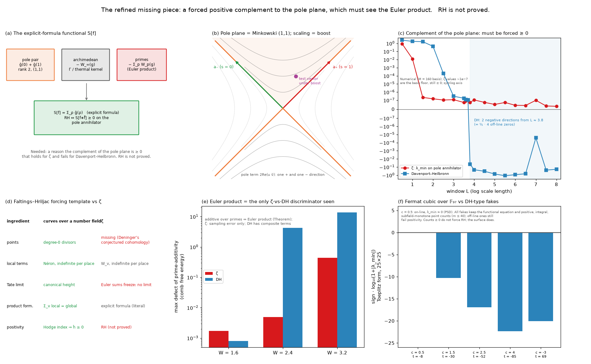](figures/hero_v117/refined_missing_piece.png)

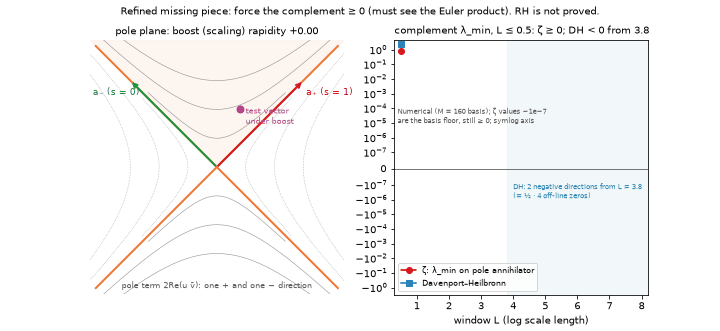

> **The Riemann Hypothesis is not proved.** Stated with the explicit-formula functional, following the definitions note on the arithmetic action.

**The functional.** S[f] = ĝ(0) + ĝ(1) − Σ_v W_v(g) = Σ_ρ ĝ(ρ): the pole pair, minus one local term per place (∞ and every prime), equals the sum over zeros (Weil’s explicit formula) [Theorem]. RH ⇔ S[f ∗ f̃] ≥ 0 on the annihilator of the pole pair [Restatement].

**The pole plane.** The pole term is 2 Re(u v̄): a plane of signature (1,1), a Minkowski plane on which scaling acts as a Lorentz boost [Restatement 3.4]. Everything else is its complement [Theorem 3.5 (Haynsworth)].

**What is missing [Conjecture 2.6].** A reason the complement is ≥ 0 that (1) holds by construction, as a norm, since ζ’s own margin closes doubly exponentially and no uniform gap exists; (2) sees the Euler product, the only ζ-vs-Davenport–Heilbronn discriminator found; (3) is global, since every local term is indefinite on its own; (4) fails for Davenport–Heilbronn and Beurling systems.

**The template.** For curves over number fields the Faltings–Hriljac theorem does exactly this: indefinite Néron local terms, a Tate limit, the product formula, divisors of degree 0, and the Hodge index forcing the global sum ≥ 0. For ζ the local terms and the product formula exist; the points (Deninger’s conjectured cohomology) and the limit do not.

**The barrier.** Certified finite-window positivity runs into the Zhu barrier T₁ = 2πe^{A} (A = Σ|prime weights| in the window): below it the prime comb has dense wells, so positivity there is a band-limited non-concentration statement, equivalent to the target [Restatement 3.3].

*Figure panels:* (a) the pieces of S[f]; (b) the pole plane with boost hyperbolas; (c) smallest eigenvalue on the complement, ζ vs Davenport–Heilbronn [Numerical]; (d) the Faltings–Hriljac template vs ζ; (e) additivity defect of the prime-comb free energy [Theorem + Numerical]; (f) Fermat cubic over 𝔽₉₇ vs fakes [Numerical]. Colours: F red, V green, light cone orange, Sato–Tate violet, ghost/Davenport–Heilbronn blue.

## A global statement about local places (v1.17)

**[ξ as the global product over places](ATLAS.md#xi-global-product-over-places) [Cited: Tate 1950].** Λ(s) = π^{−s/2}Γ(s/2)·ζ(s) is a product of one local factor per place. At ∞, π^{−s/2}Γ(s/2) is the partition function of a continuum; at each prime, (1 − p^{−s})^{−1} is a single bosonic mode at energy log p. The functional equation Λ(s) = Λ(1 − s) comes from Poisson summation on the adèles and the product formula ∏_v |x|_v = 1.

**What this does and does not give.** It makes the ingredients thermodynamic: one partition function per place, and the Euler product is the extensivity of the free energy. It does not make the positivity thermodynamic. The functional equation and the Γ factor are shared by Davenport–Heilbronn, and no local factor is positive on its own. The missing statement would be a global positivity about all local places together, of the same kind as the product formula but for the Weil form.

## What does not force positivity (v1.17)

> Each row was tested against ζ and Davenport–Heilbronn (DH). “Circular” means the statement is equivalent to RH or uses zero locations.

| mechanism | result | verdict |
|---|---|---|
| Determinant / discriminant | sign det W = (−1)^{n₋}: parity only | DH-blind [Theorem 3.2] |
| Heat capacity, entropy, Lévy measure | Weil kernel = x·Lévy measure at β = ½ (literal), but the form is not a relative entropy; Re Λ′/Λ > 0 at β = 1.05, 1.5 for ζ and DH alike | edge-only [Theorem 3.5, Numerical 3.3] |
| KMS, passivity, Tolman | passivity ⇔ zero locations (Lagarias) | circular [Restatement 2.0] |
| Bost–Connes | Hagedorn β_H = 1; the Weil form lives at β = ½, below the phase transition | no positivity supplied [Theorem 3.2] |
| Spinor / Witten | Lichnerowicz pieces indefinite; Witten index 1/ζ(β); (1,1) splits identical for ζ and DH | content-free [Theorem 2.0–2.6] |
| Ruppeiner geometry | (β, hΩ) family: ζ positive-definite (R ≈ +0.22–0.26), χ₋₄ negative-definite, DH indefinite | stability ≠ RH [Numerical 3.2] |
| Reflection positivity (Osterwalder–Schrader) | pole reflection-positive (rank 2), archimedean term exactly anti-RP, primes indefinite; the total is not RP even under RH | not a mechanism [Theorem 3.3] |
| Cramér complete monotonicity | RH ⇔ V(iu) = Σ e^{−γu} completely monotone; finite-order prime-side tests (n ≤ 12) do not separate ζ and DH | circular [Restatement 3.2] |
| Floor depth | order ζ ≪ χ₋₄ < DH (2.4·10⁻²⁹, 7.4·10⁻⁷, 4.3·10⁻⁵ at W = 2) follows conductor and first zero (γ₁ = 14.13, 6.02, 5.09) | bookkeeping, RH-blind [Numerical 3.4] |
| ζ / DH signature “swap” | basis noise plus the rank-2 shift of the pole term (Weyl interlacing, 0 ≤ Δsig ≤ 4); a Hodge reading scores 1.2 | not structural [Theorem 3.3] |
| Positive point counts (𝔽_q) | fakes keep the functional equation and positive integral counts, yet fail RH | insufficient [Numerical 3.5] |
| Truncated Euler energies | indefinite until P > e^L, then frozen; not a Tate limit | no limit [Numerical 3.2] |
| Domination / uniform gap | ζ’s margin closes doubly exponentially | impossible [Numerical 3.4] |

<a href="figures/v117/dh_floor.png">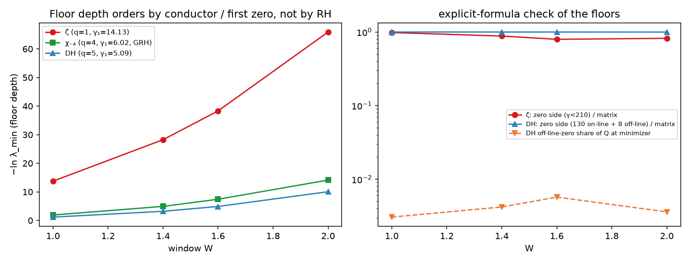</a> <a href="figures/v117/cm_swap.png">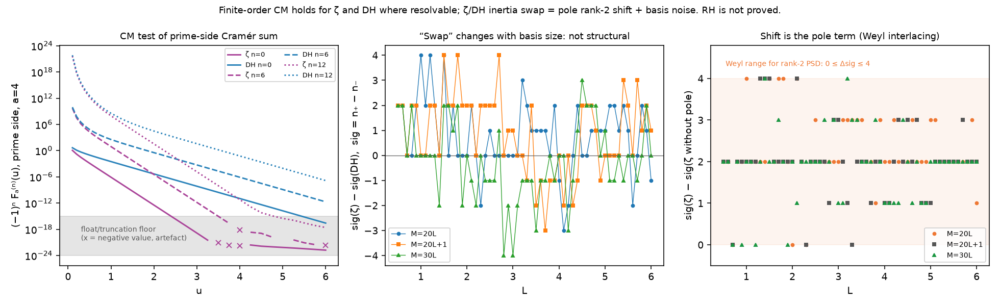</a> Left: floor depth orders by conductor and first zero, not by RH. Right: finite-order complete monotonicity for ζ and DH; the ζ/DH signature “swap” is the pole’s rank-2 shift plus basis noise.

## Rank 1 (computed priority, since v1.16)

**[Kähler triple (ω, J, g) = polarization; elliptic ⇔ positive form preserved](ATLAS.md#kahler-triple-polarization)** [Theorem; priority 0.720]. A positive form on phase space needs a choice of complex structure on top of the symplectic pairing; over finite fields the polarization provides it, for ζ it is missing. Rank 1 is set by the computed priority (0.6·sig + 0.4·prob) and the tie-break in [scores.md](scores.md): inside a tie, circular entries and no-go controls go last, then relation count. The former pinned Φ / Lee–Yang entry sits at rank 321 (priority 0.380). It would be demoted by a proposed polarization for ζ that is also positive for Davenport–Heilbronn or a Beurling system, one assembled place by place, or one only shown equivalent to RH. v1.18 packaging leaves this entry unchanged: W_L is the compatible g in g(u, v) = ω(u, Jv), not the canonical symplectic form. RH is not proved.

## The missing piece (refined in v1.15)

> **The Riemann Hypothesis is not proved.** This section states what is missing, as precisely as the current evidence allows, in the form suggested by the no-ghost theorem of string theory. Labels in brackets; scores 0.6·significance + 0.4·probability on 0–4.

**Statement [Conjecture, 2.60; any exact form is equivalent to RH, so it is stated as a construction requirement].** What is missing is a *positive-by-construction transverse space* H₊ for the scaling reduction of the adele class space, with the scaling-reduced Weil form written as Q = Φ*Φ, where

- (1) H₊ is positive for a reason independent of the zeros (taking Φ = Cholesky(Z_L) is circular);
- (2) Φ is scaling- and Hecke-equivariant and consistent under window restriction (the analogue of DDF operators commuting with the constraints);
- (3) Φ is a non-place-local intertwiner built only from Euler factors and Γ data (a sum Σ_v Φ_v*Φ_v over places is ruled out: every local term is indefinite);
- (4) the construction fails for Davenport–Heilbronn (no Euler product) and for the Beurling control (the analogue of c = 26).

**Note (v1.19).** For ζ, the norm identity on all compactly supported tests in E0, on every window, allowing a semidefinite quotient, is Weil positivity for ζ. An abstract GNS construction assuming RH can inherit formal compatibilities of W and is circular as a proof. Independent positivity of H₊, identified with W without assuming W ≥ 0, is what is missing. Not every further demand, including an unspecified Hecke action or a Beurling control, is claimed to follow automatically, and it is not claimed that no compatibility follows from RH. Place-local squares still cannot match the signed local terms one place at a time. The II₁,₁ reading of the pole plane is an analogy; no arithmetic lattice is constructed.

**Equivalently [Restatement, 3.40]:** RH ⇔ the scaling-reduced Weil form has no negative-norm (ghost) states (Weil 1952; Bombieri 2000: the number of negative directions is half the number of off-line zeros). The target is a *no-ghost theorem for the scaling reduction*, with the pole pair (signature (1,1)) as the Lorentzian II₁,₁ part [Analogy, 3.20; baseline slot 1, exists] and H₊ as the positive transverse factor, the analogue of V♮ in Borcherds’ use of the Goddard–Thorn theorem [Restatement, 3.04; baseline slot 2, missing]. The constraint is already known: scaling by the idele class group, whose reduction makes the zeros appear as an absorption spectrum (Connes 1999) [Analogy, 2.92]. **No-ghost transports positivity; it does not create it**, so H₊ must be known positive independently or the argument is circular. There is no ζ analogue yet of the DDF operators [Open, 2.28] or of c = 26 [Open, 1.76].

**Where the candidates stand.** Over 𝔽_q all four conditions hold (primitive H² with the Hodge index theorem) [Theorem]. No candidate over ℤ tested so far satisfies all four. Petersson positivity of V_p*V_p on Jacobi cusp forms is positive and Hecke-equivariant but excludes only the edge of the strip [Theorem, 3.48]; the Bochner–Kodaira–Nakano curvature is positive but is Γ data, the same for Davenport–Heilbronn [Theorem, 3.48]; Connes’ trace formula is built from local Euler and Γ terms but is a sum over places, and its positivity is RH. **Rank 1 changed in v1.16:** the manual pin on the ferromagnetic Φ / Lee–Yang entry is removed. The Lee–Yang Φ bridge test showed that single-spin Lee–Yang for Φ is RH itself (not a theorem of Newman 1976), that the many-spin ferromagnetic version adds nothing, that GHS, moment, Turán and Jensen tests are passed by Davenport–Heilbronn too (so Φ fails condition (4)), and that no damping-invariant local condition on Φ can imply Lee–Yang [Theorem 3.7]. The Φ entry stays Open, at its computed priority 0.380. Rank 1 is now the polarization entry (see above), which asks for exactly the missing positive J.

**Davenport–Heilbronn control [Numerical, 3.00].** Its off-line zero ρ = 0.808517… + 85.699348…i (with 1 − ρ̄) forms a quadruple that contributes two negative-norm states, one per parity; first Weil-window crossings at L ≈ 3.63/3.65 on fine bases.

> **Lee–Yang Φ bridge test (requested in external review) [Restatement 3.4 + Theorem 3.7 + Numerical 3.3].** Single-spin Lee–Yang for the Pólya kernel Φ is a restatement of RH, and the many-spin ferromagnetic version adds nothing: by continuity at J → 0 it fails exactly when the single-spin property fails. Correction: Newman 1976 does not state RH ⇔ Lee–Yang for Φ (it classifies the class 𝒫 and shows Φ ∉ 𝒫). Ferromagnetic coupling pulls Davenport–Heilbronn’s off-line zero onto the axis (2 spins: J ≈ 0.58/0.60; 3 spins: J ≈ 0.33), i.e. it acts like positive de Bruijn–Newman time. The GHS / Ellis–Monroe–Newman class, log-concavity, Turán, Jensen and cumulant-sign tests are passed by Davenport–Heilbronn too (blind), and no condition invariant under Φ → e^{λσ²}Φ can imply Lee–Yang (Theorem 3.7). A useful condition must be non-λ-invariant and feel zeros at large height [Open 2.3].

## Perspectives on the missing piece (v1.15)

> Seven perspectives currently attack the missing piece. For each: what it supplies, which baseline slot (1 boundary at ∞; 2 interior positivity at the finite places, missing; 3 first-order operator, downgraded; 4 Stirling asymptotics) or H₊ condition (1)–(4) it feeds, its best score (0–4), and its current blocker. The Riemann Hypothesis is not proved.

| perspective | what it supplies | feeds | best score | current blocker |
|---|---|---|---|---|
| **Spectral / operator** (Connes’ adele class space, Hilbert–Pólya, Berry–Keating, Dirac / Weitzenböck / Bochner–Kodaira–Nakano) | the constraint (scaling action; zeros as absorption spectrum); a Weitzenböck split of the Weil form into a boundary block and a relative curvature bound | slots 1, 4; condition (2) | Weitzenböck split 3.52 [Restatement]; BKN curvature k/y² 3.48 [Theorem] | the split is sharp but circular; the curvature is Γ data, identical for Davenport–Heilbronn; no first-order operator exists (the archimedean symbol is log-order) |
| **Cohomological / Hodge index** (Deninger, the 𝔽_q model, Spec ℤ × Spec ℤ) | the only model where all four conditions hold: Weil form = Gram matrix of the Frobenius orbit, positivity = Hodge index / Rosati | conditions (1)–(4) as template; slot 2 | 𝔽_q: Theorem (all four pass) | no such cohomology over Spec ℤ is constructed; Deninger’s is conjectural |
| **Automorphic / Hecke** (Ramanujan–Petersson, Petersson inner product, Jacobi U_l / V_l, Eichler–Shimura F + V, theta lifts, 691) | positive Hilbert spaces with Hecke action; V_p*V_p = p^{−(k−2)}(p^{k−2}+α)(p^{k−2}+β); the 691 congruence module | conditions (1), (2); slot 2 candidate | V*V edge positivity 3.48 [Theorem]; T_ℤ ≅ {(a,b): a ≡ b mod 691} 3.28 [Theorem] | positivity excludes only the edge (Satake offset δ ≥ ½); F and V change level while positivity lives at one level; DH is invisible on the Jacobi side (fails (4)); 691 is an integral degeneracy with no sign |
| **Arithmetic / Iwasawa / CM** (imaginary quadratic fields, the discriminant, class numbers, Mazur–Wiles) | exact boundary data and global counts: h⁺ vs h sees sign in one ℤ/2 at the real places; one B₁₂ governs four boundary objects; U_l, V_l, T_p preserve the fundamental discriminant | slot 1; condition (3) template (built from Euler data) | narrow/wide class group 3.08 [Theorem]; discriminant-family invariance 3.20 [Theorem] | finite-place data are sign-blind (genus theory is phase data); Weil positivity lacks Mazur–Wiles’ exact global count (Analogy 2.48) |
| **Statistical mechanics / thermodynamics** (primon gas, Lee–Yang / Newman Φ, de Bruijn–Newman, contact / Legendre) | the former rank-1 entry (pin removed in v1.16): a ferromagnetic / Lee–Yang reason for the global cancellation; Fock space of unique factorization | condition (1); slot 2 candidate | primon Fock space 3.4 [Theorem]; former rank-1 Φ entry [Open, priority 0.380, now rank 289] | Φ > 0 holds for Davenport–Heilbronn too (fails (4)); per-prime ferromagnetic signs refuted; Newman class 𝒫 fails; real-field thermodynamics is RH-blind; Lee–Yang Φ test done: single-spin = RH (Restatement 3.4), many-spin adds nothing, GHS/moments blind (3.1/3.4), no λ-invariant local condition suffices (Theorem 3.7); ferromagnetic coupling heals DH like positive de Bruijn time (3.3). |
| **String / VOA no-ghost** (Goddard–Thorn, Borcherds, the V♮ orbifold) | the shape of the missing piece: constraint + Lorentzian II₁,₁ + positive transverse factor ⇒ no ghosts | slot 1 (exists), slot 2 (missing); conditions (2), (4) via DDF and c = 26 | RH ⇔ no-ghost 3.40 [Restatement]; II₁,₁ ↔ pole pair 3.20 [Analogy] | no DDF analogue (Open 2.28), no c = 26 analogue (Open 1.76); no-ghost transports positivity, it does not create it |
| **Classical mechanics / geometry** (Jacobi constant, Lagrange points, Kepler, light cone / Hodge-index skeleton) | dictionaries: elliptic / parabolic / hyperbolic ⇔ a² vs 4q; the first-class constraint surface is coisotropic and its reduction is the Goddard–Thorn quotient | slot 1 frame; interpretation of conditions (2), (4) | coisotropic reduction 3.0 [Theorem]; zero velocity ↔ null states 2.2 [Analogy] | analogies only; ghost-blind (they see a ghost only when it arrives) |
| **Function fields / Fermat curves** (Weil 1949 Jacobi sums, Hasse–Davenport, Bombieri–Stepanov, FLT / R = T) | RH over 𝔽_q is literal: &#124;J&#124; = √q from &#124;g&#124;² = q, one root per Hecke-character L-polynomial; Davenport–Heilbronn-type fakes over 𝔽_q keep the functional equation and positive integral point counts yet fail RH | condition (4) located: the surface (Hodge index on C×C), not counting positivity | Numerical 3.5; Theorem 3.4 | over ℚ the Fermat L-functions are Hecke L-functions whose RH is as open as ζ’s; R = T forces automorphy, which ζ already has |

## Latest results (v1.15)

> The Riemann Hypothesis is not proved. The headline figure of v1.15 is the refined missing piece; below it are the no-ghost figures. Labels and scores as in the entries; “0–4” scores measure closeness to a literal bridge (0 decoration, 2 structural, 3 literal in a model, 4 literal and load-bearing). The v1.14 and earlier galleries follow below.

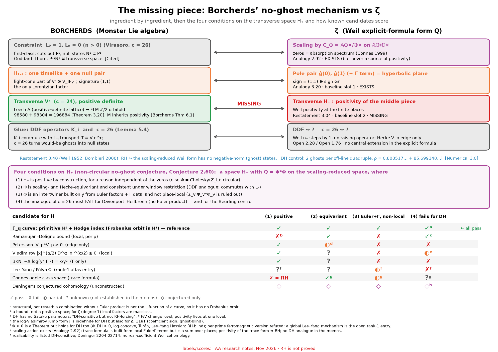

*The refined missing piece. Top: Borcherds’ no-ghost mechanism ingredient by ingredient against ζ’s scaling-reduced Weil form (constraint ↔ scaling by the idele class group; II₁,₁ ↔ the pole pair, signature (1,1); transverse V♮, positive definite ↔ H₊, missing; DDF operators and c = 26 ↔ no analogue yet). Middle: the four conditions on H₊. Bottom: how known candidates score against them; only the 𝔽_q model (primitive H² with the Hodge index theorem) passes all four.* [Cited + Analogy + Restatement; the four conditions are a Conjecture · 3.40 / 3.20 / 2.60 (scores 0–4)]

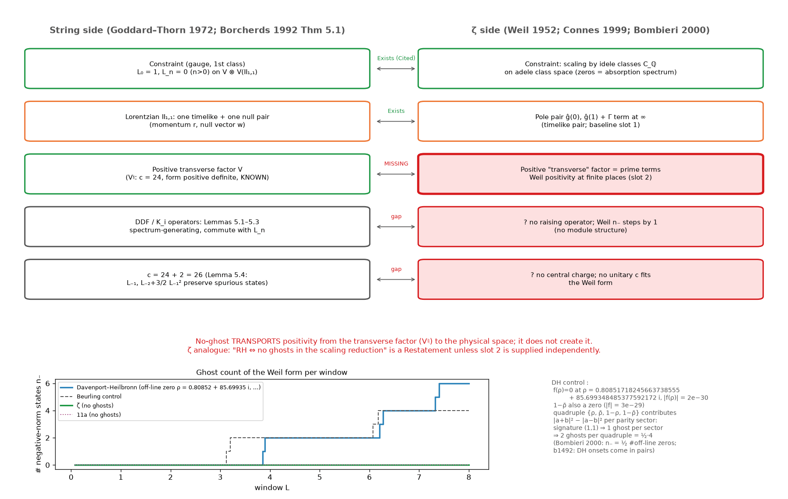

*String side vs ζ side of the no-ghost theorem: Goddard–Thorn needs a Virasoro constraint, one Lorentzian II₁,₁ factor, a positive transverse factor, DDF operators and c = 26; for ζ the constraint (scaling) and the Lorentzian part (pole pair) exist, the transverse positivity is missing, and DDF and c = 26 have no analogue. Lower panel: ghost counts of the Weil form per window (Davenport–Heilbronn and the Beurling control acquire negative-norm states, two per off-line quadruple; ζ and 11a none in the tested range).* [Cited + Analogy + Numerical · 3.40 / 3.20 / 3.00]

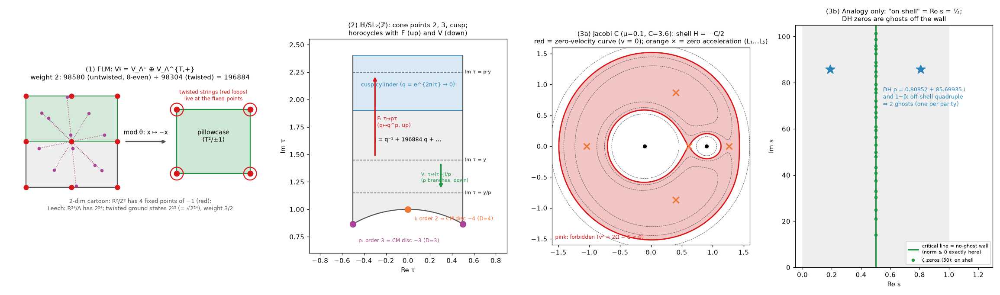

*Orbifolds and the mass shell: (1) V♮ as the FLM ℤ/2 orbifold of the Leech lattice VOA, 2²⁴ fixed points, 2¹² twisted ground states of weight 3/2, 98580 + 98304 = 196884; (2) the modular orbifold ℍ/SL₂(ℤ) with cone points i, ρ (CM discriminants −4, −3), the cusp cylinder, horocycles and the Frobenius (up) / Verschiebung (down) moves; (3) Jacobi constant, zero-velocity curves and Lagrange points, and the critical line with Davenport–Heilbronn’s off-line zeros as ghosts.* [Theorem + Cited + Analogy · 3.20 / 3.32 / 2.20]

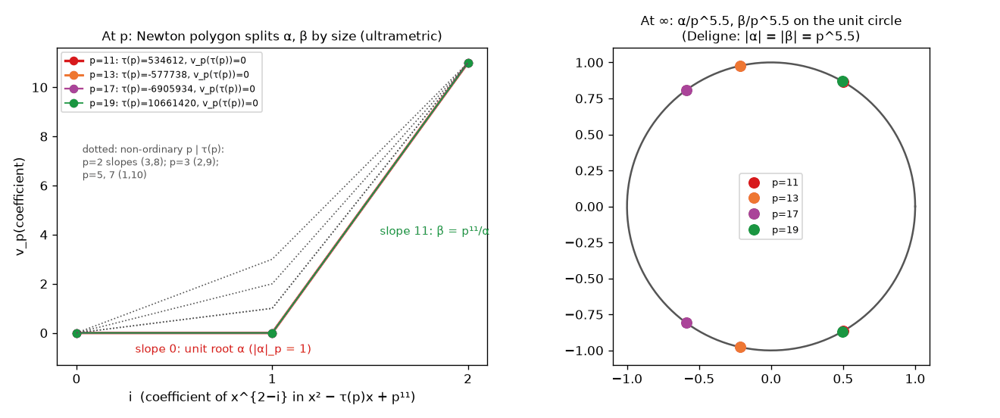

*Is F/V an archimedean/non-archimedean split? No: both live at p. For Δ the Newton polygon of x² − τ(p)x + p¹¹ has slopes 0 and 11 at ordinary primes (all p < 60 except 2, 3, 5, 7), so the roots split by p-adic size; at ∞ the same pair has equal size |α| = |β| = p^{11/2} (Deligne) and β = ᾱ.* [Theorem · 3.00 / 3.32]

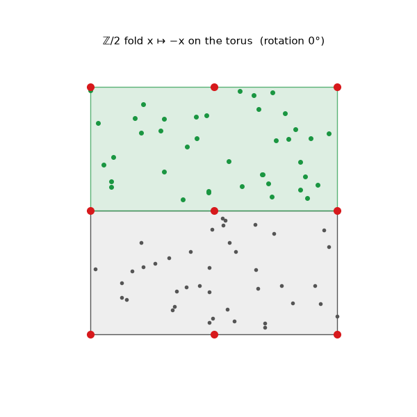

*Animation: the ℤ/2 fold of the torus and the twisted sector appearing at the fixed points (schematic of the FLM construction of V♮).* [Cited, schematic]

## The missing piece (refined in v1.11)

> **The Riemann Hypothesis is not proved.** This section states what is missing as precisely as the current evidence allows. Labels in brackets.

**Statement [Open; any exact form is equivalent to RH, so it is stated as a construction requirement].** What is missing over ℤ is a *global, Hecke-equivariant, Krein-definite polarization* for ζ: a Rosati-type structure, built from the primes, the archimedean place and the pole together, that makes the scaling pencil D v̇ = Z_L v Krein-definite (the trivial grading Γ = 1, not merely some grading) at every support length L at once. By the Hamiltonian–Krein index n₋(Z_L) = N_real + 2N_quart + 2N_Krein− this is exactly Z_L ≥ 0, i.e. RH, so **the statement is circular as a criterion**; its non-circular content is the shape any construction must have [Theorem for the index identity; the requirements below are Conjecture]. (i) *Global:* ζ’s Euler factors carry no rotation (each sits on the parabolic wall, massless), the archimedean place is a one-sided cone, and every local term is indefinite (items 4, 11, 13). (ii) *Hecke-equivariant:* a single modular-invariant observable (the Epstein zeta of x² + 5y²) fails positivity at L* = 3.025 while the class-group-averaged L-functions do not, and log p enters only as the Hecke angle θ_p = t log p (item 15) [Numerical + Theorem]. (iii) *Coherent:* every local wall is already on the right side (Hasse, Ramanujan); what is unproved is that one spectral parameter γ makes the angles θ_p = γ log p coherent across all p with a definite archimedean sign. (iv) *Margin-free:* ζ is critical along L (Szegő), t (Rodgers–Tao) and the archimedean direction, so no uniform spectral gap exists (item 12). Over 𝔽_q all four are supplied by the polarization (Rosati, Castelnuovo–Severi, the Hodge index theorem), which makes every Frobenius mode Krein-definite and the Routh wall unreachable (Krein–Gelfand–Lidskii) [Theorem]. Over ℤ such a structure would presumably live on Deninger’s conjectured cohomology [Conjecture]. None of the analogies below constructs it.

**What is now settled about it.**

1. **Frame, not definiteness [Theorem].** The product formula (the pole plane) gives the Weil form Z = Pole + W_∞ − Σ_p W_p its Lorentzian (1,1) frame. On span{pole, g} positivity is the reverse Cauchy–Schwarz inequality of timelike vectors, the inequality behind the twin paradox. The frame does not make the form definite. The pole is the positive term at imaginary momentum r = ±i/2 that lifts the r ≈ 0 channel [Analogy].
2. **Trichotomy and Weil radius [Restatement].** Along the support filtration each Levinson/Schur step has discriminant 1 − k²; over 𝔽_q exactly 1 − k₁² = (4q − a²)/4q, so elliptic / parabolic / hyperbolic ⇔ a² <, =, > 4q (a lattice Klein–Gordon mode with m² = 4 sin²(θ/2), item 13). The Weil radius L* is the first support length at which a direction turns negative, and **RH ⇔ L* = ∞ for ζ**. Under RH ζ is strictly elliptic at every finite L and meets the parabolic wall only as L → ∞; Davenport–Heilbronn crosses at L* ≈ 3.82–3.88 [Numerical].
3. **Special-relativity dictionary [Theorem; circular as a criterion].** Each step is an SU(1,1) boost with velocity k: 1 − k² = 1/γ², the Lorentz factors multiply and the rapidities add. Positivity ⇔ every step is subluminal (Schur). ζ’s largest step up to L = 8 is |k| = 0.384; Davenport–Heilbronn reaches |k| ≥ 1 at L = 3.85, exactly at its wall (h = 0.025; ≈ 3.63 on fine bases, see Note (v1.14)) [Numerical]. Under RH the cumulative ratio Π(1 − k²) → 0 (Szegő): subluminal at every step, massless in the limit [Theorem, conditional on RH].
4. **No local positivity, and no local rotation [Numerical + Theorem].** Every local term W_∞, W_p is indefinite, and partial products over places stay negative until every prime power ≤ e^L is present; the repair is collective. It is stronger than indefiniteness: ζ’s local factors carry no rotation at all (N = (F − V)/2 = 0, m² = 0 at every p), so ζ has no local carrier of the 𝔽_q mechanism.
5. **Where the ghost lives [Numerical].** On Davenport–Heilbronn’s ghost 2-plane span{g, Dg} (taken at its wall) the archimedean part is positive definite. ζ’s prime terms keep that 2×2 positive at every partial sum, in either order and at both resolutions; Davenport–Heilbronn’s own terms break it only late, first after 73–100% of the terms. The ghost comes from the prime side.
6. **One global polarization [Numerical; equivalent to n₋ = 0].** In the gyroscopic Weil pencil every ζ mode is imaginary with Krein sign +, and one fixed positive-frequency (Hardy) polarization, a Dirac sea, fills for ζ at every L ≤ 8; Davenport–Heilbronn leaves n₋/2 unfillable holes. In the language of item 9 the fill is Krein-definiteness, Γ = 1.
7. **Shear, not curvature [Theorem + Numerical; equivalent to Laguerre].** The curvature of log|Ξ| is the Riesz measure 2πΣδ_ρ ≥ 0, the same for every function; the separating part is the trace-free shear. A pointwise Witten-type curvature condition fails, so positivity must be an operator inequality.
8. **The sum of squares, explicitly, and where it breaks [Theorem + Numerical; circular as a criterion].** Toeplitz Cholesky is the Levinson recursion: Z(g) = Σ_k E_k |⟨a_k, g⟩|² with the Szegő predictor polynomials a_k. Positivity ⇔ every pivot E_k > 0 ⇔ (Schur–Cohn) no predictor root inside the unit disk. For ζ the roots lie on the circle at the zeta zeros; for Davenport–Heilbronn the root that enters the disk at the wall converges to the off-line zero itself. Π(1 − k²) is the transmitted fraction of a lossless layered line [Theorem].
9. **Count versus stability, and the exact glue [Theorem + Numerical; circular as a criterion].** Morse counts are topologically forced (2 − 3 = −1 = χ for the co-rotating potential at every mass ratio; equal signed counts for ζ and Davenport–Heilbronn; χ(Tⁿ) = 0 on the prime torus), while stability is not. The two halves are joined exactly by the Hamiltonian–Krein index n₋(Z_L) = N_real + 2N_quart + 2N_Krein− and the Kelvin–Tait–Chetaev parity sign det(D⁻¹Z) = (−1)^{n₋}: an odd index forces a real pair and a gyroscopic twist rescues only even n₋ (212/212 pencils; odd n₋ ⇒ real pair 29/29). Hence positivity ⇔ stable **and** Krein-definite; a non-trivial grading exists for Davenport–Heilbronn on L ∈ [4.025, 4.625], so “some Γ” (v1.10) was too weak.
10. **Two walls [Theorem + Numerical; the converse is open].** The *parabolic (signature) wall* is a one-mode collision of a conjugate pair on the real axis: a² = 4q over 𝔽_q, Kepler’s E = 0, a Levinson step with |k| = 1, a Hodge–Riemann signature flip; RH ⇔ ζ never reaches it [Restatement]. The *Routh (Krein-collision) wall* is a collision of two modes of opposite Krein sign off the real axis (Hamiltonian–Hopf; at L4, μ_R = 0.0385209). It needs a Krein-negative mode first, so RH ⇒ ζ never reaches any Routh wall, and under a Krein-definite (Rosati-type) polarization it is unreachable by Krein–Gelfand–Lidskii [Theorem]. Davenport–Heilbronn crosses the parabolic wall at L* = 3.875 (h = 0.025; ≈ 3.63/3.65 on fine bases) (the birth of a cap of the forbidden set), opens a Krein-negative neck at 4.025, and shows Hamiltonian–Hopf quartets from L_H ≈ 4.26–4.78 (by resolution); ζ shows none of this for L ≤ 8 [Numerical]. Whether every Krein-negative mode must reach a Routh wall as L → ∞ is open [Conjecture]. In the de Bruijn–Newman direction ζ sits exactly on its wall: RH ⇔ Λ = 0 given Λ ≥ 0 (Rodgers–Tao) [Theorem, cited]; the reading “forward heat flow plays the role of the Coriolis stiffness” is demoted in v1.11 (Analogy 2.4 → 2.2), since that flow is a gradient flow with a Calogero–Moser lift, not gyroscopic.
11. **One-sided archimedean cone, two-sided prime rigidity [Theorem + Numerical; Conjecture].** π sech(πr) = Re ψ(3/4 + ir/2) − Re ψ(1/4 + ir/2) > 0, so raising the archimedean multiplier never breaks positivity, while every finite prime-side change has a mean-zero symbol and breaks it at a finite cutoff: ζ sits on the boundary of the Weil cone in every prime direction. Conjecture: the grading is the supporting functional of the positive cone at the prime–archimedean pairing.
12. **Criticality: no margin [Theorem (conditional) + Cited + Heuristic].** Genuine L-functions are gapless in three directions: Szegő’s condition fails along L under RH, Λ ≥ 0 along the heat flow (Rodgers–Tao), and the archimedean factor is (conjecturally) minimal admissible. Arguments of the form “Z_L ≥ δ > 0 uniformly” cannot work; a proof must be identity-type (a sum of squares or a polarization), as Hasse is over 𝔽_q. Criticality separates genuine L-functions from Davenport–Heilbronn, not ζ from L(11a).
13. **Hecke recursion = lattice Klein–Gordon [Theorem].** The local transfer matrix [[a/√q, −1], [1, 0]] is a lossless LC-ladder cell with m² = 2 − a/√q: Hasse = passband (543/543 pairs; L(11a) 429/429 in band, mean m² = 1.9997), the wall = band edge, a ghost = stopband. ζ sits at m² = 0 at every prime, the massless band edge, so ζ’s positivity cannot be a cascade of local passbands.
14. **Real-field thermodynamics is RH-blind [Theorem + Restatement].** For any positive kernel Φ, log ∫Φ e^{xu} is convex in real x (Hölder), so entropy, heat capacity and the TS ↔ PV correspondence hold for Davenport–Heilbronn too (its kernel is positive and log-concave). The RH-sensitive quantity is the imaginary-field (rotation) one: −∂² log H_t is Laguerre’s expression, ≥ 0 exactly when the zeros are real (circular as a test).
15. **The elliptic-curve analogue on the discriminant space [Theorem + Numerical; Conjecture].** On binary quadratic forms, definite forms are CM points (elliptic), D = 0 is the cusp (parabolic) and indefinite forms are closed geodesics (hyperbolic), with |tr| <, =, > 2 the same trichotomy as a² vs 4q. Modular invariance alone is not enough: the single-form Epstein zeta is modular and fails, the Hecke-equivariant (class-group-averaged) objects hold. log p enters the modular surface only as the Hecke angle θ_p = t log p (Eisenstein eigenvalue 2cos(t log p)); no time change maps geodesic lengths 2 log ε_D to k log p (Livšic), and the Hecke-tree band edge |λ| = 2√p is the parabolic wall again. RH ⇔ the scattering resonances ρ/2 all sit at the same depth ¼ from the unitary line [Restatement].

**Closest literal version, and the gap.** Over 𝔽_q every item above is literal: Rosati positivity = Hasse = a definite Frobenius form = a passband Klein–Gordon mode = a subluminal first step = a Krein-definite rotation that never meets a Routh wall. Over ℤ each item is either a restatement of RH or a finite-cutoff observation. The gap is exactly the global polarization: a non-circular construction, from the primes, ∞ and the pole together, of a Hecke-equivariant, Krein-definite (Γ = 1) structure whose angles θ_p are coherent across all p with a definite archimedean sign — the structure whose presence the numerics show for ζ and whose absence they show for Davenport–Heilbronn and for single-form Epstein zetas. Since v1.16 rank 1 is the polarization entry, the computed-priority statement of this gap; the earlier pinned Φ entry is kept below at its computed priority.

**Note (v1.12).** The product formula fixes the arithmetic prime coupling at κ = 1, but positivity is a separate input: ζ stays inside an exponentially narrowing window of admissible couplings around κ = 1 while Davenport–Heilbronn leaves it, and this separation is Weil positivity restated, so it is circular as a criterion [Numerical]. The statement above is unchanged from v1.11.

**Note (v1.13).** The same one-negative frame appears on the Selberg side: for PSL₂(ℤ) the trace-formula form with the continuous spectrum removed has exactly one negative direction, in the pole plane span{e^{±x/2}}, as ζ’s Weil form does with the pole removed. There the complement is positive because the Laplacian is self-adjoint (Selberg); for ζ that complement positivity is RH [Numerical + Restatement]. What transfers through the explicit formula is the frame (the pole plane, its flip and the s ↔ 1 − s boost), not the positivity. The statement above is unchanged.

**Note (v1.14).** Sharpened: positivity of Maass–Selberg type lives only in the doubled variable (Re 2s = 1, φ = ξ(2s−1)/ξ(2s)). On the weight-½ unitary axis (S = s + k/4) ζ’s own line appears only as zeros of a Fourier coefficient, c₁ ∝ ζ(½+2it)/ζ(1+4it), which the norm sees squared [Theorem]; every theta-lift rung tested keeps one doubling [Theorem for the rungs tested; Conjecture for all lifts]. What is missing is therefore a positivity that is linear in the coefficients c_m(S) off the unitary axis, as Weil’s criterion is a family of linear conditions, one per test function [Open]. Davenport–Heilbronn has no theta realization, so no such norm can be formed for it; only the Weil form sees it. **Correction:** Davenport–Heilbronn’s first Weil-window crossings are L ≈ 3.63/3.65 on fine bases (second pair ≈ 4.19/4.21); the values 3.82–3.90 (and 6.3–7.4) quoted in this section and in earlier galleries are hat-width (h = 0.025) basis values. The statement above is unchanged.

## Previous results (v1.14)

The headline figure of v1.14 and the figures from the research notes folded into v1.14 (see README.md for the gallery and CHANGELOG.md for details). The Riemann Hypothesis is not proved.

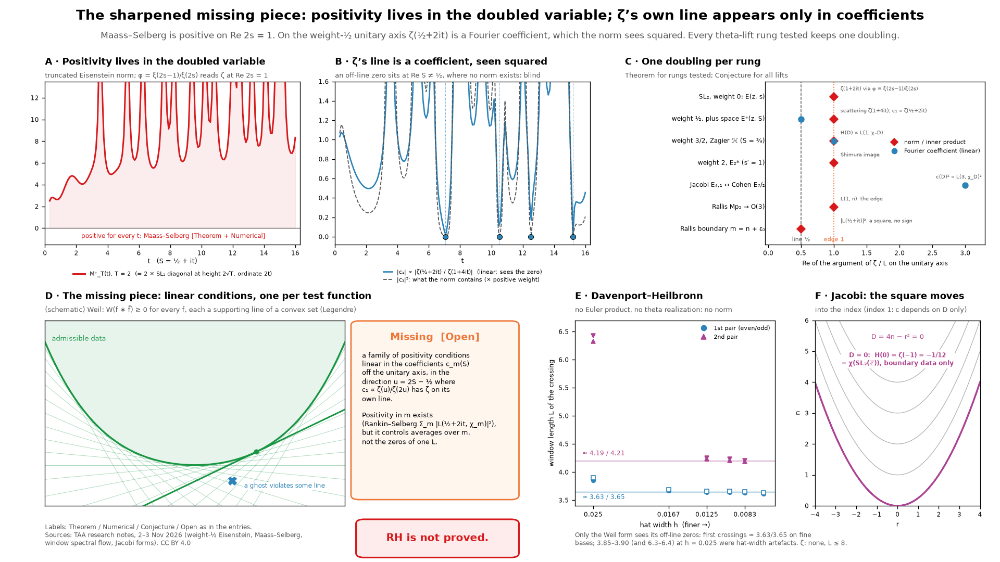

*The sharpened missing piece (research notes of 2–3 Nov 2026). (A) Maass–Selberg positivity lives in the doubled variable: the truncated Eisenstein norm reads ζ through φ = ξ(2s−1)/ξ(2s), at Re 2s = 1. (B) On the weight-½ unitary axis S = s + k/4 = ½ + it, ζ’s own line appears only as zeros of a Fourier coefficient, c₁ ∝ ζ(½+2it)/ζ(1+4it), which the norm contains squared, so it is blind to where the zeros are. (C) Every theta-lift rung tested keeps one doubling. (D) The missing piece is a positivity linear in the coefficients c_m(S) off the unitary axis, as Weil’s criterion is a family of linear conditions, one per test function (schematic) [Open]. (E) Davenport–Heilbronn has no theta realization; only the Weil form sees it, with first crossings at L ≈ 3.63/3.65 on fine bases (3.85–3.90 at h = 0.025 was a hat-width artefact). (F) Index-1 Jacobi forms move the square r² into the index D = 4n − r²; at D = 0, H(0) = ζ(−1) = −1/12 = χ(SL₂(ℤ)), boundary data only.* [Theorem + Numerical; one doubling per rung is a Conjecture for all lifts; the missing piece is Open · 3.54 / 3.36 / 2.52 (scores 0–4)] Animation: figures/hero_v114/missing_piece_one_doubling.mp4 (MP4), figures/hero_v114/missing_piece_one_doubling.gif (GIF).

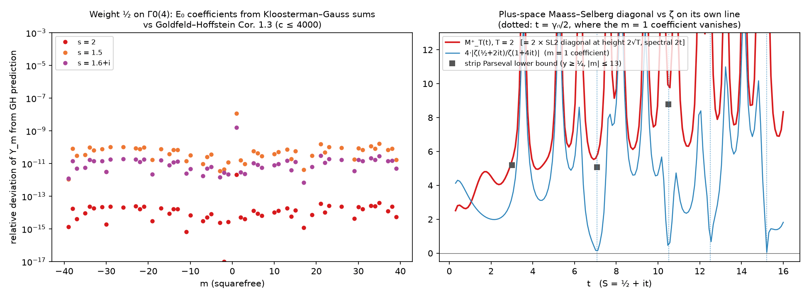

*Weight ½ on Γ₀(4): Eisenstein coefficients from Kloosterman–Gauss sums agree with Goldfeld–Hoffstein Cor. 1.3 (left); on the unitary axis S = ½ + it the plus-space Maass–Selberg diagonal M⁺_T(t) = 2·M^{SL₂}_{2√T}(2t) stays positive while the m = 1 coefficient |ζ(½+2it)/ζ(1+4it)| vanishes at t = γ/2 (right).* [Numerical + Theorem · 3.00 / 3.54 (scores 0–4)]

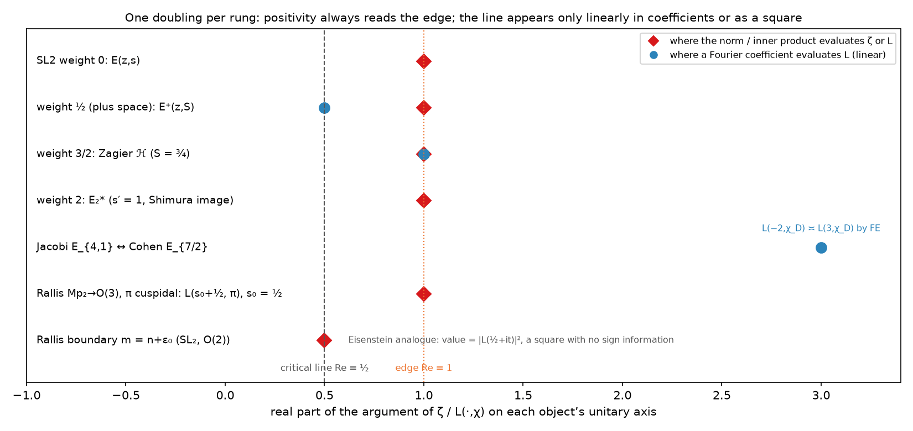

*One doubling per rung: on each object’s unitary axis the norm or inner product evaluates ζ or L at the edge Re 1; ζ’s line appears only linearly in a Fourier coefficient (weight ½) or as a square |L(½+it)|² with no sign information (Rallis boundary case).* [Theorem for the rungs tested, Conjecture for all lifts · 3.36 (scores 0–4)]

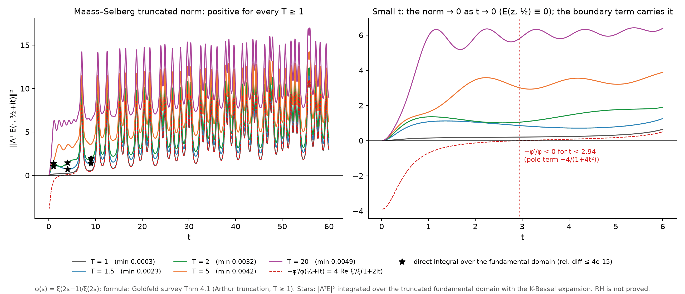

*Maass–Selberg truncated norm for SL₂(ℤ): positive for every T ≥ 1, verified by direct integration over the truncated fundamental domain; it reads ζ only at the doubled variable 2s.* [Numerical · 2.56 (scores 0–4)]

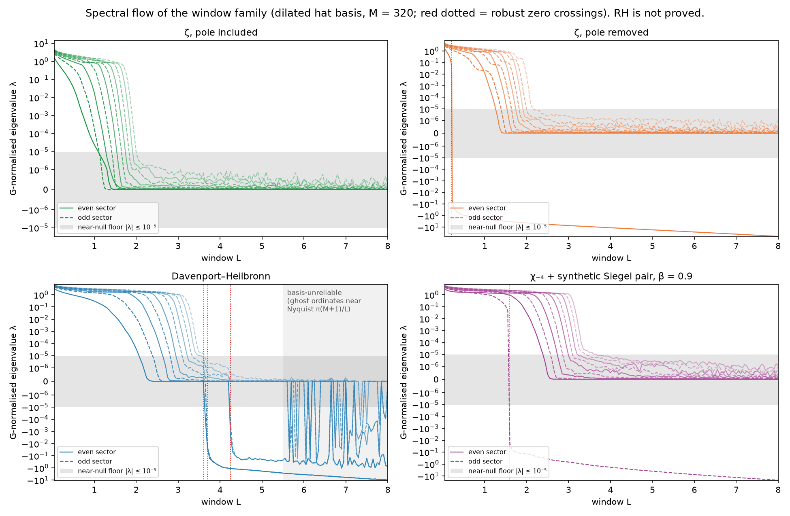

*Spectral flow of the nested window family (M = 320): eigenvalues are non-increasing in L, every system sinks into a near-null floor, ζ stays non-negative, ζ with the pole removed has its single negative from L ≈ 0.22, and Davenport–Heilbronn’s first pair leaves the floor at L ≈ 3.63/3.65 (h = 0.025 gave 3.85–3.90, a hat-width artefact).* [Theorem + Numerical · 2.80 / 3.20 (scores 0–4)]

## Previous results (v1.13)

The v1.13 headline figure and the figures from the research notes folded into v1.13. The Riemann Hypothesis is not proved.

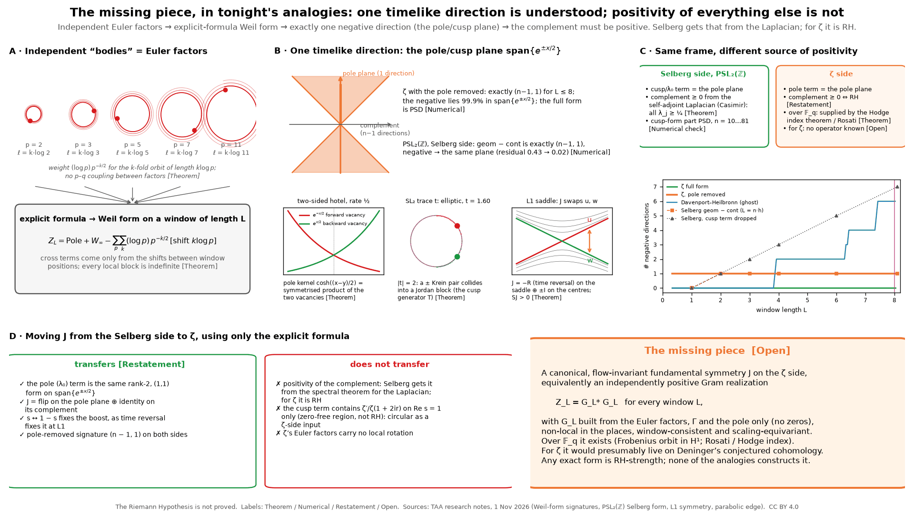

*The missing piece in the analogies of 1 Nov 2026: one timelike direction is understood, positivity of everything else is not. Independent Euler factors (k-fold orbits of length k log p, no p–q coupling) feed the explicit-formula Weil form; with the pole removed it has exactly one negative direction, the pole/cusp plane span{e^{±x/2}}, read three ways (the symmetrised product of a forward and a backward shift vacancy at rate ½, the ± Krein collision into a Jordan block at the parabolic edge |t| = 2, the L1 saddle whose fundamental symmetry is time reversal). On the Selberg side (PSL₂(ℤ)) the same frame holds and the complement is positive because the Laplacian is self-adjoint; for ζ that complement positivity is RH. What transfers through the explicit formula is the frame, not the positivity. The missing piece is a canonical, flow-invariant J, equivalently an independently positive Gram realization Z_L = G_L*G_L built without the zeros; over 𝔽_q it exists (Rosati / Hodge index), for ζ it would presumably live on Deninger’s conjectured cohomology [Open].* [Theorem + Numerical; the missing piece is Open · 3.00 / 2.20 (scores 0–4)] Animation: figures/hero_v113/missing_piece_one_timelike_direction.mp4 (MP4), figures/hero_v113/missing_piece_one_timelike_direction.gif (GIF).

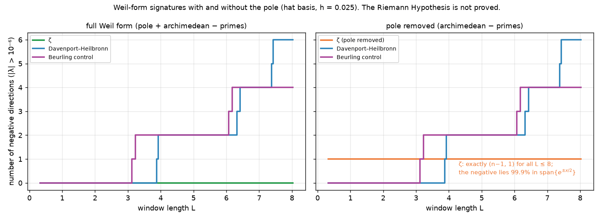

*ζ’s Weil form with and without the pole: the full form is positive at every tested window L ≤ 8, and with the pole removed it has exactly one negative direction (n−1, 1), 99.9% in the pole plane span{e^{±x/2}}; Davenport–Heilbronn and a Beurling control gain negative directions near their off-line points, one per real off-line point and two per complex quadruple.* [Numerical + Theorem · 3.40 / 3.32 (scores 0–4)]

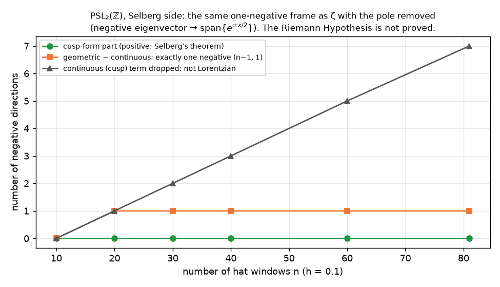

*PSL₂(ℤ), Selberg side: the cusp-form part of the trace-formula form is positive (Selberg’s theorem, checked), geometric minus continuous has exactly one negative direction, converging to the pole plane, and dropping the continuous (cusp) term breaks the frame; the frame transfers to ζ through the explicit formula, the positivity does not.* [Numerical; Restatement · 3.00 / 2.20 (scores 0–4)]

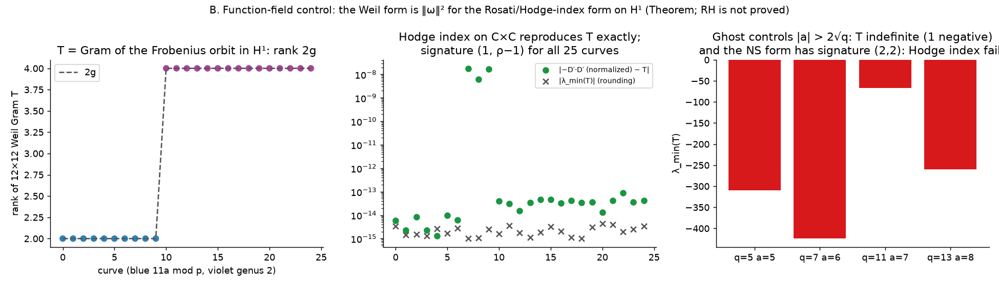

*Over 𝔽_q the Weil form is the Gram matrix of the Frobenius orbit in H¹ for the Rosati / Hodge-index form: rank 2g and signature (1, ρ−1) on all 25 tested curves, while ghost (non-Weil) data break the Hodge index; no place-by-place positive star exists for ζ.* [Theorem · 3.70 (scores 0–4)]

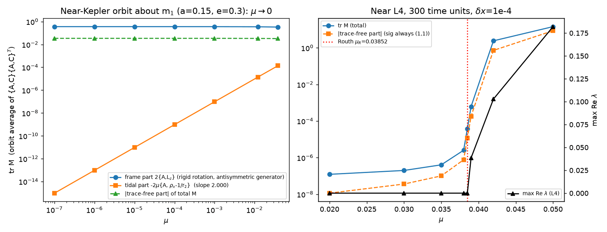

*LRL vector against the Jacobi constant: {A, C} splits exactly into a frame (Coriolis) part, which survives μ → 0, and a tidal part ∝ μ²; near L4 the Routh instability shows only in the trace, since a traceless 2×2 form is always indefinite.* [Theorem + Numerical; as an analogue of trace-free positivity, Analogy · 2.60 / 1.80 (scores 0–4)]

## Previous results (v1.12)

The v1.11 headline figure and the figures from the research notes folded into v1.12. The Riemann Hypothesis is not proved.

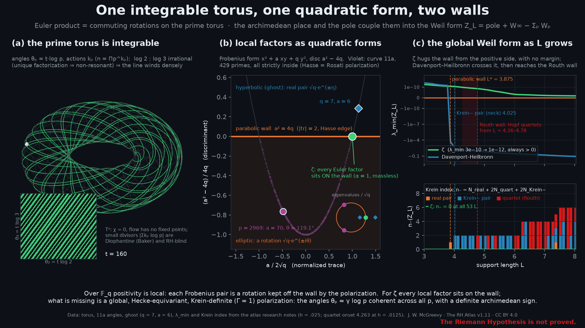

*One integrable torus, one quadratic form, two walls: (a) the Euler product as commuting rotations on the prime torus (θ_p = t log p, a Kronecker line, non-resonant by unique factorization); (b) local factors as quadratic forms x² + a xy + q y² in the discriminant plane: the curve 11a strictly inside at all 429 primes, ζ’s Euler factors on the parabolic wall a² = 4q, a ghost (q = 7, a = 6) outside; (c) the global Weil form along the support length: ζ’s smallest eigenvalue stays positive with no margin (3·10⁻¹⁰ → 10⁻¹²), while Davenport–Heilbronn crosses the parabolic wall at L* = 3.875, opens a Krein-negative neck at 4.025 and reaches the Routh wall (Hamiltonian–Hopf quartets) from 4.263–4.775. Animation: figures/hero_v111/prime_torus_two_walls.mp4 (18 s) and .gif.* [Theorem + Numerical · data from the research notes]

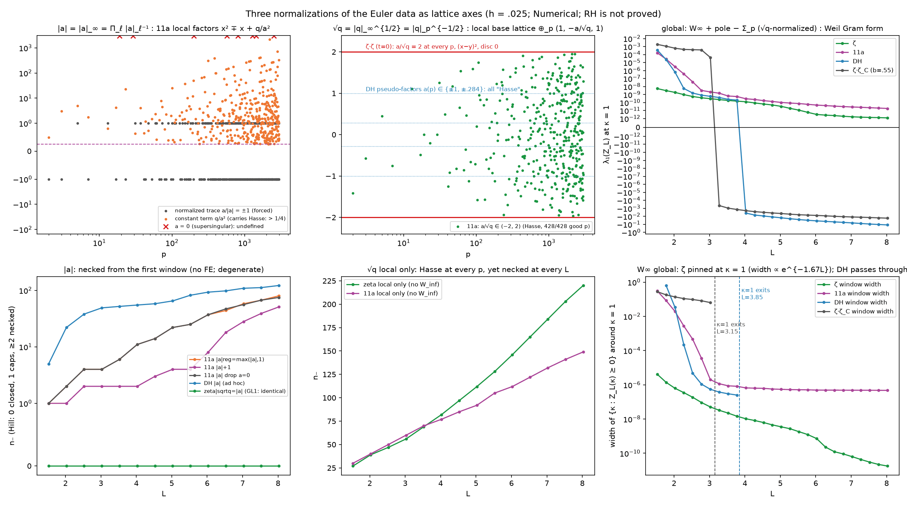

*Three normalizations of the Euler data as lattice axes. |a| (the infinite-place norm of the trace, untied from p by the product formula) forces the trace to ±1, keeps only the sign of a² − 4q, breaks at supersingular primes and gives a Gram form that is indefinite from the first window; √q gives the local Hasse lattice, which is positive for L(11a), degenerate for ζ·ζ and blind to Davenport–Heilbronn, and without the archimedean factor every window is indefinite; √q together with W∞ is the Weil form, where ζ stays inside an exponentially pinching prime-coupling window around κ = 1 while Davenport–Heilbronn and a Beurling control leave it. The last separation is Weil positivity restated (circular).* [Theorem + Numerical; circular · 3.16 / 3.28 / 3.48 (scores 0–4)]

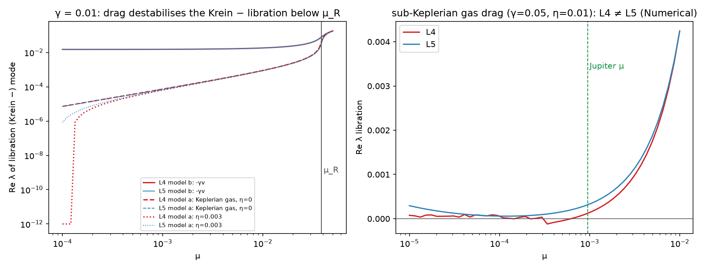

*Drag at L4 and L5: any velocity damping destabilises the Krein-negative libration for every μ below the Routh value (Kelvin–Tait–Chetaev), with L4 and L5 exactly isospectral under symmetric damping; drag relative to a sub-Keplerian gas flow breaks the symmetry and makes L4 less unstable than L5.* [Theorem + Numerical · 3.40 / 2.84 (scores 0–4)]

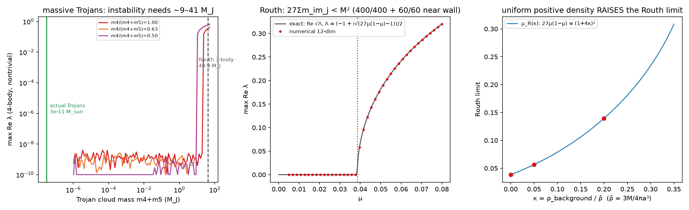

*Massive Trojans and the Routh criterion: the generalized criterion 27(m₁m₂ + m₂m₃ + m₃m₁) < M² holds on every tested triple; Sun–Jupiter would need about 9–41 Jupiter masses of Trojans to lose stability (the actual Trojan mass is about 3·10⁻¹¹ solar masses); a uniform positive background density raises the Routh limit to 27μ(1 − μ) < (1 + 4κ)².* [Numerical + Theorem · 3.04 / 3.08 (scores 0–4)]

## Previous results (v1.11)

Figures from the research notes folded into v1.11. The Riemann Hypothesis is not proved.

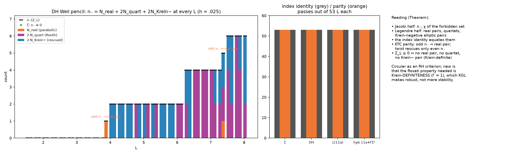

*Hamiltonian–Krein index for the Weil pencil: Davenport–Heilbronn’s n₋(Z_L) splits as N_real + 2N_quart + 2N_Krein− at every support length (a real pair at the parabolic wall, a rescued Krein-negative window, then Routh quartets); the identity and the Kelvin–Tait–Chetaev parity hold at 212/212 pencils for ζ, Davenport–Heilbronn, L(11a) and a hybrid. Positivity ⇔ stable and Krein-definite (Γ = 1).* [Theorem + Numerical · 4.00 (scores 0–4; circular as a criterion)]

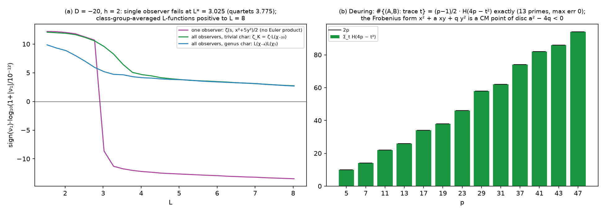

*One observer versus all observers at discriminant −20: the Epstein zeta of the single form x² + 5y² (off-line zero 0.93297 + 15.66825i) fails positivity at L* = 3.025, while the class-group-averaged ζ_K and the genus L(χ₋₄)L(χ₅) stay positive to L = 8; Deuring’s count of curves over 𝔽_p by trace is exact.* [Numerical + Theorem · 2.8 / 3.1 (scores 0–4)]

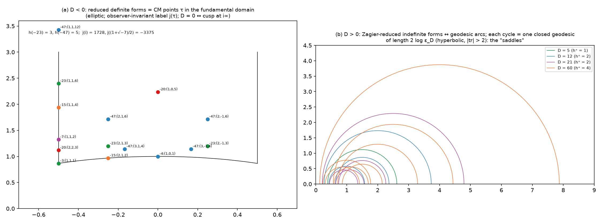

*The space of binary quadratic forms: reduced definite forms are CM points (elliptic), D = 0 is the cusp (parabolic), Zagier-reduced indefinite forms are closed geodesics of length 2 log ε_D (hyperbolic).* [Theorem · 3.1 (scores 0–4)]

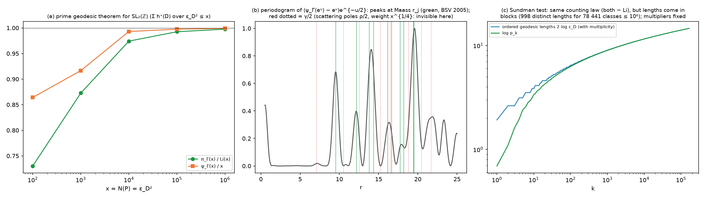

*Prime geodesic theorem for SL₂(ℤ) (π_Γ/Li = 0.9976 at 10⁶), the periodogram peaking at the Maass eigenvalues, and the Sundman test: the counts match the primes but the lengths come in blocks (998 distinct lengths), so no time change maps them to log p.* [Numerical + Theorem · 2.9 (scores 0–4)]

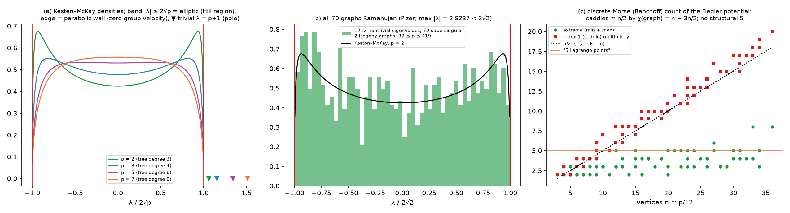

*Hecke trees: Kesten–McKay densities with the band edge |λ| = 2√p (zero group velocity, the parabolic wall again); 70 supersingular 2-isogeny graphs, all Ramanujan; discrete Morse counts grow like n/2 (no structural five).* [Theorem + Analogy · 2.4 (scores 0–4)]

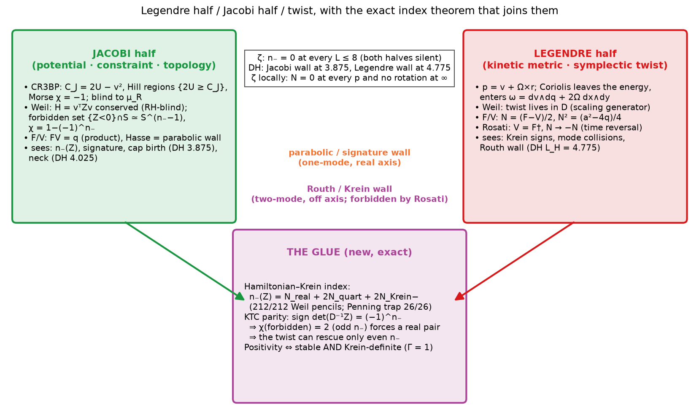

*Jacobi (potential) half, Legendre (symplectic) half and the exact index theorem that joins them.* [Theorem · 4.00 (scores 0–4)]

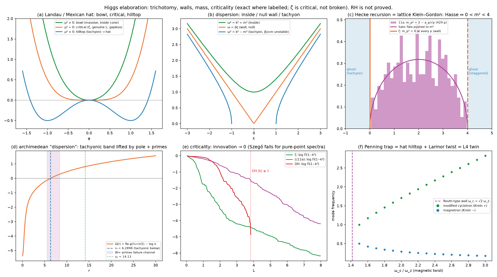

*Mass and the walls: Landau bowl / critical / hilltop; the Hecke recursion as a lattice Klein–Gordon ladder (L(11a) masses inside the band, ζ at m² = 0); the archimedean symbol Ω(r) negative below r₀ = 6.2898; Szegő innovations; Penning-trap Krein signs.* [Theorem + Analogy · 3.76 / 3.64 / 2.88 (scores 0–4)]

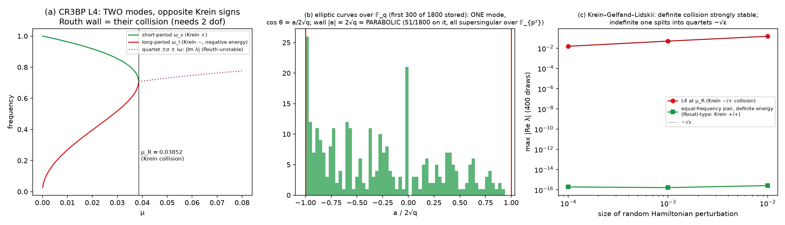

*Routh versus Hasse: in the rotating frame the L4 Hessian is negative definite and stability comes from the Coriolis twist up to μ_R = 0.0385209; over 𝔽_q the Frobenius rotation N = (F − V)/2 with N² = (a² − 4q)/4 is kept off the wall by Rosati, so a Routh wall cannot occur.* [Theorem + Numerical · 4.2 (0.6·sig + 0.4·prob, each on 0–5)]

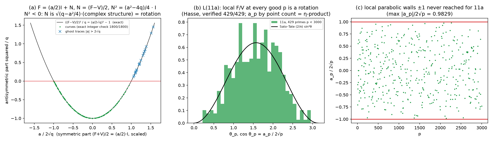

*Frobenius and Verschiebung as rotation plus scalar: (F + V)/2 = (a/2)·I and N = (F − V)/2; ζ’s local factors carry no rotation.* [Theorem · 4.1 (each on 0–5)]

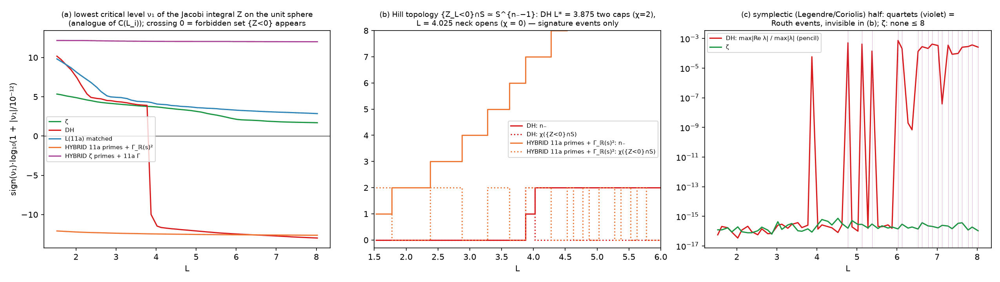

*Hill regions of the Weil form: the conserved energy vᵀZv sees only signature events (the forbidden set and its Euler characteristic), not the Krein data.* [Theorem + Numerical · 3.7 (each on 0–5)]

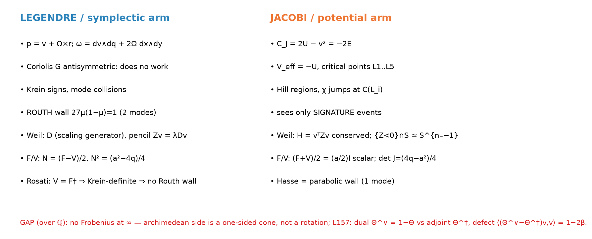

*The two arms: Legendre (symplectic, Krein signs, Routh wall) versus Jacobi (potential, Hill regions, signature events); the gap over ℚ is that the archimedean side is a one-sided cone, not a rotation.* [Theorem · 3.8 (each on 0–5)]

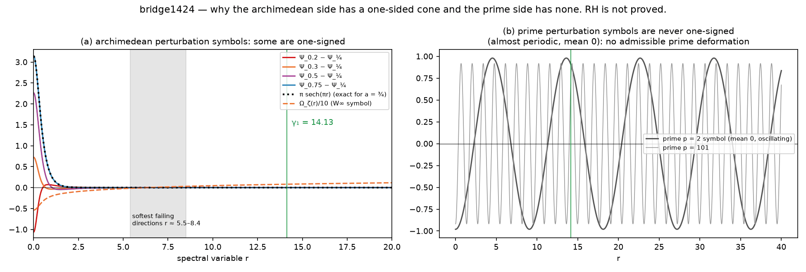

*Why the archimedean side has a one-sided cone and the prime side has none: Re ψ(3/4 + ir/2) − Re ψ(1/4 + ir/2) = π sech(πr) > 0, while every finite prime-side symbol is a mean-zero trigonometric polynomial.* [Theorem · 3.4 (scores 0–4)]

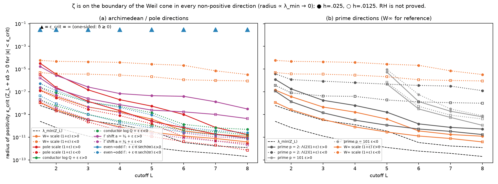

*ζ sits on the boundary of the Weil cone in every non-positive direction: the radius of positivity decays like λ_min(Z_L).* [Numerical · 3.28 (scores 0–4; circular core)]

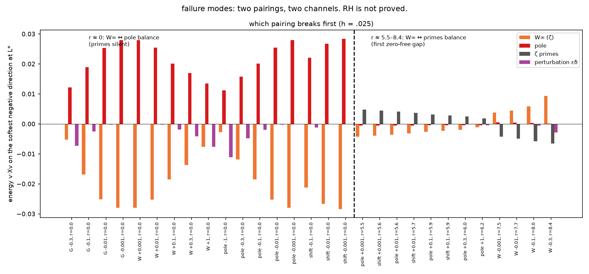

*Two failure channels: the first negative direction sits at spectral frequency 0 (archimedean factor against the pole) or at r ≈ 5.5–8.4 (archimedean factor against the primes).* [Numerical · 2.96 (scores 0–4)]

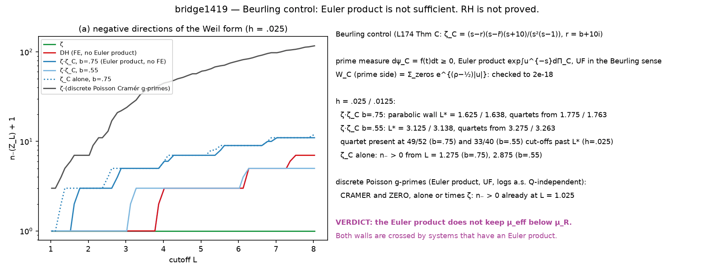

*The Euler product is not sufficient: Beurling systems with an Euler product, non-negative prime measure and unique factorization cross both walls.* [Numerical · 3.68 (scores 0–4)]

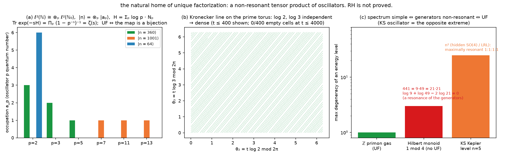

*The natural home of unique factorization: a non-resonant tensor product of oscillators (H = Σ log p · N_p, Tr e^{−sH} = ζ), against the Hilbert monoid (441 = 9·49 = 21²) and the maximally resonant Kepler problem.* [Theorem · 3.4 / 3.44 (scores 0–4)]

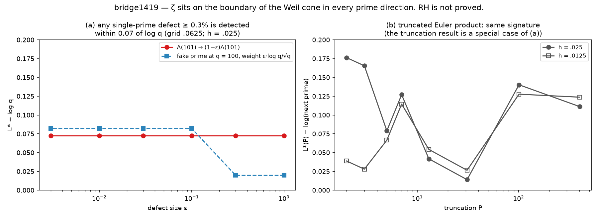

*ζ is on the boundary of the Weil cone in every prime direction: a missing prime or a 0.3% change of one weight is detected as soon as it enters the window.* [Numerical · 3.16 (scores 0–4)]

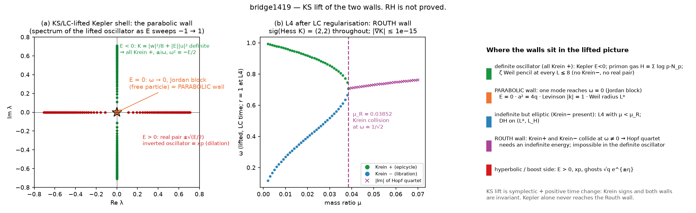

*The KS lift of both walls: Kepler becomes a definite oscillator (only the parabolic wall), the lifted L4 keeps its Routh collision at μ_R.* [Theorem · 3.44 (scores 0–4)]

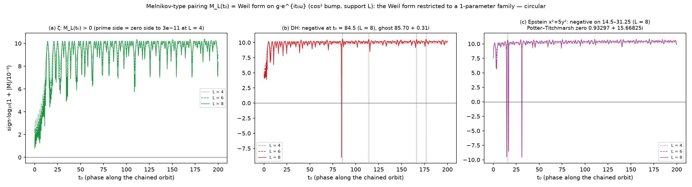

*Saddle-chain Melnikov pairing: the Weil form on modulated bumps stays positive for ζ and turns negative near the off-line zeros of Davenport–Heilbronn and of an Epstein zeta (a zero detector, circular).* [Restatement + Numerical · 2.6 (scores 0–4)]

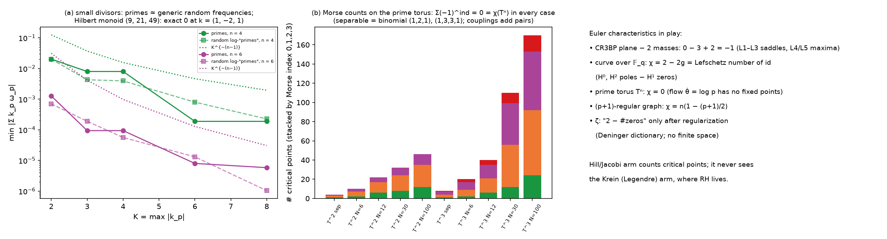

*The prime torus: small divisors |Σ k_p log p| behave like random frequencies (Diophantine, RH-blind), and critical-point counts have alternating sum χ(Tⁿ) = 0 in every case.* [Numerical + Theorem · 2.3 / 2.5 (scores 0–4)]

*Real-field thermodynamics is convex for any positive kernel: Davenport–Heilbronn’s kernel Φ is positive and log-concave too, so entropy and heat capacity cannot separate ζ from a counterexample.* [Theorem · 3.4 (scores 0–4)]

*The de Bruijn–Newman zero flow as a log-gas with sum-of-squares entropy production while the zeros are real; its second-order lift is Calogero–Moser (Hamiltonian), so the flow is not conformally symplectic.* [Theorem · 3.5 / 3.2 (scores 0–4)]

## Previous results (v1.10)

Figures from the research notes folded into v1.10. The Riemann Hypothesis is not proved.

*Two walls, not one: the parabolic (signature) wall, where a conjugate pair collides on the real axis (Hasse a² = 4q, Kepler E = 0, Levinson |k| = 1, Hodge index change; RH ⇔ ζ never reaches it), and the downstream Routh (Krein-collision) wall at μ_R = 0.0385209; Davenport–Heilbronn passes the first at L*, sits in an indefinite-but-elliptic window, then shows Hamiltonian–Hopf quartets; in the de Bruijn–Newman direction ζ sits exactly on its wall.* [Theorem + Numerical · 3.52 (0.6·sig + 0.4·prob, 0–4)]

*Positivity concepts (Weil, Rosati, Laguerre–Pólya, Hodge–Riemann, product formula, ferromagnetic Φ, Routh wall) against the mechanics pictures (Kepler/KS, shear/Raychaudhuri, Lagrange/Krein, special relativity, Routh wall): the most exact correspondence in each cell, with its label and score; every cell at 3.4 or above is a finite-dimensional theorem or an RH-equivalent restatement.* [Theorem / Restatement / Analogy · cells 2.0–3.6 (0.6·sig + 0.4·prob, 0–4)]

*Davenport–Heilbronn’s ghost 2-plane: the archimedean part is positive there; ζ’s prime terms never break the 2×2 (100% of partial sums, in either order), while Davenport–Heilbronn’s own terms break it late. The ghost comes from the prime side.* [Numerical · 3.2 (scores 0–4)]

*Levinson/Schur steps are SU(1,1) boosts: ζ stays subluminal (max |k| = 0.384 up to L = 8), Davenport–Heilbronn’s first |k| ≥ 1 is its light-cone crossing at L = 3.85, Lorentz factors multiply, and over 𝔽_q k₁ = −a/(2√q).* [Theorem + Numerical · 3.5, circular as a criterion (scores 0–4)]

*The positivity cup at E = 0: bowl, flat and peak are definite, semidefinite and indefinite (null set a point, a line, an X); ζ’s smallest Weil eigenvalue flattens but stays positive, while Davenport–Heilbronn flips to a peak at L* ≈ 3.82.* [Theorem + Numerical · 3.0 (scores 0–4)]

*KS trichotomy: oscillator (E < 0), free particle (E = 0, the null line is the wall) and inverted oscillator = xp (E > 0, the null X); Sundman time makes Kepler’s radial motion linear; the e^{t/2} normalization turns the decaying Mellin spiral into the unit circle.* [Theorem · 3.4; normalization panel 2.8 (scores 0–4)]

*Shear, not curvature: σ² − ω² = E/2 for the KS oscillator; Routh stability at L4 in tidal and rotation variables; the trace-free Hessian of log|Ξ| keeps its sign on the line for ζ and flips at Davenport–Heilbronn’s ghost heights, while the curvature is blind off the zeros.* [Theorem + Numerical · 3.5, equivalent to Laguerre (scores 0–4)]

*Dirac sea and curvature density: one global positive-frequency sea fills for ζ, Davenport–Heilbronn leaves n₋/2 holes; curvature per unit kinetic energy sits on the edge −1 for ζ and below it for Davenport–Heilbronn; the Riesz curvature density is ≥ 0 for both.* [Numerical + Theorem · 3.3 / 3.4, circular as a criterion (scores 0–4)]

*Twin paradox at the Lagrange points: the co-rotating clock rate is the Jacobi constant, so the Lagrange points are its critical points and L4/L5 clocks run fastest; L4 and L5 split only when time reversal is broken.* [Theorem + Numerical · 3.6 / 3.2 (scores 0–4)]

*Single orbit vs ensemble: over 𝔽_q the ensemble inertia is the per-pair Hasse data aggregated (122/122); in the restricted three-body problem a planet clears a chaotic band but the co-orbital Trojan and horseshoe ring survives completely.* [Theorem + Numerical · 3.4 / 3.2 (scores 0–4)]

*Frame dependence: rotating and inertial frames give the same Floquet multipliers and Krein signs (to 5e−12); only the picture changes. For ζ the Weil pencil is Hamiltonian only in the e^{t/2}-normalized frame (100% against 6.7% imaginary).* [Theorem + Numerical · 3.4 / 3.0 (scores 0–4)]

*Librations and polarization: the genus-1 Hasse bound is a positive coherency (Stokes) matrix (1800/1800 curves); Levinson steps as 2×2 coherencies; L4 modes as polarization ellipses whose Krein collision is a polarization collision; place-by-place and pole-plane filtrations (the edge-prime reading is refuted in v1.10).* [Theorem + Numerical · 3.4 / 3.3; pole plane 1.6 (scores 0–4)]

*L4/L5 and the Weil form: Krein signs and the Routh wall at μ_R = 0.0385; a Rosati-like involution is a Krein-signed complex structure; the gyroscopic Weil pencil is all-imaginary with Krein + for ζ and L4-like for Davenport–Heilbronn; the KS lift reads the Kepler trichotomy as the sign of b² − ac, with xp on the hyperbolic side.* [Theorem + Numerical · 3.4 / 3.4 / 3.3 (scores 0–4)]

*Hill regions and the prime-threshold filtration: every ζ threshold L = log n is regular; Krein spectroscopy; the equator crossing at a wall; the Bernoulli numbers fix the archimedean sign change r* = 2π + 0.0067; the Möbius light cone.* [Numerical + Theorem · 3.3 / 3.2 / 2.9; Hill-region dictionary 1.5 (scores 0–4)]

*Apsides, escape directions, hodograph and the Levi-Civita map: the escape directions are a conjugate pair that collides on the apsidal line at e = 1 and splits into two real null asymptotes for e > 1; the Frobenius quadratic is the focal quadratic of the conic.* [Theorem · 3.0 (scores 0–4)]

*Place-by-place and support filtrations of the Weil form: partial products over places stay negative until every prime power ≤ e^L is present; Levinson steps; the literal light cone; Laguerre log-concavity on the line; the elliptic / parabolic / hyperbolic trichotomy with Weil radius L* ≈ 3.82 for Davenport–Heilbronn; over 𝔽_q 4q − a² = q·det T₂.* [Restatement + Numerical · trichotomy 3.92; local definiteness falsified 3.60 (0.6·sig (0–10) + 0.4·prob (0–1))]

*The missing piece, refined: the Levinson/Szegő sum-of-squares factor of the Weil form. ζ: roots on the circle at the zeros. Davenport–Heilbronn: the root that enters the disk is the off-line zero.* [Numerical · 3.6]

*Witten-type best constant c(L) for several cushions: same sign in every variant (circular), ζ at 1 − O(1e-10).* [Restatement · 3.0]

*The negative direction of the Davenport–Heilbronn Weil form lives at the frequency of its off-line zero.* [Numerical · 3.2]

*Morse count of the co-rotating potential: 2 − 3 = −1 = χ for every mass ratio.* [Theorem · 3.8]

*Morse counting of log|Ξ|: off-line zeros force two extra saddles each on the critical line.* [Theorem · 3.4]

*Spectral flow: the Morse index of the window Weil form along L.* [Numerical · 3.3]

*Count versus stability: topology fixes the count, the gyroscopic term (positivity) decides stability.* [Theorem · 3.5]

## Previous results (v1.9)

Figures from the research notes folded into v1.9. The Riemann Hypothesis is not proved.

*Two-degree-of-freedom chaotic regularized xp: periodic-orbit periods drift with energy and do not lock onto k·log p; modular-surface lengths count like the primes but are logs of quadratic units; the explicit-formula sign is cohomological, not a Maslov phase; ζ’s orbit sum improves with the prime cutoff while Davenport–Heilbronn’s degrades.* [Numerical + Theorem + Cited · 3.9 / 4.4 / 4.4 / 3.9 (as a route to RH 2.9; adelic orbit space 3.4)]

*Regularized xp: a Poincaré time change with ∂f/∂p ≠ 0 makes xp Legendre-regular; the regularized xp is the hyperbolic Sundman clock of the F/V pair; in a Deninger-type toy the Liouville law gives only ρ ↔ 1 − ρ and a positive metric gives the line; counting matches only the two leading Riemann–von Mangoldt terms.* [Theorem + Numerical · 4.1 / 4.4 / 4.7 / 3.8 (as a route to RH 3.1)]

## Previous results (v1.8)

Figures from the research notes folded into v1.8. The Riemann Hypothesis is not proved.

*Central-charge positivity is the Weil form: from the prime side ζ stays ≥ 0 up to L = 8, while Davenport–Heilbronn turns negative near L = 4, with no zeros used.* [Restatement + Numerical · route score 4.7 (as a route to RH 2.8)]

*Zero-free signed energy of the heat-flowed Ξ: every ghost goes negative before it lands, ζ windows stay positive, and the Hermite form counts off-line pairs exactly.* [Theorem + Numerical · 4.4 (as a route to RH 3.3)]

*Hofstadter gap widths are log-linear in |n| and close like (distance to the wall)^½ on the lobe side; ‖P − P&#42;‖ is a gauge quantity that spikes at every collision, not a ghost test.* [Numerical + Theorem · 3.6 / 3.4 / 4.4 (as a ghost detector 1.6)]

*F/V on the noncommutative torus: Manin’s lobe / wall / wedge, and gap labels that hold for every zero set, so the K-theory order is ghost-blind.* [Theorem + Numerical · 4.7 (as a route to ζ positivity 2.8)]

*The Rodgers–Tao energy is an exact Sundman clock with speed limit 4, but monotone for every real configuration; the near-collision law separates Davenport–Heilbronn from ζ.* [Theorem + Numerical · 4.4]

*A Hardy constant for the primes is window positivity restated: ζ’s margin closes (critical), Davenport–Heilbronn crosses 1 near ℓ = 4–5, and local constants do not glue.* [Theorem + Numerical · 3.9]

*Sundman/Levi-Civita clock: the F/V collision becomes a turning point and real τ bounces; positivity is the clock staying real, i.e. RH restated.* [Theorem · 4.7 (circular as a proof route, Restatement 4.4)]

*Two Kepler degenerations: F = V is the circular orbit (e = 0), not the Levi-Civita centre collision (e = 1); both share the square-root map.* [Theorem · 4.4]

1025 concepts · 1990 typed relations · 10 missing pieces. Generated from `atlas.json` by `build_public_md.py`.

**Order.** Every section lists its entries in descending priority. Headers read `#rank · priority · name`. Priority comes from the Heuristic scoring layer described in [scores.md](scores.md): priority = 0.6 · (gap significance × √(sensitivity · specificity)) + 0.4 · tractability. The scores are judgment calls, shown component by component so any reader can disagree with them.

**Organizing split.** Phase/unitarity structure (functional equations, |φ| = 1, cocycles, Hecke operators, cusp positivity) is *ghost-blind*: it holds equally for functions with zeros off the critical line, such as the Davenport–Heilbronn function. The *sign* of a spectral weight is *ghost-sensitive*, and for ζ that sign is RH.

**Labels.** Theorem · Restatement (equivalent to RH or to a known result) · Analogy · Conjecture · Open · Numerical · Heuristic · Cited (taken from the literature). References of the form “TAA Lemma N” point to the lemma series of the Thermodynamics of Arithmetic Action programme (see README.md for the published volumes). Citations marked “to verify” have not yet been checked against the source.

## Contents

- [Missing pieces](#missing-pieces)
- [Diagnostic quadrants](#diagnostic-quadrants)
- [Concepts by primary axis](#concepts-by-primary-axis)
  - [sign/positivity (Ax2)](#axis-sign-positivity-ax2) (118)
  - [geometry over F_q](#axis-geometry-over-f-q) (39)
  - [no-go / refuted](#axis-no-go-refuted) (39)
  - [Spec ℤ gap](#axis-spec-gap) (31)
  - [reference/pole/cusp](#axis-reference-pole-cusp) (40)
  - [numerics/certificate](#axis-numerics-certificate) (182)
  - [physics analogue](#axis-physics-analogue) (177)
  - [restatement ⇔ RH](#axis-restatement-rh) (75)
  - [ghost-sensitive](#axis-ghost-sensitive) (33)
  - [structure/frame (Ax1)](#axis-structure-frame-ax1) (179)
  - [open target](#axis-open-target) (54)
  - [phase/unitarity (Ax3)](#axis-phase-unitarity-ax3) (38)
  - [ghost-blind](#axis-ghost-blind) (10)
- [Index by rank](#index-by-rank)

## Missing pieces

These are the objects that, as far as this atlas can tell, would have to exist for a positivity proof of RH along the lines of the function-field case. Each is labelled Open. Listed in priority order.

### #13 · 0.700 · Missing: Deninger's conjectured cohomology for Spec ℤ, stated as axioms MP0–MP4 (no coined name) 

**Label:** Open · **id:** `mp_flow_h1` · **quadrant:** RH-sharp

*In plain words:* For ℚ both cohomologies we can compute vanish (étale H¹ = 0, Arakelov Pic⁰ = a point), yet ψ(x) − x ≠ 0. The zeros need a cohomology relative to the scaling flow.

**Core.** Construct the middle term of Tate's split at |x| = 1 as an H¹ for Spec ℤ carrying (a) a Frobenius-type flow whose spectrum is the zeros (MP1–MP2; needs the Euler product, absent for DH) and (b) a cup product H¹ × H¹ → H² ≅ ℝ(−1) (MP3; absent for DH), and prove the cup square definite on the primitive part (MP4 = Hodge index/Rosati sign; the only positivity input). MP0: H⁰/H² = Tate boundary terms f(0), f̂(0) (DH: none). Deninger's axioms, TAA refinements MP0/MP4 (TAA Lemma 151 Conj 4.1). TAA Lemma 153: Connes's cokernel (TAA Lemma 153, correction 18) — its Hilbert space is automatically positive and sees only critical zeros; RH ⇔ nothing missing ⇔ global trace formula. Recorded as a precision of MP4, no new missing piece (MPU153). TAA Lemma 157 sharpening of MP4: Deninger's conjectured cohomology carries a positive g = tr(· ∪ ∗·) with ∗ commuting with Θ, i.e. the Poincaré dual of the flow equals its Hilbert adjoint (Θ^∨ = Θ†); equivalently the arithmetic J (from the Euler product) makes the flow a rotation. Den98 §3 p.169 (opened) gives ⇒ RH. TAA Lemma 158: degree-1 form of MP4 for surface leaves: positivity tr(h∪∗h) is automatic (Den05 (15)); ∗ = −J on H̄¹; MP4 ⇔ the flow preserves a leafwise Hodge splitting ([J,Θ] = 0), cf. Deninger–Singhof Prop 4.6. Missing Piece v5 (headline adopted by J. W. McGreevy): MP4 is headed by the one-line Conjecture "the Euler product induces the Hodge splitting of the square, with its sign" (entry: Euler product induces the Hodge splitting), with the v4 sharp form underneath: a complex structure J on H¹ with (1) [J,Θ] = 0, (2) g = ω(·,J·) positive definite on the primitive part (a Θ-invariant fundamental decomposition of the Krein form; σ: ρ ↦ 1 − ρ̄ fixes every eigenvalue), (3) the positivity derived, not verified, from a structural input built from the whole Euler product that is prime-crossing and uses all primes in each window at once (R8′). Requirements R1–R8′ unchanged; no-go list 32 items. Headline reworded geometrically: "the Euler product, taken as geometry (the Frobenius correspondence: graph classes on the square with an ample class), not as counting data, induces the Hodge splitting of the square, with its sign".

**Formula.** N_n − (1 + qⁿ) = −Tr(Fⁿ | H¹) ↔ ψ(x) − x = −Σ_ρ x^ρ/ρ + …

**What is proved around it.** π₁ét(Spec ℤ) = 1 ⇒ H¹ét = 0 (TAA Lemma 140); curve row: N_n − (qⁿ + 1) = −Tr(Fⁿ | H¹) with relative Gram NSD (TAA Lemma 141 §1); Tr ↔ −(ψ − x) up to the s = 0 term and ARCH (TAA Lemma 142 corrections).

**Tests it must pass.** Must carry a positive structure (Ax2), not only the trace formula: the explicit formula alone is ghost-blind in data (TAA Lemma 143: ghost defect ≤ 1.9e−5, 0.08× noise).

**Also known as:** H¹_flow; Deninger H¹

**Axes:** missing piece, Spec ℤ gap, reference/pole/cusp

**TAA lemmas:** 140, 141, 142, 151, 153, 157, 158

**Scores (Heuristic):** gap significance 1.0 (nearest gap: Deninger's conjectured cohomology for Spec ℤ, stated as axioms MP0–MP4 (no coined name)) · sensitivity 1.0 · specificity 1.0 · tractability 0.25 · evidence 0.5 → priority 0.700

**Relations (outgoing):**

- same mechanism as → [No étale H¹ for Spec ℤ](#no-etale-h1)
- same mechanism as → [ψ(x) − x (explicit formula, deviation from the pole)](#psi-minus-x)
- same mechanism as → [Deninger’s foliated program](#deninger)
- same mechanism as → [Missing: H¹ on the square of the scaling site (Connes–Consani s(f,f) ≤ 0)](#mp-h1-square) — subsumed as MP4 (TAA Lemma 151)
- same mechanism as → [Missing: arithmetic Castelnuovo object (positive involution on a space where the Weil distribution is a |·|²)](#mp-castelnuovo) — sign half = MP4 (TAA Lemma 151)
- same mechanism as → [Missing: a Néron–Severi strictly larger than U containing the Frobenius classes Ψ_λ](#mp-ns-psi) — contained as a test (TAA Lemma 151)
- same mechanism as → [MP4 headline: the Euler product, taken as geometry (the Frobenius correspondence: graph classes on the square with an ample class), not as counting data, induces the Hodge splitting of the square, with its sign](#mp4-euler-induces-hodge) — headline of MP4 (Missing Piece v5)

**Relations (incoming):** [Definite cup square / Krein one-liner](#definite-cup-square) (same mechanism as); [Connes trace formula](#connes-trace) (same mechanism as); [Two Verschiebungs: pairing dual V^∨ vs positive adjoint V†](#two-verschiebungs-dual-vs-adjoint) (lives in); [Kähler identities → Serre/Deninger–Singhof unitarity → MP4 in degree 1 ⇔ the flow preserves a leafwise Hodge splitting](#kahler-identities-foliated) (lives in); [Missing: a BRST-type complex Q with H(Q) = U^⊥ positive (PM-3)](#mp-brst) (same mechanism as); [Verschiebung as the positive adjoint of Frobenius (F† = V)](#verschiebung-positive-adjoint) (same mechanism as); [Cayley–Klein absolute: definite ⇔ no real null rays (rotations vs boosts)](#cayley-klein-absolute) (same mechanism as); [Zero-side real form = RH: under MP0–MP3 a finite Θ-stable σ-stable block with m off-line orbits has Krein isometry group U(n₀+m, m); the normalized flow is in a compact group on every block ⇔ RH; DH's Weil Gram reads O(n−q, q), q up to 24 (h =.025, L = 15.95), ζ compact on all TAA Lemma 149 windows](#zero-side-real-form-krein) (lives in); [Deninger’s foliated program](#deninger) (same mechanism as); [Limiting mixed Hodge structure / nilpotent and SL₂-orbit theorems (Schmid; CKS)](#lmhs-nilpotent-orbit) (analogue of); [Livšic route to conformality, split: under Deninger’s working hypothesis 7.5 ζ’s explicit formula fixes only ε_γp(k) = +1 and |det A_p| = p for the return map of the log p orbit; tr M_p (M_p = A_p/√p) is constrained only by |tr M_p| < √p + 1/√p, while Kalinin–Sadovskaya’s periodic-data conformality theorem needs |tr M_p| < 2; the scalar factor e^t is supplied by abelian Livšic, the conformal structure (≡ invariant leafwise J, i.e. H4 at the prime orbits) is not](#livsic-route-split) (lives in); [Adelic gluing: ℍ at ∞ and Bruhat–Tits trees at p in GL₂(ℚ)∖GL₂(𝔸)](#adelic-gluing-bruhat-tits) (same mechanism as); [MP4 headline: the Euler product, taken as geometry (the Frobenius correspondence: graph classes on the square with an ample class), not as counting data, induces the Hodge splitting of the square, with its sign](#mp4-euler-induces-hodge) (special case of); [The shape of the missing piece: ten necessary properties (P1–P10)](#missing-piece-shape-list) (constrains); [Weil template, standing assignment (Missing Piece v5): Deninger's foliation = one factor (½), the Connes–Consani square = the product (½ ⊗ ½), 1 ⊕ 0 = the splitting of the product by the ample class, cusp part split off](#weil-template-factor-product) (lives in); [Open: realize the Weil form as the harmonic norm of H¹ classes on a lattice with a star given independently of it](#weil-form-as-harmonic-norm-on-lattice) (feeds); [Refined: the source must keep phases and live on a finite-rank H1](#finite-rank-phase-keeping-source) (refines); [Width → area → 2-form: (1/2π)Δ log|ξ| dσ∧dt = Σ δ_ρ](#zero-count-two-form) (same mechanism as); [No-go items 27–32 (Missing Piece v5): per-prime SU(2)/Satake data; per-prime norm identities (a_p² + |α−ᾱ|² = 4p, the ζ mass shell, Kepler's |A|² + 2m|E|L² = (mk)²); correspondence alone (Jacquet–Langlands via Shimizu, functoriality); KMS/coefficient positivity; a compact real form on the zero side as input; single-place data of n!](#nogo-v5-per-prime-and-places) (lives in); [The missing square Spec ℤ × Spec ℤ as the object (collapse ℤ⊗ℤ = ℤ; defect requirements R1–R5)](#missing-square-spec-z) (lives in)

### #14 · 0.700 · Missing: arithmetic Castelnuovo object (positive involution on a space where the Weil distribution is a |·|²) 

**Label:** Open · **id:** `mp_castelnuovo` · **quadrant:** RH-sharp

*In plain words:* A space with an infinite H¹, a positive involution † and a flow u_t with u_t u_t† = eᵗ, on which the explicit-formula (Weil) distribution becomes a squared norm, with that positivity proved without using the zeros.

**Core.** Arithmetic Castelnuovo object = (C1) infinite H¹, (C2) positive involution, (C3) u_t u_t† = eᵗ, (C4) positivity proved without zeros (TAA Lemma 136); equivalently a positive involution plus a Frobenius-type flow with positivity proved without zeros (TAA Lemma 136 synthesis). Hilbert–Pólya form: a positive V ≅ H¹ (TAA Lemma 115); “all that is missing is an appropriate inner product” (Lax–Phillips, TAA Lemma 105/TAA Lemma 141).

**What is proved around it.** Over F_q: Ax2 ∧ Ax3 ⇔ |α| = √q (TAA Lemma 137, theorem). Over ℚ: isometry of the flow is unconditional (TAA Lemma 1); the Čech 2-class supplies C2–C3 structure but not the sign (TAA Lemma 138); Ax2 alone holds for fakes, Ax3 alone is tautological (TAA Lemma 137).

**Tests it must pass.** Must separate ghosts: Ax2 and Ax3 jointly, never one alone (TAA Lemma 137). Must not define the inner product by Weil’s form (circular, TAA Lemma 138 R2; TAA Lemma 106).

**Also known as:** C1–C4; positive involution; Hilbert–Pólya object

**Axes:** missing piece, Spec ℤ gap, sign/positivity (Ax2), open target

**TAA lemmas:** 105, 106, 115, 136, 137, 138

**Scores (Heuristic):** gap significance 1.0 (nearest gap: arithmetic Castelnuovo object (positive involution on a space where the Weil distribution is a |·|²)) · sensitivity 1.0 · specificity 1.0 · tractability 0.25 · evidence 0.5 → priority 0.700

**Relations (outgoing):**

- same mechanism as → [Arithmetic Castelnuovo object (C1–C4)](#castelnuovo-object)
- same mechanism as → [Hilbert–Pólya](#hilbert-polya)
- special case of → [Ax1–Ax3 axioms (Yoneda specification)](#ax123) — Ax2 + Ax3 jointly

**Relations (incoming):** [Kähler triple (ω, J, g) = polarization; elliptic ⇔ positive form preserved](#kahler-triple-polarization) (lives in); [Over 𝔽_q, Levinson/PARCOR steps are Cauchy–Schwarz in the Hodge-index / Rosati product](#ff-levinson-parcor-hodge-bound) (feeds); [Missing: Deninger's conjectured cohomology for Spec ℤ, stated as axioms MP0–MP4 (no coined name)](#mp-flow-h1) (same mechanism as); [Missing: surface + ample class + Riemann–Roch for Spec ℤ (D8)](#mp-d8) (special case of); [Beurling wall incidence is not a zeros-blind certificate](#beurling-incidence-no-toy-certificate) (feeds); [Alias lock: (U) is the sign-neutral analytic half; (P) is positivity on the primitive part](#kl-polarization-alias-lock) (feeds); [A positive metric forces holes to sit as harmonic classes; occupancy does not](#metric-forces-harmonic-holes) (feeds); [Rosati = time reversal composed with a Krein grading: P = SΓ is positive and invariant exactly while the flow is elliptic](#rosati-time-reversal-krein) (constrains); [Rosati-like involution = Krein-signed compatible complex structure](#krein-rosati-iota) (constrains); [The shape of the missing piece: ten necessary properties (P1–P10)](#missing-piece-shape-list) (constrains); [Zeros-blind input is the data package “masses + force law”, not a literal equation](#zeros-blind-masses-force-package) (feeds); [Herbrand–Ribet and the Iwasawa main conjecture: the spectral half without a polarization](#herbrand-ribet-spectral-no-positivity) (contrasts with)

### #15 · 0.700 · Missing: a Néron–Severi strictly larger than U containing the Frobenius classes Ψ_λ 

**Label:** Open · **id:** `mp_ns_psi` · **quadrant:** RH-sharp

*In plain words:* An intersection theory on the square in which the Connes–Consani correspondences Ψ_λ are genuine classes outside the pole plane U, with enough sections that their growth sees s(f,f).

**Core.** Need NS ⊋ U with Ψ_λ, and #H⁰(±nD(f)) ≥ 2^{n² s(f,f)/2} (TAA Lemma 147). Decisive missing objects: H¹ on the square, an intersection theory putting Ψ_λ into an NS larger than U, and quadratic RR (TAA Lemma 147 (iv)).

**Formula.** #H⁰(±nD(f)) ≥ 2^{n² s(f,f)/2}

**What is proved around it.** Laurent piece of HZ ∧_𝕊 HZ: box count 2n² + 4n exact, but the quadratic coefficient 2αβ is the U-form ⇒ vacuous on degree-0 D(f) (TAA Lemma 147 Thm vac).

**Tests it must pass.** Quadratic growth must come from V₀ = U^⊥, not from U (Thm vac). Ghost-sensitive side is s(f,f), which must be negative for ζ and fail for DH (TAA Lemma 142, TAA Lemma 147).

**Also known as:** NS ⊋ U; Ψ_λ classes

**Axes:** missing piece, Spec ℤ gap, structure/frame (Ax1)

**TAA lemmas:** 147, 142, 150

**Scores (Heuristic):** gap significance 1.0 (nearest gap: a Néron–Severi strictly larger than U containing the Frobenius classes Ψ_λ) · sensitivity 1.0 · specificity 1.0 · tractability 0.25 · evidence 0.5 → priority 0.700

> ⚠ **Correction / caution.** TAA Lemma 150 Prop 2.3: classes at log n (n ≤ 90, disjoint hats) are ghost-blind — ζ, DH and inserted ghosts all give λ_max < 0; NS ⊋ U must use continuous translates or all ratios λ ∈ ℚ₊ (PSI-2).

**Relations (outgoing):**

- same mechanism as → [Tensor square HZ ∧_𝕊 HZ and its Laurent piece (quadratic only in U)](#laurent-square)
- lives in → [Light cone U = ⟨𝟙, 𝕃⟩ (pole plane, null rays)](#light-cone-u) — must leave U
- same mechanism as → [Riemann–Roch strategy: RH ⇔ s(f,f) ≤ 0](#rr-strategy-sff)

**Relations (incoming):** [Frobenius-graph lattice on E×E (relative counts = intersections with Δ)](#frobenius-graph-lattice) (analogue of); [Missing: Deninger's conjectured cohomology for Spec ℤ, stated as axioms MP0–MP4 (no coined name)](#mp-flow-h1) (same mechanism as); [Integer Ψ_n lattice test (negative result)](#psi-n-lattice) (fails for)

### #16 · 0.700 · Missing: surface + ample class + Riemann–Roch for Spec ℤ (D8) 

**Label:** Open · **id:** `mp_d8` · **quadrant:** RH-sharp

*In plain words:* The top substantive direction: a surface S over Spec ℤ with an ample class and a Riemann–Roch whose χ(nD) is quadratic, so that Hodge index follows as it does for curves.

**Core.** D8: surface + ample + RR for Spec ℤ — find S with χ(nD) quadratic and a Hodge index; obstacle: the collapse ℤ ⊗ ℤ = ℤ; sign = Weil form (TAA Lemma 140, TAA Lemma 141). Acceptance test (TAA Lemma 141): reconstruct the relative space and its form from independent constraints — (a) the hyperbolic plane U = ⟨𝟙, 𝕃⟩, (b) the scaling flow acting on it as diag(1, eᵗ), (c) ampleness at ∞, (d) RR/GRR with quadratic growth — then prove negativity on U^⊥. Any proof that uses the zeros, or defines the form by its negativity, fails. TAA Lemma 152: phrased as a 'degree' — a count (≥ 0) on arithmetic correspondences whose polarization is Weil's form; in Cayley–Klein terms the absolute of the arithmetic pairing must be imaginary (= MP4). TAA Lemma 158: the collapse as an object: requirements R1–R5 on a defect invariant (missing_square_spec_z); collapse alone is ghost-blind.

**What is proved around it.** Over F_q: surface + ample + RR ⇒ Hodge index (Segre 1937, Grothendieck 1958) (TAA Lemma 140). Spec ℤ ×_ℤ Spec ℤ = Spec ℤ (TAA Lemma 65). Arithmetic surfaces (curve × Spec O_K) satisfy V1–V3, but the relative part is Néron–Tate, not ζ (TAA Lemma 145).

**Tests it must pass.** Must pass the tautology test (no zeros, no definition by negativity, TAA Lemma 141) and the must-fail-for-DH test (TAA Lemma 147).

**Also known as:** D8; arithmetic surface with Hodge index

**Axes:** missing piece, Spec ℤ gap, sign/positivity (Ax2)

**TAA lemmas:** 65, 140, 141, 145, 147, 152, 158

**Scores (Heuristic):** gap significance 1.0 (nearest gap: surface + ample class + Riemann–Roch for Spec ℤ (D8)) · sensitivity 1.0 · specificity 1.0 · tractability 0.25 · evidence 0.4 → priority 0.700

**Relations (outgoing):**

- same mechanism as → [Surface + ample + RR ⇒ Hodge index (D8)](#surface-ample-rr)
- same mechanism as → [Missing: quadratic Riemann–Roch + “ampleness ⇒ effectivity” on the square](#mp-quadratic-rr)
- special case of → [Missing: arithmetic Castelnuovo object (positive involution on a space where the Weil distribution is a |·|²)](#mp-castelnuovo)

**Relations (incoming):** [Missing: RR/GRR on an arithmetic Spec ℤ × Spec ℤ producing the sign (RG-5, “the missing row”)](#mp-rg5) (same mechanism as); [The missing square Spec ℤ × Spec ℤ as the object (collapse ℤ⊗ℤ = ℤ; defect requirements R1–R5)](#missing-square-spec-z) (same mechanism as)

### #17 · 0.700 · Missing: a BRST-type complex Q with H(Q) = U^⊥ positive (PM-3) 

**Label:** Open · **id:** `mp_brst` · **quadrant:** RH-sharp

*In plain words:* A nilpotent operator on the test functions whose cohomology is exactly the relative space U^⊥, so that “remove the pole plane, then the rest is positive” becomes a cohomology statement, as in Gupta–Bleuler/BRST.

**Core.** PM-3: Gupta–Bleuler/BRST complex Q on TAA Lemma 142’s test functions with H(Q) = U^⊥ (TAA Lemma 146). Thm gb (linear algebra, proved): for V = U ⊕ U^⊥, U = ⟨F₁, F₂⟩, F_i² = 0, F₁F₂ = 1, the quotient F₁^⊥/⟨F₁⟩ is isometric to U^⊥; a nilpotent Q with cohomology U^⊥ would package it as a flow-relative cohomology (Open).

**Formula.** F₁^⊥/⟨F₁⟩ ≅ U^⊥ (isometric)

**What is proved around it.** TAA Lemma 115: BRST structure exact over F_q and ℚ; “no ghosts” ⇔ RH (restatement); missing positive V ≅ H¹ (Hilbert–Pólya). TAA Lemma 146: the BRST quartet decouples, but a ghost quartet survives.

**Tests it must pass.** A ghost quartet is exactly a quartet that fails to decouple (TAA Lemma 146); the complex must not decouple it. Positivity of the quotient is an input in QED and is RH for ζ.

**Also known as:** PM-3; flow-relative cohomology (BRST)

**Axes:** missing piece, physics analogue, structure/frame (Ax1)

**TAA lemmas:** 115, 146

**Scores (Heuristic):** gap significance 1.0 (nearest gap: a BRST-type complex Q with H(Q) = U^⊥ positive (PM-3)) · sensitivity 1.0 · specificity 1.0 · tractability 0.25 · evidence 0.5 → priority 0.700

**Relations (outgoing):**

- same mechanism as → [BRST / Gupta–Bleuler physical quotient](#brst)
- same mechanism as → [Primitive part V₀ = U^⊥](#primitive-part) — H(Q) = U^⊥
- same mechanism as → [Missing: Deninger's conjectured cohomology for Spec ℤ, stated as axioms MP0–MP4 (no coined name)](#mp-flow-h1)

**Relations (incoming):** [Conjecture: a no-ghost-type polarisation forced by an algebra with central term 24](#central-term-24-algebra-conjecture) (refines)

### #18 · 0.700 · Missing: passivity of ξ′/ξ from a zero-free mechanism (Lagarias margin) 

**Label:** Open · **id:** `mp_passivity_margin` · **quadrant:** RH-sharp

*In plain words:* RH is equivalent to ξ′/ξ being a passive (positive-real) response to the right of the line. What is missing is a proof of a passivity margin that uses only primes, the pole and the archimedean place.

**Core.** Lagarias (1.5), attributed to Hinkkanen: RH ⇔ Re ξ′/ξ(s) > 0 on Re s > ½ (TAA Lemma 146, opened). PM-1: a Lagarias margin h(σ) for ξ vs DH/ghost — a provable, ghost-sensitive passivity margin? (TAA Lemma 146).

**Formula.** RH ⇔ Re ξ′/ξ(s) > 0 for Re s > ½

**What is proved around it.** Re ξ′/ξ = Σ(σ−β)/((σ−β)² + (t−γ)²): each zero an absorption line, an off-line zero a gain line (TAA Lemma 146). Passivity ⇒ causality, not conversely (TAA Lemma 146 corrections). Free positivity (Λ(n) ≥ 0, KMS, Bagchi recurrence) is ghost-blind (TAA Lemma 136, TAA Lemma 118).

**Tests it must pass.** Grid σ ∈ [.505, 1.1], t ∈ [80, 92]: ξ min +0.00467; DH −66.84 at (0.794, 85.70), 1.89% negative; ghost −66.97, 1.94% (TAA Lemma 146). The margin must stay positive for ξ and go negative for both.

**Also known as:** PM-1; Lagarias margin

**Axes:** missing piece, sign/positivity (Ax2), ghost-sensitive, physics analogue

**TAA lemmas:** 17, 146

**Scores (Heuristic):** gap significance 1.0 (nearest gap: passivity of ξ′/ξ from a zero-free mechanism (Lagarias margin)) · sensitivity 1.0 · specificity 1.0 · tractability 0.25 · evidence 0.5 → priority 0.700

**Relations (outgoing):**

- same mechanism as → [Passivity (positive real part)](#passivity)
- same mechanism as → [Lagarias/Hinkkanen criterion](#lagarias)
- fails for → [Gain lines (active media)](#gain-line)

**Relations (incoming):** [Oscillator semigroup: positive ⇔ real A with symplectic eigenvalues ≤ 1 (archimedean, ghost-blind)](#oscillator-semigroup-contraction) (analogue of)

### #19 · 0.700 · Missing: quadratic Riemann–Roch + “ampleness ⇒ effectivity” on the square 

**Label:** Open · **id:** `mp_quadratic_rr` · **quadrant:** RH-sharp

*In plain words:* A Riemann–Roch on Spec ℤ × Spec ℤ whose Euler characteristic is quadratic in D, together with the step “ample ⇒ has sections ⇒ effective”. This is exactly the part of the curve proof that Spec ℤ lacks.

**Core.** Classical chain: S1 quadratic RR, S2 Serre duality, S3 h¹ ≥ 0 / Minkowski, S4 sections ⇒ effective, S5 ample·effective > 0. Missing Spec ℤ step = quadratic S1 + S4 (“ampleness ⇒ effectivity” via a 2-dim h⁰) (TAA Lemma 145 V3, verdict VF-E). Parity: quadratic χ is even in D, linear χ odd ⇒ fixed rank proves only degree c(D) = 0, never sees D².

**Formula.** χ(D) = ½D·(D − K) + χ(𝒪) (needed shape)

**What is proved around it.** Every proved Connes–Consani RR is 1-dimensional, χ = deg + const (TAA Lemma 147); fixed-rank products are linear, h⁰/n = 2.000 at n = 400 (TAA Lemma 145 Thm linear); on ℙ¹_ℤ χ̂ is quadratic and realizes the U-form (TAA Lemma 145). Hodge index also needs S2, S3, S5 (TAA Lemma 145 corrections).

**Tests it must pass.** Must fail for Davenport–Heilbronn, hence must use the Euler product (TAA Lemma 147, necessary condition). Must see D², i.e. be quadratic. V3 on the square ⇔ Weil ⇔ RH, so it must be proved, not assumed (TAA Lemma 145).

**Also known as:** S1q + S4; quadratic RR; VF-E

**Axes:** missing piece, Spec ℤ gap, sign/positivity (Ax2)

**TAA lemmas:** 145, 147

**Scores (Heuristic):** gap significance 1.0 (nearest gap: quadratic Riemann–Roch + “ampleness ⇒ effectivity” on the square) · sensitivity 1.0 · specificity 1.0 · tractability 0.25 · evidence 0.4 → priority 0.700

> ❓ **Not verified / open.** The displayed “needed shape” is the classical surface RR, quoted as the target form.

**Relations (outgoing):**

- same mechanism as → [Surface + ample + RR ⇒ Hodge index (D8)](#surface-ample-rr)
- fails for → [Connes–Consani Riemann–Roch on Spec ℤ̄ (1-dimensional)](#cc-riemann-roch) — linear χ
- same mechanism as → [Parity argument: linear χ cannot see D²](#parity-linear-chi)

**Relations (incoming):** [Missing: surface + ample class + Riemann–Roch for Spec ℤ (D8)](#mp-d8) (same mechanism as)

### #20 · 0.700 · Missing: an inequality consequence of automorphy (SC-E / HS-1) 

**Label:** Open · **id:** `mp_automorphy_ineq` · **quadrant:** RH-sharp

*In plain words:* Automorphy (invariance under the full modular group) decides where the zeros are but does not derive it; what is missing is an inequality that automorphy forces on δ_ρ.

**Core.** SC-E (structural P: Hecke/Euler product) = Selberg-class RH, the open non-circular version of trapped-set rigidity (TAA Lemma 143); sharpened to “an inequality consequence of automorphy” (→ Weil positivity, TAA Lemma 142) (TAA Lemma 144). HS-1: an automorphy-defect functional 𝒟(Λ_X) ≥ 0 with 𝒟 = 0 ⇔ Λ_X = ξ; it needs an inequality that the defect forces on δ_ρ, which we do not have (TAA Lemma 144).

**Formula.** 𝒟(Λ_X) ≥ 0, 𝒟(Λ_X) = 0 ⇔ Λ_X = ξ

**What is proved around it.** Thm 3.3 (TAA Lemma 144): automorphy picks a = 1/ξ(2s), c = φ uniquely, exact defect formula; Hecke alone puts no constraint on φ (Prop 3.2). SC-A ⇔ RH (restatement); SC-B false (DH); SC-C false (all cofinite Γ); HS-B (Hecke + unitarity ⇒ δ = 0) false (fakes).

**Tests it must pass.** Fakes pass Hecke/FE/Δ/unitarity to 1e−25 but fail S-invariance: DH by 1.4–3.2%, the degree-0 ghost by 4.5e−6–1.6e−4 (TAA Lemma 144). The inequality must be violated by both.

**Also known as:** SC-E; HS-1; automorphy-defect functional

**Axes:** missing piece, Spec ℤ gap, ghost-sensitive, phase/unitarity (Ax3)

**TAA lemmas:** 142, 143, 144

**Scores (Heuristic):** gap significance 1.0 (nearest gap: an inequality consequence of automorphy (SC-E / HS-1)) · sensitivity 1.0 · specificity 1.0 · tractability 0.25 · evidence 0.5 → priority 0.700

**Relations (outgoing):**

- same mechanism as → [Automorphy defect (TAA Lemma 144)](#automorphy-defect)
- fails for → [Davenport–Heilbronn function](#davenport-heilbronn) — DH breaks automorphy
- implies → [Weil positivity criterion](#weil-positivity) — target

### #21 · 0.700 · Missing: H¹ on the square of the scaling site (Connes–Consani s(f,f) ≤ 0) 

**Label:** Open · **id:** `mp_h1_square` · **quadrant:** RH-sharp

*In plain words:* A first cohomology on the square of Connes–Consani’s scaling site; with it, an RR theorem would give D(f)•D(f) ≤ 0, which is RH.

**Core.** CC18: RH ⇔ s(f,f) ≤ 0, s(f,f) = D•D with D = ∫fΨ_λ; five steps, only step 1 (complex lift) built; H¹ on the square of the scaling site, and hence RR there, is open (TAA Lemma 147, correction 2). ½D(f)•D(f) = ½s(f,f) is the Weil form (TAA Lemma 142).

**Formula.** RH ⇔ s(f,f) = D(f)•D(f) ≤ 0

**What is proved around it.** No RR for C_ℚ × C_ℚ exists (TAA Lemma 147, correction 2). The square exists as a site with Ψ_λ (TAA Lemma 30) but carries no H¹, RR or Hodge index (TAA Lemma 65).

**Tests it must pass.** All H⁰-side objects built from ℤ ⊂ 𝔸_ℚ are ghost-blind; the topological side s(f,f) is ghost-sensitive (DH-location ghost positive from L* = 3.45, actual DH from 4.70) (TAA Lemma 142, TAA Lemma 147).

**Also known as:** H¹ on C_ℚ × C_ℚ; CC18 key step

**Axes:** missing piece, Spec ℤ gap

**TAA lemmas:** 30, 65, 142, 145, 147

**Scores (Heuristic):** gap significance 1.0 (nearest gap: H¹ on the square of the scaling site (Connes–Consani s(f,f) ≤ 0)) · sensitivity 1.0 · specificity 1.0 · tractability 0.25 · evidence 0.5 → priority 0.700

**Relations (outgoing):**

- same mechanism as → [No Riemann–Roch for C_ℚ × C_ℚ (the square is open)](#cc-square-open)
- equivalent to RH → [Riemann hypothesis (target node)](#rh) — s(f,f) ≤ 0
- same mechanism as → [Riemann–Roch strategy: RH ⇔ s(f,f) ≤ 0](#rr-strategy-sff)

**Relations (incoming):** [Definite cup square / Krein one-liner](#definite-cup-square) (same mechanism as); [Missing: Deninger's conjectured cohomology for Spec ℤ, stated as axioms MP0–MP4 (no coined name)](#mp-flow-h1) (same mechanism as); [Weil template, standing assignment (Missing Piece v5): Deninger's foliation = one factor (½), the Connes–Consani square = the product (½ ⊗ ½), 1 ⊕ 0 = the splitting of the product by the ample class, cusp part split off](#weil-template-factor-product) (same mechanism as)

### #22 · 0.700 · Missing: RR/GRR on an arithmetic Spec ℤ × Spec ℤ producing the sign (RG-5, “the missing row”) 

**Label:** Open · **id:** `mp_rg5` · **quadrant:** RH-sharp

*In plain words:* In the relative Gram dictionary every entry has an analogue except the one that proves the sign: a Riemann–Roch or Grothendieck–Riemann–Roch theorem on an arithmetic square.

**Core.** RG-5: RR/GRR on an arithmetic “Spec ℤ × Spec ℤ” producing the sign — the missing row of the TAA Lemma 142 dictionary (TAA Lemma 142). D9: arithmetic GRR test on the scaling-site square (TAA Lemma 140/TAA Lemma 141 candidate).

**Formula.** G_rel ≤ 0 on all spans ⇔ RH

**What is proved around it.** TAA Lemma 142 Thm 1.1: Weil Gram on translates is Toeplitz (flow), POLE = rank-2 signature (1,1) = the curve U-part exactly; every entry zero-free (flow, U/Tate poles, Γ_ℝ, Λ(n)); G_rel ≤ 0 on all spans ⇔ RH (Weil, restatement). Unconditional sign only on windows ≤ log 3 (TAA Lemma 10) and arch-only a* (TAA Lemma 127), both ghost-blind.

**Tests it must pass.** Ghost ⇒ n₊(G_rel) = 2 (TAA Lemma 142); DH-location ghost positive from L* = 3.45. The theorem must produce G_rel ≤ 0 for ζ on every span without using zeros.

**Also known as:** RG-5; D9; missing row

**Axes:** missing piece, Spec ℤ gap, sign/positivity (Ax2), restatement ⇔ RH

**TAA lemmas:** 10, 127, 140, 141, 142

**Scores (Heuristic):** gap significance 1.0 (nearest gap: RR/GRR on an arithmetic Spec ℤ × Spec ℤ producing the sign (RG-5, “the missing row”)) · sensitivity 1.0 · specificity 1.0 · tractability 0.25 · evidence 0.5 → priority 0.700

**Relations (outgoing):**

- same mechanism as → [Relative Gram matrix G_rel](#relative-gram)
- same mechanism as → [Tautology boundary (zero side vs prime side)](#tautology-boundary)
- same mechanism as → [Missing: surface + ample class + Riemann–Roch for Spec ℤ (D8)](#mp-d8)

**Relations (incoming):** [Arithmetic Hodge–Riemann for ζ via the Faltings–Hriljac recipe on Spec ℤ × Spec ℤ](#ahr-zeta-conjecture) (refines); [The missing square Spec ℤ × Spec ℤ as the object (collapse ℤ⊗ℤ = ℤ; defect requirements R1–R5)](#missing-square-spec-z) (same mechanism as)

## Diagnostic quadrants

Sensitivity asks whether a statement holds for ζ (is necessary for, or implied by, RH). Specificity asks whether it fails for the fakes (the Davenport–Heilbronn function and the ghost zero models). A concept can only detect RH if it scores high on both.

| | specificity ≥ 0.8 (fails for the fakes) | specificity < 0.8 (ghost-blind or untested) |
|---|---|---|
| **sensitivity ≥ 0.8** (true for ζ) | RH-sharp: 359 | true but ghost-blind/untested: 540 |
| **sensitivity < 0.8** (interpretive) | sharp but interpretive: 22 | background: 104 |

### RH-sharp: true for ζ and fails for the fakes (359)

- #1 · 0.720 · [Kähler triple (ω, J, g) = polarization; elliptic ⇔ positive form preserved](#kahler-triple-polarization) [Theorem]
- #2 · 0.720 · [Frobenius-graph lattice on E×E (relative counts = intersections with Δ)](#frobenius-graph-lattice) [Theorem]
- #3 · 0.720 · [Definite cup square / Krein one-liner](#definite-cup-square) [Theorem]
- #4 · 0.720 · [Davenport–Heilbronn function](#davenport-heilbronn) [Theorem]
- #5 · 0.720 · [Weil positivity criterion](#weil-positivity) [Cited]
- #6 · 0.720 · [Connes trace formula](#connes-trace) [Cited]
- #7 · 0.720 · [ψ(x) − x (explicit formula, deviation from the pole)](#psi-minus-x) [Cited]
- #8 · 0.720 · [Two Verschiebungs: pairing dual V^∨ vs positive adjoint V†](#two-verschiebungs-dual-vs-adjoint) [Theorem]
- #9 · 0.720 · [Lagarias/Hinkkanen criterion](#lagarias) [Cited]
- #10 · 0.720 · [Kähler identities → Serre/Deninger–Singhof unitarity → MP4 in degree 1 ⇔ the flow preserves a leafwise Hodge splitting](#kahler-identities-foliated) [Theorem]
- #11 · 0.720 · [Primitive part V₀ = U^⊥](#primitive-part) [Theorem]
- #12 · 0.720 · [Over 𝔽_q, Levinson/PARCOR steps are Cauchy–Schwarz in the Hodge-index / Rosati product](#ff-levinson-parcor-hodge-bound) [Theorem]
- #13 · 0.700 · [Missing: Deninger's conjectured cohomology for Spec ℤ, stated as axioms MP0–MP4 (no coined name)](#mp-flow-h1) [Open]
- #14 · 0.700 · [Missing: arithmetic Castelnuovo object (positive involution on a space where the Weil distribution is a |·|²)](#mp-castelnuovo) [Open]
- #15 · 0.700 · [Missing: a Néron–Severi strictly larger than U containing the Frobenius classes Ψ_λ](#mp-ns-psi) [Open]
- #16 · 0.700 · [Missing: surface + ample class + Riemann–Roch for Spec ℤ (D8)](#mp-d8) [Open]
- #17 · 0.700 · [Missing: a BRST-type complex Q with H(Q) = U^⊥ positive (PM-3)](#mp-brst) [Open]
- #18 · 0.700 · [Missing: passivity of ξ′/ξ from a zero-free mechanism (Lagarias margin)](#mp-passivity-margin) [Open]
- #19 · 0.700 · [Missing: quadratic Riemann–Roch + “ampleness ⇒ effectivity” on the square](#mp-quadratic-rr) [Open]
- #20 · 0.700 · [Missing: an inequality consequence of automorphy (SC-E / HS-1)](#mp-automorphy-ineq) [Open]
- #21 · 0.700 · [Missing: H¹ on the square of the scaling site (Connes–Consani s(f,f) ≤ 0)](#mp-h1-square) [Open]
- #22 · 0.700 · [Missing: RR/GRR on an arithmetic Spec ℤ × Spec ℤ producing the sign (RG-5, “the missing row”)](#mp-rg5) [Open]
- #24 · 0.600 · [Passivity (positive real part)](#passivity) [Restatement]
- #25 · 0.600 · [Relative Gram matrix G_rel](#relative-gram) [Restatement]
- #26 · 0.600 · [Verschiebung as the positive adjoint of Frobenius (F† = V)](#verschiebung-positive-adjoint) [Restatement]
- #27 · 0.600 · [Cayley–Klein absolute: definite ⇔ no real null rays (rotations vs boosts)](#cayley-klein-absolute) [Restatement]
- #28 · 0.600 · [Riemann–Roch strategy: RH ⇔ s(f,f) ≤ 0](#rr-strategy-sff) [Restatement]
- #29 · 0.600 · [Zero-side real form = RH: under MP0–MP3 a finite Θ-stable σ-stable block with m off-line orbits has Krein isometry group U(n₀+m, m); the normalized flow is in a compact group on every block ⇔ RH; DH's Weil Gram reads O(n−q, q), q up to 24 (h =.025, L = 15.95), ζ compact on all TAA Lemma 149 windows](#zero-side-real-form-krein) [Restatement]
- #30 · 0.600 · [Alias lock: (U) is the sign-neutral analytic half; (P) is positivity on the primitive part](#kl-polarization-alias-lock) [Restatement]
- #31 · 0.600 · [A positive metric forces holes to sit as harmonic classes; occupancy does not](#metric-forces-harmonic-holes) [Restatement]
- #32 · 0.580 · [Block-wise Weil-form diagnostic (BR-2): R-symmetric tilt blocks detect DH’s off-line pairs from the prime side](#blockwise-weil-diagnostic) [Numerical]
- #33 · 0.580 · [DH prime-side Gram test](#dh-prime-side-gram) [Numerical]
- #34 · 0.580 · [Euler product and functional equation work only together: the window positivity test](#euler-fe-conjunction) [Numerical]
- #35 · 0.580 · [Gyroscopic pencil of the Weil form](#weil-gyroscopic-pencil) [Numerical]
- #36 · 0.580 · [Primitive-part Weil spectrometer: the TAA Lemma 149 Weil Gram restricted to kerP = {∫f e^{±u/2} = 0} (pole/cusp functionals): ζ’s only negative direction without the pole row is the pole direction (index 1, removed by kerP); ζ, L(χ₅) PSD on full and kerP to W = 16; DH’s failure is primitive: same onset (3.875 at h = 0.025, 5.7 at h = 0.05) and essentially the same index (24 / 14 at W ≈ 16) on kerP](#primitive-part-weil-spectrometer) [Numerical]
- #37 · 0.580 · [Two standing ghosts in the truncated Weil test: the Epstein zeta Z_Q/2, Q = x² + 5y² (non-negative coefficients, FE, pole, Γ_R(s)Γ_R(s+1), conductor 20, no Euler product) fails at W = 3.0 (kerP 3.175; no pole row 1.05) and locks there for all P ≥ 7 (all P-smooth n); prime powers only lock at 3.35; ζ_K = ζL(χ₋₂₀) (same Γ factor, Euler product) passes to W = 8 and its truncations track log q; Epstein index 32 at W = 7.9 vs DH 6 at W = 8](#two-standing-ghosts-truncation) [Numerical]
- #38 · 0.580 · [Chebyshev bias for elliptic curves (averaged sign of a_p)](#elliptic-chebyshev-bias) [Numerical]
- #39 · 0.580 · [Growing-S rate test (h = 0.025, all 428 primes P ≤ e⁸): Euler-product truncations (ζ, L(χ₅)) fail just after log q of the first omitted prime (offsets 0.009–0.051 for ζ, all P; 0.017–0.063 for χ₅, P ≥ 7; small-P slack of χ₅ since χ₅(5) = 0) with pre-onset margin 1.8e−6 → 5e−11 (numerical floor); DH with all P-smooth composites tracks log q until P = 41 and locks at its global onset 3.85 for all P ≥ 43; DH prime powers only locks at 1.90 for all P ≥ 3](#growing-s-truncation-rate) [Numerical]
- #40 · 0.580 · [Davenport–Heilbronn’s first Weil crossings move to L ≈ 3.63/3.65 on fine bases (second pair ≈ 4.19/4.21); the earlier 3.85–3.90 are h = 0.025 values](#dh-crossing-basis-dependence) [Numerical]
- #41 · 0.580 · [Davenport–Heilbronn’s ghost 2-plane: the archimedean part is positive, the ghost comes from the prime side](#dh-ghost-plane-separation) [Numerical]
- #42 · 0.580 · [Ghost conventions A / B / C for spectral tests](#ghost-conv-abc) [Numerical]
- #43 · 0.580 · [Hyperbolic loops are the primes; zeros are an elliptic action on H¹; a hyperbolic action on H¹ is a ghost](#hyperbolic-orbits-elliptic-h1) [Numerical]
- #44 · 0.580 · [Davenport–Heilbronn’s Krein-negative energy is carried by its non-multiplicative coefficients, yet deleting them makes it worse](#dh-kreinminus-carried-by-couplings) [Numerical]
- #45 · 0.580 · [Davenport–Heilbronn: the root that enters the disk at the wall is the off-line zero](#dh-predictor-roots-are-ghosts) [Numerical]
- #46 · 0.580 · [With D*D the positive archimedean part (or Stirling's log-order multiplier), the curvature K is essentially the prime part: indefinite with about half its eigenvalues negative for ζ, Davenport–Heilbronn and χ₋₄ alike, in every basis](#curvature-sign-no-separation) [Numerical]
- #47 · 0.580 · [Davenport–Heilbronn's negative directions have zero overlap with the archimedean-negative block and peak at frequency r ≈ 84.5–86.7, the off-line ordinate 85.699; ρ = 1.04–1.83 for L = 3.75–6 on fine bases, while ζ's near-null vectors sit in the low-frequency block](#dh-failure-high-frequency-block) [Numerical]
- #48 · 0.580 · [Matched L-functions stay positive; archimedean hybrids fail except in one-sided directions](#matched-vs-hybrid-archimedean) [Numerical]
- #49 · 0.580 · [Minimal Hodge index test: span{pole plane, one primitive vector}](#minimal-hodge-index-test) [Numerical]
- #50 · 0.580 · [Why the tropical test passes over F_q and fails over Z: finite diagonal](#tropical-needs-finite-diagonal) [Numerical]
- #51 · 0.580 · [Davenport–Heilbronn has no Gibbs family: its −DH′/DH coefficients are 50.1% negative and supported off prime powers, and (log DH)″ < 0 for β ≤ 4](#dh-no-entropy) [Numerical]
- #52 · 0.580 · [Davenport-Heilbronn prime side is not a periodic-orbit sum](#dh-not-orbit-sum) [Numerical]
- #53 · 0.580 · [Where Gibbs states exist (β > 1), Re Λ′/Λ(β+it) > 0 holds for both ζ and Davenport–Heilbronn (minima 0.0254 and 0.1087 at β = 1.05), so thermodynamic positivity is edge-only and cannot separate them](#edge-only-thermo-positivity) [Numerical]
- #54 · 0.580 · [The Riemann–Siegel θ generates a Legendrian curve in the 1-jet space, with stationary-phase constant −π/8 for ζ and +π/8 for Davenport–Heilbronn (parity)](#rs-theta-legendrian) [Numerical]
- #55 · 0.580 · [Thermodynamic positivities: the primon-gas variance is negative for χ₋₄ and Davenport–Heilbronn; vertical convexity fails near every zero; only ∂σ log|Λ| > 0 separates ζ from Davenport–Heilbronn, first failing at t ≈ 85.45, at the off-line ordinate](#thermo-positivity-rh-equivalent-only) [Numerical]
- #56 · 0.580 · [Completeness rigidity: one missing prime creates many unstable modes](#completeness-rigidity-one-prime) [Numerical]
- #57 · 0.580 · [Weil Gram matrix of prime-localised bumps (mutual-inductance matrix), computed from primes and ∞ only](#weil-gram-coupling-matrix) [Numerical]
- #58 · 0.580 · [Over F_q a positive similitude CᵀGC = qG exists for every tested curve and for no ghost (semidefinite test)](#fq-similitude-sdp) [Numerical]
- #59 · 0.580 · [The admissible prime-coupling window around κ = 1 pinches for ζ and L(11a) but closes for Davenport–Heilbronn and a Beurling control (circular)](#prime-coupling-window-pinch) [Numerical]
- #60 · 0.580 · [Dirac sea: one global Hardy polarization fills for ζ; Davenport–Heilbronn leaves n₋/2 holes](#dirac-hardy-sea) [Numerical]
- #61 · 0.580 · [Rescaled Maass–Selberg kernels (axis at Re = A/2) are de Branges-type: they gain one negative per zero with real part above A/2, and are positive for ζ on the tested range](#rescaled-ms-kernel-de-branges) [Numerical]
- #62 · 0.580 · [ζ’s window Weil form is on the cone boundary in every non-positive direction, archimedean or prime](#weil-two-sided-rigidity-all-directions) [Numerical]
- #76 · 0.560 · [MP4 headline: the Euler product, taken as geometry (the Frobenius correspondence: graph classes on the square with an ample class), not as counting data, induces the Hodge splitting of the square, with its sign](#mp4-euler-induces-hodge) [Conjecture]
- #77 · 0.560 · [The shape of the missing piece: ten necessary properties (P1–P10)](#missing-piece-shape-list) [Open]
- #78 · 0.540 · [Rosati positivity](#rosati) [Theorem]
- #79 · 0.540 · [Krein collisions (how ghosts are born)](#krein-collision) [Theorem]
- #80 · 0.540 · [Castelnuovo–Severi inequality](#castelnuovo-severi) [Theorem]
- #81 · 0.540 · [Frobenius as a boost (rapidity ½ log q)](#frobenius-boost) [Theorem]
- #82 · 0.540 · [RH for curves over F_q (Weil)](#fq-curves) [Cited]
- #83 · 0.540 · [F/V merge: circle → ellipse → parabolic → hyperbola (t = a/√q; τ(t); sign pattern)](#fv-merge-trichotomy) [Theorem]
- #84 · 0.540 · [Ghost quartet ½ ± δ ± iγ](#ghost-quartet) [Theorem]
- #85 · 0.540 · [Zeros as Breit–Wigner resonances (line shapes, cusp doublets)](#breit-wigner-resonances) [Theorem]
- #86 · 0.540 · [Conic type decided at infinity: degree positivity ⇒ ellipse ⇒ Hasse](#conic-type-at-infinity) [Theorem]
- #87 · 0.540 · [Poincaré disk: period domain, cusp degeneration and the trace classification](#poincare-disk-period-domain) [Theorem]
- #88 · 0.540 · [Compatible complex structure J commuting with Frobenius](#compatible-j) [Theorem]
- #89 · 0.540 · [Ghost map Δ_w: zeros right of σ from damped Dirichlet sums](#ghost-map) [Theorem]
- #90 · 0.540 · [Genealogy of DH ghosts: the σ-pencil f_λ = (1−λ)Λ(χ) + λWΛ(χ̄) (χ mod 5) keeps a functional equation for all real λ, runs from the Euler product L(χ) to DH (λ = 1/2); on-line zeros = crossings of one phase θ(t) with the level tan θ = −(1−λ)/λ; off-line pairs are born at folds (Krein collisions of opposite-sign crossings) with the square-root law; t ≤ 600: 17 escapes, 2 captures, net 15 = DH census](#euler-to-dh-pencil-genealogy) [Theorem]
- #91 · 0.540 · [Fake Weil polynomials (finite ghosts)](#fake-weil-poly) [Theorem]
- #92 · 0.540 · [Certified zero lists (Arb): DH complete for t < 200, ζ for t < 150](#certified-zero-lists) [Theorem]
- #93 · 0.540 · [Decay rate ¼](#decay-quarter) [Theorem]
- #94 · 0.540 · [Gas positivities: positive weights ⇒ positive-definite KMS characteristic function and convex log Z; Euler product ⇒ infinitely divisible (free gas). DH fails all; Epstein and ζ(s)ζ(s+a) show none forces RH](#free-gas-positivity-ladder) [Theorem]
- #95 · 0.540 · [Goldfeld’s theorem (Euler product at s = 1 ⇒ RH, analytic order)](#goldfeld-bsd) [Cited]
- #96 · 0.540 · [ℤ̂ in the dictionary: Gal(𝔽̄_q/𝔽_q) ≅ ℤ̂; ℚ⧵𝔸 ≅ (ℝ × ℤ̂)/ℤ; C_ℚ ≅ ℝ₊* × ℤ̂*](#profinite-integers-adelic-solenoid) [Theorem]
- #97 · 0.540 · [Trace part = polarization (projection onto span{h,v}, ample ω = h + v, ω² = 2), positivity = definiteness of the primitive part relative to it; together = Hodge index on E×E (primitive Gram [[−2,−a],[−a,−2q]] definite ⇔ a² < 4q)](#trace-polarization-primitive-positivity) [Theorem]
- #98 · 0.540 · [Hermite form counts ghosts in a window](#hermite-window-ghost-count) [Theorem]
- #99 · 0.540 · [Cole–Hopf: Ψ = H′/H obeys backward Burgers ∂_tΨ = −Ψ″ − 2ΨΨ′; at one prime the Toeplitz sequence 2T_k(x_t) is positive-definite iff t ≥ Λ_p; product cross-term −2tΨ_pΨ_q](#burgers-local-toeplitz) [Theorem]
- #100 · 0.540 · [Hasse bound as a positive degree form](#hasse-pythagoras) [Theorem]
- #101 · 0.540 · [The Bochner–Kodaira–Nakano curvature of yᵏ|F|² is k/y² for every holomorphic F (θ, θ_χ₋₄, θ_DH and random coefficients agree to 1.6e−4): it is Γ-factor data (k = 2a) and is positive for Davenport–Heilbronn too](#bkn-theta-curvature-universal) [Theorem]
- #102 · 0.540 · [Inertia of a compressed Weil form gives 2/3 on the line](#compressed-weil-inertia-two-thirds) [Cited]
- #103 · 0.540 · [Coupled coils: the Frobenius norm form is a two-coil energy with coupling k = |a_p|/2√p; Hasse ⇔ k ≤ 1; one-factor Laguerre margin 4 log²p (1 − k)](#coupled-coil-hasse) [Theorem]
- #104 · 0.540 · [Epstein zeta no-go](#epstein) [Theorem]
- #105 · 0.540 · [de Bruijn–Newman constant Λ](#debruijn-newman) [Cited]
- #106 · 0.540 · [Two walls: the parabolic (signature) wall and the Routh (Krein-collision) wall; RH = ζ never reaches the first](#two-walls-parabolic-routh) [Theorem]
- #107 · 0.540 · [Hamiltonian–Krein index for the Weil pencil: n₋ = N_real + 2N_quart + 2N_Krein−, so positivity is stability plus Krein-definiteness (grading Γ = 1)](#hamiltonian-krein-index-weil) [Theorem]
- #108 · 0.540 · [Lee–Yang vs Fisher zeros; single-spin Lee–Yang property of Φ ⇔ RH (Restatement) ⇔ Λ ≤ 0](#lee-yang-fisher-rh) [Cited]
- #109 · 0.540 · [Arithmetic unitarity ("RH = unitarity")](#arith-unitarity) [Theorem]
- #110 · 0.540 · [Λ = 0 (⇔ RH, given Rodgers–Tao) puts ζ at the parabolic threshold of the de Bruijn–Newman family — at infinity: with simple zeros, forced collisions for t < 0 escape every compact set](#dbn-parabolic-threshold) [Theorem]
- #111 · 0.540 · [Γ is the dual−adjoint gap: ⟨(Θ^∨ − Θ†)v,v⟩ = 1 − 2β](#gamma-as-dual-adjoint-gap) [Theorem]
- #112 · 0.540 · [KMS/modular positivity is coefficient positivity: a KMS system with partition function F = Σ a_n n^{−β} exists ⇔ a_n ∈ ℤ≥0; then t ↦ F(β+it) is positive definite (|F(β+it)| ≤ F(β)). Compact pieces of the modular route: Tomita J (ℤ/2) and the imaginary-time circle; the BC modular group n^{it} is unitary but not periodic and acts on the prime side (log n)](#kms-bochner-coefficient-positivity) [Theorem]
- #113 · 0.540 · [Levinson/Verblunsky causal coordinates for the window Weil form: ghost = first super-luminal step](#levinson-causal-coordinates) [Theorem]
- #114 · 0.540 · [Eisenstein scattering resonances at s = ρ/2: purity at Re s = ¼](#eisenstein-resonances-rho-half) [Theorem]
- #115 · 0.540 · [Hardy/KLMN constant of the window Weil form](#hardy-constant-window-weil) [Theorem]
- #116 · 0.540 · [Invariant (χ-type) vs refined (h-type) counts: Lefschetz/GRR totals, N(T), box counts are FE-determined and ghost-blind; the on-line count changes only at collisions; RH ⇔ refined = invariant](#invariant-vs-refined-count) [Theorem]
- #117 · 0.540 · [Li criterion](#li-criterion) [Cited]
- #118 · 0.540 · [Lossy Weil pencil: with any loss, the number of growing modes equals n₋(Z_L) (Ostrowski–Schneider), so robustness to dissipation is Krein-definiteness](#lossy-weil-pencil-inertia) [Theorem]
- #119 · 0.540 · [A positive-tensor representation of the Weil form is equivalent to positivity](#positive-tensor-iff-positivity) [Theorem]
- #120 · 0.540 · [de Branges spaces](#de-branges) [Cited]
- #121 · 0.540 · [Suzuki’s de Branges line from the prime side](#suzuki-line) [Cited]
- #122 · 0.540 · [Bagchi recurrence](#bagchi) [Cited]
- #123 · 0.540 · [Linear positivity equals Weil positivity on exponential type](#linear-equals-weil-positivity) [Cited]
- #124 · 0.540 · [Lorentzian index for pole-free L-functions: n+ = N+](#lorentzian-index-pole-free) [Theorem]
- #125 · 0.540 · [Morse counting of log|Ξ| on the critical line: extra saddles exactly at the off-line zeros](#xi-line-morse-excess) [Theorem]
- #126 · 0.540 · [Adele-class orbits of length log p (Connes trace formula)](#connes-adelic-orbits-logp) [Cited]
- #127 · 0.540 · [Below the genuine surface case the rescaled Maass–Selberg form has no underlying L² space; its positivity restates zero locations](#rescaled-form-not-a-norm) [Theorem]
- #196 · 0.420 · [Γ, the width of a zero: FWHM of its Breit–Wigner line](#gamma-fwhm-of-a-zero) [Restatement]
- #197 · 0.420 · [The arithmetic equation of state: primon gas / Bost–Connes dictionary (T, U, S, C, Ω; KMS time; volume options; P_X(β))](#arithmetic-equation-of-state) [Restatement]
- #198 · 0.420 · [Mass shell / even Ξ: s(1−s) = ¼ + t²](#mass-shell-even-xi) [Restatement]
- #199 · 0.420 · [Two conditions: primitive positivity and pole channel](#two-channel-missing-piece) [Restatement]
- #200 · 0.420 · [Composite leakage: −F′/F supported on prime powers ⇔ Euler product (unique factorization); DH leaks first at n = 6 (c₆ = 1.9364; also 12, 14, 18, 21, …); along the pencil leakage is 0 exactly at λ = 0, 1 and |c₆| ≈ 7.1λ; Saias–Weingartner ⇒ every 0 < λ < 1 has infinitely many off-line zeros, so ghost births start at λ = 0⁺ as T → ∞; truncated Weil forms (primes ≤ P = 5…13): ζ, χ₅ fail just after log of the next prime, DH at 1.90 for all P (c₆ at log 6)](#composite-leakage) [Restatement]
- #201 · 0.420 · [Passive arithmetic response of 32a1 (Λ′/Λ as a Foster function)](#arithmetic-response-passivity-32a1) [Restatement]
- #202 · 0.420 · [Compressed slogan: RH is the Hodge index theorem for Spec ℤ × Spec ℤ, holding with zero margin (Λ = 0); restates Bombieri's 'general index theorem' question; zero margin = dBN time, not a null vector](#rh-hodge-index-zero-margin) [Restatement]
- #203 · 0.420 · [Density × density: Weil’s form read off the diagonal and its log n translates](#density-times-density-diagonal) [Restatement]
- #204 · 0.420 · [Witten-type best constant: −R ≤ c·T for the kinetic cushion T](#witten-constant-window) [Restatement]
- #205 · 0.420 · [Central-charge positivity from the explicit formula](#central-charge-positivity-weil) [Restatement]
- #206 · 0.420 · [Why the area is π: the circle in every zero count (Basel as common origin)](#circle-pi-in-zero-counts) [Restatement]
- #207 · 0.420 · [Order compatible with a form needs a Rosati involution](#order-form-rosati) [Restatement]
- #208 · 0.420 · [On a symmetric window the Weil Gram splits as (A+H) ⊕ (A−H), H the reflected (Hankel) form; window positivity ⇔ reflection ratio |μ| < 1](#os-even-odd-split) [Restatement]
- #209 · 0.420 · [Positivity as reality of the regularized clock](#positivity-real-clock-restatement) [Restatement]
- #210 · 0.420 · [Weil form as kinetic minus potential: Z = T - V on ker P](#weil-schroedinger-split) [Restatement]
- #211 · 0.420 · [Weil criterion in push/shear language: pole terms = (hyperbolic) push, −Σ_ρ f̂(ρ) = shear, primes + archimedean = total; degree-0 test functions remove the push; RH ⇔ shear ≤ 0](#weil-shear-subtracts) [Restatement]
- #212 · 0.420 · [With D built from the archimedean place, positivity of the Weil form on a window splits into a boundary block (pole and primes cover the archimedean-negative modes) and a relative bound ρ = max(−K/D*D) ≤ 1 on the high-frequency block; ζ and χ₋₄ saturate ρ = 1.0000, so the split is sharp and equivalent to Weil positivity](#weitzenbock-split-sharp-circular) [Restatement]
- #213 · 0.420 · [On the modular surface the zeros of ζ are poles of the cusp scattering matrix φ(s) = ξ(2s−1)/ξ(2s)](#cusp-scattering-zeros-as-resonances) [Restatement]
- #214 · 0.420 · [Moving the Selberg-side J to ζ: the pole-plane frame transfers, positivity of the complement does not](#j-transplant) [Restatement]
- #215 · 0.420 · [Passive-network reading: RH ⇔ ξ′/ξ(½+w) is positive real on Re w > 0 (Lagarias); lossless on the line; Foster interlacing](#passive-network-positive-real) [Restatement]
- #216 · 0.420 · [Two-point form g + iω ≥ 0](#two-point) [Restatement]
- #217 · 0.420 · [The ladder of constant terms ζ(−1), ζ(−3), …, ζ(−11) is boundary (cusp-at-∞) data only: values at negative odd integers, no information on zeros of Re s = ½](#constant-term-ladder-boundary-only) [Restatement]
- #218 · 0.420 · [Faltings-Hriljac ingredient map to the Weil form](#fh-ingredient-map) [Restatement]
- #219 · 0.420 · [Saddle-chain Melnikov pairing: chaining the Euler factors as hyperbolic saddles gives the Weil form on a modulated family (circular)](#melnikov-pairing-weil-restricted) [Restatement]
- #220 · 0.420 · [A positive star with Z_L = BᵀB exists iff Z_L ⪰ 0: the circularity moves into the existence of the star](#star-existence-is-weil-positivity) [Restatement]
- #221 · 0.420 · [Adelic orbit space as a route](#adelic-orbit-space-route) [Restatement]
- #222 · 0.420 · [Davenport–Heilbronn coefficients are not multiplicative (a(2)a(3) = −0.0807 vs a(6) = 1), so no Hecke eigenvector on a tree quotient carries them](#dh-not-on-tree) [Restatement]
- #223 · 0.420 · [With tree edges of length log p, the Hecke correspondence T_N is the sphere of radius log N, the abscissa of the explicit-formula atom; the product of trees has no metric without such weights](#log-p-tree-metric-hecke-sphere) [Restatement]
- #224 · 0.420 · [Tropical abscissa Theta from coefficients: detects DH but restates RH](#tropical-abscissa-restatement) [Restatement]
- #225 · 0.420 · [Dispersion test as a route](#ghost-dispersion-route) [Restatement]
- #226 · 0.420 · [Weil window form on the pole annihilator, as a Morse-index / discriminant criterion](#weil-morse-discriminant-dictionary) [Restatement]
- #227 · 0.420 · [W_L is the compatible metric g = ω(·, J·), not the canonical symplectic form](#weil-form-is-compatible-g) [Restatement]
- #228 · 0.420 · [GNS factorization of W on all of E0 is Weil positivity for zeta; independent positivity of H+ is missing](#norm-identity-iff-weil-not-four-criteria) [Restatement]
- #237 · 0.400 · [One Perron mode against the pole](#pole-perron-one-mode) [Numerical]
- #238 · 0.400 · [Ghost onset L* ≈ log(γ/2π)](#ghost-onset) [Numerical]
- #239 · 0.400 · [Davenport-Heilbronn window jumps](#davenport-heilbronn-window-jumps) [Numerical]
- #240 · 0.400 · [A synthetic real off-line zero pair (Siegel-type) adds exactly one negative direction, at the window where the base margin collapses, with no second neck](#synthetic-siegel-single-timelike) [Numerical]
- #241 · 0.400 · [Allowed locally ≠ aligned globally: every Frobenius angle is allowed, but only the genuine assignment keeps the window form positive (Δ and 11a1)](#allowed-locally-not-aligned-globally) [Numerical]
- #242 · 0.400 · [Certified window for one off-line pair](#explicit-ghost-window) [Numerical]
- #243 · 0.400 · [Krein mass ratio μ_eff(L): ζ stays at μ = 0, Davenport–Heilbronn’s secondary is born at L*](#krein-mass-ratio-mu-eff) [Numerical]
- #244 · 0.400 · [Euler product does not keep the Krein mass ratio below the Routh wall (Beurling control)](#euler-product-not-sufficient-routh) [Numerical]
- #245 · 0.400 · [Gluing curvature on prime pairs](#gluing-curvature-prime-pairs) [Numerical]
- #246 · 0.400 · [The Laguerre inequality Ξ′² − ΞΞ″ > 0 holds for ζ on [0,60] and fails exactly around the off-line zero of the Davenport–Heilbronn function](#laguerre-detects-offline-zero) [Numerical]
- #247 · 0.400 · [Davenport–Heilbronn's off-line zero (h₀ = 2(ρ − ½) = 0.6170 + 171.3987i) is pulled onto the imaginary axis by complete-graph ferromagnetic coupling: 2-spin branches land at J ≈ 0.581 and 0.600, 3-spin at J ≈ 0.326; no low zero ever leaves the axis (window Im h < 200)](#dh-ferromagnetic-healing) [Numerical]
- #248 · 0.400 · [DH: two negative directions from L≈3.8 peaked at γ≈85.7, surviving on the pole annihilator; = ½·(four off-line zeros) as in Bombieri 2000](#dh-ghost-quadruple-two-negatives) [Numerical]
- #249 · 0.400 · [Davenport–Heilbronn’s first Weil negatives are the odd and even sector halves of its off-line quadruple, crossing at slightly different window lengths](#dh-sector-onset) [Numerical]
- #250 · 0.400 · [Davenport-Heilbronn ghosts under the true heat flow](#dh-true-flow-landing) [Numerical]
- #251 · 0.400 · [Dilution law on the path from Davenport–Heilbronn to an Euler product: ℓ*(t) ≈ 5.1 + 2.5 log(1/(1−t))](#dilution-law-dh-to-product) [Numerical]
- #252 · 0.400 · [Reversing the rotation does not swap the L4 Krein signs; only the planar sense of both modes flips](#krein-signs-reversal-invariant) [Numerical]
- #253 · 0.400 · [The zeta pole mode is the single unpaired negative square](#pole-mode-unpaired-degree0) [Numerical]
- #254 · 0.400 · [Two failure channels: W∞–pole at r ≈ 0 and W∞–primes in the first zero-free gap; pole deformations stay parabolic](#weil-two-failure-channels) [Numerical]
- #255 · 0.400 · [Over 𝔽_q, a DH-type fake (c·P₁+(1−c)·P₂ of two genuine L-polynomials) keeps the functional equation and positive, integral, subfield-monotone point counts, yet violates RH; only the surface (Hodge index / Riemann–Roch bound) forces RH](#beurling-curve-fakes) [Numerical]
- #256 · 0.400 · [Which channel detects a fake depends on the span](#channel-depends-on-span) [Numerical]
- #257 · 0.400 · [Davenport–Heilbronn’s first Weil negatives are non-archimedean: the archimedean contribution is positive and the negative mass sits in prime powers and composite coefficients](#dh-failure-non-archimedean) [Numerical]
- #258 · 0.400 · [DH single-spin de Bruijn–Newman landing λ* = 0.17650 for the zero at γ = 85.70 (so Λ_DH ≥ 0.1765); coupling lowers it: 0.150 at J = 0.1, 0.033 at J = 0.5, 0 at J ≈ 0.60](#dh-lambda-landing) [Numerical]
- #259 · 0.400 · [Davenport-Heilbronn ghost landings bracketed rigorously](#dh-landing-certified) [Numerical]
- #260 · 0.400 · [DH negatives lie in the Schur complement of the pole block; no Legendre flip of pole variables removes them](#dh-negatives-in-complement) [Numerical]
- #261 · 0.400 · [F_q NS inertia rule n+ = 1 + #{|alpha| > sqrt q}](#fq-ghost-inertia-rule) [Numerical]
- #262 · 0.400 · [Which channel an off-line zero breaks first over the rationals](#ghost-channel-order-over-q) [Numerical]
- #263 · 0.400 · [Crossing scale of a ghost](#ghost-crossing-scale) [Numerical]
- #264 · 0.400 · [N(T) = θ/π + 1 + S for ζ (138 zeros ≤ 300) and N(T) = θ_DH/π + 0 + S for DH (214 = 204 on-line + 10 off-line ≤ 300); effective constants 7/8 vs 1/8; integer residual ≤ 2.6e−13](#n-t-decomposition) [Numerical]
- #265 · 0.400 · [No single prime frame is positive in the window model](#no-single-prime-frame-positive) [Numerical]
- #266 · 0.400 · [Window positivity appears only when all lags are present](#positivity-by-lag-exhaustion) [Numerical]
- #267 · 0.400 · [Small class number goes with a low first zero of L(½+iγ, χ_{−d}), while those forms have the larger window margin](#small-class-number-low-first-zero) [Numerical]
- #268 · 0.400 · [ζ: 0 negative directions with pole term, exactly 1 without (L=1..6); pole term signature (1,1); DH 2 from L≈4](#weil-gram-one-ghost) [Numerical]
- #269 · 0.400 · [Weil negatives switch on one per step, while Kac walls flip p(N − rs) directions at once](#weil-onsets-simple-vs-kac-multiplicity) [Numerical]
- #270 · 0.400 · [The archimedean form's negative block has rank ≈ L·r₀/π, where r₀ is the sign change of Re ψ(a+ir/2)+log(N/π) (ζ 6.290, DH 1.212, χ₋₄ 1.564); basis-stable, paid by the pole for ζ and by positive prime terms for DH and χ₋₄](#archimedean-negative-weyl-count) [Numerical]
- #271 · 0.400 · [Ball-arithmetic Hermite count for the heat-flowed xi](#certified-hermite-pipeline) [Numerical]
- #272 · 0.400 · [L(s,χ mod 5) passive in the window while DH, a combination of L(χ) and L(χ̄), is active](#chi-passive-dh-not) [Numerical]
- #273 · 0.400 · [χ mod 5 and DH share conductor and Γ, but only DH has negatives: the ghost is the missing Euler product, not the conductor](#conductor-not-ghost-predictor) [Numerical]
- #274 · 0.400 · [DH Re Λ′/Λ turns negative exactly in windows centred on off-line zero ordinates (85.699, 114.163, 166.479, 176.702, 240.405) for σ<β; ζ min margin positive, attained at t→0](#dh-active-windows) [Numerical]
- #275 · 0.400 · [DH λ_min 7.49e−3 (W=1.6), 4.21e−5 (W=2; hat-basis 4.0e−5) vs ζ 2.3e−17, 2.4e−29](#dh-floor-gap) [Numerical]
- #276 · 0.400 · [χ(D)-twisted Jacobi objects see only χ²; DH-type κφ_χ+κ̄φ_χ̄ stays Hecke-eigen and satisfies the V-identities; breaks only on integral-weight T_p (p ≡ 2,3 mod 5)](#dh-invisible-jacobi-side) [Numerical]
- #277 · 0.400 · [DH has no semilocal tower: prime-power restriction fails below log p_next (composite coefficients)](#dh-no-semilocal-tower) [Numerical]
- #278 · 0.400 · [DH rung 1 holds by crude domination (0.297 > 0.139): rung 1 cannot separate ζ from DH](#dh-rung1-conductor-dominated) [Numerical]
- #279 · 0.400 · [DH off-line zero 0.80851718245663738555+85.699348485377592172i (|f|=2e−30); quadruple gives 2 ghosts (one per parity)](#dh-two-ghosts-per-quadruple) [Numerical]
- #280 · 0.400 · [Duursma zeta functions of codes as a finite RH laboratory: Golay satisfies RH; the [32,16,4] code G₂₄ ⊕ e₈ fails](#duursma-code-toy) [Numerical]
- #281 · 0.400 · [Extended Weil form Q_z(F)=∫|F|²Re f′/f(½+z+it): λ_min(z)>0 for ζ; DH negative exactly for z<β−½=0.3085 (jump through pole); M=117–317](#extended-weil-lambda-min) [Numerical]
- #282 · 0.400 · [Planted ghost shows as frequency-localized growth](#ghost-frequency-localized-growth) [Numerical]
- #283 · 0.400 · [Route: certified ghost-landing brackets](#ghost-landing-route) [Numerical]
- #284 · 0.400 · [V = −log Φ is even, convex, has V′ convex and is convex in σ² for both ζ and Davenport–Heilbronn (minima 75.0/22.9/174 vs 10.24/5.06/40.7 on [0.01, 1.5])](#ghs-class-blind) [Numerical]
- #285 · 0.400 · [The middle graded piece is positive definite for ζ, 11a and χ₋₄ on all windows L ≤ 8.025; it fails for Davenport–Heilbronn and for a synthetic Siegel pair](#gr-inertia-windows) [Numerical]
- #286 · 0.400 · [Near-collision law at the de Bruijn-Newman edge](#near-collision-exponent) [Numerical]
- #287 · 0.400 · [(β,h·Ω) family: ζ pos-def R≈+0.22–0.26; χ−4 neg-def R −6…−42; DH indefinite; block family flat for ζ = Euler product](#ruppeiner-stability-not-rh) [Numerical]
- #288 · 0.400 · [On t ∈ [10, 300] S_ζ and S_DH have the same mean (≈0), variance (0.129 vs 0.124) and range (|S| ≤ 1.11); off-line pairs leave no statistical signature beyond the count jump](#s-stats-indistinguishable) [Numerical]
- #289 · 0.400 · [Scalar and Ricci contractions of gluing curvature](#scalar-gluing-curvature-classifier) [Numerical]
- #290 · 0.400 · [Signed energy as an early warning of ghost landing](#signed-energy-early-warning) [Numerical]
- #291 · 0.400 · [S-lemma constant for the indefinite smooth part](#slemma-constant-indefinite-cushion) [Numerical]
- #292 · 0.400 · [Truncated sums −(1/π)Σ b(n) sin(t log n)/√n correlate with S at 0.92 (ζ, X = 2000) and 0.82 (DH, all n); prime-only truncation reaches 0.89 for ζ but saturates at ≈0.45 for DH (no Euler product)](#truncated-sum-correlation) [Numerical]
- #293 · 0.400 · [Turán inequalities (k ≤ 149), Jensen hyperbolicity (d ≤ 8, n < 120; d ≤ 64 at n = 0) and cumulant signs (k ≤ 30) hold for both ζ and Davenport–Heilbronn](#turan-jensen-blind) [Numerical]
- #294 · 0.400 · [Equator crossing at a Weil wall](#weil-equator-crossing) [Numerical]
- #295 · 0.400 · [floor order ζ≪χ−4<DH (2.4e−29, 7.4e−7, 4.3e−5 at W=2) follows conductor/γ1 (14.13, 6.02, 5.09); RH-blind](#weil-floor-conductor-bookkeeping) [Numerical]
- #296 · 0.400 · [floors confirmed by explicit formula: DH 4.2963e−5 vs 4.2859e−5 (W=2); off-line share <0.6%](#weil-floor-zero-side-check) [Numerical]
- #297 · 0.400 · [Spectral flow of the window Weil form: the Morse index along L](#weil-spectral-flow) [Numerical]
- #298 · 0.400 · [The SOS factor of the ζ Weil form has its roots on the unit circle at the zeta zeros](#zeta-predictor-roots-on-circle) [Numerical]
- #299 · 0.400 · [Hellmann–Feynman attribution of each birth: Davenport–Heilbronn and an 𝔽₂ ghost are driven by the finite places with ∞ opposing; ζ’s pole-removed onset at L ≈ 0.217 is the archimedean place alone](#birth-place-attribution) [Numerical]
- #300 · 0.400 · [130 on-line + 8 off-line DH zeros below 210 vs (T/2π)log(5T/2πe)=137.7](#dh-zero-count-conductor5) [Numerical]
- #301 · 0.400 · [C=β²(log|Z|)″ >0 for ζ on [0.52,3] (8.88 at 0.75); <0 for DH everywhere (−0.172 at 0.75): DH no thermal ensemble](#heat-capacity-sign-zeta-vs-dh) [Numerical]
- #302 · 0.400 · [Log-concavity on the critical line carried by the finite part](#laguerre-on-line-finite-part) [Numerical]
- #303 · 0.400 · [Levinson reflection coefficients in hat basis are noise-limited (ζ breaks before DH); need band-limited basis](#levinson-hat-basis-blocked) [Numerical]
- #304 · 0.400 · [Literal light cone: Schoenfeld envelope and ghost escape](#literal-light-cone-test) [Numerical]
- #305 · 0.400 · [Mobius light cone vs ghost inverse](#mobius-light-cone) [Numerical]
- #306 · 0.400 · [Rankin-Selberg separates permuted angles](#rs-separates-permutations) [Numerical]
- #307 · 0.400 · [Ghost onset is non-perturbative, so no smooth statistic warns ahead of it](#ghost-onset-nonperturbative) [Numerical]
- #308 · 0.400 · [Shear-weighted cushion: weak at accessible window lengths](#shear-weighted-cushion) [Numerical]
- #309 · 0.400 · [Nonnegative couplings plus a pole are not enough](#nonnegative-couplings-pole-insufficient) [Numerical]
- #310 · 0.400 · [The induction matrix on the Q-quotient (Weil form on S-unit lattices)](#q-quotient-induction-matrix) [Numerical]
- #311 · 0.400 · [Twin clock along the heat flow: DH's light-cone crossing recedes to ∞ as its ghosts land](#dbn-light-cone-recession) [Numerical]
- #312 · 0.400 · [Weil discriminant wall Σ on S₂(Γ₀(23)) mixes](#weil-discriminant-wall-s2-23) [Numerical]
- #313 · 0.400 · [Ghost-onset law on mixes needs a δ correction](#ghost-onset-mix23-delta-correction) [Numerical]
- #314 · 0.400 · [Levinson 1 − |k_M|² defines the mix discriminant wall](#levinson-defines-mix-wall) [Numerical]
- #320 · 0.380 · [Global complex structure J on arithmetic H¹ (sharpened missing piece)](#global-j-missing-piece) [Conjecture]
- #321 · 0.380 · [Hodge energy on arithmetic cohomology, and a torsion term with forced sign](#deninger-hodge-energy-torsion-open) [Open]
- #322 · 0.380 · [Observability as Hecke-equivariance: a single modular-invariant observable can fail positivity, the class-group-averaged (Euler-product) ones do not](#hecke-equivariance-as-observability) [Conjecture]
- #323 · 0.380 · [Narrowed missing piece (Open): a structural reason for the global cancellation in the prime-to-sequence map (the explicit formula’s balance); a per-prime ferromagnetic sign is refuted in the tested families](#ferromagnetic-phi-missing-piece) [Open]
- #324 · 0.380 · [Refined missing piece (v1.15): a positive-by-construction transverse space H₊ for the scaling reduction — a no-ghost theorem with the pole pair as the II₁,₁ part](#no-ghost-missing-piece) [Conjecture]
- #325 · 0.380 · [A square root G with G*G = Z_L is trivial if Z_L ≥ 0; a non-circular G must be zero-free, non-local, equivariant and independently positive](#square-root-constraints) [Open]
- #423 · 0.360 · [Birman–Krein bridge: scattering phase = spectral shift; −φ′/φ = spectral density = Wigner delay = Maass–Selberg intercept](#birman-krein-spectral-shift) [Theorem]
- #424 · 0.360 · [Local Newman constant Λ_p = log(|a|/2√p)/log²p (Andrade–Chang–Miller 2014, Lemma 3.18, in time t_ACM = t log²p); Λ_p ≤ 0 ⇔ Hasse; a = 0 ⇒ −∞](#acm-local-newman-constant) [Cited]
- #425 · 0.360 · [Hecke p-power recursion as a lattice Klein–Gordon (lossless LC-ladder) transfer matrix: Hasse = passband, and ζ’s local factors sit at the massless band edge](#hecke-lattice-klein-gordon) [Theorem]
- #426 · 0.360 · [Ghost count of the arithmetic side](#ghost-count-theorem) [Theorem]
- #427 · 0.360 · [Mass as metric: the archimedean kinetic multiplier is p²/2m at low frequency](#kinetic-mass-metric) [Theorem]
- #428 · 0.360 · [Genus-1 Hasse bound = positivity of a coherency (Stokes) matrix](#coherency-hasse) [Theorem]
- #429 · 0.360 · [sign det of the Weil Gram = (−1)^{n₋}: detects the pole plane, blind to DH paired negatives](#det-sign-parity-blind) [Theorem]
- #430 · 0.360 · [Ghost conventions (δ, heat-flow healing)](#ghost-conventions) [Theorem]
- #431 · 0.360 · [Krein sign = handedness = sign of kinetic minus potential energy (identity)](#krein-handedness) [Theorem]
- #432 · 0.360 · [Off-line DH zeros (five pairs with γ ≤ 300, incl. 0.86953 + 240.40467i) appear only in the argument-principle S as +2 jumps; the line phase (sign changes of Z_DH) misses 2 per pair](#offline-invisible-to-line-phase) [Theorem]
- #433 · 0.360 · [Each real off-line point gives one negative direction, each complex off-line quadruple two](#offline-point-negative-count) [Theorem]
- #434 · 0.360 · [Comb free energy Λ_W additive over primes ⇔ Euler product; DH defect 0.76/2.77 at W=2.4/3.2 from n=6](#comb-free-energy-extensive) [Theorem]
- #435 · 0.360 · [A quaternionic star on a finite form is a parity condition](#compatible-quaternionic-j-parity) [Theorem]
- #436 · 0.360 · [Dissipation-induced instability at L4: any velocity damping destabilises the Krein-negative libration for every μ below the Routh value](#drag-destabilises-krein-minus-libration) [Theorem]
- #437 · 0.360 · [Frobenius-graph Toeplitz form and its pole/count split](#frobenius-graph-toeplitz-split) [Theorem]
- #438 · 0.360 · [Negative index κ(𝒬) = N₊ (ghost count)](#kappa-index) [Theorem]
- #439 · 0.360 · [KS lift of the two walls: parabolic = a frequency reaches 0; Routh = opposite-Krein frequencies meet](#ks-lift-two-walls) [Theorem]
- #440 · 0.360 · [Liouville law gives symmetry, Hodge positivity gives the line](#liouville-vs-hodge-toy) [Theorem]
- #441 · 0.360 · [The Riemann–Siegel constant is −π/8 for ζ (even) but +π/8 for Davenport–Heilbronn (odd); the constants differ by exactly π/4 from parity; all power-law terms 1/(48t), 7/(5760t³), … are identical](#pi8-not-shared-parity) [Theorem]
- #442 · 0.360 · [Castelnuovo-Severi and Weil's bound](#castelnuovo-severi-lemma) [Cited]
- #443 · 0.360 · [Zero-free signed energy trace of the heat-flowed Xi](#contour-signed-energy-trace) [Theorem]
- #444 · 0.360 · [κ_{2k}/(2k)! = −(1/k)Σ h_j^{−2k}; on-axis zeros give alternating cumulant signs, and DH's off-axis term is suppressed by (10.19/171.4)^{2k} relative to its lowest on-axis zero, so the sign test is passed by DH for every k (checked k = 2…8 to 4 digits)](#cumulant-dominance-blind) [Theorem]
- #445 · 0.360 · [Deninger: Θ a derivation of cup product + positive Hodge ⋆ ⇒ Θ=½+A, A skew ⇒ RH (conjectural cohomology)](#deninger-derivation-positivity) [Cited]
- #446 · 0.360 · [DH Weil Gram has two ample-like directions: cannot be minus a surface intersection form](#dh-not-surface-form) [Theorem]
- #447 · 0.360 · [d* = −⋆d⋆ (dim 4), ∂̄* = −⋆∂⋆, Δ = 2□, [Λ,∂̄] = −i∂*; Hodge-index sign D°² = −‖α_harm‖² from ⋆ = −1 on primitive (1,1)](#dolbeault-kahler-sign) [Theorem]
- #448 · 0.360 · [Euler ⇔ multiplicative ⇔ Hecke eigen; DH = ((1−iκ)L(χ)+(1+iκ)L(χ̄))/2 mod 5](#euler-iff-hecke-dh-not-eigen) [Theorem]
- #449 · 0.360 · [Castelnuovo-Severi defect as a Toeplitz block](#fq-cs-block-identity) [Theorem]
- #450 · 0.360 · [Hermite count as a heat-flow barrier: sound but redundant](#hermite-barrier-soundness) [Theorem]
- #451 · 0.360 · [The Krein flip is a compact → non-compact change of the flow, not torsion](#krein-flip-noncompact) [Theorem]
- #452 · 0.360 · [Θ = s↔1−s; OS form of S on positive log-time is a Hankel form; pole RP, archimedean exactly anti-RP (CM kernel), total not RP for ζ and DH](#os-form-hankel) [Theorem]
- #453 · 0.360 · [Schur–Cohn count: roots inside the disk = negative pivots = negative eigenvalues of the Weil form](#schur-cohn-negative-count) [Theorem]
- #454 · 0.360 · [Budget lemma: a 2×2 symmetric H = (τ/2)I + H° is PD iff τ/2 > |H°|; for [[1,a/2],[a/2,p]] this is a² < 4p (Hasse); dBN shrinks only the off-diagonal shear](#trace-shear-budget) [Theorem]
- #455 · 0.360 · [Negative index of the Weil form counts off-line quadruples](#weil-negative-index-quadruples) [Theorem]
- #456 · 0.360 · [RH for Fermat curves via Jacobi sums is a degree-one accident: each Hecke-character L-polynomial is 1 − J·T, so the Gauss-sum unitarity |g|² = q (an orthogonality/Parseval identity, i.e. the functional-equation factor) pins the single root; for ζ the same unitarity (|ε| = 1) is shared by Davenport–Heilbronn and pins nothing](#degree-one-accident) [Theorem]
- #457 · 0.360 · [𝔽_q: the ensemble intersection form aggregates the per-orbit Hasse tests](#fq-ensemble-aggregation) [Theorem]
- #458 · 0.360 · [Kelvin–Tait–Chetaev parity for the Weil pencil: sign det(D⁻¹Z) = (−1)^n₋, so an odd index forces a real pair and a gyroscopic twist can rescue only even n₋](#ktc-parity-odd-index) [Theorem]
- #459 · 0.360 · [Maxwell relations = Hessian symmetry; Cauchy–Riemann gives det Hess log|f| < 0 for ζ and DH alike](#maxwell-cr-content-free) [Theorem]
- #460 · 0.360 · [ζ vs DH OS-inertia 'swap' = basis noise + rank-2 pole shift (Weyl, 0≤Δsig≤4, mode 2); Hodge reading unsupported](#pole-inertia-shift) [Theorem]
- #461 · 0.360 · [The positivity cup at E = 0: bowl / flat / peak = definite / semidefinite / indefinite](#positivity-cup) [Theorem]
- #462 · 0.360 · [θ_DH − θ_ζ − (t/2)·log 5 = arctan(tanh(πt/2)) exactly (reflection formula); → π/4 with O(e^{−πt}) error, verified to ~1e−39](#theta-difference-exact) [Theorem]
- #463 · 0.360 · [Σμ n^-β=1/ζ; max|M|/√x per decade 0.450,0.444,0.351,0.346 (to 1e7); DH inverse B/√x 0.757,1.188,1.973 (to 1e5)](#graded-primon-gas) [Theorem]
- #464 · 0.360 · [Curvature per unit energy: the Riesz measure separates nothing, and a pointwise Witten-type condition fails](#weitzenbock-curvature-density) [Theorem]
- #465 · 0.360 · [RH for zeta-built functions without Euler product](#rh-without-euler-product-weng) [Theorem]
- #466 · 0.360 · [Levinson/Schur steps are SU(1,1) boosts: Weil positivity = every step subluminal](#levinson-su11-boosts) [Theorem]
- #467 · 0.360 · [Shear, not curvature: the trace-free Hessian of log|Ξ| is the Turán/Laguerre quantity](#logxi-shear-turan) [Theorem]
- #468 · 0.360 · [Signed (holomorphic) energy detects every ghost before it lands](#holomorphic-energy-ghost-criterion) [Theorem]
- #469 · 0.360 · [Sum-of-squares form of the window Weil form: Levinson/Szegő factor, and positivity as "no predictor root inside the disk"](#szego-sos-factor-disk) [Theorem]
- #470 · 0.360 · [Two partners of a zero (duality vs conjugation)](#two-partners) [Theorem]
- #471 · 0.360 · [Over F_q, tropical PSD of the Weil Toeplitz form is the Weil bound (Restatement of RH for curves)](#tropical-psd-fq-weil-bound) [Theorem]
- #472 · 0.360 · [Bochner–Raychaudhuri identity for log|Ξ|: Turán/Laguerre is the shear term of the focusing equation](#bochner-raychaudhuri-logxi) [Theorem]
- #473 · 0.360 · [dBN zero flow = gradient flow + Calogero–Moser symplectic lift; not conformally symplectic](#dbn-calogero-moser-not-conformal) [Theorem]
- #474 · 0.360 · [Davenport–Heilbronn has a positive, even, log-concave Φ kernel](#phi-dh-positive-kernel) [Theorem]
- #475 · 0.360 · [Pontryagin spaces of entire functions](#pontryagin-de-branges-spaces) [Theorem]
- #476 · 0.360 · [S(T) = (1/π) arg ζ(½+iT): the fluctuating remainder of N(T)](#s-of-t-remainder) [Theorem]
- #477 · 0.360 · [Shear-to-push density r = T/(2ℓ₊ℓ₋): RH iff r ≤ 1 for push > 0; sup r = 1 unconditionally (log-Gaussians)](#shear-push-density) [Theorem]
- #478 · 0.360 · [In Li's variable ξ is a self-reciprocal series with positive coefficients](#li-variable-self-reciprocal-series) [Theorem]
- #479 · 0.360 · [Zeta zeros as modular-surface scattering resonances](#modular-resonances-half-zeros) [Cited]
- #865 · 0.240 · [Elliptic/parabolic/hyperbolic trichotomy and the Weil radius](#weil-radius-trichotomy) [Restatement]
- #866 · 0.240 · [RH = Hodge index for Spec Z×Spec Z with zero margin; missing piece = identity (balance law) whose leftover is a signed boundary term at ∞ and the pole](#sharpened-missing-piece) [Restatement]
- #867 · 0.240 · [Positive measure on shell C=½ reproducing Weil kernel is forced to be Σδ_γ; existence ⇔ RH](#bochner-shell-measure-forced-zeros) [Restatement]
- #868 · 0.240 · [The residue of ζ_K splits as h (finite places, sign-blind) times R·2^{r₁}(2π)^{r₂}/(w√|d|) (archimedean); L′(0,χ_D) = h log ε (40/40 to 1e−30)](#class-number-formula-mass-split) [Restatement]
- #869 · 0.240 · [Positivity of the extended Weil form at all heights z>0 is Lagarias’s RH-equivalent criterion; separator circular](#height-positivity-circular) [Restatement]
- #870 · 0.240 · [Hasse triangle and Newton's dT/dθ = L²](#hasse-triangle-newton) [Restatement]
- #871 · 0.240 · [Partial Legendre (principal pivot) in the negative pole variable: convex U ⇔ Schur complement ≥ 0 ⇔ Weil complement positive](#haynsworth-legendre-flip) [Restatement]
- #872 · 0.240 · [Positivity = susceptibility at imaginary field (Laguerre), not heat capacity at real parameters](#imaginary-field-susceptibility) [Restatement]
- #873 · 0.240 · [Net force = push − shear = ⟨g|g⟩_W with shear = prime side (Hodge: net = −D°²); RH iff the net force never points down](#net-force-orientation) [Restatement]
- #874 · 0.240 · [Passivity (Re ξ′/ξ>0 on Re s>½) separates ζ from DH but is equivalent to zero location (Lagarias 1999 Thm 1.1): circular separator](#passivity-separator-circular) [Restatement]
- #875 · 0.240 · [ζ has no local F/V rotation at any prime: degree 1, N = 0](#zeta-local-factors-no-rotation) [Restatement]
- #876 · 0.240 · [One Bernoulli number B₁₂ (691) governs four boundary objects: Cohen's H₆ constant term, E₁₂ ≡ Δ, the ω⁻¹¹ class-group eigenspace, and a simple zero (λ = 1) of the 691-adic L-function](#b12-four-boundary-objects) [Restatement]
- #877 · 0.240 · [RH as a negative-square count (restatement)](#ghost-count-rh-restatement) [Restatement]
- #878 · 0.240 · [Hill-region topology of the Weil form: closed, two caps or necked iff n₋ = 0, 1 or ≥ 2; the L1-neck analogue is λ₂ = 0](#hill-neck-lambda2) [Restatement]
- #879 · 0.240 · [Hodge-index signature for ζ (positivity on pole-plane complement) ⇔ RH](#hodge-index-zeta-restatement) [Restatement]
- #880 · 0.240 · [Lee–Yang for the single-spin Pólya kernel Φ is RH; by continuity at J → 0, ferromagnetic N-spin Lee–Yang for all J ≥ 0 fails exactly when the single-spin property fails, so multi-spin tests add no information](#multispin-adds-nothing) [Restatement]
- #881 · 0.240 · [RH ⇔ the scaling-reduced Weil form has no negative-norm states (Weil 1952; Bombieri 2000: n₋ = ½ #off-line zeros)](#rh-no-ghost-restatement) [Restatement]
- #882 · 0.240 · [No-ghost transports positivity from a known-positive transverse factor (V♮); ζ analogue = slot 2](#transverse-positivity-slot2) [Restatement]
- #883 · 0.240 · [Hamiltonian dictionary for the window Weil form](#weil-form-momentum-dictionary) [Restatement]
- #884 · 0.240 · [Anisotropic part: E×E primitive Gram negative definite iff Hasse (det = 2(a²−4p)); over Spec Z, Q = 1−P removes the pole functionals and Weil’s criterion is T ≤ 0 on the kernel](#anisotropic-part-weil) [Restatement]
- #885 · 0.240 · [sign Q = (1,1) ⊕ sign(v^⊥/⟨v⟩): the pole/cusp pair is a hyperbolic plane and all signature content sits in the middle graded piece](#boundary-signature-neutral) [Restatement]
- #886 · 0.240 · [S[f] = ĝ(0)+ĝ(1)−Σ_v W_v(g) = Σ_ρ ĝ(ρ), g = f*f^♯, f̂(s)=∫f x^s d*x (CC21 normalization)](#def-arithmetic-action) [Restatement]
- #887 · 0.240 · [(S, T, scaling flow, Euler axiom) read via Mellin=partition function, extensive prime free energy, 2π thermal kernel, O(1,1) pole plane](#def-thermodynamic-arithmetic-action) [Restatement]
- #888 · 0.240 · [KMS/passivity/Jacobson/Tolman give no forcing of the Schur complement (circular via Lagarias; no Gibbs below β=1)](#kms-positivity-not-forcing) [Restatement]
- #889 · 0.240 · [Levi-Civita square: Ξ(t) = F(t²) and the bound-oscillator reading of RH](#lc-square-xi) [Restatement]
- #890 · 0.240 · [Pole term 2α·uv in null coords; log-translation = O(1,1) boost rapidity c/2; zero pair-planes boosted by β−½; RH ⇔ only the pole plane is boosted](#pole-plane-lorentz-boost) [Restatement]
- #891 · 0.240 · [Invariant maximal non-positive subspaces: exactly two](#pontryagin-exactly-two) [Restatement]
- #892 · 0.240 · [Wells are dense below T₁ (ζ ~4–10% at t=400); positivity = band-limited non-concentration (Landau–Widom), circular](#positivity-is-nonconcentration) [Restatement]
- #893 · 0.240 · [The product formula as the archimedean rest frame; a ghost is a boost with rapidity arccosh e](#product-formula-rest-frame) [Restatement]
- #894 · 0.240 · [Stirling constant (a−½)π/2 = −π/4 (1-D stationary phase, sgn Hess·π/4, shared by every Γ_ℝ factor) + aπ/2 (parity weight)](#stationary-phase-split) [Restatement]
- #895 · 0.240 · [A nilpotent supercharge with W = {Q, Q*} restates positivity](#supercharge-laplacian-restates-positivity) [Restatement]
- #896 · 0.240 · [T ⇔ for every finite S, Γ+pole+S form ≥0 on L<log p_next(S); literal at S=∅ only](#t-iff-semilocal-sonin) [Restatement]
- #897 · 0.240 · [Of all thermodynamic positivities tested (heat capacity, KMS, entropy, Ruppeiner, Lévy, OS), the only ζ-specific literal one is extensivity: free energy additive over primes ⇔ Euler product; the rest are edge-only, ghost-blind or circular](#thermo-only-extensivity) [Restatement]
- #898 · 0.240 · [Trace dictionary a/√q = 2cos θ: elliptic on the line, ghosts at θ = iη or π + iη, walls at θ = 0, π](#trig-hyperbolic-trace-dictionary) [Restatement]
- #899 · 0.240 · [Weil form as energy: spectrum of its kernel is the zero set, so positivity ⇔ RH](#weil-energy-spectrum-zeros) [Restatement]
- #900 · 0.240 · [Zagier’s ℋ (S = ¾) corresponds to E₂* (s′ = 1) under s′ = 2S − ½ and T ↦ 2√T: both sit at the pole/edge, not on the line](#zagier-e2-edge-dictionary) [Restatement]
- #901 · 0.240 · [RH ⇔ Cramér V(iu)=Σ e^{−γu} completely monotone (Euclidean RP of zero correlator); ghost signal masked](#cramer-cm-iff-rh) [Restatement]
- #902 · 0.240 · [Euler’s criterion a^{(p−1)/2} = (a/p) is the tame Hilbert symbol (a,p)_p; Gauss’s half-system is a fundamental domain for F_p^×/{±1}](#euler-half-exponent-tame-symbol) [Restatement]
- #903 · 0.240 · [No pair among U_l, V_l gives FV = VF = scalar on Jacobi spaces; FV = p^{2k−3} holds only for Satake roots (Eichler–Shimura restatement)](#fv-operator-pair-refuted) [Restatement]
- #904 · 0.240 · [Hodge index in push/shear language: D² = (D·ω)²/ω² + D°², Hodge index ⇔ D°² ≤ 0 (shear can only subtract); D°² = D₀² − ½(D·h − D·v)²](#hodge-index-shear-subtracts) [Restatement]
- #905 · 0.240 · [RH as infinite divisibility](#infinitely-divisible-rh-criterion) [Restatement]
- #906 · 0.240 · [KS lift: Kepler trichotomy as sign of b^2-ac; hyperbolic = xp](#ks-trichotomy-xp) [Restatement]
- #907 · 0.240 · [In a Ruelle/Selberg zeta the saddle multiplier plays the role of the norm N(γ), and √Λ is the half-density weight](#lambda-as-norm) [Restatement]
- #908 · 0.240 · [RH ⇔ F_a(u)=Σ_ρ e^{−u√(γ²+a²)} CM; prime side via K_ν kernels; n≤12 non-separating, ζ failures are floor artefacts](#prime-side-cramer-cm) [Restatement]
- #909 · 0.240 · [RH ⇔ Λ=(1/2π)∫e^{−ixτ}/ξ(½+τ)dτ PF∞ (Gröchenig 2020, Schoenberg); numerically Λ>0, log-concave, minors k≤6 >0 for ζ AND DH](#reciprocal-xi-pf-ensemble) [Restatement]
- #910 · 0.240 · [Riemann-Roch sorts the two conditions](#riemann-roch-sorting) [Restatement]
- #911 · 0.240 · [Rodgers-Tao renormalization needs the zero count (Turing)](#rt-renormalization-count-drift) [Restatement]
- #912 · 0.240 · [Determinant sees parity only, signature is the invariant: CM height (disc/det), Hill regions (Δχ = −sign det Hess) and the Weil form (n₋ = ½·#off-line zeros) give the same lesson](#signature-not-det-three-ways) [Restatement]
- #913 · 0.240 · [Which sign statements for zeta are non-circular](#signed-energy-noncircular-sign) [Restatement]
- #914 · 0.240 · [The ξ(2s) → ξ(s) halving corresponds to a change of Liouville background charge (c 7 → 25), not to an operator in one Virasoro module](#virasoro-halving-is-central-charge-change) [Restatement]
- #915 · 0.240 · [⟨g|h⟩_W=Σ_ρ ĝ(ρ)conj ĥ(1−ρ̄); Hermitian and scaling-isometric unconditionally; RH ⇔ positive semidefinite](#weil-braket-pairing) [Restatement]
- #916 · 0.240 · [Each zeta zero as an F/V quadratic with a = 1, q = rho(1 - rho)](#zeta-zero-fv-quadratic) [Restatement]
- #917 · 0.240 · [Corrections: pole term 2Re(uv̄); prime normalization; RH ⇔ S≥0 on all T; β^⊥ statement is pole-term-only](#corrections) [Restatement]
- #918 · 0.240 · [Honest L-functions appear only as ratios of Bost–Connes-type partition functions, such as ζ_{ℚ(i)}/ζ; Davenport–Heilbronn is a linear combination, not a product or ratio](#honest-l-as-partition-ratio) [Restatement]
- #919 · 0.240 · [Parabola sums ΣH(4n−r²) = Hecke traces (KH n≤60, ES k=12 → τ(n) n≤10 exact); additivity over primes = Hecke multiplicativity](#kronecker-hurwitz-eichler-selberg) [Restatement]
- #920 · 0.240 · [W = covariance of φ̂_i under Σδ_γ iff zeros real](#weil-form-as-fisher-metric-circular) [Restatement]
- #921 · 0.240 · [Davenport–Heilbronn has no Shimura/Brandt vector, so a twist-Gram control is not meaningful](#dh-no-brandt-control) [Restatement]
- #922 · 0.240 · [Prime torus in action-angle variables: H₀ = Σ k_p log p is linear in the actions, so KAM nondegeneracy fails and small divisors are RH-blind](#prime-torus-action-angle-degenerate) [Restatement]
- #923 · 0.240 · [Sundman-regularized Rodgers-Tao energy](#sundman-regularized-rt-energy) [Restatement]
- #924 · 0.240 · [The negative cone {Q < 0} on the unit sphere is homotopic to S^{n₋−1}, so its topology changes at every switch-on](#negative-cone-topology) [Restatement]
- #985 · 0.200 · [Convolution square root](#convolution-square-root) [Open]
- #986 · 0.200 · [Anticipation law: the past fluctuation of the primes predicts the present one inside the Krein disk](#anticipation-law-fluctuation) [Conjecture]
- #987 · 0.200 · [Weighted signed energy trace from the heat-flowed function](#signed-local-energy-trace) [Open]
- #988 · 0.200 · [A condition that Φ satisfies, Davenport–Heilbronn violates, and that implies Lee–Yang must be non-λ-invariant and must feel zeros at large height (non-local in height); none is known](#slot2-thermodynamic-target) [Open]
- #989 · 0.200 · [Krein–Laguerre count: negative-Krein pencil pairs versus Laguerre-violation windows (conjecture)](#krein-laguerre-count) [Conjecture]
- #990 · 0.200 · [Non-circular no-ghost for ζ needs an Euler-factor-built, scaling-equivariant, window-consistent intertwiner into an independently positive space plus a c=26-type identity that fails for DH and Beurling](#noncircular-noghost-conjecture) [Conjecture]
- #991 · 0.200 · [Weil functional as a special-cycle self-intersection (program)](#weil-as-special-cycle-self-intersection) [Conjecture]
- #992 · 0.200 · [TAA thesis: potential Φ on H₊ with Hess S, pole pair Legendre-conjugate, forced nonneg limit on pole annihilator using Euler axiom, failing for DH ⇒ RH](#taa-thesis) [Conjecture]
- #993 · 0.200 · [No entropy/large-deviation bound alone implies window positivity; DH non-extensive from W=1.79 yet positive to 3.8](#entropy-bound-insufficient) [Conjecture]
- #994 · 0.200 · [RH positivity and height positivity from one star-pairing](#height-positivity-equals-rh-positivity) [Conjecture]
- #995 · 0.200 · [zeta on the wall of deformation families](#zeta-on-the-wall) [Conjecture]
- #996 · 0.200 · [“RH ⇔ the Weil window family never focuses” as a Jacobi/Morse curvature criterion is downgraded: every system approaches the near-kernel, and the Davenport–Heilbronn conjugate point is a birth from the floor](#never-focuses-conjecture-downgraded) [Conjecture]

### True for ζ but ghost-blind or untested against the fakes (540)

- #23 · 0.619 · [Beurling wall incidence is not a zeros-blind certificate](#beurling-incidence-no-toy-certificate) [Numerical]
- #63 · 0.579 · [Deninger’s foliated program](#deninger) [Cited]
- #64 · 0.579 · [Light cone U = ⟨𝟙, 𝕃⟩ (pole plane, null rays)](#light-cone-u) [Theorem]
- #65 · 0.579 · [Surface + ample + RR ⇒ Hodge index (D8)](#surface-ample-rr) [Theorem]
- #66 · 0.579 · [Ax1–Ax3 axioms (Yoneda specification)](#ax123) [Theorem]
- #67 · 0.579 · [Rosati = time reversal composed with a Krein grading: P = SΓ is positive and invariant exactly while the flow is elliptic](#rosati-time-reversal-krein) [Theorem]
- #68 · 0.579 · [Limiting mixed Hodge structure / nilpotent and SL₂-orbit theorems (Schmid; CKS)](#lmhs-nilpotent-orbit) [Cited]
- #69 · 0.579 · [Rosati-like involution = Krein-signed compatible complex structure](#krein-rosati-iota) [Theorem]
- #70 · 0.579 · [Tensor square HZ ∧_𝕊 HZ and its Laurent piece (quadratic only in U)](#laurent-square) [Theorem]
- #72 · 0.579 · [Parity argument: linear χ cannot see D²](#parity-linear-chi) [Theorem]
- #73 · 0.579 · [Adelic gluing: ℍ at ∞ and Bruhat–Tits trees at p in GL₂(ℚ)∖GL₂(𝔸)](#adelic-gluing-bruhat-tits) [Cited]
- #74 · 0.579 · [Tautology boundary (zero side vs prime side)](#tautology-boundary) [Theorem]
- #75 · 0.579 · [No étale H¹ for Spec ℤ](#no-etale-h1) [Theorem]
- #129 · 0.492 · [Maxwell–Cremona on the discretized mix wall Σ is too thin to lift](#s2-wall-too-thin-for-cremona) [Numerical]
- #130 · 0.492 · [The Brandt-vector Gram over 56 twists of 11a is positive with rank 2 = h; its cusp-form part is rank 1](#twist-gram-rank-h) [Numerical]
- #131 · 0.492 · [Near-null direction of ζ's relative Gram matrix](#near-null-anatomy) [Numerical]
- #132 · 0.492 · [Adding primes in order to ∞ + pole first increases the negative count and positivity appears only once every prime up to e^L is present](#cumulative-primes-grow-then-collapse) [Numerical]
- #133 · 0.492 · [Explicit-formula sign is cohomological, not a Maslov phase](#riemann-sign-cohomological) [Numerical]
- #134 · 0.492 · [ζ sits on the boundary of the Weil cone in every prime direction](#weil-cone-prime-rigidity) [Numerical]
- #135 · 0.492 · [Integer dimension over 𝕊 (minimal generators)](#dim-s) [Numerical]
- #136 · 0.492 · [Coupled 2-DOF regularized xp: chaotic, lengths drift with energy](#coupled-regularized-xp-blurs) [Numerical]
- #137 · 0.492 · [Gluing curvature sees a ghost only through positivity](#gluing-curvature-tracks-positivity) [Numerical]
- #138 · 0.492 · [The Kac gap at the c = 1 edge closes like N^{−1.04}, the ζ window gap like e^{−1.67L}: not alike](#c1-edge-power-law-vs-zeta-exponential) [Numerical]
- #139 · 0.492 · [The pole-orthogonal margin of ζ_K shows no stable relation to h(−d) or L(1, χ) on windows L ≤ 8](#zeta-k-primitive-no-class-number-signal) [Numerical]
- #140 · 0.492 · [ζ’s Weil form with the pole removed is exactly (n−1, 1) for L ≤ 8; the full form is positive; the negative lies in span{e^{±x/2}}](#pole-free-lorentzian) [Numerical]
- #141 · 0.492 · [The one-box axis: F(ℓ) = W(1_[0,ℓ]) has a uniform rescaled margin on [1, 10], but only by a 1-in-9400 cancellation](#single-box-axis-criterion) [Numerical]
- #142 · 0.452 · [Hodge index theorem](#hodge-index) [Theorem]
- #143 · 0.452 · [L4 linearization, Krein signatures and the Routh wall](#l4-routh-krein) [Theorem]
- #144 · 0.452 · [Legendre strata: support function / Fenchel–Moreau as a definiteness detector](#legendre-support-function) [Theorem]
- #145 · 0.452 · [Pole plane / Tate poles at s = 0, 1](#pole-plane) [Theorem]
- #146 · 0.452 · [Weil operator C = i^{p−q} = Wick rotation](#weil-operator) [Theorem]
- #147 · 0.452 · [Connes–Consani sites](#connes-consani) [Cited]
- #148 · 0.452 · [Hodge–Riemann bilinear relations](#hodge-riemann) [Theorem]
- #149 · 0.452 · [Lax–Phillips scattering](#lax-phillips) [Cited]
- #150 · 0.452 · [Function-field test of the MP4 headline: over F_q, point counts + functional equation + non-negative integer closed-point counts (an Euler product with positive multiplicities, which implies Ihara’s constraints) do NOT induce the Hodge sign; the sign on the Frobenius-graph Gram comes from the surface C×C (Hodge index), not from the counts](#ff-counts-do-not-induce-sign) [Theorem]
- #151 · 0.452 · [Over F_q the Weil form is the Gram matrix of the Frobenius orbit in H¹ for the Rosati / Hodge-index form](#ff-weil-form-is-h1-gram) [Theorem]
- #152 · 0.452 · [The pole kernel is the symmetrised product of the forward and backward translation-cogenerator defects at rate ½](#hotel-defect-pole-plane) [Theorem]
- #153 · 0.452 · [Arakelov geometry](#arakelov) [Cited]
- #154 · 0.452 · [Laguerre's formula: angle = (1/2i) log cross-ratio with the circular points](#laguerre-formula) [Theorem]
- #155 · 0.452 · [The archimedean side of the Weil form has a one-sided cone; odd Γ = even Γ + π sech(πr)](#weil-archimedean-one-sided-cone) [Theorem]
- #156 · 0.452 · [Cartan involution / compact unitary group](#cartan-involution) [Theorem]
- #157 · 0.452 · [On a compact manifold a flow conformal on TF with factor e^{αt} has α = 0 (Jacobian e^{αt}, volume conserved); ζ needs α = 1, so the phase space must be solenoidal, with leaf expansion balanced by contraction of a totally disconnected transversal (product formula as volume balance, in Deninger’s elliptic-curve example)](#conformal-flow-needs-solenoid) [Theorem]
- #158 · 0.452 · [Deligne's route: Lefschetz pencils, monodromy and Rankin's tensor-power trick](#deligne-tensor-power) [Cited]
- #159 · 0.452 · [Selberg eigenvalue conjecture ↔ mass shell λ = ¼ + r²](#selberg-eigenvalue-mass-shell) [Cited]
- #160 · 0.452 · [SL₂(ℤ) scattering: φ(s) = ξ(2s−1)/ξ(2s), |φ| = 1 on Re s = ½, and Res_{s=1} φ = 3/π = 1/area](#sl2z-scattering-area) [Cited]
- #161 · 0.452 · [Brandt/isogeny-graph Hecke spectra match weight-2 newforms (20/20 characteristic polynomials, q ≤ 389, ℓ ≤ 7) and satisfy |λ|/√ℓ ≤ 2 (max 1.9712): the sharp bound is local and already Deligne's theorem](#tree-quotient-ramanujan-local) [Theorem]
- #162 · 0.452 · [At β = ½ the Weil kernel (prime lines log p·p^{−m/2} at m log p and the archimedean density e^{−y/2}/(1−e^{−2y})) is the x-weighted Lévy measure of the logarithm of the completed Bost–Connes/Γ partition function; the pole term renormalizes its Hagedorn tail e^{x/2}](#weil-kernel-is-levy-measure) [Theorem]
- #163 · 0.452 · [Gross's formula checked on supersingular isogeny graphs: the squared CM period ⟨c_D,f⟩² divided by u²√|D|·L(f,1)L(f⊗χ_D,1) is constant in D to 4e−15 (11a, 37b, 67a) and vanishes exactly with the twisted central value; a global positivity at the centre only](#gross-cm-period-square) [Theorem]
- #164 · 0.452 · [The local zeta of one planar Lyapunov orbit has its zeros on the lines Re s = −(m+1)λ](#local-ruelle-lines) [Theorem]
- #165 · 0.452 · [Maxwell construction / convex effective potential](#maxwell-effective-potential) [Theorem]
- #166 · 0.452 · [Single-prime step of the window Weil form](#prime-step-operator-indefinite) [Theorem]
- #167 · 0.452 · [Products grow linearly (2n), not quadratically](#products-linear) [Theorem]
- #168 · 0.452 · [Weight–monodromy conjecture (Deligne): status](#weight-monodromy) [Cited]
- #169 · 0.452 · [The Weil form is not a relative entropy or its Hessian: the entropy Hessian is diagonal and positive, the Weil prime term is minus a convolution pairing that is indefinite even at β = 2 (Re(−ζ′/ζ)(2+it) has minimum −0.351), and β = ½ lies below the phase transition where no Gibbs state exists](#weil-not-relative-entropy) [Theorem]
- #170 · 0.452 · [Bernoulli numbers fix the archimedean sign change](#bernoulli-fix-rstar) [Theorem]
- #171 · 0.452 · [Deninger toy: conformal along leaves gives Re = alpha/2](#deninger-conformal-along-leaves) [Cited]
- #172 · 0.452 · [Gutzwiller weights give shifted copies; p^{-k/2} is the half-density](#gutzwiller-weights-shifted-copies) [Theorem]
- #173 · 0.452 · [No first-order operator works: the archimedean symbol grows like log r, so Q − ε²‖f′‖² is unbounded below (−187, −762, −3060 as the basis is refined); the natural square root is log-order](#log-order-not-first-order) [Theorem]
- #174 · 0.452 · [Yoneda specification](#yoneda) [Theorem]
- #175 · 0.452 · [Osterwalder–Schrader reflection positivity](#os-reflection-positivity) [Cited]
- #176 · 0.452 · [No place-by-place positive Hodge star realizes the Weil form: every local block is indefinite](#no-place-local-hodge-star) [Theorem]
- #177 · 0.452 · [The monodromy analogue of q is the symplectic multiplier 1; the saddle pair is an off-line pair; no positive similitude exists for any scale](#monodromy-q-is-one) [Theorem]
- #178 · 0.452 · [The Kustaanheimo–Stiefel lift preserves signatures, Krein signs and the Krein index; no new connection appears](#ks-lift-invariance) [Theorem]
- #179 · 0.452 · [The prime-torus flow θ_p + t log p acts trivially on H¹ and carries no zeros](#prime-torus-flow-trivial-on-h1) [Theorem]
- #180 · 0.452 · [LRL vector against the Jacobi constant: {A, C} splits exactly into a frame (Coriolis) part and a tidal part ∝ μ](#lrl-c-frame-tidal) [Theorem]
- #181 · 0.452 · [Semiclassical counting of xp regularizations vs Riemann-von Mangoldt](#xp-counting-orders) [Theorem]
- #182 · 0.452 · [Chaotic candidates vs the leafwise-conformal / transversally-Hamiltonian requirements](#chaotic-candidates-vs-foliation-requirements) [Theorem]
- #183 · 0.452 · [Hamiltonian-plus-Liouville vector fields are decoupled products](#leaf-ham-transverse-liouville-product) [Theorem]
- #184 · 0.452 · [Scaling + Weyl law dimension obstruction for Riemann dynamics](#scaling-weyl-dimension-obstruction) [Theorem]
- #185 · 0.452 · [Measure versus metric: the product formula gives an invariant measure, not an invariant metric](#haar-measure-not-metric) [Theorem]
- #186 · 0.452 · [log p enters the modular surface as a Hecke angle, θ_p = t log p, on the spectral side, not as a geodesic length](#hecke-angle-t-log-p) [Theorem]
- #187 · 0.452 · [On E×E the intersection form splits as a hyperbolic boundary term plus a perpendicular Gram whose sign is inertia, not the determinant](#fq-split-inertia-not-determinant) [Theorem]
- #229 · 0.419 · [Riemann hypothesis (target node)](#rh) [Open]
- #230 · 0.419 · [Hilbert–Pólya](#hilbert-polya) [Open]
- #231 · 0.419 · [Arithmetic Castelnuovo object (C1–C4)](#castelnuovo-object) [Open]
- #232 · 0.419 · [No Riemann–Roch for C_ℚ × C_ℚ (the square is open)](#cc-square-open) [Open]
- #233 · 0.419 · [Open: realize the Weil form as the harmonic norm of H¹ classes on a lattice with a star given independently of it](#weil-form-as-harmonic-norm-on-lattice) [Open]
- #234 · 0.419 · [Refined: the source must keep phases and live on a finite-rank H1](#finite-rank-phase-keeping-source) [Conjecture]
- #235 · 0.419 · [Arithmetic Hodge–Riemann for ζ via the Faltings–Hriljac recipe on Spec ℤ × Spec ℤ](#ahr-zeta-conjecture) [Conjecture]
- #236 · 0.419 · [Conjecture: a no-ghost-type polarisation forced by an algebra with central term 24](#central-term-24-algebra-conjecture) [Conjecture]
- #319 · 0.387 · [Integer Ψ_n lattice test (negative result)](#psi-n-lattice) [Numerical]
- #330 · 0.365 · [The Hamiltonian–Krein index count and the determinant-sign parity hold at all five Lagrange points for all μ (1215/1215)](#five-point-hki) [Numerical]
- #331 · 0.365 · [Weil Gram: pole term rank-2 signature (1,1); ζ without pole has exactly one negative direction (L 0.5–8, M=160); positive on the pole-functional annihilator](#pole-plane-hyperbolic-complement-positive) [Numerical]
- #332 · 0.365 · [Kohnen–Zagier for 11a: L(E_D,1)√|D| = κ c(|D|)² for all 56 admissible D ≥ −399](#waldspurger-squares-11a) [Numerical]
- #333 · 0.365 · [Place-by-place attribution of ζ’s Weil form: on the pole-removed negative vector every place is negative; on the full form’s bottom vector only the pole is positive](#place-attribution-pole-pays) [Numerical]
- #334 · 0.365 · [Dedekind zeta of ℚ(i): one pole, exactly one unstable mode, aligned with the pole vector](#dedekind-qi-one-mode) [Numerical]
- #335 · 0.365 · [A ghost makes the window mechanically unstable](#ghost-negative-compressibility) [Numerical]
- #336 · 0.365 · [For PSL₂(ℤ) the Selberg-side form with the continuous spectrum removed is exactly (n−1, 1), with its negative in the pole plane](#selberg-lorentzian) [Numerical]
- #337 · 0.365 · [Truncated Euler products (+Γ, pole) on mass-0 test functions are indefinite until P > e^L then frozen: no Tate-type limit](#euler-truncation-not-tate) [Numerical]
- #338 · 0.365 · [Planar and vertical Lyapunov families from L1/L2 (Earth–Moon, Sun–Jupiter), with halo bifurcations at ν_v = 1](#lyapunov-families-halo) [Numerical]
- #339 · 0.365 · [Weil pole term = α(a₊a₋ᵀ+a₋a₊ᵀ) exactly in pole-functional coordinates: conjugate-pair pairing, signature (1,1)](#pole-term-conjugate-pairing) [Numerical]
- #340 · 0.365 · [Semi-local (∞+pole+S) forms positive only while S covers all primes below e^L](#semilocal-positive-iff-primes-covered) [Numerical]
- #341 · 0.365 · [Talenti template transcribed to Weil: bulk=boundary works on Yoshida's short-support class (ĝ(±i/2)=0 as the boundary condition); W_R alone indefinite by support log 4; total top eigenvalue → 0⁻](#talenti-template-test) [Numerical]
- #342 · 0.365 · [Γ+pole Weil form positive to L*=0.7455 (M=160) > log 2; CC/Yoshida support bound is sufficient with margin 0.052](#arch-edge-0745) [Numerical]
- #343 · 0.365 · [Archimedean term = Dirichlet form minus a constant](#arch-levy-khintchine-sos) [Numerical]
- #344 · 0.365 · [∞ + pole is positive up to L = 0.750 and gains a negative at 0.775, just after p = 2 enters the window; p = 2 alone removes it](#archimedean-needs-p2) [Numerical]
- #345 · 0.365 · [The archimedean block has exactly 2L negative eigenvalues, matching a Landau–Widom count](#archimedean-negative-count-landau) [Numerical]
- #346 · 0.365 · [h_F^stab(CM) = ½L′/L(1,χ_D) + ¼log|D| − ½(γ+log 2π²), 9 class-number-1 fields to 1e−12](#cm-height-log-derivative) [Numerical]
- #347 · 0.365 · [Genus seen at resolution sigma](#genus-at-resolution) [Numerical]
- #348 · 0.365 · [Gross/Brandt data for 11a: quaternion algebra (−1,−11), class number 2, Brandt matrix T(2) = [[1,2],[3,0]]](#gross-brandt-11a) [Numerical]
- #349 · 0.365 · [The mass that must be moved between places to make every local block positive grows like e^{0.49L} for ζ](#nonlocal-transfer-growth) [Numerical]
- #350 · 0.365 · [Primitive integral period polynomials 36X¹⁰−691X⁸+2073X⁶−2073X⁴+691X²−36 and 4X⁹−25X⁷+42X⁵−25X³+4X; ⟨Δ,Δ⟩/(Ω⁺Ω⁻) = 691/2¹⁰ (residual 1e−41)](#period-ratio-691) [Numerical]
- #351 · 0.365 · [The admissible prime weights form a thin slab: narrow along total mass, about 30 times wider along mass-neutral directions](#prime-weight-anisotropy) [Numerical]
- #352 · 0.365 · [On the pole-orthogonal part the archimedean block alone is positive up to L = 1.200; from L = 1.225 the primes supply exactly its deficit](#primitive-archimedean-self-sufficient) [Numerical]
- #353 · 0.365 · [691 sits at the D = 0 rung: H_6/ζ(−11) has 691 in every coefficient denominator (N ≤ 200); τ(n) ≡ σ₁₁(n) mod 691 for n ≤ 60](#six91-at-boundary-rung) [Numerical]
- #354 · 0.365 · [On the Hasse edge the companion-matrix similitude test gives a false negative; a semisimple Frobenius passes](#stein-edge-false-negative) [Numerical]
- #355 · 0.365 · [V_p*V_p = p^{k−2}(p+1) + T_p = p^{−(k−2)}(p^{k−2}+α)(p^{k−2}+β), αβ = p^{2k−3} (φ10, φ12 exact integers; k=16 operator identity 5.8e−13/6.5e−9)](#vstar-v-satake-factorization) [Numerical]
- #356 · 0.365 · [Zagier’s weight-3/2 series: Hurwitz class numbers pass the θ³, Kronecker–Hurwitz, Hecke T_{p²} (eigenvalue 1 + p = σ₁(p), E₂’s) and Dirichlet checks with no failures](#zagier-h-checks) [Numerical]
- #357 · 0.365 · [W_{ζ_K} = W_ζ + W_{χ_D}: no negatives on the pole annihilator for 10 imaginary quadratic D](#zetak-weil-decomposition) [Numerical]
- #358 · 0.365 · [How much the primes fill the archimedean deficit of the Weil form, by support](#archimedean-rectifier-fill) [Numerical]
- #359 · 0.365 · [ζ=[ζ/ζ(2·)]ζ(2·); fermion sector negative from log4, 54 neg at L=6; pair lines indefinite 77/83; only the sum is positive](#boson-fermion-pair-split) [Numerical]
- #360 · 0.365 · [The spectral asymmetry of the boundary piece (pole + ∞) is basis-stable; the interior (primes) and full-form asymmetries scale with basis size](#boundary-eta-stable-interior-not) [Numerical]
- #361 · 0.365 · [Cohen's formula L(1−r,χ_D)Σμ(d)χ_D(d)d^{r−1}σ_{2r−1}(f/d) reproduces Hurwitz H(N) (150/150, N ≤ 300) and, for r = 2…6, transforms under (1 0; 4 1) with θ^{2r+1} to 3·10⁻⁴⁰; support (−1)ʳN ≡ 0,1 mod 4](#cohen-formula-checks) [Numerical]
- #362 · 0.365 · [‖P₂‖ = log2/√2 = 0.490 while λ_min(Γ+pole) = −0.423 at log 3: no surplus-vs-prime comparison proves rung 1](#crude-domination-fails) [Numerical]
- #363 · 0.365 · [Cutoff saturation (class-number x is not the lever)](#cutoff-saturation) [Numerical]
- #364 · 0.365 · [Davenport-Heilbronn off-line zeros below height 400](#dh-offline-zeros-400) [Numerical]
- #365 · 0.365 · [Generalized Routh criterion 27(m₁m₂ + m₂m₃ + m₃m₁) < M² verified; Sun–Jupiter needs about 41 Jupiter masses at L4 to reach the wall](#generalized-routh-verified) [Numerical]
- #366 · 0.365 · [Sub-Keplerian gas drag makes L4 less unstable than L5: a decay-rate asymmetry, not an accumulation](#headwind-drag-l4-preference) [Numerical]
- #367 · 0.365 · [Negative inertia of the height-z Weil form counts off-line zeros with β−½>z](#inertia-counts-zeros) [Numerical]
- #368 · 0.365 · [Near-null direction is infrared with Fourier nodes at zeta zeros](#infrared-minimiser-nodes) [Numerical]
- #369 · 0.365 · [Gaps between consecutive irregular primes are geometric (independent), with no repulsion](#irregular-gaps-geometric) [Numerical]
- #370 · 0.365 · [The index of irregularity i(p) is Poisson(½) and the irregular positions 2k/p are uniform for p < 5·10⁴ (Siegel’s heuristic)](#irregularity-index-poisson) [Numerical]
- #371 · 0.365 · [Window forms have simple spectra: no commuting star](#kramers-absent-window-forms) [Numerical]
- #372 · 0.365 · [In Lagrange’s elliptic three-body solution each LRL vector is parallel to its centre-of-mass vector, with |A_i|/k_i = e](#lagrange-lrl-parallel-ci) [Numerical]
- #373 · 0.365 · [Backward collision clocks of Lehmer pairs](#lehmer-pair-backward-clock) [Numerical]
- #374 · 0.365 · [Γ and prime pieces of the ζ Weil form are each indefinite on mass-0 test functions: no dominant-energy analogue](#lichnerowicz-pieces-indefinite) [Numerical]
- #375 · 0.365 · [LMFDB level-1 Maass list complete to T = 100](#lmfdb-maass-complete) [Numerical]
- #376 · 0.365 · [Néron local terms indefinite at every place for 389a1 and 5077a1; sum = ĥ Gram (PSD) to 7e−16](#local-neron-terms-indefinite) [Numerical]
- #377 · 0.365 · [λ_min(z) increasing for ζ but concave (not subharmonic); log det, Σ negative eigenvalues, dBN edge all separate only via zero location](#no-noncircular-monotone) [Numerical]
- #378 · 0.365 · [Null-calibrated GLS matched filter](#null-calibrated-gls) [Numerical]
- #379 · 0.365 · [Ghost onset depends on kernel width](#onset-kernel-dependence) [Numerical]
- #380 · 0.365 · [⟨Δ,Δ⟩ = 1.0353620568043209223478168122e−6 (Fourier/incomplete-Γ, 40 digits; direct 2-D quadrature agrees to 18)](#petersson-delta-value) [Numerical]
- #381 · 0.365 · [On log2 < L ≤ log3 the p=2 term cancels the Γ+pole negative to the floor (1e−5 hat basis): positivity is a near-cancellation](#prime-term-supplies-positivity) [Numerical]
- #382 · 0.365 · [ζ’s primitive gap closes like e^{−1.10L} without crossing; it is not a massless free field](#primitive-gap) [Numerical]
- #383 · 0.365 · [Real-β heat capacity: sign = coefficient sign, not RH](#real-beta-heat-capacity-sign) [Numerical]
- #384 · 0.365 · [mp sine-basis λ_min(W): 5.42e−13, 2.31e−17, 7.07e−23, 2.38e−29 at W=1.4–2.0; −lnλ·lnN/N 10.34/13.28/15.23/17.13 vs Zhu 10.37/13.28/15.28/17.42](#schur-test-window-profile) [Numerical]
- #385 · 0.365 · [Semilocal edges L*(S) exceed log p_next(S) by 0.055/0.022/0.020/0.018 for S=∅,{2},{2,3},{2,3,5,7}](#semilocal-edges-track-next-prime) [Numerical]
- #386 · 0.365 · [Semi-local partial sums of heights indefinite until the last place, matching the ζ Weil semi-local pattern](#semilocal-last-place) [Numerical]
- #387 · 0.365 · [Semi-local Weil form (∞+pole+primes in S) first negative at L_S ≈ log(next prime)+0.012–0.052 (M=160); all primes: none on L≤6](#semilocal-loss-at-log-next-prime) [Numerical]
- #388 · 0.365 · [Model kernel e^{−bu²−u⁶}: first zero collision at b_c ≈ 3.1955](#sextic-kernel-collision) [Numerical]
- #389 · 0.365 · [The diagonal of the twist Gram equals the Waldspurger squares, with constant 2.917633233877](#twist-gram-diagonal-waldspurger) [Numerical]
- #390 · 0.365 · [W_χ on the pole annihilator has unbounded numerical rank: a CM-height realisation needs an ind-family of cycles](#wchi-unbounded-rank) [Numerical]
- #391 · 0.365 · [Weight-½ Eisenstein coefficients on Γ₀(4) from Kloosterman–Gauss sums agree with Goldfeld–Hoffstein Cor. 1.3](#weight-half-coefficients-verified) [Numerical]
- #392 · 0.365 · [−W (ζ, pole removed) has exactly one positive direction, 0/4000 reverse-Cauchy–Schwarz violations](#weil-hodge-index-one) [Numerical]
- #393 · 0.365 · [The r = 1 (Zagier) series fails the holomorphic weight-3/2 transformation (relative error ≈ 2): the bottom rung needs a non-holomorphic completion](#zagier-rung-non-holomorphic) [Numerical]
- #394 · 0.365 · [BC Gibbs (β=1.01, 2), CC21 W_∞, Haar×shell, ν_½: none matches Weil Gram (mismatch 6%–180%)](#zero-free-candidates-fail) [Numerical]
- #395 · 0.365 · [For λ ∈ [−0.4, 0], H_λ has no non-real zeros with Im h < 200 (γ < 100): a finite window cannot see the edge Λ ≥ 0](#zeta-edge-invisible-in-window) [Numerical]
- #396 · 0.365 · [Only the e^{t/2}-normalized frame makes the Weil pencil Hamiltonian](#zeta-normalized-frame) [Numerical]
- #397 · 0.365 · [Zeta windows: signed energy positive and decreasing](#zeta-signed-energy-positive) [Numerical]
- #398 · 0.365 · [Arch edge L* moves continuously with additive conductor constant (0.264/0.748/0.986/2.274): eigenvalue balance, not a Cauchy radius; Laplace limit 0.6627 ≠ log 2 ≠ 0.7455 (identification = numerology)](#edge-is-balance-not-singularity) [Numerical]
- #399 · 0.365 · [Shift-removed margin anticorrelated with L(1,χ_D) (Spearman −0.83): split small primes lower short-window positivity](#margin-vs-l1chi) [Numerical]
- #400 · 0.365 · [Mass ratio and LRL precession](#mu-lrl-precession) [Numerical]
- #401 · 0.365 · [⟨E₁₂,Δ⟩ = 0; Zagier R.N. ⟨E₁₂,E₁₂⟩ = −2.78974777823911e−4 (convention-dependent); regularized Gram signature (1,1); no forced sign](#regularized-gram-weight12) [Numerical]
- #402 · 0.365 · [Log-det Hessian curvature on prime directions is negative for genuine forms](#hessian-curvature-negative-genuine) [Numerical]
- #403 · 0.365 · [No per-prime positive allocation of the smooth part](#per-prime-psd-allocation-nogo) [Numerical]
- #404 · 0.365 · [No-go: a ferromagnetic sign pattern fixes the shape of the unstable mode, not the number of unstable modes](#ferromagnetic-sign-not-count) [Numerical]
- #405 · 0.365 · [No rigidity in the Levinson chain: Verblunsky coefficients are free, and ζ's update is expanding](#levinson-contraction-route-dead) [Numerical]
- #406 · 0.365 · [Negative log-det Hessian curvature is generic for positive-definite forms](#hessian-curvature-generic-control) [Numerical]
- #407 · 0.365 · [The |a| and √q normalizations with q := Λ are degenerate on Lyapunov orbits; W∞ returns equilibrium data](#lyapunov-lattice-axes-degenerate) [Numerical]
- #408 · 0.365 · [On windows L ≤ 8 the planes span{e^{±(β−½)x}} and span{e^{±x/2}} nearly coincide, so overlap with the pole plane cannot identify a Siegel zero](#siegel-pole-planes-coincide) [Numerical]
- #409 · 0.365 · [Search for a structured square root Q (QᵀQ = Weil form) supported on a prime ladder](#structured-gram-factor-search) [Numerical]
- #410 · 0.365 · [|a|-normalized prime terms against the true archimedean factor are indefinite from the first window](#abs-normalization-degenerate) [Numerical]
- #411 · 0.365 · [Coupled xp is chaotic while its flag curvature is mostly positive](#chaos-without-negative-curvature) [Numerical]
- #412 · 0.365 · [Torsion/contorsion split of the gluing connection does not isolate sign flips](#connection-split-torsion-null) [Numerical]
- #413 · 0.365 · [Graded inertia of window forms: no index identity beyond positivity](#graded-inertia-null) [Numerical]
- #414 · 0.365 · [Heat-kernel Gram ansatz fails](#heat-kernel-gram-fails) [Numerical]
- #415 · 0.365 · [No natural dictionary between Virasoro level and window length: dim Z_L grows linearly, p(N) and the primon count exponentially](#no-level-l-dictionary) [Numerical]
- #416 · 0.365 · [Partial products over places are negative until complete](#place-partial-products-negative) [Numerical]
- #417 · 0.365 · [Subtracting the pole and the prime-number-theorem main term destroys the positivity object](#pnt-subtracted-levinson-nogo) [Numerical]
- #418 · 0.365 · [Selberg orbit sum is uncorrelated with S(T) of zeta](#selberg-sum-vs-zeta-uncorrelated) [Numerical]
- #419 · 0.365 · [Genuine windows are baroclinic, controls barotropic](#window-barotropy) [Numerical]
- #420 · 0.365 · [Prime thresholds are regular for zeta](#prime-thresholds-regular) [Numerical]
- #421 · 0.365 · [Exact-E0 Galerkin minima shrink with the window and are not certificates](#spring-galerkin-near-cancellation) [Numerical]
- #422 · 0.365 · [Free basis, off E0: one negative Galerkin eigenvalue of W minus the pole, not a certificate](#window-signature-numerical-witness) [Numerical]
- #480 · 0.347 · [Connes–Consani Riemann–Roch on Spec ℤ̄ (1-dimensional)](#cc-riemann-roch) [Cited]
- #481 · 0.347 · [Oscillator semigroup: positive ⇔ real A with symplectic eigenvalues ≤ 1 (archimedean, ghost-blind)](#oscillator-semigroup-contraction) [Cited]
- #482 · 0.347 · [Width → area → 2-form: (1/2π)Δ log|ξ| dσ∧dt = Σ δ_ρ](#zero-count-two-form) [Theorem]
- #483 · 0.347 · [Automorphy defect (TAA Lemma 144)](#automorphy-defect) [Theorem]
- #484 · 0.347 · [Herbrand–Ribet and the Iwasawa main conjecture: the spectral half without a polarization](#herbrand-ribet-spectral-no-positivity) [Cited]
- #485 · 0.347 · [No-go items 27–32 (Missing Piece v5): per-prime SU(2)/Satake data; per-prime norm identities (a_p² + |α−ᾱ|² = 4p, the ζ mass shell, Kepler's |A|² + 2m|E|L² = (mk)²); correspondence alone (Jacquet–Langlands via Shimizu, functoriality); KMS/coefficient positivity; a compact real form on the zero side as input; single-place data of n!](#nogo-v5-per-prime-and-places) [Theorem]
- #486 · 0.347 · [Certified positivity windows](#certified-windows) [Numerical]
- #487 · 0.347 · [The Maass–Selberg truncated norm for SL₂(ℤ) verified by direct integration over the truncated fundamental domain, and positive for all T ≥ 1](#maass-selberg-norm-verified) [Numerical]
- #488 · 0.347 · [With the conductor removed, a smaller L(1, χ_{−d}) gives a larger Weil-form margin; up to L ≈ 4 this is the window’s own small-prime average of χ](#margin-tracks-small-prime-chi) [Numerical]
- #489 · 0.347 · [First 10⁵ ζ zeros: nearest-neighbour spacings are GUE-like (KS 0.021 against 0.298 for Poisson), with the residual shrinking with height](#zeta-spacing-gue-drift) [Numerical]
- #490 · 0.347 · [The twist Gram is blind off the centre: identical rows for twists with different L(E_D, s) at s = 1.5, 2](#twist-gram-blind-off-centre) [Numerical]
- #491 · 0.347 · [Base-regularity test (B) and the B* no-go: B* (Euler product + counting error O(x^θ), θ < ½ ⇒ RH) appears false — a deterministic discretization of a continuous Beurling system keeps an exact zero at 0.75 ± 10i while the measured counting exponent is θ̂ ≈ 0.29 up to x = 5·10⁷ (Numerical refutation; asymptotic θ < ½ not proved); integer-counting error over 9 systems: ℤ bounded (≤ 1), Davenport–Heilbronn bounded, Epstein and ζ_Q(i) θ̂ ≈ 0.32, random discretizations at order √x](#beurling-counting-test-bstar) [Numerical]
- #492 · 0.347 · [Signed Maslov path on the Weil Gram matrix: not positivity-preserving; tropical end passes DH](#maslov-path-weil-matrix) [Numerical]
- #493 · 0.347 · [The OS transfer operator on the positive reflected part is not a positive contraction for ζ, 11a or Davenport–Heilbronn alike; matrix-pencil detection of off-line zeros is unreliable](#os-transfer-no-signal) [Numerical]
- #494 · 0.325 · [Wick rotation of one Euler frame: t = 2cos θ → 2cos(iφ) = 2cosh φ; elliptic (bounded U_k, poles on |u| = 1 = local unitarity) → parabolic (k + 1, double pole) → hyperbolic (sinh growth); endpoint φ = ½ log p is ζ(s)ζ(s−1) (Eisenstein)](#euler-factor-wick-rotation) [Theorem]
- #495 · 0.325 · [Morse picture of the strata: lobes (extrema), wedge (saddle level), hyperbolic windows (index 1)](#morse-lobes-wedges-windows) [Theorem]
- #496 · 0.325 · [Toeplitz / Verblunsky coefficients](#toeplitz-verblunsky) [Theorem]
- #497 · 0.325 · [Zeros as frames: simple real zero = elliptic, double zero = parabolic (collision), conjugate pair/quartet = hyperbolic; real zeros leave the line only by collision or from infinity](#zeros-as-frames-trichotomy) [Theorem]
- #498 · 0.325 · [Hasse is the parabolic wall; Rosati positivity makes the Routh wall unreachable](#hasse-parabolic-routh-forbidden-by-rosati) [Theorem]
- #499 · 0.325 · [Sundman clock for the F/V collision](#fv-sundman-oscillator) [Theorem]
- #500 · 0.325 · [Nested discriminant parabolas D = 4n − r² collapse to D = 0, where H(0) = ζ(−1) = −1/12 = χ(SL₂(ℤ)), the orbifold Euler characteristic: boundary data only](#h0-zeta-minus-one-orbifold-euler) [Theorem]
- #501 · 0.325 · [Pole of ζ at s = 1 (residue / 3/π)](#pole-s1) [Cited]
- #502 · 0.325 · [Equation of state of the window Weil operator](#window-equation-of-state) [Theorem]
- #503 · 0.325 · [The space of binary quadratic forms as the elliptic-curve analogue: definite forms = CM points (elliptic), D = 0 = the cusp (parabolic), indefinite forms = closed geodesics of length 2 log ε_D (hyperbolic)](#discriminant-space-trichotomy) [Theorem]
- #504 · 0.325 · [Dual conic (adjugate): ellipse ↔ ellipse, hyperbola ↔ hyperbola, line pair ↔ double point](#dual-conic) [Theorem]
- #505 · 0.325 · [Rotating frame: Legendre removes Coriolis from the energy value; it lives in the symplectic form](#legendre-jacobi-split-rotating-frame) [Theorem]
- #506 · 0.325 · [Unique factorization = the primon Fock decomposition is an isomorphism](#primon-fock-unique-factorization) [Theorem]
- #507 · 0.325 · [Conductor term log|D|·G shifts every Weil eigenvalue by log|D|; 36 imaginary quadratic χ_D positive for L≤6](#conductor-uniform-shift) [Theorem]
- #508 · 0.325 · [Krein-definite normal forms are strongly stable; the indefinite L4 form is destabilized by small perturbations](#definite-vs-indefinite-strong-stability) [Theorem]
- #509 · 0.325 · [Gluing connections are flat; a signed curvature must live in the metric](#flat-gluing-curvature-in-metric) [Theorem]
- #510 · 0.325 · [F = (a/2)·I + N with N = (F−V)/2 and N² = (a²−4q)/4](#frobenius-verschiebung-rotation-split) [Theorem]
- #511 · 0.325 · [F/V trichotomy in Manin's dictionary](#fv-nc-torus-trichotomy) [Theorem]
- #512 · 0.325 · [(p+1)/2 = 2⁻¹ ∈ ℤ_p for odd p ⇔ the Hilbert symbol is trivial on units ⇔ Mp₂ splits over SL₂(ℤ_p); it fails only at 2, hence θ’s level 4, ε_d and (2/p)](#half-unit-mp2-splitting) [Theorem]
- #513 · 0.325 · [The eigenvalue-1 Jordan block of a periodic-orbit monodromy is a shear with off-diagonal −dT/dC](#jordan-shear-dtdc) [Theorem]
- #514 · 0.325 · [Kepler Jacobi curvature K=-E/(4(Er+1)^3) and the collision cone](#kepler-jacobi-trichotomy) [Theorem]
- #515 · 0.325 · [At L1 a fundamental symmetry J exists: −(time reversal) on the saddle plane and ±I on the centres, with SJ positive definite](#l1-fundamental-symmetry) [Theorem]
- #516 · 0.325 · [At L4 the effective-potential Hessian is negative definite; the cross term sets its discriminant](#l4-veff-hessian-negative-definite) [Theorem]
- #517 · 0.325 · [The pole block of the Weil form is c·cosh((x−y)/2): rank 2, signature (1,1), a hyperbolic plane](#pole-block-hyperbolic-plane) [Theorem]
- #518 · 0.325 · [Selberg resonances](#selberg-resonances) [Theorem]
- #519 · 0.325 · [√2 family](#sqrt2-family) [Theorem]
- #520 · 0.325 · [Hasse, Routh and Levinson walls are discriminant walls of quadratics with a fixed product](#amgm-discriminant-walls) [Theorem]
- #521 · 0.325 · [Levi-Civita regularization of zero collisions](#calogero-pair-levi-civita) [Theorem]
- #522 · 0.325 · [Cohen's weight r+½ series: H(r,0) = ζ(1−2r) = −B₂ᵣ/(2r), exact for r = 1…6; numerators 1,1,1,1,1,691](#cohen-constant-terms-zeta-odd) [Theorem]
- #523 · 0.325 · [Count versus stability: the Coriolis term leaves the Morse count unchanged and decides stability](#count-vs-stability-gyroscopic) [Theorem]
- #524 · 0.325 · [Cusp ≠ archimedean place](#cusp-vs-infinity) [Theorem]
- #525 · 0.325 · [Energy positivity = positive kernel spectrum + mass-0 quotient (log kernel 1/2n); mass-0 ↔ pole-plane quotient](#energy-positivity-mechanism) [Theorem]
- #526 · 0.325 · [F₁ base](#f1-base) [Cited]
- #527 · 0.325 · [The Frobenius quadratic is the focal quadratic of a conic](#focal-frobenius-quadratic) [Theorem]
- #528 · 0.325 · [Frobenius of 11a mod p acts on the two loops of the torus as multiplication by π on the CM lattice ℤ[π]](#frobenius-on-cm-lattice-11a) [Theorem]
- #529 · 0.325 · [Norm as the product of two K-theory states](#fv-two-states-sector) [Theorem]
- #530 · 0.325 · [Jacobi forms: the theta decomposition moves the square r² of the elliptic variable into the coefficient index D = 4n − r²; for E_{k,1}, c(D)² ∝ L(k − 1, χ)², a central value off ζ’s line](#jacobi-theta-decomposition-hinge) [Theorem]
- #531 · 0.325 · [Kustaanheimo–Stiefel polarization ellipse: Stokes parameters and the genus-1 Hasse bound](#ks-stokes-hasse) [Theorem]
- #532 · 0.325 · [Twin paradox at the Lagrange points: the co-rotating clock rate is the Jacobi constant](#lagrange-clock-rates) [Theorem]
- #533 · 0.325 · [Conditions on V‴ or on convexity of V = −log Φ in σ² (EMN class G₋, Ellis–Newman GHS) are invariant under Φ → e^{λσ²}Φ, while Lee–Yang of Φ_λ holds only for λ ≥ Λ > −∞; hence no such condition can imply Lee–Yang](#lambda-invariance-nogo) [Theorem]
- #534 · 0.325 · [Perturbed Kepler orbits close iff the apsidal ratio is rational; the lunar LRL precession in the restricted problem is measured](#lrl-rational-closure) [Theorem]
- #535 · 0.325 · [No real-coefficient Weil cohomology for arithmetic curves](#no-real-weil-cohomology-arithmetic) [Theorem]
- #536 · 0.325 · [Over F_q the rank-4 Néron–Severi sublattice of E×E has signature (1, 3) for every tested curve; ghosts give (2, 2)](#ns-exe-signature) [Theorem]
- #537 · 0.325 · [Null-line quotient (Gupta-Bleuler form)](#null-line-quotient) [Theorem]
- #538 · 0.325 · [At the parabolic edge |t| = 2 a ± Krein pair collides into a Jordan block (the cusp generator); no single Krein sign flips](#parabolic-edge) [Theorem]
- #539 · 0.325 · [The pole pair is the real transfer-matrix pair e^{±a/2} (energies ∓½): absent from the full ζ kernel, weight −h² in the pole-removed kernel, never a contraction](#pole-transfer-pair) [Theorem]
- #540 · 0.325 · [Principalization](#principalization) [Theorem]
- #541 · 0.325 · [Polishchuk-Schwarz tilt as the wall limit of a central charge](#ps-central-charge-fv-family) [Theorem]
- #542 · 0.325 · [Rodgers-Tao Hamiltonian as a Sundman clock](#rt-energy-sundman-clock) [Theorem]
- #543 · 0.325 · [S-mirror ρ ↦ 1 − ρ̄](#s-mirror) [Theorem]
- #544 · 0.325 · [The negative directions of the three-body energy form at a Lagrange point have δv = 0: they are zero-velocity directions](#sitting-still) [Theorem]
- #545 · 0.325 · [Petersson positivity of V_p on J^cusp_{k,1} gives λ_p > −(√p+1/√p)p^{k−3/2}: excludes Satake offset δ ≥ ½ (edge) only, never forces δ = 0](#vstar-v-edge-positivity) [Theorem]
- #546 · 0.325 · [Coupled 2-DOF regularized xp: Finsler, not Riemannian, Jacobi geometry](#xp2dof-maupertuis-finsler) [Theorem]
- #547 · 0.325 · [Re ψ(a+it/2)−ψ(a)=∫e^{(1−2a)y}/sinh y·(1−cos ty)dy; KMS period 2π, fermionic antiperiodic; iπ-twist ∓i (ζ/odd)](#arch-symbol-bose-kernel) [Theorem]
- #548 · 0.325 · [Arithmetic Hodge index: definite after quotienting an isotropic line](#arithmetic-hodge-index-null-quotient) [Theorem]
- #549 · 0.325 · [Chebyshev bias as a boson–fermion imbalance set by the zeros of L(χ₄)](#chebyshev-bias-boson-fermion) [Cited]
- #550 · 0.325 · [Closed geodesics on the modular surface](#closed-geodesics) [Theorem]
- #551 · 0.325 · [Density / volume reading](#density-volume) [Theorem]
- #552 · 0.325 · [A dent moves a zero charge sideways; geometric deformations only rotate](#dent-is-charge-move) [Theorem]
- #553 · 0.325 · [Boson/fermion labelling of primes mod 4 is χ₄: split versus inert in Z[i]](#dirichlet-primes-are-chi4) [Theorem]
- #554 · 0.325 · [Faltings–Hriljac: −Arakelov = Néron–Tate on generic-degree-0 divisors orthogonal to fibre components; signature (1,n−1)](#faltings-hriljac-statement) [Cited]
- #555 · 0.325 · [The F/V sweep is a de Bruijn-Newman flow](#fv-is-dbn-flow) [Theorem]
- #556 · 0.325 · [log(1/ζ(β)) = βF; Weil prime lines at ½ = U = −ζ′/ζ](#graded-gas-is-free-energy) [Theorem]
- #557 · 0.325 · [In(W_np)=(1,1)⊕In(S_L); S_L≥0, min 7.64e−12 (W=1.6), 3.62e−23 (W=2); closes doubly exponentially](#haynsworth-pole-plane-split-windows) [Theorem]
- #558 · 0.325 · [Indefinite norm as a minimum of definite forms](#hecke-indefinite-as-min-definite) [Theorem]
- #559 · 0.325 · [Maupertuis (fixed E) and Hopf-Lax (fixed t) least action are Legendre-dual; Prekopa dequantizes to convex inf-convolution](#hopf-lax-maupertuis-duality) [Theorem]
- #560 · 0.325 · [Positive conserved tensor from an imaginary shift (local smoothing paper)](#imaginary-shift-positive-tensor) [Cited]
- #561 · 0.325 · [[M₁₂(ℤ) : ℤ·691E₁₂ ⊕ ℤΔ] = 691 exactly (691E₁₂ = 691E₄³ − 432000Δ; Smith diag(1,691)); cusp projection of M₁₂(ℤ) is (1/691)ℤΔ](#index-691-weight12) [Theorem]
- #562 · 0.325 · [Two Kepler degenerations on the F/V gap axis](#kepler-two-degenerations) [Theorem]
- #563 · 0.325 · [Levi-Civita (conformal) and Kustaanheimo–Stiefel (Δ₄(U∘π)=4|y|²(Δ₃U)∘π) lifts preserve harmonicity and sign; cannot create positivity](#ks-lc-preserve-sign) [Theorem]
- #564 · 0.325 · [L4 and L5 are exactly isospectral under any symmetric damping; an L4/L5 asymmetry needs a circulatory (background-flow) force](#l4l5-isospectral-symmetric-damping) [Theorem]
- #565 · 0.325 · [Local log-derivatives are sign-indefinite (Euler) or anti-passive for small t (Γ); global passivity is not a sum of local passivities](#local-logderiv-indefinite) [Theorem]
- #566 · 0.325 · [Modularity as the observability link](#modularity-observability-link) [Theorem]
- #567 · 0.325 · [Penning trap = hilltop plus Larmor twist: a laboratory twin of L4, of the Routh wall and of Davenport–Heilbronn’s rescued window](#penning-trap-l4-twin) [Theorem]
- #568 · 0.325 · [Plus space: φ⁺(S) = 4^{1−2S} φ_SL₂(2S − ½), so the weight-½ Maass–Selberg diagonal is twice the SL₂ one at doubled ordinate and height 2√T](#plus-space-ms-is-sl2-doubled) [Theorem]
- #569 · 0.325 · [The pole kernel has Schmidt rank 2 with eigenvalues (L ± 2 sinh(L/2))/2; its entropy is definitional](#pole-kernel-schmidt) [Theorem]
- #570 · 0.325 · [L4 frequency ratios k:1 occur at quadratic-irrational mass ratios: 27μ(1 − μ) = 4k²/(1 + k²)²](#rational-frequency-ratio-quadratic-mu) [Theorem]
- #571 · 0.325 · [Spec ℤ is terminal](#spec-z-terminal) [Theorem]
- #572 · 0.325 · [Spinor/Clifford route](#spinor-route) [Theorem]
- #573 · 0.325 · [Regularized xp as the hyperbolic Sundman clock](#srl-hyperbolic-sundman-clock) [Theorem]
- #574 · 0.325 · [Support property dies at the wall; integrality replaces it on the wedge](#support-property-wall) [Theorem]
- #575 · 0.325 · [Three indices that must not be conflated: Fredholm index, negative (Pontryagin) index, conserved charge](#three-indices-not-conflated) [Theorem]
- #576 · 0.325 · [Weight-½ Eisenstein series on Γ₀(4): constant term ∝ ζ(4s−1)/ζ(4s), coefficients L(2s, χ_m)/ζ(4s); on the unitary axis (Goldfeld–Hoffstein Re s = ¼) it doubles once, like SL₂](#weight-half-eisenstein-doubles-once) [Theorem]
- #577 · 0.325 · [Weil Rosetta stone](#weil-rosetta) [Cited]
- #578 · 0.325 · [Regularized xp on an energy level is a particle hitting an exponential wall](#xp-liouville-wall) [Theorem]
- #579 · 0.325 · [The Weil Gram of ζ_K = ζ·L(χ_{−d}) is the sum of the two forms exactly, and the conductor adds exactly log(d/π) to every eigenvalue of the L(χ) form](#zeta-k-block-sum-conductor-shift) [Theorem]
- #580 · 0.325 · [Normalizing a Frobenius trace by |a| uses the infinite place of the wrong number: |a| = Π_ℓ |a|_ℓ⁻¹ is untied from p, while √q = |q|_p^{−1/2}](#abs-a-is-infinite-place-of-trace) [Theorem]
- #581 · 0.325 · [Arakelov local heights = Green functions/equilibrium potentials (Rumely; Baker–Rumely); mutual-energy positivity (Favre–Rivera-Letelier)](#arakelov-green-capacity) [Cited]
- #582 · 0.325 · [A uniform background density raises the Routh limit: 27μ(1 − μ) < (1 + 4κ)²](#background-density-raises-routh) [Theorem]
- #583 · 0.325 · [CM Faltings height = (1/12)log|Δ_min| (discriminant, finite) + Chowla–Selberg lattice-determinant term (archimedean)](#cm-height-disc-det-split) [Theorem]
- #584 · 0.325 · [Connes–Marcolli–Ramachandran KMS system: Z = ζ_K, explicit CFT for imaginary quadratic fields](#cmr-explicit-cft) [Cited]
- #585 · 0.325 · [First-class constraint surface is coisotropic (not Legendrian); coisotropic reduction = Goddard–Thorn P/N](#coisotropic-reduction-pn) [Theorem]
- #586 · 0.325 · [Correction: semilocal edge pattern already numerically in Connes–Consani 'Spectral triples and ζ-cycles' §2.2–2.4](#correction-semilocal-pattern-known) [Cited]
- #587 · 0.325 · [Morse count of the co-rotating potential: 2 minima − 3 saddles = −1 = χ(plane minus two points)](#cr3bp-morse-count) [Theorem]
- #588 · 0.325 · [The cross term of the twist Gram is c(D₁)c(D₂), a cycle integral, not a central value of a product twist](#cross-term-correction) [Theorem]
- #589 · 0.325 · [Discrete de Rham lattice: Betti numbers equal harmonic-form counts for any positive diagonal Hodge star](#dec-betti-equals-harmonic) [Theorem]
- #590 · 0.325 · [Escape directions of a Kepler conic behave like the Frobenius pair on the apsidal axis](#escape-direction-pair) [Theorem]
- #591 · 0.325 · [Each Euler factor (1−p^(−s))^(−1) is positive-real: Re > 1/(1+p^(−σ)) > ½ for σ>0](#euler-impedance-positive-real) [Theorem]
- #592 · 0.325 · [Ω-parity split of the Euler product](#euler-product-omega-parity-split) [Theorem]
- #593 · 0.325 · [Finite-window positive representing measures are non-unique (Carathéodory–Toeplitz; NNLS on two grids)](#finite-window-nonuniqueness) [Theorem]
- #594 · 0.325 · [Genus theory: the 2-rank of the class group is fixed by local Hilbert symbols (phase data, not sign); 122/122 checks](#genus-two-part-is-phase) [Theorem]
- #595 · 0.325 · [BC density e^{E}: Hagedorn β_H = 1 = BC phase transition; Weil at β=½ beyond it](#hagedorn-bc) [Theorem]
- #596 · 0.325 · [T_ℤ on M₁₂ ≅ {(a,b): a ≡ b mod 691}; T⊗𝔽₆₉₁ ≅ 𝔽₆₉₁[ε]/ε²; gcd_{n≤1000}(σ₁₁(n) − τ(n)) = 691, 0 congruence failures](#hecke-congruence-module-691) [Theorem]
- #597 · 0.325 · [Indefinite norm as minimal mass over stability conditions](#hecke-mass-stability) [Theorem]
- #598 · 0.325 · [Hill-region Euler characteristic jumps by −sign det Hess Ω (= sign of Hessian discriminant) at L1–L5](#hill-topology-disc) [Theorem]
- #599 · 0.325 · [A holomorphic family is determined by its diagonal (Calabi): literal for the theta series in z, not in s](#holomorphic-polarization-theta) [Theorem]
- #600 · 0.325 · [Ihara zeta of the finite graph has its nontrivial poles on |u| = ℓ^{−½} (Hashimoto check at q = 37): a single-prime Satake bound, not the Riemann hypothesis for ζ or L(f,s)](#ihara-rh-is-local-ramanujan) [Theorem]
- #601 · 0.325 · [L4/L5 are the j = 0 point of the cross-ratio for every mass ratio](#j0-l4) [Theorem]
- #602 · 0.325 · [Virasoro Shapovalov Grams at levels 1–6 computed exactly; the Kac determinant, including its constant, verified to 1.6·10⁻³⁷](#kac-formula-verified) [Theorem]
- #603 · 0.325 · [Kramers–Kronig/Poisson reconstruction of ξ′/ξ from a vertical line holds iff no zeros lie to its right: ghost-blind only right of all zeros, RH-local in the strip](#kk-ghost-blind-only-right-of-zeros) [Theorem]
- #604 · 0.325 · [Kepler eccentricity as a degree of polarization (KS dictionary)](#ks-polarization-dictionary) [Theorem]
- #605 · 0.325 · [What Lambda <= 0.19 would actually need](#lambda-019-gate) [Cited]
- #606 · 0.325 · [Real-rooted exponential sums are restricted Lee–Yang polynomials](#lee-yang-multivariate-restriction) [Theorem]
- #607 · 0.325 · [Legendre criterion for Poincare time changes of xp](#legendre-poincare-criterion) [Theorem]
- #608 · 0.325 · [Connes’ isotropic-pair inequality has slack exactly Q(y,y) on the pole-plane complement; random test vectors never detect failure, only extremal ones do](#lemma21-slack-identity) [Theorem]
- #609 · 0.325 · [Mellin = two-sided Laplace in E=−log x; log-convex for f≥0; Weil g not ≥0 pointwise](#mellin-partition-function) [Theorem]
- #610 · 0.325 · [X(3),X(4),X(5) are the tetrahedron, octahedron, icosahedron; X(6) is the hexagonal torus](#modular-tower-platonic) [Theorem]
- #611 · 0.325 · [The class group sees sign in one ℤ/2 at the real places: h⁺ = h if a unit of norm −1 exists, else 2h (40/40 real quadratic D < 230)](#narrow-wide-sign-at-infinity) [Theorem]
- #612 · 0.325 · [The single negative direction of the pole-free ζ form lies in the pole plane (interlacing; G-norm fraction 0.969→0.99996)](#negdir-is-pole-plane-interlacing) [Theorem]
- #613 · 0.325 · [A positive but non-coercive metric loses the zeros](#non-coercive-metric-loses-spectrum) [Theorem]
- #614 · 0.325 · [Piston free energy of the window Weil operator](#piston-window-free-energy) [Theorem]
- #615 · 0.325 · [A zero of ζ on Re s = 1 would make the Eisenstein Fourier coefficients blow up against a bounded Maass–Selberg side; the line formula only turns negative for zeros right of Re s = 1](#pnt-by-norm-blowup) [Theorem]
- #616 · 0.325 · [Polymath15: the barrier is not the bottleneck for upper bounds on Lambda](#polymath15-barrier-not-bottleneck) [Cited]
- #617 · 0.325 · [Rallis inner product formula: ⟨θ(f), θ(f)⟩ involves L(s_{m,n} + ½, π) with s_{m,n} = (m − n − ε₀)/2; for Mp₂ → O(3) that is L(1, π), the edge](#rallis-point-edge-or-boundary) [Cited]
- #618 · 0.325 · [Routh’s 27 comes from the 30–60–90 halves of the Lagrange triangle](#routh27-from-right-triangles) [Theorem]
- #619 · 0.325 · [Square-root factorization with a one-sided Wick flip](#sqrt-factorization-one-sided-wick) [Theorem]
- #620 · 0.325 · [Lagrangian of the regularized xp (massive square-root form)](#srl-lagrangian) [Theorem]
- #621 · 0.325 · [Stark and Gross–Stark: the leading coefficient at s = 0 is the archimedean or p-adic log of a unit](#stark-unit-leading-coefficient) [Cited]
- #622 · 0.325 · [The gap-squared clock is hyperbolic arc length](#sundman-clock-hyperbolic-length) [Theorem]
- #623 · 0.325 · [Kepler in Sundman time is linear: r″ = 2E r + k](#sundman-linear-kepler) [Theorem]
- #624 · 0.325 · [Distortionless telegrapher line as a conformally symplectic flow](#telegrapher-distortionless) [Theorem]
- #625 · 0.325 · [L_θ(u) = 2ζ(2u) is doubled in u, but its weight-½ functional-equation centre u = ¼ maps to ζ’s critical line](#theta-fe-centre-on-line) [Theorem]
- #626 · 0.325 · [Translation-invariant Weil kernel: three-axis extension reduces to the (u,z) half-plane; boundary conjugate = Hilbert transform](#third-axis-is-half-plane) [Theorem]
- #627 · 0.325 · [The unitary axis of the half-integral-weight Eisenstein series is S = s + k/4 = ½ + it: coefficients L(½ + 2it, χ_m), scattering ζ(1 + 4it)](#unitary-axis-s-eq-s-plus-k4) [Theorem]
- #628 · 0.325 · [|disc| = exp(−2·E_log) at β=2; capacity = transfinite diameter](#vandermonde-log-gas) [Theorem]
- #629 · 0.325 · [Window Weil form: simple even ground state, certified](#window-ground-state-simple-even) [Theorem]
- #630 · 0.325 · [Witten index of the primon gas = 1/ζ(β): 1 as β→∞, 0 at Hagedorn β→1](#witten-index-inverse-zeta) [Theorem]
- #631 · 0.325 · [Distortionless criterion for the xp family: constant divergence](#xp-distortionless-constant-divergence) [Theorem]
- #632 · 0.325 · [Zeta zero collisions are double-root type only](#zeta-collisions-type-one) [Theorem]
- #633 · 0.325 · [Cohesion (arena)](#cohesion) [Theorem]
- #634 · 0.325 · [U_l, V_l, T_p preserve the fundamental discriminant D₀; c(|D₀|f²) = c(|D₀|)Σ μ(d)χ_{D₀}(d)d^{k−2}a(f/d) verified 84/84](#discriminant-family-invariance) [Theorem]
- #635 · 0.325 · [EZ U_l, V_l, T_p identities (V_lV_l', commutations, Hecke eigenvalues σ_{2k−3}(p), a_p(ΔE₆), a_p(ΔE₁₀)) verified exactly](#ez-operators-verified) [Theorem]
- #636 · 0.325 · [T_p ≡ F+V mod p; F: τ↦pτ (q↦q^p) raises horocycles, V: τ↦(τ+j)/p (p branches) lowers them](#frobenius-up-verschiebung-down) [Theorem]
- #637 · 0.325 · [Finite-window prime comb: time distribution = torus law (checked to 2e−3)](#kronecker-weyl-comb-law) [Theorem]
- #638 · 0.325 · [In the nested window family the Weil-form eigenvalues are non-increasing in the window length, so spectral flow equals the change in the negative count and every crossing is downward](#nested-window-family-morse-monotone) [Theorem]
- #639 · 0.325 · [A nilpotent preserving the symmetric Weil form must lie in so(Q): N x = Q(u,x)v − Q(v,x)u with v isotropic, N³ = 0, of type III](#nilpotent-must-be-orthogonal) [Theorem]
- #640 · 0.325 · [A definite form admits no nonzero skew nilpotent: the full Weil form has none, the pole-removed Lorentzian form does, and on the pole plane alone so(1,1) is the scaling boost](#no-isotropic-no-nilpotent) [Theorem]
- #641 · 0.325 · [Jacobi parabolas D=3,4 are the cone points ρ, i (CM −3, −4); Hurwitz H(3)=1/3, H(4)=1/2 = orbifold weights; parabolas = Heegner divisors, horocycles = Fourier index n](#parabola-cone-points) [Theorem]
- #642 · 0.325 · [Rung 1 (and L ≤ 1.6) claimed by certified computation in an Aug 2026 preprint (arXiv:2608.24827); not verified here](#rung1-covered-by-certified-preprint) [Cited]
- #643 · 0.325 · [Imaginary quadratic trace form signature (1,1), det = D; norm form det |D|/4 (Brill sign)](#trace-norm-form-signature) [Theorem]
- #644 · 0.325 · [U_l*U_l = 1 on Jacobi cusp forms; V_p*U_p = V_p (p=2 numerical)](#u-isometry) [Theorem]
- #645 · 0.325 · [V♮ = V_Λ⁺ ⊕ V_Λ^{T,+}: 2²⁴ fixed points, 2¹² twisted ground states (weight 3/2); weight 2 = 98580 + 98304 = 196884](#vnat-flm-count) [Theorem]
- #646 · 0.325 · [X0(p) mod p: F- and V-graph components meet at supersingular points (w_p swaps them); Eichler mass (p−1)/24](#x0p-components-meet) [Cited]
- #647 · 0.325 · [GL1 control: weight-3/2 Eisenstein coefficients are class numbers, linear in an edge value, not squares of central values](#sqrt-lift-gl1-linear-not-square) [Theorem]
- #648 · 0.325 · [Local-to-global failure](#local-global) [Theorem]
- #649 · 0.325 · [OS reflection positivity fails in two senses: the archimedean Hankel part is ≤ 0 at every window, and for concentrated test functions the log 2 atom dominates](#os-failure-two-senses) [Theorem]
- #650 · 0.325 · [Routh is a Krein collision, not a Kac-type null vector: the L4 energy form is non-degenerate at μ_R](#routh-not-kac-wall) [Theorem]
- #651 · 0.325 · [Conformally symplectic flows have exact forms and no Hamiltonian](#conformal-symplectic-no-hamiltonian) [Theorem]
- #652 · 0.325 · [Multi-channel first-order factors are bounded by the SOS fit](#gram-factor-channel-bound) [Theorem]
- #653 · 0.325 · [Local stability constants do not glue](#local-hardy-constants-no-glue) [Theorem]
- #654 · 0.325 · [Each Kubota–Leopoldt branch has exactly λ zeros in the p-adic disc, so no per-prime spacing statistic exists](#lp-branch-no-spacing) [Theorem]
- #655 · 0.325 · [Modular-surface geodesic lengths are logs of quadratic units, not log p](#modular-lengths-quadratic-units) [Theorem]
- #656 · 0.325 · [Moving the scattering axis onto ζ’s critical line makes the scattering phase identically 1, so every zero drops out](#unitary-axis-rescaling-trivializes-phase) [Theorem]
- #657 · 0.325 · [Prime term = alpha-derivative of the conjugated Vladimirov symbol](#vladimirov-derivative-is-prime-term) [Theorem]
- #658 · 0.325 · [The window Weil operator is not extensive](#window-nonextensivity) [Theorem]
- #659 · 0.325 · [Pointwise Jacobi/Finsler curvature sign is not invariant for non-mechanical H](#flag-curvature-gauge-dependent) [Theorem]
- #660 · 0.325 · [Archimedean Newton polygon of P(T) misreports true curves](#fq-newton-polygon-false-positives) [Theorem]
- #661 · 0.325 · [A Gram matrix b(|D₁|)·conj b(|D₂|) is rank 1 and positive by construction](#gram-ab-rank-one) [Theorem]
- #662 · 0.325 · [Jacobi conformal factor: every place is flat in the critical strip; curvature only at zeros](#jacobi-factor-flat-every-place) [Theorem]
- #663 · 0.325 · [A square-root operator G₀² = L₀ − c/24 is necessary but not sufficient for positivity](#ramond-g0-square) [Theorem]
- #664 · 0.325 · [Iwasawa dictionary: class-group size ↔ inverse p-adic size of L-values and T ↔ (1+p)^s − 1; substituting s = |X_n| into p^{−s} gives a doubly exponentially small number, not an L-value](#reverse-substitution-dictionary) [Theorem]
- #665 · 0.325 · [No time change carries the geodesic lengths 2 log ε_D to the prime lengths k log p (Livšic; multipliers are conjugacy invariants)](#sundman-livsic-obstruction) [Theorem]
- #666 · 0.325 · [Two-component Lee–Yang can fail](#two-component-lee-yang-can-fail) [Theorem]
- #667 · 0.325 · [For GL₁ (class field theory) the local monodromy N is 0 at every place, so the nilpotent on the Weil form is auxiliary, not arithmetic monodromy](#gl1-monodromy-zero) [Theorem]
- #668 · 0.325 · [Serre intersection positivity (2026 preprint) is local, not a global Hodge index](#serre-positivity-local-not-hodge) [Cited]
- #669 · 0.325 · [λ*(W) nonincreasing; RH ⇔ λ*≥0 ∀W; inf λ* = 0, so no uniform margin; renormalized LW quantity presupposes positivity (circular)](#box-to-limit-trivial-no-uniform-gap) [Theorem]
- #670 · 0.325 · [Sign of a prime step is the sign of the prime-gap excess](#prime-step-sign-gap-excess) [Theorem]
- #671 · 0.325 · [A covariance of W would be a weight, not a normalized state; that positivity is not established](#positive-weight-not-normalized-state) [Theorem]
- #685 · 0.307 · [Metaplectic / Kubota cocycle](#metaplectic) [Theorem]
- #686 · 0.307 · [Half Tate twist ℚ(½)](#half-tate-twist) [Theorem]
- #687 · 0.307 · [Functional equation ξ(s) = ξ(1 − s)](#functional-equation) [Theorem]
- #688 · 0.307 · [Bost–Connes KMS states](#kms-bost-connes) [Cited]
- #689 · 0.307 · [Archimedean place and Γ_ℝ factor](#archimedean-place) [Theorem]
- #690 · 0.307 · [Gauss-sum unitarity |g| = √p (RH for a CM curve as a unitarity identity)](#gauss-sum-unitarity) [Theorem]
- #691 · 0.307 · [Herbrand–Ribet: ω¹⁻ᵏ eigenspace of Cl(ℚ(μ_p)) and p | B_k](#herbrand-ribet) [Cited]
- #692 · 0.307 · [Mazur–Wiles main conjecture ("Euler characteristic = L-value")](#mazur-wiles) [Cited]
- #693 · 0.307 · [E₂ anomaly (E₂* = E₂ − 3/(πy))](#e2-anomaly) [Theorem]
- #694 · 0.307 · [Half turn = sign flip (S² = −I, root number, Hardy Z sign changes)](#half-turn-sign-flip) [Theorem]
- #695 · 0.307 · [Hecke on S³ (Lubotzky–Phillips–Sarnak): for p ≡ 1 mod 4 the p+1 norm-p quaternions act on S³/±1 and on PSL/PGL(2,F_q) Cayley graphs; constant function eigenvalue p+1 (= ζ frame √p + 1/√p after normalizing), all other eigenvalues |λ| ≤ 2√p (Ramanujan via Deligne/Eichler) = elliptic frames; unique factorization ⇒ (p+1)-regular tree](#lps-hecke-on-s3) [Theorem]
- #696 · 0.307 · [Moser/Souriau: bound Kepler orbits at fixed E < 0 form S²×S² with coordinates j± = (L ± A′)/2, |j₊| = |j₋| = 1/(2√(−2E)); H²(S²×S²) intersection form [[0,1],[1,0]] (signature (1,1): diagonal +2, anti-diagonal −2 — Hodge-index shape); perturbations of a compact orbit average to slow precession of A at fixed |A|, unbound orbits only deflect](#moser-orbit-space-s2xs2) [Theorem]
- #697 · 0.307 · [Nash–Kuiper flexibility / Onsager threshold](#nash-kuiper-onsager) [Cited]
- #698 · 0.307 · [Apsides = zeros of the dual-minus-adjoint gap form: for v′ = Xv, X ∈ sl₂(ℝ), r·v = ½⟨(Xᵀ − X^∨)v, v⟩; apsides are the null lines of the squeeze part; circle ⇔ gap ≡ 0 ⇔ dual = Euclidean adjoint (τ = i)](#apsides-gap-form) [Theorem]
- #699 · 0.307 · [Cup product / Poincaré duality pairing](#cup-product) [Theorem]
- #700 · 0.307 · [Cusp forms & Petersson positivity](#cusp-forms-petersson) [Theorem]
- #701 · 0.307 · [Hecke operators](#hecke) [Theorem]
- #702 · 0.307 · [PV ↔ TS: dT∧dS = dP∧dV (Maxwell as one area identity); work = heat = enclosed area; PdV, TdS two primitives of one exact 2-form](#pv-ts-symplectomorphism) [Theorem]
- #703 · 0.307 · [Compact vs non-compact real forms of so(4,ℂ) = sl₂ℂ ⊕ sl₂ℂ: so(4) = su(2)⊕su(2) (Killing (0,6), S³), so(3,1) = sl(2,ℂ)_ℝ ((3,3), H³/Lorentz), so(2,2) = sl(2,ℝ)⊕sl(2,ℝ) ((4,2)); SO(2,2)₀ = (SL₂ℝ×SL₂ℝ)/±1 on AdS₃ = SL₂ℝ by x ↦ g x h⁻¹ is the F/V animation's own G×G, the non-compact twin of SO(4) on S³; rotation = elliptic, boost = hyperbolic (ζ: φ = ½ log p), null rotation = parabolic](#real-forms-compact-vs-boost) [Theorem]
- #704 · 0.307 · [Connes–Consani 2021: Weil positivity at the archimedean place (support [2^{−1/2}, 2^{1/2}])](#cc21-archimedean-positivity) [Cited]
- #705 · 0.307 · [Euler characteristic χ(D) = dim H⁰ − dim H¹ (Connes–Consani RR)](#euler-char-chi) [Theorem]
- #706 · 0.307 · [Ramanujan congruence τ(n) ≡ σ₁₁(n) mod 691 (Δ ≡ E₁₂)](#ramanujan-691) [Cited]
- #707 · 0.307 · [What each 𝔽₁ approach builds in place of Spec ℤ × Spec ℤ](#f1-square-constructions) [Cited]
- #708 · 0.307 · [The n! bridge: n! carries every place (Γ/Stirling at ∞; v_p(n!), Morita's Γ_p and Gauss sums at p), tied by the product formula; each place is ghost-blind, so what is missing is a positivity coupling all places at once](#n-factorial-bridge-all-places) [Theorem]
- #709 · 0.307 · [Self-dual / anti-self-dual split as push / shear](#self-duality-push-shear) [Theorem]
- #710 · 0.307 · [Standing frame of the F/V frame geometry: SO(2,2)₀ = (SL₂ℝ×SL₂ℝ)/±1 on AdS₃ = SL₂ℝ (x ↦ g x h⁻¹), compact dual SO(4) on S³ — the unique candidate meeting seven criteria read off the animation (all frame types; trace-preserving conjugation; transitive sweep through t = ±2; real traces only; real form of so(4,ℂ); all Satake frames of ζ and cusp forms; minimal)](#standing-frame-so22-ads3) [Theorem]
- #711 · 0.307 · [Tate count / Picard number (ghost-blind)](#tate-count) [Theorem]
- #712 · 0.307 · [Thermodynamic geometry: Ruppeiner/Weinhold metrics, contact structure (Mrugała), and the compatible J that a 2-dim state surface always has](#thermo-geometry-ruppeiner-contact) [Theorem]
- #713 · 0.307 · [The Weil form is the Jacobi integral of the scaling-generator flow D v̇ = Z v](#weil-pencil-jacobi-integral) [Theorem]
- #714 · 0.307 · [Consani: archimedean cohomology, N at infinity, Γ-factor as a characteristic polynomial](#consani-archimedean-cohomology) [Cited]
- #715 · 0.307 · [λ₂ is monotone under nested windows (Cauchy interlacing)](#lambda2-monotone-nested-windows) [Theorem]
- #716 · 0.307 · [The Hodge star squares to the fermion parity in even dimension](#hodge-star-square-fermion-parity) [Theorem]
- #717 · 0.307 · [The literal Osterwalder–Schrader form ⟨Θf, f⟩ = W(x+y) is about half negative for ζ, ζ pole-removed, Davenport–Heilbronn and 11a alike](#os-form-half-negative) [Theorem]
- #718 · 0.307 · [Window thermodynamics cannot see where zero is](#thermo-shift-invariance) [Theorem]
- #719 · 0.307 · [Mechanical stability of the window is not positivity](#window-mechanical-stability) [Theorem]
- #720 · 0.307 · [Max-plus Weil functional is dominated by the diagonal, hence ghost-blind](#maxplus-weil-diagonal-dominance) [Theorem]
- #721 · 0.307 · [Non-normal residue ||P - P*|| is a gauge quantity and a collision detector](#riesz-nonnormal-residue-gauge) [Theorem]
- #722 · 0.307 · [Primary sign rule for a_p of y² = x³ − x](#primary-sign-rule) [Numerical]
- #723 · 0.307 · [Maass–Selberg relations](#maass-selberg) [Numerical]
- #724 · 0.307 · [Pole-plane coherency of the Weil form: a necessary 2×2 shadow (downgraded)](#pole-plane-polarization) [Numerical]
- #725 · 0.307 · [Archimedean thresholds a*](#arch-threshold) [Numerical]
- #726 · 0.307 · [Hofstadter gap labels for F/V fluxes](#gap-labelling-fv-check) [Numerical]
- #727 · 0.307 · [Hofstadter gap widths decay exponentially in |n|, not n^2](#gap-width-vs-label) [Numerical]
- #728 · 0.307 · [Slack ledger: record close pairs follow z ~ C/d (exponent 1.0±0.15, C ~ π²/(2 log p log q), no sharp constant); same-branch record jumps are exactly continued-fraction convergent denominators of log q/log p; slack left in [0,Z] is d_min(Z)²/8 ≈ C²/8Z²](#slack-ledger-cf) [Numerical]
- #729 · 0.307 · [Negative eigenvalues are born out of a near-null floor of the window Gram that every system, including a theorem-positive 𝔽_q control, reaches by L ≈ 1.1–2.4](#birth-from-near-null-floor) [Numerical]
- #730 · 0.307 · [Gap widths approaching the wall](#gap-width-wall-exponent) [Numerical]
- #731 · 0.307 · [The boundary isotropic line converges to the pole character e^{x/2} with |t| ≈ L e^{−L/2}, identically across ζ, Davenport–Heilbronn and 11a: blind to zeros](#isotropic-line-kinematic) [Numerical]
- #732 · 0.307 · [Gaussian (imaginary-shift, Husimi, heat) filters are ghost-blind](#gaussian-filter-ghost-blind) [Numerical]
- #733 · 0.307 · [Edge-prime repair of the pole plane: refuted](#pole-plane-repair-negative) [Numerical]
- #734 · 0.307 · [Legendre-symbol linking matrix of primes ≡ 1 mod 4: spectrally random, indefinite, uncorrelated with Weil positivity](#arithmetic-topology-linking-matrix) [Numerical]
- #735 · 0.307 · [Iterated log-concavity is ghost- and DH-blind](#coefficient-ilc-ghost-blind) [Numerical]
- #736 · 0.307 · [The Fisher curvature operator on bivectors is ghost-blind](#fisher-curvature-operator-ghost-blind) [Numerical]
- #737 · 0.307 · [Monotone quantities along the de Bruijn–Newman flow: kernel-side entropies are smooth through t = 0; zero-side energy relaxes](#dbn-monotone-functionals) [Numerical]
- #738 · 0.307 · [The Raychaudhuri-type curvature κ = −λ̈/λ of the lowest eigenvalue is negative before the floor for ζ and equally for Davenport–Heilbronn, 11a and χ₋₄](#raychaudhuri-curvature-no-discrimination) [Numerical]
- #739 · 0.307 · [E0 is dense in L² and not closed; on one window the kernel is closed of codimension 2](#e0-dense-window-kernel-closed) [Theorem]
- #740 · 0.307 · [After the counterterm, the net prime contribution has the sign of the autocorrelation](#signed-prime-autocorrelation) [Theorem]
- #741 · 0.307 · [Window Weil form as nonnegative spring energy minus a counterterm](#spring-energy-counterterm-split) [Theorem]
- #745 · 0.292 · [Open target: a positive Fock-type space and a zero-free G_L with Z_L = G_L*G_L for every window](#fock-gram-realization-target) [Open]
- #746 · 0.292 · [Where the Krein grading lives: the supporting functional of the Weil cone at ζ](#grading-supporting-functional) [Conjecture]
- #747 · 0.292 · [Orientation is not positivity: what is missing is a positive invariant form (Rosati over F_q; for ζ, Deninger’s conjectured cohomology)](#missing-positive-invariant-form) [Open]
- #748 · 0.292 · [Perelman template: forced monotones of the local flow (|a_eff|, zero log-energy S with Ṡ = 2Σ(∂S)²); a monotone functional for the full product is Open; Galois/curvature link is Analogy](#perelman-template-dbn) [Open]
- #749 · 0.292 · [Sharpened gap: a positivity linear in the coefficients c_m(S) off the unitary axis (the u = 2S − ½ direction); positivity in the discriminant variable exists but only averages](#bypass-u-direction-gap) [Open]
- #750 · 0.292 · [Conjecture-level target: a Hopf-type fibration of Spec ℤ (a global Kustaanheimo–Stiefel map) as a Deninger triple with a compact circle/Bohr-torus flow](#hopf-fibration-spec-z) [Conjecture]
- #751 · 0.292 · [Tropical/semiring Hodge index on Spec Z x Spec Z as the positivity source (tested, downgraded)](#tropical-hodge-index-conjecture) [Conjecture]
- #752 · 0.292 · [One doubling per rung: no tested theta lift moves Maass–Selberg positivity onto ζ’s line; the halving appears only as a linear coefficient or as its square](#one-doubling-per-rung) [Conjecture]
- #753 · 0.292 · [No tested arithmetic family turns positive at a collinear-to-triangular type crossing](#no-neg-to-pos-crossing) [Open]
- #770 · 0.267 · [Half-density normalization |x|^{½}](#half-density) [Theorem]
- #771 · 0.267 · [Theta inversion θ(1/t) = √t θ(t)](#theta-inversion) [Theorem]
- #772 · 0.267 · [The prime 2 as the wild place](#prime-two-wild) [Theorem]
- #773 · 0.267 · [The F/V sweep as an orbit sequence: invariant conics S_t = [[1,−t/2],[−t/2,1]] of g_t keep their apsidal axes at 45°/135° for all t; e_H² = 2t/(t+2); after Bohlin z², Kepler e_K = t/2 = (F+V)/2√q, F/√q = e_K + i b/a; circle → ellipse → parabola (t = 2, F = V, escape) → hyperbola; binding margin 1 − t/2 = 1 − e_K](#apsidal-sweep-eccentricity) [Theorem]
- #774 · 0.267 · [De Bruijn–Newman flow at one prime = the F/V sweep at fixed determinant: a_eff(t) = a e^{−t log²p}](#dbn-local-flow-fv-sweep) [Theorem]
- #775 · 0.267 · [Eisenstein constant term & scattering φ(s)](#eisenstein-ct) [Theorem]
- #776 · 0.267 · [Four squares as the quaternion lift of ζ: Σ r₄(n) n^{−s} = 8(1 − 4^{1−s}) ζ(s) ζ(s−1); r₄(p)/8 = p + 1 ⇒ normalized t = (p+1)/√p = 2cosh(½ log p) — ζ's hyperbolic (boost) frames are the trivial/Eisenstein part; cusp parts appear only for other definite quaternion lattices (B ramified at 11, ∞: θ_O = E + (8/5) f₁₁ₐ₁)](#four-squares-eisenstein-lift) [Theorem]
- #777 · 0.267 · [Gauss half: quadratic character, (p ± 1)/2 and the (p + 1)/4 square-root formula](#gauss-half) [Theorem]
- #778 · 0.267 · [Hilbert reciprocity at 2: the odd halves become sign bits](#hilbert-reciprocity-at-2) [Cited]
- #779 · 0.267 · [Scattering unitarity |φ| = 1](#scattering-phi) [Theorem]
- #780 · 0.267 · [Fundamental domain of SL₂(ℤ): elliptic (CM points), parabolic (cusp), hyperbolic (closed geodesics)](#fundamental-domain-three-phases) [Theorem]
- #781 · 0.267 · [Kepler: LRL vector closes so(4) = su(2) ⊕ su(2) for E < 0, so(3,1) for E > 0, e(3) at E = 0](#kepler-so4-contraction) [Theorem]
- #782 · 0.267 · [Kustaanheimo–Stiefel quaternion lift: x = q i q̄ (Hopf map S³ → S², |x| = |q|²) with the bilinear U(1) constraint turns 3D Kepler at energy E into the 4D isotropic oscillator with ω² = −E/2; E < 0 real ω (rotation), E > 0 inverted oscillator (boost) — the Wick rotation; the commutant of the constraint in u(4) is u(2)⊕u(2) ⊃ su(2)⊕su(2) = so(4)](#ks-quaternion-lift) [Theorem]
- #783 · 0.267 · [Legendre ↔ Fourier: stationary phase, half-density amplitude, Maslov phase](#maslov-legendre-fourier) [Theorem]
- #784 · 0.267 · [Half representations of SL(2,F_p): p+4 irreps of dims 1, p, p+1 ((p−3)/2 of them), p−1 ((p−1)/2), and two each of dims (p+1)/2 and (p−1)/2 — the induced rep from the quadratic (Legendre) character splits in half, with unipotent character values (1 ± √(εp))/2 and (−1 ± √(εp))/2, ε = (−1/p) (quadratic Gauss sum); needs F_p a field — the precise place where (p ± 1)/2 separates primes from odd composites](#sl2fp-half-representations) [Theorem]
- #785 · 0.267 · [Yoshida window positivity](#yoshida) [Cited]
- #786 · 0.267 · [Λ = 0 exactly for every finite product of ≥ 2 strictly Hasse degree-2 factors at distinct primes; (a) infinitely many non-real zeros for all t < 0 (Kronecker close pairs + local Rouché on F + sF″; Bohr + Hurwitz), (b) real-rooted for t ≥ 0 (Pólya 1927, Laguerre–Pólya class)](#incommensurable-lehmer-zero) [Theorem]
- #787 · 0.267 · [One cusp, three readings: orbifold, Tate curve, archimedean monodromy](#one-cusp-three-readings) [Theorem]
- #788 · 0.267 · [Push–shear balance: ∫(τ/2)² − ∫|H°|² = ½B with B = ∫(Δu)² − ∫|Hess u|² = ∮[κ(u_n²+u_s²) − 2u_s∂_s u_n] (corner terms on polygons); 0 on ℝ², ½∫K|∇u|² on closed surfaces (Bochner)](#push-shear-balance) [Theorem]
- #789 · 0.267 · [Quartet capacity: which real Lie algebras carry an off-line quartet {±δ ± iγ}: none in so(4) or in sl₂⊕sl₂ on ℝ²⊕ℝ²; yes in so(2,2) on ℝ²⊗ℝ² (a_i + b_j), sp(4,ℝ) ≅ so(3,2) and sl₂ℂ on ℂ²; Krein collision in sp(4,ℝ): only opposite signatures leave the axis — the real form of the frame group does not decide ghosts](#quartet-capacity-sp4) [Theorem]
- #790 · 0.267 · [Hill topology of the Weil form sees only signature events, not Routh quartets](#weil-hill-topology-signature-only) [Theorem]
- #791 · 0.267 · [ξ is the global product over places: Λ(s) = π^{−s/2}Γ(s/2)·ζ(s) = ∏_v ζ_v(s); the archimedean factor is the partition function of a continuum, each Euler factor (1 − p^{−s})^{−1} a one-mode boson at energy log p; the functional equation comes from the adelic Poisson summation and the product formula (Tate 1950)](#xi-global-product-over-places) [Cited]
- #792 · 0.267 · [CM case: the Hasse triangle is Fermat's two-squares triangle](#cm-gaussian-hasse-triangle) [Theorem]
- #793 · 0.267 · [Split/inert duality for a CM curve (32a1)](#cm-split-inert-duality) [Theorem]
- #794 · 0.267 · [Cone deficit along the local dBN flow: δ(t) = 2π − 2arccos(|a|e^{−t log²p}/2√p) falls to 180° forward and reaches the cusp (2π) at t = Λ_p; past the cusp it is a boost of length log(F/V)](#dbn-deficit-time-to-cusp) [Theorem]
- #795 · 0.267 · [Product obstruction: flow(H₁H₂) − flow(H₁)flow(H₂) = 2e^{t(L₁²+L₂²)}[(e^{2tL₁L₂}−1)cos(L₁+L₂)z + (e^{−2tL₁L₂}−1)cos(L₁−L₂)z]; Λ_global ≠ max Λ_p](#dbn-product-cross-term) [Theorem]
- #796 · 0.267 · [Gauss sum as canonical √(±p)](#gauss-sum-canonical-root) [Theorem]
- #797 · 0.267 · [Johnson–Lippmann operator: a spin-dependent Laplace–Runge–Lenz operator commuting with the Dirac–Coulomb Hamiltonian](#johnson-lippmann-supercharge) [Cited]
- #798 · 0.267 · [Kaluza–Klein circles, the infinite torus, and adelic solenoids](#kk-circle-and-adelic-solenoids) [Theorem]
- #799 · 0.267 · [The 1/24 identities (1/24 = −ζ(−1)/2, η²⁴ = Δ, Θ_Leech) and the verdict: in Weil’s form the 1/24 acts only through the weight](#one-twentyfourth-identities) [Theorem]
- #800 · 0.267 · [Weight ladder (modular weights)](#weight-ladder) [Theorem]
- #801 · 0.267 · [On E×E over ℂ: ⋆² = 1, ⋆ = γ₅ on spinors (up to sign), Λ⁺ = ℝω ⊕ Re Λ^{2,0}, primitive (1,1) = ASD; Hodge index = only SD (1,1) class is ω; τ = (1/12π²)∫(|W⁺|² − |W⁻|²) = 0, blind to RH](#chirality-star-gamma5-hodge-index) [Theorem]
- #802 · 0.267 · [Bohlin eccentricity under the local flow: e_K(t) = e^{−(t−Λ_p) log²p}; elliptic → parabolic (t = Λ_p) → hyperbolic, read backward](#dbn-bohlin-decay) [Theorem]
- #803 · 0.267 · [Log-gas entropy of the zeros: dS/dt = ½ Re Σ ż² (Perelman-type sum of squares)](#dbn-loggas-entropy-production) [Theorem]
- #804 · 0.267 · [η chain: weight-½ half-density, D log η = E₂/24, E₂* curvature = c₁(ω) (half-volume); half-mass fits only as the L179 equipotential](#eta-chain) [Theorem]
- #805 · 0.267 · [Euler factors as passive but lossy sections](#euler-factor-passive-lossy) [Theorem]
- #806 · 0.267 · [(τ/2)²−|H°|²=det H=½div(Δu∇u−H∇u), det H dx∧dy=d(u_x du_y); on S² the non-exact remainder is ½∫K|∇u|²](#exactness-monge-ampere) [Theorem]
- #807 · 0.267 · [The Galois deformation obstruction is a second-order curvature](#galois-obstruction-is-curvature) [Theorem]
- #808 · 0.267 · [The critical-line wave: Hardy Z and the Riemann–Siegel phase](#hardy-z-critical-line-wave) [Theorem]
- #809 · 0.267 · [Weil operator, star and the eighth turn](#hodge-c-star-eighth-turn) [Theorem]
- #810 · 0.267 · [E₂* as the derivative of the Kronecker limit (cusp-scattering footprint)](#kronecker-limit-e2star) [Theorem]
- #811 · 0.267 · [Local slack s_p = -Lambda_p = log(2 sqrt p/|a|)/log^2 p; products of Hasse frames at distinct primes have slack 0 (not additive, not min)](#local-dbn-slack) [Theorem]
- #812 · 0.267 · [The lattice whose axes are the normalized Euler factors sees only local Hasse: it is blind to Davenport–Heilbronn, and the archimedean factor is indispensable](#local-lattice-hasse-only) [Theorem]
- #813 · 0.267 · [The Maass–Selberg norm of truncated Eisenstein series is positive unconditionally, so cusp positivity does not see RH](#maass-selberg-positivity-blind-to-rh) [Theorem]
- #814 · 0.267 · [Unique factorization = non-resonance of the prime torus; Euler product = separable Bohr lift](#prime-torus-nonresonance) [Theorem]
- #815 · 0.267 · [w₂ / Čech class (TAA Lemma 138)](#w2-cech) [Theorem]
- #816 · 0.267 · [W_R=(1/2π)∫|Φ̂|²K, K=log π−Re ψ(1/4+it/2)=−2θ′ (smooth zero density); K(t₀)=0 at t₀=6.2898=argmin θ](#archimedean-weyl-kernel) [Theorem]
- #817 · 0.267 · [Beta integral, Maslov dequantization and entropy](#beta-dequantization-entropy) [Theorem]
- #818 · 0.267 · [The χ = −1 "effective pole" is half of ζ’s pole, entering through ζ_ℚ(i) = ζ·L(χ₄)](#chi-minus-one-half-pole) [Theorem]
- #819 · 0.267 · [Number-theoretical ferromagnetic spin chain](#knauf-ferromagnetic-spin-chain) [Theorem]
- #820 · 0.267 · [Φ is not in Newman's class 𝒫 (unconditional), so b₀ < ∞; the Lee–Yang property of Φ is RH](#newman-class-p-fails-for-phi) [Cited]
- #821 · 0.267 · [One clock per prime: τ_p = t log²p (ACM time); time to the cusp on its own clock is log cos θ̄₀, independent of p; cross-tones run at (log p + log q)², and the 2 log p log q term is the product interaction](#prime-clocks) [Theorem]
- #822 · 0.267 · [Primon gas in a box: Z = ζ(V^{−1/3}/T), PV = U/3, ∮TdS = ∮PdV](#primon-box-ts-pv) [Theorem]
- #823 · 0.267 · [Sector map w = e^{iπs/2}](#sector-map-w) [Theorem]
- #824 · 0.267 · [Contact form and Legendre surface of the window equation of state](#window-contact-legendre-surface) [Theorem]
- #825 · 0.267 · [The m = 1 plus-space coefficient is ∝ ζ(½ + 2it)/ζ(1 + 4it): ζ’s zeros on its own line are zeros of a Fourier coefficient, which the norm sees only squared](#zeta-zero-is-coefficient-zero) [Theorem]
- #826 · 0.267 · [Elliptic/parabolic/hyperbolic as |tr M| = 2r < = > 2 for normalised Frobenius; only SO(2) compact; in RP² the parabola is tangent to the line at infinity (zero-margin edge as tangency); r = 1 forces scalar Frobenius for elliptic curves](#conic-compactness) [Theorem]
- #827 · 0.267 · [Finite Guinand–Weil dictionary for truncated Weil forms](#finite-guinand-weil-dictionary) [Theorem]
- #828 · 0.267 · [The 45-degree flip is a real structure, not a star](#flip45-is-real-structure) [Theorem]
- #829 · 0.267 · [The factorial of one half and the Fourier quarter-turn](#fourier-quarter-turn) [Theorem]
- #830 · 0.267 · [Fourth roots: a_p = 0 (supersingular) gives r = 0 over 𝔽_p and the cusp r = 1 over 𝔽_{p²} (a_{p²} = −2p)](#fourth-roots-supersingular) [Theorem]
- #831 · 0.267 · [Frame and clock invariance of Krein data at L4](#frame-clock-invariance) [Theorem]
- #832 · 0.267 · [Frobenius angles are already quantized](#frobenius-angles-quantized) [Theorem]
- #833 · 0.267 · [Gross-Zagier as rank-one positivity](#gross-zagier-rank-one-positivity) [Cited]
- #834 · 0.267 · [Window Weil form as jump kinetic energy minus a mass plus a pole](#levy-khintchine-mass-gap) [Theorem]
- #835 · 0.267 · [Möbius function as fermion parity of the primon gas](#mobius-is-witten-parity) [Theorem]
- #836 · 0.267 · [Platonic-point deficits 2π(1 − 1/k) are orbifold cone deficits of S²/G, not Descartes vertex defects; orbifold Gauss–Bonnet: cone deficits + area = 720° (icosahedral 708° + 12°, χ_orb = 1/30)](#orbifold-vs-descartes-deficits) [Theorem]
- #837 · 0.267 · [Rankin-Selberg is blind to sign flips](#rs-blind-to-sign-flips) [Theorem]
- #838 · 0.267 · [Rankin–Selberg explicit formula yields a positive-definite lattice form](#rs-explicit-formula-positive-lattice-form) [Theorem]
- #839 · 0.267 · [Ruled quadric through a saddle: null lines, signature (1,1)](#ruled-quadric-null-lines) [Theorem]
- #840 · 0.267 · [so(4)=su(2)⊕su(2): Λ± are commuting rotation subalgebras; D·D=‖D⁺‖²−‖D⁻‖²](#so4-chirality-split) [Theorem]
- #841 · 0.267 · [Spin structure & theta characteristic](#spin-theta) [Theorem]
- #842 · 0.267 · [Three lenses on one Euler factor (analytic factor, det(1 − Frob X), oscillator 2cos(z log p)) carry the same dBN flow; they separate only for products](#three-lenses-one-flow) [Theorem]
- #843 · 0.267 · [Counts vs quadratic positivity](#count-positivity) [Theorem]
- #844 · 0.267 · [Curvature routes to positivity are ghost-blind: flat Bochner remainder, flat prime graph, indefinite Λ² operator, fixed-sign Verblunsky metric](#flat-bochner-curvature-ghost-blind) [Theorem]
- #845 · 0.267 · [Hecke ladder toy: U_p on ℓ²(ℕ) with J₃ = log n raises J₃ by log p, but [U_p, U_p*] is a projection (Toeplitz/Bost–Connes): a contraction, neither su(2) nor su(1,1)](#hecke-toy-contraction) [Theorem]
- #846 · 0.267 · [Jacobi curvature sees only the trace of the log-Hessian of kinetic energy](#jacobi-curvature-trace-only) [Theorem]
- #847 · 0.267 · [The K-theory order is automatic and ghost-blind](#k-order-ghost-blind) [Theorem]
- #848 · 0.267 · [The monotone log-gas energy cannot certify real zeros](#rt-energy-monotone-but-blind) [Theorem]
- #849 · 0.267 · [The de Bruijn–Newman kernel is not PF5](#dbn-kernel-not-pf5) [Theorem]
- #850 · 0.267 · [Saddles of Euler products: curvature is additive and the cross-prime term at a saddle is always non-positive](#euler-product-saddle-additivity) [Theorem]
- #851 · 0.267 · [Euler characteristic on the prime torus is zero; the explicit formula is a regularized Lefschetz sum whose sign lives in H¹, not in a count](#prime-torus-euler-characteristic-zero) [Theorem]
- #852 · 0.267 · [Real-axis log-convexity of L(sigma) measures coefficient signs, not RH](#real-axis-log-convexity-not-rh) [Theorem]
- #853 · 0.267 · [Forced functionals of the finite dBN zero gas: dL/dt = 2E, dE/dt ≤ 0; W = L − (n(n−1)/4) log S₂ nondecreasing, constant on Hermite configurations; Y = ΣIm² nonincreasing; de Bruijn envelope y_max(t)² ≤ max(y₀² − 2(t − t₀), 0)](#zero-gas-forced-functionals) [Theorem]
- #854 · 0.267 · [The only scaling-and-Fourier invariant Hermitian form on Tate’s two boundary numbers is hyperbolic or zero](#tate-boundary-only-hyperbolic) [Theorem]
- #997 · 0.187 · [The missing square Spec ℤ × Spec ℤ as the object (collapse ℤ⊗ℤ = ℤ; defect requirements R1–R5)](#missing-square-spec-z) [Open]
- #1004 · 0.165 · [Arithmetic positivity mechanism: global points (Tate limit of log-sizes ≥ 0) + product formula + degree-0 quotient; ζ side lacks the global object](#mechanism-global-object) [Open]
- #1005 · 0.165 · [Zero-free window certificates as heat-flow barriers](#barrier-certificate-bypass) [Open]
- #1006 · 0.165 · [Order as a stability condition (target shape)](#ps-tilt-central-charge-target) [Open]
- #1007 · 0.165 · [Candidate formulations of Castelnuovo-Severi over the integers](#cs-for-spec-z-formulations) [Open]
- #1008 · 0.165 · [Ring-preserving supercharge and RH as purity](#rings-purity-restates-positivity) [Conjecture]
- #1009 · 0.165 · [Witten-type natural Dirac square root of the Weil form: generic root circular; natural one open](#spinor-root-open) [Open]
- #1010 · 0.165 · [Standard conjectures (Hodge type)](#standard-conj) [Open]
- #1011 · 0.165 · [Thermodynamic J direction: Maxwell = symmetry (no sign), Clausius = inequality, ω(x,x)=0; positivity needs a compatible J or a stability Hessian; a rigid work↔heat J is Cauchy–Riemann (harmonic U, indefinite) or forces quadratic U; free primon gas has zero cross-prime covariance, (log ζ)″ is a trivial variance](#thermodynamic-j-direction) [Open]
- #1012 · 0.165 · [Weil form as restriction of an Arakelov height pairing on an arithmetic surface over F1](#weil-as-height-restriction) [Open]
- #1013 · 0.165 · [One operator that is a sum of squares (net ≥ 0 as an identity) and generates dBN (∂_tH = +Δ_z H, backward heat on the real line); stronger than Hilbert–Pólya](#both-at-once) [Open]
- #1014 · 0.165 · [No ζ analogue of c=26 (no unitary c fits the Weil form)](#c26-gap) [Open]
- #1015 · 0.165 · [No ζ analogue of DDF operators (no raising operator; Weil n₋ steps by 1)](#ddf-gap) [Open]
- #1016 · 0.165 · [F/V change level; slot-2 positivity lives at one level; only V*V ≥ 0 (edge)](#fv-level-change-gap) [Open]
- #1017 · 0.165 · [Integrality instead of positivity (45-degree direction)](#integrality-support-bypass) [Open]
- #1018 · 0.165 · [Conceptual rung 1 needs W_{∞,2}(g*g*) ≥ Tr(ϑ_S(g)S_Sϑ_S(g)*); CCM 2024 gives the Sonin space (Thm 2), not the inequality](#needed-semilocal-sonin-inequality) [Open]
- #1019 · 0.165 · [Regularized xp foliation as a route](#regularized-xp-foliation-route) [Open]
- #1020 · 0.165 · [A Siegel zero is abnormally small residue mass h·R; conjecturally it appears as a second pole-like negative direction](#siegel-zero-as-small-boundary-mass) [Conjecture]
- #1021 · 0.165 · [Baseline object is two steps from arithmetic Hodge index: F1-product with pole plane as rulings; map test functions to divisors](#two-steps-to-baseline) [Open]
- #1022 · 0.165 · [Obstruction: x-side Lévy positivity (ν_½, unconditional) does not transfer to r-side Bochner positivity; the transfer is the explicit formula](#xside-vs-rside-obstruction) [Open]
- #1023 · 0.165 · [Chaotic 2-DOF regularized xp as a route](#chaotic-2dof-xp-route) [Open]
- #1024 · 0.165 · [Route: Hermite barrier certificate to lower Lambda](#hermite-barrier-route) [Open]
- #1025 · 0.165 · [Route: Jacobi/Finsler geometry of xp as a positivity source](#jacobi-finsler-positivity-route) [Open]

### Separates ζ from the fakes, but the claim itself is interpretive (Analogy/Heuristic) (22)

- #71 · 0.579 · [Livšic route to conformality, split: under Deninger’s working hypothesis 7.5 ζ’s explicit formula fixes only ε_γp(k) = +1 and |det A_p| = p for the return map of the log p orbit; tr M_p (M_p = A_p/√p) is constrained only by |tr M_p| < √p + 1/√p, while Kalinin–Sadovskaya’s periodic-data conformality theorem needs |tr M_p| < 2; the scalar factor e^t is supplied by abelian Livšic, the conformal structure (≡ invariant leafwise J, i.e. H4 at the prime orbits) is not](#livsic-route-split) [Theorem]
- #128 · 0.532 · [Gain lines (active media)](#gain-line) [Analogy]
- #188 · 0.451 · [Boosts close into rotations only in imaginary time: Thomas–Wigner (boost commutators are rotations), Cartan duality H³ = SO(3,1)/SO(3) ↔ S³ = SO(4)/SO(3) (p ↦ ip), and Bisognano–Wichmann/Unruh: the Rindler boost is the modular flow of the wedge algebra; its Wick rotation is a Euclidean rotation whose 2π period is the KMS condition (T = a/2π) — arithmetic counterpart: ζ(β) as the primon-gas / Bost–Connes partition function, p^{−it} the time evolution](#boost-rotation-modular-kms) [Heuristic]
- #189 · 0.451 · [Organizing split: ghost-blind = phase, ghost-sensitive = sign](#split-blind-sensitive) [Heuristic]
- #190 · 0.451 · [Definite (Kepler/apsidal) vs gyroscopic (TAA Lemma 4) stability: TAA Lemma 4 has indefinite energy held by the work-free Coriolis J; opposite Krein signs collide at Gascheau–Routh μ = 0.0385209 (Hamiltonian–Hopf quadruple); any dissipation destroys it (Kelvin–Tait–Chetaev); Weil positivity says ζ-type stability must be definite — DH ≈ TAA Lemma 4 past Routh](#gyroscopic-vs-definite-stability) [Heuristic]
- #191 · 0.451 · [Must-fail-for-DH acceptance test](#dh-acceptance) [Heuristic]
- #192 · 0.451 · [No uniform relative form bound a < 1 (heuristic)](#no-uniform-klmn-bound) [Heuristic]
- #315 · 0.392 · [Curvature as cup square: convexity ↔ Rosati positivity](#curvature-cup-square) [Analogy]
- #316 · 0.392 · [Time delay (Wigner)](#time-delay) [Analogy]
- #317 · 0.392 · [Källén–Lehmann spectral positivity](#kallen-lehmann) [Analogy]
- #318 · 0.392 · [Clausius as candidate positivity: Γ ≥ 0 is automatic, RH = Γ ≡ 0 (reversible / lossless); the working positivity is passivity (ghosts = gain), with Foster ⇔ Laguerre on the line](#clausius-gamma-reversibility) [Analogy]
- #742 · 0.300 · [Criticality: genuine L-functions are gapless in three directions, so any proof of positivity must be margin-free](#genuine-l-criticality) [Heuristic]
- #743 · 0.300 · [Connes–Consani pole conditions / dual-system cokernel = quotient by the Hodge-index (pole) plane; DH negatives survive it](#dual-system-quotient-is-pole-plane) [Heuristic]
- #744 · 0.300 · [baseline slot 4 (asymptotic condition at ∞) is the same for ζ and DH up to parity and conductor; any separation of ζ from DH must come from slot 2 (interior: Euler product / positivity)](#slot-mapping) [Heuristic]
- #857 · 0.253 · [Hodge-index type at the Lagrange points: L1–L3 have one positive direction along the primaries axis, L4/L5 have one too many](#hodge-index-lagrange-points) [Analogy]
- #858 · 0.253 · [L4/L5 below Routh are Krein-indefinite (n₋ = 2): they twin Davenport–Heilbronn’s n₋ = 2 windows, and ζ has no CR3BP equilibrium twin](#l4-krein-indefinite-not-zeta) [Analogy]
- #859 · 0.253 · [The collinear points (one negative, a real pair) twin the odd window of Davenport–Heilbronn](#collinear-dh-odd-window) [Analogy]
- #860 · 0.253 · [(β,2β) fermion potential has (1,1) Hessian for ζ and DH alike; s→2s doubling is not the pole-plane Legendre pair](#fermion-pair-beta-2beta) [Analogy]
- #861 · 0.253 · [Ghost pair as dispersion (frequency-dependent decay)](#ghost-as-dispersion) [Analogy]
- #862 · 0.253 · [Einstein–Cartan torsion: no object; fermionic antiperiodicity DH-blind](#einstein-cartan) [Analogy]
- #863 · 0.253 · [Purity as distortionless transmission: weight strata = attenuation classes](#purity-distortionless) [Analogy]
- #864 · 0.253 · [Ferromagnetic coupling as gyroscopic stiffness: ζ sits exactly on its de Bruijn–Newman wall](#ferromagnetic-gyroscopic-stiffness) [Analogy]

### Background: interpretive and not separating (104)

- #193 · 0.423 · [BRST / Gupta–Bleuler physical quotient](#brst) [Analogy]
- #194 · 0.423 · [Weil template, standing assignment (Missing Piece v5): Deninger's foliation = one factor (½), the Connes–Consani square = the product (½ ⊗ ½), 1 ⊕ 0 = the splitting of the product by the ample class, cusp part split off](#weil-template-factor-product) [Analogy]
- #195 · 0.423 · [Zeros-blind input is the data package “masses + force law”, not a literal equation](#zeros-blind-masses-force-package) [Analogy]
- #326 · 0.377 · [Displaced reference (subtracting the pole)](#displaced-reference) [Heuristic]
- #327 · 0.377 · [Formal intersection lattice vs geometric surface (ghost-blind vs proof-bearing)](#formal-vs-geometric-lattice) [Heuristic]
- #328 · 0.377 · [Preserved-leaf contribution χ(L)/|e^{κt} − 1| (Álvarez López–Kordyukov–Leichtnam Thm 1.3.10) has the shape of the archimedean term](#deninger-preserved-leaf-term) [Heuristic]
- #329 · 0.377 · [Band criterion γ < 2T_M](#band-criterion) [Heuristic]
- #672 · 0.324 · [CR3BP Hessian, Morse index and Hill pinch, as a dictionary for the Hasse / Σ valve](#cr3bp-zvc-hasse-dictionary) [Analogy]
- #673 · 0.324 · [Cusp-form vanishing is not the geometric cusp; a residual Spec T collision is a pinch-twin of Σ](#cuspform-residual-cong-as-pinch) [Analogy]
- #674 · 0.324 · [Kramers–Kronig relations](#kramers-kronig) [Analogy]
- #675 · 0.324 · [No-ghost theorem ↔ Gupta–Bleuler quotient of the window form (Analogy)](#no-ghost-gupta-bleuler-analogy) [Analogy]
- #676 · 0.324 · [The Shapovalov Gram per level as an analogue of the Weil form per window](#shapovalov-weil-window) [Analogy]
- #677 · 0.324 · [Mazur–Wiles squeezes equality from an exact global count and one-sided local bounds; Weil positivity lacks the exact global count](#mazur-wiles-squeeze-vs-positivity) [Analogy]
- #678 · 0.324 · [Gribov ambiguity](#gribov) [Analogy]
- #679 · 0.324 · [Reading: the p-adic side as independent counts (action–angle-like) and the archimedean side as a repelling spectrum (KAM/chaotic-like)](#integrable-vs-kam-reading) [Analogy]
- #680 · 0.324 · [691 glues the Eisenstein and cusp pieces over ℤ₍₆₉₁₎ while they stay Petersson-orthogonal over ℝ; congruence primes 691…657931 checked for k = 12…26](#six91-finite-place-glue) [Analogy]
- #681 · 0.324 · [Primes as removed loops: each prime block is k-fold windings of one orbit, but ζ’s Weil form has no p–q cross terms](#primes-as-knots-no-linking-in-zeta) [Analogy]
- #682 · 0.324 · [Equivalence-principle gap across a collision: TAA Lemma 157 gap 1 − 2β is 0 before and at the merge and opens ∝ (t* − t)^{1/2} after; RH read as ζ on the EP side, at its edge (at infinity)](#ep-gap-across-collision) [Analogy]
- #683 · 0.324 · [Weil positivity is real-time (Bochner, unitary group) positivity, not Euclidean (Osterwalder–Schrader, contraction semigroup) positivity](#weil-realtime-not-euclidean) [Analogy]
- #684 · 0.324 · [Robertson–Schrödinger, BPS, Hodge index, and no-ghost are related architectures, not one identity](#quadratic-architectures-related) [Analogy]
- #754 · 0.271 · [Zero-margin heuristic: Hodge-index positivity for Spec Z × Spec Z must come from an identity (Weil form = ‖Qg‖², or ⋆ with ⋆²=+1), not an estimate with slack](#identity-not-estimate) [Heuristic]
- #755 · 0.271 · [The edge r = 1 as a boundary; ∂∂ = 0 ⇔ d² = 0 as the root of exactness; what survives at the edge as a cycle, i.e. a cohomology class (Deninger)](#edge-boundary-cycle) [Heuristic]
- #756 · 0.271 · [RH needs a Kähler package (L, ∂̄, ⋆) for Spec Z × Spec Z under which the trace-free part is a sum-of-squares deficit against the trace push, balanced at zero margin](#kahler-package-one-liner) [Heuristic]
- #757 · 0.271 · [Branch selection by arithmetic](#phase-branch-selection) [Heuristic]
- #758 · 0.271 · [Bost–Connes: class-field-theory symmetry is visible only for β > 1 (extremal KMS states); the Weil form lives at β = ½ in the unique-KMS phase, where that symmetry is invisible](#bost-connes-phase-mismatch) [Heuristic]
- #759 · 0.271 · [Margins close doubly exponentially for ζ itself (Zhu; Schur complement), so no uniform gap exists: positivity of the complement must come from an identity (a norm or sum of squares by construction), not from domination](#margins-force-identity) [Heuristic]
- #760 · 0.271 · [The adele class space can host the KK response, but no non-circular positivity source was found](#adelic-kk-no-noncircular-mechanism) [Heuristic]
- #761 · 0.271 · [Ferromagnetic coupling acts like positive de Bruijn time: e^{Jσ₁σ₂} contains e^{(J/2)S²}, forward heat flow in the total spin](#coupling-is-heat-time) [Heuristic]
- #762 · 0.271 · [Reading: the Shimura/Kohnen image of H_6 is E₁₂, so the 691 denominators are E₁₂'s 65520/691 (image not computed)](#h6-shimura-image-e12) [Heuristic]
- #763 · 0.271 · [RR/θ (Analogy 2.0), BC free energy (Analogy 2.4), log-energy (Restatement 2.0, circular), log det/prolate (3.2 live via Sonin)](#candidates-abcd) [Heuristic]
- #764 · 0.271 · [Over 𝔽_q the pole set is periodic, and the pole-removed window form has a negative count growing with resolution: the single negative carried by the pole is a feature of ℚ](#fq-periodic-poles-many-negatives) [Heuristic]
- #765 · 0.271 · [Uncountable labels, separable completion; window effective dimension 2LT/π; N(T*) = e^{2L}(2L−1)+7/8](#index-vs-dimension) [Heuristic]
- #766 · 0.271 · [Thermo ledger: literal = window F/Legendre, pole conjugacy, Szegő, CC archimedean trace; nearly = semilocal edges, Lévy kernel; rest circular/analogy/dead](#thermo-ledger) [Heuristic]
- #767 · 0.271 · [The Weil window form is marginal (lowest eigenvalue → 0⁺), unlike a negatively curved index form, which is coercive](#weil-form-marginal-not-coercive) [Heuristic]
- #768 · 0.271 · [μ_R lies in ℚ(√69), with minimal polynomial discriminant 621 = 25² − 4 (numerology, no mechanism)](#routh-q-sqrt69-numerology) [Heuristic]
- #769 · 0.271 · [12 = 3·2² from the split of the Lagrange points is numerology; the closest literal twelve is SL₂(ℤ)^ab = ℤ/12](#twelve-numerology) [Heuristic]
- #855 · 0.256 · ["Cocycles give structure, not sign"](#cocycle-principle) [Heuristic]
- #856 · 0.256 · [J. W. McGreevy's flat-potential animation: half-turn polarity flip through a pure wedge](#wedge-flip-animation) [Heuristic]
- #925 · 0.226 · [Buoyancy / Archimedes principle](#archimedes) [Analogy]
- #926 · 0.226 · [Distortionless line R/L = G/C](#distortionless) [Analogy]
- #927 · 0.226 · [Einstein–Cartan: spin enters as torsion](#einstein-cartan-torsion-spin) [Analogy]
- #928 · 0.226 · [Heaviside RLGC line](#heaviside) [Analogy]
- #929 · 0.226 · [The zero-velocity boundary Ω = C/2 of the rotating frame ↔ the turning point of the Γ factor (Stirling/WKB phase); the archimedean Weil term is the negative one](#omega-c2-gamma-turning-point) [Analogy]
- #930 · 0.226 · [The archimedean place as the "third body"](#archimedean-third-body-analogy) [Analogy]
- #931 · 0.226 · [|L|² = det Gram(r, p) parallels the Hasse Gram determinant q − a²/4 of End(E)](#lagrange-hasse-gram) [Analogy]
- #932 · 0.226 · [Momentum side: Legendre takes a Lagrangian quadratic in v (a norm) to a Hamiltonian linear in p along supporting lines, so the missing linear-in-coefficients positivity would live on the momentum side](#legendre-momentum-side-linear-positivity) [Analogy]
- #933 · 0.226 · [One log-gas and its frozen limit](#log-gas-frozen-limit) [Analogy]
- #934 · 0.226 · [The Gram matrix of (L, A) is conserved in Kepler motion, and Fock maps the bound shell to the unit quaternions](#lrl-fock-gram-conserved) [Analogy]
- #935 · 0.226 · [Mass-density positivity](#mass-density) [Analogy]
- #936 · 0.226 · [Quasimodular anomaly: E₂(γτ)=j²E₂+(6/πi)cj, E₂=D log Δ connection, ϑ_k=D−(k/12)E₂, curvature −E₄/12; Weil analogue: Γ-factor log-derivative K already present and unsigned](#serre-derivative-analogy) [Analogy]
- #937 · 0.226 · [Archimedean dispersion: the symbol Ω(r) is negative below r₀ = 6.28984, and the pole is the positive term at imaginary momentum r = ±i/2](#archimedean-symbol-dispersion) [Analogy]
- #938 · 0.226 · [The degenerate level D = 0 ↔ a topology change of the Hill region (a critical value of the Jacobi constant)](#degenerate-discriminant-hill-topology) [Analogy]
- #939 · 0.226 · [Tension and amplitude dictionary](#half-density-tension-dictionary) [Analogy]
- #940 · 0.226 · [45° bypass: the Hecke–Mellin transform Λ(w+s−½)Λ(w−s+½) and CM periods ζ_K(s)/ζ(2s) put ζ on its own line; Maass–Selberg positivity lives only in s](#hecke-mellin-lightcone-bypass) [Analogy]
- #941 · 0.226 · [z = w²: Kepler (Levi-Civita) regularization and the Ramond twist share the 2:1 branched cover](#levi-civita-branched-cover) [Analogy]
- #942 · 0.226 · [Principalization (every ideal becomes principal in the Hilbert class field) ↔ conformal Hamiltonization (the Jacobi/Chaplygin multiplier 2(Ω − C/2)): an obstruction trivialized by lifting; divisibility, not sign](#principalization-conformal-hamiltonization) [Analogy]
- #943 · 0.226 · [Shimura lift T_{p²} ↔ T_p and Mp₂ splitting give structure without sign; Waldspurger squares are a candidate square root for cusp forms at the centre only, missing for ζ](#shimura-waldspurger-template-map) [Analogy]
- #944 · 0.226 · [Thermodynamic dictionary mapped onto F–H ingredients: Tate limit, Green/capacity, product formula, mass-0 align; 2nd law, C, Dirac do not](#thermo-dictionary-grades) [Analogy]
- #945 · 0.226 · [Faltings–Hriljac ingredients as thermodynamics: Tate limit (circular for ζ), product formula = first law (literal), degree 0 = neutrality (circular), points = microstates (missing)](#thermo-forcing-grades) [Analogy]
- #946 · 0.226 · [Hecke trees: the Kesten–McKay band edge |λ| = 2√p has zero group velocity, a “curve of zero velocity” that is the parabolic wall a² = 4q again](#tree-band-edge-zero-velocity) [Analogy]
- #947 · 0.226 · [691 ∣ L^alg(Ad Δ,1) in integral period normalization; it is the Eisenstein (boundary) congruence, not a cuspidal Hida congruence (dim S₁₂ = 1); identification with Hida's module in full cohomology Cited/Open](#adjoint-691-eisenstein-not-cuspidal) [Analogy]
- #948 · 0.226 · [Principalization in the Hilbert class field trivializes divisibility but keeps the single pole: class group and pole mass are different data](#capitulation-keeps-pole) [Analogy]
- #949 · 0.226 · [Discriminant as self-intersection of a polarization (arithmetic Hodge index)](#discriminant-polarization-height) [Analogy]
- #950 · 0.226 · [Divergence-free positive tensors as a quantitative tool once positivity is known](#dpt-quantitative-template) [Analogy]
- #951 · 0.226 · [Einstein–de Haas lesson: the molecular-current model gave g ≈ 1, the true carrier was spin (g = 2); the missing piece may be a spin-like degree of freedom, not an orbit](#einstein-de-haas-lesson) [Analogy]
- #952 · 0.226 · [sqrt(q) normalization as fixing the energy shell](#frobenius-similitude-shell) [Analogy]
- #953 · 0.226 · [Hodge index signature (1,n−1) vs Morse index at collinear Lagrange points](#hodge-morse-analogy) [Analogy]
- #954 · 0.226 · [Lorentzian II₁,₁ of Goddard–Thorn ↔ pole pair at ∞ (signature (1,1) hyperbolic plane)](#ii11-pole-pair) [Analogy]
- #955 · 0.226 · [KS/oscillator realisation as a positivity source for the Weil form](#ks-oscillator-positivity-source) [Analogy]
- #956 · 0.226 · [Larmor–Onsager chain: the RH-sensitive data sit in the rotation (imaginary-field) sector; the real (boost) sector is convex for any positive kernel](#larmor-onsager-rotation-sector) [Analogy]
- #957 · 0.226 · [The polarization-curvature constant k/4 = a/2 is fixed by the Γ shift, so the Lichnerowicz-type term belongs to the archimedean data, not to the finite places](#lichnerowicz-is-gamma-shift) [Analogy]
- #958 · 0.226 · [Reading the shared −π/4 as a Maslov index of a ray-limit Lagrangian (no WKB construction given)](#maslov-reading) [Analogy]
- #959 · 0.226 · [Pole plane = II₁,₁; pole-annihilator = constraints; transverse positivity missing (= RH)](#no-ghost-template) [Analogy]
- #960 · 0.226 · [Complex conjugation splits Cl(ℚ(μ_p)): the minus part is Bernoulli data (v₆₉₁(h⁻) = 2, 218 digits), the plus part is unit/regulator data; Leopoldt's R_p ≠ 0 is the p-adic analogue of R > 0](#plus-minus-units-bernoulli) [Analogy]
- #961 · 0.226 · [pole cancels the one arithmetic ghost](#pole-as-counterterm-not-tachyon) [Analogy]
- #962 · 0.226 · [prime p = mode with quantum log p; enters window only for L>log p; matches an earlier research note L_S](#prime-mode-energy-quantum) [Analogy]
- #963 · 0.226 · [The Riemann–Siegel phase is purely archimedean (parity + conductor) and carries no per-prime data; per-prime information lives in S(t)](#rs-phase-not-per-prime) [Analogy]
- #964 · 0.226 · [λ_ℓ/√ℓ = 2cos θ_ℓ lies strictly inside (−2, 2) for all tree-quotient eigenvectors: a per-prime conserved angle, not a global constant of motion](#sato-tate-angle-as-conserved-c) [Analogy]
- #965 · 0.226 · [Viscosity multiplies trace-free strain; dissipation 2μ|S°|² ≥ 0 is the analogue of the missing sign; baroclinic wedge ↔ Gram tilt cos θ = r, net = p sin²θ](#viscosity-baroclinic) [Analogy]
- #966 · 0.226 · [Virasoro constraint L₀=1, L_n=0 ↔ scaling action of C_Q on the adele class space (Connes 1999)](#constraint-scaling) [Analogy]
- #967 · 0.226 · [Per-prime curvatures σ_p² do not reproduce H(D) weights](#curvature-vs-class-numbers) [Analogy]
- #968 · 0.226 · [(1+1)/2 = 1: s = 1 is the fixed point of s ↦ (s+1)/2, the second Γ_ℝ factor in Γ_ℝ(s)Γ_ℝ(s+1) = Γ_ℂ(s); the fixed points 0, 1 are ξ’s poles](#duplication-fixed-point-pole) [Analogy]
- #969 · 0.226 · [Jacobi → Jacobi theta → Eichler–Zagier → Eichler–Shimura → Shimura–Taniyama–Weil → Taylor–Wiles is a chain of linear, Hecke-equivariant modularity transfers](#eponymic-chain-linear-transfers) [Analogy]
- #970 · 0.226 · [Euler product = independence over places, not Markov in log-time](#euler-markov) [Analogy]
- #971 · 0.226 · [Lagrange (local radius) ↔ semilocal edges; Kapteyn/Bessel (global) ↔ prolate/Sonin global basis](#kepler-lagrange-kapteyn-analogy) [Analogy]
- #972 · 0.226 · [β* as work reserve → 0 at barrier (Carnot limit), log p as heat](#margin-work-reserve) [Analogy]
- #973 · 0.226 · [T/γ, γT, invariant ↔ 1/f̂(1), 1/f̂(0), 1/√(f̂(0)f̂(1)); Weil uses the invariant](#planck-ott-landsberg-reading) [Analogy]
- #974 · 0.226 · [FLT template (Frey → Ribet → Wiles R = T) forces automorphy, i.e. an Euler product with functional equation; ζ already has both, so R = T addresses a slot that is not missing. Its numerical criterion (an inequality forced to equality) is the transferable part](#r-equals-t-wrong-slot) [Analogy]
- #975 · 0.226 · [T₁ = 2π e^{sup P}: barrier = Boltzmann factor of maximal comb energy](#t1-boltzmann-reading) [Analogy]
- #976 · 0.226 · [Zero velocity ↔ degeneracy of the form (null states, Kac wall), not the light cone; zero acceleration (Lagrange points) ↔ ghost onsets](#zero-velocity-null-states) [Analogy]
- #977 · 0.226 · [Spectral flow of the window family as interior density plus boundary η (APS-type): finite-dimensional analogue only, and the identity fails numerically](#aps-type-split-analogue) [Analogy]
- #978 · 0.226 · [Hill-region stratification vs prime filtration](#hill-region-dictionary) [Analogy]
- #979 · 0.226 · [2 ≡ 2⁻¹ (mod p) only for p = 3 (checked p < 10⁴)](#two-is-half-only-mod3) [Analogy]
- #980 · 0.212 · [Laplace–Runge–Lenz vector: |A| = mk·e, so bound (definite, E < 0) ⇔ |A| < mk; hidden symmetry SO(4) (E < 0, compact, discrete spectrum) / E(3) (E = 0) / SO(1,3) (E > 0) = elliptic / parabolic / hyperbolic; tangential periapsis impulse stretches A (changes the margin), radial impulse rotates A (precession, spectrum-blind)](#lrl-hidden-symmetry-trichotomy) [Analogy]
- #981 · 0.212 · [SU(2)×SU(2) as a compact 'product surface': SO(4) = (SU(2)×SU(2))/±1 acts on S³ = SU(2) by x ↦ g x h⁻¹, stabilizer of 1 = diagonal (conjugation, preserves trace = F+V); Peter–Weyl L²(G) = ⊕ V_π ⊗ V_π* is the compact analogue of Künneth; dictionary to Weil's C×C (Δ ↔ diagonal, Γ_F ↔ translate, Lefschetz ↔ trace, Hodge index ↔ Haar positivity, automatic for compact G)](#su2xsu2-peter-weyl-surface) [Analogy]
- #982 · 0.212 · [Higgs mechanism: negative mass² at the symmetric point](#higgs-negative-mass2) [Analogy]
- #983 · 0.212 · [Klein–Gordon indefinite charge](#klein-gordon-charge) [Analogy]
- #984 · 0.212 · [Anomalous dispersion](#anomalous-dispersion) [Analogy]
- #998 · 0.181 · [Buoyancy reading of the F/V sweep: r=|a|/2√p = shear/push (rescaled frame); elliptic floats (margin s_p=log(1/r)/log²p), cusp neutral, hyperbolic sinks](#buoyancy-reading) [Analogy]
- #999 · 0.181 · [Lamb cutoff](#lamb-cutoff) [Analogy]
- #1000 · 0.181 · [Two different χ’s: Euler characteristic vs class-group character](#two-chis) [Analogy]
- #1001 · 0.181 · [Sha as a locally trivial, globally nontrivial defect](#sha-as-holonomy-defect) [Analogy]
- #1002 · 0.181 · [Ramanujan's 691 as a degeneration of the pole line](#ramanujan-691-degeneration) [Analogy]
- #1003 · 0.181 · [Tate twist as hbar](#tate-twist-as-hbar) [Analogy]

## Concepts by primary axis

Sections are ordered by their highest-ranked entry; entries within each section by descending priority. Missing pieces are listed above and not repeated.

## Axis: sign/positivity (Ax2) 

### #1 · 0.720 · Kähler triple (ω, J, g) = polarization; elliptic ⇔ positive form preserved 

**Label:** Theorem · **id:** `kahler_triple_polarization` · **quadrant:** RH-sharp

*In plain words:* A positive form on phase space needs a choice of complex structure on top of the symplectic pairing; over finite fields the polarization provides it, for ζ it is missing.

**Core.** [T] ω antisymmetric (pairing side; Sp preserves it; ω-dual of symplectic F is F⁻¹). Positivity is extra data: compatible J, g = ω(·,J·) > 0 (Riemann form E with E(ix,x) > 0 for abelian varieties: polarization ⇒ Rosati positive). sp = u(n) ⊕ {squeezes}: rotations commute with J, squeezes anticommute. SL₂: for M ≠ ±1 the invariant symmetric forms form a line, spanned by a definite / indefinite / degenerate form as |tr M| <, >, = 2. 𝔽_q: M = Frobenius/√q on ℤ[π] preserves the norm form m² + amn + qn², positive ⇔ a² < 4q ⇔ TAA Lemma 150 lattice U ⊕ (−2N) has signature (1,3); fakes (2,2), det −(4q − a²) (q = 101: a = −3, 0, 12, 20 → (1,3); 21, 25, 40 → (2,2)). Hyperbolic Γ_q = 2 arccosh(|a|/2√q)/log q. TAA Lemma 161: S_t = |x − τp|² with τ = F/√q: the preserved complex structure; eccentricity measures d_H(i, τ) (e_K = tanh d).

**Numbers.** q = 101 trichotomy: 7/7 traces match (1,3)/(2,2) · a = 21: Γ_q = 0.1292230686 · rank 1 in v1.16 by computed priority 0.720 (tied with 10 others) and the v1.16 tie-break: non-circular, not a no-go control, then relation count (13)

**Axes:** sign/positivity (Ax2), geometry over F_q, ghost-sensitive, structure/frame (Ax1)

**TAA lemmas:** 157, 161

**Scores (Heuristic):** gap significance 0.8 (nearest gap: arithmetic Castelnuovo object (positive involution on a space where the Weil distribution is a |·|²)) · sensitivity 1.0 · specificity 1.0 · tractability 0.6 · evidence 1 → priority 0.720

> ⚠ **Correction / caution.** The J preserved by an elliptic M is forced by M (unique up to scale); the arithmetic content is that the polarization supplies the same g for all Frobenius powers.

**Relations (outgoing):**

- same mechanism as → [Compatible complex structure J commuting with Frobenius](#compatible-j)
- same mechanism as → [Rosati positivity](#rosati)
- same mechanism as → [Hodge–Riemann bilinear relations](#hodge-riemann)
- lives in → [Missing: arithmetic Castelnuovo object (positive involution on a space where the Weil distribution is a |·|²)](#mp-castelnuovo) — missing arithmetic J
- same mechanism as → [Two Verschiebungs: pairing dual V^∨ vs positive adjoint V†](#two-verschiebungs-dual-vs-adjoint)
- analogue of → [Metaplectic / Kubota cocycle](#metaplectic) — metaplectic preserves ω only

**Relations (incoming):** [Kähler identities → Serre/Deninger–Singhof unitarity → MP4 in degree 1 ⇔ the flow preserves a leafwise Hodge splitting](#kahler-identities-foliated) (same mechanism as); [Alias lock: (U) is the sign-neutral analytic half; (P) is positivity on the primitive part](#kl-polarization-alias-lock) (related to); [A positive metric forces holes to sit as harmonic classes; occupancy does not](#metric-forces-harmonic-holes) (refines); [Dirac sea: one global Hardy polarization fills for ζ; Davenport–Heilbronn leaves n₋/2 holes](#dirac-hardy-sea) (analogue of); [F/V merge: circle → ellipse → parabolic → hyperbola (t = a/√q; τ(t); sign pattern)](#fv-merge-trichotomy) (same mechanism as); [On E×E the intersection form splits as a hyperbolic boundary term plus a perpendicular Gram whose sign is inertia, not the determinant](#fq-split-inertia-not-determinant) (illustrates); [Zeros-blind input is the data package “masses + force law”, not a literal equation](#zeros-blind-masses-force-package) (feeds); [Weil window form on the pole annihilator, as a Morse-index / discriminant criterion](#weil-morse-discriminant-dictionary) (related to); [W_L is the compatible metric g = ω(·, J·), not the canonical symplectic form](#weil-form-is-compatible-g) (restates); [GNS factorization of W on all of E0 is Weil positivity for zeta; independent positivity of H+ is missing](#norm-identity-iff-weil-not-four-criteria) (constrains); [CR3BP Hessian, Morse index and Hill pinch, as a dictionary for the Hasse / Σ valve](#cr3bp-zvc-hasse-dictionary) (related to); [Robertson–Schrödinger, BPS, Hodge index, and no-ghost are related architectures, not one identity](#quadratic-architectures-related) (analogue of); [Metaplectic / Kubota cocycle](#metaplectic) (same mechanism as); [Apsides = zeros of the dual-minus-adjoint gap form: for v′ = Xv, X ∈ sl₂(ℝ), r·v = ½⟨(Xᵀ − X^∨)v, v⟩; apsides are the null lines of the squeeze part; circle ⇔ gap ≡ 0 ⇔ dual = Euclidean adjoint (τ = i)](#apsides-gap-form) (same mechanism as); [PV ↔ TS: dT∧dS = dP∧dV (Maxwell as one area identity); work = heat = enclosed area; PdV, TdS two primitives of one exact 2-form](#pv-ts-symplectomorphism) (analogue of); [Thermodynamic geometry: Ruppeiner/Weinhold metrics, contact structure (Mrugała), and the compatible J that a 2-dim state surface always has](#thermo-geometry-ruppeiner-contact) (analogue of)

### #3 · 0.720 · Definite cup square / Krein one-liner 

**Label:** Theorem · **id:** `definite_cup_square` · **quadrant:** RH-sharp

*In plain words:* Positivity is put in by a definite Hermitian square: a flow that scales it forces every eigenvalue onto the line, and only null vectors (ghosts) can escape.

**Core.** If ⟨φᵗx, φᵗy⟩ = eᵗ⟨x,y⟩ for a Hermitian form, an eigenvector with eigenvalue e^{tρ} has Re ρ = ½ or is null; ρ pairs only with 1 − ρ̄ (Krein-neutral (1,1) block); definite ⇒ all on the line (TAA Lemma 152 Prop 2.1; NUM 2.3e−16). A bilinear cup pairing only pairs ρ with 1 − ρ (= functional equation, ghost-blind; Cor 2.2): Hermitian needs conjugation + Weil operator/polarization. Over F_q: the definite form is the Rosati trace form on End⁰(J)⊗ℝ (ππ′ = q ⇒ |σ(π)|² = q), equivalently Hodge index on NS(C×C) — not a Hermitian form on H¹_ét (TAA Lemma 152, correction 1). For ζ: MP4 (TAA Lemma 151), the only positivity input. On E×E the projection D_n = Γ_n − qⁿe₁ − e₂ gives D_m·D_n = −Σ αᵢⁿ βᵢᵐ, β = q/α: Hermitian iff |α| = √q (TAA Lemma 152 Prop 4.3).

**Formula.** e^{t(ρ+σ̄)} h(v,w) = eᵗ h(v,w)

**Also known as:** Krein one-liner; Hermitian vs bilinear

**Axes:** sign/positivity (Ax2), ghost-sensitive

**TAA lemmas:** 152

**Scores (Heuristic):** gap significance 0.8 (nearest gap: H¹ on the square of the scaling site (Connes–Consani s(f,f) ≤ 0)) · sensitivity 1.0 · specificity 1.0 · tractability 0.6 · evidence 1 → priority 0.720

> ⚠ **Correction / caution.** Over F_q there is no positive Hermitian form on H¹_ét (TAA Lemma 152, correction 1).

> ⚠ **Correction / caution.** A bilinear (cup) pairing gives only the FE (TAA Lemma 152, correction 2).

**Relations (outgoing):**

- same mechanism as → [Krein collisions (how ghosts are born)](#krein-collision) — Krein-neutral pair = ghost
- same mechanism as → [Missing: Deninger's conjectured cohomology for Spec ℤ, stated as axioms MP0–MP4 (no coined name)](#mp-flow-h1) — MP4
- same mechanism as → [Rosati positivity](#rosati) — F_q form
- lives in → [Cup product / Poincaré duality pairing](#cup-product) — needs conjugation + polarization
- same mechanism as → [Missing: H¹ on the square of the scaling site (Connes–Consani s(f,f) ≤ 0)](#mp-h1-square)

**Relations (incoming):** [Two Verschiebungs: pairing dual V^∨ vs positive adjoint V†](#two-verschiebungs-dual-vs-adjoint) (same mechanism as); [Verschiebung as the positive adjoint of Frobenius (F† = V)](#verschiebung-positive-adjoint) (same mechanism as); [Krein collisions (how ghosts are born)](#krein-collision) (same mechanism as)

### #5 · 0.720 · Weil positivity criterion 

**Label:** Cited · **id:** `weil_positivity` · **quadrant:** RH-sharp

*In plain words:* A quadratic form built from primes, the archimedean place and the pole. RH holds exactly when it is never negative.

**Core.** Weil 1952: RH ⇔ W(f∗f̃*) ≥ 0 for all test f; equivalently the Hermitian form 𝒬 is positive, ⇔ a unitary Hilbert realization of the scaling flow (TAA Lemma 1 Thm 2.1 (iv)). TAA Lemma 161: positivity read as definite (apsidal/Kepler) stability vs gyroscopic (TAA Lemma 4) stability: the FE is a work-free J that DH also has; only a definite form excludes Krein collisions (Heuristic).

**Formula.** RH ⇔ W(f ∗ f̃*) ≥ 0 ∀f

**Numbers.** κ(𝒬) = N₊ (TAA Lemma 1)

**Also known as:** Weil criterion; W(f∗f̃*) ≥ 0; Weil form 𝒬; arithmetic action S[F]

**Axes:** sign/positivity (Ax2), ghost-sensitive, restatement ⇔ RH, Spec ℤ gap

**TAA lemmas:** 1, 17, 98, 103, 142, 152, 161

**Scores (Heuristic):** gap significance 0.8 (nearest gap: an inequality consequence of automorphy (SC-E / HS-1)) · sensitivity 1.0 · specificity 1.0 · tractability 0.6 · evidence 1 → priority 0.720

> ⚠ **Correction / caution.** The zero-side check is tautological (TAA Lemma 142); only the prime side with no zeros is a test.

> ⚠ **Correction / caution.** "Q = LP + positive" is false (TAA Lemma 8).

> ⚠ **Correction / caution.** Definition, not source (TAA Lemma 152 §3): Weil's criterion ⇔ RH, so it cannot by itself supply the positivity.

**Relations (outgoing):**

- equivalent to RH → [Riemann hypothesis (target node)](#rh) — Weil 1952
- same mechanism as → [Relative Gram matrix G_rel](#relative-gram) — TAA Lemma 142: Weil form = relative intersection matrix on translates
- same mechanism as → [Hodge index theorem](#hodge-index) — Spec ℤ analogue of Hodge index on V₀ (TAA Lemma 91)
- same mechanism as → [Two-point form g + iω ≥ 0](#two-point) — TAA Lemma 103: g + iω ≥ 0 ⇔ Weil
- analogue of → [Definite (Kepler/apsidal) vs gyroscopic (TAA Lemma 4) stability: TAA Lemma 4 has indefinite energy held by the work-free Coriolis J; opposite Krein signs collide at Gascheau–Routh μ = 0.0385209 (Hamiltonian–Hopf quadruple); any dissipation destroys it (Kelvin–Tait–Chetaev); Weil positivity says ζ-type stability must be definite — DH ≈ TAA Lemma 4 past Routh](#gyroscopic-vs-definite-stability)

**Relations (incoming):** [Connes trace formula](#connes-trace) (same mechanism as); [Missing: an inequality consequence of automorphy (SC-E / HS-1)](#mp-automorphy-ineq) (implies); [Relative Gram matrix G_rel](#relative-gram) (same mechanism as); [Riemann–Roch strategy: RH ⇔ s(f,f) ≤ 0](#rr-strategy-sff) (same mechanism as); [Block-wise Weil-form diagnostic (BR-2): R-symmetric tilt blocks detect DH’s off-line pairs from the prime side](#blockwise-weil-diagnostic) (lives in); [Euler product and functional equation work only together: the window positivity test](#euler-fe-conjunction) (tests); [Primitive-part Weil spectrometer: the TAA Lemma 149 Weil Gram restricted to kerP = {∫f e^{±u/2} = 0} (pole/cusp functionals): ζ’s only negative direction without the pole row is the pole direction (index 1, removed by kerP); ζ, L(χ₅) PSD on full and kerP to W = 16; DH’s failure is primitive: same onset (3.875 at h = 0.025, 5.7 at h = 0.05) and essentially the same index (24 / 14 at W ≈ 16) on kerP](#primitive-part-weil-spectrometer) (special case of); [Hyperbolic loops are the primes; zeros are an elliptic action on H¹; a hyperbolic action on H¹ is a ghost](#hyperbolic-orbits-elliptic-h1) (related to); [With D*D the positive archimedean part (or Stirling's log-order multiplier), the curvature K is essentially the prime part: indefinite with about half its eigenvalues negative for ζ, Davenport–Heilbronn and χ₋₄ alike, in every basis](#curvature-sign-no-separation) (related to); [Over F_q a positive similitude CᵀGC = qG exists for every tested curve and for no ghost (semidefinite test)](#fq-similitude-sdp) (restates); [The admissible prime-coupling window around κ = 1 pinches for ζ and L(11a) but closes for Davenport–Heilbronn and a Beurling control (circular)](#prime-coupling-window-pinch) (restates); [ζ’s window Weil form is on the cone boundary in every non-positive direction, archimedean or prime](#weil-two-sided-rigidity-all-directions) (equivalent to RH); [Tautology boundary (zero side vs prime side)](#tautology-boundary) (same mechanism as); [Trace part = polarization (projection onto span{h,v}, ample ω = h + v, ω² = 2), positivity = definiteness of the primitive part relative to it; together = Hodge index on E×E (primitive Gram [[−2,−a],[−a,−2q]] definite ⇔ a² < 4q)](#trace-polarization-primitive-positivity) (refines); [Hermite form counts ghosts in a window](#hermite-window-ghost-count) (analogy of); [Cole–Hopf: Ψ = H′/H obeys backward Burgers ∂_tΨ = −Ψ″ − 2ΨΨ′; at one prime the Toeplitz sequence 2T_k(x_t) is positive-definite iff t ≥ Λ_p; product cross-term −2tΨ_pΨ_q](#burgers-local-toeplitz) (refines); [Inertia of a compressed Weil form gives 2/3 on the line](#compressed-weil-inertia-two-thirds) (refines); [Arithmetic unitarity ("RH = unitarity")](#arith-unitarity) (same mechanism as); [Levinson/Verblunsky causal coordinates for the window Weil form: ghost = first super-luminal step](#levinson-causal-coordinates) (refines); [Hardy/KLMN constant of the window Weil form](#hardy-constant-window-weil) (refines); [Li criterion](#li-criterion) (same mechanism as); [Lossy Weil pencil: with any loss, the number of growing modes equals n₋(Z_L) (Ostrowski–Schneider), so robustness to dissipation is Krein-definiteness](#lossy-weil-pencil-inertia) (restates); [A positive-tensor representation of the Weil form is equivalent to positivity](#positive-tensor-iff-positivity) (refines); [Linear positivity equals Weil positivity on exponential type](#linear-equals-weil-positivity) (refines); [Lorentzian index for pole-free L-functions: n+ = N+](#lorentzian-index-pole-free) (restates); [Adding primes in order to ∞ + pole first increases the negative count and positivity appears only once every prime up to e^L is present](#cumulative-primes-grow-then-collapse) (no-progress-on); [ζ sits on the boundary of the Weil cone in every prime direction](#weil-cone-prime-rigidity) (refines); [Gluing curvature sees a ghost only through positivity](#gluing-curvature-tracks-positivity) (instance of); [The pole-orthogonal margin of ζ_K shows no stable relation to h(−d) or L(1, χ) on windows L ≤ 8](#zeta-k-primitive-no-class-number-signal) (no-progress-on); [ζ’s Weil form with the pole removed is exactly (n−1, 1) for L ≤ 8; the full form is positive; the negative lies in span{e^{±x/2}}](#pole-free-lorentzian) (refines); [The one-box axis: F(ℓ) = W(1_[0,ℓ]) has a uniform rescaled margin on [1, 10], but only by a 1-in-9400 cancellation](#single-box-axis-criterion) (restates); [Legendre strata: support function / Fenchel–Moreau as a definiteness detector](#legendre-support-function) (lives in); [The archimedean side of the Weil form has a one-sided cone; odd Γ = even Γ + π sech(πr)](#weil-archimedean-one-sided-cone) (refines); [SL₂(ℤ) scattering: φ(s) = ξ(2s−1)/ξ(2s), |φ| = 1 on Re s = ½, and Res_{s=1} φ = 3/π = 1/area](#sl2z-scattering-area) (related to); [Brandt/isogeny-graph Hecke spectra match weight-2 newforms (20/20 characteristic polynomials, q ≤ 389, ℓ ≤ 7) and satisfy |λ|/√ℓ ≤ 2 (max 1.9712): the sharp bound is local and already Deligne's theorem](#tree-quotient-ramanujan-local) (contrasts with); [At β = ½ the Weil kernel (prime lines log p·p^{−m/2} at m log p and the archimedean density e^{−y/2}/(1−e^{−2y})) is the x-weighted Lévy measure of the logarithm of the completed Bost–Connes/Γ partition function; the pole term renormalizes its Hagedorn tail e^{x/2}](#weil-kernel-is-levy-measure) (restates); [Gross's formula checked on supersingular isogeny graphs: the squared CM period ⟨c_D,f⟩² divided by u²√|D|·L(f,1)L(f⊗χ_D,1) is constant in D to 4e−15 (11a, 37b, 67a) and vanishes exactly with the twisted central value; a global positivity at the centre only](#gross-cm-period-square) (contrasts with); [The local zeta of one planar Lyapunov orbit has its zeros on the lines Re s = −(m+1)λ](#local-ruelle-lines) (no-progress-on); [Maxwell construction / convex effective potential](#maxwell-effective-potential) (analogue of); [Single-prime step of the window Weil form](#prime-step-operator-indefinite) (refines); [The Weil form is not a relative entropy or its Hessian: the entropy Hessian is diagonal and positive, the Weil prime term is minus a convolution pairing that is indefinite even at β = 2 (Re(−ζ′/ζ)(2+it) has minimum −0.351), and β = ½ lies below the phase transition where no Gibbs state exists](#weil-not-relative-entropy) (contrasts with); [Osterwalder–Schrader reflection positivity](#os-reflection-positivity) (same mechanism as); [No place-by-place positive Hodge star realizes the Weil form: every local block is indefinite](#no-place-local-hodge-star) (tests); [Definite (Kepler/apsidal) vs gyroscopic (TAA Lemma 4) stability: TAA Lemma 4 has indefinite energy held by the work-free Coriolis J; opposite Krein signs collide at Gascheau–Routh μ = 0.0385209 (Hamiltonian–Hopf quadruple); any dissipation destroys it (Kelvin–Tait–Chetaev); Weil positivity says ζ-type stability must be definite — DH ≈ TAA Lemma 4 past Routh](#gyroscopic-vs-definite-stability) (analogue of); [Compressed slogan: RH is the Hodge index theorem for Spec ℤ × Spec ℤ, holding with zero margin (Λ = 0); restates Bombieri's 'general index theorem' question; zero margin = dBN time, not a null vector](#rh-hodge-index-zero-margin) (restates); [Density × density: Weil’s form read off the diagonal and its log n translates](#density-times-density-diagonal) (restates); [Witten-type best constant: −R ≤ c·T for the kinetic cushion T](#witten-constant-window) (equivalent to RH); [Central-charge positivity from the explicit formula](#central-charge-positivity-weil) (instance of); [On a symmetric window the Weil Gram splits as (A+H) ⊕ (A−H), H the reflected (Hankel) form; window positivity ⇔ reflection ratio |μ| < 1](#os-even-odd-split) (uses); [Weil form as kinetic minus potential: Z = T - V on ker P](#weil-schroedinger-split) (restates); [Weil criterion in push/shear language: pole terms = (hyperbolic) push, −Σ_ρ f̂(ρ) = shear, primes + archimedean = total; degree-0 test functions remove the push; RH ⇔ shear ≤ 0](#weil-shear-subtracts) (restates); [With D built from the archimedean place, positivity of the Weil form on a window splits into a boundary block (pole and primes cover the archimedean-negative modes) and a relative bound ρ = max(−K/D*D) ≤ 1 on the high-frequency block; ζ and χ₋₄ saturate ρ = 1.0000, so the split is sharp and equivalent to Weil positivity](#weitzenbock-split-sharp-circular) (restates); [On the modular surface the zeros of ζ are poles of the cusp scattering matrix φ(s) = ξ(2s−1)/ξ(2s)](#cusp-scattering-zeros-as-resonances) (related to); [Moving the Selberg-side J to ζ: the pole-plane frame transfers, positivity of the complement does not](#j-transplant) (no-progress-on); [Two-point form g + iω ≥ 0](#two-point) (same mechanism as); [The ladder of constant terms ζ(−1), ζ(−3), …, ζ(−11) is boundary (cusp-at-∞) data only: values at negative odd integers, no information on zeros of Re s = ½](#constant-term-ladder-boundary-only) (no-progress-on); [Saddle-chain Melnikov pairing: chaining the Euler factors as hyperbolic saddles gives the Weil form on a modulated family (circular)](#melnikov-pairing-weil-restricted) (restates); [A positive star with Z_L = BᵀB exists iff Z_L ⪰ 0: the circularity moves into the existence of the star](#star-existence-is-weil-positivity) (restates); [Adelic orbit space as a route](#adelic-orbit-space-route) (analogy of); [With tree edges of length log p, the Hecke correspondence T_N is the sphere of radius log N, the abscissa of the explicit-formula atom; the product of trees has no metric without such weights](#log-p-tree-metric-hecke-sphere) (related to); [Tropical abscissa Theta from coefficients: detects DH but restates RH](#tropical-abscissa-restatement) (instance of); [Dispersion test as a route](#ghost-dispersion-route) (analogy of); [GNS factorization of W on all of E0 is Weil positivity for zeta; independent positivity of H+ is missing](#norm-identity-iff-weil-not-four-criteria) (restates); [Källén–Lehmann spectral positivity](#kallen-lehmann) (same mechanism as); [Refined missing piece (v1.15): a positive-by-construction transverse space H₊ for the scaling reduction — a no-ghost theorem with the pole pair as the II₁,₁ part](#no-ghost-missing-piece) (restates); [A square root G with G*G = Z_L is trivial if Z_L ≥ 0; a non-circular G must be zero-free, non-local, equivariant and independently positive](#square-root-constraints) (restates); [Width → area → 2-form: (1/2π)Δ log|ξ| dσ∧dt = Σ δ_ρ](#zero-count-two-form) (same mechanism as); [The Maass–Selberg truncated norm for SL₂(ℤ) verified by direct integration over the truncated fundamental domain, and positive for all T ≥ 1](#maass-selberg-norm-verified) (contrasts with); [With the conductor removed, a smaller L(1, χ_{−d}) gives a larger Weil-form margin; up to L ≈ 4 this is the window’s own small-prime average of χ](#margin-tracks-small-prime-chi) (no-progress-on); [First 10⁵ ζ zeros: nearest-neighbour spacings are GUE-like (KS 0.021 against 0.298 for Poisson), with the residual shrinking with height](#zeta-spacing-gue-drift) (no-progress-on); [The twist Gram is blind off the centre: identical rows for twists with different L(E_D, s) at s = 1.5, 2](#twist-gram-blind-off-centre) (fails for); [The OS transfer operator on the positive reflected part is not a positive contraction for ζ, 11a or Davenport–Heilbronn alike; matrix-pencil detection of off-line zeros is unreliable](#os-transfer-no-signal) (no-progress-on); [The Shapovalov Gram per level as an analogue of the Weil form per window](#shapovalov-weil-window) (analogue of); [Mazur–Wiles squeezes equality from an exact global count and one-sided local bounds; Weil positivity lacks the exact global count](#mazur-wiles-squeeze-vs-positivity) (contrasts with); [Archimedean place and Γ_ℝ factor](#archimedean-place) (lives in); [The Weil form is the Jacobi integral of the scaling-generator flow D v̇ = Z v](#weil-pencil-jacobi-integral) (refines); [The literal Osterwalder–Schrader form ⟨Θf, f⟩ = W(x+y) is about half negative for ζ, ζ pole-removed, Davenport–Heilbronn and 11a alike](#os-form-half-negative) (contrasts with); [Window thermodynamics cannot see where zero is](#thermo-shift-invariance) (refines); [Mechanical stability of the window is not positivity](#window-mechanical-stability) (analogy of); [After the counterterm, the net prime contribution has the sign of the autocorrelation](#signed-prime-autocorrelation) (refines); [Window Weil form as nonnegative spring energy minus a counterterm](#spring-energy-counterterm-split) (refines); [Tropical/semiring Hodge index on Spec Z x Spec Z as the positivity source (tested, downgraded)](#tropical-hodge-index-conjecture) (refines); [One doubling per rung: no tested theta lift moves Maass–Selberg positivity onto ζ’s line; the halving appears only as a linear coefficient or as its square](#one-doubling-per-rung) (contrasts with); [No tested arithmetic family turns positive at a collinear-to-triangular type crossing](#no-neg-to-pos-crossing) (constrains)

### #8 · 0.720 · Two Verschiebungs: pairing dual V^∨ vs positive adjoint V† 

**Label:** Theorem · **id:** `two_verschiebungs_dual_vs_adjoint` · **quadrant:** RH-sharp

*In plain words:* The Verschiebung can be defined by a pairing (always available, blind to fake zeros) or by a positive inner product (the hard part). RH says the two definitions agree.

**Core.** [T] For a flow generator Θ on a real space with a nondegenerate pairing B for which Θ is a derivation into a twist-1 top class (B(Θx,y)+B(x,Θy) = B(x,y), Deninger's cup product), the B-dual is Θ^∨ = 1 − Θ (ρ ↦ 1−ρ: the functional equation, ghost-blind; DH has it). For a positive form g(x,y) = B(x,∗y) the g-adjoint is Θ† = ∗⁻¹ Θ^∨ ∗. Hence Θ† = Θ^∨ ⇔ [∗,Θ] = 0, and then Θ = ½ + A with A skew (Deninger ICM98 §3, p.169, opened). Group form: for F with ω(Fx,Fy) = q·ω(x,y), V := F^∨ = qF⁻¹ always; F† = qF⁻¹ ⇔ F/√q ∈ Sp ∩ O = U(n). Polar F = UP: F^∨ = P⁻¹U⁻¹, F† = PU⁻¹, gap ‖F^∨ − F†‖ = ‖P − P⁻¹‖ (= 2 sinh r in 2D). Lie algebra: Θ^∨ − Θ† = −2S, S = symmetric (squeeze) part of Θ − ½. TAA Lemma 161: in 2D the gap form is the radial speed r·v; apsides are its zeros; circle ⇔ dual = adjoint; e_K = tanh d_H(i, τ).

**Numbers.** polar identities: 60 random Sp(2n), n ≤ 3, residuals ≤ 3.2e−10 · 2D gap = 2 sinh r: 0.6090405869 at r = 0.3

**Also known as:** V^∨ vs V†; dual vs adjoint; Θ† = ∗⁻¹Θ^∨∗

**Axes:** sign/positivity (Ax2), structure/frame (Ax1), ghost-sensitive

**TAA lemmas:** 157, 161

**Scores (Heuristic):** gap significance 0.8 (nearest gap: Deninger's conjectured cohomology for Spec ℤ, stated as axioms MP0–MP4 (no coined name)) · sensitivity 1.0 · specificity 1.0 · tractability 0.6 · evidence 1 → priority 0.720

> ⚠ **Correction / caution.** RH ⇒ dual = adjoint needs Θ normal for g (semisimple + orthogonal eigenlines); the converse needs nothing.

> ⚠ **Correction / caution.** Building the positive g from the Euler product is open (= MP4).

**Relations (outgoing):**

- same mechanism as → [Verschiebung as the positive adjoint of Frobenius (F† = V)](#verschiebung-positive-adjoint) — refines: dual vs adjoint
- same mechanism as → [Definite cup square / Krein one-liner](#definite-cup-square) — bilinear pairs ρ↔1−ρ; Hermitian pairs ρ↔ρ̄
- same mechanism as → [Compatible complex structure J commuting with Frobenius](#compatible-j) — adjoint = J-conjugate of dual
- lives in → [Missing: Deninger's conjectured cohomology for Spec ℤ, stated as axioms MP0–MP4 (no coined name)](#mp-flow-h1) — MP4 sharpened: Poincaré dual = Hilbert adjoint
- analogue of → [Deninger’s foliated program](#deninger) — Den98 p.169 argument
- fails for → [Davenport–Heilbronn function](#davenport-heilbronn) — dual exists, no positive form agrees
- analogue of → [Rosati positivity](#rosati) — Rosati: π† = qπ⁻¹ = V
- same mechanism as → [Apsides = zeros of the dual-minus-adjoint gap form: for v′ = Xv, X ∈ sl₂(ℝ), r·v = ½⟨(Xᵀ − X^∨)v, v⟩; apsides are the null lines of the squeeze part; circle ⇔ gap ≡ 0 ⇔ dual = Euclidean adjoint (τ = i)](#apsides-gap-form)

**Relations (incoming):** [Kähler triple (ω, J, g) = polarization; elliptic ⇔ positive form preserved](#kahler-triple-polarization) (same mechanism as); [Kähler identities → Serre/Deninger–Singhof unitarity → MP4 in degree 1 ⇔ the flow preserves a leafwise Hodge splitting](#kahler-identities-foliated) (same mechanism as); [Γ is the dual−adjoint gap: ⟨(Θ^∨ − Θ†)v,v⟩ = 1 − 2β](#gamma-as-dual-adjoint-gap) (lives in); [Equivalence-principle gap across a collision: TAA Lemma 157 gap 1 − 2β is 0 before and at the merge and opens ∝ (t* − t)^{1/2} after; RH read as ζ on the EP side, at its edge (at infinity)](#ep-gap-across-collision) (analogue of); [Apsides = zeros of the dual-minus-adjoint gap form: for v′ = Xv, X ∈ sl₂(ℝ), r·v = ½⟨(Xᵀ − X^∨)v, v⟩; apsides are the null lines of the squeeze part; circle ⇔ gap ≡ 0 ⇔ dual = Euclidean adjoint (τ = i)](#apsides-gap-form) (same mechanism as)

### #9 · 0.720 · Lagarias/Hinkkanen criterion 

**Label:** Cited · **id:** `lagarias` · **quadrant:** RH-sharp

*In plain words:* RH ⇔ the log-derivative of ξ has positive real part to the right of the line.

**Core.** Lagarias 1999 (1.5), credited to Hinkkanen: RH ⇔ Re ξ′/ξ(s) > 0 on Re s > ½ (TAA Lemmas 17, 146).

**Formula.** RH ⇔ Re ξ′/ξ(s) > 0 (Re s > ½)

**Numbers.** DH: Re ξ′/ξ = −66.8

**Also known as:** Re ξ′/ξ > 0; Hinkkanen

**Axes:** sign/positivity (Ax2), ghost-sensitive, restatement ⇔ RH

**TAA lemmas:** 17, 146, 154, 157

**Scores (Heuristic):** gap significance 0.8 (nearest gap: passivity of ξ′/ξ from a zero-free mechanism (Lagarias margin)) · sensitivity 1.0 · specificity 1.0 · tractability 0.6 · evidence 1 → priority 0.720

**Relations (outgoing):**

- equivalent to RH → [Riemann hypothesis (target node)](#rh)
- same mechanism as → [Passivity (positive real part)](#passivity)
- fails for → [Davenport–Heilbronn function](#davenport-heilbronn) — DH violates it
- same mechanism as → [Γ, the width of a zero: FWHM of its Breit–Wigner line](#gamma-fwhm-of-a-zero)

**Relations (incoming):** [Missing: passivity of ξ′/ξ from a zero-free mechanism (Lagarias margin)](#mp-passivity-margin) (same mechanism as); [Passivity (positive real part)](#passivity) (same mechanism as); [Zeros as Breit–Wigner resonances (line shapes, cusp doublets)](#breit-wigner-resonances) (same mechanism as); [Γ is the dual−adjoint gap: ⟨(Θ^∨ − Θ†)v,v⟩ = 1 − 2β](#gamma-as-dual-adjoint-gap) (equivalent to RH); [Γ, the width of a zero: FWHM of its Breit–Wigner line](#gamma-fwhm-of-a-zero) (same mechanism as); [Passive arithmetic response of 32a1 (Λ′/Λ as a Foster function)](#arithmetic-response-passivity-32a1) (refines); [Passive-network reading: RH ⇔ ξ′/ξ(½+w) is positive real on Re w > 0 (Lagarias); lossless on the line; Foster interlacing](#passive-network-positive-real) (restates); [Oscillator semigroup: positive ⇔ real A with symplectic eigenvalues ≤ 1 (archimedean, ghost-blind)](#oscillator-semigroup-contraction) (analogue of)

### #10 · 0.720 · Kähler identities → Serre/Deninger–Singhof unitarity → MP4 in degree 1 ⇔ the flow preserves a leafwise Hodge splitting 

**Label:** Theorem · **id:** `kahler_identities_foliated` · **quadrant:** RH-sharp

*In plain words:* Kähler identities make the Hodge star expressible through the complex structure and the Kähler class; then any flow that respects both is a rotation up to scale, which is RH. For Deninger's space positivity is free; the missing piece is a complex structure the flow respects.

**Core.** [C,N] Kähler identities [Λ,∂̄] = −i∂*, [Λ,∂] = i∂̄*, [L,Δ] = 0 (Wikipedia/Huybrechts §3.1; sign verified symbolically on ℂ² with ω = (i/2)Σdz∧dz̄: residual 0, opposite sign fails). sl₂ (L,Λ,Π) ⇒ hard Lefschetz, Hodge–Riemann on primitive classes. [C] Deninger–Singhof 2002 (opened): Kähler–Riemann foliations: H̄ⁿ_F = ⊕H^{pq} (depends only on J, Prop 4.2), hard Lefschetz (4.3), polarization (4.4), Prop 4.6 (Serre 1960 analogue): f leafwise holomorphic, f*[ω_F] = q[ω_F] ⇒ f* = q^{n/2}·unitary. [T] infinitesimal: Θ derivation, Θ[ω] = α[ω], [Θ,J] = 0 ⇒ Θ = nα/2 + skew on H̄ⁿ; finite model N: 60 trials, commuting part Re = ½ to 6e−16, generic sp part off-line in 88%. [T] Surface leaves (Deninger's 3-dim picture): ∗ = −J on 1-forms (∗dz = −i dz), positivity tr(h∪∗h) is automatic for every Riemannian foliation (Den05 (15)); so MP4 in degree 1 ⇔ [J,Θ] = 0 on H̄¹ (Restatement). Den05: 'one will need the Kähler identities on cohomology' (for (11)). El Kacimi 1990 (opened): basic (transverse) Hodge/Lefschetz — the other flavour, not Deninger's leafwise H̄.

**Numbers.** Kähler identity residual 0 (16 forms, ℂ²); opposite sign 14.55 · finite Serre model: Re − ½ ≤ 5.6e−16 when [J,Θ] = 0

**Also known as:** Serre Kählerian Weil analogue; Deninger–Singhof Prop. 4.6; leafwise Hodge splitting

**Axes:** sign/positivity (Ax2), structure/frame (Ax1), ghost-sensitive

**TAA lemmas:** 158

**Scores (Heuristic):** gap significance 0.8 (nearest gap: Deninger's conjectured cohomology for Spec ℤ, stated as axioms MP0–MP4 (no coined name)) · sensitivity 1.0 · specificity 1.0 · tractability 0.6 · evidence 1 → priority 0.720

> ⚠ **Correction / caution.** El Kacimi treats basic (transverse) cohomology; Deninger needs leafwise reduced cohomology (Deninger–Singhof).

> ⚠ **Correction / caution.** Leafwise holomorphic is a pointwise (forms) condition; Deninger doubts it for number fields. The cohomological condition [J,Θ] = 0 suffices but is equally open.

**Relations (outgoing):**

- same mechanism as → [Hodge–Riemann bilinear relations](#hodge-riemann)
- same mechanism as → [Compatible complex structure J commuting with Frobenius](#compatible-j) — [J,Θ] = 0
- same mechanism as → [Weil operator C = i^{p−q} = Wick rotation](#weil-operator) — ∗ = −J on H¹ of surfaces
- lives in → [Missing: Deninger's conjectured cohomology for Spec ℤ, stated as axioms MP0–MP4 (no coined name)](#mp-flow-h1) — MP4 degree-1 form
- analogue of → [Deninger’s foliated program](#deninger) — Den05 Thm 4.1 toy model
- same mechanism as → [Kähler triple (ω, J, g) = polarization; elliptic ⇔ positive form preserved](#kahler-triple-polarization) — arithmetic J
- same mechanism as → [Two Verschiebungs: pairing dual V^∨ vs positive adjoint V†](#two-verschiebungs-dual-vs-adjoint) — dual = adjoint ⇔ [∗,Θ] = 0

**Relations (incoming):** [Livšic route to conformality, split: under Deninger’s working hypothesis 7.5 ζ’s explicit formula fixes only ε_γp(k) = +1 and |det A_p| = p for the return map of the log p orbit; tr M_p (M_p = A_p/√p) is constrained only by |tr M_p| < √p + 1/√p, while Kalinin–Sadovskaya’s periodic-data conformality theorem needs |tr M_p| < 2; the scalar factor e^t is supplied by abelian Livšic, the conformal structure (≡ invariant leafwise J, i.e. H4 at the prime orbits) is not](#livsic-route-split) (same mechanism as); [Weil window form on the pole annihilator, as a Morse-index / discriminant criterion](#weil-morse-discriminant-dictionary) (related to); [Self-dual / anti-self-dual split as push / shear](#self-duality-push-shear) (analogy of); [Thermodynamic geometry: Ruppeiner/Weinhold metrics, contact structure (Mrugała), and the compatible J that a 2-dim state surface always has](#thermo-geometry-ruppeiner-contact) (analogue of)

### #25 · 0.600 · Relative Gram matrix G_rel 

**Label:** Restatement · **id:** `relative_gram` · **quadrant:** RH-sharp

*In plain words:* Take a test function, translate it, and form the matrix of pairings after removing the pole plane. RH ⇔ this matrix is positive (semi)definite for all choices.

**Core.** TAA Lemma 149: prime side to x = e^16, exact u-space ARCH; hats h = 0.025, all 316 spans 0.25–16: ζ λ_max(G_rel) < 0 everywhere (−2.31e−6, −5.13e−9, −4.90e−11, −2.78e−11, −6.45e−12 at L = 1, 4, 8, 12, 16), n₊(C) = 1; roundoff floor 5e−15 (not a certificate).

**Formula.** G_rel ⪰ 0 ∀ f, t_i ⇔ RH

**Numbers.** λ_max(16) = −6.45e−12 (h=0.025), −2.69e−11 at 15.95 (h=0.05) · floor ≤ 4.9e−15 · plateau ≈ −2.8e−11 on L ∈ [11,14]

**Also known as:** relative intersection matrix; Gram on translates; Weil Gram

**Axes:** sign/positivity (Ax2), ghost-sensitive, reference/pole/cusp, restatement ⇔ RH, Spec ℤ gap

**TAA lemmas:** 142, 10, 127, 149

**Scores (Heuristic):** gap significance 0.8 (nearest gap: RR/GRR on an arithmetic Spec ℤ × Spec ℤ producing the sign (RG-5, “the missing row”)) · sensitivity 1.0 · specificity 1.0 · tractability 0.3 · evidence 1 → priority 0.600

> ⚠ **Correction / caution.** Using the zero side to "check" it is tautological.

> ⚠ **Correction / caution.** Negative sign is predicted both by RH and by any ghost with δ below the detection threshold (δ ≈ 0.01 at γ 85.7 by L = 16).

**Relations (outgoing):**

- equivalent to RH → [Riemann hypothesis (target node)](#rh) — TAA Lemma 142
- same mechanism as → [Weil positivity criterion](#weil-positivity)
- analogue of → [Primitive part V₀ = U^⊥](#primitive-part) — Gram on U^⊥
- lives in → [Davenport–Heilbronn function](#davenport-heilbronn) — [tested-by] DH prime side positive from L = 3.85 (TAA Lemma 149) [v1.14: 3.85 is the h = 0.025 value; ≈ 3.63/3.65 on fine bases]

**Relations (incoming):** [Weil positivity criterion](#weil-positivity) (same mechanism as); [ψ(x) − x (explicit formula, deviation from the pole)](#psi-minus-x) (analogue of); [Missing: RR/GRR on an arithmetic Spec ℤ × Spec ℤ producing the sign (RG-5, “the missing row”)](#mp-rg5) (same mechanism as); [Riemann–Roch strategy: RH ⇔ s(f,f) ≤ 0](#rr-strategy-sff) (same mechanism as); [DH prime-side Gram test](#dh-prime-side-gram) (special case of); [Ghost conventions A / B / C for spectral tests](#ghost-conv-abc) (same mechanism as); [The Brandt-vector Gram over 56 twists of 11a is positive with rank 2 = h; its cusp-form part is rank 1](#twist-gram-rank-h) (related to); [Near-null direction of ζ's relative Gram matrix](#near-null-anatomy) (lives in); [Integer Ψ_n lattice test (negative result)](#psi-n-lattice) (same mechanism as); [Displaced reference (subtracting the pole)](#displaced-reference) (same mechanism as)

### #26 · 0.600 · Verschiebung as the positive adjoint of Frobenius (F† = V) 

**Label:** Restatement · **id:** `verschiebung_positive_adjoint` · **quadrant:** RH-sharp

*In plain words:* Frobenius has a partner map going the other way, Verschiebung, with F·V = q; the true statement behind RH is that V is the mirror image (adjoint) of F for a positive inner product, and J. W. McGreevy’s animation runs this pairing continuously.

**Core.** [T] On an elliptic curve over F_q: FV = VF = q and F + V = a (trace); deg(m − nF) = (m − nF)(m − nV) = m² − a·mn + q·n² (the norm conic); a² < 4q ⇒ ellipse and V = F̄ (complex conjugate eigenvalues), so |α|² = αᾱ = FV = q: Hasse; a² = 4q double line; a² > 4q hyperbola, F, V two different real numbers (a fake). Dieudonné modules W(k){F,V}/(FV − p); Rosati: π∘π† = q ⇒ π† = qπ⁻¹ = V (TAA Lemma 115 §6.1, Milne AV Lemma 1.2 as cited there). [R] The ghost-sensitive statement is V = F† for a POSITIVE form (Rosati trace form): ⟨Fx,Fy⟩ = q⟨x,y⟩ (Krein one-liner, definite_cup_square); for a finite model RH ⇔ there is a positive involution with F† = V (TAA Lemma 115 §6.3, via TAA Lemma 113 Thm 2.1). Flow form: adjoint = inverse up to eᵗ ⇔ Re ρ = ½. On the Eisenstein constant term Ve = Fr̄ on y^s iff Re s = ½ (TAA Lemma 115; a Ramanujan statement for E(·,s), not RH for ζ). [Ghost-blind] FV = q alone is pure algebra: any fake with char. poly x² − ax + q has V = a − F with FV = q (TAA Lemma 113 Thm 5.1 via TAA Lemma 115). TAA Lemma 117 §4: with the pairing ρ ↔ 1 − ρ̄, Ve = Fr† always; an on-line zero is self-paired (definite square), an off-line pair spans a hyperbolic plane where p^{−½}Fr is a boost of rapidity δ log p. TAA Lemma 121: Π_p′ (transpose of Frobenius) is Verschiebung, Π_pΠ_p′ = p; mod p, Φ_p = 0 is graph of j ↦ j^p ∪ its transpose (Kronecker congruence). [A] J. W. McGreevy’s animation as the dynamic F ↔ V sweep: the half turn swaps F and V; running a through a² < 4q, = 4q, > 4q is lobe → wedge → hyperbola. TAA Lemma 157: V^∨ (pairing dual, = qF⁻¹, ghost-blind) vs V† (positive adjoint); F† = J⁻¹F^∨J; agree ⇔ F/√q ∈ U(n); per-eigenline gap |q/α − ᾱ| (exponent form Γ = |1−2β|).

**Formula.** FV = VF = q; deg(m − nF) = (m − nF)(m − nV); F† = V ⇔ |α| = √q

**Numbers.** TAA Lemma 115: s = ½ + 7.3i, p = 3: Fr = −0.28601 + 1.70827i, Ve = conj(Fr), Fr·Ve = 3 · TAA Lemma 115: T_pE = (p^{s−½} + p^{½−s})E checked to 1e−30

**Also known as:** F ↔ V swap; Rosati adjoint of Frobenius; FV = VF = q

**Axes:** sign/positivity (Ax2), geometry over F_q, ghost-sensitive, restatement ⇔ RH

**TAA lemmas:** 115, 117, 121, 152, 153, 157

**Scores (Heuristic):** gap significance 0.8 (nearest gap: Deninger's conjectured cohomology for Spec ℤ, stated as axioms MP0–MP4 (no coined name)) · sensitivity 1.0 · specificity 1.0 · tractability 0.3 · evidence 0.8 → priority 0.600

> ⚠ **Correction / caution.** FV = q is ghost-blind (fakes have it); only “V is the adjoint for a POSITIVE form” is ghost-sensitive.

> ⚠ **Correction / caution.** TAA Lemma 115 TAA Lemma 115, correction 12: “Verschiebung drives the birth” holds only as a parameter flow (V_N: y ↦ Ny is not Γ-invariant), not as a symmetry of the zero set.

> ⚠ **Correction / caution.** TAA Lemma 115: on the Eisenstein side “Ve = Fr†” restates Ramanujan/temperedness for E(·,s), not RH for ζ.

> ⚠ **Correction / caution.** The animation reading is an Analogy; its code is lost and per-frame autoscaling could fake a flip (TAA Lemma 152, correction 11).

> ❓ **Not verified / open.** No new lemma build: assembled from TAA Lemma 115/TAA Lemma 117/TAA Lemma 121/TAA Lemma 152/TAA Lemma 153; Milne AV Lemma 1.2 as cited in TAA Lemma 115.

**Relations (outgoing):**

- same mechanism as → [Rosati positivity](#rosati) — π† = V
- same mechanism as → [Definite cup square / Krein one-liner](#definite-cup-square) — ⟨Fx,Fy⟩ = q⟨x,y⟩
- same mechanism as → [Conic type decided at infinity: degree positivity ⇒ ellipse ⇒ Hasse](#conic-type-at-infinity) — deg(m − nF) = (m − nF)(m − nV)
- equivalent to RH → [Riemann hypothesis (target node)](#rh) — finite model: RH ⇔ positive involution with F† = V (TAA Lemma 115 §6.3); for ζ a Restatement of MP4
- same mechanism as → [Missing: Deninger's conjectured cohomology for Spec ℤ, stated as axioms MP0–MP4 (no coined name)](#mp-flow-h1) — adjoint = inverse up to eᵗ
- same mechanism as → [Frobenius as a boost (rapidity ½ log q)](#frobenius-boost) — off-line pair: p^{−½}Fr is a boost (TAA Lemma 117)
- same mechanism as → [Half turn = sign flip (S² = −I, root number, Hardy Z sign changes)](#half-turn-sign-flip) — half turn = F ↔ V swap
- analogue of → [J. W. McGreevy's flat-potential animation: half-turn polarity flip through a pure wedge](#wedge-flip-animation) — dynamic F ↔ V sweep
- fails for → [Fake Weil polynomials (finite ghosts)](#fake-weil-poly) — fakes keep FV = q but V ≠ F†
- same mechanism as → [Poincaré disk: period domain, cusp degeneration and the trace classification](#poincare-disk-period-domain) — Frob/√q elliptic ⇔ V = F̄

**Relations (incoming):** [Two Verschiebungs: pairing dual V^∨ vs positive adjoint V†](#two-verschiebungs-dual-vs-adjoint) (same mechanism as); [What each 𝔽₁ approach builds in place of Spec ℤ × Spec ℤ](#f1-square-constructions) (analogue of); [J. W. McGreevy's flat-potential animation: half-turn polarity flip through a pure wedge](#wedge-flip-animation) (analogue of)

### #27 · 0.600 · Cayley–Klein absolute: definite ⇔ no real null rays (rotations vs boosts) 

**Label:** Restatement · **id:** `cayley_klein_absolute` · **quadrant:** RH-sharp

*In plain words:* A geometry is definite exactly when its absolute (the conic at infinity) has no real points; real points give boosts and null directions, i.e. ghosts.

**Core.** Every projective metric = cross-ratio with a fixed conic, the absolute (Cayley 1859, Klein 1871). Imaginary absolute ⇔ definite form ⇔ rotations, eigenvalues e^{±iθ} on the unit circle, no real null vectors. Real absolute (null rays at ±45°) ⇔ indefinite ⇔ boosts, eigenvalues e^{±η}, rapidity η = ½ log CR(ℓ₁,ℓ₂; N₊,N₋) (TAA Lemma 152 NUM 4.4e−16), real null vectors = Krein-neutral pairs = ghosts. Gap restated: is the absolute of the arithmetic pairing imaginary? Over F_q yes (Hodge index); for ζ this is MP4 ⇔ RH. J. W. McGreevy's withdrawn 45° null rays are the picture of the failure mode.

**Numbers.** rapidity identity 4.4e−16

**Also known as:** Cayley–Klein metric; imaginary vs real absolute; rotations vs boosts

**Axes:** sign/positivity (Ax2), restatement ⇔ RH, structure/frame (Ax1)

**TAA lemmas:** 152, 153

**Scores (Heuristic):** gap significance 0.8 (nearest gap: Deninger's conjectured cohomology for Spec ℤ, stated as axioms MP0–MP4 (no coined name)) · sensitivity 1.0 · specificity 1.0 · tractability 0.3 · evidence 1 → priority 0.600

> ⚠ **Correction / caution.** Cayley 1859 and Klein 1871: bibliographic data verified via Crossref only.

> ⚠ **Correction / caution.** Restatement: it re-expresses Weil positivity; it supplies no positivity.

**Relations (outgoing):**

- equivalent to RH → [Riemann hypothesis (target node)](#rh) — imaginary absolute of the arithmetic pairing = MP4 ⇔ RH (Weil)
- same mechanism as → [Krein collisions (how ghosts are born)](#krein-collision) — real null vectors = Krein-neutral pairs
- same mechanism as → [Frobenius as a boost (rapidity ½ log q)](#frobenius-boost) — RH = exclude boosts (TAA Lemma 42/TAA Lemma 58/TAA Lemma 98)
- same mechanism as → [Missing: Deninger's conjectured cohomology for Spec ℤ, stated as axioms MP0–MP4 (no coined name)](#mp-flow-h1) — MP4 = imaginary absolute
- same mechanism as → [Poincaré disk: period domain, cusp degeneration and the trace classification](#poincare-disk-period-domain) — Klein model; trace classification

**Relations (incoming):** [Poincaré disk: period domain, cusp degeneration and the trace classification](#poincare-disk-period-domain) (same mechanism as); [Legendre strata: support function / Fenchel–Moreau as a definiteness detector](#legendre-support-function) (same mechanism as); [Laguerre's formula: angle = (1/2i) log cross-ratio with the circular points](#laguerre-formula) (special case of); [Compact vs non-compact real forms of so(4,ℂ) = sl₂ℂ ⊕ sl₂ℂ: so(4) = su(2)⊕su(2) (Killing (0,6), S³), so(3,1) = sl(2,ℂ)_ℝ ((3,3), H³/Lorentz), so(2,2) = sl(2,ℝ)⊕sl(2,ℝ) ((4,2)); SO(2,2)₀ = (SL₂ℝ×SL₂ℝ)/±1 on AdS₃ = SL₂ℝ by x ↦ g x h⁻¹ is the F/V animation's own G×G, the non-compact twin of SO(4) on S³; rotation = elliptic, boost = hyperbolic (ζ: φ = ½ log p), null rotation = parabolic](#real-forms-compact-vs-boost) (same mechanism as)

### #28 · 0.600 · Riemann–Roch strategy: RH ⇔ s(f,f) ≤ 0 

**Label:** Restatement · **id:** `rr_strategy_sff` · **quadrant:** RH-sharp

*In plain words:* Connes–Consani’s plan: build divisors D(f) on the square from test functions; RH is equivalent to their self-intersection being ≤ 0, and an RR theorem there would prove it.

**Core.** CC18: RH ⇔ s(f,f) ≤ 0 (12), s(f,f) = D•D with D = ∫fΨ_λ (14); five steps, only step 1 (complex lift) built; H¹ on the square open. ½D(f)•D(f) = ½s(f,f) is the Weil form (TAA Lemma 147 §4, TAA Lemma 142).

**Formula.** RH ⇔ s(f,f) = D(f)•D(f) ≤ 0

**Also known as:** CC18; s(f,f) = D•D; five steps; D = ∫fΨ_λ

**Axes:** sign/positivity (Ax2), ghost-sensitive, restatement ⇔ RH, Spec ℤ gap

**TAA lemmas:** 147, 142

**Scores (Heuristic):** gap significance 0.8 (nearest gap: a Néron–Severi strictly larger than U containing the Frobenius classes Ψ_λ) · sensitivity 1.0 · specificity 1.0 · tractability 0.3 · evidence 1 → priority 0.600

> ⚠ **Correction / caution.** The H⁰ side is ghost-blind; only the topological side s(f,f) is ghost-sensitive (TAA Lemma 147 §4).

**Relations (outgoing):**

- equivalent to RH → [Riemann hypothesis (target node)](#rh) — CC18 (12)
- same mechanism as → [Weil positivity criterion](#weil-positivity) — ½ s(f,f) = Weil form
- same mechanism as → [Relative Gram matrix G_rel](#relative-gram) — TAA Lemma 142 computes it
- lives in → [Connes–Consani sites](#connes-consani) — scaling site square

**Relations (incoming):** [Missing: a Néron–Severi strictly larger than U containing the Frobenius classes Ψ_λ](#mp-ns-psi) (same mechanism as); [Missing: H¹ on the square of the scaling site (Connes–Consani s(f,f) ≤ 0)](#mp-h1-square) (same mechanism as)

### #41 · 0.580 · Davenport–Heilbronn’s ghost 2-plane: the archimedean part is positive, the ghost comes from the prime side 

**Label:** Numerical · **id:** `dh_ghost_plane_separation` · **quadrant:** RH-sharp

*In plain words:* Take P = span{g, Dg}, with g the first negative eigenvector of the Davenport–Heilbronn Weil form (h = 0.025: L = 3.875; h = 0.0125: L = 3.638) and D the scaling generator. The archimedean part compressed to P is positive definite. ζ’s Dirichlet terms keep the 2×2 positive semidefinite at 100% of partial sums, adding terms in increasing or decreasing n, at both resolutions; Davenport–Heilbronn’s own terms first lose it after 79% / 95% of the terms (h = 0.025; increasing / decreasing n) and after 73% / 100% (h = 0.0125; in decreasing order only the last term breaks it), and the 2×2 is positive semidefinite at 77% / 92% and 77% / 97% of the partial sums; and at L = 6 its 2×2 is negative definite. On ζ’s own soft plane the repair needs almost every prime. The first test in this series that separates ζ from Davenport–Heilbronn on a fixed low-dimensional plane rather than through the global smallest eigenvalue. Finite cutoff and resolution; not a proof.

**Core.** Davenport–Heilbronn’s ghost 2-plane: the archimedean part is positive, the ghost comes from the prime side.

**Numbers.** research-note score: 3.2 (closeness-to-literal score on 0–4: 0 decoration, 2 structural, 3 literal in a model, 4 literal and load-bearing)

**Axes:** sign/positivity (Ax2), ghost-sensitive, numerics/certificate

**Scores (Heuristic):** gap significance 0.5 (nearest gap: an inequality consequence of automorphy (SC-E / HS-1)) · sensitivity 1.0 · specificity 1.0 · tractability 0.7 · evidence 0.8 → priority 0.580

> ⚠ **Correction / caution.** Correction (v1.14): Davenport–Heilbronn’s first Weil-window crossings move to L ≈ 3.63 (even) / 3.65 (odd) on fine bases (fine grid M = 320; h = 0.0083), and the second pair to ≈ 4.19/4.21 (h = 0.0083); the values 3.80–3.925 (and 6.3–7.4 for the second pair) quoted here are basis values at h = 0.025 or coarser, where the hat factor s(γh)⁴ attenuates the ghost ordinate. The qualitative statements are unchanged; see dh_crossing_basis_dependence.

**Relations (outgoing):**

- refines → [Edge-prime repair of the pole plane: refuted](#pole-plane-repair-negative) — ghost-sensitive version of the 2×2 test
- tests → [Davenport–Heilbronn function](#davenport-heilbronn) — separates ζ from Davenport–Heilbronn on a fixed plane
- constrains → [Narrowed missing piece (Open): a structural reason for the global cancellation in the prime-to-sequence map (the explicit formula’s balance); a per-prime ferromagnetic sign is refuted in the tested families](#ferromagnetic-phi-missing-piece) — the ghost is produced on the prime side; the archimedean part is positive on that plane

**Relations (incoming):** [Davenport–Heilbronn: the root that enters the disk at the wall is the off-line zero](#dh-predictor-roots-are-ghosts) (refines)

### #59 · 0.580 · The admissible prime-coupling window around κ = 1 pinches for ζ and L(11a) but closes for Davenport–Heilbronn and a Beurling control (circular) 

**Label:** Numerical · **id:** `prime_coupling_window_pinch` · **quadrant:** RH-sharp

*In plain words:* Scale every prime term of the Weil Gram form by a common coupling κ (the arithmetic value is κ = 1). Because λ_min is concave in κ, K_L = {κ : Z_L(κ) ⪰ 0} is an interval [Theorem]. For ζ, κ = 1 stays inside K_L at every L ≤ 8 and the window narrows exponentially, from width 4.1·10⁻⁶ at L = 1.5 to 1.8·10⁻¹¹ at L = 8 (rate 1.67 per unit L, h = 0.025; narrower at h = 0.0125); for L(11a) it plateaus near 4.7·10⁻⁷. Davenport–Heilbronn leaves the window at L = 3.850 and the neck (λ₂ = 0) follows at 3.900; the Beurling control ζ·ζ_C leaves at 3.150. This separation is Weil positivity restated: 1 ∈ K_L ⇔ λ_min(Z_L) ≥ 0, and for all L it is RH. The product formula fixes κ = 1, but positivity is a separate input.

**Core.** The admissible prime-coupling window around κ = 1 pinches for ζ and L(11a) but closes for Davenport–Heilbronn and a Beurling control (circular). Sources: TAA research notes, Oct 2026.

**Numbers.** research-note label: Numerical (circular) · research-note score: 3.48 (0.6·significance + 0.4·probability, each on 0–4)

**Axes:** sign/positivity (Ax2), restatement ⇔ RH, ghost-sensitive, numerics/certificate

**Scores (Heuristic):** gap significance 0.5 (nearest gap: an inequality consequence of automorphy (SC-E / HS-1)) · sensitivity 1.0 · specificity 1.0 · tractability 0.7 · evidence 0.8 → priority 0.580

> ⚠ **Correction / caution.** Correction (v1.14): Davenport–Heilbronn’s first Weil-window crossings move to L ≈ 3.63 (even) / 3.65 (odd) on fine bases (fine grid M = 320; h = 0.0083), and the second pair to ≈ 4.19/4.21 (h = 0.0083); the values 3.80–3.925 (and 6.3–7.4 for the second pair) quoted here are basis values at h = 0.025 or coarser, where the hat factor s(γh)⁴ attenuates the ghost ordinate. The qualitative statements are unchanged; see dh_crossing_basis_dependence.

**Relations (outgoing):**

- restates → [Weil positivity criterion](#weil-positivity) — 1 ∈ K_L ⇔ λ_min ≥ 0
- extends → [ζ’s window Weil form is on the cone boundary in every non-positive direction, archimedean or prime](#weil-two-sided-rigidity-all-directions) — the prime-coupling direction
- tests → [Davenport–Heilbronn function](#davenport-heilbronn)

**Relations (incoming):** [The mass that must be moved between places to make every local block positive grows like e^{0.49L} for ζ](#nonlocal-transfer-growth) (related to)

### #62 · 0.580 · ζ’s window Weil form is on the cone boundary in every non-positive direction, archimedean or prime 

**Label:** Numerical · **id:** `weil_two_sided_rigidity_all_directions` · **quadrant:** RH-sharp

*In plain words:* With ζ’s primes fixed, scaling W∞ or the pole, lowering the conductor, shifting the Gamma argument, or changing one prime weight by ε breaks positivity at a finite cutoff for every ε ≠ 0 tested; the radius of positivity decays with L like λ_min(Z_L) (≈ e^{−1.3L} at h = .025), so L*(ε) grows only like log(1/|ε|). Signs are very asymmetric (lowering W∞ is tolerated ~3·10⁵ times longer than raising it at L = 8). Circular core: this is λ_min → 0.

**Core.** ζ’s window Weil form is on the cone boundary in every non-positive direction, archimedean or prime. Sources: TAA research notes, Oct 2026.

**Numbers.** research-note score: 3.28 (0.6·significance + 0.4·probability, each on 0–4)

**Axes:** sign/positivity (Ax2), restatement ⇔ RH

**Scores (Heuristic):** gap significance 0.5 (nearest gap: an inequality consequence of automorphy (SC-E / HS-1)) · sensitivity 1.0 · specificity 1.0 · tractability 0.7 · evidence 0.8 → priority 0.580

**Relations (outgoing):**

- refines → [ζ sits on the boundary of the Weil cone in every prime direction](#weil-cone-prime-rigidity) — adds the archimedean directions
- equivalent to RH → [Weil positivity criterion](#weil-positivity) — radius -> 0 is lambda_min -> 0 (circular core)

**Relations (incoming):** [The admissible prime-coupling window around κ = 1 pinches for ζ and L(11a) but closes for Davenport–Heilbronn and a Beurling control (circular)](#prime-coupling-window-pinch) (extends)

### #66 · 0.579 · Ax1–Ax3 axioms (Yoneda specification) 

**Label:** Theorem · **id:** `ax123` · **quadrant:** true but ghost-blind/untested

*In plain words:* The three ingredients that together force RH for curves: Hodge index on Frobenius graphs (Ax1), a positive involution † (Ax2), and ππ† = q for that same † (Ax3).

**Core.** TAA Lemma 137: on T_W, |α| = √q ⇔ Ax2 ∧ Ax3 ⇔ Ax1 ∀N. Each axiom alone is ghost-blind (Ax3 alone tautological; Ax2 alone holds for fakes); only the joint requirement separates. All qualifying items are over F_q; no Spec ℤ item qualifies.

**Formula.** |α| = √q ⇔ Ax2 ∧ Ax3 ⇔ Ax1 ∀N

**Numbers.** 7 of 135 items in the programme’s positivity inventory pass (TAA Lemma 137) · n₊(Ax1) = 1 + n₋(Ax2) observed

**Also known as:** Ax1; Ax2; Ax3; T_W

**Axes:** sign/positivity (Ax2), phase/unitarity (Ax3), structure/frame (Ax1), geometry over F_q

**TAA lemmas:** 137, 138, 141

**Scores (Heuristic):** gap significance 0.8 (nearest gap: arithmetic Castelnuovo object (positive involution on a space where the Weil distribution is a |·|²)) · sensitivity 1.0 · specificity 0.5 · tractability 0.6 · evidence 1 → priority 0.579

> ⚠ **Correction / caution.** Ax3 (unitarity, ππ† = q) is satisfied by ghosts too; never present it as positivity.

**Relations (outgoing):**

- special case of → [Rosati positivity](#rosati) — Ax2 ∧ Ax3 = Rosati
- same mechanism as → [Hodge index theorem](#hodge-index) — Ax1
- lives in → [RH for curves over F_q (Weil)](#fq-curves) — proved only over F_q

**Relations (incoming):** [Missing: arithmetic Castelnuovo object (positive involution on a space where the Weil distribution is a |·|²)](#mp-castelnuovo) (special case of); [Fake Weil polynomials (finite ghosts)](#fake-weil-poly) (fails for); [Yoneda specification](#yoneda) (same mechanism as); [Organizing split: ghost-blind = phase, ghost-sensitive = sign](#split-blind-sensitive) (same mechanism as)

### #69 · 0.579 · Rosati-like involution = Krein-signed compatible complex structure 

**Label:** Theorem · **id:** `krein_rosati_iota` · **quadrant:** true but ghost-blind/untested

*In plain words:* Linear Hamiltonian A: elliptic iff a positive invariant form exists iff a symplectic complex structure commuting with A has omega(.,iota.)>0; iota = sgn(Krein) A(-A^2)^(-1/2); unsigned version indefinite at TAA Lemma 4. Over F_q the polarization is given a priori and forces ellipticity.

**Core.** Rosati-like involution = Krein-signed compatible complex structure. Sources: TAA research notes, Oct 2026.

**Numbers.** research-note label: Proved here · research-note score: 3.4 (closeness-to-literal score on 0–4: 0 decoration, 2 structural, 3 literal in a model, 4 literal and load-bearing)

**Axes:** sign/positivity (Ax2), structure/frame (Ax1), phase/unitarity (Ax3)

**Scores (Heuristic):** gap significance 0.8 (nearest gap: arithmetic Castelnuovo object (positive involution on a space where the Weil distribution is a |·|²)) · sensitivity 1.0 · specificity 0.5 · tractability 0.6 · evidence 1 → priority 0.579

**Relations (outgoing):**

- explains → [Gyroscopic pencil of the Weil form](#weil-gyroscopic-pencil)
- constrains → [Missing: arithmetic Castelnuovo object (positive involution on a space where the Weil distribution is a |·|²)](#mp-castelnuovo) — finite-dimensional: elliptic ⇔ a Krein-signed compatible complex structure; over ℤ no a-priori polarization

**Relations (incoming):** [Dirac sea: one global Hardy polarization fills for ζ; Davenport–Heilbronn leaves n₋/2 holes](#dirac-hardy-sea) (same mechanism as); [Rosati = time reversal composed with a Krein grading: P = SΓ is positive and invariant exactly while the flow is elliptic](#rosati-time-reversal-krein) (refines); [Bernoulli numbers fix the archimedean sign change](#bernoulli-fix-rstar) (constrains)

### #78 · 0.540 · Rosati positivity 

**Label:** Theorem · **id:** `rosati` · **quadrant:** RH-sharp

*In plain words:* An involution † on endomorphisms with Tr(φφ†) > 0 — like a squared length that is never negative. With ππ† = q it forces |α| = √q.

**Core.** Tr(φφ†) > 0 on End⁰(J); ππ† = q ⇒ |α| = √q (Milne AV 14.3). On R[F]: Rosati PD ⇔ RH-model ⇔ ∃ compatible J with [J,F] = 0; n₋ = #real pairs + 2#quartets (TAA Lemma 106). Over ℚ: Rosati = Weil form is a restatement.

**Formula.** Tr(φφ†) > 0; ππ† = q

**Numbers.** E^n over F₅: Tr = 2ΣN(φ_ij) > 0, 3000/3000 (TAA Lemma 136) · signatures true (2,0),(4,0),(8,0); ghost (1,1); quartet (2,2) · TAA Lemma 157: Rosati positivity = the g of the Kähler triple attached to the polarization (Riemann form E(ix,x) > 0); dual = adjoint ⇔ |α| = √q

**Also known as:** Rosati involution †; Tr(φφ†) > 0; positive involution; Ax2∧Ax3

**Axes:** sign/positivity (Ax2), geometry over F_q, ghost-sensitive

**TAA lemmas:** 84, 99, 106, 133, 136, 151, 157

**Scores (Heuristic):** gap significance 0.5 (nearest gap: arithmetic Castelnuovo object (positive involution on a space where the Weil distribution is a |·|²)) · sensitivity 1.0 · specificity 1.0 · tractability 0.6 · evidence 1 → priority 0.540

> ⚠ **Correction / caution.** |φ| = 1 on Re s = ½ is only the adjoint half ππ† = q (Ax3), ghost-blind.

> ⚠ **Correction / caution.** Positivity over F_q is geometric, from intersection numbers, not arithmetic (TAA Lemma 106, correction 1).

**Relations (outgoing):**

- same mechanism as → [Castelnuovo–Severi inequality](#castelnuovo-severi) — TAA Lemma 133
- special case of → [Cartan involution / compact unitary group](#cartan-involution) — Rosati = Cartan θ_J on commutant (TAA Lemma 99)
- equivalent to RH → [Riemann hypothesis (target node)](#rh) — over ℚ
- analogue of → [Mass-density positivity](#mass-density) — mass-like single positivity
- lives in → [RH for curves over F_q (Weil)](#fq-curves) — proved setting
- analogue of → [Osterwalder–Schrader reflection positivity](#os-reflection-positivity) — OS shape; positivity from polarization

**Relations (incoming):** [Kähler triple (ω, J, g) = polarization; elliptic ⇔ positive form preserved](#kahler-triple-polarization) (same mechanism as); [Frobenius-graph lattice on E×E (relative counts = intersections with Δ)](#frobenius-graph-lattice) (same mechanism as); [Definite cup square / Krein one-liner](#definite-cup-square) (same mechanism as); [Two Verschiebungs: pairing dual V^∨ vs positive adjoint V†](#two-verschiebungs-dual-vs-adjoint) (analogue of); [Over 𝔽_q, Levinson/PARCOR steps are Cauchy–Schwarz in the Hodge-index / Rosati product](#ff-levinson-parcor-hodge-bound) (uses); [Verschiebung as the positive adjoint of Frobenius (F† = V)](#verschiebung-positive-adjoint) (same mechanism as); [Zero-side real form = RH: under MP0–MP3 a finite Θ-stable σ-stable block with m off-line orbits has Krein isometry group U(n₀+m, m); the normalized flow is in a compact group on every block ⇔ RH; DH's Weil Gram reads O(n−q, q), q up to 24 (h =.025, L = 15.95), ζ compact on all TAA Lemma 149 windows](#zero-side-real-form-krein) (analogue of); [Over F_q a positive similitude CᵀGC = qG exists for every tested curve and for no ghost (semidefinite test)](#fq-similitude-sdp) (feeds); [Ax1–Ax3 axioms (Yoneda specification)](#ax123) (special case of); [Rosati = time reversal composed with a Krein grading: P = SΓ is positive and invariant exactly while the flow is elliptic](#rosati-time-reversal-krein) (analogue of); [Castelnuovo–Severi inequality](#castelnuovo-severi) (same mechanism as); [Hasse bound as a positive degree form](#hasse-pythagoras) (special case of); [Hodge–Riemann bilinear relations](#hodge-riemann) (same mechanism as); [Over F_q the Weil form is the Gram matrix of the Frobenius orbit in H¹ for the Rosati / Hodge-index form](#ff-weil-form-is-h1-gram) (uses); [Cartan involution / compact unitary group](#cartan-involution) (same mechanism as); [Osterwalder–Schrader reflection positivity](#os-reflection-positivity) (analogue of); [The monodromy analogue of q is the symplectic multiplier 1; the saddle pair is an off-line pair; no positive similitude exists for any scale](#monodromy-q-is-one) (contrasts with); [Order compatible with a form needs a Rosati involution](#order-form-rosati) (instance of); [Positivity as reality of the regularized clock](#positivity-real-clock-restatement) (analogy of); [W_L is the compatible metric g = ω(·, J·), not the canonical symplectic form](#weil-form-is-compatible-g) (same mechanism as); [Curvature as cup square: convexity ↔ Rosati positivity](#curvature-cup-square) (analogue of); [Källén–Lehmann spectral positivity](#kallen-lehmann) (same mechanism as); [Genus-1 Hasse bound = positivity of a coherency (Stokes) matrix](#coherency-hasse) (same mechanism as); [Negative index κ(𝒬) = N₊ (ghost count)](#kappa-index) (same mechanism as); [Liouville law gives symmetry, Hodge positivity gives the line](#liouville-vs-hodge-toy) (analogy of); [Krein-definite normal forms are strongly stable; the indefinite L4 form is destabilized by small perturbations](#definite-vs-indefinite-strong-stability) (uses); [Norm as the product of two K-theory states](#fv-two-states-sector) (analogy of); [Nash–Kuiper flexibility / Onsager threshold](#nash-kuiper-onsager) (analogue of); [Scattering unitarity |φ| = 1](#scattering-phi) (analogue of); [Mass-density positivity](#mass-density) (analogue of)

### #80 · 0.540 · Castelnuovo–Severi inequality 

**Label:** Theorem · **id:** `castelnuovo_severi` · **quadrant:** RH-sharp

*In plain words:* On the surface C×C a class cannot be "too timelike" relative to the two fibre directions; applied to Frobenius graphs it gives RH for curves.

**Core.** D² ≤ 2(D·f₁)(D·f₂); def(D) = 2d₁d₂ − D² = −(D°)² = Tr_{H¹}(α_D α_D†) (C–S = Rosati, TAA Lemma 133). Weil mF + n: −(2gqm² + 2amn + 2gn²) ≤ 0 ⇔ a² ≤ 4g²q (TAA Lemma 125). TAA Lemma 152 §3: the proved source of positivity over F_q (Weil 1948, BIB): surface → ample → RR → Hodge index; Weil's criterion is the definition, not the source.

**Formula.** D² ≤ 2(D·f₁)(D·f₂)

**Numbers.** primitive Gram det 4p − a² > 0 (29 primes, TAA Lemma 133)

**Also known as:** C–S; reverse Cauchy–Schwarz; def(D)

**Axes:** sign/positivity (Ax2), geometry over F_q, ghost-sensitive

**TAA lemmas:** 14, 114, 125, 133, 152

**Scores (Heuristic):** gap significance 0.5 (nearest gap: arithmetic Castelnuovo object (positive involution on a space where the Weil distribution is a |·|²)) · sensitivity 1.0 · specificity 1.0 · tractability 0.6 · evidence 1 → priority 0.540

> ⚠ **Correction / caution.** A “−2Tr” formula holds only on the primitive part with the g-dimensional trace.

**Relations (outgoing):**

- same mechanism as → [Rosati positivity](#rosati) — TAA Lemma 133: C–S = Rosati
- special case of → [Hodge index theorem](#hodge-index) — C–S ⇔ Hodge index on ⟨f₁,f₂,D⟩
- analogue of → [Buoyancy / Archimedes principle](#archimedes) — buoyancy reading
- lives in → [Light cone U = ⟨𝟙, 𝕃⟩ (pole plane, null rays)](#light-cone-u) — relative to the null rays
- same mechanism as → [Surface + ample + RR ⇒ Hodge index (D8)](#surface-ample-rr) — the source chain

**Relations (incoming):** [Frobenius-graph lattice on E×E (relative counts = intersections with Δ)](#frobenius-graph-lattice) (same mechanism as); [Over 𝔽_q, Levinson/PARCOR steps are Cauchy–Schwarz in the Hodge-index / Rosati product](#ff-levinson-parcor-hodge-bound) (restates); [Beurling wall incidence is not a zeros-blind certificate](#beurling-incidence-no-toy-certificate) (uses); [Rosati positivity](#rosati) (same mechanism as); [RH for curves over F_q (Weil)](#fq-curves) (implies); [Conic type decided at infinity: degree positivity ⇒ ellipse ⇒ Hasse](#conic-type-at-infinity) (special case of); [Trace part = polarization (projection onto span{h,v}, ample ω = h + v, ω² = 2), positivity = definiteness of the primitive part relative to it; together = Hodge index on E×E (primitive Gram [[−2,−a],[−a,−2q]] definite ⇔ a² < 4q)](#trace-polarization-primitive-positivity) (restates); [Over F_q the Weil form is the Gram matrix of the Frobenius orbit in H¹ for the Rosati / Hodge-index form](#ff-weil-form-is-h1-gram) (restates); [Arithmetic Castelnuovo object (C1–C4)](#castelnuovo-object) (analogue of); [F_q NS inertia rule n+ = 1 + #{|alpha| > sqrt q}](#fq-ghost-inertia-rule) (instance of); [Curvature as cup square: convexity ↔ Rosati positivity](#curvature-cup-square) (analogue of); [Liouville law gives symmetry, Hodge positivity gives the line](#liouville-vs-hodge-toy) (analogy of); [Over F_q, tropical PSD of the Weil Toeplitz form is the Weil bound (Restatement of RH for curves)](#tropical-psd-fq-weil-bound) (refines); [Nash–Kuiper flexibility / Onsager threshold](#nash-kuiper-onsager) (analogue of); [Primary sign rule for a_p of y² = x³ − x](#primary-sign-rule) (fails for); [Gauss half: quadratic character, (p ± 1)/2 and the (p + 1)/4 square-root formula](#gauss-half) (fails for); [Buoyancy / Archimedes principle](#archimedes) (analogue of); [The missing square Spec ℤ × Spec ℤ as the object (collapse ℤ⊗ℤ = ℤ; defect requirements R1–R5)](#missing-square-spec-z) (analogue of)

### #82 · 0.540 · RH for curves over F_q (Weil) 

**Label:** Cited · **id:** `fq_curves` · **quadrant:** RH-sharp

*In plain words:* For a curve over a finite field the Frobenius eigenvalues all have size √q. This is the one setting where TAA’s positivity is a theorem.

**Core.** Weil 1948: Castelnuovo–Severi / Hodge index on C×C ⇒ |α_i| = √q. Proved without the zeros: surface + ample class + Riemann–Roch ⇒ Hodge index ⇒ sign.

**Formula.** |α_i| = √q; |N − q − 1| ≤ 2g√q

**Also known as:** Hasse–Weil; |α| = √q; column 2

**Axes:** sign/positivity (Ax2), geometry over F_q, ghost-sensitive

**TAA lemmas:** 3, 14, 98, 133, 140

**Scores (Heuristic):** gap significance 0.5 (nearest gap: arithmetic Castelnuovo object (positive involution on a space where the Weil distribution is a |·|²)) · sensitivity 1.0 · specificity 1.0 · tractability 0.6 · evidence 1 → priority 0.540

> ⚠ **Correction / caution.** Weil already did column 2 (1940 note, 1948 books); the open step is column 3.

**Relations (outgoing):**

- implies → [Castelnuovo–Severi inequality](#castelnuovo-severi) — proof route
- analogue of → [Riemann hypothesis (target node)](#rh) — column 2 ↔ column 3 (Rosetta)
- lives in → [Weil Rosetta stone](#weil-rosetta) — column 2

**Relations (incoming):** [Ax1–Ax3 axioms (Yoneda specification)](#ax123) (lives in); [Rosati positivity](#rosati) (lives in); [Over F_q the Weil form is the Gram matrix of the Frobenius orbit in H¹ for the Rosati / Hodge-index form](#ff-weil-form-is-h1-gram) (refines); [Deligne's route: Lefschetz pencils, monodromy and Rankin's tensor-power trick](#deligne-tensor-power) (analogue of); [Weight–monodromy conjecture (Deligne): status](#weight-monodromy) (analogue of); [Over F_q the rank-4 Néron–Severi sublattice of E×E has signature (1, 3) for every tested curve; ghosts give (2, 2)](#ns-exe-signature) (uses); [Weil Rosetta stone](#weil-rosetta) (analogue of); [Orientation is not positivity: what is missing is a positive invariant form (Rosati over F_q; for ζ, Deninger’s conjectured cohomology)](#missing-positive-invariant-form) (lives in); [|L|² = det Gram(r, p) parallels the Hasse Gram determinant q − a²/4 of End(E)](#lagrange-hasse-gram) (uses)

### #83 · 0.540 · F/V merge: circle → ellipse → parabolic → hyperbola (t = a/√q; τ(t); sign pattern) 

**Label:** Theorem · **id:** `fv_merge_trichotomy` · **quadrant:** RH-sharp

*In plain words:* As Frobenius and Verschiebung slide together on the unit circle, the invariant conic goes from a circle to ever thinner ellipses; when they meet it degenerates, and past that it becomes a hyperbola with positive and negative wedges, which only fake zeta functions reach.

**Core.** [T] M_t = [[0,−1],[1,t]] (Frobenius/√q on ℤ[π], t = a/√q) preserves Q_t = m² + tmn + n² (residual 0); disc t² − 4: |t| < 2 definite (closed ellipses; circle iff t = 0), |t| = 2 degenerate, |t| > 2 indefinite (1,1): + in two opposite wedges, − in the other two. Eigenvalues α, ᾱ = (t ± i√(4−t²))/2 start at ±i (t = 0), meet at 1 (t = 2), split on ℝ. Fixed point τ(t) = (−t + i√(4−t²))/2 of z ↦ −1/(z+t): τ = i at t = 0 (the round START), → ∂ℍ as |t| → 2. [N] t = 0 occurs for every supersingular E/𝔽_p, p ≥ 5 (y² = x³ − x, p ≡ 3 mod 4: 8/8; y² = x³ + 1, p ≡ 2 mod 3: 9/9): not specific to CM by ℤ[i]. |t| = 2 on actual curves: y² = x³ − x over 𝔽_{p²} (p = 3, 7, 11): a = −2p, π = −p scalar (every form invariant, TAA Lemma 157, correction 4), not a Jordan block. [T] Mirror α ↔ ᾱ and half turn Q(−x) = Q(x) persist in every stage: ghost-blind; the signal is sign(t² − 4) (signature), coordinate-free. [A] The merge is the 𝔽_q picture of the de Bruijn–Newman collision. TAA Lemma 160: the merge never happens in a single Euler factor at a good prime (|a_p| < 2√p); at the level of zeros it is the dBN double zero (zeros_as_frames_trichotomy); one-frame Wick rotation in euler_factor_wick_rotation. TAA Lemma 161: F = V is the parabolic escape of the invariant conic (Kepler e_K = t/2 = 1 after Bohlin); hyperbolic F, V span the asymptotes, mirror images in the 45° apsidal axis.

**Numbers.** trace 0: 17/17 supersingular examples · scalar Frobenius over F_{p²}: a = −2p for p = 3, 7, 11

**Also known as:** tilt

**Axes:** sign/positivity (Ax2), geometry over F_q, ghost-sensitive, structure/frame (Ax1)

**TAA lemmas:** 158, 160, 161

**Scores (Heuristic):** gap significance 0.5 (nearest gap: arithmetic Castelnuovo object (positive involution on a space where the Weil distribution is a |·|²)) · sensitivity 1.0 · specificity 1.0 · tractability 0.6 · evidence 1 → priority 0.540

> ⚠ **Correction / caution.** τ = i is the start (t = 0), not the meeting point (TAA Lemma 158, correction 13).

> ⚠ **Correction / caution.** At |t| = 2 actual curves have scalar Frobenius; the parallel-line picture is the non-semisimple model (TAA Lemma 158, correction 14).

> ⚠ **Correction / caution.** The 'tilt' of an axis is coordinate-dependent; use the discriminant/signature (TAA Lemma 158, correction 17).

**Relations (outgoing):**

- same mechanism as → [Conic type decided at infinity: degree positivity ⇒ ellipse ⇒ Hasse](#conic-type-at-infinity)
- same mechanism as → [Kähler triple (ω, J, g) = polarization; elliptic ⇔ positive form preserved](#kahler-triple-polarization) — SL₂ trichotomy
- same mechanism as → [Half turn = sign flip (S² = −I, root number, Hardy Z sign changes)](#half-turn-sign-flip) — half turn ghost-blind
- analogue of → [de Bruijn–Newman constant Λ](#debruijn-newman) — collision ↔ merge
- same mechanism as → [Morse picture of the strata: lobes (extrema), wedge (saddle level), hyperbolic windows (index 1)](#morse-lobes-wedges-windows) — lobes vs wedges
- fails for → [Fake Weil polynomials (finite ghosts)](#fake-weil-poly) — hyperbolic stage

**Relations (incoming):** [Wick rotation of one Euler frame: t = 2cos θ → 2cos(iφ) = 2cosh φ; elliptic (bounded U_k, poles on |u| = 1 = local unitarity) → parabolic (k + 1, double pole) → hyperbolic (sinh growth); endpoint φ = ½ log p is ζ(s)ζ(s−1) (Eisenstein)](#euler-factor-wick-rotation) (same mechanism as); [Zeros as frames: simple real zero = elliptic, double zero = parabolic (collision), conjugate pair/quartet = hyperbolic; real zeros leave the line only by collision or from infinity](#zeros-as-frames-trichotomy) (same mechanism as); [Sundman clock for the F/V collision](#fv-sundman-oscillator) (refines); [F/V trichotomy in Manin's dictionary](#fv-nc-torus-trichotomy) (refines); [The F/V sweep as an orbit sequence: invariant conics S_t = [[1,−t/2],[−t/2,1]] of g_t keep their apsidal axes at 45°/135° for all t; e_H² = 2t/(t+2); after Bohlin z², Kepler e_K = t/2 = (F+V)/2√q, F/√q = e_K + i b/a; circle → ellipse → parabola (t = 2, F = V, escape) → hyperbola; binding margin 1 − t/2 = 1 − e_K](#apsidal-sweep-eccentricity) (same mechanism as); [De Bruijn–Newman flow at one prime = the F/V sweep at fixed determinant: a_eff(t) = a e^{−t log²p}](#dbn-local-flow-fv-sweep) (refines)

### #88 · 0.540 · Compatible complex structure J commuting with Frobenius 

**Label:** Theorem · **id:** `compatible_J` · **quadrant:** RH-sharp

*In plain words:* A quarter-turn that commutes with Frobenius and makes the form positive; it exists exactly when the curve satisfies RH.

**Core.** J = (2F − a)/√(4q − a²) (TAA Lemma 101) exists only if a² < 4q; 2^g sign choices, exactly one positive. Finite: compatible J with [J,F] = 0 ⇔ F unitary semisimple (TAA Lemma 104). For ζ: J exists ⇔ RH (restatement, TAA Lemma 104 dichotomy).

**Formula.** J = (2F − a)/√(4q − a²)

**Numbers.** g = 1, q = 101: J = J_F exact; ghosts give Cl(1,1)

**Also known as:** J = (2F − a)/√(4q − a²); h(i); polarizing J

**Axes:** sign/positivity (Ax2), geometry over F_q, ghost-sensitive

**TAA lemmas:** 99, 100, 101, 104, 110

**Scores (Heuristic):** gap significance 0.5 (nearest gap: arithmetic Castelnuovo object (positive involution on a space where the Weil distribution is a |·|²)) · sensitivity 1.0 · specificity 1.0 · tractability 0.6 · evidence 1 → priority 0.540

> ⚠ **Correction / caution.** A quartet J is symplectic but never compatible (sig (2,2)) (TAA Lemma 110).

> ⚠ **Correction / caution.** With a W-independent form J is unconditional but ghost-blind (TAA Lemma 104).

**Relations (outgoing):**

- same mechanism as → [Weil operator C = i^{p−q} = Wick rotation](#weil-operator)
- equivalent to RH → [Riemann hypothesis (target node)](#rh) — for ζ
- same mechanism as → [Spinor/Clifford route](#spinor-route) — Clifford pair version

**Relations (incoming):** [Kähler triple (ω, J, g) = polarization; elliptic ⇔ positive form preserved](#kahler-triple-polarization) (same mechanism as); [Two Verschiebungs: pairing dual V^∨ vs positive adjoint V†](#two-verschiebungs-dual-vs-adjoint) (same mechanism as); [Kähler identities → Serre/Deninger–Singhof unitarity → MP4 in degree 1 ⇔ the flow preserves a leafwise Hodge splitting](#kahler-identities-foliated) (same mechanism as); [Weil operator C = i^{p−q} = Wick rotation](#weil-operator) (same mechanism as); [W_L is the compatible metric g = ω(·, J·), not the canonical symplectic form](#weil-form-is-compatible-g) (uses); [Källén–Lehmann spectral positivity](#kallen-lehmann) (same mechanism as); [Spinor/Clifford route](#spinor-route) (same mechanism as); [Apsides = zeros of the dual-minus-adjoint gap form: for v′ = Xv, X ∈ sl₂(ℝ), r·v = ½⟨(Xᵀ − X^∨)v, v⟩; apsides are the null lines of the squeeze part; circle ⇔ gap ≡ 0 ⇔ dual = Euclidean adjoint (τ = i)](#apsides-gap-form) (lives in)

### #94 · 0.540 · Gas positivities: positive weights ⇒ positive-definite KMS characteristic function and convex log Z; Euler product ⇒ infinitely divisible (free gas). DH fails all; Epstein and ζ(s)ζ(s+a) show none forces RH 

**Label:** Theorem · **id:** `free_gas_positivity_ladder` · **quadrant:** RH-sharp

*In plain words:* A genuine gas needs positive weights, and a free gas needs an Euler product. Davenport–Heilbronn fails both tests and even has negative heat capacity, but Epstein zeta functions and ζ(s)ζ(s+a) pass them and still have zeros off their lines, so gas positivity alone cannot give RH.

**Core.** [T] For a Dirichlet series with a(n) ≥ 0 and β in the half-plane of absolute convergence: φ_β(t) = f(β+it)/f(β) is a characteristic function (positive definite, Bochner) and log f is convex in β (Cauchy–Schwarz), i.e. heat capacity ≥ 0. With an Euler product, log f = Σ b(n)n^{−s}, b(n) = Λ(n)/log n ≥ 0 for ζ: compound Poisson, infinitely divisible (a free gas of independent modes). [N] β = 2, Toeplitz [φ(t_i − t_j)], h = 0.25, N = 120: ζ min eigenvalue 1.3e−10 (PSD), DH −7.78 (10 negative). Lévy coefficients b(n), n ≤ 2000: ζ 0 negative; DH 466 negative, 615 nonzero off prime powers ('interacting'); ζ(s)ζ(s+½) 0 negative; Epstein x²+5y² (a(n) = r(n)/2 ≥ 0) 40 negative. Real-axis stability: (log DH)″ < 0 for 1 < β < 4.23183 (negative heat capacity), > 0 beyond. [T] DH coefficients periodic mod 5: (1, κ, −κ, −1, 0), κ = 0.284079 (two-sector mix, TAA Lemma 158). Ghost test: every rung separates DH (DH-sensitive) but none forces RH: Epstein x²+5y² has positive weights and FE s ↔ 1−s and an off-line zero 0.93297 + 15.66825i (TAA Lemma 83/TAA Lemma 153); ζ(s)ζ(s+a) has an Euler product and is infinitely divisible, with zeros on Re s = ½ and ½ − a, off its own FE line Re s = (1−a)/2 [T]. Hurwitz ζ(s,a) (a ≠ ½, 1; positive weights) has zeros in 1 < σ < 1+ε (Davenport–Heilbronn 1936 / Cassels, via Wikipedia).

**Numbers.** ζ PSD (min eig 1.3e−10) vs DH −7.78 · Lévy negatives: ζ 0, DH 466, ζ(s)ζ(s+½) 0, Epstein 40 (n ≤ 2000) · (log DH)″ < 0 on (1, 4.23183)

**Also known as:** Bochner positivity of the KMS state; infinite divisibility of the zeta distribution; free gas = Euler product

**Axes:** sign/positivity (Ax2), ghost-sensitive, physics analogue, numerics/certificate

**TAA lemmas:** 159

**Scores (Heuristic):** gap significance 0.5 (nearest gap: an inequality consequence of automorphy (SC-E / HS-1)) · sensitivity 1.0 · specificity 1.0 · tractability 0.6 · evidence 1 → priority 0.540

> ⚠ **Correction / caution.** DH-sensitive is not ghost-sensitive in general: Epstein (positive weights) and ζ(s)ζ(s+a) (Euler product) carry ghosts relative to their FE lines.

> ⚠ **Correction / caution.** All of this lives at Re s > 1; the zeros are at Re s ≤ 1.

**Relations (outgoing):**

- fails for → [Davenport–Heilbronn function](#davenport-heilbronn) — signed weights, not ID, negative C for β < 4.23
- fails for → [Epstein zeta no-go](#epstein) — positive weights but off-line zeros
- same mechanism as → [Bost–Connes KMS states](#kms-bost-connes) — KMS characteristic function
- analogue of → [Organizing split: ghost-blind = phase, ghost-sensitive = sign](#split-blind-sensitive) — DH-sensitive yet not RH-forcing
- lives in → [The arithmetic equation of state: primon gas / Bost–Connes dictionary (T, U, S, C, Ω; KMS time; volume options; P_X(β))](#arithmetic-equation-of-state)

**Relations (incoming):** [The window Weil operator is not extensive](#window-nonextensivity) (analogy of)

### #97 · 0.540 · Trace part = polarization (projection onto span{h,v}, ample ω = h + v, ω² = 2), positivity = definiteness of the primitive part relative to it; together = Hodge index on E×E (primitive Gram [[−2,−a],[−a,−2q]] definite ⇔ a² < 4q) 

**Label:** Theorem · **id:** `trace_polarization_primitive_positivity` · **quadrant:** RH-sharp

*In plain words:* Split each class into the part along the two fibre directions and the rest. The first part is the polarization. Positivity means the rest is definite, and that only makes sense relative to the polarization. The two together are the Hodge index theorem, which is Weil's proof of RH for curves.

**Core.** Trace part = polarization (projection onto span{h,v}, ample ω = h + v, ω² = 2), positivity = definiteness of the primitive part relative to it; together = Hodge index on E×E (primitive Gram [[−2,−a],[−a,−2q]] definite ⇔ a² < 4q)

**Formula.** π(D) = (D·v)h + (D·h)v; D² = 2(D·h)(D·v) + D₀²

**Numbers.** fake (5,5): signature (2,2); real: (1,3) · h − v complement indefinite even for real curves

**Axes:** sign/positivity (Ax2), geometry over F_q, ghost-sensitive

**TAA lemmas:** 180

**Scores (Heuristic):** gap significance 0.5 (nearest gap: an inequality consequence of automorphy (SC-E / HS-1)) · sensitivity 1.0 · specificity 1.0 · tractability 0.6 · evidence 1 → priority 0.540

> ⚠ **Correction / caution.** The trace-free part alone is not positivity. The flowed primitive form is definite iff t > Λ_p (formal).

**Relations (outgoing):**

- restates → [Castelnuovo–Severi inequality](#castelnuovo-severi)
- refines → [Weil positivity criterion](#weil-positivity)
- feeds → [Local Newman constant Λ_p = log(|a|/2√p)/log²p (Andrade–Chang–Miller 2014, Lemma 3.18, in time t_ACM = t log²p); Λ_p ≤ 0 ⇔ Hasse; a = 0 ⇒ −∞](#acm-local-newman-constant)

**Relations (incoming):** [Over 𝔽_q, Levinson/PARCOR steps are Cauchy–Schwarz in the Hodge-index / Rosati product](#ff-levinson-parcor-hodge-bound) (uses); [Weil window form on the pole annihilator, as a Morse-index / discriminant criterion](#weil-morse-discriminant-dictionary) (related to); [Budget lemma: a 2×2 symmetric H = (τ/2)I + H° is PD iff τ/2 > |H°|; for [[1,a/2],[a/2,p]] this is a² < 4p (Hasse); dBN shrinks only the off-diagonal shear](#trace-shear-budget) (refines); [On E×E over ℂ: ⋆² = 1, ⋆ = γ₅ on spinors (up to sign), Λ⁺ = ℝω ⊕ Re Λ^{2,0}, primitive (1,1) = ASD; Hodge index = only SD (1,1) class is ω; τ = (1/12π²)∫(|W⁺|² − |W⁻|²) = 0, blind to RH](#chirality-star-gamma5-hodge-index) (refines); [Hodge index in push/shear language: D² = (D·ω)²/ω² + D°², Hodge index ⇔ D°² ≤ 0 (shear can only subtract); D°² = D₀² − ½(D·h − D·v)²](#hodge-index-shear-subtracts) (restates)

### #98 · 0.540 · Hermite form counts ghosts in a window 

**Label:** Theorem · **id:** `hermite_window_ghost_count` · **quadrant:** RH-sharp

*In plain words:* The quadratic form sum_k q(z_k)^2 over the zeros in a window, built from contour moments, is positive definite exactly when those zeros are real; its number of negative directions is the number of off-line pairs. It flagged every ghost over its whole pre-landing era and nothing in any real-rooted window. It is a local positivity of Weil type with polynomial-square tests.

**Core.** Hermite form counts ghosts in a window. Sources: Hermite quadratic form (classical root counting).

**Formula.** H_ij = (1/2 pi i) oint T_i(u) T_j(u) H_t'/H_t dz; #neg(H) = #non-real pairs

**Numbers.** zeta windows flagged: 0 · dh ghosts flagged: 4 · poisson min eig ratio: 4.198e-08 · route score: 4.4 (0.6·significance + 0.4·probability of progress, 0–10); significance 4, probability 5

**Axes:** sign/positivity (Ax2), ghost-sensitive, numerics/certificate

**Scores (Heuristic):** gap significance 0.5 (nearest gap: an inequality consequence of automorphy (SC-E / HS-1)) · sensitivity 1.0 · specificity 1.0 · tractability 0.6 · evidence 1 → priority 0.540

> ⚠ **Correction / caution.** Exact because it counts off-line zeros in the window: for ζ, a zero negative count in every window at every height is RH restated; the non-circular use is as a zero-free barrier certificate (Polymath15-type), which bounds Λ from above.

**Relations (outgoing):**

- refines → [Signed (holomorphic) energy detects every ghost before it lands](#holomorphic-energy-ghost-criterion)
- analogy of → [Weil positivity criterion](#weil-positivity)

**Relations (incoming):** [Ball-arithmetic Hermite count for the heat-flowed xi](#certified-hermite-pipeline) (instance of); [Hermite count as a heat-flow barrier: sound but redundant](#hermite-barrier-soundness) (refines); [Zero-free window certificates as heat-flow barriers](#barrier-certificate-bypass) (refines)

### #99 · 0.540 · Cole–Hopf: Ψ = H′/H obeys backward Burgers ∂_tΨ = −Ψ″ − 2ΨΨ′; at one prime the Toeplitz sequence 2T_k(x_t) is positive-definite iff t ≥ Λ_p; product cross-term −2tΨ_pΨ_q 

**Label:** Theorem · **id:** `burgers_local_toeplitz` · **quadrant:** RH-sharp

*In plain words:* The log-derivative side of the flow is a Burgers equation. At one prime its time-t positivity switches on exactly at the local Newman time. For products the primes couple at first order through a product of their log-derivatives.

**Core.** Cole–Hopf: Ψ = H′/H obeys backward Burgers ∂_tΨ = −Ψ″ − 2ΨΨ′; at one prime the Toeplitz sequence 2T_k(x_t) is positive-definite iff t ≥ Λ_p; product cross-term −2tΨ_pΨ_q

**Formula.** c_k(t) = (α_t^k + β_t^k)/p^{k/2} = 2T_k(λ_p e^{−t log²p}/2)

**Numbers.** (5,3): min eig −9.9e8, −1.9e3, −34 at Λ_p − 0.05, −0.005, −0.0005

**Axes:** sign/positivity (Ax2), ghost-sensitive

**TAA lemmas:** 180

**Scores (Heuristic):** gap significance 0.5 (nearest gap: an inequality consequence of automorphy (SC-E / HS-1)) · sensitivity 1.0 · specificity 1.0 · tractability 0.6 · evidence 1 → priority 0.540

**Relations (outgoing):**

- restates → [Local Newman constant Λ_p = log(|a|/2√p)/log²p (Andrade–Chang–Miller 2014, Lemma 3.18, in time t_ACM = t log²p); Λ_p ≤ 0 ⇔ Hasse; a = 0 ⇒ −∞](#acm-local-newman-constant)
- refines → [Weil positivity criterion](#weil-positivity)
- feeds → [Product obstruction: flow(H₁H₂) − flow(H₁)flow(H₂) = 2e^{t(L₁²+L₂²)}[(e^{2tL₁L₂}−1)cos(L₁+L₂)z + (e^{−2tL₁L₂}−1)cos(L₁−L₂)z]; Λ_global ≠ max Λ_p](#dbn-product-cross-term)

### #100 · 0.540 · Hasse bound as a positive degree form 

**Label:** Theorem · **id:** `hasse_pythagoras` · **quadrant:** RH-sharp

*In plain words:* For an elliptic curve the degree of an endomorphism is a positive quadratic form; Hasse’s bound is that this form is positive (Cauchy–Schwarz / Pythagoras).

**Core.** deg(m + nπ) = m² + amn + qn² is PD ⇔ a² < 4q; Hasse = Cauchy–Schwarz. Ghost a = 25, q = 101: deg(10 − π) = −49 (TAA Lemma 106).

**Formula.** m² + a mn + q n² > 0 ⇔ a² < 4q

**Numbers.** ghost deg(10 − π) = −49

**Also known as:** deg form; Q_p = x² + a_p xy + p y²; Pythagoras

**Axes:** sign/positivity (Ax2), geometry over F_q, ghost-sensitive

**TAA lemmas:** 19, 64, 106, 114

**Scores (Heuristic):** gap significance 0.5 (nearest gap: a Néron–Severi strictly larger than U containing the Frobenius classes Ψ_λ) · sensitivity 1.0 · specificity 1.0 · tractability 0.6 · evidence 1 → priority 0.540

**Relations (outgoing):**

- special case of → [Rosati positivity](#rosati) — genus 1
- analogue of → [Light cone U = ⟨𝟙, 𝕃⟩ (pole plane, null rays)](#light-cone-u) — definite forms = hyperboloid sheet (TAA Lemma 14)

**Relations (incoming):** [Gauss-sum unitarity |g| = √p (RH for a CM curve as a unitarity identity)](#gauss-sum-unitarity) (analogue of)

### #102 · 0.540 · Inertia of a compressed Weil form gives 2/3 on the line 

**Label:** Cited · **id:** `compressed_weil_inertia_two_thirds` · **quadrant:** RH-sharp

*In plain words:* A rank–trace inequality on a finite compression of the Weil hermitian form, with Sylvester inertia counting off-line pairs as negative squares, makes Montgomery's simple-zero argument unconditional: at least 2/3 of zeros are simple and on the line (preprint, Lean-formalized by its authors).

**Core.** Inertia of a compressed Weil form gives 2/3 on the line. Sources: arXiv:2608.13637.

**Axes:** sign/positivity (Ax2), ghost-sensitive, numerics/certificate

**Scores (Heuristic):** gap significance 0.5 (nearest gap: an inequality consequence of automorphy (SC-E / HS-1)) · sensitivity 1.0 · specificity 1.0 · tractability 0.6 · evidence 0.8 → priority 0.540

> ❓ **Not verified / open.** preprint, unrefereed

**Relations (outgoing):**

- analogy of → [Ghost map Δ_w: zeros right of σ from damped Dirichlet sums](#ghost-map)
- refines → [Weil positivity criterion](#weil-positivity)

### #106 · 0.540 · Two walls: the parabolic (signature) wall and the Routh (Krein-collision) wall; RH = ζ never reaches the first 

**Label:** Theorem · **id:** `two_walls_parabolic_routh` · **quadrant:** RH-sharp

*In plain words:* Every positivity failure in the dictionary is a collision, of one of two kinds. The parabolic (signature) wall is a one-mode collision of a conjugate pair on the real axis: a² = 4q over 𝔽_q (Hasse), Kepler’s E = 0, a Levinson step with |k| = 1, a Hodge–Riemann signature change, and along the support filtration the Weil radius L*. RH ⇔ ζ never reaches it (L* = ∞; Weil) [Restatement]. The Routh wall is a collision of two different modes of opposite Krein sign off the real axis (Hamiltonian–Hopf; at TAA Lemma 4 μ_R = ½(1 − √(23/27)) = 0.0385209, ω = 1/√2). It needs a Krein-negative mode, so it lies downstream: RH ⇒ ζ never reaches any Routh wall (Krein’s theorem plus Weil’s criterion) [Theorem]. The converse fails at finite L: Davenport–Heilbronn crosses the parabolic wall at L* ≈ 3.6–3.9 (depending on the resolution), then sits in an TAA Lemma 4-like window (energy indefinite, every pencil mode still elliptic, one Krein-negative pair), and shows Hamiltonian–Hopf quartets from L_H ≈ 4.3–4.8 on (4.263 at h = 0.0125, 4.775 at h = 0.025; quartets at 18 of 27 grid points up to L = 8). ζ shows none of this for L ≤ 8 [Numerical]. Over 𝔽_q in genus 1 the two walls coincide.

**Core.** Two walls: the parabolic (signature) wall and the Routh (Krein-collision) wall; RH = ζ never reaches the first.

**Numbers.** research-note label: Theorem + Numerical · research-note score: 3.52 (0.6·significance + 0.4·probability, each on 0–4) · Weil-pencil census, L ∈ [3, 8]: ζ 0 Krein-negative modes, 0 real pairs, 0 quartets (41 cutoffs); Davenport–Heilbronn real pair at L = 3.875 (h = 0.025), Krein-negative pair present at 3.763 (h = 0.0125), first quartet 4.775 / 4.263 · dense-band conjecture: any Krein-negative mode collides with a Krein-positive neighbour within about one level spacing as L → ∞ (collision distance / spacing 0.09–1.29 at 23 grid points) [Conjecture 2.6]; if true for the whole class, “never a Routh wall at any L” ⇔ RH · v1.11: the Routh wall is unreachable under a Rosati-type (Krein-definite) polarization by Krein–Gelfand–Lidskii; Davenport–Heilbronn’s parabolic crossing L* = 3.875 is the birth of a cap of the forbidden set and the neck opens at 4.025 (Hamiltonian–Krein index, 212/212) [Theorem + Numerical]

**Axes:** sign/positivity (Ax2), ghost-sensitive, physics analogue

**Scores (Heuristic):** gap significance 0.5 (nearest gap: an inequality consequence of automorphy (SC-E / HS-1)) · sensitivity 1.0 · specificity 1.0 · tractability 0.6 · evidence 1 → priority 0.540

> ⚠ **Correction / caution.** “RH ⇔ ζ never reaches its Routh wall” is false at finite L: Davenport–Heilbronn is indefinite but still elliptic on (L*, L_H). Only the implication RH ⇒ no Routh wall is a theorem.

> ⚠ **Correction / caution.** L_H moves with the resolution (4.78 → 4.26 as h halves); the h → 0 limit is open.

> ⚠ **Correction / caution.** Correction (v1.14): Davenport–Heilbronn’s first Weil-window crossings move to L ≈ 3.63 (even) / 3.65 (odd) on fine bases (fine grid M = 320; h = 0.0083), and the second pair to ≈ 4.19/4.21 (h = 0.0083); the values 3.80–3.925 (and 6.3–7.4 for the second pair) quoted here are basis values at h = 0.025 or coarser, where the hat factor s(γh)⁴ attenuates the ghost ordinate. The qualitative statements are unchanged; see dh_crossing_basis_dependence.

**Relations (outgoing):**

- refines → [Levinson/Schur steps are SU(1,1) boosts: Weil positivity = every step subluminal](#levinson-su11-boosts) — Levinson |k| = 1 is the parabolic wall
- refines → [L4 linearization, Krein signatures and the Routh wall](#l4-routh-krein) — the Routh wall is the second, downstream wall
- refines → [Elliptic/parabolic/hyperbolic trichotomy and the Weil radius](#weil-radius-trichotomy) — the Weil radius is the parabolic wall along the support filtration
- refines → [Krein collisions (how ghosts are born)](#krein-collision)
- tests → [Davenport–Heilbronn function](#davenport-heilbronn) — parabolic wall, then an TAA Lemma 4-like window, then Hopf quartets

**Relations (incoming):** [Krein mass ratio μ_eff(L): ζ stays at μ = 0, Davenport–Heilbronn’s secondary is born at L*](#krein-mass-ratio-mu-eff) (illustrates); [Euler product does not keep the Krein mass ratio below the Routh wall (Beurling control)](#euler-product-not-sufficient-routh) (instance of); [Two failure channels: W∞–pole at r ≈ 0 and W∞–primes in the first zero-free gap; pole deformations stay parabolic](#weil-two-failure-channels) (instance of); [KS lift of the two walls: parabolic = a frequency reaches 0; Routh = opposite-Krein frequencies meet](#ks-lift-two-walls) (lives in); [Hasse, Routh and Levinson walls are discriminant walls of quadratics with a fixed product](#amgm-discriminant-walls) (refines); [Penning trap = hilltop plus Larmor twist: a laboratory twin of L4, of the Routh wall and of Davenport–Heilbronn’s rescued window](#penning-trap-l4-twin) (illustrates); [A uniform background density raises the Routh limit: 27μ(1 − μ) < (1 + 4κ)²](#background-density-raises-routh) (extends); [Criticality: genuine L-functions are gapless in three directions, so any proof of positivity must be margin-free](#genuine-l-criticality) (refines); [Hodge-index type at the Lagrange points: L1–L3 have one positive direction along the primaries axis, L4/L5 have one too many](#hodge-index-lagrange-points) (illustrates)

### #107 · 0.540 · Hamiltonian–Krein index for the Weil pencil: n₋ = N_real + 2N_quart + 2N_Krein−, so positivity is stability plus Krein-definiteness (grading Γ = 1) 

**Label:** Theorem · **id:** `hamiltonian_krein_index_weil` · **quadrant:** RH-sharp

*In plain words:* For the scaling pencil D v̇ = Z_L v, with D the invertible skew scaling generator, the Hamiltonian–Krein index theorem (Kapitula–Kevrekidis–Sandstede 2004; Pelinovsky 2005) equates the signature of the Weil form with the spectral data: n₋(Z_L) = N_real + 2N_quart + 2N_Krein− (real pairs, Hamiltonian–Hopf quartets, Krein-negative elliptic pairs). The identity holds at 212/212 pencils (ζ, Davenport–Heilbronn, L(11a) and a hybrid, 53 support lengths each, h = 0.025). Hence Z_L ≥ 0 exactly when there is no real pair, no quartet and no Krein-negative pair: positivity is Krein-definiteness, the trivial grading Γ = 1, and not merely the existence of some grading (a non-trivial one exists for Davenport–Heilbronn on L ∈ [4.025, 4.625], where it is elliptic). This corrects the v1.10 statement “P = ZΓ positive for some Γ”. As an RH criterion it is circular (it is Z_L ≥ 0); its content is the exact accounting between the potential (Jacobi) half and the symplectic (Legendre) half.

**Core.** Hamiltonian–Krein index for the Weil pencil: n₋ = N_real + 2N_quart + 2N_Krein−, so positivity is stability plus Krein-definiteness (grading Γ = 1).

**Numbers.** research-note label: Theorem + Numerical · research-note score: 4.0 (0.6·significance + 0.4·probability, each on 0–4) · Davenport–Heilbronn sequence at h = 0.025: real pair (parabolic wall) at L = 3.875, Krein-negative pair (neck) from 4.025, first Hopf quartet at 4.775 (4.263 at h = 0.0125); ζ: n₋ = 0 at all 53 cutoffs [Numerical]

**Axes:** sign/positivity (Ax2), restatement ⇔ RH, ghost-sensitive

**Scores (Heuristic):** gap significance 0.5 (nearest gap: arithmetic Castelnuovo object (positive involution on a space where the Weil distribution is a |·|²)) · sensitivity 1.0 · specificity 1.0 · tractability 0.6 · evidence 1 → priority 0.540

> ⚠ **Correction / caution.** Correction (v1.14): Davenport–Heilbronn’s first Weil-window crossings move to L ≈ 3.63 (even) / 3.65 (odd) on fine bases (fine grid M = 320; h = 0.0083), and the second pair to ≈ 4.19/4.21 (h = 0.0083); the values 3.80–3.925 (and 6.3–7.4 for the second pair) quoted here are basis values at h = 0.025 or coarser, where the hat factor s(γh)⁴ attenuates the ghost ordinate. The qualitative statements are unchanged; see dh_crossing_basis_dependence.

**Relations (outgoing):**

- refines → [The Weil form is the Jacobi integral of the scaling-generator flow D v̇ = Z v](#weil-pencil-jacobi-integral)
- extends → [Hasse is the parabolic wall; Rosati positivity makes the Routh wall unreachable](#hasse-parabolic-routh-forbidden-by-rosati)
- corrects → [Rosati = time reversal composed with a Krein grading: P = SΓ is positive and invariant exactly while the flow is elliptic](#rosati-time-reversal-krein) — positivity needs the trivial grading Γ = 1 (Krein-definite), not some Γ
- refines → [Gyroscopic pencil of the Weil form](#weil-gyroscopic-pencil)

**Relations (incoming):** [Lossy Weil pencil: with any loss, the number of growing modes equals n₋(Z_L) (Ostrowski–Schneider), so robustness to dissipation is Krein-definiteness](#lossy-weil-pencil-inertia) (extends); [A synthetic real off-line zero pair (Siegel-type) adds exactly one negative direction, at the window where the base margin collapses, with no second neck](#synthetic-siegel-single-timelike) (uses); [Observability as Hecke-equivariance: a single modular-invariant observable can fail positivity, the class-group-averaged (Euler-product) ones do not](#hecke-equivariance-as-observability) (refines); [The Hamiltonian–Krein index count and the determinant-sign parity hold at all five Lagrange points for all μ (1215/1215)](#five-point-hki) (feeds); [The |a| and √q normalizations with q := Λ are degenerate on Lyapunov orbits; W∞ returns equilibrium data](#lyapunov-lattice-axes-degenerate) (constrains); [Each real off-line point gives one negative direction, each complex off-line quadruple two](#offline-point-negative-count) (analogue of); [Kelvin–Tait–Chetaev parity for the Weil pencil: sign det(D⁻¹Z) = (−1)^n₋, so an odd index forces a real pair and a gyroscopic twist can rescue only even n₋](#ktc-parity-odd-index) (special case of); [Hill-region topology of the Weil form: closed, two caps or necked iff n₋ = 0, 1 or ≥ 2; the L1-neck analogue is λ₂ = 0](#hill-neck-lambda2) (uses)

### #113 · 0.540 · Levinson/Verblunsky causal coordinates for the window Weil form: ghost = first super-luminal step 

**Label:** Theorem · **id:** `levinson_causal_coordinates` · **quadrant:** RH-sharp

*In plain words:* In the box model the window Weil form is exactly Toeplitz, pole included, so the Szegő/Levinson recursion writes it as an exact sum of squares of causal innovations with no curvature remainder: W = Σ_m E_m ε_m², E_m = r₀ Π_{j≤m}(1 − k_j²). Hence W ≻ 0 if and only if every Verblunsky (reflection) coefficient satisfies |k_m| < 1. Each step is an SU(1,1) transfer matrix, a Lorentz boost of rapidity artanh|k_m|; |k| = 1 is the light cone, and a ghost is the first super-luminal step. The first Levinson failure equals the first negative eigenvalue box for box in every failing case checked. This is a Restatement of positivity in coordinates where the margin is O(1): for ζ, E/r₀ ≈ 0.18 at window length 7 and is stable in the grid step, while λ_min/r₀ is about 10⁻⁵ to 10⁻⁷ and shrinks with the grid step.

**Core.** Levinson/Verblunsky causal coordinates for the window Weil form: ghost = first super-luminal step. Sources: Verblunsky (1935); B. Simon, Orthogonal Polynomials on the Unit Circle, Part 1, AMS 2005; Levinson (1947); Durbin (1960).

**Formula.** fᵀW_ℓ f = Σ_{m<N} E_m ε_m(f)²;  W_ℓ ≻ 0 ⇔ |k_m| < 1 for all m < ℓ/h

**Numbers.** sup k genuine l7: ζ 0.260, L(Δ) 0.251, 11a1 0.186 · E over r0 zeta l7: 0.183 (h = 0.02), 0.190 (h = 0.01), 0.185 (h = 0.005) · zeta to l16 h0.01: no failure; band sup|k| ≤ 0.076 for ℓ ≥ 9; λ_min/r₀ = 2.7e−7; E/r₀ ≈ ℓ^(−0.70) · controls: 20/20 ζ sign-flip controls fail within 0.05 of log p of the first flipped prime; Davenport–Heilbronn fails at ℓ = 3.89–4.80 depending on the box split · toeplitz defect: ≤ 8e−15

**Axes:** sign/positivity (Ax2), restatement ⇔ RH, ghost-sensitive

**Scores (Heuristic):** gap significance 0.5 (nearest gap: an inequality consequence of automorphy (SC-E / HS-1)) · sensitivity 1.0 · specificity 1.0 · tractability 0.6 · evidence 1 → priority 0.540

**Relations (outgoing):**

- instance of → [Toeplitz / Verblunsky coefficients](#toeplitz-verblunsky)
- refines → [Weil positivity criterion](#weil-positivity)
- refines → [Certified window for one off-line pair](#explicit-ghost-window)

**Relations (incoming):** [Ghost onset is non-perturbative, so no smooth statistic warns ahead of it](#ghost-onset-nonperturbative) (instance of); [No rigidity in the Levinson chain: Verblunsky coefficients are free, and ζ's update is expanding](#levinson-contraction-route-dead) (refines); [Levinson/Schur steps are SU(1,1) boosts: Weil positivity = every step subluminal](#levinson-su11-boosts) (refines); [Anticipation law: the past fluctuation of the primes predicts the present one inside the Krein disk](#anticipation-law-fluctuation) (refines)

### #117 · 0.540 · Li criterion 

**Label:** Cited · **id:** `li_criterion` · **quadrant:** RH-sharp

*In plain words:* RH ⇔ the Li coefficients are non-negative.

**Core.** Li 1997 / Bombieri–Lagarias 1999: RH ⇔ λ_n ≥ 0 for all n — the Weil positivity in another basis. TAA Lemma 112 reads the Weil form as a Toeplitz–Carathéodory problem; TAA Lemma 131: no route supplies the positivity.

**Formula.** λ_n ≥ 0 ∀n

**Also known as:** λ_n ≥ 0

**Axes:** sign/positivity (Ax2), ghost-sensitive, restatement ⇔ RH

**TAA lemmas:** 112, 131

**Scores (Heuristic):** gap significance 0.5 (nearest gap: H¹ on the square of the scaling site (Connes–Consani s(f,f) ≤ 0)) · sensitivity 1.0 · specificity 1.0 · tractability 0.6 · evidence 1 → priority 0.540

**Relations (outgoing):**

- equivalent to RH → [Riemann hypothesis (target node)](#rh)
- same mechanism as → [Weil positivity criterion](#weil-positivity) — same positivity, other basis
- same mechanism as → [Toeplitz / Verblunsky coefficients](#toeplitz-verblunsky) — TAA Lemma 112

**Relations (incoming):** [Narrowed missing piece (Open): a structural reason for the global cancellation in the prime-to-sequence map (the explicit formula’s balance); a per-prime ferromagnetic sign is refuted in the tested families](#ferromagnetic-phi-missing-piece) (related to)

### #118 · 0.540 · Lossy Weil pencil: with any loss, the number of growing modes equals n₋(Z_L) (Ostrowski–Schneider), so robustness to dissipation is Krein-definiteness 

**Label:** Theorem · **id:** `lossy_weil_pencil_inertia` · **quadrant:** RH-sharp

*In plain words:* For the scaling pencil with a loss term, v̇ = (J − εR)Z_L v with J = D⁻¹ skew and R > 0, one has AX + XAᵀ = −2εR < 0 for X = Z_L⁻¹, so by the Ostrowski–Schneider inertia theorem the number of eigenvalues with positive real part is exactly n₋(Z_L), with none on the imaginary axis. Checked on 18 pencils (ζ and Davenport–Heilbronn, L = 2–6.5, two loss matrices, two loss strengths): 72/72. Where Davenport–Heilbronn is elliptic but Krein-indefinite (n₋ = 2), any loss produces two growing modes with rate ∝ ε (log–log slopes 1.000, 0.997, 0.993); ζ (n₋ = 0) decays. This is the TAA Lemma 4 libration mechanism: the pencil survives every dissipation iff Z_L ≥ 0 iff the grading is trivial (Γ = 1). Circular as a criterion; no physical loss term is known on the ζ side.

**Core.** Lossy Weil pencil: with any loss, the number of growing modes equals n₋(Z_L) (Ostrowski–Schneider), so robustness to dissipation is Krein-definiteness. Sources: TAA research notes, Oct 2026.

**Numbers.** research-note label: Theorem + Numerical (circular) · research-note score: 3.6 (0.6·significance + 0.4·probability, each on 0–4)

**Axes:** sign/positivity (Ax2), restatement ⇔ RH, ghost-sensitive

**Scores (Heuristic):** gap significance 0.5 (nearest gap: an inequality consequence of automorphy (SC-E / HS-1)) · sensitivity 1.0 · specificity 1.0 · tractability 0.6 · evidence 1 → priority 0.540

**Relations (outgoing):**

- extends → [Hamiltonian–Krein index for the Weil pencil: n₋ = N_real + 2N_quart + 2N_Krein−, so positivity is stability plus Krein-definiteness (grading Γ = 1)](#hamiltonian-krein-index-weil)
- tests → [Davenport–Heilbronn’s Krein-negative energy is carried by its non-multiplicative coefficients, yet deleting them makes it worse](#dh-kreinminus-carried-by-couplings)
- restates → [Weil positivity criterion](#weil-positivity) — robustness to every loss ⇔ Z_L ≥ 0
- analogue of → [Dissipation-induced instability at L4: any velocity damping destabilises the Krein-negative libration for every μ below the Routh value](#drag-destabilises-krein-minus-libration)

### #120 · 0.540 · de Branges spaces 

**Label:** Cited · **id:** `de_branges` · **quadrant:** RH-sharp

*In plain words:* Hilbert spaces of entire functions built from a Hermite–Biehler function E; RH becomes "E_h is Hermite–Biehler", but de Branges’ stronger positivity conditions are known to fail for ζ.

**Core.** TAA Lemma 36 Thm 3.1: for h ∈ (0,½], all β ≤ ½ + h ⇔ PR on σ > ½ + h ⇔ E_{h′} HB ∀h′ > h; h = ½ free, h → 0 = RH. Conrey–Li 2000 (opened, TAA Lemma 78): de Branges positivity fails for ζ and χ₄. TAA Lemma 118: Ψ_c passive ⇔ E_c = ξ(·+c) Hermite–Biehler. TAA Lemma 34: Suzuki’s de Branges line from the prime side.

**Also known as:** Hermite–Biehler

**Axes:** sign/positivity (Ax2), ghost-sensitive, restatement ⇔ RH

**TAA lemmas:** 34, 36, 78, 118

**Scores (Heuristic):** gap significance 0.5 (nearest gap: passivity of ξ′/ξ from a zero-free mechanism (Lagarias margin)) · sensitivity 1.0 · specificity 1.0 · tractability 0.6 · evidence 1 → priority 0.540

> ⚠ **Correction / caution.** Conrey–Li: de Branges’ stronger conditions fail — beware "positivity ⇒ RH" shortcuts.

**Relations (outgoing):**

- same mechanism as → [Toeplitz / Verblunsky coefficients](#toeplitz-verblunsky)
- same mechanism as → [Passivity (positive real part)](#passivity) — HB ⇔ passive (TAA Lemma 118)

**Relations (incoming):** [Suzuki’s de Branges line from the prime side](#suzuki-line) (same mechanism as)

### #121 · 0.540 · Suzuki’s de Branges line from the prime side 

**Label:** Cited · **id:** `suzuki_line` · **quadrant:** RH-sharp

*In plain words:* A de Branges / transmission-line object built from prime data whose passivity along the whole line is equivalent to RH.

**Core.** Su21 (Suzuki JFA 281 (2021) 109116): E^{ω,ν} = ξ(½ + ω − iz)^ν, νω > 1, Hankel kernel from prime-side data (TAA Lemma 34). TAA Lemma 37: headline exponential line Θ_c = exp(−2c ξ′/ξ); ‖𝒦[t]‖ < 1 ∀t ⇔ sup ≤ 1; weak form sup_t ≤ 1 ⇔ RH; "sup < 1" is false in the passive case; strict pointwise bound open (M11).

**Formula.** Θ_c = exp(−2c ξ′/ξ)

**Also known as:** Suzuki JFA 2021; E^{ω,ν}; exponential line Θ_c; G5 line

**Axes:** sign/positivity (Ax2), ghost-sensitive, restatement ⇔ RH

**TAA lemmas:** 34, 37

**Scores (Heuristic):** gap significance 0.5 (nearest gap: H¹ on the square of the scaling site (Connes–Consani s(f,f) ≤ 0)) · sensitivity 1.0 · specificity 1.0 · tractability 0.6 · evidence 1 → priority 0.540

> ⚠ **Correction / caution.** "sup < 1" is false in the passive case; the correct form is sup ≤ 1 (TAA Lemma 37).

**Relations (outgoing):**

- same mechanism as → [de Branges spaces](#de-branges)
- same mechanism as → [Passivity (positive real part)](#passivity) — G5 as passive line
- equivalent to RH → [Riemann hypothesis (target node)](#rh) — weak form (TAA Lemma 37)

### #130 · 0.492 · The Brandt-vector Gram over 56 twists of 11a is positive with rank 2 = h; its cusp-form part is rank 1 

**Label:** Numerical · **id:** `twist_gram_rank_h` · **quadrant:** true but ghost-blind/untested

*In plain words:* Over 56 twists D = −3…−399 the Gram ⟨e_{D₁}, e_{D₂}⟩ is positive semidefinite (λ_min ≈ −8.5·10⁻¹³, roundoff) with rank 2 = h. Its Eisenstein part is exactly h(D)/u_D and its cusp-form part c cᵀ/‖u_f‖² has rank 1 (multiplicity one).

**Core.** The Brandt-vector Gram over 56 twists of 11a is positive with rank 2 = h; its cusp-form part is rank 1. Sources: TAA research notes, 1 Nov 2026.

**Axes:** sign/positivity (Ax2), numerics/certificate

**Scores (Heuristic):** gap significance 0.5 (nearest gap: RR/GRR on an arithmetic Spec ℤ × Spec ℤ producing the sign (RG-5, “the missing row”)) · sensitivity 1.0 · specificity 0.5 · tractability 0.7 · evidence 0.8 → priority 0.492

**Relations (outgoing):**

- corrects → [A Gram matrix b(|D₁|)·conj b(|D₂|) is rank 1 and positive by construction](#gram-ab-rank-one)
- related to → [Frobenius of 11a mod p acts on the two loops of the torus as multiplication by π on the CM lattice ℤ[π]](#frobenius-on-cm-lattice-11a)
- related to → [Relative Gram matrix G_rel](#relative-gram)

**Relations (incoming):** [Gross/Brandt data for 11a: quaternion algebra (−1,−11), class number 2, Brandt matrix T(2) = [[1,2],[3,0]]](#gross-brandt-11a) (feeds); [The cross term of the twist Gram is c(D₁)c(D₂), a cycle integral, not a central value of a product twist](#cross-term-correction) (refines)

### #132 · 0.492 · Adding primes in order to ∞ + pole first increases the negative count and positivity appears only once every prime up to e^L is present 

**Label:** Numerical · **id:** `cumulative_primes_grow_then_collapse` · **quadrant:** true but ghost-blind/untested

*In plain words:* Starting from ∞ + pole and adding primes in increasing order, the negative count rises (7 → 25 at L = 3.825, 11 → 60 at 5.825, 15 → 101 at 8.025) and then collapses to 0 only when the last primes below e^L enter (the last change at p = 43, 331 and 3019 respectively). 11a behaves the same way. Positivity is collective, not built prime by prime.

**Core.** Adding primes in order to ∞ + pole first increases the negative count and positivity appears only once every prime up to e^L is present. Sources: TAA research notes, 2–3 Nov 2026.

**Numbers.** research-note score: 2.68 (0.6·significance + 0.4·probability, each on 0–4)

**Axes:** sign/positivity (Ax2), numerics/certificate

**Scores (Heuristic):** gap significance 0.5 (nearest gap: an inequality consequence of automorphy (SC-E / HS-1)) · sensitivity 1.0 · specificity 0.5 · tractability 0.7 · evidence 0.8 → priority 0.492

**Relations (outgoing):**

- analogue of → [Edge-prime repair of the pole plane: refuted](#pole-plane-repair-negative)
- no-progress-on → [Weil positivity criterion](#weil-positivity)

### #133 · 0.492 · Explicit-formula sign is cohomological, not a Maslov phase 

**Label:** Numerical · **id:** `riemann_sign_cohomological` · **quadrant:** true but ghost-blind/untested

*In plain words:* Smoothed orbit sums vs S(T): Riemann sign corr 0.9999, Gutzwiller sign -0.9999, constant Maslov pi per traversal ((-1)^k) 0.957 (0.899 at sigma=0.5). Complex-linear conformal action on 2-dim leaves: det(1-A)=|1-lambda|^2>0 so Deninger sign eps_gamma(k)=+1 for all k; zeros in H^1 give the overall minus (absorption, Connes).

**Core.** Explicit-formula sign is cohomological, not a Maslov phase. Sources: Berry-Keating SIAM Rev. 41 (1999) sec. 2; Connes arXiv:math/9811068 sec. II; Deninger arXiv:math/0505354 Conj. 5.1.

**Numbers.** research-note label: Numerical + Theorem + Cited · route score: 4.4 (0.6·significance + 0.4·probability of progress, 0–10); significance 4, probability 5

**Axes:** sign/positivity (Ax2), numerics/certificate, structure/frame (Ax1)

**Scores (Heuristic):** gap significance 0.5 (nearest gap: Deninger's conjectured cohomology for Spec ℤ, stated as axioms MP0–MP4 (no coined name)) · sensitivity 1.0 · specificity 0.5 · tractability 0.7 · evidence 0.8 → priority 0.492

> ⚠ **Correction / caution.** The minus sign of the explicit formula is not a Maslov phase (a constant index gives (−1)^k); it is the H¹ (absorption) sign.

**Relations (outgoing):**

- refines → [Connes trace formula](#connes-trace)
- refines → [Deninger’s foliated program](#deninger)

### #134 · 0.492 · ζ sits on the boundary of the Weil cone in every prime direction 

**Label:** Numerical · **id:** `weil_cone_prime_rigidity` · **quadrant:** true but ghost-blind/untested

*In plain words:* Removing any prime from ζ’s prime side (Euler product cut at P) makes the window Weil form indefinite as soon as the first missing prime p enters the window: L* − log p between 0.01 and 0.18 for P = 2 … 401, with quartets within 0.25. Changing a single weight Λ(101) by as little as 0.3%, or inserting a fake prime at 100, is detected the same way. Heuristic reason (conditional on RH): ζ’s spectral measure is pure point, and any finite prime-side change adds an almost-periodic symbol that is negative on a zero-free interval. Elementary, but it is the exact sense in which each Euler factor is pinned at weight log p.

**Core.** ζ sits on the boundary of the Weil cone in every prime direction. Sources: TAA research notes, Oct 2026.

**Numbers.** research-note score: 3.16 (0.6·significance + 0.4·probability, each on 0–4)

**Axes:** sign/positivity (Ax2), structure/frame (Ax1)

**Scores (Heuristic):** gap significance 0.5 (nearest gap: an inequality consequence of automorphy (SC-E / HS-1)) · sensitivity 1.0 · specificity 0.5 · tractability 0.7 · evidence 0.8 → priority 0.492

**Relations (outgoing):**

- refines → [Weil positivity criterion](#weil-positivity) — every Euler factor pinned at weight log p

**Relations (incoming):** [ζ’s window Weil form is on the cone boundary in every non-positive direction, archimedean or prime](#weil-two-sided-rigidity-all-directions) (refines)

### #140 · 0.492 · ζ’s Weil form with the pole removed is exactly (n−1, 1) for L ≤ 8; the full form is positive; the negative lies in span{e^{±x/2}} 

**Label:** Numerical · **id:** `pole_free_lorentzian` · **quadrant:** true but ghost-blind/untested

*In plain words:* With the pole term included (sign convention Q = pole − primes + archimedean) the ζ Weil form is positive semidefinite at every tested window L ≤ 8. Removing the pole leaves exactly one negative direction, 99.9% in the pole plane span{e^{±x/2}}; the primitive (pole-orthogonal) part is positive definite. RH ⇒ the full form is positive ⇒ the pole-free form has n₋ ≤ 1, and RH ⇔ the primitive part is positive (Weil).

**Core.** ζ’s Weil form with the pole removed is exactly (n−1, 1) for L ≤ 8; the full form is positive; the negative lies in span{e^{±x/2}}. Sources: TAA research notes, 1 Nov 2026.

**Numbers.** research-note score: 3.40 (0.6·significance + 0.4·probability, each on 0–4)

**Axes:** sign/positivity (Ax2), reference/pole/cusp, numerics/certificate

**Scores (Heuristic):** gap significance 0.5 (nearest gap: Deninger's conjectured cohomology for Spec ℤ, stated as axioms MP0–MP4 (no coined name)) · sensitivity 1.0 · specificity 0.5 · tractability 0.7 · evidence 0.8 → priority 0.492

**Relations (outgoing):**

- refines → [Weil positivity criterion](#weil-positivity)
- analogue of → [Hodge index theorem](#hodge-index)
- corrects → [L4/L5 below Routh are Krein-indefinite (n₋ = 2): they twin Davenport–Heilbronn’s n₋ = 2 windows, and ζ has no CR3BP equilibrium twin](#l4-krein-indefinite-not-zeta)
- no-progress-on → [Deninger’s foliated program](#deninger)

**Relations (incoming):** [The pole kernel is the symmetrised product of the forward and backward translation-cogenerator defects at rate ½](#hotel-defect-pole-plane) (refines); [A synthetic real off-line zero pair (Siegel-type) adds exactly one negative direction, at the window where the base margin collapses, with no second neck](#synthetic-siegel-single-timelike) (refines); [Place-by-place attribution of ζ’s Weil form: on the pole-removed negative vector every place is negative; on the full form’s bottom vector only the pole is positive](#place-attribution-pole-pays) (uses); [For PSL₂(ℤ) the Selberg-side form with the continuous spectrum removed is exactly (n−1, 1), with its negative in the pole plane](#selberg-lorentzian) (analogue of); [The pole pair is the real transfer-matrix pair e^{±a/2} (energies ∓½): absent from the full ζ kernel, weight −h² in the pole-removed kernel, never a contraction](#pole-transfer-pair) (refines); [The Weil Gram of ζ_K = ζ·L(χ_{−d}) is the sum of the two forms exactly, and the conductor adds exactly log(d/π) to every eigenvalue of the L(χ) form](#zeta-k-block-sum-conductor-shift) (uses); [sign Q = (1,1) ⊕ sign(v^⊥/⟨v⟩): the pole/cusp pair is a hyperbolic plane and all signature content sits in the middle graded piece](#boundary-signature-neutral) (restates)

### #142 · 0.452 · Hodge index theorem 

**Label:** Theorem · **id:** `hodge_index` · **quadrant:** true but ghost-blind/untested

*In plain words:* On a surface the intersection form has exactly one positive direction (the ample class); everything orthogonal to it is negative. This sign is what proves RH for curves.

**Core.** NS(C×C) ⊗ ℝ has signature (1, ρ−1); U = ⟨f₁,f₂⟩ is the (1,1) part and its complement is negative definite. Over ℚ, Hodge-index form on V₀ ⇔ RH (TAA Lemma 91, restatement). Surface + ample + RR ⇒ Hodge index (D8). TAA Lemma 162: E×E Gram of {pt×E, E×pt, Δ, Γ_F}: det = a² − 4p; one positive eigenvalue ⇔ |a| ≤ 2√p; compact-group analogue: Haar positivity (Peter–Weyl).

**Formula.** sig NS = (1, ρ − 1); D·D ≤ 0 on h^⊥

**Numbers.** true E×E (1,3), fakes (2,2) (TAA Lemma 88)

**Also known as:** NS signature (1, ρ−1); Lorentzian Néron–Severi; Ax1

**Axes:** sign/positivity (Ax2), geometry over F_q, structure/frame (Ax1)

**TAA lemmas:** 14, 88, 91, 98, 140, 145, 162

**Scores (Heuristic):** gap significance 0.5 (nearest gap: arithmetic Castelnuovo object (positive involution on a space where the Weil distribution is a |·|²)) · sensitivity 1.0 · specificity 0.5 · tractability 0.6 · evidence 1 → priority 0.452

> ⚠ **Correction / caution.** Effectivity and Hodge index are independent on both sides (TAA Lemma 94).

> ⚠ **Correction / caution.** Hodge index needs S2, S3, S5 too (TAA Lemma 145).

**Relations (outgoing):**

- equivalent to RH → [Riemann hypothesis (target node)](#rh) — D·D ≤ 0 on V₀ over ℚ (TAA Lemma 91)
- same mechanism as → [BRST / Gupta–Bleuler physical quotient](#brst) — U^⊥ = physical quotient (TAA Lemma 115, TAA Lemma 146)
- lives in → [Light cone U = ⟨𝟙, 𝕃⟩ (pole plane, null rays)](#light-cone-u) — complement of U
- analogue of → [SU(2)×SU(2) as a compact 'product surface': SO(4) = (SU(2)×SU(2))/±1 acts on S³ = SU(2) by x ↦ g x h⁻¹, stabilizer of 1 = diagonal (conjugation, preserves trace = F+V); Peter–Weyl L²(G) = ⊕ V_π ⊗ V_π* is the compact analogue of Künneth; dictionary to Weil's C×C (Δ ↔ diagonal, Γ_F ↔ translate, Lefschetz ↔ trace, Hodge index ↔ Haar positivity, automatic for compact G)](#su2xsu2-peter-weyl-surface)

**Relations (incoming):** [Frobenius-graph lattice on E×E (relative counts = intersections with Δ)](#frobenius-graph-lattice) (special case of); [Weil positivity criterion](#weil-positivity) (same mechanism as); [Over 𝔽_q, Levinson/PARCOR steps are Cauchy–Schwarz in the Hodge-index / Rosati product](#ff-levinson-parcor-hodge-bound) (uses); [A positive metric forces holes to sit as harmonic classes; occupancy does not](#metric-forces-harmonic-holes) (uses); [Light cone U = ⟨𝟙, 𝕃⟩ (pole plane, null rays)](#light-cone-u) (lives in); [Surface + ample + RR ⇒ Hodge index (D8)](#surface-ample-rr) (implies); [Ax1–Ax3 axioms (Yoneda specification)](#ax123) (same mechanism as); [Parity argument: linear χ cannot see D²](#parity-linear-chi) (fails for); [MP4 headline: the Euler product, taken as geometry (the Frobenius correspondence: graph classes on the square with an ample class), not as counting data, induces the Hodge splitting of the square, with its sign](#mp4-euler-induces-hodge) (same mechanism as); [Castelnuovo–Severi inequality](#castelnuovo-severi) (special case of); [ζ’s Weil form with the pole removed is exactly (n−1, 1) for L ≤ 8; the full form is positive; the negative lies in span{e^{±x/2}}](#pole-free-lorentzian) (analogue of); [Function-field test of the MP4 headline: over F_q, point counts + functional equation + non-negative integer closed-point counts (an Euler product with positive multiplicities, which implies Ihara’s constraints) do NOT induce the Hodge sign; the sign on the Frobenius-graph Gram comes from the surface C×C (Hodge index), not from the counts](#ff-counts-do-not-induce-sign) (special case of); [Over F_q the Weil form is the Gram matrix of the Frobenius orbit in H¹ for the Rosati / Hodge-index form](#ff-weil-form-is-h1-gram) (uses); [Deligne's route: Lefschetz pencils, monodromy and Rankin's tensor-power trick](#deligne-tensor-power) (analogue of); [On E×E the intersection form splits as a hyperbolic boundary term plus a perpendicular Gram whose sign is inertia, not the determinant](#fq-split-inertia-not-determinant) (reconfirms); [BRST / Gupta–Bleuler physical quotient](#brst) (same mechanism as); [Curvature as cup square: convexity ↔ Rosati positivity](#curvature-cup-square) (analogue of); [Källén–Lehmann spectral positivity](#kallen-lehmann) (same mechanism as); [Log-det Hessian curvature on prime directions is negative for genuine forms](#hessian-curvature-negative-genuine) (analogy of); [No-go: a ferromagnetic sign pattern fixes the shape of the unstable mode, not the number of unstable modes](#ferromagnetic-sign-not-count) (fails for); [Over F_q, tropical PSD of the Weil Toeplitz form is the Weil bound (Restatement of RH for curves)](#tropical-psd-fq-weil-bound) (illustrates); [The pole block of the Weil form is c·cosh((x−y)/2): rank 2, signature (1,1), a hyperbolic plane](#pole-block-hyperbolic-plane) (analogue of); [Over F_q the rank-4 Néron–Severi sublattice of E×E has signature (1, 3) for every tested curve; ghosts give (2, 2)](#ns-exe-signature) (instance of); [Arithmetic Hodge index: definite after quotienting an isotropic line](#arithmetic-hodge-index-null-quotient) (instance of); [Discrete de Rham lattice: Betti numbers equal harmonic-form counts for any positive diagonal Hodge star](#dec-betti-equals-harmonic) (analogue of); [Robertson–Schrödinger, BPS, Hodge index, and no-ghost are related architectures, not one identity](#quadratic-architectures-related) (analogue of); [Moser/Souriau: bound Kepler orbits at fixed E < 0 form S²×S² with coordinates j± = (L ± A′)/2, |j₊| = |j₋| = 1/(2√(−2E)); H²(S²×S²) intersection form [[0,1],[1,0]] (signature (1,1): diagonal +2, anti-diagonal −2 — Hodge-index shape); perturbations of a compact orbit average to slow precession of A at fixed |A|, unbound orbits only deflect](#moser-orbit-space-s2xs2) (analogue of); [Nash–Kuiper flexibility / Onsager threshold](#nash-kuiper-onsager) (analogue of); [Self-dual / anti-self-dual split as push / shear](#self-duality-push-shear) (refines); [Orientation is not positivity: what is missing is a positive invariant form (Rosati over F_q; for ζ, Deninger’s conjectured cohomology)](#missing-positive-invariant-form) (uses); [Ruled quadric through a saddle: null lines, signature (1,1)](#ruled-quadric-null-lines) (instance of); [Hodge-index type at the Lagrange points: L1–L3 have one positive direction along the primaries axis, L4/L5 have one too many](#hodge-index-lagrange-points) (analogue of); [|L|² = det Gram(r, p) parallels the Hasse Gram determinant q − a²/4 of End(E)](#lagrange-hasse-gram) (related to); [SU(2)×SU(2) as a compact 'product surface': SO(4) = (SU(2)×SU(2))/±1 acts on S³ = SU(2) by x ↦ g x h⁻¹, stabilizer of 1 = diagonal (conjugation, preserves trace = F+V); Peter–Weyl L²(G) = ⊕ V_π ⊗ V_π* is the compact analogue of Künneth; dictionary to Weil's C×C (Δ ↔ diagonal, Γ_F ↔ translate, Lefschetz ↔ trace, Hodge index ↔ Haar positivity, automatic for compact G)](#su2xsu2-peter-weyl-surface) (analogue of); [RH positivity and height positivity from one star-pairing](#height-positivity-equals-rh-positivity) (analogy of); [Standard conjectures (Hodge type)](#standard-conj) (special case of)

### #144 · 0.452 · Legendre strata: support function / Fenchel–Moreau as a definiteness detector 

**Label:** Theorem · **id:** `legendre_support_function` · **quadrant:** true but ghost-blind/untested

*In plain words:* All the information about a convex curve sits in the intercepts of its tangent lines; the Legendre transform returns the curve exactly when it is convex, so it is a definiteness test.

**Core.** Tangent lines carry a convex curve: the support function h(θ) = sup_{x∈K}⟨x,u_θ⟩ determines a closed convex K (Minkowski; BIB). For f = ½xᵀAx the Legendre transform is ½pᵀA⁻¹p, finite everywhere iff A ≻ 0; if A has a negative eigenvalue f* ≡ +∞ (on a box |x| ≤ R it grows with R: TAA Lemma 153 NUM). Fenchel–Moreau: f** = f iff f is convex lsc (BIB). Support-function window of a conic region: 2π for an ellipse; for one convex hyperbola branch exactly 2·atan√(|λ₋|/λ₊) < π (NUM 64.8° vs 64.62° predicted for λ = 1, −0.4); for both branches (or the region xᵀAx ≤ 1 with A indefinite) empty; jump 2π → 0 at det = 0. J. W. McGreevy's 'Legendre type concept' is this. TAA Lemma 159: thermodynamic potentials U, F, H, G are Legendre transforms of one generating function on one Legendrian surface; stability (convexity) is what makes the dictionary invertible.

**Formula.** h_K(u) = sup⟨x,u⟩; (½xᵀAx)* = ½pᵀA⁻¹p iff A ≻ 0

**Numbers.** hyperbola-branch window 2 atan√(|λ₋|/λ₊): 64.8° (grid) vs 64.62°

**Also known as:** support function; Fenchel–Moreau; y-intercepts of tangents

**Axes:** sign/positivity (Ax2), structure/frame (Ax1)

**TAA lemmas:** 153, 159

**Scores (Heuristic):** gap significance 0.5 (nearest gap: Deninger's conjectured cohomology for Spec ℤ, stated as axioms MP0–MP4 (no coined name)) · sensitivity 1.0 · specificity 0.5 · tractability 0.6 · evidence 1 → priority 0.452

**Relations (outgoing):**

- same mechanism as → [Cayley–Klein absolute: definite ⇔ no real null rays (rotations vs boosts)](#cayley-klein-absolute) — ellipse ⇔ imaginary absolute ⇔ full window
- same mechanism as → [Conic type decided at infinity: degree positivity ⇒ ellipse ⇒ Hasse](#conic-type-at-infinity) — window = conic type
- lives in → [Weil positivity criterion](#weil-positivity) — applied blockwise

**Relations (incoming):** [Block-wise Weil-form diagnostic (BR-2): R-symmetric tilt blocks detect DH’s off-line pairs from the prime side](#blockwise-weil-diagnostic) (same mechanism as); [Maxwell construction / convex effective potential](#maxwell-effective-potential) (same mechanism as); [Morse picture of the strata: lobes (extrema), wedge (saddle level), hyperbolic windows (index 1)](#morse-lobes-wedges-windows) (same mechanism as); [Dual conic (adjugate): ellipse ↔ ellipse, hyperbola ↔ hyperbola, line pair ↔ double point](#dual-conic) (special case of); [PV ↔ TS: dT∧dS = dP∧dV (Maxwell as one area identity); work = heat = enclosed area; PdV, TdS two primitives of one exact 2-form](#pv-ts-symplectomorphism) (same mechanism as); [Thermodynamic geometry: Ruppeiner/Weinhold metrics, contact structure (Mrugała), and the compatible J that a 2-dim state surface always has](#thermo-geometry-ruppeiner-contact) (same mechanism as); [Legendre ↔ Fourier: stationary phase, half-density amplitude, Maslov phase](#maslov-legendre-fourier) (same mechanism as); [Momentum side: Legendre takes a Lagrangian quadratic in v (a norm) to a Hamiltonian linear in p along supporting lines, so the missing linear-in-coefficients positivity would live on the momentum side](#legendre-momentum-side-linear-positivity) (uses)

### #146 · 0.452 · Weil operator C = i^{p−q} = Wick rotation 

**Label:** Theorem · **id:** `weil_operator` · **quadrant:** true but ghost-blind/untested

*In plain words:* Turning an indefinite pairing into a positive one by inserting a quarter turn — the same move as Wick rotation in physics.

**Core.** TAA Lemma 139: Q indefinite → Q(C·, ·̄) PD (Rosati); Abel–Jacobi = principalization. A complex structure is a μ₄ action (J² = −1). Obstruction: Pic^(Spec ℤ̄) ≅ ℝ has no complex structure.

**Formula.** C = i^{p−q}; Q(x, C ȳ) > 0

**Numbers.** y² = x³ − x: π/√p primitive 4th root of unity for p ≡ 3 mod 4 (TAA Lemma 140)

**Also known as:** Wick rotation; J² = −1; μ₄ action; complex structure

**Axes:** sign/positivity (Ax2), Spec ℤ gap, physics analogue

**TAA lemmas:** 139, 140, 102

**Scores (Heuristic):** gap significance 0.5 (nearest gap: Deninger's conjectured cohomology for Spec ℤ, stated as axioms MP0–MP4 (no coined name)) · sensitivity 1.0 · specificity 0.5 · tractability 0.6 · evidence 1 → priority 0.452

> ⚠ **Correction / caution.** The Fourier transform is the swap, not the Weil operator (TAA Lemma 140).

> ⚠ **Correction / caution.** Over F_q the sign is algebraic (Castelnuovo); the Hodge model is only an analogy there (TAA Lemma 139 caveat).

**Relations (outgoing):**

- same mechanism as → [Compatible complex structure J commuting with Frobenius](#compatible-j) — J = h(i)
- analogue of → [Principalization](#principalization) — Abel–Jacobi = principalization
- fails for → [Arakelov geometry](#arakelov) — no complex structure on Pic^ ≅ ℝ

**Relations (incoming):** [Kähler identities → Serre/Deninger–Singhof unitarity → MP4 in degree 1 ⇔ the flow preserves a leafwise Hodge splitting](#kahler-identities-foliated) (same mechanism as); [Alias lock: (U) is the sign-neutral analytic half; (P) is positivity on the primitive part](#kl-polarization-alias-lock) (related to); [Compatible complex structure J commuting with Frobenius](#compatible-j) (same mechanism as); [Hodge–Riemann bilinear relations](#hodge-riemann) (same mechanism as); [Arakelov geometry](#arakelov) (fails for); [Why the area is π: the circle in every zero count (Basel as common origin)](#circle-pi-in-zero-counts) (analogue of); [Principalization](#principalization) (analogue of); [Weil operator, star and the eighth turn](#hodge-c-star-eighth-turn) (refines)

### #148 · 0.452 · Hodge–Riemann bilinear relations 

**Label:** Theorem · **id:** `hodge_riemann` · **quadrant:** true but ghost-blind/untested

*In plain words:* Pairing a holomorphic form with its own complex conjugate gives a positive number: a genuine |amplitude|².

**Core.** HR holds on every compact Riemann surface; HR form = 2 × Petersson (TAA Lemma 134). Positivity = complex structure inserted (Weil operator C = i^{p−q}). Hecke self-adjointness gives a_p ∈ ℝ, not |a_p| ≤ 2√p.

**Formula.** i ∫ α ∧ ᾱ = 2∫|f|² > 0

**Also known as:** HR form; i∫α∧ᾱ > 0; Riemann form; Petersson positivity

**Axes:** sign/positivity (Ax2), geometry over F_q

**TAA lemmas:** 40, 102, 134, 139, 146

**Scores (Heuristic):** gap significance 0.5 (nearest gap: arithmetic Castelnuovo object (positive involution on a space where the Weil distribution is a |·|²)) · sensitivity 1.0 · specificity 0.5 · tractability 0.6 · evidence 1 → priority 0.452

> ⚠ **Correction / caution.** Column 2 (F_q) never fully inherited the HR sign; Castelnuovo replaces it algebraically (TAA Lemma 140).

**Relations (outgoing):**

- special case of → [Cup product / Poincaré duality pairing](#cup-product) — cup with the conjugate through the Hodge structure
- same mechanism as → [Rosati positivity](#rosati) — Rosati = H-adjoint (TAA Lemma 134)
- same mechanism as → [Weil operator C = i^{p−q} = Wick rotation](#weil-operator) — positivity needs C = i^{p−q}

**Relations (incoming):** [Kähler triple (ω, J, g) = polarization; elliptic ⇔ positive form preserved](#kahler-triple-polarization) (same mechanism as); [Kähler identities → Serre/Deninger–Singhof unitarity → MP4 in degree 1 ⇔ the flow preserves a leafwise Hodge splitting](#kahler-identities-foliated) (same mechanism as); [Limiting mixed Hodge structure / nilpotent and SL₂-orbit theorems (Schmid; CKS)](#lmhs-nilpotent-orbit) (same mechanism as); [Cusp forms & Petersson positivity](#cusp-forms-petersson) (same mechanism as); [Hecke operators](#hecke) (same mechanism as); [Ring-preserving supercharge and RH as purity](#rings-purity-restates-positivity) (analogy of)

### #151 · 0.452 · Over F_q the Weil form is the Gram matrix of the Frobenius orbit in H¹ for the Rosati / Hodge-index form 

**Label:** Theorem · **id:** `ff_weil_form_is_h1_gram` · **quadrant:** true but ghost-blind/untested

*In plain words:* For a curve over F_q, −D′·D′ on C×C equals the Toeplitz Weil form T exactly: rank 2g, signature (1, ρ−1) on the Néron–Severi side, and positive on the primitive part by the Hodge index theorem. Ghost (non-Weil) polynomials break the Hodge index pattern and give (2,2). This is the realized version of "the Weil form as a Gram matrix".

**Core.** Over F_q the Weil form is the Gram matrix of the Frobenius orbit in H¹ for the Rosati / Hodge-index form. Sources: TAA research notes, 1 Nov 2026.

**Numbers.** research-note score: 3.70 (0.6·significance + 0.4·probability, each on 0–4)

**Axes:** sign/positivity (Ax2), geometry over F_q, structure/frame (Ax1)

**Scores (Heuristic):** gap significance 0.5 (nearest gap: Deninger's conjectured cohomology for Spec ℤ, stated as axioms MP0–MP4 (no coined name)) · sensitivity 1.0 · specificity 0.5 · tractability 0.6 · evidence 1 → priority 0.452

**Relations (outgoing):**

- refines → [RH for curves over F_q (Weil)](#fq-curves)
- uses → [Hodge index theorem](#hodge-index)
- uses → [Rosati positivity](#rosati)
- restates → [Castelnuovo–Severi inequality](#castelnuovo-severi)

**Relations (incoming):** [Over 𝔽_q, Levinson/PARCOR steps are Cauchy–Schwarz in the Hodge-index / Rosati product](#ff-levinson-parcor-hodge-bound) (uses); [On E×E the intersection form splits as a hyperbolic boundary term plus a perpendicular Gram whose sign is inertia, not the determinant](#fq-split-inertia-not-determinant) (uses); [Weil window form on the pole annihilator, as a Morse-index / discriminant criterion](#weil-morse-discriminant-dictionary) (related to); [Open: realize the Weil form as the harmonic norm of H¹ classes on a lattice with a star given independently of it](#weil-form-as-harmonic-norm-on-lattice) (extends); [Kohnen–Zagier for 11a: L(E_D,1)√|D| = κ c(|D|)² for all 56 admissible D ≥ −399](#waldspurger-squares-11a) (analogue of); [Frobenius of 11a mod p acts on the two loops of the torus as multiplication by π on the CM lattice ℤ[π]](#frobenius-on-cm-lattice-11a) (refines)

### #155 · 0.452 · The archimedean side of the Weil form has a one-sided cone; odd Γ = even Γ + π sech(πr) 

**Label:** Theorem · **id:** `weil_archimedean_one_sided_cone` · **quadrant:** true but ghost-blind/untested

*In plain words:* Raising the archimedean multiplier pointwise adds a positive semidefinite form, so Weil positivity survives every such change at every cutoff: a larger conductor, or switching the even Gamma factor to the odd one, since Re ψ(3/4 + ir/2) − Re ψ(1/4 + ir/2) = π sech(πr) > 0 exactly (from the reflection formula). Numerically ζ’s primes with the odd Gamma factor stay positive to L = 8, as do χ₅’s; every other shift of the Gamma argument fails at L < 1.1.

**Core.** The archimedean side of the Weil form has a one-sided cone; odd Γ = even Γ + π sech(πr). Sources: TAA research notes, Oct 2026.

**Numbers.** research-note score: 3.4 (0.6·significance + 0.4·probability, each on 0–4)

**Axes:** sign/positivity (Ax2), reference/pole/cusp

**Scores (Heuristic):** gap significance 0.5 (nearest gap: an inequality consequence of automorphy (SC-E / HS-1)) · sensitivity 1.0 · specificity 0.5 · tractability 0.6 · evidence 1 → priority 0.452

**Relations (outgoing):**

- refines → [Weil positivity criterion](#weil-positivity)

**Relations (incoming):** [Criticality: genuine L-functions are gapless in three directions, so any proof of positivity must be margin-free](#genuine-l-criticality) (uses); [Where the Krein grading lives: the supporting functional of the Weil cone at ζ](#grading-supporting-functional) (same mechanism as); [ζ has no local F/V rotation at any prime: degree 1, N = 0](#zeta-local-factors-no-rotation) (extends)

### #156 · 0.452 · Cartan involution / compact unitary group 

**Label:** Theorem · **id:** `cartan_involution` · **quadrant:** true but ghost-blind/untested

*In plain words:* A positive involution is the same thing as a compact (rotation-type) symmetry group; Albert lists the possible kinds.

**Core.** Positive involution ⇔ compact unitary group (TAA Lemma 99, Milne Prop 1.20); Rosati = Cartan θ_J on commutant of J; Weil numbers generate CM or totally real fields (TAA Lemma 136); Albert types I–IV.

**Also known as:** positive involution ⇔ compact form; Albert classification

**Axes:** sign/positivity (Ax2), structure/frame (Ax1)

**TAA lemmas:** 84, 99, 136

**Scores (Heuristic):** gap significance 0.5 (nearest gap: H¹ on the square of the scaling site (Connes–Consani s(f,f) ≤ 0)) · sensitivity 1.0 · specificity 0.5 · tractability 0.6 · evidence 1 → priority 0.452

> ⚠ **Correction / caution.** Abelian scaling has only an outer Cartan U(1); zeros-as-angles = RH (circular, TAA Lemma 99).

**Relations (outgoing):**

- same mechanism as → [Rosati positivity](#rosati) — Rosati = Cartan θ_J (TAA Lemma 99)
- fails for → [Riemann hypothesis (target node)](#rh) — no compact Hodge circle for ℚ (TAA Lemma 100)

**Relations (incoming):** [Rosati positivity](#rosati) (special case of)

### #159 · 0.452 · Selberg eigenvalue conjecture ↔ mass shell λ = ¼ + r² 

**Label:** Cited · **id:** `selberg_eigenvalue_mass_shell` · **quadrant:** true but ghost-blind/untested

*In plain words:* The Laplacian on the modular surface is positive, which forces its eigenvalues onto a line; whether the first eigenvalue is at least ¼ for all congruence groups is still open.

**Core.** Δ ≥ 0 on L²(Γ∖ℍ), λ = s(1−s) real ⇒ s ∈ [0,1] or Re s = ½; for SL₂(ℤ) λ₁ = ¼ + 9.53369…² ≈ 91.14 > ¼, so the spectral zeros of Selberg's zeta (cusp forms) lie on Re s = ½. Selberg's conjecture λ₁ ≥ ¼ for congruence subgroups: open; Selberg 3/16 (1965), Kim–Sarnak 975/4096 = ¼ − (7/64)² ≈ 0.2380 (appendix to Kim, JAMS 16 (2003) 139–183; bib data Crossref, bound via secondary sources). Shape analogy: ρ(1−ρ) = ¼ + γ² ≥ ¼ real ⇔ ρ on the line (or real) (Analogy).

**Also known as:** λ₁ ≥ ¼; 975/4096; interior positivity

**Axes:** sign/positivity (Ax2), structure/frame (Ax1)

**TAA lemmas:** 153

**Scores (Heuristic):** gap significance 0.5 (nearest gap: H¹ on the square of the scaling site (Connes–Consani s(f,f) ≤ 0)) · sensitivity 1.0 · specificity 0.5 · tractability 0.6 · evidence 1 → priority 0.452

**Relations (outgoing):**

- analogue of → [Mass shell / even Ξ: s(1−s) = ¼ + t²](#mass-shell-even-xi) — ¼ + γ²
- analogue of → [Riemann hypothesis (target node)](#rh) — ρ(1−ρ) ≥ ¼
- lives in → [Fundamental domain of SL₂(ℤ): elliptic (CM points), parabolic (cusp), hyperbolic (closed geodesics)](#fundamental-domain-three-phases) — interior positivity

### #166 · 0.452 · Single-prime step of the window Weil form 

**Label:** Theorem · **id:** `prime_step_operator_indefinite` · **quadrant:** true but ghost-blind/untested

*In plain words:* The contribution of one prime power to the window form is a symmetrised shift by k log p compressed to the window: high rank (2(l - k log p)/h boxes), with a spectrum symmetric about zero, and a whole-line symbol -2 Re[log p/(p^(1/2+i xi) - 1)] that always takes both signs. Rank-two positive pieces belong to the zero side, not the prime side.

**Core.** Single-prime step of the window Weil form. Sources: Weil 1952 explicit formula.

**Formula.** sigma_p(xi) in [-2 log p/(sqrt p - 1), 2 log p/(sqrt p + 1)]

**Numbers.** inertia p101 l8: 339, 339 · inertia p2 l8: 569, 231

**Axes:** sign/positivity (Ax2), structure/frame (Ax1)

**Scores (Heuristic):** gap significance 0.5 (nearest gap: an inequality consequence of automorphy (SC-E / HS-1)) · sensitivity 1.0 · specificity 0.5 · tractability 0.6 · evidence 1 → priority 0.452

**Relations (outgoing):**

- refines → [Weil positivity criterion](#weil-positivity)

**Relations (incoming):** [Prime term = alpha-derivative of the conjugated Vladimirov symbol](#vladimirov-derivative-is-prime-term) (refines)

### #175 · 0.452 · Osterwalder–Schrader reflection positivity 

**Label:** Cited · **id:** `os_reflection_positivity` · **quadrant:** true but ghost-blind/untested

*In plain words:* 

**Core.** TAA Lemma 25 Prop 6.3: OS-RP for Weil with θu = −u FAILS (atom δ_{log2}: RP ≍ −1/ε, −2.50, −11.08, −35.58, −121.35 at ε = 0.1…0.003); OS gives H ≥ 0 semigroup, Weil a unitary group. TAA Lemma 32: RH ⇔ |OS_a| ≤ Q on E₊(a) (domination form); OS-RP false unconditionally. TAA Lemma 42 Thm 2.1/2.2/4.4 (Hankel ≠ Toeplitz; orthogonality pincer). TAA Lemma 47: reflection ⇒ FE, positivity needs polarization. Closest literature: Neeb–Ólafsson RP ↔ Lax–Phillips. TAA Lemma 151: failure at log 2 = smallest prime, not wildness; half density = the reflection (unitary) half of OS. TAA Lemma 153 (claim 6): for Gaussian data RP ⇔ the reflected form B(f,g) = ⟨θf,g⟩ is PSD on the positive-time space ⇔ every 2-plane restriction is an ellipse or degenerate (trivially, since 1-dim restrictions suffice); NOT ⇔ 'the blocks of one chosen decomposition are ellipses' unless they are B-orthogonal (TAA Lemma 153, correction 6). TAA Lemma 153's R-symmetric tilt blocks are reflection pairs (f₊, f₋ = Rf₊).

**Also known as:** OS reflection positivity

**Axes:** sign/positivity (Ax2), no-go / refuted, physics analogue

**TAA lemmas:** 25, 32, 42, 47, 151, 153

**Scores (Heuristic):** gap significance 0.5 (nearest gap: an inequality consequence of automorphy (SC-E / HS-1)) · sensitivity 1.0 · specificity 0.5 · tractability 0.6 · evidence 1 → priority 0.452

> ⚠ **Correction / caution.** As stated (OS_a ≥ 0) it is false for ζ; only the domination |OS_a| ≤ Q is RH-equivalent.

**Relations (outgoing):**

- same mechanism as → [Weil positivity criterion](#weil-positivity) — degenerate OS form (TAA Lemma 32)
- analogue of → [Rosati positivity](#rosati) — θ ↔ Rosati, positivity from polarization
- analogue of → [BRST / Gupta–Bleuler physical quotient](#brst) — OS reconstruction ↔ Gupta–Bleuler quotient
- same mechanism as → [Lax–Phillips scattering](#lax-phillips) — Neeb–Ólafsson
- analogue of → [Klein–Gordon indefinite charge](#klein-gordon-charge)
- analogue of → [Nash–Kuiper flexibility / Onsager threshold](#nash-kuiper-onsager) — regularity failure (H)
- analogue of → [Curvature as cup square: convexity ↔ Rosati positivity](#curvature-cup-square)
- analogue of → [Mass shell / even Ξ: s(1−s) = ¼ + t²](#mass-shell-even-xi) — RP kernel with H² spectrum z would force z ≥ 0
- analogue of → [Block-wise Weil-form diagnostic (BR-2): R-symmetric tilt blocks detect DH’s off-line pairs from the prime side](#blockwise-weil-diagnostic)

**Relations (incoming):** [Block-wise Weil-form diagnostic (BR-2): R-symmetric tilt blocks detect DH’s off-line pairs from the prime side](#blockwise-weil-diagnostic) (analogue of); [Rosati positivity](#rosati) (analogue of); [Boosts close into rotations only in imaginary time: Thomas–Wigner (boost commutators are rotations), Cartan duality H³ = SO(3,1)/SO(3) ↔ S³ = SO(4)/SO(3) (p ↦ ip), and Bisognano–Wichmann/Unruh: the Rindler boost is the modular flow of the wedge algebra; its Wick rotation is a Euclidean rotation whose 2π period is the KMS condition (T = a/2π) — arithmetic counterpart: ζ(β) as the primon-gas / Bost–Connes partition function, p^{−it} the time evolution](#boost-rotation-modular-kms) (analogue of); [On a symmetric window the Weil Gram splits as (A+H) ⊕ (A−H), H the reflected (Hankel) form; window positivity ⇔ reflection ratio |μ| < 1](#os-even-odd-split) (refines); [OS reflection positivity fails in two senses: the archimedean Hankel part is ≤ 0 at every window, and for concentrated test functions the log 2 atom dominates](#os-failure-two-senses) (refines); [Half Tate twist ℚ(½)](#half-tate-twist) (analogue of); [Connes–Consani 2021: Weil positivity at the archimedean place (support [2^{−1/2}, 2^{1/2}])](#cc21-archimedean-positivity) (analogue of); [The literal Osterwalder–Schrader form ⟨Θf, f⟩ = W(x+y) is about half negative for ζ, ζ pole-removed, Davenport–Heilbronn and 11a alike](#os-form-half-negative) (refines); [Theta inversion θ(1/t) = √t θ(t)](#theta-inversion) (same mechanism as); [Purity as distortionless transmission: weight strata = attenuation classes](#purity-distortionless) (analogue of)

### #176 · 0.452 · No place-by-place positive Hodge star realizes the Weil form: every local block is indefinite 

**Label:** Theorem · **id:** `no_place_local_hodge_star` · **quadrant:** true but ghost-blind/untested

*In plain words:* Prime blocks of the Weil form are traceless, hence indefinite; the archimedean and pole blocks are indefinite too, at every window length L and also over F_q. So no positive star can be assembled place by place; any positive realization must be non-local in the places.

**Core.** No place-by-place positive Hodge star realizes the Weil form: every local block is indefinite. Sources: TAA research notes, 1 Nov 2026.

**Numbers.** research-note score: 3.70 (0.6·significance + 0.4·probability, each on 0–4)

**Axes:** sign/positivity (Ax2), no-go / refuted, structure/frame (Ax1)

**Scores (Heuristic):** gap significance 0.5 (nearest gap: an inequality consequence of automorphy (SC-E / HS-1)) · sensitivity 1.0 · specificity 0.5 · tractability 0.6 · evidence 1 → priority 0.452

**Relations (outgoing):**

- tests → [Weil positivity criterion](#weil-positivity)
- extends → [The lattice whose axes are the normalized Euler factors sees only local Hasse: it is blind to Davenport–Heilbronn, and the archimedean factor is indispensable](#local-lattice-hasse-only)
- contrasts with → [Connes–Consani 2021: Weil positivity at the archimedean place (support [2^{−1/2}, 2^{1/2}])](#cc21-archimedean-positivity)

**Relations (incoming):** [Weil window form on the pole annihilator, as a Morse-index / discriminant criterion](#weil-morse-discriminant-dictionary) (related to); [A square root G with G*G = Z_L is trivial if Z_L ≥ 0; a non-circular G must be zero-free, non-local, equivariant and independently positive](#square-root-constraints) (uses); [Place-by-place attribution of ζ’s Weil form: on the pole-removed negative vector every place is negative; on the full form’s bottom vector only the pole is positive](#place-attribution-pole-pays) (refines); [The mass that must be moved between places to make every local block positive grows like e^{0.49L} for ζ](#nonlocal-transfer-growth) (refines); [On the pole-orthogonal part the archimedean block alone is positive up to L = 1.200; from L = 1.225 the primes supply exactly its deficit](#primitive-archimedean-self-sufficient) (refines)

### #189 · 0.451 · Organizing split: ghost-blind = phase, ghost-sensitive = sign 

**Label:** Heuristic · **id:** `split_blind_sensitive` · **quadrant:** sharp but interpretive

*In plain words:* Every test that ghosts pass is about phase/unitarity; every test that catches a ghost is about the sign of a spectral weight, and for ζ that sign is RH.

**Core.** TAA Lemma 146 synthesis: functional equation, |φ| = 1, cocycles, Hecke, cusp positivity are ghost-blind (Ax3); Lagarias sign, Weil sign, Rosati sign are ghost-sensitive (Ax2) and ⇔ RH for ζ. Every ghost-sensitive global quadratic statement for Spec ℤ found so far is a restatement.

**Formula.** ghost-blind ↔ Ax3 (phase); ghost-sensitive ↔ Ax2 (sign) ⇔ RH

**Numbers.** DH: FE to 5×10⁻¹⁵ yet Re ξ′/ξ = −66.8

**Also known as:** TAA Lemma 146 split; two bins; phase vs sign

**Axes:** sign/positivity (Ax2), phase/unitarity (Ax3), ghost-blind, ghost-sensitive

**TAA lemmas:** 146, 137, 141, 151

**Scores (Heuristic):** gap significance 0.5 (nearest gap: arithmetic Castelnuovo object (positive involution on a space where the Weil distribution is a |·|²)) · sensitivity 0.7 · specificity 1.0 · tractability 0.5 · evidence 0.6 → priority 0.451

> ⚠ **Correction / caution.** An organizing observation, not a theorem: "sign" items for curves are theorems, for ζ restatements.

**Relations (outgoing):**

- same mechanism as → [Kramers–Kronig relations](#kramers-kronig) — absorption (sign) vs dispersion (phase) split
- same mechanism as → [Ax1–Ax3 axioms (Yoneda specification)](#ax123) — Ax2 vs Ax3
- analogue of → [Nash–Kuiper flexibility / Onsager threshold](#nash-kuiper-onsager)

**Relations (incoming):** [Gas positivities: positive weights ⇒ positive-definite KMS characteristic function and convex log Z; Euler product ⇒ infinitely divisible (free gas). DH fails all; Epstein and ζ(s)ζ(s+a) show none forces RH](#free-gas-positivity-ladder) (analogue of); [Must-fail-for-DH acceptance test](#dh-acceptance) (same mechanism as); [Kramers–Kronig relations](#kramers-kronig) (same mechanism as); [Half Tate twist ℚ(½)](#half-tate-twist) (lives in); [Gauss-sum unitarity |g| = √p (RH for a CM curve as a unitarity identity)](#gauss-sum-unitarity) (same mechanism as); ["Cocycles give structure, not sign"](#cocycle-principle) (same mechanism as)

### #190 · 0.451 · Definite (Kepler/apsidal) vs gyroscopic (TAA Lemma 4) stability: TAA Lemma 4 has indefinite energy held by the work-free Coriolis J; opposite Krein signs collide at Gascheau–Routh μ = 0.0385209 (Hamiltonian–Hopf quadruple); any dissipation destroys it (Kelvin–Tait–Chetaev); Weil positivity says ζ-type stability must be definite — DH ≈ TAA Lemma 4 past Routh 

**Label:** Heuristic · **id:** `gyroscopic_vs_definite_stability` · **quadrant:** sharp but interpretive

*In plain words:* A planet near periapsis is stable because its energy is a positive bowl. A Trojan at TAA Lemma 4 sits on a hilltop and is kept there only by the sideways Coriolis force, which does no work. That kind of stability breaks when two modes of opposite sign collide or when any friction is added. Weil's criterion says ζ's zeros would need the first, positive kind.

**Core.** [T] TAA Lemma 4 linearization λ⁴ + λ² + (27/4)μ(1−μ) = 0 (residual 9e−8); μ_R = (1 − √(23/27))/2 = 0.0385208965; μ = 0.04: ±0.0675 ± 0.7103i. Ω-Hessian positive definite (TAA Lemma 4 = max of −Ω); quadratic energy signature (2,2); Krein signs of the slow/fast modes −/+ (μ =,.038). Coriolis −2ω × v ⊥ v (zero power; skew block, no contribution to the gap form or energy). Linear damping −γv: max Re λ =.0018 (γ =.001),.018 (.01),.086 (.05) at μ =. Linearized motion epicyclic: long period √(27μ/4) libration + short ≈ 1 epicycle; tadpole/horseshoe are large-amplitude nonlinear (horseshoe encloses TAA Lemma 3, TAA Lemma 4, TAA Lemma 5; Dermott–Murray 1981). Kepler: a periapsis perturbation gives a nearby conic (orbital, not Lyapunov, stability: separation 0.012 → 0.150 over t ≤ 200; linear oscillator bounded). [C] Gascheau 1843 (via Sicardy 2010), Routh 1875 PLMS 6, 86–97; BKMR 1994 AIHP 11, 37–90. [R] Weil: RH ⇔ positivity → definite type; [A/H] FE/quartet symmetry = work-free J (ghost-blind, DH has it); DH ghosts ↔ quadruples past Routh; cycle 3: Weil Gram index 2 per resolved quartet.

**Numbers.** μ_R = 0.0385208965 · μ = 0.04: ±0.0675 ± 0.7103i · damped growth.018 at γ =

**Also known as:** Gascheau–Routh; Coriolis = J; dissipation-induced instability

**Axes:** sign/positivity (Ax2), physics analogue, ghost-sensitive

**TAA lemmas:** 161

**Scores (Heuristic):** gap significance 0.5 (nearest gap: an inequality consequence of automorphy (SC-E / HS-1)) · sensitivity 0.7 · specificity 1.0 · tractability 0.5 · evidence 0.6 → priority 0.451

> ⚠ **Correction / caution.** Kepler apsides are not equilibria (TAA Lemma 161, correction 13).

> ⚠ **Correction / caution.** Tadpole/horseshoe are nonlinear; linear motion is epicyclic (TAA Lemma 161, correction 14).

> ⚠ **Correction / caution.** DH ↔ TAA Lemma 4 is Analogy; 27/4 has no arithmetic meaning claimed.

**Relations (outgoing):**

- same mechanism as → [Krein collisions (how ghosts are born)](#krein-collision) — Gascheau–Routh = Krein collision
- analogue of → [Weil positivity criterion](#weil-positivity) — definite energy
- analogue of → [Ghost quartet ½ ± δ ± iγ](#ghost-quartet) — Hamiltonian–Hopf quadruple
- fails for → [Davenport–Heilbronn function](#davenport-heilbronn) — J (FE) without definiteness
- lives in → [Apsides = zeros of the dual-minus-adjoint gap form: for v′ = Xv, X ∈ sl₂(ℝ), r·v = ½⟨(Xᵀ − X^∨)v, v⟩; apsides are the null lines of the squeeze part; circle ⇔ gap ≡ 0 ⇔ dual = Euclidean adjoint (τ = i)](#apsides-gap-form)

**Relations (incoming):** [Weil positivity criterion](#weil-positivity) (analogue of); [Krein collisions (how ghosts are born)](#krein-collision) (same mechanism as); [Moser/Souriau: bound Kepler orbits at fixed E < 0 form S²×S² with coordinates j± = (L ± A′)/2, |j₊| = |j₋| = 1/(2√(−2E)); H²(S²×S²) intersection form [[0,1],[1,0]] (signature (1,1): diagonal +2, anti-diagonal −2 — Hodge-index shape); perturbations of a compact orbit average to slow precession of A at fixed |A|, unbound orbits only deflect](#moser-orbit-space-s2xs2) (analogue of)

### #199 · 0.420 · Two conditions: primitive positivity and pole channel 

**Label:** Restatement · **id:** `two_channel_missing_piece` · **quadrant:** RH-sharp

*In plain words:* On each finite section, Weil positivity splits into (a) positivity on the primitive part (functions whose Mellin transform vanishes at the two pole points), which is Castelnuovo-Severi / Hodge index on the primitive part and is where off-line zeros and finite-field fakes show up, and (b) positivity of the even and odd pole margins, which are exactly zero in the finite-field template, tend to zero generically, and are blind to off-line zeros. (a) and (b) on all sections is equivalent to RH. What is missing is a source for (a). In the finite-field model the pole channel is zero only once the graphs span the fibre classes; with an incomplete span a fake fails first in the pole channel, so the pole condition is not pure normalisation on finite sections.

**Core.** Two conditions: primitive positivity and pole channel

**Formula.** (a) W ⪰ 0 on ker P;  (b) ε = -1 - vᵀZ⁻¹v > 0, η = 1 - wᵀZ⁻¹w > 0;  1 - sup r = ε/(1+ε)

**Numbers.** eps_ell123 · eta_ell123 · ghost_beta_0p2_primitive · ghost_eps

**Axes:** sign/positivity (Ax2), restatement ⇔ RH, ghost-sensitive

**TAA lemmas:** 180, 181

**Scores (Heuristic):** gap significance 0.5 (nearest gap: Deninger's conjectured cohomology for Spec ℤ, stated as axioms MP0–MP4 (no coined name)) · sensitivity 1.0 · specificity 1.0 · tractability 0.3 · evidence 1 → priority 0.420

**Relations (outgoing):**

- refines → [Global complex structure J on arithmetic H¹ (sharpened missing piece)](#global-j-missing-piece)
- refines → [One Perron mode against the pole](#pole-perron-one-mode)

**Relations (incoming):** [The shape of the missing piece: ten necessary properties (P1–P10)](#missing-piece-shape-list) (refines); [Davenport-Heilbronn window jumps](#davenport-heilbronn-window-jumps) (refines); [Which channel detects a fake depends on the span](#channel-depends-on-span) (refines); [Which channel an off-line zero breaks first over the rationals](#ghost-channel-order-over-q) (refines); [Genus seen at resolution sigma](#genus-at-resolution) (refines); [Castelnuovo-Severi defect as a Toeplitz block](#fq-cs-block-identity) (refines); [Null-line quotient (Gupta-Bleuler form)](#null-line-quotient) (refines); [Riemann-Roch sorts the two conditions](#riemann-roch-sorting) (refines); [Candidate formulations of Castelnuovo-Severi over the integers](#cs-for-spec-z-formulations) (refines)

### #204 · 0.420 · Witten-type best constant: −R ≤ c·T for the kinetic cushion T 

**Label:** Restatement · **id:** `witten_constant_window` · **quadrant:** RH-sharp

*In plain words:* With Z = T + R (T the positive archimedean cushion, R = pole + constant − prime sum), the best constant c(L) = 1 − ν_min(Z, T). ζ and ζ_K sit at c = 1 − O(1e-10) for L = 3–8 (no spare room; ζ's R is negative, so a pointwise Witten argument cannot work); Davenport–Heilbronn has c = 1.06 at L = 4 rising to 3.0–3.2 at L = 8; ζ·DH 1.14–1.77. Every cushion variant tried (powers ½, 1, 2 of the multiplier, Gram, Hardy restriction) gives the same sign: circular by construction.

**Core.** Witten-type best constant: −R ≤ c·T for the kinetic cushion T. Sources: TAA research notes, Oct 2026.

**Numbers.** research-note score: 3.0 (closeness-to-literal score on 0–4: 0 decoration, 2 structural, 3 literal in a model, 4 literal and load-bearing)

**Axes:** sign/positivity (Ax2), restatement ⇔ RH, numerics/certificate

**Scores (Heuristic):** gap significance 0.5 (nearest gap: an inequality consequence of automorphy (SC-E / HS-1)) · sensitivity 1.0 · specificity 1.0 · tractability 0.3 · evidence 1 → priority 0.420

**Relations (outgoing):**

- refines → [Curvature per unit energy: the Riesz measure separates nothing, and a pointwise Witten-type condition fails](#weitzenbock-curvature-density)
- lives in → [Mass as metric: the archimedean kinetic multiplier is p²/2m at low frequency](#kinetic-mass-metric)
- same mechanism as → [Hardy/KLMN constant of the window Weil form](#hardy-constant-window-weil)
- equivalent to RH → [Weil positivity criterion](#weil-positivity) — in the window; circular

**Relations (incoming):** [Shear-weighted cushion: weak at accessible window lengths](#shear-weighted-cushion) (refines)

### #216 · 0.420 · Two-point form g + iω ≥ 0 

**Label:** Restatement · **id:** `two_point` · **quadrant:** RH-sharp

*In plain words:* Combine a metric g and symplectic ω into one Hermitian form; positivity ⇔ Weil.

**Core.** TAA Lemma 103: g + iω ≥ 0 ⇔ Weil ⇔ RH.

**Formula.** g + iω ≥ 0

**Also known as:** Kähler two-point

**Axes:** sign/positivity (Ax2), ghost-sensitive, restatement ⇔ RH

**TAA lemmas:** 103

**Scores (Heuristic):** gap significance 0.5 (nearest gap: H¹ on the square of the scaling site (Connes–Consani s(f,f) ≤ 0)) · sensitivity 1.0 · specificity 1.0 · tractability 0.3 · evidence 1 → priority 0.420

**Relations (outgoing):**

- equivalent to RH → [Riemann hypothesis (target node)](#rh)
- same mechanism as → [Weil positivity criterion](#weil-positivity)

**Relations (incoming):** [Weil positivity criterion](#weil-positivity) (same mechanism as)

### #315 · 0.392 · Curvature as cup square: convexity ↔ Rosati positivity 

**Label:** Analogy · **id:** `curvature_cup_square` · **quadrant:** sharp but interpretive

*In plain words:* 

**Core.** K θ₁∧θ₂ = ω₁₃∧ω₂₃ (convention-independent; dω₁₂ = ±ω₁₃∧ω₂₃): Gauss curvature is a wedge square of second-fundamental-form 1-forms; Theorema Egregium; Gauss–Bonnet. Convex (II definite) ⇒ K > 0 ⇒ Cohn-Vossen rigidity (Herglotz). Dictionary: II ↔ H¹/cup product; convexity ↔ Rosati Tr(φφ′) > 0 ↔ |α| = √q; 'what is the arithmetic C²?' (FR-1).

**Axes:** sign/positivity (Ax2), geometry over F_q, ghost-sensitive

**TAA lemmas:** 151

**Scores (Heuristic):** gap significance 0.5 (nearest gap: a Néron–Severi strictly larger than U containing the Frobenius classes Ψ_λ) · sensitivity 0.6 · specificity 1.0 · tractability 0.4 · evidence 0.5 → priority 0.392

**Relations (outgoing):**

- analogue of → [Rosati positivity](#rosati) — convexity ↔ positive involution
- analogue of → [Hodge index theorem](#hodge-index)
- analogue of → [Cup product / Poincaré duality pairing](#cup-product) — K is a cup square
- analogue of → [Castelnuovo–Severi inequality](#castelnuovo-severi)
- analogue of → [Frobenius-graph lattice on E×E (relative counts = intersections with Δ)](#frobenius-graph-lattice) — deg(m+nF) as the cup square
- analogue of → [Nash–Kuiper flexibility / Onsager threshold](#nash-kuiper-onsager) — rigid vs flexible

**Relations (incoming):** [Osterwalder–Schrader reflection positivity](#os-reflection-positivity) (analogue of); [Cup product / Poincaré duality pairing](#cup-product) (analogue of); [The Galois deformation obstruction is a second-order curvature](#galois-obstruction-is-curvature) (analogy of)

### #318 · 0.392 · Clausius as candidate positivity: Γ ≥ 0 is automatic, RH = Γ ≡ 0 (reversible / lossless); the working positivity is passivity (ghosts = gain), with Foster ⇔ Laguerre on the line 

**Label:** Analogy · **id:** `clausius_gamma_reversibility` · **quadrant:** sharp but interpretive

*In plain words:* Reading the width Γ as entropy production gives nothing, because widths are never negative anyway; RH says every width is zero, i.e. the system is reversible. The positivity that does work is passivity: ζ absorbs everywhere to the right of the line, while a ghost shows up as gain.

**Core.** [C] Clausius ∮δQ/T_res ≤ 0, equality iff reversible; entropy production ≥ 0 (Wikipedia 'Clausius theorem', opened). [N] Carnot T_h = 2, T_c = 1: Σ Q/T = 0, efficiency 0.5; conduction Q = 1 from 2 to 1: entropy production 0.5. [A] Γ_ρ = 2|β − ½| ↔ entropy production: Γ ≥ 0 holds by definition, so this 'second law' is empty; RH is the EQUALITY Γ ≡ 0 ('every mode reversible'), matching TAA Lemma 118 (RH = undoubled system lossless). [N] TAA Lemma 156 certified: ζ 52 zeros t < 150 all Γ = 0; DH Γ = 0.617034, 0.301660, 0.148712, 0.448515 (t < 200), sum 1.516. [R] The precise positivity law is passivity (Lagarias/Hinkkanen): RH ⇔ Re ξ′/ξ > 0 on Re s > ½; each zero gives a Lorentzian of sign sgn(σ − β), so a ghost is GAIN (negative absorption) for ½ < σ < β — the opposite sign to 'ghost = dissipation'. [N] t ∈ [80,120], σ ∈ {.55}: ζ min 0.0467 > 0; DH min −15.08 at (0.75, 85.7), negative on [85.5,85.9] and [114.1,114.3] at σ =. [T] On the line ξ′/ξ(½+it) = −iΞ′/Ξ is purely reactive (lossless); Foster's monotone reactance dX/dt > 0 is the Laguerre inequality Ξ′² − ΞΞ″ > 0 (⇐ RH; ⇏ RH, TAA Lemma 116 locally invisible ghosts). [C] de Bruijn–Newman: the forward (dissipative) heat flow creates off-line pairs (TAA Lemma 158, correction 16) — here 'ghost = dissipation' is right. [O] An entropy-production functional built without zeros (R5) whose zero set is Γ ≡ 0: none known.

**Numbers.** ζ passivity min 0.0467; DH min −15.08 · DH Γ sum 1.516 (four pairs, t < 200) · Carnot Clausius sum 0; conduction σ = 0.5

**Also known as:** Clausius inequality; RH = reversible on every mode; Foster reactance

**Axes:** sign/positivity (Ax2), ghost-sensitive, physics analogue

**TAA lemmas:** 159

**Scores (Heuristic):** gap significance 0.5 (nearest gap: H¹ on the square of the scaling site (Connes–Consani s(f,f) ≤ 0)) · sensitivity 0.6 · specificity 1.0 · tractability 0.4 · evidence 0.5 → priority 0.392

> ⚠ **Correction / caution.** Γ ≥ 0 is automatic: no content (TAA Lemma 159, correction 12).

> ⚠ **Correction / caution.** In the passivity picture a ghost is gain, not dissipation; in the de Bruijn–Newman picture dissipation creates ghosts: say which (TAA Lemma 159, correction 12).

**Relations (outgoing):**

- same mechanism as → [Passivity (positive real part)](#passivity) — the working positivity law
- analogue of → [Γ, the width of a zero: FWHM of its Breit–Wigner line](#gamma-fwhm-of-a-zero) — Γ ↔ entropy production
- same mechanism as → [Gain lines (active media)](#gain-line) — ghost = gain
- analogue of → [de Bruijn–Newman constant Λ](#debruijn-newman) — forward heat creates ghosts
- equivalent to RH → [Riemann hypothesis (target node)](#rh) — via passivity (Lagarias/Hinkkanen)

**Relations (incoming):** [Log-gas entropy of the zeros: dS/dt = ½ Re Σ ż² (Perelman-type sum of squares)](#dbn-loggas-entropy-production) (same mechanism as)

### #332 · 0.365 · Kohnen–Zagier for 11a: L(E_D,1)√|D| = κ c(|D|)² for all 56 admissible D ≥ −399 

**Label:** Numerical · **id:** `waldspurger_squares_11a` · **quadrant:** true but ghost-blind/untested

*In plain words:* For the twists of 11a, L(E_D,1)√|D| / κ is an integer square c(|D|)² for 56/56 admissible fundamental discriminants D ≥ −399 (5 vanish, rank ≥ 2). Positivity of central values comes from a square root (a half-integral weight form), not from RH.

**Core.** Kohnen–Zagier for 11a: L(E_D,1)√|D| = κ c(|D|)² for all 56 admissible D ≥ −399. Sources: TAA research notes, 1 Nov 2026.

**Numbers.** research-note score: 3.40 (0.6·significance + 0.4·probability, each on 0–4)

**Axes:** sign/positivity (Ax2), numerics/certificate

**Scores (Heuristic):** gap significance 0.2 (no gap within distance 2) · sensitivity 1.0 · specificity 0.5 · tractability 0.7 · evidence 0.8 → priority 0.365

**Relations (outgoing):**

- analogue of → [Over F_q the Weil form is the Gram matrix of the Frobenius orbit in H¹ for the Rosati / Hodge-index form](#ff-weil-form-is-h1-gram)

**Relations (incoming):** [The diagonal of the twist Gram equals the Waldspurger squares, with constant 2.917633233877](#twist-gram-diagonal-waldspurger) (tests); [Rallis inner product formula: ⟨θ(f), θ(f)⟩ involves L(s_{m,n} + ½, π) with s_{m,n} = (m − n − ε₀)/2; for Mp₂ → O(3) that is L(1, π), the edge](#rallis-point-edge-or-boundary) (contrasts with); [GL1 control: weight-3/2 Eisenstein coefficients are class numbers, linear in an edge value, not squares of central values](#sqrt-lift-gl1-linear-not-square) (contrasts with); [A square-root operator G₀² = L₀ − c/24 is necessary but not sufficient for positivity](#ramond-g0-square) (analogue of); [Shimura lift T_{p²} ↔ T_p and Mp₂ splitting give structure without sign; Waldspurger squares are a candidate square root for cusp forms at the centre only, missing for ζ](#shimura-waldspurger-template-map) (uses)

### #333 · 0.365 · Place-by-place attribution of ζ’s Weil form: on the pole-removed negative vector every place is negative; on the full form’s bottom vector only the pole is positive 

**Label:** Numerical · **id:** `place_attribution_pole_pays` · **quadrant:** true but ghost-blind/untested

*In plain words:* With W = pole + ∞ + Σ_p W_p (per-prime columns sum to the aggregate within 5·10⁻¹⁶), the pole-removed negative vector at L = 8.025 receives a negative contribution from every place (∞ −3.51, p = 2 −1.75, p = 3 −1.45, …), and on the full form’s bottom vector the pole (+16.78) pays for all of them, with ∞ (−4.02) the most dangerous single place.

**Core.** Place-by-place attribution of ζ’s Weil form: on the pole-removed negative vector every place is negative; on the full form’s bottom vector only the pole is positive. Sources: TAA research notes, 2–3 Nov 2026.

**Numbers.** research-note score: 2.80 (0.6·significance + 0.4·probability, each on 0–4)

**Axes:** sign/positivity (Ax2), numerics/certificate, structure/frame (Ax1)

**Scores (Heuristic):** gap significance 0.2 (no gap within distance 2) · sensitivity 1.0 · specificity 0.5 · tractability 0.7 · evidence 0.8 → priority 0.365

**Relations (outgoing):**

- refines → [No place-by-place positive Hodge star realizes the Weil form: every local block is indefinite](#no-place-local-hodge-star)
- uses → [ζ’s Weil form with the pole removed is exactly (n−1, 1) for L ≤ 8; the full form is positive; the negative lies in span{e^{±x/2}}](#pole-free-lorentzian)
- refines → [Archimedean dispersion: the symbol Ω(r) is negative below r₀ = 6.28984, and the pole is the positive term at imaginary momentum r = ±i/2](#archimedean-symbol-dispersion)

**Relations (incoming):** [With the conductor removed, a smaller L(1, χ_{−d}) gives a larger Weil-form margin; up to L ≈ 4 this is the window’s own small-prime average of χ](#margin-tracks-small-prime-chi) (related to); [The zero-velocity boundary Ω = C/2 of the rotating frame ↔ the turning point of the Γ factor (Stirling/WKB phase); the archimedean Weil term is the negative one](#omega-c2-gamma-turning-point) (uses)

### #336 · 0.365 · For PSL₂(ℤ) the Selberg-side form with the continuous spectrum removed is exactly (n−1, 1), with its negative in the pole plane 

**Label:** Numerical · **id:** `selberg_lorentzian` · **quadrant:** true but ghost-blind/untested

*In plain words:* Built from the Selberg trace formula on hat windows (hyperbolic classes, elliptic, identity, parabolic, continuous and λ₀ terms), the cusp-form part is positive semidefinite for every tested size (a check of Selberg’s theorem). Geometric minus continuous has exactly one negative direction for every n ≥ 20, converging to span{e^{±x/2}} (residual 0.02 at L = 8.1). Dropping the continuous term gives 1–7 negatives. The same frame as ζ with the pole removed.

**Core.** For PSL₂(ℤ) the Selberg-side form with the continuous spectrum removed is exactly (n−1, 1), with its negative in the pole plane. Sources: TAA research notes, 1 Nov 2026.

**Numbers.** research-note score: 3.00 (0.6·significance + 0.4·probability, each on 0–4)

**Axes:** sign/positivity (Ax2), reference/pole/cusp, numerics/certificate

**Scores (Heuristic):** gap significance 0.2 (no gap within distance 2) · sensitivity 1.0 · specificity 0.5 · tractability 0.7 · evidence 0.8 → priority 0.365

**Relations (outgoing):**

- analogue of → [ζ’s Weil form with the pole removed is exactly (n−1, 1) for L ≤ 8; the full form is positive; the negative lies in span{e^{±x/2}}](#pole-free-lorentzian)
- uses → [SL₂(ℤ) scattering: φ(s) = ξ(2s−1)/ξ(2s), |φ| = 1 on Re s = ½, and Res_{s=1} φ = 3/π = 1/area](#sl2z-scattering-area)
- related to → [The pole kernel is the symmetrised product of the forward and backward translation-cogenerator defects at rate ½](#hotel-defect-pole-plane)

**Relations (incoming):** [Moving the Selberg-side J to ζ: the pole-plane frame transfers, positivity of the complement does not](#j-transplant) (uses)

### #343 · 0.365 · Archimedean term = Dirichlet form minus a constant 

**Label:** Numerical · **id:** `arch_levy_khintchine_sos` · **quadrant:** true but ghost-blind/untested

*In plain words:* Omega(r) = c + int (1 - cos ru) nu(du), nu >= 0: W_inf is an exact sum of squares of difference quotients minus c||g||^2; literal analogue of Green-function energy.

**Core.** Archimedean term = Dirichlet form minus a constant. Sources: TAA research notes, Oct 2026; Connes-Consani arXiv:2006.13771.

**Numbers.** research-note score: 3.36 (0.6·significance (0–10) + 0.4·probability (0–1))

**Axes:** sign/positivity (Ax2), numerics/certificate

**Scores (Heuristic):** gap significance 0.2 (no gap within distance 2) · sensitivity 1.0 · specificity 0.5 · tractability 0.7 · evidence 0.8 → priority 0.365

> ⚠ **Correction / caution.** Archimedean positivity of W_∞ alone holds only for support L ≤ log 2 (Connes–Consani 2021); do not describe the archimedean term as a positive kinetic energy without the constant shift.

**Relations (outgoing):**

- instance of → [Faltings-Hriljac ingredient map to the Weil form](#fh-ingredient-map) — the archimedean local piece

**Relations (incoming):** [Mass as metric: the archimedean kinetic multiplier is p²/2m at low frequency](#kinetic-mass-metric) (refines); [Window Weil form as nonnegative spring energy minus a counterterm](#spring-energy-counterterm-split) (refines)

### #344 · 0.365 · ∞ + pole is positive up to L = 0.750 and gains a negative at 0.775, just after p = 2 enters the window; p = 2 alone removes it 

**Label:** Numerical · **id:** `archimedean_needs_p2` · **quadrant:** true but ghost-blind/untested

*In plain words:* The archimedean place plus the pole stays positive semidefinite up to L = 0.750 and has one negative from L = 0.775, right after log 2 enters the window; adding the p = 2 block alone removes it, while pole + p = 2 without ∞ is (6,6) indefinite. No single place is positive by itself.

**Core.** ∞ + pole is positive up to L = 0.750 and gains a negative at 0.775, just after p = 2 enters the window; p = 2 alone removes it. Sources: TAA research notes, 2–3 Nov 2026.

**Numbers.** research-note score: 2.64 (0.6·significance + 0.4·probability, each on 0–4)

**Axes:** sign/positivity (Ax2), numerics/certificate

**Scores (Heuristic):** gap significance 0.2 (no gap within distance 2) · sensitivity 1.0 · specificity 0.5 · tractability 0.7 · evidence 0.8 → priority 0.365

**Relations (outgoing):**

- related to → [Archimedean place and Γ_ℝ factor](#archimedean-place)
- related to → [Prime term = alpha-derivative of the conjugated Vladimirov symbol](#vladimirov-derivative-is-prime-term)

### #349 · 0.365 · The mass that must be moved between places to make every local block positive grows like e^{0.49L} for ζ 

**Label:** Numerical · **id:** `nonlocal_transfer_growth` · **quadrant:** true but ghost-blind/untested

*In plain words:* The minimal transfer needed to make all local blocks positive is at least Σ_v tr(Z_v⁻) (an SDP agrees within 2%). For ζ it grows from 0.28 to 11.4 times tr Z_L on L = 1.5–8, roughly e^{0.49L}. Davenport–Heilbronn needs less, so the cost is not a criterion for RH.

**Core.** The mass that must be moved between places to make every local block positive grows like e^{0.49L} for ζ. Sources: TAA research notes, 1 Nov 2026.

**Numbers.** research-note score: 3.20 (0.6·significance + 0.4·probability, each on 0–4)

**Axes:** sign/positivity (Ax2), numerics/certificate

**Scores (Heuristic):** gap significance 0.2 (no gap within distance 2) · sensitivity 1.0 · specificity 0.5 · tractability 0.7 · evidence 0.8 → priority 0.365

**Relations (outgoing):**

- refines → [No place-by-place positive Hodge star realizes the Weil form: every local block is indefinite](#no-place-local-hodge-star)
- related to → [The admissible prime-coupling window around κ = 1 pinches for ζ and L(11a) but closes for Davenport–Heilbronn and a Beurling control (circular)](#prime-coupling-window-pinch)

### #352 · 0.365 · On the pole-orthogonal part the archimedean block alone is positive up to L = 1.200; from L = 1.225 the primes supply exactly its deficit 

**Label:** Numerical · **id:** `primitive_archimedean_self_sufficient` · **quadrant:** true but ghost-blind/untested

*In plain words:* On the primitive (pole-orthogonal) part, W_∞ is positive semidefinite up to L = 1.200 and gains negatives from L = 1.225 (14 at L = 8); the primes then pay exactly the archimedean deficit (Σ_p +2.47 against ∞ −2.47 at L = 8), with the paying primes moving outward as L grows. As a positivity statement it is circular.

**Core.** On the pole-orthogonal part the archimedean block alone is positive up to L = 1.200; from L = 1.225 the primes supply exactly its deficit. Sources: TAA research notes, 2–3 Nov 2026.

**Numbers.** research-note score: 2.80 (0.6·significance + 0.4·probability, each on 0–4)

**Axes:** sign/positivity (Ax2), numerics/certificate

**Scores (Heuristic):** gap significance 0.2 (no gap within distance 2) · sensitivity 1.0 · specificity 0.5 · tractability 0.7 · evidence 0.8 → priority 0.365

**Relations (outgoing):**

- refines → [No place-by-place positive Hodge star realizes the Weil form: every local block is indefinite](#no-place-local-hodge-star)
- uses → [The archimedean block has exactly 2L negative eigenvalues, matching a Landau–Widom count](#archimedean-negative-count-landau)

### #426 · 0.360 · Ghost count of the arithmetic side 

**Label:** Theorem · **id:** `ghost_count_theorem` · **quadrant:** RH-sharp

*In plain words:* Write Weil's form as W = Z + P, with P the rank-2 pole term of signature (1,1) and Z the archimedean-plus-primes side, and restrict to test functions supported in a window of length l. The number of negative squares of Z on the window is at most 1 + N+, where N+ is the number of distinct zeros off the critical line to the right, and for every finite N <= N+ it is at least 1 + N once the window is long enough. So the count increases to 1 + N+. In the combined ledger the pole pair at +-i/2 enters exactly like an off-line zero pair with multiplicity -1; its negative direction is the even (cosh) pole vector, i.e. the Perron mode.

**Core.** Ghost count of the arithmetic side

**Formula.** n_-(Z_l) <= n_-(W_l) + 1 <= 1 + N+;  n_-(Z_l) increases to 1 + N+ as l -> infinity

**Axes:** sign/positivity (Ax2), reference/pole/cusp, ghost-sensitive

**TAA lemmas:** 182

**Scores (Heuristic):** gap significance 0.2 (no gap within distance 2) · sensitivity 1.0 · specificity 1.0 · tractability 0.6 · evidence 1 → priority 0.360

**Relations (outgoing):**

- refines → [One Perron mode against the pole](#pole-perron-one-mode)

**Relations (incoming):** [Davenport-Heilbronn window jumps](#davenport-heilbronn-window-jumps) (instance of); [Certified window for one off-line pair](#explicit-ghost-window) (refines); [Dedekind zeta of ℚ(i): one pole, exactly one unstable mode, aligned with the pole vector](#dedekind-qi-one-mode) (tests); [Three indices that must not be conflated: Fredholm index, negative (Pontryagin) index, conserved charge](#three-indices-not-conflated) (refines); [RH as a negative-square count (restatement)](#ghost-count-rh-restatement) (instance of)

### #428 · 0.360 · Genus-1 Hasse bound = positivity of a coherency (Stokes) matrix 

**Label:** Theorem · **id:** `coherency_hasse` · **quadrant:** RH-sharp

*In plain words:* J = [[√q, a/2], [a/2, √q]] has det J = (4q − a²)/4 and degree of polarization P = |a|/(2√q) = e; it is congruent to the Rosati degree Gram [[1, −a/2], [−a/2, q]] of deg(m − nφ). Hasse ⇔ J ⪰ 0 ⇔ the Stokes vector lies inside its light cone. 900 random curves over 𝔽_p and their base changes: det ≥ 0 in 1800/1800; P = 1 (the wall) only for supersingular curves over 𝔽_{p²}; every ghost trace gives det < 0. New packaging of the classical Rosati proof; novelty low.

**Core.** Genus-1 Hasse bound = positivity of a coherency (Stokes) matrix.

**Numbers.** research-note label: Literal · research-note score: 3.4 (closeness-to-literal score on 0–4: 0 decoration, 2 structural, 3 literal in a model, 4 literal and load-bearing)

**Axes:** sign/positivity (Ax2), geometry over F_q, ghost-sensitive

**Scores (Heuristic):** gap significance 0.2 (no gap within distance 2) · sensitivity 1.0 · specificity 1.0 · tractability 0.6 · evidence 1 → priority 0.360

**Relations (outgoing):**

- same mechanism as → [Pole-plane coherency of the Weil form: a necessary 2×2 shadow (downgraded)](#pole-plane-polarization) — same 2×2 shape
- same mechanism as → [Rosati positivity](#rosati) — Rosati degree Gram
- refines → [Kustaanheimo–Stiefel polarization ellipse: Stokes parameters and the genus-1 Hasse bound](#ks-stokes-hasse)

**Relations (incoming):** [Hasse, Routh and Levinson walls are discriminant walls of quadratics with a fixed product](#amgm-discriminant-walls) (same mechanism as)

### #431 · 0.360 · Krein sign = handedness = sign of kinetic minus potential energy (identity) 

**Label:** Theorem · **id:** `krein_handedness` · **quadrant:** RH-sharp

*In plain words:* For a gyroscopic mode q̈ + Gq̇ − Kq = 0 with G = 2γJ: ω² + ⟨K⟩ = 2γω|S₃/S₀| and Krein sign = sign(ω² − ⟨K⟩) = sign(ω − γ|S₃/S₀|), the sign of the mode’s kinetic-minus-potential energy (residual ≤ 9e−16; 16/16 TAA Lemma 4 modes). The Routh wall is a polarization collision of the two TAA Lemma 4 modes. For the Weil pencil Zv = iωDv one has v*Zv = ω·(i v*Dv), so the Krein sign is the handedness relative to the scaling generator: ζ 115+/0− at L ≈ 6, Davenport–Heilbronn 114/1. For ζ this restates the Krein count (circular).

**Core.** Krein sign = handedness = sign of kinetic minus potential energy (identity).

**Numbers.** research-note label: Literal (mechanics); Equivalent for ζ · research-note score: 3.3 (closeness-to-literal score on 0–4: 0 decoration, 2 structural, 3 literal in a model, 4 literal and load-bearing) · joint statement score 3.1 (Krein = handedness = kinetic cushion, for any gyroscopic pencil)

**Axes:** sign/positivity (Ax2), physics analogue, ghost-sensitive

**Scores (Heuristic):** gap significance 0.2 (no gap within distance 2) · sensitivity 1.0 · specificity 1.0 · tractability 0.6 · evidence 1 → priority 0.360

**Relations (outgoing):**

- same mechanism as → [Weil form as kinetic minus potential: Z = T - V on ker P](#weil-schroedinger-split) — Krein sign = sign(T − |V|)
- refines → [L4 linearization, Krein signatures and the Routh wall](#l4-routh-krein)

**Relations (incoming):** [Reversing the rotation does not swap the L4 Krein signs; only the planar sense of both modes flips](#krein-signs-reversal-invariant) (related to); [Mass as metric: the archimedean kinetic multiplier is p²/2m at low frequency](#kinetic-mass-metric) (same mechanism as)

### #438 · 0.360 · Negative index κ(𝒬) = N₊ (ghost count) 

**Label:** Theorem · **id:** `kappa_index` · **quadrant:** RH-sharp

*In plain words:* Counts how many negative directions the Weil form has; each off-line zero quartet contributes exactly 2.

**Core.** Unconditional: κ(𝒬) = N₊ (TAA Lemma 1 Thm 2.1); each ghost quartet gives 2 negative eigenvalues (TAA Lemma 103, Bombieri). Finite form: n₋ = k_r + 2k_c = ½ rk E² (TAA Lemma 110 Thm 2.3); Rosati n₋ = k = τ + ½Z_off = n₊(NS) − 1 (TAA Lemma 88 Thm B).

**Formula.** n₋ = k_r + 2k_c

**Numbers.** 2 negative eigenvalues per quartet

**Also known as:** κ; negative index; Bombieri count; n₋ = #real pairs + 2#quartets

**Axes:** sign/positivity (Ax2), ghost-sensitive

**TAA lemmas:** 1, 88, 93, 103, 110

**Scores (Heuristic):** gap significance 0.2 (no gap within distance 2) · sensitivity 1.0 · specificity 1.0 · tractability 0.6 · evidence 1 → priority 0.360

> ⚠ **Correction / caution.** Count convention: TAA Lemma 91 n₊ = 2k vs TAA Lemma 88 k = ½Z_off — see TAA Lemma 92 C5 notation clash.

**Relations (outgoing):**

- same mechanism as → [Rosati positivity](#rosati) — Rosati index on R[F] = Weil index (TAA Lemma 106)
- same mechanism as → [Ghost quartet ½ ± δ ± iγ](#ghost-quartet) — one quartet ↦ two negatives

**Relations (incoming):** [Ghost quartet ½ ± δ ± iγ](#ghost-quartet) (same mechanism as)

### #440 · 0.360 · Liouville law gives symmetry, Hodge positivity gives the line 

**Label:** Theorem · **id:** `liouville_vs_hodge_toy` · **quadrant:** RH-sharp

*In plain words:* Toy Thm 4.1 (genus 2, alpha=1, 2000 trials): conformal-symplectic only => rho <-> 1-rho symmetric, 96.6% off line; commuting with *_F + positive metric => max|Re rho - 1/2| = 1e-15, 0% off; indefinite (2,2) metric => 82% off line.

**Core.** Liouville law gives symmetry, Hodge positivity gives the line. Sources: Deninger arXiv math/0505354, Thm 4.1.

**Numbers.** research-note label: Theorem + Numerical · route score: 4.7 (0.6·significance + 0.4·probability of progress, 0–10); significance 4.5, probability 5

**Axes:** sign/positivity (Ax2), structure/frame (Ax1), ghost-sensitive

**Scores (Heuristic):** gap significance 0.2 (no gap within distance 2) · sensitivity 1.0 · specificity 1.0 · tractability 0.6 · evidence 1 → priority 0.360

> ⚠ **Correction / caution.** The conformal (Liouville) law alone gives only the functional-equation symmetry ρ ↔ α − ρ; the line Re ρ = α/2 needs compatibility with *_F and a positive metric (Hodge). A toy, not ζ.

**Relations (outgoing):**

- analogy of → [Castelnuovo–Severi inequality](#castelnuovo-severi)
- instance of → [Functional equation ξ(s) = ξ(1 − s)](#functional-equation)
- analogy of → [Rosati positivity](#rosati)

### #447 · 0.360 · d* = −⋆d⋆ (dim 4), ∂̄* = −⋆∂⋆, Δ = 2□, [Λ,∂̄] = −i∂*; Hodge-index sign D°² = −‖α_harm‖² from ⋆ = −1 on primitive (1,1) 

**Label:** Theorem · **id:** `dolbeault_kahler_sign` · **quadrant:** RH-sharp

*In plain words:* The sign is minus a sum of squares, as an identity.

**Core.** d* = −⋆d⋆ (dim 4), ∂̄* = −⋆∂⋆, Δ = 2□, [Λ,∂̄] = −i∂*; Hodge-index sign D°² = −‖α_harm‖² from ⋆ = −1 on primitive (1,1)

**Axes:** sign/positivity (Ax2), structure/frame (Ax1), ghost-sensitive

**TAA lemmas:** 180

**Scores (Heuristic):** gap significance 0.2 (no gap within distance 2) · sensitivity 1.0 · specificity 1.0 · tractability 0.6 · evidence 1 → priority 0.360

**Relations (outgoing):**

- supplies the sign for → [The edge r = 1 as a boundary; ∂∂ = 0 ⇔ d² = 0 as the root of exactness; what survives at the edge as a cycle, i.e. a cohomology class (Deninger)](#edge-boundary-cycle)
- worked example of → [η chain: weight-½ half-density, D log η = E₂/24, E₂* curvature = c₁(ω) (half-volume); half-mass fits only as the L179 equipotential](#eta-chain)

### #453 · 0.360 · Schur–Cohn count: roots inside the disk = negative pivots = negative eigenvalues of the Weil form 

**Label:** Theorem · **id:** `schur_cohn_negative_count` · **quadrant:** RH-sharp

*In plain words:* For every window length L ≤ 8 and both grid steps tested, the number of predictor roots inside the unit disk equals the number of negative Levinson pivots and the number of negative eigenvalues of the Weil form (one root-finding failure on a degree-520 polynomial excepted). ζ and ζ_K: always 0. Davenport–Heilbronn: 0 before its wall, then pairs.

**Core.** Schur–Cohn count: roots inside the disk = negative pivots = negative eigenvalues of the Weil form. Sources: TAA research notes, Oct 2026.

**Numbers.** research-note score: 3.4 (closeness-to-literal score on 0–4: 0 decoration, 2 structural, 3 literal in a model, 4 literal and load-bearing)

**Axes:** sign/positivity (Ax2), ghost-sensitive, numerics/certificate

**Scores (Heuristic):** gap significance 0.2 (no gap within distance 2) · sensitivity 1.0 · specificity 1.0 · tractability 0.6 · evidence 1 → priority 0.360

**Relations (outgoing):**

- special case of → [Sum-of-squares form of the window Weil form: Levinson/Szegő factor, and positivity as "no predictor root inside the disk"](#szego-sos-factor-disk)

**Relations (incoming):** [Spectral flow of the window Weil form: the Morse index along L](#weil-spectral-flow) (same mechanism as)

### #454 · 0.360 · Budget lemma: a 2×2 symmetric H = (τ/2)I + H° is PD iff τ/2 > |H°|; for [[1,a/2],[a/2,p]] this is a² < 4p (Hasse); dBN shrinks only the off-diagonal shear 

**Label:** Theorem · **id:** `trace_shear_budget` · **quadrant:** RH-sharp

*In plain words:* Positivity means the isotropic part outweighs the shear; Hasse is that inequality for one Frobenius.

**Core.** Budget lemma: a 2×2 symmetric H = (τ/2)I + H° is PD iff τ/2 > |H°|; for [[1,a/2],[a/2,p]] this is a² < 4p (Hasse); dBN shrinks only the off-diagonal shear

**Formula.** λ = τ/2 ± √(((h11−h22)/2)² + h12²)

**Numbers.** 0/20000 mismatches

**Axes:** sign/positivity (Ax2), geometry over F_q, ghost-sensitive

**TAA lemmas:** 180

**Scores (Heuristic):** gap significance 0.2 (no gap within distance 2) · sensitivity 1.0 · specificity 1.0 · tractability 0.6 · evidence 1 → priority 0.360

> ⚠ **Correction / caution.** The Hodge-index analogue holds up to a sign on the complement.

**Relations (outgoing):**

- refines → [Trace part = polarization (projection onto span{h,v}, ample ω = h + v, ω² = 2), positivity = definiteness of the primitive part relative to it; together = Hodge index on E×E (primitive Gram [[−2,−a],[−a,−2q]] definite ⇔ a² < 4q)](#trace-polarization-primitive-positivity)

**Relations (incoming):** [Push–shear balance: ∫(τ/2)² − ∫|H°|² = ½B with B = ∫(Δu)² − ∫|Hess u|² = ∮[κ(u_n²+u_s²) − 2u_s∂_s u_n] (corner terms on polygons); 0 on ℝ², ½∫K|∇u|² on closed surfaces (Bochner)](#push-shear-balance) (refines)

### #455 · 0.360 · Negative index of the Weil form counts off-line quadruples 

**Label:** Theorem · **id:** `weil_negative_index_quadruples` · **quadrant:** RH-sharp

*In plain words:* On real test functions each off-line quadruple contributes a block of signature (2, 2) and each on-line zero a positive square, so the negative index on support L is at most twice the number of quadruples and is nondecreasing in L. Observed: 0 for zeta through L = 8; 2 for DH from L = 4 (one quadruple; the next at 114.16 lies above the test band); 2 for each planted ghost.

**Core.** Negative index of the Weil form counts off-line quadruples.

**Formula.** n_-(L) <= 2 #{off-line quadruples}

**Numbers.** dh nneg by L: 1.0 = 0, 1.5 = 0, 2.0 = 0, 2.5 = 0, 3.0 = 0, 3.5 = 0, 4.0 = 2, 5.0 = 2, 6.0 = 2, 7.0 = 2, 8.0 = 2 · route score: 4.2 (0.6·significance + 0.4·probability of progress, 0–10); significance 4, probability 4.5

**Axes:** sign/positivity (Ax2), ghost-sensitive

**Scores (Heuristic):** gap significance 0.2 (no gap within distance 2) · sensitivity 1.0 · specificity 1.0 · tractability 0.6 · evidence 1 → priority 0.360

**Relations (outgoing):**

- refines → [Central-charge positivity from the explicit formula](#central-charge-positivity-weil)

**Relations (incoming):** [Davenport-Heilbronn off-line zeros below height 400](#dh-offline-zeros-400) (instance of)

### #458 · 0.360 · Kelvin–Tait–Chetaev parity for the Weil pencil: sign det(D⁻¹Z) = (−1)^n₋, so an odd index forces a real pair and a gyroscopic twist can rescue only even n₋ 

**Label:** Theorem · **id:** `ktc_parity_odd_index` · **quadrant:** RH-sharp

*In plain words:* Because det D = Pf(D)² > 0, the sign of det(D⁻¹Z_L) is (−1)^{n₋}. An odd number of negative directions (a forbidden set with Euler characteristic 2) therefore forces a real eigenvalue pair, and gyroscopic (Krein) rescue is possible only for even n₋. Checked: odd n₋ ⇒ real pair at both odd Davenport–Heilbronn cutoffs (L = 3.875, 7.375) and 27/27 for the hybrid; ζ and L(11a) have n₋ = 0 everywhere.

**Core.** Kelvin–Tait–Chetaev parity for the Weil pencil: sign det(D⁻¹Z) = (−1)^n₋, so an odd index forces a real pair and a gyroscopic twist can rescue only even n₋.

**Numbers.** research-note score: 3.8 (0.6·significance + 0.4·probability, each on 0–4)

**Axes:** sign/positivity (Ax2), ghost-sensitive, physics analogue

**Scores (Heuristic):** gap significance 0.2 (no gap within distance 2) · sensitivity 1.0 · specificity 1.0 · tractability 0.6 · evidence 1 → priority 0.360

> ⚠ **Correction / caution.** Correction (v1.14): Davenport–Heilbronn’s first Weil-window crossings move to L ≈ 3.63 (even) / 3.65 (odd) on fine bases (fine grid M = 320; h = 0.0083), and the second pair to ≈ 4.19/4.21 (h = 0.0083); the values 3.80–3.925 (and 6.3–7.4 for the second pair) quoted here are basis values at h = 0.025 or coarser, where the hat factor s(γh)⁴ attenuates the ghost ordinate. The qualitative statements are unchanged; see dh_crossing_basis_dependence.

**Relations (outgoing):**

- special case of → [Hamiltonian–Krein index for the Weil pencil: n₋ = N_real + 2N_quart + 2N_Krein−, so positivity is stability plus Krein-definiteness (grading Γ = 1)](#hamiltonian-krein-index-weil)

### #461 · 0.360 · The positivity cup at E = 0: bowl / flat / peak = definite / semidefinite / indefinite 

**Label:** Theorem · **id:** `positivity_cup` · **quadrant:** RH-sharp

*In plain words:* Bowl H = ½(p² + x²) is positive definite (null set a point), flat H = ½p² is semidefinite (null set a line), peak H = ½(p² − x²) = ξη is indefinite (null set an X, the separatrix). Over 𝔽_q these are a² < 4q, a² = 4q (the wall) and a² > 4q (a ghost). For ζ the smallest eigenvalue of the Weil form stays > 0 while flattening toward the wall (basis-limited, roughly e^{−L}); Davenport–Heilbronn flips to a peak at L* ≈ 3.82 and ζ·Davenport–Heilbronn at ≈ 5.24. E = 0 is the critical point of the quadratic; whether it is a minimum, flat or a saddle is the positivity question. The flat case is kinetic energy p²/2 alone: positivity needs a confining term in the missing direction.

**Core.** The positivity cup at E = 0: bowl / flat / peak = definite / semidefinite / indefinite.

**Numbers.** research-note label: Literal · research-note score: 3.0 (closeness-to-literal score on 0–4: 0 decoration, 2 structural, 3 literal in a model, 4 literal and load-bearing)

**Axes:** sign/positivity (Ax2), physics analogue, ghost-sensitive

**Scores (Heuristic):** gap significance 0.2 (no gap within distance 2) · sensitivity 1.0 · specificity 1.0 · tractability 0.6 · evidence 1 → priority 0.360

> ⚠ **Correction / caution.** Correction (v1.14): Davenport–Heilbronn’s first Weil-window crossings move to L ≈ 3.63 (even) / 3.65 (odd) on fine bases (fine grid M = 320; h = 0.0083), and the second pair to ≈ 4.19/4.21 (h = 0.0083); the values 3.80–3.925 (and 6.3–7.4 for the second pair) quoted here are basis values at h = 0.025 or coarser, where the hat factor s(γh)⁴ attenuates the ghost ordinate. The qualitative statements are unchanged; see dh_crossing_basis_dependence.

**Relations (outgoing):**

- same mechanism as → [Elliptic/parabolic/hyperbolic trichotomy and the Weil radius](#weil-radius-trichotomy) — definite / semidefinite / indefinite

### #464 · 0.360 · Curvature per unit energy: the Riesz measure separates nothing, and a pointwise Witten-type condition fails 

**Label:** Theorem · **id:** `weitzenbock_curvature_density` · **quadrant:** RH-sharp

*In plain words:* The literal curvature density Δ log|Ξ| = 2πΣδ_ρ is ≥ 0 for ζ and Davenport–Heilbronn alike; only its location differs (Davenport–Heilbronn has one zero in each box [84, 88] × [0.05, 0.6] and [112, 116] × [0.05, 0.6], ζ none). In a Weitzenböck-type split Z = T + R (T = D*D), positivity ⇔ κ_min = min⟨Rv, v⟩/⟨Tv, v⟩ ≥ −1: ζ sits at −1 + O(1e−9) at every L, Davenport–Heilbronn at −1.06 / −1.62 / −2.99 for L = 4 / 6 / 8. ζ’s curvature term R is negative, so there is no pointwise dominant-energy condition: positivity must be an operator inequality T ≥ −R (Hardy/Sobolev type), not R ≥ 0.

**Core.** Curvature per unit energy: the Riesz measure separates nothing, and a pointwise Witten-type condition fails.

**Numbers.** research-note label: Theorem / Fails · research-note score: 3.4 (closeness-to-literal score on 0–4: 0 decoration, 2 structural, 3 literal in a model, 4 literal and load-bearing) · Witten-type pointwise route: fails (1.0)

**Axes:** sign/positivity (Ax2), no-go / refuted, ghost-sensitive

**Scores (Heuristic):** gap significance 0.2 (no gap within distance 2) · sensitivity 1.0 · specificity 1.0 · tractability 0.6 · evidence 1 → priority 0.360

> ⚠ **Correction / caution.** “Curvature density ≥ 0 gives positivity” (Witten-type, pointwise) fails: the Riesz measure is ≥ 0 for every function, and ζ’s curvature term is negative.

**Relations (outgoing):**

- refines → [Hardy/KLMN constant of the window Weil form](#hardy-constant-window-weil) — positivity must be an operator inequality T ≥ −R
- contrasts with → [Shear, not curvature: the trace-free Hessian of log|Ξ| is the Turán/Laguerre quantity](#logxi-shear-turan) — curvature (trace) versus shear (trace-free)

**Relations (incoming):** [Witten-type best constant: −R ≤ c·T for the kinetic cushion T](#witten-constant-window) (refines); [Sum-of-squares form of the window Weil form: Levinson/Szegő factor, and positivity as "no predictor root inside the disk"](#szego-sos-factor-disk) (refines)

### #465 · 0.360 · RH for zeta-built functions without Euler product 

**Label:** Theorem · **id:** `rh_without_euler_product_weng` · **quadrant:** RH-sharp

*In plain words:* Weng zeta functions of reductive groups over Q are finite combinations of completed zeta ratios with a functional equation and no Euler product; RH is proved for rank 2 and Sp(4), and for all but finitely many zeros in the Chevalley case under a geometric hypothesis.

**Core.** RH for zeta-built functions without Euler product. Sources: arXiv:math/0412039; arXiv:0802.0102; arXiv:1011.4583.

**Axes:** sign/positivity (Ax2), ghost-sensitive, no-go / refuted

**Scores (Heuristic):** gap significance 0.2 (no gap within distance 2) · sensitivity 1.0 · specificity 1.0 · tractability 0.6 · evidence 1 → priority 0.360

**Relations (outgoing):**

- refines → [Euler product and functional equation work only together: the window positivity test](#euler-fe-conjunction)

### #466 · 0.360 · Levinson/Schur steps are SU(1,1) boosts: Weil positivity = every step subluminal 

**Label:** Theorem · **id:** `levinson_su11_boosts` · **quadrant:** RH-sharp

*In plain words:* Each Schur/Levinson step of the Toeplitz Weil form is the boost B(k) = [[1, k], [k, 1]]/√(1 − k²), with velocity k = v/c, rapidity artanh k and γ = 1/√(1 − k²). E_M/E_{M−1} = 1 − k_M² = 1/γ_M² (checked to 2e−16 for ζ, 3e−14 for Davenport–Heilbronn), so the Lorentz factors multiply (Π γ_m² = E₀/E_M) and collinear rapidities add (to 1e−6); at z = e^{iθ} the composition carries a Thomas–Wigner rotation. Weil positivity ⇔ every step is subluminal, |k| < 1 (Schur). On span{pole, g} positivity is reverse Cauchy–Schwarz, the inequality behind the twin paradox. ζ: max |k| = 0.384 up to L = 8; Davenport–Heilbronn first reaches |k| ≥ 1 at L = 3.85 (k = 1.23), ζ·Davenport–Heilbronn at 5.075, exactly at their walls. Over 𝔽_q, k₁ = −a/(2√q) exactly, so the speed limit is the Hasse bound.

**Core.** Levinson/Schur steps are SU(1,1) boosts: Weil positivity = every step subluminal.

**Numbers.** research-note label: Theorem + Numerical · research-note score: 3.5 (closeness-to-literal score on 0–4: 0 decoration, 2 structural, 3 literal in a model, 4 literal and load-bearing) · light-cone crossings 3.3 [Numerical]; 𝔽_q k₁ = −a/(2√q), light-like at step 2g: 3.5 [Theorem] · “positivity = subluminality” as a statement about RH: Schur’s criterion, circular (Analogy 2.0)

**Axes:** sign/positivity (Ax2), physics analogue, restatement ⇔ RH

**Scores (Heuristic):** gap significance 0.2 (no gap within distance 2) · sensitivity 1.0 · specificity 1.0 · tractability 0.6 · evidence 1 → priority 0.360

> ⚠ **Correction / caution.** As an RH criterion this is Schur’s theorem; the relativistic dictionary is exact but supplies no positivity.

**Relations (outgoing):**

- same mechanism as → [Elliptic/parabolic/hyperbolic trichotomy and the Weil radius](#weil-radius-trichotomy) — reverse Cauchy–Schwarz / light cone
- refines → [Toeplitz / Verblunsky coefficients](#toeplitz-verblunsky)
- refines → [Levinson/Verblunsky causal coordinates for the window Weil form: ghost = first super-luminal step](#levinson-causal-coordinates)

**Relations (incoming):** [Over 𝔽_q, Levinson/PARCOR steps are Cauchy–Schwarz in the Hodge-index / Rosati product](#ff-levinson-parcor-hodge-bound) (refines); [Two walls: the parabolic (signature) wall and the Routh (Krein-collision) wall; RH = ζ never reaches the first](#two-walls-parabolic-routh) (refines); [Weil window form on the pole annihilator, as a Morse-index / discriminant criterion](#weil-morse-discriminant-dictionary) (related to); [Twin clock along the heat flow: DH's light-cone crossing recedes to ∞ as its ghosts land](#dbn-light-cone-recession) (extends); [Weil discriminant wall Σ on S₂(Γ₀(23)) mixes](#weil-discriminant-wall-s2-23) (related to); [Hecke p-power recursion as a lattice Klein–Gordon (lossless LC-ladder) transfer matrix: Hasse = passband, and ζ’s local factors sit at the massless band edge](#hecke-lattice-klein-gordon) (same mechanism as); [Sum-of-squares form of the window Weil form: Levinson/Szegő factor, and positivity as "no predictor root inside the disk"](#szego-sos-factor-disk) (refines); [Hasse, Routh and Levinson walls are discriminant walls of quadratics with a fixed product](#amgm-discriminant-walls) (same mechanism as); [Twin paradox at the Lagrange points: the co-rotating clock rate is the Jacobi constant](#lagrange-clock-rates) (analogue of); [CR3BP Hessian, Morse index and Hill pinch, as a dictionary for the Hasse / Σ valve](#cr3bp-zvc-hasse-dictionary) (related to); [The product formula as the archimedean rest frame; a ghost is a boost with rapidity arccosh e](#product-formula-rest-frame) (analogue of)

### #469 · 0.360 · Sum-of-squares form of the window Weil form: Levinson/Szegő factor, and positivity as "no predictor root inside the disk" 

**Label:** Theorem · **id:** `szego_sos_factor_disk` · **quadrant:** RH-sharp

*In plain words:* Toeplitz Cholesky is the Levinson recursion: A Z Aᵀ = diag(E_k), with the rows of A the backward predictor (Szegő) polynomials, so Z(g) = Σ E_k |⟨a_k, g⟩|² (checked to 3e-11 for ζ, 2e-9 for Davenport–Heilbronn). Positivity of the window form is equivalent to all pivots E_k > 0, and (Schur–Cohn) to no root of the reversed predictor lying inside the unit disk. As an RH criterion this is circular; its value is that the failure is localized.

**Core.** Sum-of-squares form of the window Weil form: Levinson/Szegő factor, and positivity as "no predictor root inside the disk". Sources: TAA research notes, Oct 2026.

**Numbers.** research-note score: 3.5 (closeness-to-literal score on 0–4: 0 decoration, 2 structural, 3 literal in a model, 4 literal and load-bearing)

**Axes:** sign/positivity (Ax2), restatement ⇔ RH, ghost-sensitive

**Scores (Heuristic):** gap significance 0.2 (no gap within distance 2) · sensitivity 1.0 · specificity 1.0 · tractability 0.6 · evidence 1 → priority 0.360

**Relations (outgoing):**

- refines → [Levinson/Schur steps are SU(1,1) boosts: Weil positivity = every step subluminal](#levinson-su11-boosts) — positivity = every Schur step subluminal = no predictor root inside the disk
- refines → [Curvature per unit energy: the Riesz measure separates nothing, and a pointwise Witten-type condition fails](#weitzenbock-curvature-density) — explicit SOS replacing the pointwise Witten condition

**Relations (incoming):** [Davenport–Heilbronn: the root that enters the disk at the wall is the off-line zero](#dh-predictor-roots-are-ghosts) (instance of); [The SOS factor of the ζ Weil form has its roots on the unit circle at the zeta zeros](#zeta-predictor-roots-on-circle) (instance of); [Schur–Cohn count: roots inside the disk = negative pivots = negative eigenvalues of the Weil form](#schur-cohn-negative-count) (special case of)

### #475 · 0.360 · Pontryagin spaces of entire functions 

**Label:** Theorem · **id:** `pontryagin_de_branges_spaces` · **quadrant:** RH-sharp

*In plain words:* Indefinite de Branges spaces with finitely many negative squares and their canonical systems: the natural function-space home for a finite negative index.

**Core.** Pontryagin spaces of entire functions. Sources: doi:10.1007/bf03651372; doi:10.1007/bf03549841.

**Axes:** sign/positivity (Ax2), restatement ⇔ RH, ghost-sensitive

**Scores (Heuristic):** gap significance 0.2 (no gap within distance 2) · sensitivity 1.0 · specificity 1.0 · tractability 0.6 · evidence 1 → priority 0.360

**Relations (outgoing):**

- analogy of → [Invariant maximal non-positive subspaces: exactly two](#pontryagin-exactly-two)

**Relations (incoming):** [Three indices that must not be conflated: Fredholm index, negative (Pontryagin) index, conserved charge](#three-indices-not-conflated) (refines)

### #477 · 0.360 · Shear-to-push density r = T/(2ℓ₊ℓ₋): RH iff r ≤ 1 for push > 0; sup r = 1 unconditionally (log-Gaussians) 

**Label:** Theorem · **id:** `shear_push_density` · **quadrant:** RH-sharp

*In plain words:* Zero margin is a theorem in density form; approach from below is RH. Margin has density 0 against dBN slack.

**Core.** Shear-to-push density r = T/(2ℓ₊ℓ₋): RH iff r ≤ 1 for push > 0; sup r = 1 unconditionally (log-Gaussians)

**Axes:** sign/positivity (Ax2), restatement ⇔ RH, ghost-sensitive

**TAA lemmas:** 180

**Scores (Heuristic):** gap significance 0.2 (no gap within distance 2) · sensitivity 1.0 · specificity 1.0 · tractability 0.6 · evidence 1 → priority 0.360

**Relations (outgoing):**

- quantifies → [Net force = push − shear = ⟨g|g⟩_W with shear = prime side (Hodge: net = −D°²); RH iff the net force never points down](#net-force-orientation)
- density form of → [Anisotropic part: E×E primitive Gram negative definite iff Hasse (det = 2(a²−4p)); over Spec Z, Q = 1−P removes the pole functionals and Weil’s criterion is T ≤ 0 on the kernel](#anisotropic-part-weil)

### #481 · 0.347 · Oscillator semigroup: positive ⇔ real A with symplectic eigenvalues ≤ 1 (archimedean, ghost-blind) 

**Label:** Cited · **id:** `oscillator_semigroup_contraction` · **quadrant:** true but ghost-blind/untested

*In plain words:* Positive Gaussian operators exist exactly on the stable (rotation) side; this is real but archimedean, so it cannot tell ζ from a fake.

**Core.** [C] Dereziński–Karczmarczyk arXiv:1701.07297 Prop. 10: a·Op(e^{−A}) (A ∈ Sym++(ℂ^{2d})) is Hermitian iff a ∈ ℝ, A real; positive iff a > 0 and A ∈ Sym_p(ℝ^{2d}) (σ(Aθ) ⊂ [−1,1]); following Howe. [T,N] d = 1: Op(e^{−λ(x²+p²)}) = r^N/(1+λ), r = (1−λ)/(1+λ): positive iff λ ≤ 1; normalized elements are contractions with generator −N (harmonic oscillator, the rotation side). The IHO quadratic x² − p² is indefinite, so its Gaussians are not in the positive cone. [T] dissipative A ⇒ Re⟨(λ−A)⁻¹x,x⟩ > 0 for Re λ > 0 (Carathéodory). [R] A contraction semigroup whose generator realizes {ρ − ½} would give Lagarias's Re ξ′/ξ > 0 and, with the functional equation, RH. [A] the oscillator semigroup itself has spectrum {−n}, unrelated to zeros: 'contraction ⇒ no gain lines' is an analogy for it.

**Numbers.** Mehler/Laguerre check ≤ 1e−31 (6 cases) · Carathéodory: min Re m = 0.0308 > 0 over 200 random dissipative 6×6

**Axes:** sign/positivity (Ax2), ghost-blind, physics analogue

**TAA lemmas:** 157

**Scores (Heuristic):** gap significance 0.8 (nearest gap: passivity of ξ′/ξ from a zero-free mechanism (Lagarias margin)) · sensitivity 1.0 · specificity 0.05 · tractability 0.6 · evidence 1 → priority 0.347

> ⚠ **Correction / caution.** Re A > 0 gives bounded operators, not positive ones (positive needs A real, Prop. 10).

> ⚠ **Correction / caution.** Contraction alone + FE would already force β = ½ if the zeros were its spectrum: the content is the realization, not the sign.

**Relations (outgoing):**

- analogue of → [Lagarias/Hinkkanen criterion](#lagarias) — Carathéodory ⇔ Herglotz
- analogue of → [Lax–Phillips scattering](#lax-phillips) — contraction semigroup
- lives in → [Metaplectic / Kubota cocycle](#metaplectic)
- analogue of → [Missing: passivity of ξ′/ξ from a zero-free mechanism (Lagarias margin)](#mp-passivity-margin) — needs a zero-free realization

**Relations (incoming):** [Perelman template: forced monotones of the local flow (|a_eff|, zero log-energy S with Ṡ = 2Σ(∂S)²); a monotone functional for the full product is Open; Galois/curvature link is Analogy](#perelman-template-dbn) (contrasts with)

### #482 · 0.347 · Width → area → 2-form: (1/2π)Δ log|ξ| dσ∧dt = Σ δ_ρ 

**Label:** Theorem · **id:** `zero_count_two_form` · **quadrant:** true but ghost-blind/untested

*In plain words:* A zero’s line always has area π however wide it is; stacking these areas over the strip gives the 2-form that counts zeros, and RH would need that count to come from a positive pairing.

**Core.** [T] Re ξ′/ξ(σ+it) = ∂_σ log|ξ|; each line has area π·sgn(σ−β) independent of its width (width × height = 1); crossing σ = β the area jumps by 2π = flux of ∇log|ξ| around ρ; Poincaré–Lelong/Jensen: (1/2π)Δ log|ξ| dσ∧dt = Σ_ρ δ_ρ (BIB). [N] TAA Lemma 154 fitted amplitudes = 1 to ≤ 3.4e−5 (area π); DH ghost-1 near amplitude −1 at d = 0.30, +1 at d = 0.35. [R] Pairing the 2-form with test functions = zero side of Weil's explicit formula; making it positive = MP4. Local areas are ghost-blind in total; their sign seen from σ > ½ is ghost-sensitive.

**Also known as:** Poincaré–Lelong; Jensen

**Axes:** sign/positivity (Ax2), ghost-blind, structure/frame (Ax1)

**TAA lemmas:** 154

**Scores (Heuristic):** gap significance 0.8 (nearest gap: Deninger's conjectured cohomology for Spec ℤ, stated as axioms MP0–MP4 (no coined name)) · sensitivity 1.0 · specificity 0.05 · tractability 0.6 · evidence 1 → priority 0.347

**Relations (outgoing):**

- same mechanism as → [Weil positivity criterion](#weil-positivity) — global pairing of the 2-form
- same mechanism as → [Missing: Deninger's conjectured cohomology for Spec ℤ, stated as axioms MP0–MP4 (no coined name)](#mp-flow-h1) — positivity = MP4
- special case of → [Γ, the width of a zero: FWHM of its Breit–Wigner line](#gamma-fwhm-of-a-zero) — area of a line
- same mechanism as → [Cup product / Poincaré duality pairing](#cup-product) — volume form

**Relations (incoming):** [Why the area is π: the circle in every zero count (Basel as common origin)](#circle-pi-in-zero-counts) (same mechanism as)

### #496 · 0.325 · Toeplitz / Verblunsky coefficients 

**Label:** Theorem · **id:** `toeplitz_verblunsky` · **quadrant:** true but ghost-blind/untested

*In plain words:* Positivity of Toeplitz matrices ⇔ |α_n| < 1; each step a boost of rapidity artanh|α|.

**Core.** TAA Lemma 112 [C Simon]: Carathéodory–Toeplitz–Herglotz; T_{n+1} ≻ 0 ⇔ |α_j| < 1 ∀j < n; n₋(T_N) = #{E_n < 0}, sign flips at each |α_j| > 1. Levinson: PD ⇔ |κ_j| < 1, each step a boost of rapidity artanh κ (true |κ| < 1 for 60 orders; ghost κ₈ = −1.0009). TAA Lemma 117: U(1,1) boost of velocity |α|; |α| > 1 = Krein swap ∘ boost. TAA Lemma 37/TAA Lemma 118: Schur/Verblunsky layer stripping = restatement (circular).

**Formula.** |α_n| < 1

**Numbers.** closest true κ₈ = −0.986 · ghost 14.13 ± 0.1i: κ₈ = −1.0009

**Also known as:** Szegő; Levinson

**Axes:** sign/positivity (Ax2)

**TAA lemmas:** 37, 98, 112, 117, 118

**Scores (Heuristic):** gap significance 0.2 (no gap within distance 2) · sensitivity 1.0 · specificity 0.5 · tractability 0.6 · evidence 1 → priority 0.325

**Relations (outgoing):**

- analogue of → [Frobenius as a boost (rapidity ½ log q)](#frobenius-boost)

**Relations (incoming):** [Over 𝔽_q, Levinson/PARCOR steps are Cauchy–Schwarz in the Hodge-index / Rosati product](#ff-levinson-parcor-hodge-bound) (uses); [Alias lock: (U) is the sign-neutral analytic half; (P) is positivity on the primitive part](#kl-polarization-alias-lock) (uses); [Frobenius as a boost (rapidity ½ log q)](#frobenius-boost) (analogue of); [Levinson/Verblunsky causal coordinates for the window Weil form: ghost = first super-luminal step](#levinson-causal-coordinates) (instance of); [Li criterion](#li-criterion) (same mechanism as); [de Branges spaces](#de-branges) (same mechanism as); [Levinson/Schur steps are SU(1,1) boosts: Weil positivity = every step subluminal](#levinson-su11-boosts) (refines); [Euler factors as passive but lossy sections](#euler-factor-passive-lossy) (analogy of); [Elliptic/parabolic/hyperbolic trichotomy and the Weil radius](#weil-radius-trichotomy) (refines)

### #498 · 0.325 · Hasse is the parabolic wall; Rosati positivity makes the Routh wall unreachable 

**Label:** Theorem · **id:** `hasse_parabolic_routh_forbidden_by_rosati` · **quadrant:** true but ghost-blind/untested

*In plain words:* Mode by mode, a stable normal mode corresponds to a Frobenius pair; Hasse a² = 4q is the one-mode (parabolic) wall. Routh is a two-mode collision of opposite Krein signs. Rosati positivity makes all Frobenius pairs Krein-definite, so by Krein–Gelfand–Lidskii collisions are strongly stable (164 genus-2 collisions, max Re 7.8e-16 vs 1.6e-2 at TAA Lemma 4 at μ_R). The formal map μ ↔ a/2√q is false: same discriminant, opposite stable side.

**Core.** Hasse is the parabolic wall; Rosati positivity makes the Routh wall unreachable. Sources: TAA research notes, Oct 2026.

**Numbers.** research-note label: Theorem + Numerical · research-note score: 4.2 (0.6·significance + 0.4·probability of progress, each on 0–5)

**Axes:** sign/positivity (Ax2), geometry over F_q, physics analogue

**Scores (Heuristic):** gap significance 0.2 (no gap within distance 2) · sensitivity 1.0 · specificity 0.5 · tractability 0.6 · evidence 1 → priority 0.325

**Relations (outgoing):**

- refines → [Where the Krein grading lives: the supporting functional of the Weil cone at ζ](#grading-supporting-functional)
- contrasts with → [At L4 the effective-potential Hessian is negative definite; the cross term sets its discriminant](#l4-veff-hessian-negative-definite)

**Relations (incoming):** [Over 𝔽_q, Levinson/PARCOR steps are Cauchy–Schwarz in the Hodge-index / Rosati product](#ff-levinson-parcor-hodge-bound) (same mechanism as); [Hamiltonian–Krein index for the Weil pencil: n₋ = N_real + 2N_quart + 2N_Krein−, so positivity is stability plus Krein-definiteness (grading Γ = 1)](#hamiltonian-krein-index-weil) (extends); [Hecke p-power recursion as a lattice Klein–Gordon (lossless LC-ladder) transfer matrix: Hasse = passband, and ζ’s local factors sit at the massless band edge](#hecke-lattice-klein-gordon) (same mechanism as); [The space of binary quadratic forms as the elliptic-curve analogue: definite forms = CM points (elliptic), D = 0 = the cusp (parabolic), indefinite forms = closed geodesics of length 2 log ε_D (hyperbolic)](#discriminant-space-trichotomy) (instance of); [F = (a/2)·I + N with N = (F−V)/2 and N² = (a²−4q)/4](#frobenius-verschiebung-rotation-split) (feeds); [The lattice whose axes are the normalized Euler factors sees only local Hasse: it is blind to Davenport–Heilbronn, and the archimedean factor is indispensable](#local-lattice-hasse-only) (refines)

### #508 · 0.325 · Krein-definite normal forms are strongly stable; the indefinite L4 form is destabilized by small perturbations 

**Label:** Theorem · **id:** `definite_vs_indefinite_strong_stability` · **quadrant:** true but ghost-blind/untested

*In plain words:* With the TAA Lemma 4 frequencies at 0.95 μ_R, random Hamiltonian perturbations of size 0.2 or 0.4 destabilize 31% / 60% of the indefinite (2,2) normal form and 0% of the Krein-definite one (Krein–Gelfand–Lidskii). Rosati positivity puts Frobenius/√q in the compact U(g), where it is strongly stable.

**Core.** Krein-definite normal forms are strongly stable; the indefinite TAA Lemma 4 form is destabilized by small perturbations. Sources: TAA research notes, 1 Nov 2026.

**Numbers.** research-note label: Theorem + Numerical

**Axes:** sign/positivity (Ax2), physics analogue

**Scores (Heuristic):** gap significance 0.2 (no gap within distance 2) · sensitivity 1.0 · specificity 0.5 · tractability 0.6 · evidence 1 → priority 0.325

**Relations (outgoing):**

- uses → [Rosati positivity](#rosati)
- related to → [Krein collisions (how ghosts are born)](#krein-collision)
- related to → [The Krein flip is a compact → non-compact change of the flow, not torsion](#krein-flip-noncompact)

**Relations (incoming):** [Orientation is not positivity: what is missing is a positive invariant form (Rosati over F_q; for ζ, Deninger’s conjectured cohomology)](#missing-positive-invariant-form) (related to)

### #548 · 0.325 · Arithmetic Hodge index: definite after quotienting an isotropic line 

**Label:** Theorem · **id:** `arithmetic_hodge_index_null_quotient` · **quadrant:** true but ghost-blind/untested

*In plain words:* For adelic line bundles with zero degree against nef big classes, the self-intersection is non-positive; the pairing is semi-definite on the orthogonal of the pulled-back classes, those classes are maximal isotropic, and the quotient is definite.

**Core.** Arithmetic Hodge index: definite after quotienting an isotropic line. Sources: arXiv:1304.3538; doi:10.1007/s00208-016-1414-1.

**Axes:** sign/positivity (Ax2), Spec ℤ gap, structure/frame (Ax1)

**Scores (Heuristic):** gap significance 0.2 (no gap within distance 2) · sensitivity 1.0 · specificity 0.5 · tractability 0.6 · evidence 1 → priority 0.325

**Relations (outgoing):**

- instance of → [Hodge index theorem](#hodge-index)
- analogy of → [No-ghost theorem ↔ Gupta–Bleuler quotient of the window form (Analogy)](#no-ghost-gupta-bleuler-analogy)

### #572 · 0.325 · Spinor/Clifford route 

**Label:** Theorem · **id:** `spinor_route` · **quadrant:** true but ghost-blind/untested

*In plain words:* Encode J and F as a Clifford pair; ghosts give the indefinite Cl(1,1).

**Core.** TAA Lemma 101/TAA Lemma 110: ghosts give Cl(1,1); true case Cl(2,0).

**Also known as:** Clifford pair; Cl(1,1)

**Axes:** sign/positivity (Ax2), geometry over F_q

**TAA lemmas:** 101, 110

**Scores (Heuristic):** gap significance 0.2 (no gap within distance 2) · sensitivity 1.0 · specificity 0.5 · tractability 0.6 · evidence 1 → priority 0.325

**Relations (outgoing):**

- same mechanism as → [Compatible complex structure J commuting with Frobenius](#compatible-j)

**Relations (incoming):** [Compatible complex structure J commuting with Frobenius](#compatible-j) (same mechanism as)

### #592 · 0.325 · Ω-parity split of the Euler product 

**Label:** Theorem · **id:** `euler_product_omega_parity_split` · **quadrant:** true but ghost-blind/untested

*In plain words:* ζ(s) = √ζ(2s) · (ζ(s)/√ζ(2s)) splits the Euler product into even-Ω (“bosonic”) and odd-Ω (“fermionic”) parts. Each factor has half-order singularities at s = ρ/2 that cancel only in the product. In the window-form box model each factor fails positivity while their sum is positive.

**Core.** Ω-parity split of the Euler product.

**Formula.** ζ(s) = √ζ(2s) · (ζ(s)/√ζ(2s))

**Numbers.** zeta boson part negative squares l7: 19 · zeta fermion part negative squares l7: 48

**Axes:** sign/positivity (Ax2), structure/frame (Ax1)

**TAA lemmas:** 185

**Scores (Heuristic):** gap significance 0.2 (no gap within distance 2) · sensitivity 1.0 · specificity 0.5 · tractability 0.6 · evidence 1 → priority 0.325

**Relations (outgoing):**

- analogy of → [Narrowed missing piece (Open): a structural reason for the global cancellation in the prime-to-sequence map (the explicit formula’s balance); a per-prime ferromagnetic sign is refuted in the tested families](#ferromagnetic-phi-missing-piece)

### #608 · 0.325 · Connes’ isotropic-pair inequality has slack exactly Q(y,y) on the pole-plane complement; random test vectors never detect failure, only extremal ones do 

**Label:** Theorem · **id:** `lemma21_slack_identity` · **quadrant:** true but ghost-blind/untested

*In plain words:* For the isotropic pair of the pole plane, the slack of Connes’ isotropic-pair inequality (his Lemma 2.1) equals Q(y,y) on the complement of the pole plane, to 2.4·10⁻¹⁵. Random test vectors showed no violation in 4000 trials even for Davenport–Heilbronn and the synthetic Siegel pair; only extremal vectors (the Gr minimum) detect failure.

**Core.** Connes’ isotropic-pair inequality has slack exactly Q(y,y) on the pole-plane complement; random test vectors never detect failure, only extremal ones do. Sources: TAA research notes, 2–3 Nov 2026.

**Numbers.** research-note score: 2.80 (0.6·significance + 0.4·probability, each on 0–4)

**Axes:** sign/positivity (Ax2), reference/pole/cusp

**Scores (Heuristic):** gap significance 0.2 (no gap within distance 2) · sensitivity 1.0 · specificity 0.5 · tractability 0.6 · evidence 1 → priority 0.325

**Relations (outgoing):**

- restates → [sign Q = (1,1) ⊕ sign(v^⊥/⟨v⟩): the pole/cusp pair is a hyperbolic plane and all signature content sits in the middle graded piece](#boundary-signature-neutral)

### #615 · 0.325 · A zero of ζ on Re s = 1 would make the Eisenstein Fourier coefficients blow up against a bounded Maass–Selberg side; the line formula only turns negative for zeros right of Re s = 1 

**Label:** Theorem · **id:** `pnt_by_norm_blowup` · **quadrant:** true but ghost-blind/untested

*In plain words:* This is the prime-number-theorem-by-positivity mechanism: a (synthetic) zero on Re w = 1 forces the n = ±1 coefficient lower bound to 2.1·10¹⁴ while the Maass–Selberg side stays at 7.97; a zero at Re w = 1 + ε makes the formula itself negative, of depth ≈ −4/ε. The positivity controls Re 2s = 1, not ζ’s critical line.

**Core.** A zero of ζ on Re s = 1 would make the Eisenstein Fourier coefficients blow up against a bounded Maass–Selberg side; the line formula only turns negative for zeros right of Re s = 1. Sources: TAA research notes, 2–3 Nov 2026.

**Numbers.** research-note score: 2.88 (0.6·significance + 0.4·probability, each on 0–4)

**Axes:** sign/positivity (Ax2), reference/pole/cusp

**Scores (Heuristic):** gap significance 0.2 (no gap within distance 2) · sensitivity 1.0 · specificity 0.5 · tractability 0.6 · evidence 1 → priority 0.325

**Relations (outgoing):**

- uses → [The Maass–Selberg truncated norm for SL₂(ℤ) verified by direct integration over the truncated fundamental domain, and positive for all T ≥ 1](#maass-selberg-norm-verified)

### #629 · 0.325 · Window Weil form: simple even ground state, certified 

**Label:** Theorem · **id:** `window_ground_state_simple_even` · **quadrant:** true but ghost-blind/untested

*In plain words:* Certified bounds show the compact-window Weil form is positive on a window 2.3 times the classical range, with a simple even ground state, the hypothesis used by rank-one zeta spectral triples.

**Core.** Window Weil form: simple even ground state, certified. Sources: arXiv:2608.24827; arXiv:2511.22755.

**Axes:** sign/positivity (Ax2), reference/pole/cusp, numerics/certificate

**Scores (Heuristic):** gap significance 0.2 (no gap within distance 2) · sensitivity 1.0 · specificity 0.5 · tractability 0.6 · evidence 1 → priority 0.325

**Relations (outgoing):**

- analogy of → [One Perron mode against the pole](#pole-perron-one-mode)

### #668 · 0.325 · Serre intersection positivity (2026 preprint) is local, not a global Hodge index 

**Label:** Cited · **id:** `serre_positivity_local_not_hodge` · **quadrant:** true but ghost-blind/untested

*In plain words:* Preprint claims chi(M,N)>0 for all regular local rings (ramified mixed characteristic included); not peer reviewed, no Lean. Local proper-intersection positivity does not give the signature statement of the Hodge index row.

**Core.** Serre intersection positivity (2026 preprint) is local, not a global Hodge index. Sources: OpenAI, Positivity of Serre's Intersection Multiplicity, preprint, Sep 23 2026 (github.com/openai/math).

**Numbers.** research-note score: 1.6 (0.6·significance + 0.4·probability of progress, each on 0–5)

**Axes:** sign/positivity (Ax2), no-go / refuted

**Scores (Heuristic):** gap significance 0.2 (no gap within distance 2) · sensitivity 1.0 · specificity 0.5 · tractability 0.6 · evidence 1 → priority 0.325

> ⚠ **Correction / caution.** Unrefereed preprint; local proper-intersection positivity does not give the signature statement of a Hodge index theorem.

### #670 · 0.325 · Sign of a prime step is the sign of the prime-gap excess 

**Label:** Theorem · **id:** `prime_step_sign_gap_excess` · **quadrant:** true but ghost-blind/untested

*In plain words:* With the main term shared out by prime intervals, the net mass of a prime step is (g_p - log p)/sqrt p up to O(log p/p), so its sign is the sign of the gap excess. Gaps exceed and undershoot log p infinitely often, so no fixed per-prime sign exists; bounding the partial sums is equivalent to RH by von Koch.

**Core.** Sign of a prime step is the sign of the prime-gap excess. Sources: Westzynthius 1931; Erdos 1940; von Koch 1901.

**Formula.** mass(Phi_p) = (g_p - log p)/sqrt p + O(log p/p)

**Numbers.** sign agreement: 0.995 · first order agreement l12: 0.956 · route score: 4.2 (0.6·significance + 0.4·probability of progress, 0–10); significance 3, probability 6

**Axes:** sign/positivity (Ax2), Spec ℤ gap, no-go / refuted

**Scores (Heuristic):** gap significance 0.2 (no gap within distance 2) · sensitivity 1.0 · specificity 0.5 · tractability 0.6 · evidence 1 → priority 0.325

**Relations (outgoing):**

- refines → [No-go: a ferromagnetic sign pattern fixes the shape of the unstable mode, not the number of unstable modes](#ferromagnetic-sign-not-count)

**Relations (incoming):** [Narrowed missing piece (Open): a structural reason for the global cancellation in the prime-to-sequence map (the explicit formula’s balance); a per-prime ferromagnetic sign is refuted in the tested families](#ferromagnetic-phi-missing-piece) (constrains)

### #671 · 0.325 · A covariance of W would be a weight, not a normalized state; that positivity is not established 

**Label:** Theorem · **id:** `positive_weight_not_normalized_state` · **quadrant:** true but ghost-blind/untested

*In plain words:* A covariance Gram is positive because a state or a weight is positive. A generic positive Gram need not include a commutator. A nonzero Robertson-Schrodinger commutator needs noncommuting operators. A commutative positive functional can still be independent of the zeros. W is unbounded, so a covariance realization would be a weight on test functions, not a normalized state on bounded translations. That positivity is not established.

**Core.** Withdrawn: the claim that a commutative functional cannot be an independent sign (the so-called Bochner trap). A positive-definite distribution is the Fourier transform of a positive tempered measure. Stiffness is the quadratic form of a Hamiltonian; covariance is a two-point function; poles are the boundary pair; zeros are spectral data. The local archimedean phase delay is the kernel K, prior. The ratio of completed zeta values Lambda(1/2 - it) / Lambda(1/2 + it) equals 1 by the functional equation, so no group-delay positivity is drawn from it. Real F defines a self-adjoint convolution only when F sharp equals F. On the test core (E0, G0), Q0 and the dilation satisfy [Q0, D] = i. They do not commute. A fixed-window self-adjoint realization still depends on boundary conditions of the domain.

**Numbers.** Audit: Lambda(1/2 - it) / Lambda(1/2 + it) agrees with 1 to 1e-8 at t = 1 and t = 5, as the functional equation requires.

**What is proved around it.** The functional equation gives the ratio 1. The Bochner-Schwartz correspondence is classical and is not re-proved here; the correction is that it does not forbid an independent functional.

**Tests it must pass.** Must not be used to claim a state whose two-point function is W. No such state is constructed.

**Also known as:** Robertson-Schrödinger versus stiffness; Bochner correction

**Axes:** sign/positivity (Ax2), structure/frame (Ax1)

**Scores (Heuristic):** gap significance 0.2 (no gap within distance 2) · sensitivity 1.0 · specificity 0.5 · tractability 0.6 · evidence 1.0 → priority 0.325

> ⚠ **Correction / caution.** RS in this entry is Robertson-Schrödinger, not Rankin-Selberg.

> ⚠ **Correction / caution.** A vacuum spectral density proportional to |Lambda|^2 is not asserted.

> ⚠ **Correction / caution.** A theta functional is not asserted to change sign at the zeros.

**Relations (outgoing):**

- refines → [Refined missing piece (v1.15): a positive-by-construction transverse space H₊ for the scaling reduction — a no-ghost theorem with the pole pair as the II₁,₁ part](#no-ghost-missing-piece) — a positive functional can be the independent input; it does not pick W
- contrasts with → [A nilpotent supercharge with W = {Q, Q*} restates positivity](#supercharge-laplacian-restates-positivity) — a square root restates positivity; commutativity does not forbid an independent functional
- uses → [W_R=(1/2π)∫|Φ̂|²K, K=log π−Re ψ(1/4+it/2)=−2θ′ (smooth zero density); K(t₀)=0 at t₀=6.2898=argmin θ](#archimedean-weyl-kernel) — local phase delay is K; the completed ratio is identically 1

### #695 · 0.307 · Hecke on S³ (Lubotzky–Phillips–Sarnak): for p ≡ 1 mod 4 the p+1 norm-p quaternions act on S³/±1 and on PSL/PGL(2,F_q) Cayley graphs; constant function eigenvalue p+1 (= ζ frame √p + 1/√p after normalizing), all other eigenvalues |λ| ≤ 2√p (Ramanujan via Deligne/Eichler) = elliptic frames; unique factorization ⇒ (p+1)-regular tree 

**Label:** Theorem · **id:** `lps_hecke_on_s3` · **quadrant:** true but ghost-blind/untested

*In plain words:* Multiplying by the p+1 quaternions of norm p is an averaging operator on the 3-sphere. The constant function is its one 'big' eigenvector, which is the ζ-type piece. Every other eigenvalue is at most 2√p, which is the Ramanujan bound and the compact, rotation-type piece.

**Core.** [N] X^{5,13} (2184, PGL bipartite) max nontrivial |λ| 4.2497 ≤ 4.4721; X^{13,17} (2448) 7.0902 ≤ 7.2111; X^{17,13} (1092) 7.8509 ≤ 8.2462; X^{5,17} (4896) 4.3089 ≤ 4.4721. Hecke T_p on SO(3) harmonics ℓ ≤ 15: max |λ| 4.2841 (p = 5), 7.0075 (p = 13). Primitive norm-p^k counts (p+1)p^{k−1} (k ≤ 3). [C] LPS Combinatorica 8 (1988) 261–277; CPAM 39 (1986) S149–S186 (bibliographic + reference list). [T] trivial rep ↔ Eisenstein/ζ (hyperbolic, poles side); cusp part ↔ compact, Ramanujan. DH has no Hecke eigen-system here (c(2)c(3) = −κ² ≠ c(6) = 1).

**Numbers.** X^{5,13}: 4.2497 ≤ 4.4721 · X^{13,17}: 7.0902 ≤ 7.2111 · S²: 4.2841 ≤ 4.4721 (p = 5)

**Also known as:** LPS Ramanujan graphs; Brandt/Hecke on the sphere; trivial vs Ramanujan spectrum

**Axes:** sign/positivity (Ax2), structure/frame (Ax1), numerics/certificate, ghost-blind

**TAA lemmas:** 162

**Scores (Heuristic):** gap significance 0.5 (nearest gap: Deninger's conjectured cohomology for Spec ℤ, stated as axioms MP0–MP4 (no coined name)) · sensitivity 1.0 · specificity 0.05 · tractability 0.6 · evidence 1 → priority 0.307

> ⚠ **Correction / caution.** The 2√p bound uses Deligne (Weil conjectures) — it is input, not output.

> ⚠ **Correction / caution.** The trivial eigenvalue p+1 is ζ's frame; ζ's zeros are not eigenvalues here.

**Relations (outgoing):**

- lives in → [Hecke operators](#hecke)
- analogue of → [Arithmetic unitarity ("RH = unitarity")](#arith-unitarity) — compact quotient ⇒ unitary Hecke
- fails for → [Davenport–Heilbronn function](#davenport-heilbronn) — not multiplicative
- lives in → [Four squares as the quaternion lift of ζ: Σ r₄(n) n^{−s} = 8(1 − 4^{1−s}) ζ(s) ζ(s−1); r₄(p)/8 = p + 1 ⇒ normalized t = (p+1)/√p = 2cosh(½ log p) — ζ's hyperbolic (boost) frames are the trivial/Eisenstein part; cusp parts appear only for other definite quaternion lattices (B ramified at 11, ∞: θ_O = E + (8/5) f₁₁ₐ₁)](#four-squares-eisenstein-lift)

**Relations (incoming):** [No-go items 27–32 (Missing Piece v5): per-prime SU(2)/Satake data; per-prime norm identities (a_p² + |α−ᾱ|² = 4p, the ζ mass shell, Kepler's |A|² + 2m|E|L² = (mk)²); correspondence alone (Jacquet–Langlands via Shimizu, functoriality); KMS/coefficient positivity; a compact real form on the zero side as input; single-place data of n!](#nogo-v5-per-prime-and-places) (analogue of); [Hecke operators](#hecke) (lives in); [Half representations of SL(2,F_p): p+4 irreps of dims 1, p, p+1 ((p−3)/2 of them), p−1 ((p−1)/2), and two each of dims (p+1)/2 and (p−1)/2 — the induced rep from the quadratic (Legendre) character splits in half, with unipotent character values (1 ± √(εp))/2 and (−1 ± √(εp))/2, ε = (−1/p) (quadratic Gauss sum); needs F_p a field — the precise place where (p ± 1)/2 separates primes from odd composites](#sl2fp-half-representations) (lives in); [SU(2)×SU(2) as a compact 'product surface': SO(4) = (SU(2)×SU(2))/±1 acts on S³ = SU(2) by x ↦ g x h⁻¹, stabilizer of 1 = diagonal (conjugation, preserves trace = F+V); Peter–Weyl L²(G) = ⊕ V_π ⊗ V_π* is the compact analogue of Künneth; dictionary to Weil's C×C (Δ ↔ diagonal, Γ_F ↔ translate, Lefschetz ↔ trace, Hodge index ↔ Haar positivity, automatic for compact G)](#su2xsu2-peter-weyl-surface) (lives in)

### #700 · 0.307 · Cusp forms & Petersson positivity 

**Label:** Theorem · **id:** `cusp_forms_petersson` · **quadrant:** true but ghost-blind/untested

*In plain words:* Cusp forms have positive Petersson norm — a real positivity, but it does not see ζ’s zeros.

**Core.** ⟨f,f⟩ = ∫|f|²y^k dμ > 0; HR = 2 × Petersson (TAA Lemma 134). Ghost-blind for ζ (TAA Lemma 146).

**Formula.** ⟨f,f⟩ = ∫ |f|² y^k dμ > 0

**Also known as:** Petersson norm; ⟨f,f⟩ > 0

**Axes:** sign/positivity (Ax2), ghost-blind

**TAA lemmas:** 134, 146

**Scores (Heuristic):** gap significance 0.5 (nearest gap: H¹ on the square of the scaling site (Connes–Consani s(f,f) ≤ 0)) · sensitivity 1.0 · specificity 0.05 · tractability 0.6 · evidence 1 → priority 0.307

> ⚠ **Correction / caution.** Positive but about cusp forms, not ζ’s spectral weights.

**Relations (outgoing):**

- same mechanism as → [Hodge–Riemann bilinear relations](#hodge-riemann)
- fails for → [Riemann hypothesis (target node)](#rh) — ghost-blind

**Relations (incoming):** [Eisenstein scattering resonances at s = ρ/2: purity at Re s = ¼](#eisenstein-resonances-rho-half) (same mechanism as); [Gluing connections are flat; a signed curvature must live in the metric](#flat-gluing-curvature-in-metric) (analogy of); [691 glues the Eisenstein and cusp pieces over ℤ₍₆₉₁₎ while they stay Petersson-orthogonal over ℝ; congruence primes 691…657931 checked for k = 12…26](#six91-finite-place-glue) (related to); [Four squares as the quaternion lift of ζ: Σ r₄(n) n^{−s} = 8(1 − 4^{1−s}) ζ(s) ζ(s−1); r₄(p)/8 = p + 1 ⇒ normalized t = (p+1)/√p = 2cosh(½ log p) — ζ's hyperbolic (boost) frames are the trivial/Eisenstein part; cusp parts appear only for other definite quaternion lattices (B ramified at 11, ∞: θ_O = E + (8/5) f₁₁ₐ₁)](#four-squares-eisenstein-lift) (analogue of); [Weight ladder (modular weights)](#weight-ladder) (same mechanism as)

### #704 · 0.307 · Connes–Consani 2021: Weil positivity at the archimedean place (support [2^{−1/2}, 2^{1/2}]) 

**Label:** Cited · **id:** `cc21_archimedean_positivity` · **quadrant:** true but ghost-blind/untested

*In plain words:* Connes and Consani explain why Weil’s form is positive for test functions too narrow to see the prime 2: it dominates a trace on Sonin space.

**Core.** Selecta Math. (N.S.) 27 (2021) no. 4, art. 77 (arXiv 2006.13771, opened). Weil's inequality: f smooth positive definite, supp f ⊂ (1/2, 2), f̂(±i/2) = 0 ⇒ W∞(f) ≥ 0 (proved by Yoshida 1992 by explicit computation); ⇔ QW(g) = W∞(g∗g*) ≥ 0 for supp g ⊂ [2^{−1/2}, 2^{1/2}], ĝ(i/2) = 0. Support (1/2,2) chosen so that no rational prime enters. Thm 1: if also ĝ(0) = 0, W∞(g∗g*) ≥ Tr(ϑ(g) S ϑ(g)*), S = projection on Sonin space; Thm 6.11: without ĝ(0) = 0, ≥ Tr(...) − c|ĝ(0)|², 13 < c < 17. Their abstract method alone reaches I = [u⁻¹,u], u = 1.10246 (Cor 8) / 1.15077 (Rem 9); [1/2,2] needs Sonin/prolate and numerics (§6). In log scale: f supported in |u| < log 2 = the first prime atom; TAA Lemma 25's OS-RP fails exactly when the atom log 2 enters. Ghost-blind (archimedean only).

**Numbers.** 13 < c < 17 · u = 1.10246 / 1.15077 abstract range

**Also known as:** CC21; Sonin space; log 2 window

**Axes:** sign/positivity (Ax2), ghost-blind

**TAA lemmas:** 153

**Scores (Heuristic):** gap significance 0.5 (nearest gap: Deninger's conjectured cohomology for Spec ℤ, stated as axioms MP0–MP4 (no coined name)) · sensitivity 1.0 · specificity 0.05 · tractability 0.6 · evidence 1 → priority 0.307

**Relations (outgoing):**

- special case of → [Yoshida window positivity](#yoshida) — conceptual strengthening
- lives in → [Archimedean place and Γ_ℝ factor](#archimedean-place)
- analogue of → [Osterwalder–Schrader reflection positivity](#os-reflection-positivity) — both thresholds at log 2
- analogue of → [Connes trace formula](#connes-trace) — Sonin trace

**Relations (incoming):** [No place-by-place positive Hodge star realizes the Weil form: every local block is indefinite](#no-place-local-hodge-star) (contrasts with); [GNS factorization of W on all of E0 is Weil positivity for zeta; independent positivity of H+ is missing](#norm-identity-iff-weil-not-four-criteria) (uses); [Robertson–Schrödinger, BPS, Hodge index, and no-ghost are related architectures, not one identity](#quadratic-architectures-related) (contrasts with); [E0 is dense in L² and not closed; on one window the kernel is closed of codimension 2](#e0-dense-window-kernel-closed) (uses); [Yoshida window positivity](#yoshida) (analogue of)

### #712 · 0.307 · Thermodynamic geometry: Ruppeiner/Weinhold metrics, contact structure (Mrugała), and the compatible J that a 2-dim state surface always has 

**Label:** Theorem · **id:** `thermo_geometry_ruppeiner_contact` · **quadrant:** true but ghost-blind/untested

*In plain words:* Thermodynamic stability gives a positive metric on the space of states, and the first law gives a contact structure. On a two-dimensional state space a compatible complex structure always exists, so the hard part of MP4, a J commuting with a flow, has no thermodynamic counterpart yet.

**Core.** [C] Ruppeiner g_R = −Hess S (positive by stability), Weinhold g_W = Hess U, ds_R² = ds_W²/T; flat for non-interacting systems; Lorentzian signature for negative heat capacity (Reissner–Nordström) (Wikipedia, opened). Mrugała 2000 (opened): thermodynamic phase space = (2n+1)-dim contact manifold, Legendre submanifolds = equilibrium states; contact ↔ first law, metric ↔ second law; his G = dp dx + θ⊗θ has signature (n+1, n) (TAA Lemma 116, correction 1). [T] On a 2-dim oriented state surface with metric g and area form ω = f·vol_g (f > 0), J := rotation by 90° in g satisfies J² = −1, g(J·,J·) = g, ω(·, J·) = f g: the triple always exists, so it carries no content here; MP4's content is commutation with a flow (TAA Lemma 157/TAA Lemma 158), and equilibrium thermodynamics has no flow. [N] ideal gas at (U,V) = (3,2): g_R = diag(1/6, 1/4), ω = 1/3 dU∧dV, J² + 1 = 1e−16, Ruppeiner curvature 0; ω = √(2/3)·vol_W identically (sympy); vdW (1, 0.2): curvature 0.2244 (interaction), J² + 1 = 2e−16. TAA Lemma 116: Euler (multiplicative) field ⇒ flat; χ₄ field curved: curvature measures non-multiplicativity, not zeros. Stability = convexity ⇔ Legendre transform finite/involutive (TAA Lemma 153 window; Fenchel–Moreau); non-convex ⇒ convex hull (Maxwell construction, BIB).

**Numbers.** ideal: K = 0, ω/vol_W = √(2/3) · vdW: K = 0.2244

**Also known as:** Ruppeiner metric; Weinhold metric; Gibbs–Hermann–Mrugała contact geometry; missing J

**Axes:** sign/positivity (Ax2), structure/frame (Ax1), ghost-blind, physics analogue

**TAA lemmas:** 159

**Scores (Heuristic):** gap significance 0.5 (nearest gap: arithmetic Castelnuovo object (positive involution on a space where the Weil distribution is a |·|²)) · sensitivity 1.0 · specificity 0.05 · tractability 0.6 · evidence 1 → priority 0.307

> ⚠ **Correction / caution.** In 2D the compatible J is free; do not count it as a missing piece (TAA Lemma 159, correction 13).

> ⚠ **Correction / caution.** Gibbs, Hermann, Weinhold and Ruppeiner primary papers not opened.

**Relations (outgoing):**

- analogue of → [Kähler triple (ω, J, g) = polarization; elliptic ⇔ positive form preserved](#kahler-triple-polarization) — (ω, J, g) automatic in 2D
- same mechanism as → [Legendre strata: support function / Fenchel–Moreau as a definiteness detector](#legendre-support-function) — stability ⇔ Legendre finite
- analogue of → [Kähler identities → Serre/Deninger–Singhof unitarity → MP4 in degree 1 ⇔ the flow preserves a leafwise Hodge splitting](#kahler-identities-foliated) — positivity free, commutation is the content
- lives in → [The arithmetic equation of state: primon gas / Bost–Connes dictionary (T, U, S, C, Ω; KMS time; volume options; P_X(β))](#arithmetic-equation-of-state)

**Relations (incoming):** [Contact form and Legendre surface of the window equation of state](#window-contact-legendre-surface) (instance of)

### #713 · 0.307 · The Weil form is the Jacobi integral of the scaling-generator flow D v̇ = Z v 

**Label:** Theorem · **id:** `weil_pencil_jacobi_integral` · **quadrant:** true but ghost-blind/untested

*In plain words:* The pencil Zv = λDv is a linear Hamiltonian system with symplectic form D; vᵀZv and every vᵀZ(D⁻¹Z)^{2k}v are conserved (drift ≤ 6e-15 for ζ, DH, L(11a)). For self-dual L-functions Z has no antisymmetric part: the twist sits entirely in D, as Coriolis sits in ω. There is no position/velocity split, so configuration-space Hill regions are an analogy. RH-blind (holds for DH).

**Core.** The Weil form is the Jacobi integral of the scaling-generator flow D v̇ = Z v. Sources: TAA research notes, Oct 2026.

**Numbers.** research-note label: Theorem + Analogy · research-note score: 3.4 (0.6·significance + 0.4·probability of progress, each on 0–5)

**Axes:** sign/positivity (Ax2), ghost-blind

**Scores (Heuristic):** gap significance 0.5 (nearest gap: an inequality consequence of automorphy (SC-E / HS-1)) · sensitivity 1.0 · specificity 0.05 · tractability 0.6 · evidence 1 → priority 0.307

**Relations (outgoing):**

- analogue of → [Rotating frame: Legendre removes Coriolis from the energy value; it lives in the symplectic form](#legendre-jacobi-split-rotating-frame)
- refines → [Weil positivity criterion](#weil-positivity)

**Relations (incoming):** [Hamiltonian–Krein index for the Weil pencil: n₋ = N_real + 2N_quart + 2N_Krein−, so positivity is stability plus Krein-definiteness (grading Γ = 1)](#hamiltonian-krein-index-weil) (refines); [Saddle-chain Melnikov pairing: chaining the Euler factors as hyperbolic saddles gives the Weil form on a modulated family (circular)](#melnikov-pairing-weil-restricted) (restates); [Hill topology of the Weil form sees only signature events, not Routh quartets](#weil-hill-topology-signature-only) (uses)

### #724 · 0.307 · Pole-plane coherency of the Weil form: a necessary 2×2 shadow (downgraded) 

**Label:** Numerical · **id:** `pole_plane_polarization` · **quadrant:** true but ghost-blind/untested

*In plain words:* Compressing the Weil form to the pole plane span{e^{−x/2}, e^{x/2}} gives the 𝔽_q shape [[S₀, S₂], [S₂, S₀]]. The archimedean part is over-polarized (P_∞ > 1, growing like e^{0.25L}), adding primes first raises P, and the complete form has P_L < 1. Necessary for Weil positivity, not sufficient: it holds for ζ, ζ_K, Davenport–Heilbronn and ζ·Davenport–Heilbronn alike, so it does not separate ζ from the fakes.

**Core.** Pole-plane coherency of the Weil form: a necessary 2×2 shadow (downgraded).

**Numbers.** research-note score: 1.6 (closeness-to-literal score on 0–4: 0 decoration, 2 structural, 3 literal in a model, 4 literal and load-bearing) · downgraded in v1.10: as a separator 2.9 → 1.6; the companion claim that the edge primes (log p ≈ L) are the decisive repair 2.6 → 1.0

**Axes:** sign/positivity (Ax2), ghost-blind, numerics/certificate

**Scores (Heuristic):** gap significance 0.2 (no gap within distance 2) · sensitivity 1.0 · specificity 0.05 · tractability 0.7 · evidence 0.8 → priority 0.307

> ⚠ **Correction / caution.** Downgraded in v1.10: the earlier observation that the last primes (log p ≈ L) do the repair was an ordering effect. The repair is collective (ζ needs 88–100% of the terms in either order), and the pole plane is blind to Davenport–Heilbronn.

> ⚠ **Correction / caution.** The local-alignment reading of the product formula fails as stated: each local W_p is indefinite and partial sums are mis-polarized until completion.

**Relations (outgoing):**

- refines → [Pole plane / Tate poles at s = 0, 1](#pole-plane)

**Relations (incoming):** [Genus-1 Hasse bound = positivity of a coherency (Stokes) matrix](#coherency-hasse) (same mechanism as); [A holomorphic family is determined by its diagonal (Calabi): literal for the theta series in z, not in s](#holomorphic-polarization-theta) (related to); [Edge-prime repair of the pole plane: refuted](#pole-plane-repair-negative) (corrects)

### #740 · 0.307 · After the counterterm, the net prime contribution has the sign of the autocorrelation 

**Label:** Theorem · **id:** `signed_prime_autocorrelation` · **quadrant:** true but ghost-blind/untested

*In plain words:* Grouped as a Rayleigh quotient, the archimedean density contributes through a nonnegative weight 2 - 2 rho, while each prime leaves -2 a_n rho(log n). That signed term is what remains after the counterterm has taken the diagonal. It is not the prime spring energy, which stays nonnegative.

**Core.** W(F)/||F||^2 = K(0) + integral k_infinity(a) (2 - 2 rho(F, a)) da - 2 sum a_n rho(F, log n), rho(b) = <F, T_b F> / ||F||^2. The weight 2 - 2 rho is nonnegative for a real isometry. The coefficient of a_n is minus twice the autocorrelation, so a prime helps or hurts that mode according to the sign of rho. The bottom of the spectrum is concave in the weights (K(0), k_infinity, a_n), so the nonnegative set is convex. Elementary reorganization of the same quadratic form, not a new inequality.

**Formula.** W/||F||^2 = K(0) + integral k (2-2 rho) - 2 sum a_n rho(log n)

**Numbers.** Convexity of the positivity region in the weights is exact and does not decide the arithmetic point.

**What is proved around it.** Algebraic identity for a real translation isometry: a ||F - TF||^2 - 2 a ||F||^2 = -2 a <F, TF>.

**Also known as:** signed autocorrelation; rho of the Weil form

**Axes:** sign/positivity (Ax2), structure/frame (Ax1), ghost-blind

**Scores (Heuristic):** gap significance 0.5 (nearest gap: an inequality consequence of automorphy (SC-E / HS-1)) · sensitivity 1.0 · specificity 0.05 · tractability 0.6 · evidence 1.0 → priority 0.307

> ⚠ **Correction / caution.** Do not describe the prime springs as signed. The springs are nonnegative. The signed object is the net term after the counterterm.

**Relations (outgoing):**

- distinguishes → [Window Weil form as nonnegative spring energy minus a counterterm](#spring-energy-counterterm-split) — same quadratic form, two groupings
- uses → [At β = ½ the Weil kernel (prime lines log p·p^{−m/2} at m log p and the archimedean density e^{−y/2}/(1−e^{−2y})) is the x-weighted Lévy measure of the logarithm of the completed Bost–Connes/Γ partition function; the pole term renormalizes its Hagedorn tail e^{x/2}](#weil-kernel-is-levy-measure)
- refines → [Weil positivity criterion](#weil-positivity) — Rayleigh form of the same criterion

**Relations (incoming):** [Exact-E0 Galerkin minima shrink with the window and are not certificates](#spring-galerkin-near-cancellation) (illustrates)

### #741 · 0.307 · Window Weil form as nonnegative spring energy minus a counterterm 

**Label:** Theorem · **id:** `spring_energy_counterterm_split` · **quadrant:** true but ghost-blind/untested

*In plain words:* For real F extended by zero outside a window of full width A, and for N at least e^A, the Weil form is the pole term plus a finite spring energy E_N minus M_N times the norm squared. M_N = -K(0) + 2 sum_{n<=N} a_n. The sum over all n diverges. Couplings past the window cancel. On E0 the pole term is zero, and positivity is whether E_N dominates M_N. The identity restates W; it does not prove the inequality.

**Core.** For real F extended by zero outside a window of full width A, and N at least e^A: W(F) = P(F) + integral k_infinity(a) ||F - T_a F||^2 da + sum_{n<=N} a_n ||F - T_log n F||^2 - M_N ||F||^2, with a_n = Lambda(n) n^(-1/2), k_infinity(a) = e^(-a/2)/(1-e^(-2a)), and M_N = -K(0) + 2 sum_{n<=N} a_n, K(0) = Re psi(1/4) - log pi. Without the cutoff the prime sum diverges. Terms past the window cancel. Each piece of E_N is nonnegative. The archimedean Levy representation is prior. An explicit functional with a quartic potential of coupling lambda >= 0 has Hessian at 0 equal to W. Away from 0 the Hessian is W plus a nonnegative term coming from that quartic potential. The Hessian stays quadratic in the variation. A Hessian identity restates W and does not sign it.

**Formula.** W = P + E_N - M_N ||F||^2, N >= e^A, F = 0 outside the window; on E0, P = 0

**Numbers.** K = 8 exact-E0 reproduction: full width A = 1, smallest Rayleigh quotient 0.0673395762411; A = 2, 1.65055568024e-8. Upper bounds, not certificates. · Mass M about 6.352 and 11.225 at those two widths. · Research-note score: the identity is exact; the inequality is open and is Weil positivity on E0.

**What is proved around it.** The splitting is an algebraic completion of the square for translation isometries, on top of the prior archimedean Levy representation.

**Tests it must pass.** A uniform gap is not expected. Domination for every test function is the open comparison.

**Also known as:** spring domination; E_springs; anharmonic Hessian of W

**Axes:** sign/positivity (Ax2), structure/frame (Ax1), ghost-blind

**Scores (Heuristic):** gap significance 0.5 (nearest gap: an inequality consequence of automorphy (SC-E / HS-1)) · sensitivity 1.0 · specificity 0.05 · tractability 0.6 · evidence 1.0 → priority 0.307

> ⚠ **Correction / caution.** Positive Galerkin minima are not certificates, and K = 8 does not control K to infinity.

> ⚠ **Correction / caution.** Do not read this identity as a ban on domination. Domination of the counterterm by the springs is the target. A uniform surplus, independent of the test function, is a different and unavailable argument.

**Relations (outgoing):**

- refines → [Window Weil form as jump kinetic energy minus a mass plus a pole](#levy-khintchine-mass-gap) — completed-square form of the jump-minus-mass split; the archimedean Levy piece is prior
- refines → [Archimedean term = Dirichlet form minus a constant](#arch-levy-khintchine-sos) — the constant shift is the diagonal absorbed into M
- uses → [At β = ½ the Weil kernel (prime lines log p·p^{−m/2} at m log p and the archimedean density e^{−y/2}/(1−e^{−2y})) is the x-weighted Lévy measure of the logarithm of the completed Bost–Connes/Γ partition function; the pole term renormalizes its Hagedorn tail e^{x/2}](#weil-kernel-is-levy-measure) — same archimedean density
- distinguishes → [Margins close doubly exponentially for ζ itself (Zhu; Schur complement), so no uniform gap exists: positivity of the complement must come from an identity (a norm or sum of squares by construction), not from domination](#margins-force-identity) — no uniform gap; the remaining target is spring energy against the counterterm
- refines → [Weil positivity criterion](#weil-positivity) — on E0 the inequality is Weil positivity rewritten; the identity does not prove it

**Relations (incoming):** [Exact-E0 Galerkin minima shrink with the window and are not certificates](#spring-galerkin-near-cancellation) (illustrates); [After the counterterm, the net prime contribution has the sign of the autocorrelation](#signed-prime-autocorrelation) (distinguishes)

### #742 · 0.300 · Criticality: genuine L-functions are gapless in three directions, so any proof of positivity must be margin-free 

**Label:** Heuristic · **id:** `genuine_l_criticality` · **quadrant:** sharp but interpretive

*In plain words:* (L) Under RH the spectral measure of the Weil Toeplitz form is pure point (the zeros), Szegő’s condition fails and Π(1 − k²) → 0 [Theorem, conditional on RH]. (t) Λ ≥ 0 (Rodgers–Tao): ζ cannot be pushed strictly inside along the heat flow [Cited]. (Ω) The archimedean factor is minimal admissible [Conjecture]. Measured slopes of log Π(1 − k²) per unit L: −0.43 for ζ, −0.67 for L(11a); Davenport–Heilbronn breaks (|k| ≥ 1) at L = 3.825. No uniform spectral gap or compactness margin exists, so a proof must be identity-type (a sum of squares or a polarization), as Hasse is over 𝔽_q [Heuristic]. Criticality does not separate ζ from L(11a); it separates genuine L-functions from Davenport–Heilbronn.

**Core.** Criticality: genuine L-functions are gapless in three directions, so any proof of positivity must be margin-free.

**Numbers.** research-note label: Theorem (conditional) + Cited + Heuristic · research-note score: 3.56 (0.6·significance + 0.4·probability, each on 0–4)

**Axes:** sign/positivity (Ax2), open target, ghost-sensitive

**Scores (Heuristic):** gap significance 0.2 (no gap within distance 2) · sensitivity 0.7 · specificity 1.0 · tractability 0.5 · evidence 0.6 → priority 0.300

**Relations (outgoing):**

- uses → [The archimedean side of the Weil form has a one-sided cone; odd Γ = even Γ + π sech(πr)](#weil-archimedean-one-sided-cone)
- refines → [Two walls: the parabolic (signature) wall and the Routh (Krein-collision) wall; RH = ζ never reaches the first](#two-walls-parabolic-routh)
- uses → [de Bruijn–Newman constant Λ](#debruijn-newman) — Λ ≥ 0 (Rodgers–Tao)

### #751 · 0.292 · Tropical/semiring Hodge index on Spec Z x Spec Z as the positivity source (tested, downgraded) 

**Label:** Conjecture · **id:** `tropical_hodge_index_conjecture` · **quadrant:** true but ghost-blind/untested

*In plain words:* Proposed source: an arithmetic Hodge index theorem on a tropical or semiring version of Spec Z x Spec Z, read as convexity of an infimal-convolution, Jacobi-type geometry with a prime-by-prime stretching factor and archimedean curvature. Zero-free tests: every tropical, Hopf-Lax and Jacobi version of the Weil form is ghost-blind (passes Davenport-Heilbronn), convex by construction, or circular; the only zero-free separator at L about 4 is the ordinary Weil form. Score 3.5 -> 2.8.

**Core.** Tropical/semiring Hodge index on Spec Z x Spec Z as the positivity source (tested, downgraded). Sources: TAA research notes, Oct 2026; Weil explicit formula; Davenport-Heilbronn function as control.

**Numbers.** research-note score: 2.82 (0.6·significance + 0.4·probability of progress, each on 0–5)

**Axes:** sign/positivity (Ax2), Spec ℤ gap, no-go / refuted

**Scores (Heuristic):** gap significance 0.5 (nearest gap: Deninger's conjectured cohomology for Spec ℤ, stated as axioms MP0–MP4 (no coined name)) · sensitivity 1.0 · specificity 0.5 · tractability 0.2 · evidence 0.5 → priority 0.292

**Relations (outgoing):**

- refines → [Weil positivity criterion](#weil-positivity)
- compared with → [Connes–Consani sites](#connes-consani)

**Relations (incoming):** [Refined: the source must keep phases and live on a finite-rank H1](#finite-rank-phase-keeping-source) (refines); [Signed Maslov path on the Weil Gram matrix: not positivity-preserving; tropical end passes DH](#maslov-path-weil-matrix) (obstructs); [Jacobi conformal factor: every place is flat in the critical strip; curvature only at zeros](#jacobi-factor-flat-every-place) (corrects); [Max-plus Weil functional is dominated by the diagonal, hence ghost-blind](#maxplus-weil-diagonal-dominance) (obstructs); [Real-axis log-convexity of L(sigma) measures coefficient signs, not RH](#real-axis-log-convexity-not-rh) (obstructs)

### #752 · 0.292 · One doubling per rung: no tested theta lift moves Maass–Selberg positivity onto ζ’s line; the halving appears only as a linear coefficient or as its square 

**Label:** Conjecture · **id:** `one_doubling_per_rung` · **quadrant:** true but ghost-blind/untested

*In plain words:* Weight 0 reads ζ(2s); weight ½ reads ζ(4S − 1) = ζ(2s′) with s′ = 2S − ½; weight 3/2 ↔ E₂ reads L(1, χ); the Rallis point for Mp₂ → O(3) is L(1, π); Jacobi E_{k,1} gives L(k − 1, χ)². ζ’s own line appears only in coefficients (linearly) and in norms as squares. Theorem for the rungs tested, Conjecture for every theta lift. Davenport–Heilbronn has no theta or Eisenstein realization, so none of these norms can be formed for it; the Weil form does see it (first crossings ≈ 3.63/3.65).

**Core.** One doubling per rung: no tested theta lift moves Maass–Selberg positivity onto ζ’s line; the halving appears only as a linear coefficient or as its square. Sources: TAA research notes, 2–3 Nov 2026.

**Numbers.** research-note label: Theorem (rungs tested) / Conjecture (all lifts) · research-note score: 3.36 (0.6·significance + 0.4·probability, each on 0–4)

**Axes:** sign/positivity (Ax2), reference/pole/cusp, no-go / refuted, open target

**Scores (Heuristic):** gap significance 0.5 (nearest gap: an inequality consequence of automorphy (SC-E / HS-1)) · sensitivity 1.0 · specificity 0.5 · tractability 0.2 · evidence 0.5 → priority 0.292

**Relations (outgoing):**

- contrasts with → [Weil positivity criterion](#weil-positivity)
- related to → [Davenport–Heilbronn function](#davenport-heilbronn)

**Relations (incoming):** [The ladder of constant terms ζ(−1), ζ(−3), …, ζ(−11) is boundary (cusp-at-∞) data only: values at negative odd integers, no information on zeros of Re s = ½](#constant-term-ladder-boundary-only) (related to); [ζ=[ζ/ζ(2·)]ζ(2·); fermion sector negative from log4, 54 neg at L=6; pair lines indefinite 77/83; only the sum is positive](#boson-fermion-pair-split) (analogue of)

### #767 · 0.271 · The Weil window form is marginal (lowest eigenvalue → 0⁺), unlike a negatively curved index form, which is coercive 

**Label:** Heuristic · **id:** `weil_form_marginal_not_coercive` · **quadrant:** background

*In plain words:* For ζ the lowest window eigenvalue tends to 0 from above as L grows, so positivity, if true, is marginal: there is no uniform coercivity margin of the kind a negatively curved index form has.

**Core.** The Weil window form is marginal (lowest eigenvalue → 0⁺), unlike a negatively curved index form, which is coercive. Sources: TAA research notes, 2–3 Nov 2026.

**Numbers.** research-note score: 2.50 (0.6·significance + 0.4·probability, each on 0–4)

**Axes:** sign/positivity (Ax2)

**Scores (Heuristic):** gap significance 0.2 (no gap within distance 2) · sensitivity 0.7 · specificity 0.5 · tractability 0.5 · evidence 0.6 → priority 0.271

### #790 · 0.267 · Hill topology of the Weil form sees only signature events, not Routh quartets 

**Label:** Theorem · **id:** `weil_hill_topology_signature_only` · **quadrant:** true but ghost-blind/untested

*In plain words:* {Z_L < 0} on the unit sphere is homotopic to S^{n₋−1}. For DH, L* = 3.875 is the birth of two antipodal caps, the TAA Lemma 1-type neck opening is at L = 4.025 (n₋ = 2), and the quartet at 4.775 changes nothing. DH on 4.025–4.625 is the twin of TAA Lemma 4 below μ_R: indefinite but Krein-rescued. ζ: empty to L = 8, lowest critical level 4.9e-11.

**Core.** Hill topology of the Weil form sees only signature events, not Routh quartets. Sources: TAA research notes, Oct 2026.

**Numbers.** research-note label: Theorem + Numerical · research-note score: 3.7 (0.6·significance + 0.4·probability of progress, each on 0–5)

**Axes:** sign/positivity (Ax2), numerics/certificate, ghost-blind

**Scores (Heuristic):** gap significance 0.2 (no gap within distance 2) · sensitivity 1.0 · specificity 0.05 · tractability 0.6 · evidence 1 → priority 0.267

> ⚠ **Correction / caution.** Correction (v1.14): Davenport–Heilbronn’s first Weil-window crossings move to L ≈ 3.63 (even) / 3.65 (odd) on fine bases (fine grid M = 320; h = 0.0083), and the second pair to ≈ 4.19/4.21 (h = 0.0083); the values 3.80–3.925 (and 6.3–7.4 for the second pair) quoted here are basis values at h = 0.025 or coarser, where the hat factor s(γh)⁴ attenuates the ghost ordinate. The qualitative statements are unchanged; see dh_crossing_basis_dependence.

**Relations (outgoing):**

- uses → [The Weil form is the Jacobi integral of the scaling-generator flow D v̇ = Z v](#weil-pencil-jacobi-integral)
- refines → [Two failure channels: W∞–pole at r ≈ 0 and W∞–primes in the first zero-free gap; pole deformations stay parabolic](#weil-two-failure-channels)

**Relations (incoming):** [Euler characteristic on the prime torus is zero; the explicit formula is a regularized Lefschetz sum whose sign lives in H¹, not in a count](#prime-torus-euler-characteristic-zero) (feeds); [The degenerate level D = 0 ↔ a topology change of the Hill region (a critical value of the Jacobi constant)](#degenerate-discriminant-hill-topology) (analogue of); [Hecke trees: the Kesten–McKay band edge |λ| = 2√p has zero group velocity, a “curve of zero velocity” that is the parabolic wall a² = 4q again](#tree-band-edge-zero-velocity) (extends)

### #805 · 0.267 · Euler factors as passive but lossy sections 

**Label:** Theorem · **id:** `euler_factor_passive_lossy` · **quadrant:** true but ghost-blind/untested

*In plain words:* Each normalised Euler factor (1 - p^(-1/2))/(1 - p^(-s)) is contractive on the half-plane right of the critical line, and so is its sign-flipped version, so per-factor passivity cannot tell zeta from controls; the product of the normalisations tends to zero, so the cascade dissipates everything, and no Euler factor is lossless on the line.

**Core.** Euler factors as passive but lossy sections.

**Formula.** |(1 - p^(-1/2))/(1 - p^(-s))| <= 1 for Re s >= 1/2

**Axes:** sign/positivity (Ax2), phase/unitarity (Ax3), ghost-blind

**Scores (Heuristic):** gap significance 0.2 (no gap within distance 2) · sensitivity 1.0 · specificity 0.05 · tractability 0.6 · evidence 1 → priority 0.267

**Relations (outgoing):**

- analogy of → [Toeplitz / Verblunsky coefficients](#toeplitz-verblunsky)
- analogy of → [No per-prime positive allocation of the smooth part](#per-prime-psd-allocation-nogo)

**Relations (incoming):** [Narrowed missing piece (Open): a structural reason for the global cancellation in the prime-to-sequence map (the explicit formula’s balance); a per-prime ferromagnetic sign is refuted in the tested families](#ferromagnetic-phi-missing-piece) (constrains)

### #820 · 0.267 · Φ is not in Newman's class 𝒫 (unconditional), so b₀ < ∞; the Lee–Yang property of Φ is RH 

**Label:** Cited · **id:** `newman_class_P_fails_for_phi` · **quadrant:** true but ghost-blind/untested

*In plain words:* Newman's sufficient condition (an even potential growing like a polynomial) fails for Φ because Φ decays doubly exponentially. Lee–Yang for Φ is therefore not available from that theorem.

**Core.** Φ is not in Newman's class 𝒫 (unconditional), so b₀ < ∞; the Lee–Yang property of Φ is RH

**Numbers.** V/u⁴ = 253, 160, 247, 584 at u = 0.5, 1, 1.5, 2

**Axes:** sign/positivity (Ax2), ghost-blind

**TAA lemmas:** 180

**Scores (Heuristic):** gap significance 0.2 (no gap within distance 2) · sensitivity 1.0 · specificity 0.05 · tractability 0.6 · evidence 1 → priority 0.267

> ⚠ **Correction / caution.** Correction (v1.15): Newman 1976 (Proc. AMS 61) classifies the class 𝒫 and shows Φ ∉ 𝒫; it does not state RH ⇔ Lee–Yang for Φ, and no theorem states it for all ferromagnetic J ≥ 0. The single-spin Lee–Yang property of Φ (all zeros of ∫Φ(u)e^{hu}du = ¼ξ(½+h/2) on iℝ) is a Restatement of RH; by continuity at J → 0 the many-spin ferromagnetic version fails exactly when the single-spin one does, so it adds no information (see multispin_adds_nothing).

**Relations (outgoing):**

- constrains → [Narrowed missing piece (Open): a structural reason for the global cancellation in the prime-to-sequence map (the explicit formula’s balance); a per-prime ferromagnetic sign is refuted in the tested families](#ferromagnetic-phi-missing-piece)

**Relations (incoming):** [The de Bruijn–Newman kernel is not PF5](#dbn-kernel-not-pf5) (refines)

### #833 · 0.267 · Gross-Zagier as rank-one positivity 

**Label:** Cited · **id:** `gross_zagier_rank_one_positivity` · **quadrant:** true but ghost-blind/untested

*In plain words:* L'(E,1) L(E_D,1) equals a positive explicit constant times the Neron-Tate height of a Heegner point: positivity of one central derivative, equal to the length of one vector. It does not locate other zeros.

**Core.** Gross-Zagier as rank-one positivity.

**Formula.** L'(E/K,1) = L'(E,1) L(E_D,1) = c h(P_D), c > 0

**Axes:** sign/positivity (Ax2), reference/pole/cusp, ghost-blind

**TAA lemmas:** 183

**Scores (Heuristic):** gap significance 0.2 (no gap within distance 2) · sensitivity 1.0 · specificity 0.05 · tractability 0.6 · evidence 1 → priority 0.267

**Relations (incoming):** [Sha as a locally trivial, globally nontrivial defect](#sha-as-holonomy-defect) (analogy of)

### #834 · 0.267 · Window Weil form as jump kinetic energy minus a mass plus a pole 

**Label:** Theorem · **id:** `levy_khintchine_mass_gap` · **quadrant:** true but ghost-blind/untested

*In plain words:* For zeta the window form splits exactly as W = J - M I + Pole, with J a positive jump (log-Vladimirov) form from the arch and prime atoms, M = 2 sum Lambda(n) n^(-1/2) minus the arch value at 0, and Pole of inertia (1,1). Positivity forces at most one level of J below M. Zeta has exactly one (the constant mode) for all tested windows, and its second level sits only 2.8e-4 to 9e-10 above M (critical); controls have 22-198. For Davenport-Heilbronn, Delta and 11a1 the jump form is indefinite (signed coefficients), so this is a Lambda >= 0 property, not an RH mechanism; ghost-blind.

**Core.** Window Weil form as jump kinetic energy minus a mass plus a pole. Sources: Haran 1990.

**Formula.** W = J - M I + Pole;  W >= 0 => #{eig J < M} <= 1

**Numbers.** zeta levels below M: 1 · zeta gap l2 4 8 12 16: [0.00028, 2.3e-05, 5.6e-07, 1.1e-08, 9e-10] · ctrl levels below M l12: [180, 198] · route score: 4.3 (0.6·significance + 0.4·probability of progress, 0–10); significance 4.5, probability 4; necessary only; ghost-blind

**Axes:** sign/positivity (Ax2), physics analogue, ghost-blind

**Scores (Heuristic):** gap significance 0.2 (no gap within distance 2) · sensitivity 1.0 · specificity 0.05 · tractability 0.6 · evidence 1 → priority 0.267

> ⚠ **Correction / caution.** A Λ(n) ≥ 0 property, not an RH mechanism: the jump form is indefinite for Davenport–Heilbronn and also for the GRH-true L(Δ) and 11a1.

**Relations (outgoing):**

- instance of → [Hardy/KLMN constant of the window Weil form](#hardy-constant-window-weil)

**Relations (incoming):** [Window Weil form as nonnegative spring energy minus a counterterm](#spring-energy-counterterm-split) (refines)

### #837 · 0.267 · Rankin-Selberg is blind to sign flips 

**Label:** Theorem · **id:** `rs_blind_to_sign_flips` · **quadrant:** true but ghost-blind/untested

*In plain words:* Flipping a_p -> -a_p (theta -> pi - theta) on any set of primes leaves every Rankin-Selberg and Sym^2 coefficient unchanged, so their Weil forms are identical. Numerically the Weil form of L(Delta) itself fails for every random sign pattern tested, while the genuine twist by the quadratic character mod 5 (correct conductor) passes.

**Core.** Rankin-Selberg is blind to sign flips.

**Formula.** (2cos k(pi-theta))^2 = (2cos k theta)^2

**Numbers.** sign flip sets: 20 · RS max entry difference: 0.0 · L Delta n minus at l7: 28-38 · twist chi5 n minus: 0

**Axes:** sign/positivity (Ax2), phase/unitarity (Ax3), ghost-blind

**TAA lemmas:** 183

**Scores (Heuristic):** gap significance 0.2 (no gap within distance 2) · sensitivity 1.0 · specificity 0.05 · tractability 0.6 · evidence 1 → priority 0.267

**Relations (outgoing):**

- instance of → [Convolution square root](#convolution-square-root)

### #838 · 0.267 · Rankin–Selberg explicit formula yields a positive-definite lattice form 

**Label:** Theorem · **id:** `rs_explicit_formula_positive_lattice_form` · **quadrant:** true but ghost-blind/untested

*In plain words:* Weil's explicit formula for L(pi x pi-dual) with non-negative test function and transform gives an inequality whose main term is a real quadratic form on archimedean types; its definiteness proves finiteness of algebraic cusp forms of bounded weight and conductor.

**Core.** Rankin–Selberg explicit formula yields a positive-definite lattice form. Sources: arXiv:1802.05066.

**Axes:** sign/positivity (Ax2), ghost-blind

**Scores (Heuristic):** gap significance 0.2 (no gap within distance 2) · sensitivity 1.0 · specificity 0.05 · tractability 0.6 · evidence 1 → priority 0.267

**Relations (outgoing):**

- analogy of → [Convolution square root](#convolution-square-root)

### #849 · 0.267 · The de Bruijn–Newman kernel is not PF5 

**Label:** Theorem · **id:** `dbn_kernel_not_pf5` · **quadrant:** true but ghost-blind/untested

*In plain words:* A certified negative 5x5 Toeplitz minor shows the kernel Phi is not a Polya frequency function of order 5, closing a total-positivity route to real zeros.

**Core.** The de Bruijn–Newman kernel is not PF5. Sources: arXiv:2602.20313.

**Axes:** sign/positivity (Ax2), no-go / refuted, ghost-blind

**Scores (Heuristic):** gap significance 0.2 (no gap within distance 2) · sensitivity 1.0 · specificity 0.05 · tractability 0.6 · evidence 1 → priority 0.267

**Relations (outgoing):**

- refines → [Φ is not in Newman's class 𝒫 (unconditional), so b₀ < ∞; the Lee–Yang property of Φ is RH](#newman-class-p-fails-for-phi)

### #877 · 0.240 · RH as a negative-square count (restatement) 

**Label:** Restatement · **id:** `ghost_count_rh_restatement` · **quadrant:** RH-sharp

*In plain words:* RH holds if and only if the arithmetic side has exactly one negative square on all long windows, equivalently its second min-max value is non-negative for every window. If RH fails anywhere, the count is at least two on all long windows. This is equivalent to RH and is circular as a route to it.

**Core.** RH as a negative-square count (restatement)

**Formula.** RH <=> n_-(Z_l) = 1 for all large l <=> lambda_2(Z_l) >= 0 for all l

**Axes:** sign/positivity (Ax2), restatement ⇔ RH, ghost-sensitive

**TAA lemmas:** 182

**Scores (Heuristic):** gap significance 0.2 (no gap within distance 2) · sensitivity 1.0 · specificity 1.0 · tractability 0.3 · evidence 1 → priority 0.240

**Relations (outgoing):**

- instance of → [Ghost count of the arithmetic side](#ghost-count-theorem)

**Relations (incoming):** [λ₂ is monotone under nested windows (Cauchy interlacing)](#lambda2-monotone-nested-windows) (refines); [Invariant maximal non-positive subspaces: exactly two](#pontryagin-exactly-two) (refines)

### #878 · 0.240 · Hill-region topology of the Weil form: closed, two caps or necked iff n₋ = 0, 1 or ≥ 2; the L1-neck analogue is λ₂ = 0 

**Label:** Restatement · **id:** `hill_neck_lambda2` · **quadrant:** RH-sharp

*In plain words:* Treat V(v) = vᵀZ_L v on the unit sphere as a potential at the Jacobi level 0. Its critical points are the eigenvectors (v_k has Morse index k − 1), and the region {V < 0} is empty when n₋ = 0, two antipodal caps when n₋ = 1, and connected through a neck when n₋ ≥ 2, the moment the index-1 saddle v₂ reaches the level. Davenport–Heilbronn goes from closed to necked within one resolution step (L = 3.850 → 3.900), its Krein-negative pair.

**Core.** Hill-region topology of the Weil form: closed, two caps or necked iff n₋ = 0, 1 or ≥ 2; the TAA Lemma 1-neck analogue is λ₂ = 0. Sources: TAA research notes, Oct 2026.

**Numbers.** research-note score: 3.04 (0.6·significance + 0.4·probability, each on 0–4)

**Axes:** sign/positivity (Ax2), physics analogue

**Scores (Heuristic):** gap significance 0.2 (no gap within distance 2) · sensitivity 1.0 · specificity 1.0 · tractability 0.3 · evidence 1 → priority 0.240

> ⚠ **Correction / caution.** Correction (v1.14): Davenport–Heilbronn’s first Weil-window crossings move to L ≈ 3.63 (even) / 3.65 (odd) on fine bases (fine grid M = 320; h = 0.0083), and the second pair to ≈ 4.19/4.21 (h = 0.0083); the values 3.80–3.925 (and 6.3–7.4 for the second pair) quoted here are basis values at h = 0.025 or coarser, where the hat factor s(γh)⁴ attenuates the ghost ordinate. The qualitative statements are unchanged; see dh_crossing_basis_dependence.

**Relations (outgoing):**

- uses → [Hamiltonian–Krein index for the Weil pencil: n₋ = N_real + 2N_quart + 2N_Krein−, so positivity is stability plus Krein-definiteness (grading Γ = 1)](#hamiltonian-krein-index-weil)
- analogue of → [Kepler Jacobi curvature K=-E/(4(Er+1)^3) and the collision cone](#kepler-jacobi-trichotomy)

**Relations (incoming):** [A synthetic real off-line zero pair (Siegel-type) adds exactly one negative direction, at the window where the base margin collapses, with no second neck](#synthetic-siegel-single-timelike) (contrasts with)

### #891 · 0.240 · Invariant maximal non-positive subspaces: exactly two 

**Label:** Restatement · **id:** `pontryagin_exactly_two` · **quadrant:** RH-sharp

*In plain words:* If the number of off-line zeros N+ is finite, the dilation group has exactly 2^(1+N+) invariant maximal non-positive subspaces in the spectral completion (one null line chosen in each hyperbolic plane). Under RH there are exactly two, the light-cone lines of the pole plane. RH is equivalent to there being exactly two; this restates RH and is circular as a route. Pontryagin-type theorems give existence only.

**Core.** Invariant maximal non-positive subspaces: exactly two

**Formula.** #invariant MNPS = 2^(1 + N+);  RH <=> exactly two

**Axes:** sign/positivity (Ax2), restatement ⇔ RH, ghost-sensitive

**TAA lemmas:** 182

**Scores (Heuristic):** gap significance 0.2 (no gap within distance 2) · sensitivity 1.0 · specificity 1.0 · tractability 0.3 · evidence 1 → priority 0.240

**Relations (outgoing):**

- refines → [RH as a negative-square count (restatement)](#ghost-count-rh-restatement)

**Relations (incoming):** [Pontryagin spaces of entire functions](#pontryagin-de-branges-spaces) (analogy of)

### #904 · 0.240 · Hodge index in push/shear language: D² = (D·ω)²/ω² + D°², Hodge index ⇔ D°² ≤ 0 (shear can only subtract); D°² = D₀² − ½(D·h − D·v)² 

**Label:** Restatement · **id:** `hodge_index_shear_subtracts` · **quadrant:** RH-sharp

*In plain words:* The ample direction pushes, everything orthogonal to it can only lower the self-intersection.

**Core.** Hodge index in push/shear language: D² = (D·ω)²/ω² + D°², Hodge index ⇔ D°² ≤ 0 (shear can only subtract); D°² = D₀² − ½(D·h − D·v)²

**Formula.** D² ≤ (D·ω)²/ω²

**Numbers.** fakes (5,5): max D°²/|D|² = 0.18 > 0

**Axes:** sign/positivity (Ax2), geometry over F_q, ghost-sensitive

**TAA lemmas:** 180

**Scores (Heuristic):** gap significance 0.2 (no gap within distance 2) · sensitivity 1.0 · specificity 1.0 · tractability 0.3 · evidence 1 → priority 0.240

> ⚠ **Correction / caution.** ω = h + v; h alone has h² = 0.

**Relations (outgoing):**

- restates → [Trace part = polarization (projection onto span{h,v}, ample ω = h + v, ω² = 2), positivity = definiteness of the primitive part relative to it; together = Hodge index on E×E (primitive Gram [[−2,−a],[−a,−2q]] definite ⇔ a² < 4q)](#trace-polarization-primitive-positivity)

## Axis: geometry over F_q 

### #2 · 0.720 · Frobenius-graph lattice on E×E (relative counts = intersections with Δ) 

**Label:** Theorem · **id:** `frobenius_graph_lattice` · **quadrant:** RH-sharp

*In plain words:* On the square of an elliptic curve, the graph of Frobenius meets the diagonal in the point count; the sign pattern of these intersections is exactly the Riemann hypothesis for the curve.

**Core.** e₁, e₂, Δ, Γ_{F^n} on E×E/F_q: Γ_n·e₁ = 1, Γ_n·e₂ = q^n, Δ·Γ_n = N_n, Γ_m·Γ_n = q^{min}N_{|m−n|}; complement Gram −[[2,a],[a,2q]] = −2 deg(m+nF); det = −(4q − a²); Hodge index ⇔ signature (1,3) ⇔ Hasse. NUM 11a1, 15 primes: (1,3,0), with Γ₂ (1,3,1); fake a > 2√p → (2,2). TAA Lemma 152 Prop 4.1 (NUM, zeta-free): 11a1, brute-force counts over F_{p^k} (p^k ≤ 729; p = 2,3,5,7,13,17,19) satisfy Γ_m·Γ_n = q^m N_{n−m} (incl. m = n, N₀ = 2 − 2g); Gram of ⟨e₁,e₂,Γ₀..Γ_K⟩ rank 4, inertia (1,3) exactly; fakes (5,5),(7,6),(13,8),(2,3) give (2,2). Prop 4.3: D_m·D_n = −Σ αᵢⁿβᵢᵐ.

**Formula.** det Gram⟨e₁,e₂,Δ,Γ_F⟩ = −(4q − a²)

**Numbers.** det₄ = −11 (p=3), −211 (p=59) · N_k(11a1, p = 2) = 5, 5, 5, 25, 25, 65, 145, 225, 545 (k ≤ 9) · inertia (1,3) for all 7 primes; fakes (2,2)

**Axes:** geometry over F_q, sign/positivity (Ax2), ghost-sensitive

**TAA lemmas:** 150, 152

**Scores (Heuristic):** gap significance 0.8 (nearest gap: a Néron–Severi strictly larger than U containing the Frobenius classes Ψ_λ) · sensitivity 1.0 · specificity 1.0 · tractability 0.6 · evidence 1 → priority 0.720

**Relations (outgoing):**

- special case of → [Hodge index theorem](#hodge-index) — E×E
- same mechanism as → [Rosati positivity](#rosati) — Rosati form = intersection form on the Frobenius plane
- same mechanism as → [Castelnuovo–Severi inequality](#castelnuovo-severi)
- analogue of → [Missing: a Néron–Severi strictly larger than U containing the Frobenius classes Ψ_λ](#mp-ns-psi) — ℚ target: Ψ_λ classes
- analogue of → [ψ(x) − x (explicit formula, deviation from the pole)](#psi-minus-x) — relative counts = intersections with Δ

**Relations (incoming):** [Conic type decided at infinity: degree positivity ⇒ ellipse ⇒ Hasse](#conic-type-at-infinity) (same mechanism as); [Function-field test of the MP4 headline: over F_q, point counts + functional equation + non-negative integer closed-point counts (an Euler product with positive multiplicities, which implies Ihara’s constraints) do NOT induce the Hodge sign; the sign on the Frobenius-graph Gram comes from the surface C×C (Hodge index), not from the counts](#ff-counts-do-not-induce-sign) (lives in); [Curvature as cup square: convexity ↔ Rosati positivity](#curvature-cup-square) (analogue of); [Integer Ψ_n lattice test (negative result)](#psi-n-lattice) (analogue of); [Formal intersection lattice vs geometric surface (ghost-blind vs proof-bearing)](#formal-vs-geometric-lattice) (same mechanism as); [SU(2)×SU(2) as a compact 'product surface': SO(4) = (SU(2)×SU(2))/±1 acts on S³ = SU(2) by x ↦ g x h⁻¹, stabilizer of 1 = diagonal (conjugation, preserves trace = F+V); Peter–Weyl L²(G) = ⊕ V_π ⊗ V_π* is the compact analogue of Künneth; dictionary to Weil's C×C (Δ ↔ diagonal, Γ_F ↔ translate, Lefschetz ↔ trace, Hodge index ↔ Haar positivity, automatic for compact G)](#su2xsu2-peter-weyl-surface) (lives in); [The missing square Spec ℤ × Spec ℤ as the object (collapse ℤ⊗ℤ = ℤ; defect requirements R1–R5)](#missing-square-spec-z) (analogue of)

### #12 · 0.720 · Over 𝔽_q, Levinson/PARCOR steps are Cauchy–Schwarz in the Hodge-index / Rosati product 

**Label:** Theorem · **id:** `ff_levinson_parcor_hodge_bound` · **quadrant:** RH-sharp

*In plain words:* Over a finite field the normalized Frobenius-orbit Gram is positive by the Hodge index, so the Levinson steps stay inside the closed unit disk until the rank is exhausted. The bound is Cauchy–Schwarz for the Rosati form. The functional equation alone does not give it: curve fakes and Davenport–Heilbronn have the Toeplitz structure and still step outside the disk. Over ℚ the positive polarization is missing.

**Core.** Over 𝔽_q: c_k = q^{−|k|/2}(q^k + 1 − N_k) is the Gram of the normalized Frobenius-orbit primitive classes E_n = q^{−n/2}[Γ_{F^n}]_prim in the form −(·) on NS(C×C) primitive for ω, with ω = h + v (the Rosati trace form on ℝ[F]). The Hodge index implies T_N ⪰ 0 for every N. With d = # distinct α_i one has |k_M| < 1 for M < d, and |k_d| = 1 is terminal (rank exhaustion, not a conjugate point); never |k| > 1. k_M = −cos∠(f_M, b_M) (partial correlation), so the bound is Cauchy–Schwarz in the Hodge-index/Rosati inner product, and 1 − k_M² = det T_{M+1} det T_{M−1} / det T_M². The sign comes from the polarization (P). FF† = q, the analytic half (U), gives only the Toeplitz structure. The bound fails for Beurling-curve fakes (k_1 = 1.523 at q = 97, t = −30) and for the fake (5, 5) (k_1 = −1.118): (U) without (P). Davenport–Heilbronn has (U) as a Krein isometry and no (P). Over ℚ the bounding datum — a zeros-blind positive polarization with a flow-respected J — is missing (Open ~1.8). RH is not proved. Sources: TAA research notes, 5–6 Nov 2026.

**Formula.** 1 − k_M² = det T_{M+1} · det T_{M−1} / det T_M²; |k_M| < 1 for M < d by the Hodge index

**Numbers.** research-note score: 3.6 (0.6·significance + 0.4·probability, each on 0–4) · y² = x⁵ + x + 3 over 𝔽₇: k = 0.2835, 0.2816, 0.6013, 1 (d = 4) · 1 − k_M² det-ratio residual ≤ 2×10⁻⁶⁰ (5 cases) · PARCOR vs Levinson ≤ 4×10⁻¹⁵

**Axes:** geometry over F_q, sign/positivity (Ax2), ghost-sensitive, structure/frame (Ax1)

**Scores (Heuristic):** gap significance 0.8 (nearest gap: arithmetic Castelnuovo object (positive involution on a space where the Weil distribution is a |·|²)) · sensitivity 1.0 · specificity 1.0 · tractability 0.6 · evidence 1.0 → priority 0.720

> ⚠ **Correction / caution.** Over ℚ the zeros-blind pair (ω, J) whose compatible g reproduces W_L is still missing (Open ~1.8). RH is not proved.

**Relations (outgoing):**

- refines → [Weil window form on the pole annihilator, as a Morse-index / discriminant criterion](#weil-morse-discriminant-dictionary) — fills rows 5a, 6, 9 over F_q
- uses → [Over F_q the Weil form is the Gram matrix of the Frobenius orbit in H¹ for the Rosati / Hodge-index form](#ff-weil-form-is-h1-gram)
- uses → [Hodge index theorem](#hodge-index)
- uses → [Rosati positivity](#rosati)
- restates → [Castelnuovo–Severi inequality](#castelnuovo-severi)
- uses → [Trace part = polarization (projection onto span{h,v}, ample ω = h + v, ω² = 2), positivity = definiteness of the primitive part relative to it; together = Hodge index on E×E (primitive Gram [[−2,−a],[−a,−2q]] definite ⇔ a² < 4q)](#trace-polarization-primitive-positivity)
- refines → [Levinson/Schur steps are SU(1,1) boosts: Weil positivity = every step subluminal](#levinson-su11-boosts) — sign supplied over F_q
- uses → [Toeplitz / Verblunsky coefficients](#toeplitz-verblunsky)
- same mechanism as → [Hasse, Routh and Levinson walls are discriminant walls of quadratics with a fixed product](#amgm-discriminant-walls) — walls only as terminal steps
- refines → [Conic type decided at infinity: degree positivity ⇒ ellipse ⇒ Hasse](#conic-type-at-infinity) — M = 1 is Hasse
- same mechanism as → [Hasse is the parabolic wall; Rosati positivity makes the Routh wall unreachable](#hasse-parabolic-routh-forbidden-by-rosati)
- fails for → [Over 𝔽_q, a DH-type fake (c·P₁+(1−c)·P₂ of two genuine L-polynomials) keeps the functional equation and positive, integral, subfield-monotone point counts, yet violates RH; only the surface (Hodge index / Riemann–Roch bound) forces RH](#beurling-curve-fakes)
- fails for → [Fake Weil polynomials (finite ghosts)](#fake-weil-poly)
- fails for → [DH Weil Gram has two ample-like directions: cannot be minus a surface intersection form](#dh-not-surface-form)
- feeds → [Missing: arithmetic Castelnuovo object (positive involution on a space where the Weil distribution is a |·|²)](#mp-castelnuovo) — Q-template (Q1)-(Q4); Q4 Missing

**Relations (incoming):** [Beurling wall incidence is not a zeros-blind certificate](#beurling-incidence-no-toy-certificate) (reconfirms); [Alias lock: (U) is the sign-neutral analytic half; (P) is positivity on the primitive part](#kl-polarization-alias-lock) (uses)

### #58 · 0.580 · Over F_q a positive similitude CᵀGC = qG exists for every tested curve and for no ghost (semidefinite test) 

**Label:** Numerical · **id:** `fq_similitude_sdp` · **quadrant:** RH-sharp

*In plain words:* The Stein/similitude equation CᵀGC = qG with G positive definite is feasible for 25/25 tested curves and infeasible for 4/4 ghosts, and the orbit Gram reproduces the Toeplitz Weil form to 8.6·10⁻¹³. This restates Weil-RH for curves. Correction (later the same day): with the companion matrix the test gives a false negative exactly on the Hasse edge; use a semisimple realization of Frobenius.

**Core.** Over F_q a positive similitude CᵀGC = qG exists for every tested curve and for no ghost (semidefinite test). Sources: TAA research notes, 1 Nov 2026.

**Numbers.** research-note label: Numerical (Restatement of Weil-RH for curves) · research-note score: 3.10 (0.6·significance + 0.4·probability, each on 0–4)

**Axes:** geometry over F_q, restatement ⇔ RH, numerics/certificate

**Scores (Heuristic):** gap significance 0.5 (nearest gap: an inequality consequence of automorphy (SC-E / HS-1)) · sensitivity 1.0 · specificity 1.0 · tractability 0.7 · evidence 0.8 → priority 0.580

**Relations (outgoing):**

- feeds → [Rosati positivity](#rosati)
- instance of → [Open target: a positive Fock-type space and a zero-free G_L with Z_L = G_L*G_L for every window](#fock-gram-realization-target)
- restates → [Weil positivity criterion](#weil-positivity)

**Relations (incoming):** [The monodromy analogue of q is the symplectic multiplier 1; the saddle pair is an off-line pair; no positive similitude exists for any scale](#monodromy-q-is-one) (contrasts with); [On the Hasse edge the companion-matrix similitude test gives a false negative; a semisimple Frobenius passes](#stein-edge-false-negative) (corrects)

### #79 · 0.540 · Krein collisions (how ghosts are born) 

**Label:** Theorem · **id:** `krein_collision` · **quadrant:** RH-sharp

*In plain words:* Zeros on the line carry a sign; two can only leave the line together if they meet with opposite signs.

**Core.** TAA Lemma 111: semisimple unit-spectrum F strongly stable ⇔ Krein form definite on each eigenspace; ghosts born only at opposite-sign collisions (710/710 births). For ζ the graphical Krein sign alternates ⇒ no protection; Λ ≥ 0 ⇒ ζ not heat-flow stable. TAA Lemma 160: KGL rule re-sourced (Gelfand–Lidskii MR0091390 record); 4×4 toy (ε = 0.2): opposite signs exit for |ω₁ − ω₂| < 0.2, same sign never; H_t collision (4,5) re-checked t* = −3.954792524 (diff 2.2e−9 from TAA Lemma 111); box count conserved, real count 2 → 0. TAA Lemma 161: Gascheau–Routh TAA Lemma 4 as the classical model: slow mode Krein −, fast +; collision at μ_R = 0.0385209; μ = 0.04 quadruple ±0.0675 ± 0.7103i; damping makes the pre-collision regime unstable too (BKMR 1994). TAA Lemma 163: sp(4,ℝ) normal form: equal-frequency oscillators coupled by ε leave the axis iff Krein signatures are opposite (band ≈ 2ε). TAA Lemma 165: realized arithmetically: every DH ghost with t ≤ 600 is born from a collision of two opposite-sign on-line crossings of the σ-pencil (signs 200/294 → 185/279).

**Numbers.** 300 paths: 710 births, all opposite-sign

**Also known as:** Krein sign; opposite-sign collision; strong stability

**Axes:** geometry over F_q, ghost-sensitive

**TAA lemmas:** 27, 41, 111, 120, 152, 153, 160, 161, 163, 165

**Scores (Heuristic):** gap significance 0.5 (nearest gap: H¹ on the square of the scaling site (Connes–Consani s(f,f) ≤ 0)) · sensitivity 1.0 · specificity 1.0 · tractability 0.6 · evidence 1 → priority 0.540

> ⚠ **Correction / caution.** Krein = stability, not positivity; presupposes unit spectrum (TAA Lemma 111 circularity).

**Relations (outgoing):**

- analogue of → [de Bruijn–Newman constant Λ](#debruijn-newman) — heat-flow collisions
- same mechanism as → [Ghost quartet ½ ± δ ± iγ](#ghost-quartet) — pair leaves as (γ ± iδ)²
- same mechanism as → [Definite cup square / Krein one-liner](#definite-cup-square) — Krein one-liner (TAA Lemma 152 Prop 2.1)
- same mechanism as → [Block-wise Weil-form diagnostic (BR-2): R-symmetric tilt blocks detect DH’s off-line pairs from the prime side](#blockwise-weil-diagnostic) — hyperbolic block = off-line pair (claim 7, Restatement)
- lives in → [Zeros as frames: simple real zero = elliptic, double zero = parabolic (collision), conjugate pair/quartet = hyperbolic; real zeros leave the line only by collision or from infinity](#zeros-as-frames-trichotomy)
- same mechanism as → [Definite (Kepler/apsidal) vs gyroscopic (TAA Lemma 4) stability: TAA Lemma 4 has indefinite energy held by the work-free Coriolis J; opposite Krein signs collide at Gascheau–Routh μ = 0.0385209 (Hamiltonian–Hopf quadruple); any dissipation destroys it (Kelvin–Tait–Chetaev); Weil positivity says ζ-type stability must be definite — DH ≈ TAA Lemma 4 past Routh](#gyroscopic-vs-definite-stability)
- lives in → [Quartet capacity: which real Lie algebras carry an off-line quartet {±δ ± iγ}: none in so(4) or in sl₂⊕sl₂ on ℝ²⊕ℝ²; yes in so(2,2) on ℝ²⊗ℝ² (a_i + b_j), sp(4,ℝ) ≅ so(3,2) and sl₂ℂ on ℂ²; Krein collision in sp(4,ℝ): only opposite signatures leave the axis — the real form of the frame group does not decide ghosts](#quartet-capacity-sp4)
- lives in → [Genealogy of DH ghosts: the σ-pencil f_λ = (1−λ)Λ(χ) + λWΛ(χ̄) (χ mod 5) keeps a functional equation for all real λ, runs from the Euler product L(χ) to DH (λ = 1/2); on-line zeros = crossings of one phase θ(t) with the level tan θ = −(1−λ)/λ; off-line pairs are born at folds (Krein collisions of opposite-sign crossings) with the square-root law; t ≤ 600: 17 escapes, 2 captures, net 15 = DH census](#euler-to-dh-pencil-genealogy)

**Relations (incoming):** [Definite cup square / Krein one-liner](#definite-cup-square) (same mechanism as); [Cayley–Klein absolute: definite ⇔ no real null rays (rotations vs boosts)](#cayley-klein-absolute) (same mechanism as); [Zero-side real form = RH: under MP0–MP3 a finite Θ-stable σ-stable block with m off-line orbits has Krein isometry group U(n₀+m, m); the normalized flow is in a compact group on every block ⇔ RH; DH's Weil Gram reads O(n−q, q), q up to 24 (h =.025, L = 15.95), ζ compact on all TAA Lemma 149 windows](#zero-side-real-form-krein) (same mechanism as); [Block-wise Weil-form diagnostic (BR-2): R-symmetric tilt blocks detect DH’s off-line pairs from the prime side](#blockwise-weil-diagnostic) (same mechanism as); [Frobenius as a boost (rapidity ½ log q)](#frobenius-boost) (same mechanism as); [Genealogy of DH ghosts: the σ-pencil f_λ = (1−λ)Λ(χ) + λWΛ(χ̄) (χ mod 5) keeps a functional equation for all real λ, runs from the Euler product L(χ) to DH (λ = 1/2); on-line zeros = crossings of one phase θ(t) with the level tan θ = −(1−λ)/λ; off-line pairs are born at folds (Krein collisions of opposite-sign crossings) with the square-root law; t ≤ 600: 17 escapes, 2 captures, net 15 = DH census](#euler-to-dh-pencil-genealogy) (same mechanism as); [de Bruijn–Newman constant Λ](#debruijn-newman) (analogue of); [Two walls: the parabolic (signature) wall and the Routh (Krein-collision) wall; RH = ζ never reaches the first](#two-walls-parabolic-routh) (refines); [The monodromy analogue of q is the symplectic multiplier 1; the saddle pair is an off-line pair; no positive similitude exists for any scale](#monodromy-q-is-one) (related to); [Definite (Kepler/apsidal) vs gyroscopic (TAA Lemma 4) stability: TAA Lemma 4 has indefinite energy held by the work-free Coriolis J; opposite Krein signs collide at Gascheau–Routh μ = 0.0385209 (Hamiltonian–Hopf quadruple); any dissipation destroys it (Kelvin–Tait–Chetaev); Weil positivity says ζ-type stability must be definite — DH ≈ TAA Lemma 4 past Routh](#gyroscopic-vs-definite-stability) (same mechanism as); [Mass shell / even Ξ: s(1−s) = ¼ + t²](#mass-shell-even-xi) (analogue of); [Dissipation-induced instability at L4: any velocity damping destabilises the Krein-negative libration for every μ below the Routh value](#drag-destabilises-krein-minus-libration) (extends); [Zeros as frames: simple real zero = elliptic, double zero = parabolic (collision), conjugate pair/quartet = hyperbolic; real zeros leave the line only by collision or from infinity](#zeros-as-frames-trichotomy) (same mechanism as); [Krein-definite normal forms are strongly stable; the indefinite L4 form is destabilized by small perturbations](#definite-vs-indefinite-strong-stability) (related to); [Quartet capacity: which real Lie algebras carry an off-line quartet {±δ ± iγ}: none in so(4) or in sl₂⊕sl₂ on ℝ²⊕ℝ²; yes in so(2,2) on ℝ²⊗ℝ² (a_i + b_j), sp(4,ℝ) ≅ so(3,2) and sl₂ℂ on ℂ²; Krein collision in sp(4,ℝ): only opposite signatures leave the axis — the real form of the frame group does not decide ghosts](#quartet-capacity-sp4) (lives in); [L4/L5 below Routh are Krein-indefinite (n₋ = 2): they twin Davenport–Heilbronn’s n₋ = 2 windows, and ζ has no CR3BP equilibrium twin](#l4-krein-indefinite-not-zeta) (related to); [Higgs mechanism: negative mass² at the symmetric point](#higgs-negative-mass2) (analogue of)

### #81 · 0.540 · Frobenius as a boost (rapidity ½ log q) 

**Label:** Theorem · **id:** `frobenius_boost` · **quadrant:** RH-sharp

*In plain words:* On the light-cone plane Frobenius acts like a Lorentz boost of rapidity ½ log q; a true curve needs one boost, a fake needs two.

**Core.** Hodge index + one boost of rapidity ½ log q on the H–V plane ⇒ Hasse; fakes need two (TAA Lemma 98 thm:fqboost). Over ℚ: translation is an isometry, pole boost rapidity ½ log λ; Lorentzian = Weil positivity (restatement). TAA Lemma 150 §4.5: Doppler red/blue shift = boost; on-line motion = rotation (a_p = 2√p cos θ_p), off-line displacement σ − ½ = rapidity; a shift √p e^{±η} is forbidden for curves by Castelnuovo/Hodge index; TAA Lemma 58 'RH = exclude boosts'. Ghost-sensitive (it is δ itself).

**Formula.** B_{½ log q}(H + V) = Γ/√q (hyperbolic part)

**Numbers.** q = 101: translation length 2.3076 = ½ log 101

**Also known as:** one boost; hyperbolic orthogonal; Levinson boosts; Doppler = boost = off-line displacement

**Axes:** geometry over F_q, structure/frame (Ax1), ghost-sensitive

**TAA lemmas:** 14, 98, 99, 107, 114, 117, 150, 153

**Scores (Heuristic):** gap significance 0.5 (nearest gap: a Néron–Severi strictly larger than U containing the Frobenius classes Ψ_λ) · sensitivity 1.0 · specificity 1.0 · tractability 0.6 · evidence 1 → priority 0.540

> ⚠ **Correction / caution.** Dividing by √q does not undo the boost (TAA Lemma 114, correction 14).

> ⚠ **Correction / caution.** Two boosts are never a pure rotation unless inverse (TAA Lemma 107).

**Relations (outgoing):**

- lives in → [Light cone U = ⟨𝟙, 𝕃⟩ (pole plane, null rays)](#light-cone-u) — acts on U
- analogue of → [Toeplitz / Verblunsky coefficients](#toeplitz-verblunsky) — Levinson/Szegő step = boost of rapidity artanh|α| (TAA Lemma 98, TAA Lemma 117)
- analogue of → [Higgs mechanism: negative mass² at the symmetric point](#higgs-negative-mass2) — Doppler reading is ghost-sensitive, Higgs reading is not
- same mechanism as → [Mass shell / even Ξ: s(1−s) = ¼ + t²](#mass-shell-even-xi) — boost ⇔ complex z
- same mechanism as → [Krein collisions (how ghosts are born)](#krein-collision)
- same mechanism as → [Poincaré disk: period domain, cusp degeneration and the trace classification](#poincare-disk-period-domain) — |tr| > 2

**Relations (incoming):** [Verschiebung as the positive adjoint of Frobenius (F† = V)](#verschiebung-positive-adjoint) (same mechanism as); [Cayley–Klein absolute: definite ⇔ no real null rays (rotations vs boosts)](#cayley-klein-absolute) (same mechanism as); [Poincaré disk: period domain, cusp degeneration and the trace classification](#poincare-disk-period-domain) (same mechanism as); [Laguerre's formula: angle = (1/2i) log cross-ratio with the circular points](#laguerre-formula) (analogue of); [Toeplitz / Verblunsky coefficients](#toeplitz-verblunsky) (analogue of); [Zeros as frames: simple real zero = elliptic, double zero = parabolic (collision), conjugate pair/quartet = hyperbolic; real zeros leave the line only by collision or from infinity](#zeros-as-frames-trichotomy) (analogue of); [Compact vs non-compact real forms of so(4,ℂ) = sl₂ℂ ⊕ sl₂ℂ: so(4) = su(2)⊕su(2) (Killing (0,6), S³), so(3,1) = sl(2,ℂ)_ℝ ((3,3), H³/Lorentz), so(2,2) = sl(2,ℝ)⊕sl(2,ℝ) ((4,2)); SO(2,2)₀ = (SL₂ℝ×SL₂ℝ)/±1 on AdS₃ = SL₂ℝ by x ↦ g x h⁻¹ is the F/V animation's own G×G, the non-compact twin of SO(4) on S³; rotation = elliptic, boost = hyperbolic (ζ: φ = ½ log p), null rotation = parabolic](#real-forms-compact-vs-boost) (same mechanism as); [Fundamental domain of SL₂(ℤ): elliptic (CM points), parabolic (cusp), hyperbolic (closed geodesics)](#fundamental-domain-three-phases) (same mechanism as)

### #86 · 0.540 · Conic type decided at infinity: degree positivity ⇒ ellipse ⇒ Hasse 

**Label:** Theorem · **id:** `conic_type_at_infinity` · **quadrant:** RH-sharp

*In plain words:* Whether the quadratic form deg is an ellipse or a hyperbola is decided at infinity; deg ≥ 0 because it counts points, so it is an ellipse, which is the Hasse bound.

**Core.** A conic is an ellipse/parabola/hyperbola as it has 0/1/2 real points at infinity (discriminant of Q = 0); a plane through the cone's vertex gives a line pair (J. W. McGreevy's wedge). For E/F_q: deg(m − nF) = m² − a·mn + q·n² ≥ 0 (it counts a kernel) ⇒ a² − 4q ≤ 0 ⇔ Hasse (Silverman AEC Thm V.1.1): the norm conic is an ellipse; a² = 4q gives a double line (TAA Lemma 152, correction 10). Same as TAA Lemma 150's det −(4q − a²), signature (1,3); fakes (a² > 4q) give a hyperbola and (2,2). For ζ: Weil's form in blocks, on-line zero elliptic, off-line pair hyperbolic (1,1). Missing ingredient as a 'degree': a count (≥ 0) whose polarization is Weil's form (Open).

**Formula.** deg(m − nF) = m² − a mn + q n² ≥ 0 ⇒ a² ≤ 4q

**Numbers.** 11a1 at p = 2,3,5,7: ellipses; fake p = 5, a = 5: hyperbola

**Also known as:** norm conic; ellipse = Hasse

**Axes:** geometry over F_q, sign/positivity (Ax2), ghost-sensitive

**TAA lemmas:** 152

**Scores (Heuristic):** gap significance 0.5 (nearest gap: a Néron–Severi strictly larger than U containing the Frobenius classes Ψ_λ) · sensitivity 1.0 · specificity 1.0 · tractability 0.6 · evidence 1 → priority 0.540

**Relations (outgoing):**

- same mechanism as → [Frobenius-graph lattice on E×E (relative counts = intersections with Δ)](#frobenius-graph-lattice) — det −(4q−a²); (1,3) vs (2,2)
- special case of → [Castelnuovo–Severi inequality](#castelnuovo-severi) — genus 1, norm form
- same mechanism as → [Counts vs quadratic positivity](#count-positivity) — deg counts a kernel
- fails for → [Fake Weil polynomials (finite ghosts)](#fake-weil-poly) — fakes give a hyperbola

**Relations (incoming):** [Over 𝔽_q, Levinson/PARCOR steps are Cauchy–Schwarz in the Hodge-index / Rosati product](#ff-levinson-parcor-hodge-bound) (refines); [Beurling wall incidence is not a zeros-blind certificate](#beurling-incidence-no-toy-certificate) (refines); [Verschiebung as the positive adjoint of Frobenius (F† = V)](#verschiebung-positive-adjoint) (same mechanism as); [Block-wise Weil-form diagnostic (BR-2): R-symmetric tilt blocks detect DH’s off-line pairs from the prime side](#blockwise-weil-diagnostic) (same mechanism as); [F/V merge: circle → ellipse → parabolic → hyperbola (t = a/√q; τ(t); sign pattern)](#fv-merge-trichotomy) (same mechanism as); [Poincaré disk: period domain, cusp degeneration and the trace classification](#poincare-disk-period-domain) (same mechanism as); [Legendre strata: support function / Fenchel–Moreau as a definiteness detector](#legendre-support-function) (same mechanism as); [Morse picture of the strata: lobes (extrema), wedge (saddle level), hyperbolic windows (index 1)](#morse-lobes-wedges-windows) (same mechanism as); [Dual conic (adjugate): ellipse ↔ ellipse, hyperbola ↔ hyperbola, line pair ↔ double point](#dual-conic) (same mechanism as)

### #91 · 0.540 · Fake Weil polynomials (finite ghosts) 

**Label:** Theorem · **id:** `fake_weil_poly` · **quadrant:** RH-sharp

*In plain words:* Polynomials that look like curve zeta numerators (functional equation, integer counts) but have roots off the circle. They are the F_q test ghosts.

**Core.** Fakes pass FE, count positivity, mod-2 data and the Hecke lattice (1,2); they fail Hodge index on ⟨H,V,Δ,Γ_{Fⁿ}⟩ (n₊ ≥ 2) and Rosati. Mixed fake (T² − 6T + 7)(T² + 7) passes N ≤ 2, fails from N = 4 (TAA Lemma 137, TAA Lemma 141). TAA Lemma 166: on the primitive Gram, #positive eigenvalues = #σ-2-cycles of off-circle roots (real pair 1, quartet 2), checked on all stored fakes.

**Numbers.** T² − 5T + 5: |α| = 3.618 > √5 · g = 2, q = 11: 2935 count-positive ghosts (TAA Lemma 109)

**Also known as:** fakes; T² − 5T + 5; ghost a=25 q=101; quartet q=11

**Axes:** geometry over F_q, ghost-sensitive, numerics/certificate

**TAA lemmas:** 88, 94, 109, 137, 138, 141, 166

**Scores (Heuristic):** gap significance 0.5 (nearest gap: arithmetic Castelnuovo object (positive involution on a space where the Weil distribution is a |·|²)) · sensitivity 1.0 · specificity 1.0 · tractability 0.6 · evidence 1 → priority 0.540

> ⚠ **Correction / caution.** Degenerate fakes (|α| ∈ {1, q}) cause pole-degenerate exceptions (TAA Lemma 92 C9).

**Relations (outgoing):**

- fails for → [Ax1–Ax3 axioms (Yoneda specification)](#ax123) — no positive † with ππ† = q
- analogue of → [Davenport–Heilbronn function](#davenport-heilbronn) — F_q analogue of DH

**Relations (incoming):** [Over 𝔽_q, Levinson/PARCOR steps are Cauchy–Schwarz in the Hodge-index / Rosati product](#ff-levinson-parcor-hodge-bound) (fails for); [Beurling wall incidence is not a zeros-blind certificate](#beurling-incidence-no-toy-certificate) (refines); [Verschiebung as the positive adjoint of Frobenius (F† = V)](#verschiebung-positive-adjoint) (fails for); [Alias lock: (U) is the sign-neutral analytic half; (P) is positivity on the primitive part](#kl-polarization-alias-lock) (fails for); [F/V merge: circle → ellipse → parabolic → hyperbola (t = a/√q; τ(t); sign pattern)](#fv-merge-trichotomy) (fails for); [Conic type decided at infinity: degree positivity ⇒ ellipse ⇒ Hasse](#conic-type-at-infinity) (fails for); [Function-field test of the MP4 headline: over F_q, point counts + functional equation + non-negative integer closed-point counts (an Euler product with positive multiplicities, which implies Ihara’s constraints) do NOT induce the Hodge sign; the sign on the Frobenius-graph Gram comes from the surface C×C (Hodge index), not from the counts](#ff-counts-do-not-induce-sign) (same mechanism as); [Tate count / Picard number (ghost-blind)](#tate-count) (fails for); [Counts vs quadratic positivity](#count-positivity) (fails for)

### #103 · 0.540 · Coupled coils: the Frobenius norm form is a two-coil energy with coupling k = |a_p|/2√p; Hasse ⇔ k ≤ 1; one-factor Laguerre margin 4 log²p (1 − k) 

**Label:** Theorem · **id:** `coupled_coil_hasse` · **quadrant:** RH-sharp

*In plain words:* The quadratic form m² − a mn + p n² is the energy of two coupled inductors. It is never negative exactly when the coupling coefficient is at most one, which is the Hasse bound. A perfect transformer (k = 1) is the cusp; k > 1 would need an active element.

**Core.** Coupled coils: the Frobenius norm form is a two-coil energy with coupling k = |a_p|/2√p; Hasse ⇔ k ≤ 1; one-factor Laguerre margin 4 log²p (1 − k)

**Formula.** k_p = |a_p|/(2√p) = |cos θ_p|; Λ_p = log k_p / log²p; min_u (f′² − f f″) = 4 log²p (1 − k_p) for f = 2cos(u log p) − a/√p

**Numbers.** 11a1, 37a1, p < 2000: all k < 1; max k 0.9737 (p = 1367) and 0.9880 (p = 953) · Laguerre identity checked to 7e−15

**Axes:** geometry over F_q, sign/positivity (Ax2), physics analogue, ghost-sensitive

**TAA lemmas:** 180

**Scores (Heuristic):** gap significance 0.5 (nearest gap: passivity of ξ′/ξ from a zero-free mechanism (Lagarias margin)) · sensitivity 1.0 · specificity 1.0 · tractability 0.6 · evidence 1 → priority 0.540

**Relations (outgoing):**

- refines → [Passivity (positive real part)](#passivity)
- restates → [De Bruijn–Newman flow at one prime = the F/V sweep at fixed determinant: a_eff(t) = a e^{−t log²p}](#dbn-local-flow-fv-sweep)

### #150 · 0.452 · Function-field test of the MP4 headline: over F_q, point counts + functional equation + non-negative integer closed-point counts (an Euler product with positive multiplicities, which implies Ihara’s constraints) do NOT induce the Hodge sign; the sign on the Frobenius-graph Gram comes from the surface C×C (Hodge index), not from the counts 

**Label:** Theorem · **id:** `ff_counts_do_not_induce_sign` · **quadrant:** true but ghost-blind/untested

*In plain words:* Over a finite field, you can write down fake zeta functions whose point counts look perfectly healthy (all positive, with the right symmetry) but whose zeros are off the circle. So the counts alone do not force the sign; what does is the geometry of the surface C×C.

**Core.** [T] Gram of ⟨H, V, Γ₀..Γ_M⟩ from counts only (Γ_m·Γ_n = q^min N_|m−n|, N₀ = 2−2g; Hallouin–Perret arXiv 1409.2357 Lemma 3); primitive Gram −q^min Σα^|m−n| is −Toeplitz(Σ u^k), so #positive eigenvalues = #σ-2-cycles (real pair 1, quartet 2). [N] 15 point-counted curves (q, g) = (7,2), (11,2), (13,2), (7,3), (11,3): full inertia (1, 2g+1), primitive part NSD rank 2g (max eig ≤ 1e−13). Exact census g = 2, |a| ≤ 6q, |b| ≤ 20q (no hits on the border), a_d exact for d ≤ 40: off-circle FE integer polynomials with all a_d ≥ 0: 675 (q = 7), 2935 (q = 11; = TAA Lemma 109), 4961 (q = 13); on-circle 205/401/513. DH-like pencil (1−λ)P₁ + λP₂ of two genus-3 curves over F₁₁: off-circle for λ ∈ [0.233, 0.9725] (4 roots, 2 positive primitive eigenvalues); genus-2 pencils and (7,3) stay on the circle (sign kept although a_d non-integral). Consequence for MP4: 'Euler product' read as counting data is insufficient; the conjecture can only hold in a geometric reading (an object whose square carries Hodge index).

**Numbers.** count-positive off-circle (g = 2, d ≤ 40): 675 / 2935 / 4961 at q = 7 / 11 / 13 · (11,3) pencil off-circle on λ ∈ [0.233, 0.9725] · genuine curves: inertia (1, 2g+1), 15/15

**Also known as:** v5 direction 1; F_q test of the lead conjecture; count-positive fakes vs Hodge sign

**Axes:** geometry over F_q, sign/positivity (Ax2), numerics/certificate

**TAA lemmas:** 166

**Scores (Heuristic):** gap significance 0.5 (nearest gap: a Néron–Severi strictly larger than U containing the Frobenius classes Ψ_λ) · sensitivity 1.0 · specificity 0.5 · tractability 0.6 · evidence 1 → priority 0.452

> ⚠ **Correction / caution.** a_d ≥ 0 checked for d ≤ 40 only (exact integers).

> ⚠ **Correction / caution.** Not a refutation of the conjecture in Deninger’s conjectured cohomology: it rules out the reading “numerical Euler-product data ⇒ sign”.

> ⚠ **Correction / caution.** Framework (Gram of Frobenius graphs, geometric vs arithmetic facet) is Hallouin–Perret’s; TAA Lemma 109/TAA Lemma 137/TAA Lemma 141/TAA Lemma 152 had the count-positive ghosts.

**Relations (outgoing):**

- lives in → [MP4 headline: the Euler product, taken as geometry (the Frobenius correspondence: graph classes on the square with an ample class), not as counting data, induces the Hodge splitting of the square, with its sign](#mp4-euler-induces-hodge) — tests reading (c) over F_q
- same mechanism as → [Fake Weil polynomials (finite ghosts)](#fake-weil-poly) — count-positive fakes fail the sign
- lives in → [Frobenius-graph lattice on E×E (relative counts = intersections with Δ)](#frobenius-graph-lattice)
- special case of → [Hodge index theorem](#hodge-index) — sign = Hodge index on C×C
- analogue of → [Genealogy of DH ghosts: the σ-pencil f_λ = (1−λ)Λ(χ) + λWΛ(χ̄) (χ mod 5) keeps a functional equation for all real λ, runs from the Euler product L(χ) to DH (λ = 1/2); on-line zeros = crossings of one phase θ(t) with the level tan θ = −(1−λ)/λ; off-line pairs are born at folds (Krein collisions of opposite-sign crossings) with the square-root law; t ≤ 600: 17 escapes, 2 captures, net 15 = DH census](#euler-to-dh-pencil-genealogy) — F_q pencil of two L-polynomials

**Relations (incoming):** [Two standing ghosts in the truncated Weil test: the Epstein zeta Z_Q/2, Q = x² + 5y² (non-negative coefficients, FE, pole, Γ_R(s)Γ_R(s+1), conductor 20, no Euler product) fails at W = 3.0 (kerP 3.175; no pole row 1.05) and locks there for all P ≥ 7 (all P-smooth n); prime powers only lock at 3.35; ζ_K = ζL(χ₋₂₀) (same Γ factor, Euler product) passes to W = 8 and its truncations track log q; Epstein index 32 at W = 7.9 vs DH 6 at W = 8](#two-standing-ghosts-truncation) (analogue of); [MP4 headline: the Euler product, taken as geometry (the Frobenius correspondence: graph classes on the square with an ample class), not as counting data, induces the Hodge splitting of the square, with its sign](#mp4-euler-induces-hodge) (lives in)

### #158 · 0.452 · Deligne's route: Lefschetz pencils, monodromy and Rankin's tensor-power trick 

**Label:** Cited · **id:** `deligne_tensor_power` · **quadrant:** true but ghost-blind/untested

*In plain words:* Deligne proved the Weil conjectures without the Hodge index theorem, but still with a positivity: Rankin’s positivity of coefficients of tensor powers.

**Core.** Deligne, Weil I (Publ. IHÉS 43, 1974, 273–307): RH over F_q without a Hodge index theorem — Lefschetz pencils and monodromy (SGA 7) reduce to a local system on a curve; Rankin's trick (Rankin 1939) bounds weights through L-functions of tensor powers. It still uses positivity: of the coefficients of those L-functions (TAA Lemma 152, correction 4). For ζ no tensor-power analogue is known to give more than zero-free regions (Heuristic, BR-4).

**Also known as:** Weil I; Rankin trick; tensor-power trick

**Axes:** geometry over F_q, sign/positivity (Ax2)

**TAA lemmas:** 152

**Scores (Heuristic):** gap significance 0.5 (nearest gap: quadratic Riemann–Roch + “ampleness ⇒ effectivity” on the square) · sensitivity 1.0 · specificity 0.5 · tractability 0.6 · evidence 0.8 → priority 0.452

> ⚠ **Correction / caution.** 'No positivity' is wrong: Rankin's coefficient positivity is used; what is avoided is a Hodge index theorem (TAA Lemma 152, correction 4).

> ❓ **Not verified / open.** Numdam record and reference list opened; the argument itself is standard knowledge (BIB), not re-read.

**Relations (outgoing):**

- analogue of → [RH for curves over F_q (Weil)](#fq-curves) — a second proof of RH over F_q
- analogue of → [Hodge index theorem](#hodge-index) — replaces Hodge index by coefficient positivity

**Relations (incoming):** [Surface + ample + RR ⇒ Hodge index (D8)](#surface-ample-rr) (analogue of)

### #168 · 0.452 · Weight–monodromy conjecture (Deligne): status 

**Label:** Cited · **id:** `weight_monodromy` · **quadrant:** true but ghost-blind/untested

*In plain words:* Deligne conjectured that the monodromy filtration and Frobenius weights match; it is proved in characteristic p and in many but not all mixed-characteristic cases.

**Core.** For X proper smooth over a local field, Frobenius weights on gr_j^N H^i are i + j. Proved: equal characteristic (Deligne, Weil II 1980, over a curve; general char p via Terasoma, Ito); dim ≤ 2 in mixed characteristic (Rapoport–Zink + de Jong); p-adically uniformized varieties (Ito; Dat); cases of Shimura varieties; set-theoretic complete intersections in projective smooth toric varieties (Scholze, Publ. IHÉS 116, 2012, Thm 1.14). Open in general in mixed characteristic. (Curves and abelian varieties: curves are in dim ≤ 2; abelian varieties BIB, not opened.)

**Also known as:** WMC; monodromy filtration

**Axes:** geometry over F_q, structure/frame (Ax1)

**TAA lemmas:** 153

**Scores (Heuristic):** gap significance 0.5 (nearest gap: Deninger's conjectured cohomology for Spec ℤ, stated as axioms MP0–MP4 (no coined name)) · sensitivity 1.0 · specificity 0.5 · tractability 0.6 · evidence 1 → priority 0.452

**Relations (outgoing):**

- analogue of → [Limiting mixed Hodge structure / nilpotent and SL₂-orbit theorems (Schmid; CKS)](#lmhs-nilpotent-orbit) — ℓ-adic analogue of W(N)
- analogue of → [RH for curves over F_q (Weil)](#fq-curves) — weights

### #187 · 0.452 · On E×E the intersection form splits as a hyperbolic boundary term plus a perpendicular Gram whose sign is inertia, not the determinant 

**Label:** Theorem · **id:** `fq_split_inertia_not_determinant` · **quadrant:** true but ghost-blind/untested

*In plain words:* For a divisor on E×E, the self-intersection is twice the product of the two boundary pairings plus the perpendicular square. The perpendicular Gram is negative semidefinite exactly on the Hasse range. The determinant 4q - a^2 is positive for negative-definite examples, so the determinant does not decide the sign. The normalized Frobenius graphs sit on the same scaling hyperbola as Tate’s boundary data, as discrete samples.

**Core.** Basis h, v, Delta, Gamma. b = (D·v, D·h). D^2 = 2 b0 b1 + D_perp^2, and the cross term vanishes. Perpendicular Gram [[-2, -a], [-a, -2q]], determinant 4q - a^2. Reproduced scan: 151 trace values, negative semidefinite if and only if a^2 <= 4q. Boundary eigenvalues of [[0,1],[1,0]] are -1 and +1. This re-checks the Gram of TAA Lemma 162 and the Hodge index already in the atlas. It is a finite-field control. It is not a sign for zeta. Mattuck-Tate (Hamburg Abh. 22 (1958) 295) and Grothendieck (J. Reine Angew. Math. 200 (1958) 208-215) are the literature for the curve case via the surface; not re-proved here.

**Formula.** D^2 = 2 b0 b1 + D_perp^2; perp Gram [[-2, -a], [-a, -2q]]

**Numbers.** 151/151 traces: negative semidefinite iff a^2 <= 4q. · Examples with positive determinant and two negative eigenvalues, including (q, a) = (2, 0).

**What is proved around it.** Exact linear algebra on the standard intersection matrix, reproduced in test1.

**Tests it must pass.** Ghost traces with a^2 > 4q must leave the negative-semidefinite range. They do, in the scan.

**Also known as:** E x E boundary split; Test 1

**Axes:** geometry over F_q, sign/positivity (Ax2), numerics/certificate

**TAA lemmas:** 162

**Scores (Heuristic):** gap significance 0.5 (nearest gap: arithmetic Castelnuovo object (positive involution on a space where the Weil distribution is a |·|²)) · sensitivity 1.0 · specificity 0.5 · tractability 0.6 · evidence 1.0 → priority 0.452

> ⚠ **Correction / caution.** Do not call the finite-field points Mellin moments.

> ⚠ **Correction / caution.** Do not treat determinant positivity as form positivity.

> ⚠ **Correction / caution.** This does not construct a polarization for zeta.

**Relations (outgoing):**

- reconfirms → [Hodge index theorem](#hodge-index) — inertia of the E×E Gram
- illustrates → [Kähler triple (ω, J, g) = polarization; elliptic ⇔ positive form preserved](#kahler-triple-polarization) — finite-field side of rank 1; the J over Q is still missing
- uses → [Over F_q the Weil form is the Gram matrix of the Frobenius orbit in H¹ for the Rosati / Hodge-index form](#ff-weil-form-is-h1-gram)
- distinguishes → [sign det of the Weil Gram = (−1)^{n₋}: detects the pole plane, blind to DH paired negatives](#det-sign-parity-blind) — determinant versus inertia, now on the perpendicular block
- contrasts with → [The only scaling-and-Fourier invariant Hermitian form on Tate’s two boundary numbers is hyperbolic or zero](#tate-boundary-only-hyperbolic) — same diagonal law, discrete samples versus continuous moments

**Relations (incoming):** [Free basis, off E0: one negative Galerkin eigenvalue of W minus the pole, not a certificate](#window-signature-numerical-witness) (illustrates)

### #261 · 0.400 · F_q NS inertia rule n+ = 1 + #{|alpha| > sqrt q} 

**Label:** Numerical · **id:** `fq_ghost_inertia_rule` · **quadrant:** RH-sharp

*In plain words:* Exact inertia of the intersection Gram on span{e1, e2, Gamma_{F^0..F^K}} from point counts: true curves n+ = 1 (38/38), ghosts n+ = 1 + number of Frobenius roots outside |alpha| = sqrt q (84/84).

**Core.** F_q NS inertia rule n+ = 1 + #{|alpha| > sqrt q}. Sources: TAA research notes, Oct 2026; Hallouin-Perret arXiv:1409.2357.

**Numbers.** research-note label: Rigorous · research-note score: 3.8 (0.6·significance + 0.4·probability of progress, each on 0–5)

**Axes:** geometry over F_q, numerics/certificate, ghost-sensitive

**Scores (Heuristic):** gap significance 0.2 (no gap within distance 2) · sensitivity 1.0 · specificity 1.0 · tractability 0.7 · evidence 0.8 → priority 0.400

**Relations (outgoing):**

- instance of → [Castelnuovo–Severi inequality](#castelnuovo-severi) — finite-rank instance

**Relations (incoming):** [𝔽_q: the ensemble intersection form aggregates the per-orbit Hasse tests](#fq-ensemble-aggregation) (refines)

### #348 · 0.365 · Gross/Brandt data for 11a: quaternion algebra (−1,−11), class number 2, Brandt matrix T(2) = [[1,2],[3,0]] 

**Label:** Numerical · **id:** `gross_brandt_11a` · **quadrant:** true but ghost-blind/untested

*In plain words:* The quaternion algebra B = (−1,−11) is ramified at {11, ∞}; it has 2 classes of maximal orders with unit groups 4 and 6 (w = (2,3), mass 5/6). The Gross ternary lattices have determinant 484, and the Brandt matrix T(2) = [[1,2],[3,0]] has eigenvalues 3 (Eisenstein) and −2 = a₂(11a) (Gross 1987).

**Core.** Gross/Brandt data for 11a: quaternion algebra (−1,−11), class number 2, Brandt matrix T(2) = [[1,2],[3,0]]. Sources: TAA research notes, 1 Nov 2026.

**Numbers.** research-note label: Numerical + Cited

**Axes:** geometry over F_q, numerics/certificate

**Scores (Heuristic):** gap significance 0.2 (no gap within distance 2) · sensitivity 1.0 · specificity 0.5 · tractability 0.7 · evidence 0.8 → priority 0.365

**Relations (outgoing):**

- feeds → [The Brandt-vector Gram over 56 twists of 11a is positive with rank 2 = h; its cusp-form part is rank 1](#twist-gram-rank-h)

**Relations (incoming):** [The Gram matrix of (L, A) is conserved in Kepler motion, and Fock maps the bound shell to the unit quaternions](#lrl-fock-gram-conserved) (analogue of)

### #354 · 0.365 · On the Hasse edge the companion-matrix similitude test gives a false negative; a semisimple Frobenius passes 

**Label:** Numerical · **id:** `stein_edge_false_negative` · **quadrant:** true but ghost-blind/untested

*In plain words:* E: y² = x³ − x over F₉ has a = −6 = −2√q, on the Hasse edge. The companion matrix of (x + 3)² is a Jordan block and fails the similitude test (margin −5·10⁻¹⁰), while the true Frobenius −3I (semisimple, Tate) passes (margin 0.50). For an interior genus-2 curve, y² = x⁵ + 2x + 1 over F₇ with P = x⁴ + 2x³ + 14x + 49 and all |π| = √7, the Rosati trace form is positive definite (minimum eigenvalue 2.14).

**Core.** On the Hasse edge the companion-matrix similitude test gives a false negative; a semisimple Frobenius passes. Sources: TAA research notes, 1 Nov 2026.

**Numbers.** research-note score: 2.50 (0.6·significance + 0.4·probability, each on 0–4)

**Axes:** geometry over F_q, numerics/certificate

**Scores (Heuristic):** gap significance 0.2 (no gap within distance 2) · sensitivity 1.0 · specificity 0.5 · tractability 0.7 · evidence 0.8 → priority 0.365

**Relations (outgoing):**

- corrects → [Over F_q a positive similitude CᵀGC = qG exists for every tested curve and for no ghost (semidefinite test)](#fq-similitude-sdp)
- related to → [At the parabolic edge |t| = 2 a ± Krein pair collides into a Jordan block (the cusp generator); no single Krein sign flips](#parabolic-edge)

### #424 · 0.360 · Local Newman constant Λ_p = log(|a|/2√p)/log²p (Andrade–Chang–Miller 2014, Lemma 3.18, in time t_ACM = t log²p); Λ_p ≤ 0 ⇔ Hasse; a = 0 ⇒ −∞ 

**Label:** Cited · **id:** `acm_local_newman_constant` · **quadrant:** RH-sharp

*In plain words:* Each prime has its own threshold time after which its two zeros are real. It is negative exactly when the Hasse bound holds. This is already known from work on function fields.

**Core.** Local Newman constant Λ_p = log(|a|/2√p)/log²p (Andrade–Chang–Miller 2014, Lemma 3.18, in time t_ACM = t log²p); Λ_p ≤ 0 ⇔ Hasse; a = 0 ⇒ −∞

**Formula.** Λ_p = log(|a|/2√p)/log²p; Rodgers–Tao units ×4; ACM units ×log²p

**Numbers.** (5,3) −0.1541 · (7,−4) −0.0739 · (11,6) −0.0174 · (5,5) fake +0.0431 · (11,7) fake +0.0094 · ζ local pair (a = p+1): log cosh(½ log p)/log²p, p = 2: 0.1226

**Axes:** geometry over F_q, sign/positivity (Ax2), ghost-sensitive

**TAA lemmas:** 180

**Scores (Heuristic):** gap significance 0.2 (no gap within distance 2) · sensitivity 1.0 · specificity 1.0 · tractability 0.6 · evidence 1 → priority 0.360

**Relations (outgoing):**

- feeds → [De Bruijn–Newman flow at one prime = the F/V sweep at fixed determinant: a_eff(t) = a e^{−t log²p}](#dbn-local-flow-fv-sweep)
- restates → [Ghost onset L* ≈ log(γ/2π)](#ghost-onset)

**Relations (incoming):** [Trace part = polarization (projection onto span{h,v}, ample ω = h + v, ω² = 2), positivity = definiteness of the primitive part relative to it; together = Hodge index on E×E (primitive Gram [[−2,−a],[−a,−2q]] definite ⇔ a² < 4q)](#trace-polarization-primitive-positivity) (feeds); [Cole–Hopf: Ψ = H′/H obeys backward Burgers ∂_tΨ = −Ψ″ − 2ΨΨ′; at one prime the Toeplitz sequence 2T_k(x_t) is positive-definite iff t ≥ Λ_p; product cross-term −2tΨ_pΨ_q](#burgers-local-toeplitz) (restates); [Cone deficit along the local dBN flow: δ(t) = 2π − 2arccos(|a|e^{−t log²p}/2√p) falls to 180° forward and reaches the cusp (2π) at t = Λ_p; past the cusp it is a boost of length log(F/V)](#dbn-deficit-time-to-cusp) (restates); [Product obstruction: flow(H₁H₂) − flow(H₁)flow(H₂) = 2e^{t(L₁²+L₂²)}[(e^{2tL₁L₂}−1)cos(L₁+L₂)z + (e^{−2tL₁L₂}−1)cos(L₁−L₂)z]; Λ_global ≠ max Λ_p](#dbn-product-cross-term) (obstructs); [Local slack s_p = -Lambda_p = log(2 sqrt p/|a|)/log^2 p; products of Hasse frames at distinct primes have slack 0 (not additive, not min)](#local-dbn-slack) (restates); [One clock per prime: τ_p = t log²p (ACM time); time to the cusp on its own clock is log cos θ̄₀, independent of p; cross-tones run at (log p + log q)², and the 2 log p log q term is the product interaction](#prime-clocks) (restates)

### #425 · 0.360 · Hecke p-power recursion as a lattice Klein–Gordon (lossless LC-ladder) transfer matrix: Hasse = passband, and ζ’s local factors sit at the massless band edge 

**Label:** Theorem · **id:** `hecke_lattice_klein_gordon` · **quadrant:** RH-sharp

*In plain words:* The local transfer matrix [[c, −1], [1, 0]] ∈ SL₂ with c = a/√q is the transfer matrix of a lossless LC-ladder cell with ω²LC = 2 − c = m², equivalently of the lattice Klein–Gordon equation. Elliptic / parabolic / hyperbolic is passband / band edge / stopband, which over 𝔽_q is Hasse / the wall / a ghost (m² = 2 − 2cosh η < 0). Checked on 543 pairs (q, a); for the curve 11a all 429 primes lie in the band with mean m² = 1.9997 (Sato–Tate mean 2). For ζ every cell sits at m² = 0, the massless band edge (unipotent), so ζ’s global positivity cannot be a cascade of local passbands: the “mass” has to come from the archimedean place and the assembly.

**Core.** Hecke p-power recursion as a lattice Klein–Gordon (lossless LC-ladder) transfer matrix: Hasse = passband, and ζ’s local factors sit at the massless band edge.

**Numbers.** research-note score: 3.76 (0.6·significance + 0.4·probability, each on 0–4)

**Axes:** geometry over F_q, structure/frame (Ax1), ghost-sensitive

**Scores (Heuristic):** gap significance 0.2 (no gap within distance 2) · sensitivity 1.0 · specificity 1.0 · tractability 0.6 · evidence 1 → priority 0.360

**Relations (outgoing):**

- refines → [ζ has no local F/V rotation at any prime: degree 1, N = 0](#zeta-local-factors-no-rotation)
- same mechanism as → [F = (a/2)·I + N with N = (F−V)/2 and N² = (a²−4q)/4](#frobenius-verschiebung-rotation-split)
- same mechanism as → [Levinson/Schur steps are SU(1,1) boosts: Weil positivity = every step subluminal](#levinson-su11-boosts)
- same mechanism as → [Hasse is the parabolic wall; Rosati positivity makes the Routh wall unreachable](#hasse-parabolic-routh-forbidden-by-rosati)

**Relations (incoming):** [log p enters the modular surface as a Hecke angle, θ_p = t log p, on the spectral side, not as a geodesic length](#hecke-angle-t-log-p) (refines); [The space of binary quadratic forms as the elliptic-curve analogue: definite forms = CM points (elliptic), D = 0 = the cusp (parabolic), indefinite forms = closed geodesics of length 2 log ε_D (hyperbolic)](#discriminant-space-trichotomy) (same mechanism as); [Hecke trees: the Kesten–McKay band edge |λ| = 2√p has zero group velocity, a “curve of zero velocity” that is the parabolic wall a² = 4q again](#tree-band-edge-zero-velocity) (instance of)

### #437 · 0.360 · Frobenius-graph Toeplitz form and its pole/count split 

**Label:** Theorem · **id:** `frobenius_graph_toeplitz_split` · **quadrant:** RH-sharp

*In plain words:* For the graphs of Frobenius powers, the defect between the m-th and n-th graph is q^min(m,n) times the trace t_|m-n|. After rescaling by q^(-n/2) the defect Gram matrix is Toeplitz (Hallouin-Perret 2019). It splits as a rank-2 pole term of signature (1,1) (the fibre classes) plus minus the Toeplitz matrix of normalised point counts, which is the finite-field shadow of Weil's form split as pole plus archimedean-and-primes. Checked by brute-force counts for an elliptic curve at three primes and for three genus-2 curves.

**Core.** Frobenius-graph Toeplitz form and its pole/count split

**Formula.** def(Γ_m,Γ_n) = q^{min(m,n)} t_{|m-n|};  W_q = Toeplitz(t_k q^{-k/2}) = P_q + Z_q,  Z_q = -Toeplitz(q^{-k/2} N_k)

**Numbers.** genus2_primitive_min · genus2_inertia_W · genus2_inertia_Z

**Axes:** geometry over F_q, sign/positivity (Ax2), ghost-sensitive

**TAA lemmas:** 181

**Scores (Heuristic):** gap significance 0.2 (no gap within distance 2) · sensitivity 1.0 · specificity 1.0 · tractability 0.6 · evidence 1 → priority 0.360

**Relations (outgoing):**

- instance of → [Castelnuovo-Severi and Weil's bound](#castelnuovo-severi-lemma)
- analogy of → [One Perron mode against the pole](#pole-perron-one-mode)

**Relations (incoming):** [Density × density: Weil’s form read off the diagonal and its log n translates](#density-times-density-diagonal) (analogy of)

### #442 · 0.360 · Castelnuovo-Severi and Weil's bound 

**Label:** Cited · **id:** `castelnuovo_severi_lemma` · **quadrant:** RH-sharp

*In plain words:* On a product of two curves, the defect 2 d1 d2 - D^2 is non-negative for every divisor D (Castelnuovo-Severi). It follows from the Hodge index theorem applied to the primitive part of D, and Hodge index itself follows from Riemann-Roch on the surface plus the existence of an effective multiple. Applied to the diagonal and the graph of Frobenius it gives Weil's bound. Weil's own 1948 proof used Riemann-Roch on the curve only; Mattuck-Tate (1958) used Riemann-Roch on the product; Grothendieck (1958) reduced it to Hodge index.

**Core.** Castelnuovo-Severi and Weil's bound

**Formula.** def(D) = 2 d1 d2 - D^2 >= 0;  |N - q - 1| <= 2 g sqrt(q)

**Axes:** geometry over F_q, sign/positivity (Ax2), ghost-sensitive

**TAA lemmas:** 181

**Scores (Heuristic):** gap significance 0.2 (no gap within distance 2) · sensitivity 1.0 · specificity 1.0 · tractability 0.6 · evidence 1 → priority 0.360

**Relations (outgoing):**

- analogy of → [Candidate formulations of Castelnuovo-Severi over the integers](#cs-for-spec-z-formulations)

**Relations (incoming):** [Frobenius-graph Toeplitz form and its pole/count split](#frobenius-graph-toeplitz-split) (instance of)

### #449 · 0.360 · Castelnuovo-Severi defect as a Toeplitz block 

**Label:** Theorem · **id:** `fq_cs_block_identity` · **quadrant:** RH-sharp

*In plain words:* For the graphs of Frobenius powers on a product of two copies of a curve over a finite field, the Castelnuovo-Severi defect between the n-th and m-th graph is q^min(m,n) times the trace t_|m-n|. After rescaling by q^(-n/2) the defect matrix is Toeplitz in t_k q^(-k/2); the term 2 d1 d2 becomes a rank-2 form of signature (1,1); and the remainder is minus the Toeplitz matrix of normalised point counts. So the counts being non-negative is exactly the off-diagonal sign pattern, and Hodge index is exactly one negative mode.

**Core.** Castelnuovo-Severi defect as a Toeplitz block

**Formula.** def(Γ_m,Γ_n) = q^{min(m,n)} t_{|m-n|};  W_q = Toeplitz(t_k q^{-k/2}) = P_q + Z_q,  P_q = x y^T + y x^T (x_n = q^{n/2}, y_n = q^{-n/2}),  Z_q = -Toeplitz(q^{-k/2} N_k), N_0 = 2-2g

**Numbers.** cases · genuine_inertia_W · genuine_inertia_Z · primitive_min · fake_primitive_min · pole_channel

**Axes:** geometry over F_q, sign/positivity (Ax2), ghost-sensitive

**TAA lemmas:** 180

**Scores (Heuristic):** gap significance 0.2 (no gap within distance 2) · sensitivity 1.0 · specificity 1.0 · tractability 0.6 · evidence 1 → priority 0.360

**Relations (outgoing):**

- analogy of → [One Perron mode against the pole](#pole-perron-one-mode)
- refines → [Two conditions: primitive positivity and pole channel](#two-channel-missing-piece)

### #457 · 0.360 · 𝔽_q: the ensemble intersection form aggregates the per-orbit Hasse tests 

**Label:** Theorem · **id:** `fq_ensemble_aggregation` · **quadrant:** RH-sharp

*In plain words:* On span{e₁, e₂, Γ_{F⁰..F⁸}}, n₊ − 1 = #(det J_j < 0) + #(non-Hermitian pairs) in 122/122 cases (38 curves, 84 ghosts), with J_j = [[√q, a_j/2], [a_j/2, √q]] for each Frobenius pair: each pair is one “Kepler orbit” with its own 2×2 test and the ensemble form adds them. Over ℤ the Weil form does not split into such blocks, and building them from the zeros is circular.

**Core.** 𝔽_q: the ensemble intersection form aggregates the per-orbit Hasse tests.

**Numbers.** research-note label: Literal · research-note score: 3.4 (closeness-to-literal score on 0–4: 0 decoration, 2 structural, 3 literal in a model, 4 literal and load-bearing) · as a bridge 3.3 · mechanics ensemble (restricted three-body problem, μ = 1e−3, 60 synodic periods): the planet clears a chaotic band 0.85 < r < 1.15 (34% survive) but the co-orbital ring (tadpoles and horseshoes) survives 100%: 3.2 [Theorem + Numerical]; as an analogy for primes repairing the archimedean part 1.8

**Axes:** geometry over F_q, sign/positivity (Ax2), ghost-sensitive

**Scores (Heuristic):** gap significance 0.2 (no gap within distance 2) · sensitivity 1.0 · specificity 1.0 · tractability 0.6 · evidence 1 → priority 0.360

**Relations (outgoing):**

- refines → [F_q NS inertia rule n+ = 1 + #{|alpha| > sqrt q}](#fq-ghost-inertia-rule) — per-pair refinement

### #471 · 0.360 · Over F_q, tropical PSD of the Weil Toeplitz form is the Weil bound (Restatement of RH for curves) 

**Label:** Theorem · **id:** `tropical_psd_fq_weil_bound` · **quadrant:** RH-sharp

*In plain words:* With t(k) = q^{-k/2}(q^k+1-N_k), tropical PSD (|t(k)| <= 2g for all k) is |N_k - q^k - 1| <= 2g q^{k/2}, equivalent to RH for the curve by Cauchy-Hadamard. Test: 38 true curves (g = 1, 2; q = p, p^2; brute-force counts) never flagged; 84 ghost zeta functions with valid closed-point counts (66 real genus-1, 18 complex genus-2 quadruples, nearest |log(|alpha|/sqrt q)| = 0.120) all flagged; ordinary onset L = 2 / 3, tropical onset k = 1 / 2-5. q det T2 = 4q - a^2 = -disc_CS/4 (err 5.7e-14).

**Core.** Over F_q, tropical PSD of the Weil Toeplitz form is the Weil bound (Restatement of RH for curves). Sources: TAA research notes, Oct 2026.

**Numbers.** research-note score: 4.1 (0.6·significance + 0.4·probability of progress, each on 0–5)

**Axes:** geometry over F_q, sign/positivity (Ax2), ghost-sensitive

**Scores (Heuristic):** gap significance 0.2 (no gap within distance 2) · sensitivity 1.0 · specificity 1.0 · tractability 0.6 · evidence 1 → priority 0.360

**Relations (outgoing):**

- refines → [Castelnuovo–Severi inequality](#castelnuovo-severi)
- illustrates → [Hodge index theorem](#hodge-index)

**Relations (incoming):** [Archimedean Newton polygon of P(T) misreports true curves](#fq-newton-polygon-false-positives) (constrains)

### #510 · 0.325 · F = (a/2)·I + N with N = (F−V)/2 and N² = (a²−4q)/4 

**Label:** Theorem · **id:** `frobenius_verschiebung_rotation_split` · **quadrant:** true but ghost-blind/untested

*In plain words:* For Frobenius F and Verschiebung V = qF⁻¹ on H¹ of an elliptic curve, F + V = aI and FV = qI exactly, so N = (F−V)/2 satisfies N² = (a²−4q)/4·I. Under Hasse N is a scaled complex structure and F/√q a pure rotation by θ, cos θ = a/2√q. Verified exactly on 1800 curve cases; 51 on the wall (supersingular over 𝔽_{p²}).

**Core.** F = (a/2)·I + N with N = (F−V)/2 and N² = (a²−4q)/4. Sources: TAA research notes, Oct 2026.

**Numbers.** research-note score: 4.1 (0.6·significance + 0.4·probability of progress, each on 0–5)

**Axes:** geometry over F_q, sign/positivity (Ax2)

**Scores (Heuristic):** gap significance 0.2 (no gap within distance 2) · sensitivity 1.0 · specificity 0.5 · tractability 0.6 · evidence 1 → priority 0.325

**Relations (outgoing):**

- feeds → [Hasse is the parabolic wall; Rosati positivity makes the Routh wall unreachable](#hasse-parabolic-routh-forbidden-by-rosati)

**Relations (incoming):** [Hecke p-power recursion as a lattice Klein–Gordon (lossless LC-ladder) transfer matrix: Hasse = passband, and ζ’s local factors sit at the massless band edge](#hecke-lattice-klein-gordon) (same mechanism as); [The space of binary quadratic forms as the elliptic-curve analogue: definite forms = CM points (elliptic), D = 0 = the cusp (parabolic), indefinite forms = closed geodesics of length 2 log ε_D (hyperbolic)](#discriminant-space-trichotomy) (extends); [ζ has no local F/V rotation at any prime: degree 1, N = 0](#zeta-local-factors-no-rotation) (contrasts with)

### #528 · 0.325 · Frobenius of 11a mod p acts on the two loops of the torus as multiplication by π on the CM lattice ℤ[π] 

**Label:** Theorem · **id:** `frobenius_on_cm_lattice_11a` · **quadrant:** true but ghost-blind/untested

*In plain words:* Reduced mod p, the Frobenius of the elliptic curve 11a acts on H¹ as the matrix [[0, −p], [1, a_p]] with eigenvalues √p e^{±iθ_p}, i.e. multiplication by π on ℤ[π]; j(11a) mod p is a root of the Hilbert class polynomial H_D mod p (13/13 ordinary p < 60). This is not a symmetry of 11a over ℂ, which has no CM.

**Core.** Frobenius of 11a mod p acts on the two loops of the torus as multiplication by π on the CM lattice ℤ[π]. Sources: TAA research notes, 1 Nov 2026.

**Numbers.** research-note score: 3.40 (0.6·significance + 0.4·probability, each on 0–4)

**Axes:** geometry over F_q, structure/frame (Ax1)

**Scores (Heuristic):** gap significance 0.2 (no gap within distance 2) · sensitivity 1.0 · specificity 0.5 · tractability 0.6 · evidence 1 → priority 0.325

**Relations (outgoing):**

- refines → [Over F_q the Weil form is the Gram matrix of the Frobenius orbit in H¹ for the Rosati / Hodge-index form](#ff-weil-form-is-h1-gram)
- contrasts with → [The prime-torus flow θ_p + t log p acts trivially on H¹ and carries no zeros](#prime-torus-flow-trivial-on-h1)

**Relations (incoming):** [The Brandt-vector Gram over 56 twists of 11a is positive with rank 2 = h; its cusp-form part is rank 1](#twist-gram-rank-h) (related to)

### #536 · 0.325 · Over F_q the rank-4 Néron–Severi sublattice of E×E has signature (1, 3) for every tested curve; ghosts give (2, 2) 

**Label:** Theorem · **id:** `ns_exe_signature` · **quadrant:** true but ghost-blind/untested

*In plain words:* For the tested elliptic curves over F_q the rank-4 sublattice of NS(E×E) spanned by the fibres, the diagonal and the Frobenius graph has signature (1,3) (10/10), as the Hodge index theorem requires; ghost Frobenius data give (2,2).

**Core.** Over F_q the rank-4 Néron–Severi sublattice of E×E has signature (1, 3) for every tested curve; ghosts give (2, 2). Sources: TAA research notes, 1 Nov 2026.

**Numbers.** research-note label: Theorem + Numerical · research-note score: 3.28 (0.6·significance + 0.4·probability, each on 0–4)

**Axes:** geometry over F_q, sign/positivity (Ax2)

**Scores (Heuristic):** gap significance 0.2 (no gap within distance 2) · sensitivity 1.0 · specificity 0.5 · tractability 0.6 · evidence 1 → priority 0.325

**Relations (outgoing):**

- instance of → [Hodge index theorem](#hodge-index)
- uses → [RH for curves over F_q (Weil)](#fq-curves)
- extends → [|L|² = det Gram(r, p) parallels the Hasse Gram determinant q − a²/4 of End(E)](#lagrange-hasse-gram)

### #660 · 0.325 · Archimedean Newton polygon of P(T) misreports true curves 

**Label:** Theorem · **id:** `fq_newton_polygon_false_positives` · **quadrant:** true but ghost-blind/untested

*In plain words:* The Legendre (Newton) polygon of log|c_i| breaks iff |a| > sqrt p: 37.6%, 35.1%, 37.3% of all curves y^2 = x^3+Ax+B over F_p (p = 31, 101, 211), against the semicircle prediction 2/3 - sqrt3/(2 pi) = 0.391. p-adic Newton polygons have the same slope sets for curves and ghosts.

**Core.** Archimedean Newton polygon of P(T) misreports true curves. Sources: TAA research notes, Oct 2026; B. Birch, J. London Math. Soc. 43 (1968) (semicircle law for a_p over all curves).

**Numbers.** research-note score: 3.6 (0.6·significance + 0.4·probability of progress, each on 0–5)

**Axes:** geometry over F_q, no-go / refuted

**Scores (Heuristic):** gap significance 0.2 (no gap within distance 2) · sensitivity 1.0 · specificity 0.5 · tractability 0.6 · evidence 1 → priority 0.325

**Relations (outgoing):**

- constrains → [Over F_q, tropical PSD of the Weil Toeplitz form is the Weil bound (Restatement of RH for curves)](#tropical-psd-fq-weil-bound)

### #690 · 0.307 · Gauss-sum unitarity |g| = √p (RH for a CM curve as a unitarity identity) 

**Label:** Theorem · **id:** `gauss_sum_unitarity` · **quadrant:** true but ghost-blind/untested

*In plain words:* A quadratic Gauss sum has absolute value exactly √p: this is the statement that the finite Fourier transform is unitary. For the CM curve y² = x³ − x and p ≡ 1 mod 4, the Frobenius eigenvalue is a Gaussian integer π with ππ̄ = p, so RH for this curve is the same kind of unitarity identity.

**Core.** |g|² = p (checked numerically for all odd p ≤ 691) = Plancherel for the finite Fourier transform, the same |x|^{½} twist as TAA Lemma 145. For p ≡ 1 mod 4, π ∈ ℤ[i], ππ̄ = p, a_p = 2 Re π, so |α| = √p is automatic. Over ℚ the analogue |ε| = 1 of a root number holds for Davenport–Heilbronn too: necessary, not sufficient. Open: a ζ-analogue in which the eigenvalue itself is a Gauss sum.

**Formula.** |g|² = p, ππ̄ = p, a_p = 2 Re π

**Numbers.** |g|² at p = 691: 691 (float) · max ||g|²−p| = 3.75e−12 (p ≤ 691) · g² = (−1/p)p to 3.7e−48 (p < 200, 50 digits)

**Also known as:** |g|² = p; finite Fourier transform unitary; CM Frobenius in ℤ[i]

**Axes:** geometry over F_q, phase/unitarity (Ax3), ghost-blind

**TAA lemmas:** 150

**Scores (Heuristic):** gap significance 0.5 (nearest gap: an inequality consequence of automorphy (SC-E / HS-1)) · sensitivity 1.0 · specificity 0.05 · tractability 0.6 · evidence 1 → priority 0.307

> ⚠ **Correction / caution.** Unitarity identities of this kind are Ax3 (phase); over ℚ they are satisfied by DH too and cannot replace the sign.

**Relations (outgoing):**

- same mechanism as → [Half-density normalization |x|^{½}](#half-density) — Plancherel / unitary |x|^{½} twist
- analogue of → [Hasse bound as a positive degree form](#hasse-pythagoras) — CM case: |π|² = p as a norm identity
- same mechanism as → [Organizing split: ghost-blind = phase, ghost-sensitive = sign](#split-blind-sensitive) — phase side
- fails for → [Davenport–Heilbronn function](#davenport-heilbronn) — |ε| = 1 holds for DH as well
- same mechanism as → [Theta inversion θ(1/t) = √t θ(t)](#theta-inversion) — Gauss sum = Weil index phase of the reflection (TAA Lemma 151)

**Relations (incoming):** [Primary sign rule for a_p of y² = x³ − x](#primary-sign-rule) (same mechanism as); [Gauss half: quadratic character, (p ± 1)/2 and the (p + 1)/4 square-root formula](#gauss-half) (same mechanism as); [Gauss half: quadratic character, (p ± 1)/2 and the (p + 1)/4 square-root formula](#gauss-half) (lives in); [Gauss sum as canonical √(±p)](#gauss-sum-canonical-root) (same mechanism as)

### #711 · 0.307 · Tate count / Picard number (ghost-blind) 

**Label:** Theorem · **id:** `tate_count` · **quadrant:** true but ghost-blind/untested

*In plain words:* Counting algebraic classes on C×C does not see whether eigenvalues are on the circle.

**Core.** ρ(C×C) = 2 + Σ m(λ)m(q/λ) (Tate 1966, S–S §14.6); = 2g for squarefree, fakes too (TAA Lemma 93 Prop 2.3).

**Formula.** ρ = 2 + Σ m(λ) m(q/λ)

**Numbers.** 2923/2923 family checks (TAA Lemma 93)

**Also known as:** ρ = 2 + Σm(λ)m(q/λ); Tate classes

**Axes:** geometry over F_q, ghost-blind

**TAA lemmas:** 88, 93

**Scores (Heuristic):** gap significance 0.5 (nearest gap: Deninger's conjectured cohomology for Spec ℤ, stated as axioms MP0–MP4 (no coined name)) · sensitivity 1.0 · specificity 0.05 · tractability 0.6 · evidence 1 → priority 0.307

**Relations (outgoing):**

- fails for → [Fake Weil polynomials (finite ghosts)](#fake-weil-poly) — fakes have the same count
- same mechanism as → [Counts vs quadratic positivity](#count-positivity) — counts are blind

**Relations (incoming):** [ψ(x) − x (explicit formula, deviation from the pole)](#psi-minus-x) (analogue of); [Invariant (χ-type) vs refined (h-type) counts: Lefschetz/GRR totals, N(T), box counts are FE-determined and ghost-blind; the on-line count changes only at collisions; RH ⇔ refined = invariant](#invariant-vs-refined-count) (same mechanism as); [S(T) = (1/π) arg ζ(½+iT): the fluctuating remainder of N(T)](#s-of-t-remainder) (analogue of)

### #722 · 0.307 · Primary sign rule for a_p of y² = x³ − x 

**Label:** Numerical · **id:** `primary_sign_rule` · **quadrant:** true but ghost-blind/untested

*In plain words:* For p ≡ 1 mod 4 write p = a² + b² with b even; the sign of a in a_p = 2a is fixed by a 2-adic normalisation (a + b ≡ 1 mod 4). The individual sign is phase data; RH is about the size |a_p| ≤ 2√p, not the sign.

**Core.** p = a² + b², b even, a_p = 2a with a + b ≡ 1 mod 4 (π primary mod (1 + i)³); checked for all 14 primes p ≡ 1 mod 4 below 120 (p = 5, 13, 17: a_p = −2, 6, 2). The individual sign is a 2-adic phase (ghost-blind); RH = |a_p| ≤ 2√p is a size statement. The distribution of the signs (Sato–Tate for CM curves) is a separate question; no citation given here. TAA Lemma 150 Prop 3.3: checked on all 147 primes ≡ 1 mod 4 below 2000. Individual sign = 2-adic phase (ghost-blind); the averaged sign is the Sarnak bias 1 − 2r (TAA Lemma 150 §2.1). CM angles: χ² = 0.34 on 10 bins (n = 39,175, p < 1e6), 50.07% positive; Hecke/Deuring equidistribution [BIB, not opened].

**Formula.** a_p = 2a, p = a² + b², a + b ≡ 1 mod 4

**Numbers.** 14/14 primes p ≡ 1 mod 4, p < 120 · 147/147 primes · χ² = 0.34 (10 bins)

**Also known as:** a_p = 2a; primary mod (1+i)³; sign of a_p

**Axes:** geometry over F_q, ghost-blind, numerics/certificate

**TAA lemmas:** 150

**Scores (Heuristic):** gap significance 0.2 (no gap within distance 2) · sensitivity 1.0 · specificity 0.05 · tractability 0.7 · evidence 0.64 → priority 0.307

> ⚠ **Correction / caution.** The minus sign in a₅ = −2 is not the positivity sign of RH: it is a phase (choice of primary generator), and RH bounds the size.

> ❓ **Not verified / open.** Sato–Tate/Hecke–Deuring citation for CM sign distribution not verified; none given.

**Relations (outgoing):**

- same mechanism as → [The prime 2 as the wild place](#prime-two-wild) — the normalisation is 2-adic
- same mechanism as → [Gauss-sum unitarity |g| = √p (RH for a CM curve as a unitarity identity)](#gauss-sum-unitarity) — a_p = 2 Re π
- fails for → [Castelnuovo–Severi inequality](#castelnuovo-severi) — the sign of a_p is not the Castelnuovo sign
- analogue of → [Chebyshev bias for elliptic curves (averaged sign of a_p)](#elliptic-chebyshev-bias) — individual (phase) vs averaged (positivity) sign

**Relations (incoming):** [Chebyshev bias for elliptic curves (averaged sign of a_p)](#elliptic-chebyshev-bias) (analogue of)

### #764 · 0.271 · Over 𝔽_q the pole set is periodic, and the pole-removed window form has a negative count growing with resolution: the single negative carried by the pole is a feature of ℚ 

**Label:** Heuristic · **id:** `fq_periodic_poles_many_negatives` · **quadrant:** background

*In plain words:* For a curve over 𝔽_q the poles sit at s = 0, 1 + 2πim/log q, periodically, and removing them from the window form leaves a negative count that grows with the resolution. The single timelike direction of ζ’s pole-removed form is specific to ℚ’s single pole pair.

**Core.** Over 𝔽_q the pole set is periodic, and the pole-removed window form has a negative count growing with resolution: the single negative carried by the pole is a feature of ℚ. Sources: TAA research notes, 2–3 Nov 2026.

**Numbers.** research-note score: 2.30 (0.6·significance + 0.4·probability, each on 0–4)

**Axes:** geometry over F_q, reference/pole/cusp

**Scores (Heuristic):** gap significance 0.2 (no gap within distance 2) · sensitivity 0.7 · specificity 0.5 · tractability 0.5 · evidence 0.6 → priority 0.271

### #777 · 0.267 · Gauss half: quadratic character, (p ± 1)/2 and the (p + 1)/4 square-root formula 

**Label:** Theorem · **id:** `gauss_half` · **quadrant:** true but ghost-blind/untested

*In plain words:* Every odd prime p splits the nonzero residues into (p − 1)/2 squares and (p − 1)/2 non-squares; the quadratic character (x/p) records which. For an elliptic curve y² = f(x), a_p is minus the sum of these characters, and its value mod p is a Gauss-half power.

**Core.** a_p = −Σ_x (f(x)/p) for y² = f(x); Hasse: a_p ≡ coefficient of x^{p−1} in f^{(p−1)/2} mod p. For p ≡ 3 mod 4, (p + 1)/4 is an integer and √a = a^{(p+1)/4} mod p (691 → 173). y² = x³ − x: a_p = −2, 6, 2 for p = 5, 13, 17; a_p = 0 for p ≡ 3 mod 4, so N₆₉₁ = 692. The Gauss halves see only the coherent H¹(E, 𝒪), i.e. a_p mod p; the bound |a_p| ≤ 2√p needs positivity (Castelnuovo/Hodge index). TAA Lemma 150 Prop 3.1 (THM+NUM): verified for p = 3,5,7,11,13,17,29,37,41,691; 70,563 square roots a^{(p+1)/4} and a_p = 0 for p ≡ 3 mod 4, p < 2000. The half records a_p mod p (Hasse invariant = Frobenius on coherent H¹); the bound needs positivity (TAA Lemma 150 Thm 2.2).

**Formula.** a_p = −Σ_x (f(x)/p), a_p ≡ [x^{p−1}] f^{(p−1)/2} mod p

**Numbers.** (691 + 1)/4 = 173 · N₆₉₁(y² = x³ − x) = 692 · 691 → 173, N₆₉₁ = 692 · 70,563 residues checked

**Also known as:** Gauss 1/2 system; (p+1)/2 split; p/4 measure; 691 → 173; Hasse invariant

**Axes:** geometry over F_q, ghost-blind, structure/frame (Ax1)

**TAA lemmas:** 150

**Scores (Heuristic):** gap significance 0.2 (no gap within distance 2) · sensitivity 1.0 · specificity 0.05 · tractability 0.6 · evidence 1 → priority 0.267

> ⚠ **Correction / caution.** a_p mod p is phase-type information; it does not give the size bound |a_p| ≤ 2√p.

> ⚠ **Correction / caution.** The ½ of (p ± 1)/2 is a counting half; relating it to the half-density ½ is an analogy.

**Relations (outgoing):**

- analogue of → [Half-density normalization |x|^{½}](#half-density) — the ½ in (p ± 1)/2 vs the unitary |x|^{½} twist; analogy
- fails for → [Castelnuovo–Severi inequality](#castelnuovo-severi) — mod-p data cannot give the size bound; that needs Castelnuovo–Severi
- same mechanism as → [Gauss-sum unitarity |g| = √p (RH for a CM curve as a unitarity identity)](#gauss-sum-unitarity)
- same mechanism as → [Half-density normalization |x|^{½}](#half-density) — the square root sits here; the inequality does not (TAA Lemma 150)
- lives in → [Gauss-sum unitarity |g| = √p (RH for a CM curve as a unitarity identity)](#gauss-sum-unitarity) — TAA Lemma 150 §3.2

**Relations (incoming):** [Hilbert reciprocity at 2: the odd halves become sign bits](#hilbert-reciprocity-at-2) (same mechanism as); [Half representations of SL(2,F_p): p+4 irreps of dims 1, p, p+1 ((p−3)/2 of them), p−1 ((p−1)/2), and two each of dims (p+1)/2 and (p−1)/2 — the induced rep from the quadratic (Legendre) character splits in half, with unipotent character values (1 ± √(εp))/2 and (−1 ± √(εp))/2, ε = (−1/p) (quadratic Gauss sum); needs F_p a field — the precise place where (p ± 1)/2 separates primes from odd composites](#sl2fp-half-representations) (same mechanism as)

### #784 · 0.267 · Half representations of SL(2,F_p): p+4 irreps of dims 1, p, p+1 ((p−3)/2 of them), p−1 ((p−1)/2), and two each of dims (p+1)/2 and (p−1)/2 — the induced rep from the quadratic (Legendre) character splits in half, with unipotent character values (1 ± √(εp))/2 and (−1 ± √(εp))/2, ε = (−1/p) (quadratic Gauss sum); needs F_p a field — the precise place where (p ± 1)/2 separates primes from odd composites 

**Label:** Theorem · **id:** `sl2fp_half_representations` · **quadrant:** true but ghost-blind/untested

*In plain words:* Over the field with p elements, SL(2) has exactly two pairs of 'half-size' representations, of dimensions (p+1)/2 and (p−1)/2, and their characters carry the square-root Gauss sum. This needs p to be prime. For hydrogen, (n ± 1)/2 appears for every n, so it does not single out primes.

**Core.** [N] p = 3, 5, 7, 11, 13: Σ dim² = p(p²−1); the unipotent class sum on Ind_B^G(Legendre) has eigenvalues giving χ(u) = (1 ± √(εp))/2 with multiplicity (p+1)/2 each; second orthogonality Σ|χ(u)|² = 2p. [C] Fulton–Harris §5.2 (table via Braun–Nebe, from Dornhoff Thm 38.1: ξ₁,₂(c) = ½(1 ± √(εq)), η₁,₂(c) = ½(−1 ± √(εq))). For composite n, SL(2,ℤ/n) = Π SL(2,ℤ/p^k) (CRT): reps are tensor products, no new n-halves. [T] Hydrogen (j,j), j = (n−1)/2, Casimir ((n−1)/2)((n+1)/2) for every n; odd n ⇔ integer j (parity, cf. hilbert_reciprocity_at_2). L is not 'the prime', A′ not ±1 (vectors, |j₊| = |j₋|). [H] per-prime, phase data ⇒ ghost-blind (DH shares the local quadratic characters).

**Formula.** χ(u) = (1 ± √(εp))/2, (−1 ± √(εp))/2; ε = (−1/p)

**Numbers.** Σ dim² = p(p²−1), p ≤ 13 · Σ|χ(u)|² = 2p

**Also known as:** half principal / half discrete series; Legendre-character split

**Axes:** geometry over F_q, phase/unitarity (Ax3), ghost-blind

**TAA lemmas:** 162

**Scores (Heuristic):** gap significance 0.2 (no gap within distance 2) · sensitivity 1.0 · specificity 0.05 · tractability 0.6 · evidence 1 → priority 0.267

> ⚠ **Correction / caution.** The (p+1)/2 reps are halves of a principal series, not cuspidal; the (p−1)/2 are halves of the discrete series.

> ⚠ **Correction / caution.** Ghost-blind: local quadratic data.

**Relations (outgoing):**

- same mechanism as → [Gauss half: quadratic character, (p ± 1)/2 and the (p + 1)/4 square-root formula](#gauss-half) — √(εp) Gauss sum
- analogue of → [Half-density normalization |x|^{½}](#half-density) — (p ± 1)/2
- lives in → [Hecke on S³ (Lubotzky–Phillips–Sarnak): for p ≡ 1 mod 4 the p+1 norm-p quaternions act on S³/±1 and on PSL/PGL(2,F_q) Cayley graphs; constant function eigenvalue p+1 (= ζ frame √p + 1/√p after normalizing), all other eigenvalues |λ| ≤ 2√p (Ramanujan via Deligne/Eichler) = elliptic frames; unique factorization ⇒ (p+1)-regular tree](#lps-hecke-on-s3) — PSL(2,F_q) quotients
- analogue of → [Half Tate twist ℚ(½)](#half-tate-twist)
- analogue of → [Hilbert reciprocity at 2: the odd halves become sign bits](#hilbert-reciprocity-at-2) — integer vs half-integer j

**Relations (incoming):** [The n! bridge: n! carries every place (Γ/Stirling at ∞; v_p(n!), Morita's Γ_p and Gauss sums at p), tied by the product formula; each place is ghost-blind, so what is missing is a positivity coupling all places at once](#n-factorial-bridge-all-places) (analogue of)

### #786 · 0.267 · Λ = 0 exactly for every finite product of ≥ 2 strictly Hasse degree-2 factors at distinct primes; (a) infinitely many non-real zeros for all t < 0 (Kronecker close pairs + local Rouché on F + sF″; Bohr + Hurwitz), (b) real-rooted for t ≥ 0 (Pólya 1927, Laguerre–Pólya class) 

**Label:** Theorem · **id:** `incommensurable_lehmer_zero` · **quadrant:** true but ghost-blind/untested

*In plain words:* Zeros from different primes come arbitrarily close because the logarithms of primes are rationally independent, which is unique factorisation. Running the flow backward makes every such pair collide, so the product sits exactly at threshold 0, whatever the a_p are. This is a statement on the local unitarity line, not GRH.

**Core.** Λ = 0 exactly for every finite product of ≥ 2 strictly Hasse degree-2 factors at distinct primes; (a) infinitely many non-real zeros for all t < 0 (Kronecker close pairs + local Rouché on F + sF″; Bohr + Hurwitz), (b) real-rooted for t ≥ 0 (Pólya 1927, Laguerre–Pólya class)

**Formula.** collision t_c ≈ −d²/8; F_{−s} = F + sF″ + O(s²)

**Numbers.** record pair d = 1.98792e−6 at z = 430949.266: t_c = −4.93978673e−13 = −d²/8 (ratio 1 + 7e−13) · (5,3)×(11,6) min gap 1.6e−3 (z < 100), 1.1e−4 (z < 10⁴), 3.7e−6 (z < 10⁵)

**Axes:** geometry over F_q, structure/frame (Ax1), ghost-blind

**TAA lemmas:** 180

**Scores (Heuristic):** gap significance 0.2 (no gap within distance 2) · sensitivity 1.0 · specificity 0.05 · tractability 0.6 · evidence 0.8 → priority 0.267

> ❓ **Not verified / open.** No exact reference found; the method is close to Csordas–Smith–Varga and Dobner (possibly folklore). Hasse-level, not GRH.

**Relations (outgoing):**

- mirror of → [Λ = 0 (⇔ RH, given Rodgers–Tao) puts ζ at the parabolic threshold of the de Bruijn–Newman family — at infinity: with simple zeros, forced collisions for t < 0 escape every compact set](#dbn-parabolic-threshold)
- refines → [Product obstruction: flow(H₁H₂) − flow(H₁)flow(H₂) = 2e^{t(L₁²+L₂²)}[(e^{2tL₁L₂}−1)cos(L₁+L₂)z + (e^{−2tL₁L₂}−1)cos(L₁−L₂)z]; Λ_global ≠ max Λ_p](#dbn-product-cross-term)

**Relations (incoming):** [Compressed slogan: RH is the Hodge index theorem for Spec ℤ × Spec ℤ, holding with zero margin (Λ = 0); restates Bombieri's 'general index theorem' question; zero margin = dBN time, not a null vector](#rh-hodge-index-zero-margin) (feeds); [Slack ledger: record close pairs follow z ~ C/d (exponent 1.0±0.15, C ~ π²/(2 log p log q), no sharp constant); same-branch record jumps are exactly continued-fraction convergent denominators of log q/log p; slack left in [0,Z] is d_min(Z)²/8 ≈ C²/8Z²](#slack-ledger-cf) (refines); [Local slack s_p = -Lambda_p = log(2 sqrt p/|a|)/log^2 p; products of Hasse frames at distinct primes have slack 0 (not additive, not min)](#local-dbn-slack) (feeds)

### #792 · 0.267 · CM case: the Hasse triangle is Fermat's two-squares triangle 

**Label:** Theorem · **id:** `cm_gaussian_hasse_triangle` · **quadrant:** true but ghost-blind/untested

*In plain words:* For y² = x³ − x (CM by Z[i]) the Hasse triangle at p ≡ 1 mod 4 has integer legs 2a, 2b with a² + b² = p, and its angle is the argument of a Gaussian prime; at p ≡ 3 mod 4, a_p = 0 and α_p/√p = ±i. All Frobenius elements lie in one field Q(i), so a coherent family of local i's exists, yet RH for this L-function is open: local coherence is not the missing piece.

**Core.** CM case: the Hasse triangle is Fermat's two-squares triangle

**Numbers.** checked for all p < 2·10⁴ (1136 primes ≡ 3 mod 4 with a_p = 0)

**Axes:** geometry over F_q, phase/unitarity (Ax3), ghost-blind

**TAA lemmas:** 180

**Scores (Heuristic):** gap significance 0.2 (no gap within distance 2) · sensitivity 1.0 · specificity 0.05 · tractability 0.6 · evidence 1 → priority 0.267

**Relations (outgoing):**

- counterexample to sufficiency of → [Global complex structure J on arithmetic H¹ (sharpened missing piece)](#global-j-missing-piece)

**Relations (incoming):** [Boson/fermion labelling of primes mod 4 is χ₄: split versus inert in Z[i]](#dirichlet-primes-are-chi4) (analogy of); [Split/inert duality for a CM curve (32a1)](#cm-split-inert-duality) (refines); [Hasse triangle and Newton's dT/dθ = L²](#hasse-triangle-newton) (refines)

### #793 · 0.267 · Split/inert duality for a CM curve (32a1) 

**Label:** Theorem · **id:** `cm_split_inert_duality` · **quadrant:** true but ghost-blind/untested

*In plain words:* For y² = x³ − x one character, χ₄(p), decides both properties. Split primes have i ∈ Q_p, are ordinary, and have the angle of a Gaussian prime, equidistributed for the uniform measure (Hecke), not Sato–Tate. Inert primes have i ∉ Q_p, are supersingular (Deuring), and have a_p = 0 and angle exactly 90°; there Frobenius satisfies π² = −p and anticommutes with complex multiplication, so π/√p is a 90° rotation. The two classes are the fibres of the Galois character of Q(i), a duality rather than an isomorphism. The same holds for every CM curve, and RH for their L-functions is open.

**Core.** Split/inert duality for a CM curve (32a1)

**Formula.** χ₄(p)=+1: a_p = 2a, a²+b² = p, θ_p = arg(a+bi); χ₄(p)=−1: a_p = 0, π² = −p, π∘[i] = [−i]∘π; CM angle law ½δ_{π/2} + (1/2π)dθ

**Numbers.** p < 2·10⁴: 1125 split, 1136 inert; a_p = 0 exactly on the inert primes · split angles vs uniform: KS p = 0.96; vs Sato–Tate: KS p = 3e−30 · #E(F_{p²}) = (p+1)² for p = 3, 7, 11, 19, 23, 31, 43; anticommutation on all F_{p²}-points for p = 3, 7, 11 · π(x;4,3) ≥ π(x;4,1) for all p < 2·10⁴ (Chebyshev's bias); density ½ each is asymptotic

**Axes:** geometry over F_q, phase/unitarity (Ax3), ghost-blind

**TAA lemmas:** 180

**Scores (Heuristic):** gap significance 0.2 (no gap within distance 2) · sensitivity 1.0 · specificity 0.05 · tractability 0.6 · evidence 1 → priority 0.267

> ⚠ **Correction / caution.** not an exact 50/50 split at finite height

> ⚠ **Correction / caution.** CM angles are uniform, not Sato–Tate

**Relations (outgoing):**

- refines → [CM case: the Hasse triangle is Fermat's two-squares triangle](#cm-gaussian-hasse-triangle)
- analogy of → [Global complex structure J on arithmetic H¹ (sharpened missing piece)](#global-j-missing-piece)

**Relations (incoming):** [Passive arithmetic response of 32a1 (Λ′/Λ as a Foster function)](#arithmetic-response-passivity-32a1) (analogy of); [One cusp, three readings: orbifold, Tate curve, archimedean monodromy](#one-cusp-three-readings) (refines)

### #830 · 0.267 · Fourth roots: a_p = 0 (supersingular) gives r = 0 over 𝔽_p and the cusp r = 1 over 𝔽_{p²} (a_{p²} = −2p) 

**Label:** Theorem · **id:** `fourth_roots_supersingular` · **quadrant:** true but ghost-blind/untested

*In plain words:* At ±i the Frobenius pair has maximal slack; squaring moves it to the cusp.

**Core.** Fourth roots: a_p = 0 (supersingular) gives r = 0 over 𝔽_p and the cusp r = 1 over 𝔽_{p²} (a_{p²} = −2p)

**Axes:** geometry over F_q, ghost-blind

**TAA lemmas:** 180

**Scores (Heuristic):** gap significance 0.2 (no gap within distance 2) · sensitivity 1.0 · specificity 0.05 · tractability 0.6 · evidence 1 → priority 0.267

**Relations (outgoing):**

- illustrates → [De Bruijn–Newman flow at one prime = the F/V sweep at fixed determinant: a_eff(t) = a e^{−t log²p}](#dbn-local-flow-fv-sweep)

### #870 · 0.240 · Hasse triangle and Newton's dT/dθ = L² 

**Label:** Restatement · **id:** `hasse_triangle_newton` · **quadrant:** RH-sharp

*In plain words:* Write a_p = 2√p cos θ_p. The triangle with legs a_p and √(4p − a_p²) and hypotenuse 2√p exists exactly when the Hasse bound holds. In Newton's geometric calculus (T = tan θ) the derivative is dT/dθ = L² = 4p/a_p². This restates the bound; it does not determine θ_p, which is Sato–Tate distributed for non-CM curves. The blow-up at a_p = 0 is a chart singularity of tan, but the locus a_p = 0 (α_p = i√p, supersingular) is arithmetic.

**Core.** Hasse triangle and Newton's dT/dθ = L² Needham, Visual Complex Analysis (OUP 1997), Preface p. ix.

**Formula.** 2α_p = a_p + i√(4p − a_p²); T = √(4p−a_p²)/a_p, L = 2√p/|a_p|, dT/dθ = 1+T² = L² = 4p/a_p²; (2/π)sin²θ dθ = (2/π)T²(1+T²)^{-2} dT

**Numbers.** identity checked to 4e−16 for 11a1, 37a1, 32a1, p < 2·10⁴ · a_p = 0 below 2·10⁴: 23 primes (11a1), 13 (37a1) · Sato–Tate KS p-values 0.93 (11a1), 0.82 (37a1), 0.38 (τ, p < 3000) · τ(p) ≠ 0 for p < 3000; closest to a right angle at p = 2927 (|cos θ| = 4.9e−4)

**Axes:** geometry over F_q, phase/unitarity (Ax3), ghost-blind

**TAA lemmas:** 180

**Scores (Heuristic):** gap significance 0.2 (no gap within distance 2) · sensitivity 1.0 · specificity 1.0 · tractability 0.3 · evidence 1 → priority 0.240

**Relations (outgoing):**

- refines → [CM case: the Hasse triangle is Fermat's two-squares triangle](#cm-gaussian-hasse-triangle)
- analogy of → [Global complex structure J on arithmetic H¹ (sharpened missing piece)](#global-j-missing-piece)

**Relations (incoming):** [Allowed locally ≠ aligned globally: every Frobenius angle is allowed, but only the genuine assignment keeps the window form positive (Δ and 11a1)](#allowed-locally-not-aligned-globally) (refines); [One cusp, three readings: orbifold, Tate curve, archimedean monodromy](#one-cusp-three-readings) (refines)

### #931 · 0.226 · |L|² = det Gram(r, p) parallels the Hasse Gram determinant q − a²/4 of End(E) 

**Label:** Analogy · **id:** `lagrange_hasse_gram` · **quadrant:** background

*In plain words:* The angular momentum satisfies |L|² = det Gram(r, p) ≥ 0; for an elliptic curve the Gram determinant of {1, Frobenius} in End(E) is q − a²/4 ≥ 0 (Hasse), negative for ghosts. Both are literal Gram determinants.

**Core.** |L|² = det Gram(r, p) parallels the Hasse Gram determinant q − a²/4 of End(E). Sources: TAA research notes, 1 Nov 2026.

**Numbers.** research-note label: Analogy (both literal) · research-note score: 2.90 (0.6·significance + 0.4·probability, each on 0–4)

**Axes:** geometry over F_q, physics analogue

**Scores (Heuristic):** gap significance 0.2 (no gap within distance 2) · sensitivity 0.6 · specificity 0.5 · tractability 0.4 · evidence 0.5 → priority 0.226

**Relations (outgoing):**

- related to → [Hodge index theorem](#hodge-index)
- uses → [RH for curves over F_q (Weil)](#fq-curves)

**Relations (incoming):** [Over F_q the rank-4 Néron–Severi sublattice of E×E has signature (1, 3) for every tested curve; ghosts give (2, 2)](#ns-exe-signature) (extends)

### #1010 · 0.165 · Standard conjectures (Hodge type) 

**Label:** Open · **id:** `standard_conj` · **quadrant:** true but ghost-blind/untested

*In plain words:* The higher-dimensional version of Hodge index in characteristic p; known for surfaces, open in general.

**Core.** Hodge standard conjecture: known in char 0 and for surfaces, abelian fourfolds (Ancona 2021), K3² (IIK 2022); open in general char p, dim ≥ 3. Common root of Hodge, BSD and RH over F_q; analogy over ℚ (TAA Lemma 88).

**Also known as:** Hodge standard conjecture; Grothendieck

**Axes:** geometry over F_q, open target

**TAA lemmas:** 88, 94, 134

**Scores (Heuristic):** gap significance 0.2 (no gap within distance 2) · sensitivity 1.0 · specificity 0.5 · tractability 0.2 · evidence 0.5 → priority 0.165

> ⚠ **Correction / caution.** TAA Lemma 89, correction 4: unrefereed preprint claim (CM Hodge ⇒ standard conjecture) flagged, not applied.

**Relations (outgoing):**

- special case of → [Hodge index theorem](#hodge-index) — generalization

**Relations (incoming):** [Higgs mechanism: negative mass² at the symmetric point](#higgs-negative-mass2) (analogue of)

## Axis: no-go / refuted 

### #4 · 0.720 · Davenport–Heilbronn function 

**Label:** Theorem · **id:** `davenport_heilbronn` · **quadrant:** RH-sharp

*In plain words:* Has a functional equation but no Euler product, and zeros off the line.

**Core.** TAA Lemma 149: DH Gram matrix from its own prime side (c_DH from c*a = a·log, Γ((s+1)/2), conductor 5, no pole; no zero list): λ_max > 0 for all L ≥ 3.85 (hats h = 0.025), 0.224 at 4, 192 at 16; two positive from 3.90; h = 0.05 onset 5.75. TAA Lemma 153: archimedean factor = that of the odd character mod 5 with χ(2) = i (χ(−1) = χ(4) = i² = −1), so any archimedean-only object is DH-blind.

**Numbers.** 0.7398 (TAA Lemma 78) · 0.7376 (TAA Lemma 136) · 5×10⁻¹⁵ · −66.8 · Ξ_DH even to 4.5e−33, real on ℝ to 1e−31 · z₀ = τ₀² = 7344.2831 − 52.8794i · Z_DH: 62 sign changes vs N = 66 on [10,120]; deficits 2 in [80,90] and [110,120] (TAA Lemma 152) · TAA Lemma 153: prime-side tilt blocks (w = 1.5, τ = 0.3) hyperbolic on [84.36,84.77] (flank), [85.48,85.91] and [114.04,114.29]; nowhere else on [10,120]; every window within 1.4 of an off-line height (85.699, 114.163); first significant at X = e^12 (111,273 nonzero DH coefficients) · TAA Lemma 153: λ₋ = −1.884 at γ = 85.70 and −0.367 at 114.16 (τ = 0.3) · TAA Lemma 154: ρ₁ = 0.8085171824566 + 85.6993484853776i, ρ₂ = 0.6508300806097 + 114.1633427307570i (|f| ≤ 4e−30); Γ = 0.61703, 0.30166 · TAA Lemma 154: 75 on-line zeros γ < 135 refined; TAA Lemma 141 list ≤ 0.0144 off · Standard DH zero list (TAA Lemma 154: 75 on-line zeros γ < 135 refined to 1e−12, plus the two off-line pairs); supersedes the TAA Lemma 141 list (max deviation 0.0144); adopted as standard · [N] TAA Lemma 155: off-line zeros detected from coefficients + FE (ghost map): β̂ = 0.80852, 0.65083 at log X = 16; SNR ≥ 10 from log X = 4 · [N] TAA Lemma 155: exact comb from AFE with N = 12 / 13 terms (σ = 0.55) · [N, rigorous] TAA Lemma 156: standard list certified complete and accurate to 1e−12 for 2 < t < 135 (79 zeros) · [N, rigorous] TAA Lemma 156: further off-line pairs ρ₃ = 0.574356 + 166.479306i, ρ₄ = 0.724258 + 176.702461i (Krawczyk); 135 < t < 200 complete (51) · TAA Lemma 157: dual−adjoint gaps ρ₁ 0.617034364913, ρ₂ 0.301660161219, ρ₃ 0.148712100902, ρ₄ 0.448515389254 (DH has the dual, ρ ↔ 1−ρ, but no agreeing positive form) · TAA Lemma 158: DH = ½(1−iκ)L(s,χ) + ½(1+iκ)L(s,χ̄), χ mod 5, κ = 0.284079: two ℤ̂*-sectors (residual 0); a(2)a(3) = −0.0807 ≠ a(6) = 1 · TAA Lemma 159: coefficients (1, κ, −κ, −1, 0) mod 5; KMS Toeplitz min eig −7.78 (β = 2); 466/1999 negative Lévy coefficients; (log DH)″ < 0 on (1, 4.23183) (negative heat capacity); passivity min −15.08 at (0.75, 85.7) · TAA Lemma 160: N(135) = 79 vs main term 79.0002, N(200) = 130 vs 129.548 (χ-type count matches); on-line 75 / 122 (h-type deficit 4 / 8) · TAA Lemma 161 (reusing overnight cycle 3): 15 certified off-line quartets for 2 < γ ≤ 600, Γ from 0.032 (γ = 520.94) to 0.739 (γ = 240.40) · TAA Lemma 162: c(2)c(3) = −κ² ≠ c(6) = 1 ⇒ no Hecke eigen-system on S³; FE holds in span{Λ(χ),Λ(χ̄)} only at c = κ · TAA Lemma 163: Weil-Gram real form O(n−q, q), q ≤ 24; on-line spacings KS vs GUE.121 (464 zeros, 5% crit.063) · TAA Lemma 165: ghosts born from L(χ) along the σ-pencil at λ* ∈ [.033,.499], t ≤ 600; composite −L′/L terms from n = 6 · TAA Lemma 164: Toeplitz/Bochner test at β = 1.6 fails (DH not a partition function); companion positive ghost Z_Q (x²+5y²) · TAA Lemma 167: Weil index on kerP = full index (24 at h = 0.025, W = 15.95); onset 3.875 · TAA Lemma 174: Σa(n) bounded (θ = 0) yet no Euler product; composite share of |c(n)| 0.878 (458,230 atoms ≤ 2·10⁶)

**Also known as:** DH

**Axes:** no-go / refuted, ghost-sensitive

**TAA lemmas:** 78, 103, 136, 146, 148, 149, 150, 152, 153, 154, 155, 156, 157, 158, 159, 160, 161, 162, 163, 165, 164, 167, 174

**Scores (Heuristic):** gap significance 0.8 (nearest gap: an inequality consequence of automorphy (SC-E / HS-1)) · sensitivity 1.0 · specificity 1.0 · tractability 0.6 · evidence 1 → priority 0.720

> ⚠ **Correction / caution.** Tail number conflict.

> ⚠ **Correction / caution.** Injected DH locations only; not the DH function itself (no Euler product, no class-number data).

> ⚠ **Correction / caution.** Truncated zero side is finite-rank in fine bases (spurious λ ≈ +1e−15 from L = 2.85) — use prime side (TAA Lemma 149, correction 4).

> ⚠ **Correction / caution.** TAA Lemma 141 list leaves a cos(31.63v) residual 4.7e−8 vs prime side (TAA Lemma 149, correction 7, unexplained).

> ⚠ **Correction / caution.** Integer Ψ_n lattice does not detect DH (TAA Lemma 150, correction 6).

> ⚠ **Correction / caution.** Window edge 85.91 (TAA Lemma 153 §2 table) vs 85.92 (TAA Lemma 153 summary, s2 text and delta 1): rounding of the same scan; the table value is used here.

> ⚠ **Correction / caution.** Use for DH zeros; the TAA Lemma 141 list is off by up to 0.0144 (TAA Lemma 154, correction 14).

> ⚠ **Correction / caution.** “DH’s ghosts” needs a height range: the standard list (2 < t < 135) has two off-line pairs; TAA Lemma 156 certifies two more pairs at t ≈ 166.48 and 176.70 (ρ₃, ρ₄), recorded separately, not in the standard list (TAA Lemma 156, correction 4).

> ⚠ **Correction / caution.** Correction (v1.14): Davenport–Heilbronn’s first Weil-window crossings move to L ≈ 3.63 (even) / 3.65 (odd) on fine bases (fine grid M = 320; h = 0.0083), and the second pair to ≈ 4.19/4.21 (h = 0.0083); the values 3.80–3.925 (and 6.3–7.4 for the second pair) quoted here are basis values at h = 0.025 or coarser, where the hat factor s(γh)⁴ attenuates the ghost ordinate. The qualitative statements are unchanged; see dh_crossing_basis_dependence.

**Relations (outgoing):**

- fails for → [Functional equation ξ(s) = ξ(1 − s)](#functional-equation)

**Relations (incoming):** [Two Verschiebungs: pairing dual V^∨ vs positive adjoint V†](#two-verschiebungs-dual-vs-adjoint) (fails for); [Lagarias/Hinkkanen criterion](#lagarias) (fails for); [Missing: an inequality consequence of automorphy (SC-E / HS-1)](#mp-automorphy-ineq) (fails for); [Relative Gram matrix G_rel](#relative-gram) (lives in); [Block-wise Weil-form diagnostic (BR-2): R-symmetric tilt blocks detect DH’s off-line pairs from the prime side](#blockwise-weil-diagnostic) (special case of); [DH prime-side Gram test](#dh-prime-side-gram) (analogue of); [DH prime-side Gram test](#dh-prime-side-gram) (corrects); [Euler product and functional equation work only together: the window positivity test](#euler-fe-conjunction) (tests); [Primitive-part Weil spectrometer: the TAA Lemma 149 Weil Gram restricted to kerP = {∫f e^{±u/2} = 0} (pole/cusp functionals): ζ’s only negative direction without the pole row is the pole direction (index 1, removed by kerP); ζ, L(χ₅) PSD on full and kerP to W = 16; DH’s failure is primitive: same onset (3.875 at h = 0.025, 5.7 at h = 0.05) and essentially the same index (24 / 14 at W ≈ 16) on kerP](#primitive-part-weil-spectrometer) (fails for); [Two standing ghosts in the truncated Weil test: the Epstein zeta Z_Q/2, Q = x² + 5y² (non-negative coefficients, FE, pole, Γ_R(s)Γ_R(s+1), conductor 20, no Euler product) fails at W = 3.0 (kerP 3.175; no pole row 1.05) and locks there for all P ≥ 7 (all P-smooth n); prime powers only lock at 3.35; ζ_K = ζL(χ₋₂₀) (same Γ factor, Euler product) passes to W = 8 and its truncations track log q; Epstein index 32 at W = 7.9 vs DH 6 at W = 8](#two-standing-ghosts-truncation) (analogue of); [Growing-S rate test (h = 0.025, all 428 primes P ≤ e⁸): Euler-product truncations (ζ, L(χ₅)) fail just after log q of the first omitted prime (offsets 0.009–0.051 for ζ, all P; 0.017–0.063 for χ₅, P ≥ 7; small-P slack of χ₅ since χ₅(5) = 0) with pre-onset margin 1.8e−6 → 5e−11 (numerical floor); DH with all P-smooth composites tracks log q until P = 41 and locks at its global onset 3.85 for all P ≥ 43; DH prime powers only locks at 1.90 for all P ≥ 3](#growing-s-truncation-rate) (fails for); [Davenport–Heilbronn’s first Weil crossings move to L ≈ 3.63/3.65 on fine bases (second pair ≈ 4.19/4.21); the earlier 3.85–3.90 are h = 0.025 values](#dh-crossing-basis-dependence) (corrects); [Davenport–Heilbronn’s ghost 2-plane: the archimedean part is positive, the ghost comes from the prime side](#dh-ghost-plane-separation) (tests); [Davenport–Heilbronn’s Krein-negative energy is carried by its non-multiplicative coefficients, yet deleting them makes it worse](#dh-kreinminus-carried-by-couplings) (tests); [Davenport–Heilbronn: the root that enters the disk at the wall is the off-line zero](#dh-predictor-roots-are-ghosts) (tests); [Davenport–Heilbronn's negative directions have zero overlap with the archimedean-negative block and peak at frequency r ≈ 84.5–86.7, the off-line ordinate 85.699; ρ = 1.04–1.83 for L = 3.75–6 on fine bases, while ζ's near-null vectors sit in the low-frequency block](#dh-failure-high-frequency-block) (extends); [Matched L-functions stay positive; archimedean hybrids fail except in one-sided directions](#matched-vs-hybrid-archimedean) (tests); [Minimal Hodge index test: span{pole plane, one primitive vector}](#minimal-hodge-index-test) (tests); [Davenport–Heilbronn has no Gibbs family: its −DH′/DH coefficients are 50.1% negative and supported off prime powers, and (log DH)″ < 0 for β ≤ 4](#dh-no-entropy) (extends); [Davenport-Heilbronn prime side is not a periodic-orbit sum](#dh-not-orbit-sum) (refines); [Where Gibbs states exist (β > 1), Re Λ′/Λ(β+it) > 0 holds for both ζ and Davenport–Heilbronn (minima 0.0254 and 0.1087 at β = 1.05), so thermodynamic positivity is edge-only and cannot separate them](#edge-only-thermo-positivity) (related to); [The Riemann–Siegel θ generates a Legendrian curve in the 1-jet space, with stationary-phase constant −π/8 for ζ and +π/8 for Davenport–Heilbronn (parity)](#rs-theta-legendrian) (related to); [Thermodynamic positivities: the primon-gas variance is negative for χ₋₄ and Davenport–Heilbronn; vertical convexity fails near every zero; only ∂σ log|Λ| > 0 separates ζ from Davenport–Heilbronn, first failing at t ≈ 85.45, at the off-line ordinate](#thermo-positivity-rh-equivalent-only) (extends); [The admissible prime-coupling window around κ = 1 pinches for ζ and L(11a) but closes for Davenport–Heilbronn and a Beurling control (circular)](#prime-coupling-window-pinch) (tests); [Rescaled Maass–Selberg kernels (axis at Re = A/2) are de Branges-type: they gain one negative per zero with real part above A/2, and are positive for ζ on the tested range](#rescaled-ms-kernel-de-branges) (uses); [Ghost map Δ_w: zeros right of σ from damped Dirichlet sums](#ghost-map) (lives in); [Genealogy of DH ghosts: the σ-pencil f_λ = (1−λ)Λ(χ) + λWΛ(χ̄) (χ mod 5) keeps a functional equation for all real λ, runs from the Euler product L(χ) to DH (λ = 1/2); on-line zeros = crossings of one phase θ(t) with the level tan θ = −(1−λ)/λ; off-line pairs are born at folds (Krein collisions of opposite-sign crossings) with the square-root law; t ≤ 600: 17 escapes, 2 captures, net 15 = DH census](#euler-to-dh-pencil-genealogy) (fails for); [Fake Weil polynomials (finite ghosts)](#fake-weil-poly) (analogue of); [Certified zero lists (Arb): DH complete for t < 200, ζ for t < 150](#certified-zero-lists) (lives in); [Gas positivities: positive weights ⇒ positive-definite KMS characteristic function and convex log Z; Euler product ⇒ infinitely divisible (free gas). DH fails all; Epstein and ζ(s)ζ(s+a) show none forces RH](#free-gas-positivity-ladder) (fails for); [ℤ̂ in the dictionary: Gal(𝔽̄_q/𝔽_q) ≅ ℤ̂; ℚ⧵𝔸 ≅ (ℝ × ℤ̂)/ℤ; C_ℚ ≅ ℝ₊* × ℤ̂*](#profinite-integers-adelic-solenoid) (fails for); [The Bochner–Kodaira–Nakano curvature of yᵏ|F|² is k/y² for every holomorphic F (θ, θ_χ₋₄, θ_DH and random coefficients agree to 1.6e−4): it is Γ-factor data (k = 2a) and is positive for Davenport–Heilbronn too](#bkn-theta-curvature-universal) (contrasts with); [Epstein zeta no-go](#epstein) (same mechanism as); [Epstein zeta no-go](#epstein) (analogue of); [Two walls: the parabolic (signature) wall and the Routh (Krein-collision) wall; RH = ζ never reaches the first](#two-walls-parabolic-routh) (tests); [Γ is the dual−adjoint gap: ⟨(Θ^∨ − Θ†)v,v⟩ = 1 − 2β](#gamma-as-dual-adjoint-gap) (fails for); [KMS/modular positivity is coefficient positivity: a KMS system with partition function F = Σ a_n n^{−β} exists ⇔ a_n ∈ ℤ≥0; then t ↦ F(β+it) is positive definite (|F(β+it)| ≤ F(β)). Compact pieces of the modular route: Tomita J (ℤ/2) and the imaginary-time circle; the BC modular group n^{it} is unitary but not periodic and acts on the prime side (log n)](#kms-bochner-coefficient-positivity) (fails for); [Invariant (χ-type) vs refined (h-type) counts: Lefschetz/GRR totals, N(T), box counts are FE-determined and ghost-blind; the on-line count changes only at collisions; RH ⇔ refined = invariant](#invariant-vs-refined-count) (fails for); [Morse counting of log|Ξ| on the critical line: extra saddles exactly at the off-line zeros](#xi-line-morse-excess) (tests); [Boosts close into rotations only in imaginary time: Thomas–Wigner (boost commutators are rotations), Cartan duality H³ = SO(3,1)/SO(3) ↔ S³ = SO(4)/SO(3) (p ↦ ip), and Bisognano–Wichmann/Unruh: the Rindler boost is the modular flow of the wedge algebra; its Wick rotation is a Euclidean rotation whose 2π period is the KMS condition (T = a/2π) — arithmetic counterpart: ζ(β) as the primon-gas / Bost–Connes partition function, p^{−it} the time evolution](#boost-rotation-modular-kms) (fails for); [Definite (Kepler/apsidal) vs gyroscopic (TAA Lemma 4) stability: TAA Lemma 4 has indefinite energy held by the work-free Coriolis J; opposite Krein signs collide at Gascheau–Routh μ = 0.0385209 (Hamiltonian–Hopf quadruple); any dissipation destroys it (Kelvin–Tait–Chetaev); Weil positivity says ζ-type stability must be definite — DH ≈ TAA Lemma 4 past Routh](#gyroscopic-vs-definite-stability) (fails for); [Must-fail-for-DH acceptance test](#dh-acceptance) (same mechanism as); [No uniform relative form bound a < 1 (heuristic)](#no-uniform-klmn-bound) (tests); [Γ, the width of a zero: FWHM of its Breit–Wigner line](#gamma-fwhm-of-a-zero) (lives in); [Composite leakage: −F′/F supported on prime powers ⇔ Euler product (unique factorization); DH leaks first at n = 6 (c₆ = 1.9364; also 12, 14, 18, 21, …); along the pencil leakage is 0 exactly at λ = 0, 1 and |c₆| ≈ 7.1λ; Saias–Weingartner ⇒ every 0 < λ < 1 has infinitely many off-line zeros, so ghost births start at λ = 0⁺ as T → ∞; truncated Weil forms (primes ≤ P = 5…13): ζ, χ₅ fail just after log of the next prime, DH at 1.90 for all P (c₆ at log 6)](#composite-leakage) (fails for); [Davenport–Heilbronn coefficients are not multiplicative (a(2)a(3) = −0.0807 vs a(6) = 1), so no Hecke eigenvector on a tree quotient carries them](#dh-not-on-tree) (extends); [Observability as Hecke-equivariance: a single modular-invariant observable can fail positivity, the class-group-averaged (Euler-product) ones do not](#hecke-equivariance-as-observability) (tests); [Base-regularity test (B) and the B* no-go: B* (Euler product + counting error O(x^θ), θ < ½ ⇒ RH) appears false — a deterministic discretization of a continuous Beurling system keeps an exact zero at 0.75 ± 10i while the measured counting exponent is θ̂ ≈ 0.29 up to x = 5·10⁷ (Numerical refutation; asymptotic θ < ½ not proved); integer-counting error over 9 systems: ℤ bounded (≤ 1), Davenport–Heilbronn bounded, Epstein and ζ_Q(i) θ̂ ≈ 0.32, random discretizations at order √x](#beurling-counting-test-bstar) (fails for); [Signed Maslov path on the Weil Gram matrix: not positivity-preserving; tropical end passes DH](#maslov-path-weil-matrix) (constrains); [691 glues the Eisenstein and cusp pieces over ℤ₍₆₉₁₎ while they stay Petersson-orthogonal over ℝ; congruence primes 691…657931 checked for k = 12…26](#six91-finite-place-glue) (contrasts with); [Functional equation ξ(s) = ξ(1 − s)](#functional-equation) (fails for); [Gauss-sum unitarity |g| = √p (RH for a CM curve as a unitarity identity)](#gauss-sum-unitarity) (fails for); [Hecke on S³ (Lubotzky–Phillips–Sarnak): for p ≡ 1 mod 4 the p+1 norm-p quaternions act on S³/±1 and on PSL/PGL(2,F_q) Cayley graphs; constant function eigenvalue p+1 (= ζ frame √p + 1/√p after normalizing), all other eigenvalues |λ| ≤ 2√p (Ramanujan via Deligne/Eichler) = elliptic frames; unique factorization ⇒ (p+1)-regular tree](#lps-hecke-on-s3) (fails for); [Nash–Kuiper flexibility / Onsager threshold](#nash-kuiper-onsager) (analogue of); [The n! bridge: n! carries every place (Γ/Stirling at ∞; v_p(n!), Morita's Γ_p and Gauss sums at p), tied by the product formula; each place is ghost-blind, so what is missing is a positivity coupling all places at once](#n-factorial-bridge-all-places) (fails for); [Standing frame of the F/V frame geometry: SO(2,2)₀ = (SL₂ℝ×SL₂ℝ)/±1 on AdS₃ = SL₂ℝ (x ↦ g x h⁻¹), compact dual SO(4) on S³ — the unique candidate meeting seven criteria read off the animation (all frame types; trace-preserving conjugation; transitive sweep through t = ±2; real traces only; real form of so(4,ℂ); all Satake frames of ζ and cusp forms; minimal)](#standing-frame-so22-ads3) (fails for); [Max-plus Weil functional is dominated by the diagonal, hence ghost-blind](#maxplus-weil-diagonal-dominance) (constrains); [One doubling per rung: no tested theta lift moves Maass–Selberg positivity onto ζ’s line; the halving appears only as a linear coefficient or as its square](#one-doubling-per-rung) (related to); [The missing square Spec ℤ × Spec ℤ as the object (collapse ℤ⊗ℤ = ℤ; defect requirements R1–R5)](#missing-square-spec-z) (fails for)

### #104 · 0.540 · Epstein zeta no-go 

**Label:** Theorem · **id:** `epstein` · **quadrant:** RH-sharp

*In plain words:* Epstein zeta functions of binary quadratic forms have a functional equation but no Euler product, and they have zeros off the line — the classic counterexample class next to DH.

**Core.** TAA Lemma 83: Epstein x² + 5y² = ζL(χ₋₂₀) + L(χ₋₄)L(χ₅); N(200) = 253 zeros, 183 on the line (70 off-line); first off-line 0.93297 + 15.66825i. TAA Lemma 135: 46 zeros with ½ < σ < 1 for t ≤ 250; control x² + y² (= 4ζL(χ₋₄), has Euler product): 0. TAA Lemma 138 R4: theta inversion and FE hold, unitarity ⇒ FE only, ghost-blind (Thm). TAA Lemma 153 (G, CM points): Σ′(m²+n²)^{−s} = 4ζ(s)L(s,χ₋₄) (NUM s = 3: 4.6589136156); Σ′(m²+mn+n²)^{−s} = 6ζ(s)L(s,χ₋₃) (6.3758815528); x²+5y²: ζ_K + L(χ₋₄)L(χ₅), 2x²+2xy+3y²: ζ_K − L(χ₋₄)L(χ₅), sum over the class group = 2ζ_K (Euler product restored, Hecke; NUM to 1e−12). Off-line zero refined: 0.9329696975 + 15.6682495313i (|Z| = 3e−21; ζ_K there 0.933). CM points are where one restricts (toric periods), not a quotient (TAA Lemma 153, correction 22). TAA Lemma 164 (merged here; the delta proposed a separate positive-ghost entry): Z_Q = ζL(χ₋₂₀) + L(χ₋₄)L(χ₅) (genus theory, checked n ≤ 300) has non-negative integer multiplicities (a Gibbs/KMS system with H = log Q(m,n)), the functional equation and Bochner positivity, yet zeros with ½ < Re ρ < 1, so KMS/thermal/partition-function positivity does not force RH; r_Q(2)r_Q(3) = 0 ≠ r_Q(6) = 4 (a sum of two Euler products, like DH). Davenport–Heilbronn 1936: infinitely many zeros in σ > 1 (cited). TAA Lemma 164 Krawczyk-certified 52 zeros with Re ρ ≥ 0.52, t < 400 (max Re 0.9549; mpmath |Z_Q(ρ₁)| = 2.8e−15). Correction (Missing Piece v5, I16): the 52 is a lower bound, not a census, because TAA Lemma 164's scan grid starts at σ = 0.52 (TAA Lemma 135 already found 46 zeros with ½ < σ < 1 for t ≤ 250, against 38 in TAA Lemma 164's list there); and the ghost is not new: it is this entry (TAA Lemma 83, TAA Lemma 135, TAA Lemma 138, TAA Lemma 153, TAA Lemma 159). TAA Lemma 164 adds the KMS/Bochner reading and the certification.

**Numbers.** 0.93297 + 15.66825i · N(200) = 253, 183 on line · 46 off-line zeros t ≤ 250 · TAA Lemma 164: ≥ 52 certified zeros with Re ρ ≥ 0.52, t < 400 (lower bound: grid starts at σ = 0.52) · r_Q(6) = 4, r_Q(2) = r_Q(3) = 0 · TAA Lemma 169: truncated Weil test h = 0.025: onset 3.0 (kerP 3.175, no pole 1.05); index 32 at W = 7.9; ζ_K control passes to W = 8 · TAA Lemma 174: counting θ̂ ≈ 0.32; composite share of |c(n)| 0.921; ψ slope 0.92 (max Re 0.955)

**Also known as:** Epstein; Epstein ghost; positive ghost; Z_Q, Q = x² + 5y²

**Axes:** no-go / refuted, ghost-sensitive, numerics/certificate

**TAA lemmas:** 83, 135, 138, 153, 159, 164, 169, 174

**Scores (Heuristic):** gap significance 0.5 (nearest gap: an inequality consequence of automorphy (SC-E / HS-1)) · sensitivity 1.0 · specificity 1.0 · tractability 0.6 · evidence 1 → priority 0.540

> ⚠ **Correction / caution.** TAA Lemma 159: Epstein x² + 5y² is a genuine positive-weight gas (Bochner, convexity) with FE and an off-line zero: gas positivity is not RH-forcing; its log is not infinitely divisible (40 negative Lévy coefficients, n ≤ 2000).

> ⚠ **Correction / caution.** TAA Lemma 164 presented this ghost as new; it was already this entry (correction I16 of Missing Piece v5). Its count 52 is a lower bound, not a census.

**Relations (outgoing):**

- same mechanism as → [Davenport–Heilbronn function](#davenport-heilbronn)
- fails for → [Functional equation ξ(s) = ξ(1 − s)](#functional-equation) — FE without RH
- same mechanism as → [Counts vs quadratic positivity](#count-positivity) — TAA Lemma 135 counts vs quadratic positivity
- analogue of → [Davenport–Heilbronn function](#davenport-heilbronn) — class number 2 ⇒ no Euler product ⇒ off-line zeros (DH 1936)
- lives in → [Fundamental domain of SL₂(ℤ): elliptic (CM points), parabolic (cusp), hyperbolic (closed geodesics)](#fundamental-domain-three-phases) — CM points i, ρ
- fails for → [Bost–Connes KMS states](#kms-bost-connes) — passes KMS tests, has off-line zeros (TAA Lemma 164)
- lives in → [Boosts close into rotations only in imaginary time: Thomas–Wigner (boost commutators are rotations), Cartan duality H³ = SO(3,1)/SO(3) ↔ S³ = SO(4)/SO(3) (p ↦ ip), and Bisognano–Wichmann/Unruh: the Rindler boost is the modular flow of the wedge algebra; its Wick rotation is a Euclidean rotation whose 2π period is the KMS condition (T = a/2π) — arithmetic counterpart: ζ(β) as the primon-gas / Bost–Connes partition function, p^{−it} the time evolution](#boost-rotation-modular-kms) — TAA Lemma 164
- lives in → [Two standing ghosts in the truncated Weil test: the Epstein zeta Z_Q/2, Q = x² + 5y² (non-negative coefficients, FE, pole, Γ_R(s)Γ_R(s+1), conductor 20, no Euler product) fails at W = 3.0 (kerP 3.175; no pole row 1.05) and locks there for all P ≥ 7 (all P-smooth n); prime powers only lock at 3.35; ζ_K = ζL(χ₋₂₀) (same Γ factor, Euler product) passes to W = 8 and its truncations track log q; Epstein index 32 at W = 7.9 vs DH 6 at W = 8](#two-standing-ghosts-truncation)

**Relations (incoming):** [Two standing ghosts in the truncated Weil test: the Epstein zeta Z_Q/2, Q = x² + 5y² (non-negative coefficients, FE, pole, Γ_R(s)Γ_R(s+1), conductor 20, no Euler product) fails at W = 3.0 (kerP 3.175; no pole row 1.05) and locks there for all P ≥ 7 (all P-smooth n); prime powers only lock at 3.35; ζ_K = ζL(χ₋₂₀) (same Γ factor, Euler product) passes to W = 8 and its truncations track log q; Epstein index 32 at W = 7.9 vs DH 6 at W = 8](#two-standing-ghosts-truncation) (fails for); [Gas positivities: positive weights ⇒ positive-definite KMS characteristic function and convex log Z; Euler product ⇒ infinitely divisible (free gas). DH fails all; Epstein and ζ(s)ζ(s+a) show none forces RH](#free-gas-positivity-ladder) (fails for); [Boosts close into rotations only in imaginary time: Thomas–Wigner (boost commutators are rotations), Cartan duality H³ = SO(3,1)/SO(3) ↔ S³ = SO(4)/SO(3) (p ↦ ip), and Bisognano–Wichmann/Unruh: the Rindler boost is the modular flow of the wedge algebra; its Wick rotation is a Euclidean rotation whose 2π period is the KMS condition (T = a/2π) — arithmetic counterpart: ζ(β) as the primon-gas / Bost–Connes partition function, p^{−it} the time evolution](#boost-rotation-modular-kms) (lives in); [Composite leakage: −F′/F supported on prime powers ⇔ Euler product (unique factorization); DH leaks first at n = 6 (c₆ = 1.9364; also 12, 14, 18, 21, …); along the pencil leakage is 0 exactly at λ = 0, 1 and |c₆| ≈ 7.1λ; Saias–Weingartner ⇒ every 0 < λ < 1 has infinitely many off-line zeros, so ghost births start at λ = 0⁺ as T → ∞; truncated Weil forms (primes ≤ P = 5…13): ζ, χ₅ fail just after log of the next prime, DH at 1.90 for all P (c₆ at log 6)](#composite-leakage) (analogue of); [Base-regularity test (B) and the B* no-go: B* (Euler product + counting error O(x^θ), θ < ½ ⇒ RH) appears false — a deterministic discretization of a continuous Beurling system keeps an exact zero at 0.75 ± 10i while the measured counting exponent is θ̂ ≈ 0.29 up to x = 5·10⁷ (Numerical refutation; asymptotic θ < ½ not proved); integer-counting error over 9 systems: ℤ bounded (≤ 1), Davenport–Heilbronn bounded, Epstein and ζ_Q(i) θ̂ ≈ 0.32, random discretizations at order √x](#beurling-counting-test-bstar) (fails for)

### #138 · 0.492 · The Kac gap at the c = 1 edge closes like N^{−1.04}, the ζ window gap like e^{−1.67L}: not alike 

**Label:** Numerical · **id:** `c1_edge_power_law_vs_zeta_exponential` · **quadrant:** true but ghost-blind/untested

*In plain words:* Near c = 1 the smallest Shapovalov eigenvalue decays like N^{−1.04}, while ζ’s κ-window gap closes like e^{−1.67L}. Decay of λ_min is generic, so the "ζ ↔ c = 1 edge" reading is not supported quantitatively.

**Core.** The Kac gap at the c = 1 edge closes like N^{−1.04}, the ζ window gap like e^{−1.67L}: not alike. Sources: TAA research notes, 1 Nov 2026.

**Axes:** no-go / refuted, numerics/certificate

**Scores (Heuristic):** gap significance 0.5 (nearest gap: Deninger's conjectured cohomology for Spec ℤ, stated as axioms MP0–MP4 (no coined name)) · sensitivity 1.0 · specificity 0.5 · tractability 0.7 · evidence 0.8 → priority 0.492

**Relations (outgoing):**

- constrains → [The Shapovalov Gram per level as an analogue of the Weil form per window](#shapovalov-weil-window)
- related to → [Open: realize the Weil form as the harmonic norm of H¹ classes on a lattice with a star given independently of it](#weil-form-as-harmonic-norm-on-lattice)

### #139 · 0.492 · The pole-orthogonal margin of ζ_K shows no stable relation to h(−d) or L(1, χ) on windows L ≤ 8 

**Label:** Numerical · **id:** `zeta_k_primitive_no_class_number_signal` · **quadrant:** true but ghost-blind/untested

*In plain words:* On the pole-orthogonal (primitive) part of the ζ_K Weil form the weakest eigenvalue has no stable correlation with the class number h(−d) or with L(1, χ_{−d}) across the 33 discriminants and windows L ≤ 8.

**Core.** The pole-orthogonal margin of ζ_K shows no stable relation to h(−d) or L(1, χ) on windows L ≤ 8. Sources: TAA research notes, 2–3 Nov 2026.

**Numbers.** research-note score: 2.00 (0.6·significance + 0.4·probability, each on 0–4)

**Axes:** no-go / refuted, numerics/certificate

**Scores (Heuristic):** gap significance 0.5 (nearest gap: an inequality consequence of automorphy (SC-E / HS-1)) · sensitivity 1.0 · specificity 0.5 · tractability 0.7 · evidence 0.8 → priority 0.492

**Relations (outgoing):**

- no-progress-on → [Weil positivity criterion](#weil-positivity)

**Relations (incoming):** [The residue of ζ_K splits as h (finite places, sign-blind) times R·2^{r₁}(2π)^{r₂}/(w√|d|) (archimedean); L′(0,χ_D) = h log ε (40/40 to 1e−30)](#class-number-formula-mass-split) (explains)

### #182 · 0.452 · Chaotic candidates vs the leafwise-conformal / transversally-Hamiltonian requirements 

**Label:** Theorem · **id:** `chaotic_candidates_vs_foliation_requirements` · **quadrant:** true but ghost-blind/untested

*In plain words:* Chaotic 2-DOF Hamiltonian allowed only as the decoupled transversal factor (div 0); leaf factor must carry e^{t/2} and adds no closed orbits; modular flow lies in its weak-stable leaves (not transverse) and is reversible; Deninger Remarks after Cor 5.5: alpha=0 on compact manifolds and finitely generated length group; {log p} (rank infinity) needs fixed points or a non-manifold.

**Core.** Chaotic candidates vs the leafwise-conformal / transversally-Hamiltonian requirements. Sources: Deninger arXiv:math/0505354, Remarks after Cor 5.5.

**Numbers.** research-note label: Theorem + Cited · route score: 4.2 (0.6·significance + 0.4·probability of progress, 0–10); significance 4, probability 4.5

**Axes:** no-go / refuted, Spec ℤ gap, structure/frame (Ax1)

**Scores (Heuristic):** gap significance 0.5 (nearest gap: Deninger's conjectured cohomology for Spec ℤ, stated as axioms MP0–MP4 (no coined name)) · sensitivity 1.0 · specificity 0.5 · tractability 0.6 · evidence 1 → priority 0.452

**Relations (outgoing):**

- constrains → [Deninger’s foliated program](#deninger)
- refines → [Hamiltonian-plus-Liouville vector fields are decoupled products](#leaf-ham-transverse-liouville-product)

### #184 · 0.452 · Scaling + Weyl law dimension obstruction for Riemann dynamics 

**Label:** Theorem · **id:** `scaling_weyl_dimension_obstruction` · **quadrant:** true but ghost-blind/untested

*In plain words:* Energy-independent periods force actions linear in E (scaling); a compact n-DOF energy shell then gives N~E^n; chaos needs n>=2; T log T needs a non-compact/adelic logarithm (Berry-Keating 1999 sec. 6 (i) quasi-one-dimensionality).

**Core.** Scaling + Weyl law dimension obstruction for Riemann dynamics. Sources: Berry-Keating SIAM Rev. 41 (1999) sec. 6.

**Numbers.** research-note label: Theorem + Cited · route score: 4.3 (0.6·significance + 0.4·probability of progress, 0–10); significance 4.5, probability 4

**Axes:** no-go / refuted, Spec ℤ gap, physics analogue

**Scores (Heuristic):** gap significance 0.5 (nearest gap: arithmetic Castelnuovo object (positive involution on a space where the Weil distribution is a |·|²)) · sensitivity 1.0 · specificity 0.5 · tractability 0.6 · evidence 1 → priority 0.452

**Relations (outgoing):**

- constrains → [Hilbert–Pólya](#hilbert-polya)

### #192 · 0.451 · No uniform relative form bound a < 1 (heuristic) 

**Label:** Heuristic · **id:** `no_uniform_klmn_bound` · **quadrant:** sharp but interpretive

*In plain words:* a(b) = sup V/(T + b) grows with support and resolution because of gap-sitting test functions (transform between zeros, Z ~ 0, T large); a sharp Hardy-type inequality with constant 1 and no remainder is required, which is Weil positivity itself. Davenport-Heilbronn violates even the remainder-allowed bound.

**Core.** No uniform relative form bound a < 1 (heuristic). Sources: TAA research notes, Oct 2026.

**Numbers.** research-note score: 3.3 (0.6·significance + 0.4·probability of progress, each on 0–5)

**Axes:** no-go / refuted, ghost-sensitive

**Scores (Heuristic):** gap significance 0.5 (nearest gap: an inequality consequence of automorphy (SC-E / HS-1)) · sensitivity 0.7 · specificity 1.0 · tractability 0.5 · evidence 0.6 → priority 0.451

**Relations (outgoing):**

- tests → [Davenport–Heilbronn function](#davenport-heilbronn) — separates ζ from Davenport–Heilbronn

### #329 · 0.377 · Band criterion γ < 2T_M 

**Label:** Heuristic · **id:** `band_criterion` · **quadrant:** background

*In plain words:* A ζ zero (or ghost) at height γ is visible in the class-number data only if every Maass form with t_j < γ/2 is known and subtracted; the zero’s frequency γ/2 must lie below the unknown-Maass band.

**Core.** TAA Lemma 148 Prop. band [H, N support]: with T_M = 100 the DH-location ghost (85.699, δ =.3085) has count-matched SNR 238 (x = 1e8) / 270 (x = 1e10); with T_M = 35.4 it is 0.15. γ = 143.1, δ =.1: SNR 4.6 (T_M = 100) vs 0.010 (T_M = 35.4). Reaching height γ needs ≈ γ²/48 Maass forms and the zero list below γ ⇒ the readout only re-derives listed zeros.

**Formula.** detectable ⇔ γ/2 < T_M (Maass list complete to T_M)

**Numbers.** SNR 270 vs 0.15 (DH-location) · 2T_M = 200

**Also known as:** spectral separation; Maass completeness threshold

**Axes:** no-go / refuted, numerics/certificate

**TAA lemmas:** 148

**Scores (Heuristic):** gap significance 0.5 (nearest gap: H¹ on the square of the scaling site (Connes–Consani s(f,f) ≤ 0)) · sensitivity 0.7 · specificity 0.5 · tractability 0.5 · evidence 0.6 → priority 0.377

> ⚠ **Correction / caution.** Not a theorem; the noise model treats unknown t_j as random.

**Relations (outgoing):**

- fails for → [Riemann hypothesis (target node)](#rh) — circular: needs the zero list it would test

**Relations (incoming):** [LMFDB level-1 Maass list complete to T = 100](#lmfdb-maass-complete) (implies); [Null-calibrated GLS matched filter](#null-calibrated-gls) (same mechanism as)

### #407 · 0.365 · The |a| and √q normalizations with q := Λ are degenerate on Lyapunov orbits; W∞ returns equilibrium data 

**Label:** Numerical · **id:** `lyapunov_lattice_axes_degenerate` · **quadrant:** true but ghost-blind/untested

*In plain words:* Using the saddle multiplier as q, the √q axis gives a/√q = 0.03–0.08 and the |a| axis q/a² = 145–870, both always "Hasse" and degenerate. The continuous-time axis tends to the equilibrium spectrum (2.932, 0.066). Broucke’s stability diagram separates quartets by definition and is blind to Krein signs.

**Core.** The |a| and √q normalizations with q := Λ are degenerate on Lyapunov orbits; W∞ returns equilibrium data. Sources: TAA research notes, 1 Nov 2026.

**Numbers.** research-note score: 2.84 (0.6·significance + 0.4·probability, each on 0–4)

**Axes:** no-go / refuted, numerics/certificate

**Scores (Heuristic):** gap significance 0.2 (no gap within distance 2) · sensitivity 1.0 · specificity 0.5 · tractability 0.7 · evidence 0.8 → priority 0.365

**Relations (outgoing):**

- related to → [Each real off-line point gives one negative direction, each complex off-line quadruple two](#offline-point-negative-count)
- constrains → [Hamiltonian–Krein index for the Weil pencil: n₋ = N_real + 2N_quart + 2N_Krein−, so positivity is stability plus Krein-definiteness (grading Γ = 1)](#hamiltonian-krein-index-weil)

### #410 · 0.365 · |a|-normalized prime terms against the true archimedean factor are indefinite from the first window 

**Label:** Numerical · **id:** `abs_normalization_degenerate` · **quadrant:** true but ghost-blind/untested

*In plain words:* Replacing the √q-normalized prime weights of L(11a) by |a|-normalized ones (three regularizations at a = 0) while keeping the true archimedean factor gives a Gram form that is negative from L = 1.525, with n₋ = 51–80 and λ_min = −0.26 to −0.43 at L = 8 (hat basis, h = 0.025). The analogous ad hoc version for Davenport–Heilbronn reaches λ_min = −327. No functional equation stands behind these forms.

**Core.** |a|-normalized prime terms against the true archimedean factor are indefinite from the first window. Sources: TAA research notes, Oct 2026.

**Numbers.** research-note score: 2.72 (0.6·significance + 0.4·probability, each on 0–4)

**Axes:** no-go / refuted, numerics/certificate

**Scores (Heuristic):** gap significance 0.2 (no gap within distance 2) · sensitivity 1.0 · specificity 0.5 · tractability 0.7 · evidence 0.8 → priority 0.365

**Relations (outgoing):**

- feeds → [Normalizing a Frobenius trace by |a| uses the infinite place of the wrong number: |a| = Π_ℓ |a|_ℓ⁻¹ is untied from p, while √q = |q|_p^{−1/2}](#abs-a-is-infinite-place-of-trace)

### #415 · 0.365 · No natural dictionary between Virasoro level and window length: dim Z_L grows linearly, p(N) and the primon count exponentially 

**Label:** Numerical · **id:** `no_level_L_dictionary` · **quadrant:** true but ghost-blind/untested

*In plain words:* dim Z_L = L/h grows linearly, while the partition count p(N) and the primon Fock count grow like e^{c√N} and e^L. There is no natural level ↔ L dictionary.

**Core.** No natural dictionary between Virasoro level and window length: dim Z_L grows linearly, p(N) and the primon count exponentially. Sources: TAA research notes, 1 Nov 2026.

**Axes:** no-go / refuted

**Scores (Heuristic):** gap significance 0.2 (no gap within distance 2) · sensitivity 1.0 · specificity 0.5 · tractability 0.7 · evidence 0.8 → priority 0.365

**Relations (outgoing):**

- related to → [Unique factorization = the primon Fock decomposition is an isomorphism](#primon-fock-unique-factorization)

### #485 · 0.347 · No-go items 27–32 (Missing Piece v5): per-prime SU(2)/Satake data; per-prime norm identities (a_p² + |α−ᾱ|² = 4p, the ζ mass shell, Kepler's |A|² + 2m|E|L² = (mk)²); correspondence alone (Jacquet–Langlands via Shimizu, functoriality); KMS/coefficient positivity; a compact real form on the zero side as input; single-place data of n! 

**Label:** Theorem · **id:** `nogo_v5_per_prime_and_places` · **quadrant:** true but ghost-blind/untested

*In plain words:* Six more ingredients that cannot supply the missing sign: each works one prime (or one place) at a time, or matches data between primes, or restates RH.

**Core.** 27 per-prime SU(2)/Satake data (a_{p^k}/p^{k/2} = U_k(cos θ_p); 11a1: √12·U₂(−1/√2)·U₁(−1/(2√3)) = −2 = a₁₂; Flath; per-prime Rankin–Selberg ½ ⊗ ½ = Sym² ⊕ ζ). 28 per-prime norm identities (a_p² + |α−ᾱ|² = 4p; (p+1)² − (p−1)² = 4p, m = 2√p, v = (p−1)/(p+1); Kepler |A|² + 2m|E|L² = (mk)²): algebraic, true for every Satake pair. 29 correspondence alone: Jacquet–Langlands via the Shimizu theta lift, Langlands functoriality (Ramanujan via Symⁿ, not RH; Lafforgue used Deligne's RH as input) (not opened). 30 KMS/coefficient (Bochner) positivity (TAA Lemma 164): the Epstein ghost passes. 31 a compact real form on the zero side used as input (TAA Lemma 163): circular. 32 single-place data of n! (Γ, v_p, Γ_p, Gauss sums; the product formula as an identity). Each is ghost-blind or circular; requirements R1–R8′ unchanged.

**Numbers.** no-go list 26 → 32

**Also known as:** no-go 27–32; per-prime results are ghost-blind

**Axes:** no-go / refuted, ghost-blind

**Scores (Heuristic):** gap significance 0.8 (nearest gap: Deninger's conjectured cohomology for Spec ℤ, stated as axioms MP0–MP4 (no coined name)) · sensitivity 1.0 · specificity 0.05 · tractability 0.6 · evidence 1 → priority 0.347

**Relations (outgoing):**

- lives in → [Missing: Deninger's conjectured cohomology for Spec ℤ, stated as axioms MP0–MP4 (no coined name)](#mp-flow-h1) — inputs excluded from MP4(3)
- same mechanism as → [KMS/modular positivity is coefficient positivity: a KMS system with partition function F = Σ a_n n^{−β} exists ⇔ a_n ∈ ℤ≥0; then t ↦ F(β+it) is positive definite (|F(β+it)| ≤ F(β)). Compact pieces of the modular route: Tomita J (ℤ/2) and the imaginary-time circle; the BC modular group n^{it} is unitary but not periodic and acts on the prime side (log n)](#kms-bochner-coefficient-positivity) — item 30
- same mechanism as → [Zero-side real form = RH: under MP0–MP3 a finite Θ-stable σ-stable block with m off-line orbits has Krein isometry group U(n₀+m, m); the normalized flow is in a compact group on every block ⇔ RH; DH's Weil Gram reads O(n−q, q), q up to 24 (h =.025, L = 15.95), ζ compact on all TAA Lemma 149 windows](#zero-side-real-form-krein) — item 31
- same mechanism as → [The n! bridge: n! carries every place (Γ/Stirling at ∞; v_p(n!), Morita's Γ_p and Gauss sums at p), tied by the product formula; each place is ghost-blind, so what is missing is a positivity coupling all places at once](#n-factorial-bridge-all-places) — item 32
- analogue of → [Laplace–Runge–Lenz vector: |A| = mk·e, so bound (definite, E < 0) ⇔ |A| < mk; hidden symmetry SO(4) (E < 0, compact, discrete spectrum) / E(3) (E = 0) / SO(1,3) (E > 0) = elliptic / parabolic / hyperbolic; tangential periapsis impulse stretches A (changes the margin), radial impulse rotates A (precession, spectrum-blind)](#lrl-hidden-symmetry-trichotomy) — item 28
- analogue of → [Hecke on S³ (Lubotzky–Phillips–Sarnak): for p ≡ 1 mod 4 the p+1 norm-p quaternions act on S³/±1 and on PSL/PGL(2,F_q) Cayley graphs; constant function eigenvalue p+1 (= ζ frame √p + 1/√p after normalizing), all other eigenvalues |λ| ≤ 2√p (Ramanujan via Deligne/Eichler) = elliptic frames; unique factorization ⇒ (p+1)-regular tree](#lps-hecke-on-s3) — items 27, 29
- fails for → [MP4 headline: the Euler product, taken as geometry (the Frobenius correspondence: graph classes on the square with an ample class), not as counting data, induces the Hodge splitting of the square, with its sign](#mp4-euler-induces-hodge) — cannot supply the sign

**Relations (incoming):** [Growing-S rate test (h = 0.025, all 428 primes P ≤ e⁸): Euler-product truncations (ζ, L(χ₅)) fail just after log q of the first omitted prime (offsets 0.009–0.051 for ζ, all P; 0.017–0.063 for χ₅, P ≥ 7; small-P slack of χ₅ since χ₅(5) = 0) with pre-onset margin 1.8e−6 → 5e−11 (numerical floor); DH with all P-smooth composites tracks log q until P = 41 and locks at its global onset 3.85 for all P ≥ 43; DH prime powers only locks at 1.90 for all P ≥ 3](#growing-s-truncation-rate) (lives in); [Completeness rigidity: one missing prime creates many unstable modes](#completeness-rigidity-one-prime) (refines)

### #491 · 0.347 · Base-regularity test (B) and the B* no-go: B* (Euler product + counting error O(x^θ), θ < ½ ⇒ RH) appears false — a deterministic discretization of a continuous Beurling system keeps an exact zero at 0.75 ± 10i while the measured counting exponent is θ̂ ≈ 0.29 up to x = 5·10⁷ (Numerical refutation; asymptotic θ < ½ not proved); integer-counting error over 9 systems: ℤ bounded (≤ 1), Davenport–Heilbronn bounded, Epstein and ζ_Q(i) θ̂ ≈ 0.32, random discretizations at order √x 

**Label:** Numerical · **id:** `beurling_counting_test_bstar` · **quadrant:** true but ghost-blind/untested

*In plain words:* To separate the genuine integers from imitations, count how many 'integers' lie below x and compare with the expected straight line. For ℤ the error never exceeds 1. Imitation number systems built with random or slightly shifted primes wobble by about √x, which first suggested a conjecture (B*): a system with unique factorization whose wobble stays well below √x must satisfy RH. That now looks false. Choosing the imitation primes deterministically, so that they track a smooth system with a planted zero off the line, keeps unique factorization and keeps the planted zero exactly, yet the wobble grows only like x^0.29 as far as it was computed (x = 5·10⁷). So counting regularity alone does not force RH. This is numerical evidence, not a proof: nobody has shown the exponent stays below ½ forever.

**Core.** [N] B* (Euler product + N(x) = ρx + O(x^θ), θ < ½ ⇒ RH) appears false: a deterministic discretization of the continuous Beurling system below (g-primes chosen greedily so that the prime-counting discrepancy, prime powers included, stays ≤ 1) keeps an exact zero at 0.75 ± 10i, because ζ_P = ζ_T·e^H with H holomorphic on Re s > 0 [T, given the continuous system], while the measured counting exponent is θ̂ ≈ 0.29 up to x = 5·10⁷ (max|N − ρx| ≈ 4.3·x^0.3; ratio to √x falls from 0.61 to 0.116). Asymptotic θ < ½ is not proved, so this is a numerical refutation, not a theorem. Compare Diamond–Montgomery–Vorhauer (2006) and Broucke–Vindas (arXiv 2102.08478); prior examples were not exhaustively searched. Consequence: integer-counting regularity is a no-go as a route to RH on its own. [N] Earlier controls to X = 10⁷: random (Poisson) discretizations and integer-supported random multiplicities fluctuate at order √x; that √x noise came from the prime-counting discrepancy, not from discreteness [H]. [T] continuous system ζ_C = (s − ρ₀)(s − ρ̄₀)(s + 10)/(s²(s − 1)), N_C = ρx + O(log² x), positivity min f/t = 0.193 (computer-assisted). [C] DMV 2006 (θ > ½, RH fails), Zhang (RH with regular N), BDV 2020 (RH with large N oscillation), Hilberdink 2005 (the integer and prime exponents cannot both be < ½; not contradicted here, since the prime count is far from li x).

**Numbers.** deterministic discretization: θ̂ ≈ 0.28–0.29 up to x = 5·10⁷ (2,994,465 g-primes); max|N − ρx| ≈ 4.3·x^0.3; ratio to √x 0.61 → 0.116 · ψ regression coefficient on the planted term 0.9999993 · random controls, ratio to √x: PERT 0.19–0.28; CRAMER 0.6–1.4; ZERO 1.6–2.0; RANDMULT 3.1–4.4 · θ̂: Epstein 0.32, ζ_Q(i) 0.32

**Also known as:** B*; B* no-go; Beurling controls; integer-counting regularity

**Axes:** no-go / refuted, numerics/certificate, ghost-blind, Spec ℤ gap

**TAA lemmas:** 174

**Scores (Heuristic):** gap significance 0.5 (nearest gap: Deninger's conjectured cohomology for Spec ℤ, stated as axioms MP0–MP4 (no coined name)) · sensitivity 1.0 · specificity 0.05 · tractability 0.7 · evidence 0.64 → priority 0.347

> ⚠ **Correction / caution.** θ̂ are finite-range slopes (x ≤ 5·10⁷); θ < ½ asymptotically is not proved.

> ⚠ **Correction / caution.** B* was earlier listed as a live conjecture; it is withdrawn on this numerical evidence.

> ⚠ **Correction / caution.** Euler product + counting data still excludes Davenport–Heilbronn and Epstein, but only through the Euler product.

> ❓ **Not verified / open.** Numerical refutation: θ < ½ for the discretized system is not proved asymptotically; prior examples in the literature were not exhaustively searched.

**Relations (outgoing):**

- fails for → [Davenport–Heilbronn function](#davenport-heilbronn) — no Euler product (4,062 defects ≤ 200)
- fails for → [Epstein zeta no-go](#epstein) — no Euler product (1,566 defects)
- lives in → [Livšic route to conformality, split: under Deninger’s working hypothesis 7.5 ζ’s explicit formula fixes only ε_γp(k) = +1 and |det A_p| = p for the return map of the log p orbit; tr M_p (M_p = A_p/√p) is constrained only by |tr M_p| < √p + 1/√p, while Kalinin–Sadovskaya’s periodic-data conformality theorem needs |tr M_p| < 2; the scalar factor e^t is supplied by abelian Livšic, the conformal structure (≡ invariant leafwise J, i.e. H4 at the prime orbits) is not](#livsic-route-split) — (B) as the additive shadow of stable directions [H]

**Relations (incoming):** [Euler product does not keep the Krein mass ratio below the Routh wall (Beurling control)](#euler-product-not-sufficient-routh) (tests)

### #493 · 0.347 · The OS transfer operator on the positive reflected part is not a positive contraction for ζ, 11a or Davenport–Heilbronn alike; matrix-pencil detection of off-line zeros is unreliable 

**Label:** Numerical · **id:** `os_transfer_no_signal` · **quadrant:** true but ghost-blind/untested

*In plain words:* Building the transfer matrix T(a) on the positive part of the reflected form gives about 50% non-positive eigenvalues for every system, with no ζ/DH signal. A matrix-pencil fit finds Davenport–Heilbronn’s off-line ordinate (85.71 against 85.699) but also spurious off-circle nodes for ζ and 11a, so it cannot certify anything.

**Core.** The OS transfer operator on the positive reflected part is not a positive contraction for ζ, 11a or Davenport–Heilbronn alike; matrix-pencil detection of off-line zeros is unreliable. Sources: TAA research notes, 2–3 Nov 2026.

**Numbers.** research-note score: 2.20 (0.6·significance + 0.4·probability, each on 0–4)

**Axes:** no-go / refuted, numerics/certificate, ghost-blind

**Scores (Heuristic):** gap significance 0.5 (nearest gap: an inequality consequence of automorphy (SC-E / HS-1)) · sensitivity 1.0 · specificity 0.05 · tractability 0.7 · evidence 0.8 → priority 0.347

**Relations (outgoing):**

- no-progress-on → [Weil positivity criterion](#weil-positivity)

### #647 · 0.325 · GL1 control: weight-3/2 Eisenstein coefficients are class numbers, linear in an edge value, not squares of central values 

**Label:** Theorem · **id:** `sqrt_lift_gl1_linear_not_square` · **quadrant:** true but ghost-blind/untested

*In plain words:* The weight-3/2 Eisenstein coefficients are h(D) = √|D| L(1, χ_D)/π: linear in an edge value, not squares of central values. L(½, χ_D) ≥ 0 is not known in general, so the square-root mechanism of the cusp-form case has no GL1 analogue.

**Core.** GL1 control: weight-3/2 Eisenstein coefficients are class numbers, linear in an edge value, not squares of central values. Sources: TAA research notes, 1 Nov 2026.

**Numbers.** research-note score: 2.80 (0.6·significance + 0.4·probability, each on 0–4)

**Axes:** no-go / refuted

**Scores (Heuristic):** gap significance 0.2 (no gap within distance 2) · sensitivity 1.0 · specificity 0.5 · tractability 0.6 · evidence 1 → priority 0.325

**Relations (outgoing):**

- contrasts with → [Kohnen–Zagier for 11a: L(E_D,1)√|D| = κ c(|D|)² for all 56 admissible D ≥ −399](#waldspurger-squares-11a)
- obstructs → [45° bypass: the Hecke–Mellin transform Λ(w+s−½)Λ(w−s+½) and CM periods ζ_K(s)/ζ(2s) put ζ on its own line; Maass–Selberg positivity lives only in s](#hecke-mellin-lightcone-bypass)

**Relations (incoming):** [The m = 1 plus-space coefficient is ∝ ζ(½ + 2it)/ζ(1 + 4it): ζ’s zeros on its own line are zeros of a Fourier coefficient, which the norm sees only squared](#zeta-zero-is-coefficient-zero) (related to); [Davenport–Heilbronn has no Shimura/Brandt vector, so a twist-Gram control is not meaningful](#dh-no-brandt-control) (related to); [Shimura lift T_{p²} ↔ T_p and Mp₂ splitting give structure without sign; Waldspurger squares are a candidate square root for cusp forms at the centre only, missing for ζ](#shimura-waldspurger-template-map) (uses)

### #648 · 0.325 · Local-to-global failure 

**Label:** Theorem · **id:** `local_global` · **quadrant:** true but ghost-blind/untested

*In plain words:* Local positivity at each prime does not imply global.

**Core.** TAA Lemma 25 Rem 6.2: naive local positivity fails (K < 0 for |r| < 6.28984); CC21 Thm 1 local archimedean positivity only for supp ⊂ [2^{−½}, 2^{½}] with vanishing. TAA Lemma 64/TAA Lemma 65: local Hasse (Q_p > 0 at every p, proved) vs global RH for L(E,s) (open) — the collective split. TAA Lemma 66: local positivity via Deligne weights is ghost-blind residual data.

**Numbers.** |r| < 6.28984

**Also known as:** local positivity

**Axes:** no-go / refuted

**TAA lemmas:** 25, 64, 65, 66, 91

**Scores (Heuristic):** gap significance 0.2 (no gap within distance 2) · sensitivity 1.0 · specificity 0.5 · tractability 0.6 · evidence 1 → priority 0.325

**Relations (incoming):** [Completeness rigidity: one missing prime creates many unstable modes](#completeness-rigidity-one-prime) (refines); [No single prime frame is positive in the window model](#no-single-prime-frame-positive) (instance of); [Sha as a locally trivial, globally nontrivial defect](#sha-as-holonomy-defect) (instance of)

### #649 · 0.325 · OS reflection positivity fails in two senses: the archimedean Hankel part is ≤ 0 at every window, and for concentrated test functions the log 2 atom dominates 

**Label:** Theorem · **id:** `os_failure_two_senses` · **quadrant:** true but ghost-blind/untested

*In plain words:* The archimedean Hankel part is minus a completely monotone kernel, hence ≤ 0, so reflection positivity fails at every window before any prime enters; for test functions concentrated near log 2/2 the p = 2 atom is O(1) while ∞ and the pole are O(h), so the prime atom dominates. Both statements are true at once.

**Core.** OS reflection positivity fails in two senses: the archimedean Hankel part is ≤ 0 at every window, and for concentrated test functions the log 2 atom dominates. Sources: TAA research notes, 2–3 Nov 2026.

**Numbers.** research-note score: 2.64 (0.6·significance + 0.4·probability, each on 0–4)

**Axes:** no-go / refuted, sign/positivity (Ax2)

**Scores (Heuristic):** gap significance 0.2 (no gap within distance 2) · sensitivity 1.0 · specificity 0.5 · tractability 0.6 · evidence 1 → priority 0.325

**Relations (outgoing):**

- refines → [Osterwalder–Schrader reflection positivity](#os-reflection-positivity)
- refines → [The literal Osterwalder–Schrader form ⟨Θf, f⟩ = W(x+y) is about half negative for ζ, ζ pole-removed, Davenport–Heilbronn and 11a alike](#os-form-half-negative)
- related to → [Archimedean place and Γ_ℝ factor](#archimedean-place)

### #653 · 0.325 · Local stability constants do not glue 

**Label:** Theorem · **id:** `local_hardy_constants_no_glue` · **quadrant:** true but ghost-blind/untested

*In plain words:* Products of per-place Hardy/stability constants are Euler products at Re s <= 1 and diverge: the p-adic averaging-operator constants multiply to +infinity for every q (they do not equal zeta(1 - 1/q), which is negative there), and the sharp Vladimirov-Hardy constants multiply to 0. A global bound must use analytic continuation on the quotient.

**Core.** Local stability constants do not glue.

**Formula.** prod_p 1/(1 - p^{-(1-1/q)}) = +infinity, zeta(1-1/q) < 0

**Numbers.** log prod q2 x1e7: 464 · zeta half: -1.46 · route score: 4.0 (0.6·significance + 0.4·probability of progress, 0–10); significance 3.5, probability 4.8

**Axes:** no-go / refuted, Spec ℤ gap, sign/positivity (Ax2)

**Scores (Heuristic):** gap significance 0.2 (no gap within distance 2) · sensitivity 1.0 · specificity 0.5 · tractability 0.6 · evidence 1 → priority 0.325

> ⚠ **Correction / caution.** The identity “product of local constants = ζ(1 − 1/q)” is false: the Euler product diverges to +∞ at Re s ≤ 1, while ζ(1 − 1/q) < 0 there.

**Relations (outgoing):**

- analogy of → [No per-prime positive allocation of the smooth part](#per-prime-psd-allocation-nogo)
- refines → [Narrowed missing piece (Open): a structural reason for the global cancellation in the prime-to-sequence map (the explicit formula’s balance); a per-prime ferromagnetic sign is refuted in the tested families](#ferromagnetic-phi-missing-piece)

### #655 · 0.325 · Modular-surface geodesic lengths are logs of quadratic units, not log p 

**Label:** Theorem · **id:** `modular_lengths_quadratic_units` · **quadrant:** true but ghost-blind/untested

*In plain words:* PSL(2,Z) primitive lengths l_t=2 arccosh(t/2)=2 log eps_t; e^l=t^2-2-eps^-2 never an integer (t^2-4 non-square); |l_t-log(t^2-2)|<=1.24e-6 (t>=30). t<=1000: 78441 primitive classes vs 78498 primes <=1e6 (prime geodesic theorem), 998 distinct lengths, ~138 classes per length; 4162/4237 classes (t<=200) paired with a distinct reverse (time-reversal symmetric). Class numbers checked vs Dirichlet formula (2.3e-15).

**Core.** Modular-surface geodesic lengths are logs of quadratic units, not log p. Sources: Sarnak J. Number Theory 15 (1982) 229.

**Numbers.** research-note label: Theorem + Numerical · route score: 4.4 (0.6·significance + 0.4·probability of progress, 0–10); significance 4, probability 5

**Axes:** no-go / refuted, Spec ℤ gap, numerics/certificate

**Scores (Heuristic):** gap significance 0.2 (no gap within distance 2) · sensitivity 1.0 · specificity 0.5 · tractability 0.6 · evidence 1 → priority 0.325

> ⚠ **Correction / caution.** Modular-surface lengths are logs of quadratic units (≈ log(t² − 2)), never log p; their apparent excess near k log p is the near-integer effect, not primes.

**Relations (outgoing):**

- refines → [Selberg resonances](#selberg-resonances)

**Relations (incoming):** [Selberg orbit sum is uncorrelated with S(T) of zeta](#selberg-sum-vs-zeta-uncorrelated) (instance of)

### #661 · 0.325 · A Gram matrix b(|D₁|)·conj b(|D₂|) is rank 1 and positive by construction 

**Label:** Theorem · **id:** `gram_ab_rank_one` · **quadrant:** true but ghost-blind/untested

*In plain words:* The Gram G_{D₁D₂} = b(|D₁|) conj b(|D₂|) = vv* is rank 1 and positive semidefinite by construction; it contains nothing beyond |b|². Squares never determine a Gram; polarization needs |v_i + v_j|².

**Core.** A Gram matrix b(|D₁|)·conj b(|D₂|) is rank 1 and positive by construction. Sources: TAA research notes, 1 Nov 2026.

**Axes:** no-go / refuted

**Scores (Heuristic):** gap significance 0.2 (no gap within distance 2) · sensitivity 1.0 · specificity 0.5 · tractability 0.6 · evidence 1 → priority 0.325

**Relations (incoming):** [The Brandt-vector Gram over 56 twists of 11a is positive with rank 2 = h; its cusp-form part is rank 1](#twist-gram-rank-h) (corrects)

### #663 · 0.325 · A square-root operator G₀² = L₀ − c/24 is necessary but not sufficient for positivity 

**Label:** Theorem · **id:** `ramond_G0_square` · **quadrant:** true but ghost-blind/untested

*In plain words:* In the Ramond sector G₀² = L₀ − c/24 (verified), but at c = 1, h = 0.2 the Gram still has n₋ = 2: a square-root operator is necessary for positivity, not sufficient.

**Core.** A square-root operator G₀² = L₀ − c/24 is necessary but not sufficient for positivity. Sources: TAA research notes, 1 Nov 2026.

**Axes:** no-go / refuted

**Scores (Heuristic):** gap significance 0.2 (no gap within distance 2) · sensitivity 1.0 · specificity 0.5 · tractability 0.6 · evidence 1 → priority 0.325

**Relations (outgoing):**

- analogue of → [Kohnen–Zagier for 11a: L(E_D,1)√|D| = κ c(|D|)² for all 56 admissible D ≥ −399](#waldspurger-squares-11a)

### #665 · 0.325 · No time change carries the geodesic lengths 2 log ε_D to the prime lengths k log p (Livšic; multipliers are conjugacy invariants) 

**Label:** Theorem · **id:** `sundman_livsic_obstruction` · **quadrant:** true but ghost-blind/untested

*In plain words:* A Sundman-type time change dt = g dτ preserves which orbits are closed and, by Livšic, is pinned by the Poincaré multipliers e^{±ℓ}; ζ’s weights p^{−k/2} need multiplier e^{period}, so any orbit-wise reparametrization that keeps both lengths and weights is cohomologous to the identity. The counts agree (78 441 geodesic classes against 78 498 primes below 10⁶, both ~ Li in N = ε²), but the fine structure differs: only 998 distinct lengths below log 10⁶ (one per trace) with multiplicity up to 288. A monotone matching exists asymptotically (ℓ_k / log p_k → 1.00008) but is a relabelling, not a flow.

**Core.** No time change carries the geodesic lengths 2 log ε_D to the prime lengths k log p (Livšic; multipliers are conjugacy invariants).

**Numbers.** research-note score: 2.9 (0.6·significance + 0.4·probability, each on 0–4)

**Axes:** no-go / refuted, structure/frame (Ax1)

**Scores (Heuristic):** gap significance 0.2 (no gap within distance 2) · sensitivity 1.0 · specificity 0.5 · tractability 0.6 · evidence 1 → priority 0.325

**Relations (outgoing):**

- constrains → [The space of binary quadratic forms as the elliptic-curve analogue: definite forms = CM points (elliptic), D = 0 = the cusp (parabolic), indefinite forms = closed geodesics of length 2 log ε_D (hyperbolic)](#discriminant-space-trichotomy)

### #717 · 0.307 · The literal Osterwalder–Schrader form ⟨Θf, f⟩ = W(x+y) is about half negative for ζ, ζ pole-removed, Davenport–Heilbronn and 11a alike 

**Label:** Theorem · **id:** `os_form_half_negative` · **quadrant:** true but ghost-blind/untested

*In plain words:* Reflection positivity in the Osterwalder–Schrader sense fails for the Weil kernel: the pole column is 2cosh(t/2), signature (2,0); the archimedean kernel is −Σ e^{−(2n+½)t} ≤ 0 for t > 0, so the form fails already at the smallest window before any prime enters; each on-line zero pair contributes a (1,1) block. At L = 8.025 roughly half of the eigenvalues are negative for every system tested, so the test does not separate ζ from Davenport–Heilbronn.

**Core.** The literal Osterwalder–Schrader form ⟨Θf, f⟩ = W(x+y) is about half negative for ζ, ζ pole-removed, Davenport–Heilbronn and 11a alike. Sources: TAA research notes, 2–3 Nov 2026.

**Numbers.** research-note score: 2.88 (0.6·significance + 0.4·probability, each on 0–4)

**Axes:** no-go / refuted, ghost-blind, sign/positivity (Ax2)

**Scores (Heuristic):** gap significance 0.5 (nearest gap: an inequality consequence of automorphy (SC-E / HS-1)) · sensitivity 1.0 · specificity 0.05 · tractability 0.6 · evidence 1 → priority 0.307

**Relations (outgoing):**

- refines → [Osterwalder–Schrader reflection positivity](#os-reflection-positivity)
- contrasts with → [Weil positivity criterion](#weil-positivity)

**Relations (incoming):** [OS reflection positivity fails in two senses: the archimedean Hankel part is ≤ 0 at every window, and for concentrated test functions the log 2 atom dominates](#os-failure-two-senses) (refines); [Weil positivity is real-time (Bochner, unitary group) positivity, not Euclidean (Osterwalder–Schrader, contraction semigroup) positivity](#weil-realtime-not-euclidean) (uses)

### #720 · 0.307 · Max-plus Weil functional is dominated by the diagonal, hence ghost-blind 

**Label:** Theorem · **id:** `maxplus_weil_diagonal_dominance` · **quadrant:** true but ghost-blind/untested

*In plain words:* For g = +-e^{u/hbar} with a strict maximum, g*g~ dequantizes to the max-plus autocorrelation sup_y[u(y)+u(y-x)], which is <= 2 max u with equality only at x = 0. Prime atoms at |x| >= log 2 are exponentially subdominant, the archimedean term on the O(sqrt hbar) peak is positive, so the hbar -> 0 value is positive for any datum with this functional-equation shape, Davenport-Heilbronn included. Numerically DH's most negative direction turns positive under sign(v)|v|^t at t about 3, 5, 20 (L = 4.5, 6, 8).

**Core.** Max-plus Weil functional is dominated by the diagonal, hence ghost-blind. Sources: TAA research notes, Oct 2026.

**Numbers.** research-note score: 3.9 (0.6·significance + 0.4·probability of progress, each on 0–5)

**Axes:** no-go / refuted, ghost-blind

**Scores (Heuristic):** gap significance 0.5 (nearest gap: an inequality consequence of automorphy (SC-E / HS-1)) · sensitivity 1.0 · specificity 0.05 · tractability 0.6 · evidence 1 → priority 0.307

**Relations (outgoing):**

- obstructs → [Tropical/semiring Hodge index on Spec Z x Spec Z as the positivity source (tested, downgraded)](#tropical-hodge-index-conjecture)
- constrains → [Davenport–Heilbronn function](#davenport-heilbronn)

### #721 · 0.307 · Non-normal residue ||P - P*|| is a gauge quantity and a collision detector 

**Label:** Theorem · **id:** `riesz_nonnormal_residue_gauge` · **quadrant:** true but ghost-blind/untested

*In plain words:* The Riesz projection onto an eigenvalue is self-adjoint exactly when its eigenvector is orthogonal to the rest, which is a property of the chosen matrix, not of the spectrum. A normal model diag(zeros) gives ||P - P*|| = 0 even for ghosts; a companion matrix gives large values for real zeros. Under heat flow the residue diverges like |t - t_collision|^{-1/2} at every collision (ghost landing, and zeta's own backward collisions), symmetrically before and after, and then settles to the real-zero baseline; the projection onto the colliding pair stays bounded. So it does not separate ghosts from real zeros without first assuming a self-adjoint model, which is the Hilbert-Polya assumption.

**Core.** Non-normal residue ||P - P*|| is a gauge quantity and a collision detector.

**Formula.** ||P - P*|| ~ |t - t_c|^{-1/2} ~ split^{-1}

**Numbers.** static / zeta: companion real median = 3.942, companion real max = 6.118, balanced real median = 2.059, normal model = 0 · static / DH actual: companion real median = 32.34, companion real max = 100.8, companion ghost = 72.08, balanced real median = 21.27, balanced ghost = 2.143, normal model = 0, pair projection = 18.02 · static / DH online only: companion real median = 28.81, companion real max = 110.1, balanced real median = 22.82, normal model = 0 · static / zeta ghost 0.05: companion real median = 2.022, companion real max = 3.184, companion ghost = 101.4, balanced real median = 1.342, balanced ghost = 1.994, normal model = 0, pair projection = 2.684 · static / zeta ghost 0.10: companion real median = 2.02, companion real max = 3.18, companion ghost = 50.68, balanced real median = 1.34, balanced ghost = 1.539, normal model = 0, pair projection = 2.68 · static / zeta ghost 0.30: companion real median = 2.002, companion real max = 3.137, companion ghost = 16.76, balanced real median = 1.335, balanced ghost = 0.8745, normal model = 0, pair projection = 2.641 · landing: DH actual = 0.1791, zeta ghost 0.05 = 0.004997, zeta ghost 0.10 = 0.01994, zeta ghost 0.30 = 0.1757 · exponents / DH actual: before = -0.5011, after = -0.4966 · exponents / zeta ghost 0.05: before = -0.5002, after = -0.4989 · exponents / zeta ghost 0.10: before = -0.5003, after = -0.499 · exponents / zeta ghost 0.30: before = -0.5002, after = -0.4991 · zeta backward: t c = -1.065, real side = exp = -0.5016, se = 0.0002001, max single = 1.587e+04, complex side = exp = -0.5002, se = 4.54e-05, max single = 1.587e+04 · fv exponent: -0.5 · route score: 4.4 (0.6·significance + 0.4·probability of progress, 0–10); significance 4, probability 5 · route score (‖P − P*‖ as a ghost detector): 1.6 (0.6·significance + 0.4·probability of progress, 0–10); significance 2, probability 1

**Axes:** no-go / refuted, ghost-blind, phase/unitarity (Ax3)

**Scores (Heuristic):** gap significance 0.5 (nearest gap: arithmetic Castelnuovo object (positive involution on a space where the Weil distribution is a |·|²)) · sensitivity 1.0 · specificity 0.05 · tractability 0.6 · evidence 1 → priority 0.307

> ⚠ **Correction / caution.** The non-normality ‖P − P*‖ of a spectral projection depends on the matrix model (similarity), vanishes for normal models even with complex eigenvalues, and diverges at any eigenvalue collision; it is not a ghost test unless a self-adjoint model is assumed (Hilbert–Pólya, circular).

**Relations (outgoing):**

- analogy of → [Hilbert–Pólya](#hilbert-polya)
- analogy of → [The K-theory order is automatic and ghost-blind](#k-order-ghost-blind)

### #733 · 0.307 · Edge-prime repair of the pole plane: refuted 

**Label:** Numerical · **id:** `pole_plane_repair_negative` · **quadrant:** true but ghost-blind/untested

*In plain words:* P_∞(L) ≈ e^{0.25L} (fitted slopes 0.247–0.255) for ζ, ζ_K and ζ·Davenport–Heilbronn. The complete P_L < 1 at every L in [3, 8] for all four functions at both resolutions, so the pole plane is blind to Davenport–Heilbronn, whose failure lies in directions orthogonal to it. Primes with log p ∈ [L − ½, L] carry 5–26% of ζ’s repair, less than their 27–38% share of the terms; adding largest-first or smallest-first, ζ needs 88–100% of the terms. The repair is collective.

**Core.** Edge-prime repair of the pole plane: refuted.

**Numbers.** research-note label: Numerical (negative) · research-note score: 1.0 (closeness-to-literal score on 0–4: 0 decoration, 2 structural, 3 literal in a model, 4 literal and load-bearing) · the archimedean over-polarization P_∞ ≈ e^{L/4} is kept as a clean archimedean fact: 2.6 [Numerical]

**Axes:** no-go / refuted, numerics/certificate, ghost-blind

**Scores (Heuristic):** gap significance 0.2 (no gap within distance 2) · sensitivity 1.0 · specificity 0.05 · tractability 0.7 · evidence 0.8 → priority 0.307

**Relations (outgoing):**

- corrects → [Pole-plane coherency of the Weil form: a necessary 2×2 shadow (downgraded)](#pole-plane-polarization) — downgrades the separator claim 2.9 → 1.6 and the edge-prime obstruction 2.6 → 1.0

**Relations (incoming):** [Davenport–Heilbronn’s ghost 2-plane: the archimedean part is positive, the ghost comes from the prime side](#dh-ghost-plane-separation) (refines); [Adding primes in order to ∞ + pole first increases the negative count and positivity appears only once every prime up to e^L is present](#cumulative-primes-grow-then-collapse) (analogue of)

### #738 · 0.307 · The Raychaudhuri-type curvature κ = −λ̈/λ of the lowest eigenvalue is negative before the floor for ζ and equally for Davenport–Heilbronn, 11a and χ₋₄ 

**Label:** Numerical · **id:** `raychaudhuri_curvature_no_discrimination` · **quadrant:** true but ghost-blind/untested

*In plain words:* Reading the lowest eigenvalue along L as a focusing quantity, κ = −λ̈/λ is negative before the floor for ζ in 100% of steps and the same for Davenport–Heilbronn, L(11a) and L(χ₋₄); it does not separate ζ from Davenport–Heilbronn, whose crossing comes out of the floor where κ is noise.

**Core.** The Raychaudhuri-type curvature κ = −λ̈/λ of the lowest eigenvalue is negative before the floor for ζ and equally for Davenport–Heilbronn, 11a and χ₋₄. Sources: TAA research notes, 2–3 Nov 2026.

**Numbers.** research-note score: 2.90 (0.6·significance + 0.4·probability, each on 0–4)

**Axes:** no-go / refuted, ghost-blind, numerics/certificate

**Scores (Heuristic):** gap significance 0.2 (no gap within distance 2) · sensitivity 1.0 · specificity 0.05 · tractability 0.7 · evidence 0.8 → priority 0.307

### #768 · 0.271 · μ_R lies in ℚ(√69), with minimal polynomial discriminant 621 = 25² − 4 (numerology, no mechanism) 

**Label:** Heuristic · **id:** `routh_q_sqrt69_numerology` · **quadrant:** background

*In plain words:* μ_R = (9 − √69)/18 has minimal polynomial 27μ² − 27μ + 1 with discriminant 621 = 27·23 = 25² − 4; ℚ(√69) has class number 1, narrow class number 2 and fundamental unit (25 + 3√69)/2 of trace 25, so μ_R’s field is attached to the trace-25 hyperbolic class of the discriminant-space dictionary. Every real quadratic field arises from some trace, so this is recorded as numerology with no mechanism.

**Core.** μ_R lies in ℚ(√69), with minimal polynomial discriminant 621 = 25² − 4 (numerology, no mechanism). Sources: TAA research notes, Oct 2026.

**Numbers.** research-note label: Numerology · research-note score: 1.0 (0.6·significance + 0.4·probability, each on 0–4)

**Axes:** no-go / refuted

**Scores (Heuristic):** gap significance 0.2 (no gap within distance 2) · sensitivity 0.7 · specificity 0.5 · tractability 0.5 · evidence 0.6 → priority 0.271

> ⚠ **Correction / caution.** Numerology: no mechanism links the Routh value to the trace-25 geodesic.

**Relations (outgoing):**

- related to → [L4 frequency ratios k:1 occur at quadratic-irrational mass ratios: 27μ(1 − μ) = 4k²/(1 + k²)²](#rational-frequency-ratio-quadratic-mu) — numerology

### #769 · 0.271 · 12 = 3·2² from the split of the Lagrange points is numerology; the closest literal twelve is SL₂(ℤ)^ab = ℤ/12 

**Label:** Heuristic · **id:** `twelve_numerology` · **quadrant:** background

*In plain words:* Counting 3 collinear points and 4 further points to obtain 12 = 3·2² is numerology. The closest literal twelves are SL₂(ℤ)^ab = ℤ/12 and χ(SL₂(ℤ)) = ζ(−1) = −1/12, with no link to the three-body problem.

**Core.** 12 = 3·2² from the split of the Lagrange points is numerology; the closest literal twelve is SL₂(ℤ)^ab = ℤ/12. Sources: TAA research notes, 1 Nov 2026.

**Numbers.** research-note label: Numerology · research-note score: 1.00 (0.6·significance + 0.4·probability, each on 0–4)

**Axes:** no-go / refuted

**Scores (Heuristic):** gap significance 0.2 (no gap within distance 2) · sensitivity 0.7 · specificity 0.5 · tractability 0.5 · evidence 0.6 → priority 0.271

> ⚠ **Correction / caution.** Numerology: no mechanism links the Lagrange-point count to 12.

**Relations (outgoing):**

- constrains → [Kepler Jacobi curvature K=-E/(4(Er+1)^3) and the collision cone](#kepler-jacobi-trichotomy)

### #843 · 0.267 · Counts vs quadratic positivity 

**Label:** Theorem · **id:** `count_positivity` · **quadrant:** true but ghost-blind/untested

*In plain words:* Point counts being positive does not force RH; only quadratic forms can.

**Core.** TAA Lemma 109: 2935 count-positive ghosts (g = 2, q = 11).

**Numbers.** 2935 · TAA Lemma 166: exact census (|a| ≤ 6q, |b| ≤ 20q, d ≤ 40): 675 (q = 7), 2935 (q = 11, reproduces TAA Lemma 109), 4961 (q = 13); on-circle 205/401/513

**Also known as:** N_n ≥ 0

**Axes:** no-go / refuted, ghost-blind

**TAA lemmas:** 109, 166

**Scores (Heuristic):** gap significance 0.2 (no gap within distance 2) · sensitivity 1.0 · specificity 0.05 · tractability 0.6 · evidence 1 → priority 0.267

**Relations (outgoing):**

- fails for → [Fake Weil polynomials (finite ghosts)](#fake-weil-poly)

**Relations (incoming):** [Conic type decided at infinity: degree positivity ⇒ ellipse ⇒ Hasse](#conic-type-at-infinity) (same mechanism as); [Epstein zeta no-go](#epstein) (same mechanism as); [Invariant (χ-type) vs refined (h-type) counts: Lefschetz/GRR totals, N(T), box counts are FE-determined and ghost-blind; the on-line count changes only at collisions; RH ⇔ refined = invariant](#invariant-vs-refined-count) (analogue of); [Tate count / Picard number (ghost-blind)](#tate-count) (same mechanism as)

### #845 · 0.267 · Hecke ladder toy: U_p on ℓ²(ℕ) with J₃ = log n raises J₃ by log p, but [U_p, U_p*] is a projection (Toeplitz/Bost–Connes): a contraction, neither su(2) nor su(1,1) 

**Label:** Theorem · **id:** `hecke_toy_contraction` · **quadrant:** true but ghost-blind/untested

*In plain words:* The simplest prime-indexed ladder operators fail to close into a spin algebra; they contract.

**Core.** Hecke ladder toy: U_p on ℓ²(ℕ) with J₃ = log n raises J₃ by log p, but [U_p, U_p*] is a projection (Toeplitz/Bost–Connes): a contraction, neither su(2) nor su(1,1)

**Axes:** no-go / refuted, structure/frame (Ax1), ghost-blind

**TAA lemmas:** 180

**Scores (Heuristic):** gap significance 0.2 (no gap within distance 2) · sensitivity 1.0 · specificity 0.05 · tractability 0.6 · evidence 1 → priority 0.267

**Relations (outgoing):**

- illustrates → [Hecke operators](#hecke)
- obstructs → [Narrowed missing piece (Open): a structural reason for the global cancellation in the prime-to-sequence map (the explicit formula’s balance); a per-prime ferromagnetic sign is refuted in the tested families](#ferromagnetic-phi-missing-piece)

### #847 · 0.267 · The K-theory order is automatic and ghost-blind 

**Label:** Theorem · **id:** `k_order_ghost_blind` · **quadrant:** true but ghost-blind/untested

*In plain words:* Any finite set of real zeros gives a quasi-periodic operator whose gap labels lie in the frequency module, for zeta, Davenport-Heilbronn on-line zeros, GUE and arithmetic progressions alike. A paired off-line ghost changes only the amplitude (cos times cosh), so labels never move; gaps only close once delta times the window is about 1. An unpaired ghost is seen only because the operator stops being self-adjoint, which restates reality of zeros.

**Core.** The K-theory order is automatic and ghost-blind. Sources: Bellissard gap labelling.

**Formula.** 2 cos(gamma u) cosh(delta u)

**Numbers.** paired ghost: (delta = 0, top10 kept = 10, top10 closed = 0); (delta = 0.0001, top10 kept = 10, top10 closed = 0); (delta = 0.0003, top10 kept = 10, top10 closed = 0); (delta = 0.001, top10 kept = 10, top10 closed = 0); (delta = 0.002, top10 kept = 8, top10 closed = 2); (delta = 0.003, top10 kept = 0, top10 closed = 10); (delta = 0.005, top10 kept = 0, top10 closed = 10) · unpaired max imE: (delta = 0.0001, max abs imE = 0.01332); (delta = 0.001, max abs imE = 0.1345); (delta = 0.003, max abs imE = 0.4319) · route score: 4.7 (0.6·significance + 0.4·probability of progress, 0–10); significance 4.5, probability 5 · route score (the K-theory order as a route to ζ positivity): 2.8 (0.6·significance + 0.4·probability of progress, 0–10); significance 4, probability 1

**Axes:** no-go / refuted, ghost-blind, structure/frame (Ax1)

**Scores (Heuristic):** gap significance 0.2 (no gap within distance 2) · sensitivity 1.0 · specificity 0.05 · tractability 0.6 · evidence 1 → priority 0.267

> ⚠ **Correction / caution.** The linear K-theory order on zero-frequency modules is automatic and ghost-blind; for ζ, linear positivity on exponential-type tests equals Weil positivity (Akhiezer), so it is not a weaker route.

**Relations (outgoing):**

- analogy of → [Iterated log-concavity is ghost- and DH-blind](#coefficient-ilc-ghost-blind)

**Relations (incoming):** [Non-normal residue ||P - P*|| is a gauge quantity and a collision detector](#riesz-nonnormal-residue-gauge) (analogy of)

### #848 · 0.267 · The monotone log-gas energy cannot certify real zeros 

**Label:** Theorem · **id:** `rt_energy_monotone_but_blind` · **quadrant:** true but ghost-blind/untested

*In plain words:* The energy and Hamiltonian are monotone under the zero flow for every configuration of real points, so their monotonicity cannot distinguish zeta from Davenport-Heilbronn, random-matrix or lattice controls; first backward collision times of zeta and DH blocks are statistically indistinguishable.

**Core.** The monotone log-gas energy cannot certify real zeros. Sources: Rodgers-Tao arXiv 1801.05914.

**Numbers.** ks zeta vs dh p: 0.4131 · median t zeta: 0.01784 · median t dh: 0.01663 · route score: 4.4 (0.6·significance + 0.4·probability of progress, 0–10); significance 4, probability 5

**Axes:** no-go / refuted, ghost-blind, physics analogue

**Scores (Heuristic):** gap significance 0.2 (no gap within distance 2) · sensitivity 1.0 · specificity 0.05 · tractability 0.6 · evidence 1 → priority 0.267

> ⚠ **Correction / caution.** The log-gas energy of heat-flow zeros is an exact clock in Sundman time and is monotone, but monotone for every real configuration; it does not separate ζ from Davenport–Heilbronn. The signed holomorphic energy and the near-collision exponent do.

**Relations (outgoing):**

- refines → [Rodgers-Tao Hamiltonian as a Sundman clock](#rt-energy-sundman-clock)

**Relations (incoming):** [Rodgers-Tao renormalization needs the zero count (Turing)](#rt-renormalization-count-drift) (refines)

### #850 · 0.267 · Saddles of Euler products: curvature is additive and the cross-prime term at a saddle is always non-positive 

**Label:** Theorem · **id:** `euler_product_saddle_additivity` · **quadrant:** true but ghost-blind/untested

*In plain words:* For a product of local factors, minus the second log-derivative is a sum over primes. At a saddle the cross terms combine to minus a sum of squares, so they always oppose; the matrix of pairwise saddle margins is entrywise positive but indefinite. Saddle geometry carries no positive cross-prime coupling.

**Core.** Saddles of Euler products: curvature is additive and the cross-prime term at a saddle is always non-positive

**Formula.** F″/F = Σ f_p″/f_p + 2Σ_{p<q}(f_p′/f_p)(f_q′/f_q) and, at a saddle, the cross term = −Σ (f_p′/f_p)²

**Numbers.** 11a1, 2–20 factors: 22–809 saddles, all longitudinal; identity to 8e−16 · pairwise matrix: 1, 2, 3, 6, 11, 21, 30 negative eigenvalues for N = 2, 3, 5, 10, 20, 40, 60

**Axes:** no-go / refuted, sign/positivity (Ax2), ghost-blind

**TAA lemmas:** 180, 55, 56

**Scores (Heuristic):** gap significance 0.2 (no gap within distance 2) · sensitivity 1.0 · specificity 0.05 · tractability 0.6 · evidence 1 → priority 0.267

**Relations (outgoing):**

- constrains → [Narrowed missing piece (Open): a structural reason for the global cancellation in the prime-to-sequence map (the explicit formula’s balance); a per-prime ferromagnetic sign is refuted in the tested families](#ferromagnetic-phi-missing-piece)

### #852 · 0.267 · Real-axis log-convexity of L(sigma) measures coefficient signs, not RH 

**Label:** Theorem · **id:** `real_axis_log_convexity_not_rh` · **quadrant:** true but ghost-blind/untested

*In plain words:* (log L)''(sigma) >= 0 for sigma > 1 whenever log L has nonnegative coefficients (Holder). zeta convex on [0.55, 3] (min +0.17); the GRH-true L(s, chi5) is not (min -0.89 at 1.1); DH -0.19 at 1.1. A Legendre transform is convex by construction. False positive on a GRH-true function.

**Core.** Real-axis log-convexity of L(sigma) measures coefficient signs, not RH. Sources: TAA research notes, Oct 2026.

**Numbers.** research-note score: 3.6 (0.6·significance + 0.4·probability of progress, each on 0–5)

**Axes:** no-go / refuted, ghost-blind

**Scores (Heuristic):** gap significance 0.2 (no gap within distance 2) · sensitivity 1.0 · specificity 0.05 · tractability 0.6 · evidence 1 → priority 0.267

**Relations (outgoing):**

- obstructs → [Tropical/semiring Hodge index on Spec Z x Spec Z as the positivity source (tested, downgraded)](#tropical-hodge-index-conjecture)

### #853 · 0.267 · Forced functionals of the finite dBN zero gas: dL/dt = 2E, dE/dt ≤ 0; W = L − (n(n−1)/4) log S₂ nondecreasing, constant on Hermite configurations; Y = ΣIm² nonincreasing; de Bruijn envelope y_max(t)² ≤ max(y₀² − 2(t − t₀), 0) 

**Label:** Theorem · **id:** `zero_gas_forced_functionals` · **quadrant:** true but ghost-blind/untested

*In plain words:* For finitely many zeros the flow forces several quantities to move in one direction, Perelman-style. None of them decides anything at time zero, for heuristic reasons.

**Core.** Forced functionals of the finite dBN zero gas: dL/dt = 2E, dE/dt ≤ 0; W = L − (n(n−1)/4) log S₂ nondecreasing, constant on Hermite configurations; Y = ΣIm² nonincreasing; de Bruijn envelope y_max(t)² ≤ max(y₀² − 2(t − t₀), 0)

**Numbers.** n = 10: W_Hermite = −50.2043

**Axes:** no-go / refuted, ghost-blind

**TAA lemmas:** 180

**Scores (Heuristic):** gap significance 0.2 (no gap within distance 2) · sensitivity 1.0 · specificity 0.05 · tractability 0.6 · evidence 1 → priority 0.267

> ⚠ **Correction / caution.** None of these functionals decides the sign at time zero (Heuristic). The claim that y_max² + 2t is nonincreasing is false as stated.

**Relations (outgoing):**

- refines → [Perelman template: forced monotones of the local flow (|a_eff|, zero log-energy S with Ṡ = 2Σ(∂S)²); a monotone functional for the full product is Open; Galois/curvature link is Analogy](#perelman-template-dbn)

### #921 · 0.240 · Davenport–Heilbronn has no Shimura/Brandt vector, so a twist-Gram control is not meaningful 

**Label:** Restatement · **id:** `dh_no_brandt_control` · **quadrant:** RH-sharp

*In plain words:* Davenport–Heilbronn has no Euler product, no Shimura/Waldspurger lift and no Brandt vector; its GL1 analogue is the class-number (Eisenstein) part, which is linear.

**Core.** Davenport–Heilbronn has no Shimura/Brandt vector, so a twist-Gram control is not meaningful. Sources: TAA research notes, 1 Nov 2026.

**Axes:** no-go / refuted, ghost-sensitive

**Scores (Heuristic):** gap significance 0.2 (no gap within distance 2) · sensitivity 1.0 · specificity 1.0 · tractability 0.3 · evidence 1 → priority 0.240

**Relations (outgoing):**

- related to → [DH prime-side Gram test](#dh-prime-side-gram)
- related to → [GL1 control: weight-3/2 Eisenstein coefficients are class numbers, linear in an edge value, not squares of central values](#sqrt-lift-gl1-linear-not-square)

### #924 · 0.240 · The negative cone {Q < 0} on the unit sphere is homotopic to S^{n₋−1}, so its topology changes at every switch-on 

**Label:** Restatement · **id:** `negative_cone_topology` · **quadrant:** RH-sharp

*In plain words:* Tautologically, the set where the Weil form is negative, on the unit sphere, is homotopic to a sphere of dimension n₋ − 1, so its topology changes exactly when a negative direction switches on. The crossings in L are transversal.

**Core.** The negative cone {Q < 0} on the unit sphere is homotopic to S^{n₋−1}, so its topology changes at every switch-on. Sources: TAA research notes, 1 Nov 2026.

**Numbers.** research-note label: Restatement (tautological) · research-note score: 2.50 (0.6·significance + 0.4·probability, each on 0–4)

**Axes:** no-go / refuted

**Scores (Heuristic):** gap significance 0.2 (no gap within distance 2) · sensitivity 1.0 · specificity 1.0 · tractability 0.3 · evidence 1 → priority 0.240

**Relations (outgoing):**

- related to → [Hodge-index type at the Lagrange points: L1–L3 have one positive direction along the primaries axis, L4/L5 have one too many](#hodge-index-lagrange-points)

### #979 · 0.226 · 2 ≡ 2⁻¹ (mod p) only for p = 3 (checked p < 10⁴) 

**Label:** Analogy · **id:** `two_is_half_only_mod3` · **quadrant:** background

*In plain words:* 2 ≡ 2⁻¹ mod p ⇔ p | 3; checked for p < 10⁴. Recorded as numerology.

**Core.** 2 ≡ 2⁻¹ (mod p) only for p = 3 (checked p < 10⁴). Sources: TAA research notes, 2–3 Nov 2026.

**Numbers.** research-note label: Numerology · research-note score: 1.78 (0.6·significance + 0.4·probability, each on 0–4)

**Axes:** no-go / refuted

**Scores (Heuristic):** gap significance 0.2 (no gap within distance 2) · sensitivity 0.6 · specificity 0.5 · tractability 0.4 · evidence 0.5 → priority 0.226

## Axis: Spec ℤ gap 

### #6 · 0.720 · Connes trace formula 

**Label:** Cited · **id:** `connes_trace` · **quadrant:** RH-sharp

*In plain words:* Connes’ trace formula on the adele class space: zeros appear as an absorption spectrum, and the global trace formula holding is equivalent to RH.

**Core.** Connes 1999 (read at source, TAA Lemma 30/TAA Lemma 71): global trace formula ≡ RH; Thm 1 sees only critical zeros (δ > 1); Thm 5 char p; zeros = absorption spectrum (TAA Lemma 71). TAA Lemma 82: cutoff, non-critical zeros as resonances. TAA Lemma 118: Connes reduces RH for Hecke L to the trace formula ⇒ Weil positivity; absorption spectrum ghost-blind. TAA Lemma 138 R2: Hilbert–Pólya positivity is circular if the inner product is Weil’s form. TAA Lemma 151: Connes's cokernel L²(C_k)/Im E (absorption spectrum) is the MP1 candidate; E carries |g|^{½} (canonical real half twist); C ⊕ C(1) boundary = H⁰/H². Missing on both sides: MP4. TAA Lemma 153 (E, corrected per H): Selecta Math. (N.S.) 5 (1999) 29–106, doi 10.1007/s000290050042 (Crossref; abstract re-read). Connes cokernel: the positive (Hilbert) space sees only the critical zeros — spectral realization of the critical zeros as an absorption spectrum (δ > 1 version, Thm 1 as read at source in TAA Lemma 30/TAA Lemma 71), noncritical zeros only as resonances; semi-local trace formula proved; RH ⇔ validity of the global trace formula (⇔ Weil positivity). A quotient of a Hilbert space is automatically positive, so 'positivity of the inherited form ⇔ RH' was wrong (TAA Lemma 153, correction 18): RH ⇔ nothing is missing from the positive space. The two quotients: (1) by ℚ^× acting on ideles → C_ℚ = 𝔸^×/ℚ^× (modular analogue Γ∖ℍ); (2) the cokernel of the summation map E (modular analogue: the constant term at the cusp; cusp forms = its kernel). CM points are not the quotient.

**Also known as:** adelic class space; Connes cokernel: positive space sees only critical zeros; RH ⇔ global trace formula

**Axes:** Spec ℤ gap, restatement ⇔ RH, ghost-sensitive

**TAA lemmas:** 30, 71, 82, 118, 138, 151, 153

**Scores (Heuristic):** gap significance 0.8 (nearest gap: Deninger's conjectured cohomology for Spec ℤ, stated as axioms MP0–MP4 (no coined name)) · sensitivity 1.0 · specificity 1.0 · tractability 0.6 · evidence 1 → priority 0.720

> ⚠ **Correction / caution.** v1.19. The global trace formula is equivalent to RH for all Groessencharakter L-functions. Over Q that is zeta and every Dirichlet L-function. Weil positivity for the trivial character is the zeta case. In characteristic p, Delta_Lambda subtracts the projection Q'_{Lambda,0} from S_Lambda; subtracting a positive operator does not by itself make the difference positive.

**Relations (outgoing):**

- equivalent to RH → [Riemann hypothesis (target node)](#rh)
- same mechanism as → [Weil positivity criterion](#weil-positivity) — reduces to Weil positivity (TAA Lemma 118)
- analogue of → [Half Tate twist ℚ(½)](#half-tate-twist) — |g|^{½}
- same mechanism as → [Missing: Deninger's conjectured cohomology for Spec ℤ, stated as axioms MP0–MP4 (no coined name)](#mp-flow-h1) — RH ⇔ nothing missing from the positive space

**Relations (incoming):** [Weil Gram matrix of prime-localised bumps (mutual-inductance matrix), computed from primes and ∞ only](#weil-gram-coupling-matrix) (restates); [Deninger’s foliated program](#deninger) (analogue of); [Adelic gluing: ℍ at ∞ and Bruhat–Tits trees at p in GL₂(ℚ)∖GL₂(𝔸)](#adelic-gluing-bruhat-tits) (analogue of); [ℤ̂ in the dictionary: Gal(𝔽̄_q/𝔽_q) ≅ ℤ̂; ℚ⧵𝔸 ≅ (ℝ × ℤ̂)/ℤ; C_ℚ ≅ ℝ₊* × ℤ̂*](#profinite-integers-adelic-solenoid) (analogue of); [Eisenstein scattering resonances at s = ρ/2: purity at Re s = ¼](#eisenstein-resonances-rho-half) (same mechanism as); [Adele-class orbits of length log p (Connes trace formula)](#connes-adelic-orbits-logp) (instance of); [Explicit-formula sign is cohomological, not a Maslov phase](#riemann-sign-cohomological) (refines); [Gutzwiller weights give shifted copies; p^{-k/2} is the half-density](#gutzwiller-weights-shifted-copies) (refines); [log p enters the modular surface as a Hecke angle, θ_p = t log p, on the spectral side, not as a geodesic length](#hecke-angle-t-log-p) (analogue of); [GNS factorization of W on all of E0 is Weil positivity for zeta; independent positivity of H+ is missing](#norm-identity-iff-weil-not-four-criteria) (uses); [Robertson–Schrödinger, BPS, Hodge index, and no-ghost are related architectures, not one identity](#quadratic-architectures-related) (uses); [Bost–Connes KMS states](#kms-bost-connes) (analogue of); [Connes–Consani 2021: Weil positivity at the archimedean place (support [2^{−1/2}, 2^{1/2}])](#cc21-archimedean-positivity) (analogue of)

### #50 · 0.580 · Why the tropical test passes over F_q and fails over Z: finite diagonal 

**Label:** Numerical · **id:** `tropical_needs_finite_diagonal` · **quadrant:** RH-sharp

*In plain words:* Over F_q the diagonal t(0) = 2g = dim H1 is finite and a ghost term grows like |z|^k, so 2x2 minors eventually fail. Over Z in a zero-free local basis the diagonal is archimedean and the DH ghost term (delta = 0.31) never wins entry-wise up to L = 8; DH's negativity at L = 4 lives only in a coherent combination of about 160 basis functions, i.e. the ordinary form.

**Core.** Why the tropical test passes over F_q and fails over Z: finite diagonal. Sources: TAA research notes, Oct 2026.

**Numbers.** research-note score: 4.0 (0.6·significance + 0.4·probability of progress, each on 0–5)

**Axes:** Spec ℤ gap, numerics/certificate, ghost-sensitive

**Scores (Heuristic):** gap significance 0.5 (nearest gap: Deninger's conjectured cohomology for Spec ℤ, stated as axioms MP0–MP4 (no coined name)) · sensitivity 1.0 · specificity 1.0 · tractability 0.7 · evidence 0.8 → priority 0.580

**Relations (outgoing):**

- explains → [Refined: the source must keep phases and live on a finite-rank H1](#finite-rank-phase-keeping-source)
- refines → [Primitive-part Weil spectrometer: the TAA Lemma 149 Weil Gram restricted to kerP = {∫f e^{±u/2} = 0} (pole/cusp functionals): ζ’s only negative direction without the pole row is the pole direction (index 1, removed by kerP); ζ, L(χ₅) PSD on full and kerP to W = 16; DH’s failure is primitive: same onset (3.875 at h = 0.025, 5.7 at h = 0.05) and essentially the same index (24 / 14 at W ≈ 16) on kerP](#primitive-part-weil-spectrometer)

### #63 · 0.579 · Deninger’s foliated program 

**Label:** Cited · **id:** `deninger` · **quadrant:** true but ghost-blind/untested

*In plain words:* Deninger’s program: a foliated dynamical space whose leafwise cohomology carries the zeros; a positive Hodge star plus the flow would force Θ = ½ + (skew part).

**Core.** TAA Lemma 4: foliation-like (Deninger) structure carries the explicit formula with its signs; contact-like (Reeb) gives only the analytic shadow; on closed M, Reeb flows and Deninger systems are mutually exclusive. TAA Lemma 28: zeros = leafwise zero modes [analogy/conjectural]. TAA Lemma 50 Prop 7.1 (Den98): positive J commuting with Θ ⇒ Θ − ½ skew [RESTATEMENT]. TAA Lemma 93: Deninger D1–D5 stated exactly. TAA Lemma 141 §2: level S3 of the "surface" target. TAA Lemma 151 Conj 4.1 (OPEN): Deninger's conjectured cohomology stated as axioms MP0–MP4 (H⁰/H² = Tate boundary terms; H¹ with flow, spectrum = zeros; trace formula; cup product to ℝ(−1); definite cup square on primitive part = the sign). Naming rule: no coined name until constructed. Deninger 2007 (opened): 'the conjectured cohomology has not been constructed'. TAA Lemma 174: Livšic route audit — conformal ⇒ α = 0 on compact manifolds (Thm V; Deninger Rem. 2); explicit formula fixes only ε = +1 and |det A_p| = p (Thm I). Reference note: ICM 1998 paper: page range 163–186 (Documenta Extra Volume; 23–46 is a database numbering).

**Formula.** Θ = ½ + A, A skew

**Numbers.** TAA Lemma 157: Den98 p.169 re-opened: Hodge ∗ with tr(f ∪ ∗f′) positive definite, ∗Θ = Θ∗ ⇒ Θ = ½ + A, A skew ⇒ RH; in TAA Lemma 157 terms Θ† = ∗⁻¹Θ^∨∗ · TAA Lemma 158: Den05 p.18–19 (opened): foliated Hodge–Kähler theory (18)–(19), polarizable primitive H̄; 'I do not think that such a metric will exist … one will need the Kähler identities on cohomology' (for (11) Θ∗ = ∗(d−i+Θ))

**Also known as:** foliation

**Axes:** Spec ℤ gap, open target, physics analogue

**TAA lemmas:** 4, 28, 50, 93, 141, 151, 153, 157, 158, 174, 180

**Scores (Heuristic):** gap significance 0.8 (nearest gap: Deninger's conjectured cohomology for Spec ℤ, stated as axioms MP0–MP4 (no coined name)) · sensitivity 1.0 · specificity 0.5 · tractability 0.6 · evidence 1 → priority 0.579

**Relations (outgoing):**

- analogue of → [Arithmetic unitarity ("RH = unitarity")](#arith-unitarity)
- analogue of → [Connes trace formula](#connes-trace) — foliation vs leaf space; J. W. McGreevy conjectures an isomorphism (Hodge–Lefschetz style)
- same mechanism as → [Missing: Deninger's conjectured cohomology for Spec ℤ, stated as axioms MP0–MP4 (no coined name)](#mp-flow-h1) — MP0–MP4
- analogue of → [Consani: archimedean cohomology, N at infinity, Γ-factor as a characteristic polynomial](#consani-archimedean-cohomology) — archimedean Γ-factor proved (Consani 1998)
- lives in → [On a compact manifold a flow conformal on TF with factor e^{αt} has α = 0 (Jacobian e^{αt}, volume conserved); ζ needs α = 1, so the phase space must be solenoidal, with leaf expansion balanced by contraction of a totally disconnected transversal (product formula as volume balance, in Deninger’s elliptic-curve example)](#conformal-flow-needs-solenoid)

**Relations (incoming):** [Two Verschiebungs: pairing dual V^∨ vs positive adjoint V†](#two-verschiebungs-dual-vs-adjoint) (analogue of); [Kähler identities → Serre/Deninger–Singhof unitarity → MP4 in degree 1 ⇔ the flow preserves a leafwise Hodge splitting](#kahler-identities-foliated) (analogue of); [Missing: Deninger's conjectured cohomology for Spec ℤ, stated as axioms MP0–MP4 (no coined name)](#mp-flow-h1) (same mechanism as); [Livšic route to conformality, split: under Deninger’s working hypothesis 7.5 ζ’s explicit formula fixes only ε_γp(k) = +1 and |det A_p| = p for the return map of the log p orbit; tr M_p (M_p = A_p/√p) is constrained only by |tr M_p| < √p + 1/√p, while Kalinin–Sadovskaya’s periodic-data conformality theorem needs |tr M_p| < 2; the scalar factor e^t is supplied by abelian Livšic, the conformal structure (≡ invariant leafwise J, i.e. H4 at the prime orbits) is not](#livsic-route-split) (analogue of); [ℤ̂ in the dictionary: Gal(𝔽̄_q/𝔽_q) ≅ ℤ̂; ℚ⧵𝔸 ≅ (ℝ × ℤ̂)/ℤ; C_ℚ ≅ ℝ₊* × ℤ̂*](#profinite-integers-adelic-solenoid) (analogue of); [Explicit-formula sign is cohomological, not a Maslov phase](#riemann-sign-cohomological) (refines); [ζ’s Weil form with the pole removed is exactly (n−1, 1) for L ≤ 8; the full form is positive; the negative lies in span{e^{±x/2}}](#pole-free-lorentzian) (no-progress-on); [The pole kernel is the symmetrised product of the forward and backward translation-cogenerator defects at rate ½](#hotel-defect-pole-plane) (no-progress-on); [On a compact manifold a flow conformal on TF with factor e^{αt} has α = 0 (Jacobian e^{αt}, volume conserved); ζ needs α = 1, so the phase space must be solenoidal, with leaf expansion balanced by contraction of a totally disconnected transversal (product formula as volume balance, in Deninger’s elliptic-curve example)](#conformal-flow-needs-solenoid) (lives in); [Deninger toy: conformal along leaves gives Re = alpha/2](#deninger-conformal-along-leaves) (refines); [The monodromy analogue of q is the symplectic multiplier 1; the saddle pair is an off-line pair; no positive similitude exists for any scale](#monodromy-q-is-one) (no-progress-on); [The Kustaanheimo–Stiefel lift preserves signatures, Krein signs and the Krein index; no new connection appears](#ks-lift-invariance) (no-progress-on); [The prime-torus flow θ_p + t log p acts trivially on H¹ and carries no zeros](#prime-torus-flow-trivial-on-h1) (tests); [LRL vector against the Jacobi constant: {A, C} splits exactly into a frame (Coriolis) part and a tidal part ∝ μ](#lrl-c-frame-tidal) (no-progress-on); [Chaotic candidates vs the leafwise-conformal / transversally-Hamiltonian requirements](#chaotic-candidates-vs-foliation-requirements) (constrains); [Hamiltonian-plus-Liouville vector fields are decoupled products](#leaf-ham-transverse-liouville-product) (refines); [Open: realize the Weil form as the harmonic norm of H¹ classes on a lattice with a star given independently of it](#weil-form-as-harmonic-norm-on-lattice) (uses); [Global complex structure J on arithmetic H¹ (sharpened missing piece)](#global-j-missing-piece) (refines); [Hodge energy on arithmetic cohomology, and a torsion term with forced sign](#deninger-hodge-energy-torsion-open) (refines); [Narrowed missing piece (Open): a structural reason for the global cancellation in the prime-to-sequence map (the explicit formula’s balance); a per-prime ferromagnetic sign is refuted in the tested families](#ferromagnetic-phi-missing-piece) (candidate setting for); [Preserved-leaf contribution χ(L)/|e^{κt} − 1| (Álvarez López–Kordyukov–Leichtnam Thm 1.3.10) has the shape of the archimedean term](#deninger-preserved-leaf-term) (extends); [Reading: the p-adic side as independent counts (action–angle-like) and the archimedean side as a repelling spectrum (KAM/chaotic-like)](#integrable-vs-kam-reading) (contrasts with); [Primes as removed loops: each prime block is k-fold windings of one orbit, but ζ’s Weil form has no p–q cross terms](#primes-as-knots-no-linking-in-zeta) (analogue of); [Robertson–Schrödinger, BPS, Hodge index, and no-ghost are related architectures, not one identity](#quadratic-architectures-related) (analogue of); [Half Tate twist ℚ(½)](#half-tate-twist) (analogue of); [Consani: archimedean cohomology, N at infinity, Γ-factor as a characteristic polynomial](#consani-archimedean-cohomology) (special case of); [The Hodge star squares to the fermion parity in even dimension](#hodge-star-square-fermion-parity) (analogy of); [Open target: a positive Fock-type space and a zero-free G_L with Z_L = G_L*G_L for every window](#fock-gram-realization-target) (uses); [Orientation is not positivity: what is missing is a positive invariant form (Rosati over F_q; for ζ, Deninger’s conjectured cohomology)](#missing-positive-invariant-form) (uses); [Conjecture-level target: a Hopf-type fibration of Spec ℤ (a global Kustaanheimo–Stiefel map) as a Deninger triple with a compact circle/Bohr-torus flow](#hopf-fibration-spec-z) (refines)

### #65 · 0.579 · Surface + ample + RR ⇒ Hodge index (D8) 

**Label:** Theorem · **id:** `surface_ample_rr` · **quadrant:** true but ghost-blind/untested

*In plain words:* The curve proof needs a surface, an ample class and Riemann–Roch.

**Core.** D8 (TAA Lemma 140): surface + ample + RR ⇒ Hodge index. TAA Lemma 145 V3: classical S1 quadratic RR, S2 Serre, S3 h¹ ≥ 0, S4 sections ⇒ effective, S5 ample·eff > 0; the missing Spec ℤ step is quadratic S1 + S4. TAA Lemma 147: CC18 calls exactly this "the key missing step". TAA Lemma 152 Table 1: the chain exists for F_q curves and arithmetic surfaces; for Spec ℤ the space is partial, the ample class missing (Pic^ ≅ ℝ), RR 1-dimensional (CC22/23), Hodge index ⇔ RH (TAA Lemma 91). Deligne's route avoids Hodge index but not positivity (deligne_tensor_power).

**Also known as:** D8; ample → RR → Hodge index chain

**Axes:** Spec ℤ gap, geometry over F_q

**TAA lemmas:** 140, 145, 147, 152

**Scores (Heuristic):** gap significance 0.8 (nearest gap: quadratic Riemann–Roch + “ampleness ⇒ effectivity” on the square) · sensitivity 1.0 · specificity 0.5 · tractability 0.6 · evidence 1 → priority 0.579

> ⚠ **Correction / caution.** Needs S2, S3, S5 too (TAA Lemma 145).

**Relations (outgoing):**

- implies → [Hodge index theorem](#hodge-index)
- analogue of → [Deligne's route: Lefschetz pencils, monodromy and Rankin's tensor-power trick](#deligne-tensor-power) — the other proved route

**Relations (incoming):** [Missing: surface + ample class + Riemann–Roch for Spec ℤ (D8)](#mp-d8) (same mechanism as); [Missing: quadratic Riemann–Roch + “ampleness ⇒ effectivity” on the square](#mp-quadratic-rr) (same mechanism as); [Castelnuovo–Severi inequality](#castelnuovo-severi) (same mechanism as); [Products grow linearly (2n), not quadratically](#products-linear) (fails for); [Arithmetic Castelnuovo object (C1–C4)](#castelnuovo-object) (same mechanism as); [Formal intersection lattice vs geometric surface (ghost-blind vs proof-bearing)](#formal-vs-geometric-lattice) (implies); [Connes–Consani Riemann–Roch on Spec ℤ̄ (1-dimensional)](#cc-riemann-roch) (analogue of)

### #70 · 0.579 · Tensor square HZ ∧_𝕊 HZ and its Laurent piece (quadratic only in U) 

**Label:** Theorem · **id:** `laurent_square` · **quadrant:** true but ghost-blind/untested

*In plain words:* The tensor square of ℤ over the sphere spectrum is bigger than ℤ and has a Laurent-polynomial piece; its sections grow quadratically, but the quadratic term is only the U-form, so it is vacuous on the degree-0 divisors that matter for RH.

**Core.** CC16 Prop 7.4: HZ ∧ HZ ≇ HZ, assembly onto ℤ[t^±]^{⊗k}/ℤ. TAA Lemma 147 Laurent model (t-degree ≤ nβ, coefficient ≤ 2^{nα}): box count 2n² + 4n exact; ℓ² ball counts = volume to 4.8e−6 (n = 10), log₂ # = 2n² − n log₂ n + O(n); coefficient 2αβ is the U-form ⇒ vacuous on degree-0 D(f) (Thm vac). Needed: NS ⊋ U containing Ψ_λ with #H⁰(±nD(f)) ≥ 2^{n² s(f,f)/2}.

**Formula.** log₂ # = 2n² − n log₂ n + O(n); quadratic coefficient 2αβ = U-form

**Numbers.** box 2n² + 4n · 4.8e−6 at n = 10

**Also known as:** HZ∧HZ; Laurent assembly ℤ[t^±]/ℤ; Thm vac; CC-1/CC-3 object

**Axes:** Spec ℤ gap, reference/pole/cusp, open target

**TAA lemmas:** 147

**Scores (Heuristic):** gap significance 0.8 (nearest gap: a Néron–Severi strictly larger than U containing the Frobenius classes Ψ_λ) · sensitivity 1.0 · specificity 0.5 · tractability 0.6 · evidence 1 → priority 0.579

> ⚠ **Correction / caution.** Quadratic growth here comes only from U, so it says nothing about the primitive part V₀ (Thm vac).

**Relations (outgoing):**

- lives in → [Light cone U = ⟨𝟙, 𝕃⟩ (pole plane, null rays)](#light-cone-u) — quadratic term = U-form only
- fails for → [Primitive part V₀ = U^⊥](#primitive-part) — vacuous on degree 0
- special case of → [No Riemann–Roch for C_ℚ × C_ℚ (the square is open)](#cc-square-open) — candidate H⁰ of the square

**Relations (incoming):** [Missing: a Néron–Severi strictly larger than U containing the Frobenius classes Ψ_λ](#mp-ns-psi) (same mechanism as); [What each 𝔽₁ approach builds in place of Spec ℤ × Spec ℤ](#f1-square-constructions) (same mechanism as)

### #72 · 0.579 · Parity argument: linear χ cannot see D² 

**Label:** Theorem · **id:** `parity_linear_chi` · **quadrant:** true but ghost-blind/untested

*In plain words:* A Riemann–Roch whose Euler characteristic is linear (odd) in D can prove "positive degree ⇒ sections" but never contains D²; a quadratic (even) χ is needed for Hodge index.

**Core.** TAA Lemma 145: quadratic χ is even in D, linear χ odd ⇒ fixed rank only proves degree c(D) = 0, never sees D². TAA Lemma 147: for CC23, χ(D) + χ(−D) = 2 for deg₂D ∉ ℤ (even part constant 2χ(𝒪), odd part ⌈deg₂D⌉′); χ(D) + χ(K−D) = 0 except −1 on deg₂ ∈ (−2,0) (observation).

**Formula.** χ(D) + χ(−D) = 2

**Also known as:** TAA Lemma 145 parity; even/odd χ; χ(D)+χ(−D) = 2

**Axes:** Spec ℤ gap, structure/frame (Ax1)

**TAA lemmas:** 145, 147

**Scores (Heuristic):** gap significance 0.8 (nearest gap: quadratic Riemann–Roch + “ampleness ⇒ effectivity” on the square) · sensitivity 1.0 · specificity 0.5 · tractability 0.6 · evidence 1 → priority 0.579

> ⚠ **Correction / caution.** χ-symmetry is an observation, not a CC claim (TAA Lemma 147 s2).

**Relations (outgoing):**

- fails for → [Hodge index theorem](#hodge-index) — cannot reach the D² step
- same mechanism as → [Connes–Consani Riemann–Roch on Spec ℤ̄ (1-dimensional)](#cc-riemann-roch)

**Relations (incoming):** [Missing: quadratic Riemann–Roch + “ampleness ⇒ effectivity” on the square](#mp-quadratic-rr) (same mechanism as); [Products grow linearly (2n), not quadratically](#products-linear) (same mechanism as); [Euler characteristic χ(D) = dim H⁰ − dim H¹ (Connes–Consani RR)](#euler-char-chi) (same mechanism as)

### #74 · 0.579 · Tautology boundary (zero side vs prime side) 

**Label:** Theorem · **id:** `tautology_boundary` · **quadrant:** true but ghost-blind/untested

*In plain words:* Checking positivity using the zeros themselves is circular; a real test must use only primes, the pole and the archimedean place.

**Core.** TAA Lemma 142: all entries of the relative Gram are zero-free (flow, U/Tate poles, Γ_ℝ, Λ(n)); sign = RH (Weil); the zero-side check is the tautology. Unconditional sign only on windows ≤ log 3 (TAA Lemma 10) and arch-only a* (TAA Lemma 127), both ghost-blind.

**Also known as:** circularity; zero-free entries

**Axes:** Spec ℤ gap, sign/positivity (Ax2)

**TAA lemmas:** 142, 106, 109, 137

**Scores (Heuristic):** gap significance 0.8 (nearest gap: RR/GRR on an arithmetic Spec ℤ × Spec ℤ producing the sign (RG-5, “the missing row”)) · sensitivity 1.0 · specificity 0.5 · tractability 0.6 · evidence 1 → priority 0.579

> ⚠ **Correction / caution.** "Without zero locations" is vacuous in finite models (Newton identities, TAA Lemma 109).

**Relations (outgoing):**

- same mechanism as → [Weil positivity criterion](#weil-positivity) — zero side = restatement
- fails for → [Certified positivity windows](#certified-windows) — certificates are below ghost thresholds

**Relations (incoming):** [Missing: RR/GRR on an arithmetic Spec ℤ × Spec ℤ producing the sign (RG-5, “the missing row”)](#mp-rg5) (same mechanism as)

### #75 · 0.579 · No étale H¹ for Spec ℤ 

**Label:** Theorem · **id:** `no_etale_h1` · **quadrant:** true but ghost-blind/untested

*In plain words:* Spec ℤ is simply connected; the "H¹" must be relative to the flow (ψ − x ≠ 0).

**Core.** TAA Lemma 140: π₁ét(Spec ℤ) = 1 ⇒ H¹ét = 0. TAA Lemma 141 §4: H¹ table with a flow-H¹ column; Q(√2) circle length √2·log(1+√2) = 1.24645 (Schoof). The H¹ that carries zeros is flow-relative (ψ − x).

**Also known as:** flow-relative H¹

**Axes:** Spec ℤ gap

**TAA lemmas:** 140, 141

**Scores (Heuristic):** gap significance 0.8 (nearest gap: Deninger's conjectured cohomology for Spec ℤ, stated as axioms MP0–MP4 (no coined name)) · sensitivity 1.0 · specificity 0.5 · tractability 0.6 · evidence 1 → priority 0.579

**Relations (outgoing):**

- same mechanism as → [ψ(x) − x (explicit formula, deviation from the pole)](#psi-minus-x)

**Relations (incoming):** [Missing: Deninger's conjectured cohomology for Spec ℤ, stated as axioms MP0–MP4 (no coined name)](#mp-flow-h1) (same mechanism as)

### #147 · 0.452 · Connes–Consani sites 

**Label:** Cited · **id:** `connes_consani` · **quadrant:** true but ghost-blind/untested

*In plain words:* Topos-theoretic candidate for Spec ℤ × Spec ℤ.

**Core.** Arithmetic site and scaling site (CC14, CC16): a square exists, with Ψ_λ and s(f,f) = D•D (TAA Lemma 30), but no H¹, RR or Hodge index on it (TAA Lemma 65). TAA Lemma 147: their proved RRs are 1-dimensional; RR on the square is open (CC18).

**Numbers.** TAA Lemma 158: CC16 §6 (opened): ℤ_min ⊗_B ℤ_min, reduced square with Newton polygons, points over ℝ_max⁺ = product of points (Prop 6.11), Ψ(λ) congruences

**Also known as:** arithmetic site; scaling site

**Axes:** Spec ℤ gap

**TAA lemmas:** 30, 131, 140, 147, 158

**Scores (Heuristic):** gap significance 0.5 (nearest gap: arithmetic Castelnuovo object (positive involution on a space where the Weil distribution is a |·|²)) · sensitivity 1.0 · specificity 0.5 · tractability 0.6 · evidence 1 → priority 0.452

**Relations (outgoing):**

- same mechanism as → [Arithmetic Castelnuovo object (C1–C4)](#castelnuovo-object)

**Relations (incoming):** [Riemann–Roch strategy: RH ⇔ s(f,f) ≤ 0](#rr-strategy-sff) (lives in); [Minimal Hodge index test: span{pole plane, one primitive vector}](#minimal-hodge-index-test) (same mechanism as); [Livšic route to conformality, split: under Deninger’s working hypothesis 7.5 ζ’s explicit formula fixes only ε_γp(k) = +1 and |det A_p| = p for the return map of the log p orbit; tr M_p (M_p = A_p/√p) is constrained only by |tr M_p| < √p + 1/√p, while Kalinin–Sadovskaya’s periodic-data conformality theorem needs |tr M_p| < 2; the scalar factor e^t is supplied by abelian Livšic, the conformal structure (≡ invariant leafwise J, i.e. H4 at the prime orbits) is not](#livsic-route-split) (lives in); [Near-null direction is infrared with Fourier nodes at zeta zeros](#infrared-minimiser-nodes) (instance of); [Nash–Kuiper flexibility / Onsager threshold](#nash-kuiper-onsager) (analogue of); [What each 𝔽₁ approach builds in place of Spec ℤ × Spec ℤ](#f1-square-constructions) (same mechanism as); [Tropical/semiring Hodge index on Spec Z x Spec Z as the positivity source (tested, downgraded)](#tropical-hodge-index-conjecture) (compared with); [SU(2)×SU(2) as a compact 'product surface': SO(4) = (SU(2)×SU(2))/±1 acts on S³ = SU(2) by x ↦ g x h⁻¹, stabilizer of 1 = diagonal (conjugation, preserves trace = F+V); Peter–Weyl L²(G) = ⊕ V_π ⊗ V_π* is the compact analogue of Künneth; dictionary to Weil's C×C (Δ ↔ diagonal, Γ_F ↔ translate, Lefschetz ↔ trace, Hodge index ↔ Haar positivity, automatic for compact G)](#su2xsu2-peter-weyl-surface) (analogue of)

### #153 · 0.452 · Arakelov geometry 

**Label:** Cited · **id:** `arakelov` · **quadrant:** true but ghost-blind/untested

*In plain words:* Compactified arithmetic surfaces.

**Core.** TAA Lemma 74: Ô(1)² = ½ for FS metrics; pole-plane Gram [[½,1],[1,0]] signature (1,1); Hodge index vacuous in genus 0. TAA Lemma 139: Pic^(Spec ℤ̄) ≅ ℝ has rank 1 and no complex structure. TAA Lemma 65/TAA Lemma 145: Faltings–Hriljac = Hodge index on arithmetic surfaces (curve × Spec O_K), relative part = Néron–Tate, not ζ. TAA Lemma 138 R5: Néron–Tate PD (37a1 ĥ = 0.051114). TAA Lemma 152: Faltings 1984 (Ann. Math. 119, 387–424), Hriljac 1985 (Amer. J. Math. 107, 23–38), bibliographic data verified: Hodge index on arithmetic surfaces ⇒ Néron–Tate positive definite; not RH for any L-function (TAA Lemma 152, correction 12).

**Numbers.** TAA Lemma 158: Moriwaki (opened) Thm B, d = 1 case = Faltings–Hriljac: deg(x·ĉ₁(H)^{d−1})-form ≤ 0 on classes with z(x)·H^{d−1} = 0, equality iff nx = f*(y); hypothesis d = dim f ≥ 1 excludes Spec ℤ itself (d = 0, CĤ¹ ≅ ℝ)

**Also known as:** Pic^; Faltings–Hriljac arithmetic Hodge index; Faltings–Hriljac (arithmetic Hodge index)

**Axes:** Spec ℤ gap

**TAA lemmas:** 65, 74, 138, 139, 145, 152, 158

**Scores (Heuristic):** gap significance 0.5 (nearest gap: Deninger's conjectured cohomology for Spec ℤ, stated as axioms MP0–MP4 (no coined name)) · sensitivity 1.0 · specificity 0.5 · tractability 0.6 · evidence 1 → priority 0.452

> ⚠ **Correction / caution.** Faltings–Hriljac gives height positivity, not RH (TAA Lemma 152, correction 12).

**Relations (outgoing):**

- fails for → [Weil operator C = i^{p−q} = Wick rotation](#weil-operator)

**Relations (incoming):** [Weil operator C = i^{p−q} = Wick rotation](#weil-operator) (fails for); [Open: realize the Weil form as the harmonic norm of H¹ classes on a lattice with a star given independently of it](#weil-form-as-harmonic-norm-on-lattice) (related to); [Weil functional as a special-cycle self-intersection (program)](#weil-as-special-cycle-self-intersection) (analogy of); [RH positivity and height positivity from one star-pairing](#height-positivity-equals-rh-positivity) (refines)

### #167 · 0.452 · Products grow linearly (2n), not quadratically 

**Label:** Theorem · **id:** `products_linear` · **quadrant:** true but ghost-blind/untested

*In plain words:* Sections on naive products of Spec ℤ̄ grow only linearly in n (slope 2); a genuine surface needs quadratic growth, which forces the rank to grow with n.

**Core.** TAA Lemma 147 [T/N]: product sandwich ⌈log₂ #⌉ ≤ dim_𝕊(box) ≤ Σ dims, exact = additive bound in 6/6 boxes; fixed rank ⇒ linear: Spec ℤ̄² fits 1.99993n + 2.0009 (vs 2n + 4); quadratic growth ⇒ rank ≳ n. Same as TAA Lemma 145 Thm linear (fixed-rank lattice ⇒ h⁰ linear, h⁰/n = 2.000 at n = 400).

**Formula.** dim_𝕊 H⁰(nD) ≈ 2n + O(1)

**Numbers.** 1.99993n + 2.0009 · 6/6 boxes exact

**Also known as:** product sandwich; fixed rank ⇒ linear; Spec ℤ̄² growth 2n

**Axes:** Spec ℤ gap, numerics/certificate

**TAA lemmas:** 147, 145

**Scores (Heuristic):** gap significance 0.5 (nearest gap: quadratic Riemann–Roch + “ampleness ⇒ effectivity” on the square) · sensitivity 1.0 · specificity 0.5 · tractability 0.6 · evidence 1 → priority 0.452

**Relations (outgoing):**

- fails for → [Surface + ample + RR ⇒ Hodge index (D8)](#surface-ample-rr) — no quadratic S1
- same mechanism as → [Parity argument: linear χ cannot see D²](#parity-linear-chi) — linear χ sees only degree

### #218 · 0.420 · Faltings-Hriljac ingredient map to the Weil form 

**Label:** Restatement · **id:** `fh_ingredient_map` · **quadrant:** RH-sharp

*In plain words:* FH sign = local sign-definite corrections (Green energy at infinity, Zariski lemma at p) + global Neron-Tate height (Northcott). Over Z the natural local terms W_inf, W_p are indefinite and no height exists; Spec Z x Spec Z has no fibration.

**Core.** Faltings-Hriljac ingredient map to the Weil form. Sources: Faltings 1984; Hriljac 1985; TAA research notes, Oct 2026.

**Numbers.** research-note score: 6.04 (0.6·significance (0–10) + 0.4·probability (0–1))

**Axes:** Spec ℤ gap, sign/positivity (Ax2), structure/frame (Ax1)

**Scores (Heuristic):** gap significance 0.5 (nearest gap: RR/GRR on an arithmetic Spec ℤ × Spec ℤ producing the sign (RG-5, “the missing row”)) · sensitivity 1.0 · specificity 1.0 · tractability 0.3 · evidence 1 → priority 0.420

**Relations (outgoing):**

- feeds → [Arithmetic Hodge–Riemann for ζ via the Faltings–Hriljac recipe on Spec ℤ × Spec ℤ](#ahr-zeta-conjecture)

**Relations (incoming):** [Archimedean term = Dirichlet form minus a constant](#arch-levy-khintchine-sos) (instance of)

### #229 · 0.419 · Riemann hypothesis (target node) 

**Label:** Open · **id:** `rh` · **quadrant:** true but ghost-blind/untested

*In plain words:* All nontrivial zeros of ζ have real part ½. In TAA every ghost-sensitive global sign statement for Spec ℤ turns out to be RH restated.

**Core.** RH is not proved in TAA. The positivity inventory of the programme finds that every ghost-sensitive global quadratic statement for Spec ℤ is a restatement of RH.

**Formula.** ρ = β + iγ, β = ½ for all ρ

**Also known as:** RH; Θ = ½

**Axes:** Spec ℤ gap, open target

**TAA lemmas:** 1, 107

**Scores (Heuristic):** gap significance 0.8 (nearest gap: H¹ on the square of the scaling site (Connes–Consani s(f,f) ≤ 0)) · sensitivity 1.0 · specificity 0.5 · tractability 0.2 · evidence 0.5 → priority 0.419

> ⚠ **Correction / caution.** Every lemma PDF carries "RH NOT proved".

**Relations (incoming):** [Weil positivity criterion](#weil-positivity) (equivalent to RH); [Connes trace formula](#connes-trace) (equivalent to RH); [ψ(x) − x (explicit formula, deviation from the pole)](#psi-minus-x) (equivalent to RH); [Lagarias/Hinkkanen criterion](#lagarias) (equivalent to RH); [Missing: H¹ on the square of the scaling site (Connes–Consani s(f,f) ≤ 0)](#mp-h1-square) (equivalent to RH); [Passivity (positive real part)](#passivity) (equivalent to RH); [Relative Gram matrix G_rel](#relative-gram) (equivalent to RH); [Verschiebung as the positive adjoint of Frobenius (F† = V)](#verschiebung-positive-adjoint) (equivalent to RH); [Cayley–Klein absolute: definite ⇔ no real null rays (rotations vs boosts)](#cayley-klein-absolute) (equivalent to RH); [Riemann–Roch strategy: RH ⇔ s(f,f) ≤ 0](#rr-strategy-sff) (equivalent to RH); [Zero-side real form = RH: under MP0–MP3 a finite Θ-stable σ-stable block with m off-line orbits has Krein isometry group U(n₀+m, m); the normalized flow is in a compact group on every block ⇔ RH; DH's Weil Gram reads O(n−q, q), q up to 24 (h =.025, L = 15.95), ζ compact on all TAA Lemma 149 windows](#zero-side-real-form-krein) (equivalent to RH); [Rosati positivity](#rosati) (equivalent to RH); [RH for curves over F_q (Weil)](#fq-curves) (analogue of); [Compatible complex structure J commuting with Frobenius](#compatible-j) (equivalent to RH); [Decay rate ¼](#decay-quarter) (equivalent to RH); [Goldfeld’s theorem (Euler product at s = 1 ⇒ RH, analytic order)](#goldfeld-bsd) (implies); [de Bruijn–Newman constant Λ](#debruijn-newman) (equivalent to RH); [Lee–Yang vs Fisher zeros; single-spin Lee–Yang property of Φ ⇔ RH (Restatement) ⇔ Λ ≤ 0](#lee-yang-fisher-rh) (equivalent to RH); [Arithmetic unitarity ("RH = unitarity")](#arith-unitarity) (equivalent to RH); [Λ = 0 (⇔ RH, given Rodgers–Tao) puts ζ at the parabolic threshold of the de Bruijn–Newman family — at infinity: with simple zeros, forced collisions for t < 0 escape every compact set](#dbn-parabolic-threshold) (equivalent to RH); [Li criterion](#li-criterion) (equivalent to RH); [Suzuki’s de Branges line from the prime side](#suzuki-line) (equivalent to RH); [Bagchi recurrence](#bagchi) (equivalent to RH); [Hodge index theorem](#hodge-index) (equivalent to RH); [Cartan involution / compact unitary group](#cartan-involution) (fails for); [Selberg eigenvalue conjecture ↔ mass shell λ = ¼ + r²](#selberg-eigenvalue-mass-shell) (analogue of); [Γ, the width of a zero: FWHM of its Breit–Wigner line](#gamma-fwhm-of-a-zero) (equivalent to RH); [Mass shell / even Ξ: s(1−s) = ¼ + t²](#mass-shell-even-xi) (equivalent to RH); [Two-point form g + iω ≥ 0](#two-point) (equivalent to RH); [Hilbert–Pólya](#hilbert-polya) (implies); [Clausius as candidate positivity: Γ ≥ 0 is automatic, RH = Γ ≡ 0 (reversible / lossless); the working positivity is passivity (ghosts = gain), with Foster ⇔ Laguerre on the line](#clausius-gamma-reversibility) (equivalent to RH); [Band criterion γ < 2T_M](#band-criterion) (fails for); [Herbrand–Ribet: ω¹⁻ᵏ eigenspace of Cl(ℚ(μ_p)) and p | B_k](#herbrand-ribet) (fails for); [Cusp forms & Petersson positivity](#cusp-forms-petersson) (fails for); [Hecke operators](#hecke) (fails for)

### #231 · 0.419 · Arithmetic Castelnuovo object (C1–C4) 

**Label:** Open · **id:** `castelnuovo_object` · **quadrant:** true but ghost-blind/untested

*In plain words:* Requirements an arithmetic surface would need to reproduce the curve proof.

**Core.** TAA Lemma 136: an arithmetic Castelnuovo object needs (C1) infinite H¹, (C2) positive involution, (C3) u_t u_t† = e^t, (C4) positivity proved without zeros; circularity flagged (TAA Lemma 106). TAA Lemma 138: the Čech 2-class supplies C2–C3 structure but not the sign. TAA Lemma 147: the decisive missing objects are H¹ on the square, an NS ⊋ U containing Ψ_λ, and quadratic RR.

**Also known as:** C1–C4

**Axes:** Spec ℤ gap, open target

**TAA lemmas:** 136, 138, 145, 147

**Scores (Heuristic):** gap significance 0.8 (nearest gap: arithmetic Castelnuovo object (positive involution on a space where the Weil distribution is a |·|²)) · sensitivity 1.0 · specificity 0.5 · tractability 0.2 · evidence 0.5 → priority 0.419

**Relations (outgoing):**

- analogue of → [Castelnuovo–Severi inequality](#castelnuovo-severi)
- same mechanism as → [Surface + ample + RR ⇒ Hodge index (D8)](#surface-ample-rr)

**Relations (incoming):** [Missing: arithmetic Castelnuovo object (positive involution on a space where the Weil distribution is a |·|²)](#mp-castelnuovo) (same mechanism as); [Connes–Consani sites](#connes-consani) (same mechanism as); [No Riemann–Roch for C_ℚ × C_ℚ (the square is open)](#cc-square-open) (special case of)

### #232 · 0.419 · No Riemann–Roch for C_ℚ × C_ℚ (the square is open) 

**Label:** Open · **id:** `cc_square_open` · **quadrant:** true but ghost-blind/untested

*In plain words:* There is no Riemann–Roch theorem for the square of the scaling site; Connes–Consani themselves list H¹ on the square, and hence RR there, as open.

**Core.** TAA Lemma 147, correction 2: "their RR for the square / C_ℚ × C_ℚ, if it exists" — it does not exist; CC18 states H¹ on the square of the scaling site, and hence RR there, is open. TAA Lemma 147 (iv): decisive missing objects = H¹ on the square, an intersection theory putting Ψ_λ into an NS larger than U, and quadratic RR.

**Also known as:** RR on the square; H¹ on the square; TAA Lemma 147, correction 2

**Axes:** Spec ℤ gap, open target

**TAA lemmas:** 147

**Scores (Heuristic):** gap significance 0.8 (nearest gap: H¹ on the square of the scaling site (Connes–Consani s(f,f) ≤ 0)) · sensitivity 1.0 · specificity 0.5 · tractability 0.2 · evidence 0.5 → priority 0.419

> ⚠ **Correction / caution.** Do not cite a CC Riemann–Roch on the square: none exists (TAA Lemma 147, correction 2).

**Relations (outgoing):**

- special case of → [Arithmetic Castelnuovo object (C1–C4)](#castelnuovo-object) — the missing arithmetic surface
- corrects → [Connes–Consani Riemann–Roch on Spec ℤ̄ (1-dimensional)](#cc-riemann-roch) — proved RRs are only 1-dimensional

**Relations (incoming):** [Missing: H¹ on the square of the scaling site (Connes–Consani s(f,f) ≤ 0)](#mp-h1-square) (same mechanism as); [Tensor square HZ ∧_𝕊 HZ and its Laurent piece (quadratic only in U)](#laurent-square) (special case of); [The missing square Spec ℤ × Spec ℤ as the object (collapse ℤ⊗ℤ = ℤ; defect requirements R1–R5)](#missing-square-spec-z) (same mechanism as)

### #234 · 0.419 · Refined: the source must keep phases and live on a finite-rank H1 

**Label:** Conjecture · **id:** `finite_rank_phase_keeping_source` · **quadrant:** true but ghost-blind/untested

*In plain words:* Tropical positivity (2x2 minors) has teeth only when the diagonal is a fixed finite number (2g over F_q). Over Z the diagonal is the archimedean term standing for the full zero density, so a tropical certificate needs a finite-rank cohomology first, i.e. Deninger's conjectured cohomology.

**Core.** Refined: the source must keep phases and live on a finite-rank H1. Sources: TAA research notes, Oct 2026.

**Numbers.** research-note score: 3.18 (0.6·significance + 0.4·probability of progress, each on 0–5)

**Axes:** Spec ℤ gap, sign/positivity (Ax2), open target

**Scores (Heuristic):** gap significance 0.8 (nearest gap: Deninger's conjectured cohomology for Spec ℤ, stated as axioms MP0–MP4 (no coined name)) · sensitivity 1.0 · specificity 0.5 · tractability 0.2 · evidence 0.5 → priority 0.419

**Relations (outgoing):**

- refines → [Tropical/semiring Hodge index on Spec Z x Spec Z as the positivity source (tested, downgraded)](#tropical-hodge-index-conjecture)
- refines → [Missing: Deninger's conjectured cohomology for Spec ℤ, stated as axioms MP0–MP4 (no coined name)](#mp-flow-h1) — needs Deninger’s conjectured cohomology

**Relations (incoming):** [Why the tropical test passes over F_q and fails over Z: finite diagonal](#tropical-needs-finite-diagonal) (explains)

### #327 · 0.377 · Formal intersection lattice vs geometric surface (ghost-blind vs proof-bearing) 

**Label:** Heuristic · **id:** `formal_vs_geometric_lattice` · **quadrant:** background

*In plain words:* Numbers arranged as an intersection lattice prove nothing by themselves; on a real surface the Hodge index theorem makes them proof-bearing.

**Core.** A formal lattice of intersection numbers (TAA Lemma 150 Ψ_n lattice = Weil's form as a lattice) satisfies whatever identities are built in and was ghost-blind (λ_max −0.416 ζ vs −2.226 DH at K = 90; TAA Lemma 150 Prop 2.3). On C×C the same numbers are proof-bearing because the Hodge index is a theorem about the surface (ample class + RR), proved before the αᵢ are known. The composition law can be imposed consistently on any FE data (fakes, DH): only definiteness separates (TAA Lemma 149 DH prime-side onset 3.85; fakes (2,2)) (TAA Lemma 152, correction 5). What carries the numbers: classes Γ_t with a composition law from a flow, an ample class, RR strong enough for Hodge index.

**Also known as:** formal lattice; consistent vs definite

**Axes:** Spec ℤ gap, structure/frame (Ax1)

**TAA lemmas:** 152

**Scores (Heuristic):** gap significance 0.5 (nearest gap: quadratic Riemann–Roch + “ampleness ⇒ effectivity” on the square) · sensitivity 0.7 · specificity 0.5 · tractability 0.5 · evidence 0.6 → priority 0.377

> ⚠ **Correction / caution.** Correction (v1.14): Davenport–Heilbronn’s first Weil-window crossings move to L ≈ 3.63 (even) / 3.65 (odd) on fine bases (fine grid M = 320; h = 0.0083), and the second pair to ≈ 4.19/4.21 (h = 0.0083); the values 3.80–3.925 (and 6.3–7.4 for the second pair) quoted here are basis values at h = 0.025 or coarser, where the hat factor s(γh)⁴ attenuates the ghost ordinate. The qualitative statements are unchanged; see dh_crossing_basis_dependence.

**Relations (outgoing):**

- same mechanism as → [Integer Ψ_n lattice test (negative result)](#psi-n-lattice) — formal
- same mechanism as → [Frobenius-graph lattice on E×E (relative counts = intersections with Δ)](#frobenius-graph-lattice) — geometric
- implies → [Surface + ample + RR ⇒ Hodge index (D8)](#surface-ample-rr) — what makes numbers proof-bearing
- analogue of → [DH prime-side Gram test](#dh-prime-side-gram) — consistent but indefinite

### #328 · 0.377 · Preserved-leaf contribution χ(L)/|e^{κt} − 1| (Álvarez López–Kordyukov–Leichtnam Thm 1.3.10) has the shape of the archimedean term 

**Label:** Heuristic · **id:** `deninger_preserved_leaf_term` · **quadrant:** background

*In plain words:* In foliated Lefschetz formulas, a leaf preserved by the flow contributes a term that looks like the archimedean factor. Matching it with the pole push is an open test.

**Core.** Preserved-leaf contribution χ(L)/|e^{κt} − 1| (Álvarez López–Kordyukov–Leichtnam Thm 1.3.10) has the shape of the archimedean term

**Axes:** Spec ℤ gap, physics analogue, open target

**TAA lemmas:** 180

**Scores (Heuristic):** gap significance 0.5 (nearest gap: Deninger's conjectured cohomology for Spec ℤ, stated as axioms MP0–MP4 (no coined name)) · sensitivity 0.7 · specificity 0.5 · tractability 0.5 · evidence 0.6 → priority 0.377

> ⚠ **Correction / caution.** Deninger Theorem 5: a conformal factor gives Re ρ = α/2 in the fixed-point-free model. Defining the flow by e^{tρ} is circular.

**Relations (outgoing):**

- extends → [Deninger’s foliated program](#deninger)

### #445 · 0.360 · Deninger: Θ a derivation of cup product + positive Hodge ⋆ ⇒ Θ=½+A, A skew ⇒ RH (conjectural cohomology) 

**Label:** Cited · **id:** `deninger_derivation_positivity` · **quadrant:** RH-sharp

*In plain words:* The closest existing 'Leibniz plus a positive star' mechanism.

**Core.** Deninger: Θ a derivation of cup product + positive Hodge ⋆ ⇒ Θ=½+A, A skew ⇒ RH (conjectural cohomology)

**Axes:** Spec ℤ gap, sign/positivity (Ax2), ghost-sensitive, open target

**TAA lemmas:** 180

**Scores (Heuristic):** gap significance 0.2 (no gap within distance 2) · sensitivity 1.0 · specificity 1.0 · tractability 0.6 · evidence 1 → priority 0.360

**Relations (outgoing):**

- candidate setting for → [RH = Hodge index for Spec Z×Spec Z with zero margin; missing piece = identity (balance law) whose leftover is a signed boundary term at ∞ and the pole](#sharpened-missing-piece)

**Relations (incoming):** [The edge r = 1 as a boundary; ∂∂ = 0 ⇔ d² = 0 as the root of exactness; what survives at the edge as a cycle, i.e. a cohomology class (Deninger)](#edge-boundary-cycle) (heuristically points to)

### #480 · 0.347 · Connes–Consani Riemann–Roch on Spec ℤ̄ (1-dimensional) 

**Label:** Cited · **id:** `cc_riemann_roch` · **quadrant:** true but ghost-blind/untested

*In plain words:* Connes and Consani proved Riemann–Roch for the compactified Spec ℤ, counting sections by integer numbers of generators; it is a one-dimensional "χ = degree + constant" law and cannot see D².

**Core.** CC23 Thm 1.1/5.1 over 𝕊: dim H⁰ − dim H¹ = ⌈deg₂D⌉′ + 1 (genus 0, base 2, no exceptional set); CC22 over 𝕊[±1]: ⌈(deg D + log 2)/log 3⌉′ − 1_L, duality H⁰(K−D) ≅ Hom(H¹(D), U(1)_{1/4}), K = −2{2}; scaling site Thm 5.17 Dim_ℝ H⁰(D) − Dim_ℝ H⁰(−D) = deg D. Verdict (TAA Lemma 147): all proved RRs are 1-dimensional, χ = deg + const ⇒ blind to D² by TAA Lemma 145 parity.

**Formula.** dim H⁰(D) − dim H¹(D) = ⌈deg₂D⌉′ + 1

**Numbers.** RR grid 320 points, error 0 · χ(D) + χ(−D) = 2

**Also known as:** VF-1; CC22; CC23; RR over 𝕊

**Axes:** Spec ℤ gap, structure/frame (Ax1), ghost-blind

**TAA lemmas:** 147, 145

**Scores (Heuristic):** gap significance 0.8 (nearest gap: quadratic Riemann–Roch + “ampleness ⇒ effectivity” on the square) · sensitivity 1.0 · specificity 0.05 · tractability 0.6 · evidence 1 → priority 0.347

> ⚠ **Correction / caution.** RR is for the Arakelov compactification Spec ℤ̄, not Spec ℤ; two versions, the 𝕊 one supersedes 𝕊[±1] (TAA Lemma 147, correction 3).

> ⚠ **Correction / caution.** Dim_ℝ is a Lebesgue covering dimension on C_p, not a theta count (TAA Lemma 147, correction 1).

**Relations (outgoing):**

- analogue of → [Surface + ample + RR ⇒ Hodge index (D8)](#surface-ample-rr)

**Relations (incoming):** [Missing: quadratic Riemann–Roch + “ampleness ⇒ effectivity” on the square](#mp-quadratic-rr) (fails for); [Parity argument: linear χ cannot see D²](#parity-linear-chi) (same mechanism as); [Integer dimension over 𝕊 (minimal generators)](#dim-s) (special case of); [Must-fail-for-DH acceptance test](#dh-acceptance) (fails for); [No Riemann–Roch for C_ℚ × C_ℚ (the square is open)](#cc-square-open) (corrects); [Euler characteristic χ(D) = dim H⁰ − dim H¹ (Connes–Consani RR)](#euler-char-chi) (same mechanism as)

### #484 · 0.347 · Herbrand–Ribet and the Iwasawa main conjecture: the spectral half without a polarization 

**Label:** Cited · **id:** `herbrand_ribet_spectral_no_positivity` · **quadrant:** true but ghost-blind/untested

*In plain words:* A(ω^{1−k}) ≠ 0 ⇔ p | B_k (Herbrand 1932, Ribet 1976), refined by Mazur–Wiles 1984: the p-adic L-function is the characteristic series of γ on X_∞, the number-field analogue of “zeta = characteristic polynomial of Frobenius”. It carries no Rosati form and no positivity. A Λ-adic Hermitian pairing on X_∞ whose positivity mirrors Hasse would be the missing piece in this setting (Analogy; no construction known).

**Core.** Herbrand–Ribet and the Iwasawa main conjecture: the spectral half without a polarization.

**Numbers.** research-note label: Literal arithmetic / Analogy · research-note score: 2.0 (closeness-to-literal score on 0–4: 0 decoration, 2 structural, 3 literal in a model, 4 literal and load-bearing) · the Bernoulli → Eisenstein → class-group chain itself: 2.3 (spectral without positivity)

**Axes:** Spec ℤ gap, ghost-blind, open target

**Scores (Heuristic):** gap significance 0.8 (nearest gap: arithmetic Castelnuovo object (positive involution on a space where the Weil distribution is a |·|²)) · sensitivity 1.0 · specificity 0.05 · tractability 0.6 · evidence 1 → priority 0.347

**Relations (outgoing):**

- refines → [Herbrand–Ribet: ω¹⁻ᵏ eigenspace of Cl(ℚ(μ_p)) and p | B_k](#herbrand-ribet)
- contrasts with → [Missing: arithmetic Castelnuovo object (positive involution on a space where the Weil distribution is a |·|²)](#mp-castelnuovo) — spectral half proved, no positive involution

**Relations (incoming):** [With D*D the positive archimedean part (or Stirling's log-order multiplier), the curvature K is essentially the prime part: indefinite with about half its eigenvalues negative for ζ, Davenport–Heilbronn and χ₋₄ alike, in every basis](#curvature-sign-no-separation) (related to); [Mazur–Wiles squeezes equality from an exact global count and one-sided local bounds; Weil positivity lacks the exact global count](#mazur-wiles-squeeze-vs-positivity) (related to)

### #526 · 0.325 · F₁ base 

**Label:** Cited · **id:** `f1_base` · **quadrant:** true but ghost-blind/untested

*In plain words:* The hoped-for "field with one element" under Spec ℤ. Over F₁ the single Frobenius trace becomes a sum over all zeros, and Connes–Consani take the sphere spectrum 𝕊 as F₁.

**Core.** TAA Lemma 65: a_p is the right model, but over F₁ the single trace becomes Σ_ρ u^ρ (one eigenvalue per zero, infinite genus, N(1) = −∞); for curves the CC dictionary is literal (u = qⁿ, α_i = q^{ρ_i}). CC10 N(u) positive on (1,∞) is prime-side and shared by Beurling systems ⇒ cannot force RH alone. TAA Lemma 147, correction 4: "On the metaphysics of F₁" proves no new RR; it restates CC23 and discusses 𝕊 as F₁.

**Formula.** N(u) = u − d/du(Σ_ρ order(ρ) u^{ρ+1}/(ρ+1)) + 1

**Also known as:** field with one element

**Axes:** Spec ℤ gap, open target

**TAA lemmas:** 65, 147, 158

**Scores (Heuristic):** gap significance 0.2 (no gap within distance 2) · sensitivity 1.0 · specificity 0.5 · tractability 0.6 · evidence 1 → priority 0.325

> ⚠ **Correction / caution.** CC N(u) is only formal (TAA Lemma 65 C1).

> ⚠ **Correction / caution.** TAA Lemma 158: Borger's square is the Witt space W*(Spec ℤ), not Spec ℤ (the collapse is Durov's).

**Relations (outgoing):**

- same mechanism as → [Spec ℤ is terminal](#spec-z-terminal)

**Relations (incoming):** [Spec ℤ is terminal](#spec-z-terminal) (same mechanism as); [What each 𝔽₁ approach builds in place of Spec ℤ × Spec ℤ](#f1-square-constructions) (analogue of)

### #540 · 0.325 · Principalization 

**Label:** Theorem · **id:** `principalization` · **quadrant:** true but ghost-blind/untested

*In plain words:* Making divisors principal; Abel–Jacobi = principalization (TAA Lemma 139).

**Core.** TAA Lemma 60: "principalization as hamiltonization"; clutching = principalization (analogy). TAA Lemma 71: curve version theorem — #Pic⁰(F_{pⁿ}) = |1 − πⁿ|²; on Spec ℤ only the ℝ>0 boost (blind to θ_p). TAA Lemma 73: class group = obstruction to integral spinor square roots of light rays. TAA Lemma 139: Abel–Jacobi = principalization.

**Also known as:** Abel–Jacobi

**Axes:** Spec ℤ gap

**TAA lemmas:** 60, 71, 73, 139

**Scores (Heuristic):** gap significance 0.2 (no gap within distance 2) · sensitivity 1.0 · specificity 0.5 · tractability 0.6 · evidence 1 → priority 0.325

**Relations (outgoing):**

- analogue of → [Weil operator C = i^{p−q} = Wick rotation](#weil-operator)

**Relations (incoming):** [Weil operator C = i^{p−q} = Wick rotation](#weil-operator) (analogue of); [Principalization (every ideal becomes principal in the Hilbert class field) ↔ conformal Hamiltonization (the Jacobi/Chaplygin multiplier 2(Ω − C/2)): an obstruction trivialized by lifting; divisibility, not sign](#principalization-conformal-hamiltonization) (analogue of)

### #549 · 0.325 · Chebyshev bias as a boson–fermion imbalance set by the zeros of L(χ₄) 

**Label:** Cited · **id:** `chebyshev_bias_boson_fermion` · **quadrant:** true but ghost-blind/untested

*In plain words:* Under GRH and linear independence of the zeros, the set where π(x;4,3) > π(x;4,1) has logarithmic density 0.9959…; the constant bias comes from prime squares, where χ₄(p)² = +1. The explicit formula with the first 64 zeros of L(s, χ₄) tracks the normalized count to 10⁷ (correlation 0.944), and the first reversal at 26861 is reproduced. This is the χ₄ analogue of the Mertens sum for μ.

**Core.** Chebyshev bias as a boson–fermion imbalance set by the zeros of L(χ₄). Sources: Rubinstein and Sarnak, Experiment. Math. 3 (1994).

**Formula.** (log x/√x)(π(x;4,3) − π(x;4,1)) ≈ 1 + Σ_γ x^{iγ}/(1/2 + iγ)

**Numbers.** log density: 0.9959… (conditional) · first zero: 6.020948904697597 · zeros up to 120: 64 · first reversal: 26861

**Axes:** Spec ℤ gap, physics analogue, phase/unitarity (Ax3)

**TAA lemmas:** 185

**Scores (Heuristic):** gap significance 0.2 (no gap within distance 2) · sensitivity 1.0 · specificity 0.5 · tractability 0.6 · evidence 1 → priority 0.325

**Relations (outgoing):**

- analogy of → [Chebyshev bias for elliptic curves (averaged sign of a_p)](#elliptic-chebyshev-bias)
- refines → [Boson/fermion labelling of primes mod 4 is χ₄: split versus inert in Z[i]](#dirichlet-primes-are-chi4)

### #571 · 0.325 · Spec ℤ is terminal 

**Label:** Theorem · **id:** `spec_z_terminal` · **quadrant:** true but ghost-blind/untested

*In plain words:* Spec ℤ has no base to fiber over, unlike a curve over F_q.

**Core.** Spec ℤ ×_ℤ Spec ℤ = Spec ℤ (TAA Lemma 65 THM), so the "square" must be built elsewhere (arithmetic site, Borger). TAA Lemma 137: Spec ℤ is terminal ⇒ Yoneda gives uniqueness only. TAA Lemma 140: π₁ét(Spec ℤ) = 1.

**Also known as:** no base

**Axes:** Spec ℤ gap

**TAA lemmas:** 65, 90, 137, 140

**Scores (Heuristic):** gap significance 0.2 (no gap within distance 2) · sensitivity 1.0 · specificity 0.5 · tractability 0.6 · evidence 1 → priority 0.325

**Relations (outgoing):**

- same mechanism as → [F₁ base](#f1-base)

**Relations (incoming):** [F₁ base](#f1-base) (same mechanism as)

### #577 · 0.325 · Weil Rosetta stone 

**Label:** Cited · **id:** `weil_rosetta` · **quadrant:** true but ghost-blind/untested

*In plain words:* Weil’s analogy number fields / function fields / Riemann surfaces.

**Core.** TAA Lemma 140: Rosetta table (loop, H¹, 1 ⊕ 𝕃, counts, involution, sign); the Spec ℤ sign cell is missing (Weil positivity ⇔ RH). Column 2’s sign is the dim-2 algebraic shadow of Hodge–Riemann (surface + ample + RR ⇒ Hodge index). Weil’s 1940 letter quotes read at source (Krieger, Notices 52(3)).

**Also known as:** three columns

**Axes:** Spec ℤ gap, geometry over F_q

**TAA lemmas:** 140

**Scores (Heuristic):** gap significance 0.2 (no gap within distance 2) · sensitivity 1.0 · specificity 0.5 · tractability 0.6 · evidence 1 → priority 0.325

**Relations (outgoing):**

- analogue of → [RH for curves over F_q (Weil)](#fq-curves)

**Relations (incoming):** [RH for curves over F_q (Weil)](#fq-curves) (lives in)

### #633 · 0.325 · Cohesion (arena) 

**Label:** Theorem · **id:** `cohesion` · **quadrant:** true but ghost-blind/untested

*In plain words:* Cohesion is the arena, not the surface.

**Core.** TAA Lemma 141 §3: cohesion is the arena, not the surface; the étale ∞-topos of Spec ℤ is not cohesive (pro-shape, Hoyois); new Thm: [ℕ^×, Set] is not cohesive (Γ has no right adjoint). D10 (relative cohesion). TAA Lemma 146 §5: the cohesion quadruple Π ⊣ Disc ⊣ Γ ⊣ coDisc is a line without sign; RLGC is a 2×2 grid with mirror/KK/sign — numerology only.

**Also known as:** cohesive topos

**Axes:** Spec ℤ gap

**TAA lemmas:** 96, 141, 146

**Scores (Heuristic):** gap significance 0.2 (no gap within distance 2) · sensitivity 1.0 · specificity 0.5 · tractability 0.6 · evidence 1 → priority 0.325

> ⚠ **Correction / caution.** Heaviside ≠ cohesion one-to-one.

### #705 · 0.307 · Euler characteristic χ(D) = dim H⁰ − dim H¹ (Connes–Consani RR) 

**Label:** Theorem · **id:** `euler_char_chi` · **quadrant:** true but ghost-blind/untested

*In plain words:* The χ in the Connes–Consani Riemann–Roch is an Euler characteristic: sections minus obstructions of a divisor D. It is a number attached to D, not a character of a Galois group.

**Core.** CC23 over 𝕊: χ(D) = dim H⁰(D) − dim H¹(D) = ⌈deg₂D⌉′ + 1 (TAA Lemma 147). TAA Lemma 145 parity: a linear χ is odd in D and never contains D²; the Hodge-index step needs a quadratic χ (D²/2 term). TAA Lemma 147: χ(D) + χ(−D) = 2 (deg₂D ∉ ℤ). TAA Lemma 160: χ-type vs h-type counts (invariant_vs_refined_count): χ conserved, h^i semicontinuous; for zeros, total count conserved, on-line count changes only at collisions.

**Formula.** χ(D) = dim H⁰(D) − dim H¹(D)

**Numbers.** χ(D) + χ(−D) = 2

**Also known as:** χ(D); Euler characteristic; RR χ

**Axes:** Spec ℤ gap, structure/frame (Ax1), ghost-blind

**TAA lemmas:** 145, 147, 160

**Scores (Heuristic):** gap significance 0.5 (nearest gap: quadratic Riemann–Roch + “ampleness ⇒ effectivity” on the square) · sensitivity 1.0 · specificity 0.05 · tractability 0.6 · evidence 1 → priority 0.307

> ⚠ **Correction / caution.** Notation clash: this χ is an Euler characteristic, not the character χ (or ω) of the 691 class-group eigenspace.

**Relations (outgoing):**

- same mechanism as → [Parity argument: linear χ cannot see D²](#parity-linear-chi)
- same mechanism as → [Connes–Consani Riemann–Roch on Spec ℤ̄ (1-dimensional)](#cc-riemann-roch)
- analogue of → [Mazur–Wiles main conjecture ("Euler characteristic = L-value")](#mazur-wiles) — both "χ = L-value"-type identities; analogy only

**Relations (incoming):** [Invariant (χ-type) vs refined (h-type) counts: Lefschetz/GRR totals, N(T), box counts are FE-determined and ghost-blind; the on-line count changes only at collisions; RH ⇔ refined = invariant](#invariant-vs-refined-count) (same mechanism as); [Mazur–Wiles main conjecture ("Euler characteristic = L-value")](#mazur-wiles) (analogue of); [Two different χ’s: Euler characteristic vs class-group character](#two-chis) (analogue of)

### #707 · 0.307 · What each 𝔽₁ approach builds in place of Spec ℤ × Spec ℤ 

**Label:** Cited · **id:** `f1_square_constructions` · **quadrant:** true but ghost-blind/untested

*In plain words:* Each 𝔽₁ theory either collapses the square back to Spec ℤ (Durov), replaces it by something huge (Borger's Witt space, Connes–Consani's tropical square), or skips it (Deninger). None yet carries a proved sign.

**Core.** [C, opened] Manin/Soulé: ask for Spec ℤ ×_{Spec 𝔽₁} Spec ℤ, motivated by C × C in Weil's proof (Soulé 2004 §1.2). Durov: forces Spec ℤ ×_{𝔽₁} Spec ℤ ≅ Spec ℤ, 'unsuitable to pursue Deninger's program' (López Peña–Lorscheid). Borger (Λ-rings): 𝔽₁-structure on flat X = commuting Frobenius lifts ψ_p; 'Spec Z ×_{Spec F1} Spec Z must be defined to be the Witt space W*(Spec Z)'; 'says nothing about the archimedean place'. Haran (abstract only): F-rings with an arithmetical surface Spec O_K × Spec O_K. Connes–Consani: square of the arithmetic site = topos N̂^{×2} with ℤ_min ⊗_B ℤ_min (reduced: Newton polygons), points over ℝ_max⁺ = product of points, Frobenius correspondences Ψ(λ) as congruences (CC16); H¹/RR on the square open (CC19); ℤ ⊗_𝕊 ℤ non-trivial over 𝕊-algebras (Connes essay). Deninger: no square; H¹ with flow. [T,N] Witt link: big Witt W_12(ℤ): F_nV_n = n (ghost), V_nF_n = V_n(1)·, projection formula V_n(x·F_n y) = V_n(x)·y, F₂F₃ = F₆, integrality — the pairing side (sign-free) of TAA Lemma 157's two Verschiebungs (Analogy).

**Numbers.** Witt checks: F_nV_n = n, projection formula, F₂F₃ = F₆, integrality (N = 12)

**Also known as:** Borger square = W*(Spec ℤ); arithmetic-site square; Durov collapse

**Axes:** Spec ℤ gap, structure/frame (Ax1), ghost-blind

**TAA lemmas:** 158

**Scores (Heuristic):** gap significance 0.5 (nearest gap: a Néron–Severi strictly larger than U containing the Frobenius classes Ψ_λ) · sensitivity 1.0 · specificity 0.05 · tractability 0.6 · evidence 1 → priority 0.307

> ⚠ **Correction / caution.** Witt 'ghost components' are unrelated to TAA ghosts (off-line zeros).

> ⚠ **Correction / caution.** Haran: abstract only, not opened.

> ⚠ **Correction / caution.** Earlier TAA record (lit/lemma30/verified_refs.md) called 'ℤ⊗_{𝔽₁}ℤ = ℤ' for Borger a deduction; Borger's own definition gives W*(Spec ℤ) (TAA Lemma 158, correction 8).

**Relations (outgoing):**

- analogue of → [F₁ base](#f1-base)
- same mechanism as → [Connes–Consani sites](#connes-consani) — arithmetic-site square
- same mechanism as → [Tensor square HZ ∧_𝕊 HZ and its Laurent piece (quadratic only in U)](#laurent-square) — 𝕊-algebra square
- lives in → [The missing square Spec ℤ × Spec ℤ as the object (collapse ℤ⊗ℤ = ℤ; defect requirements R1–R5)](#missing-square-spec-z)
- analogue of → [Verschiebung as the positive adjoint of Frobenius (F† = V)](#verschiebung-positive-adjoint) — Witt F/V: pairing side only

### #997 · 0.187 · The missing square Spec ℤ × Spec ℤ as the object (collapse ℤ⊗ℤ = ℤ; defect requirements R1–R5) 

**Label:** Open · **id:** `missing_square_spec_z` · **quadrant:** true but ghost-blind/untested

*In plain words:* Over ℤ the product of Spec ℤ with itself collapses onto its diagonal, so the surface Weil used does not exist. Treating that absence as the object needs a defect invariant with a sign, built from the primes, that fails for fake zeta functions.

**Core.** [T] ℤ⊗_ℤℤ = ℤ, so Spec ℤ ×_{Spec ℤ} Spec ℤ = Spec ℤ and the diagonal is an isomorphism: no off-diagonal room for a Frobenius graph, no NS(C×C), no Castelnuovo sign. Over 𝔽_q: C ×_{𝔽_q} C is a surface, Γ_F·Δ = #C(𝔽_q), Hodge index ⇒ |α| = √q (Weil). ℤ is initial among rings, so any deeper base must leave rings (Borger, opened). [T] Any invariant that depends only on the collapse is an invariant of ℤ alone, hence the same for ζ, L(s,χ) and DH: ghost-blind. [O] J. W. McGreevy's reading made mathematics: a defect invariant δ with (R1) built from Euler-product data (primes/multiplicativity), (R2) ghost-sensitive (fails or changes sign for DH), (R3) a sign whose validity ⇒ RH, (R4) reducing over 𝔽_q to the Castelnuovo defect def(D) = 2d₁d₂ − D² ≥ 0, (R5) not defined through the zeros. 'Topological barrier' = Analogy until δ exists. Deninger's conjectured cohomology (MP0–MP4) is the hole stated on H¹ (Restatement). TAA Lemma 162: SU(2)×SU(2) on S³ and Moser's S²×S² are compact product models with automatic definiteness, but they carry elliptic-curve (rotation) frames; ζ's frames are boosts (Analogy; Open).

**Also known as:** Spec ℤ × Spec ℤ

**Axes:** Spec ℤ gap, sign/positivity (Ax2), structure/frame (Ax1), ghost-blind

**TAA lemmas:** 158, 162

**Scores (Heuristic):** gap significance 0.8 (nearest gap: Deninger's conjectured cohomology for Spec ℤ, stated as axioms MP0–MP4 (no coined name)) · sensitivity 1.0 · specificity 0.05 · tractability 0.2 · evidence 0.5 → priority 0.187

> ⚠ **Correction / caution.** The collapse is a property of ℤ only: it cannot by itself tell ζ from DH.

> ⚠ **Correction / caution.** 'Topological barrier' has no invariant yet: Analogy, not Theorem.

**Relations (outgoing):**

- same mechanism as → [Missing: surface + ample class + Riemann–Roch for Spec ℤ (D8)](#mp-d8) — obstacle: collapse ℤ⊗ℤ = ℤ
- same mechanism as → [Missing: RR/GRR on an arithmetic Spec ℤ × Spec ℤ producing the sign (RG-5, “the missing row”)](#mp-rg5) — the missing row
- same mechanism as → [No Riemann–Roch for C_ℚ × C_ℚ (the square is open)](#cc-square-open)
- analogue of → [Castelnuovo–Severi inequality](#castelnuovo-severi) — R4: defect over F_q
- analogue of → [Frobenius-graph lattice on E×E (relative counts = intersections with Δ)](#frobenius-graph-lattice) — off-diagonal room over F_q
- lives in → [Missing: Deninger's conjectured cohomology for Spec ℤ, stated as axioms MP0–MP4 (no coined name)](#mp-flow-h1) — Deninger moves the hole to H¹
- fails for → [Davenport–Heilbronn function](#davenport-heilbronn) — collapse alone is ghost-blind
- analogue of → [Moser/Souriau: bound Kepler orbits at fixed E < 0 form S²×S² with coordinates j± = (L ± A′)/2, |j₊| = |j₋| = 1/(2√(−2E)); H²(S²×S²) intersection form [[0,1],[1,0]] (signature (1,1): diagonal +2, anti-diagonal −2 — Hodge-index shape); perturbations of a compact orbit average to slow precession of A at fixed |A|, unbound orbits only deflect](#moser-orbit-space-s2xs2)

**Relations (incoming):** [Moser/Souriau: bound Kepler orbits at fixed E < 0 form S²×S² with coordinates j± = (L ± A′)/2, |j₊| = |j₋| = 1/(2√(−2E)); H²(S²×S²) intersection form [[0,1],[1,0]] (signature (1,1): diagonal +2, anti-diagonal −2 — Hodge-index shape); perturbations of a compact orbit average to slow precession of A at fixed |A|, unbound orbits only deflect](#moser-orbit-space-s2xs2) (analogue of); [What each 𝔽₁ approach builds in place of Spec ℤ × Spec ℤ](#f1-square-constructions) (lives in); [SU(2)×SU(2) as a compact 'product surface': SO(4) = (SU(2)×SU(2))/±1 acts on S³ = SU(2) by x ↦ g x h⁻¹, stabilizer of 1 = diagonal (conjugation, preserves trace = F+V); Peter–Weyl L²(G) = ⊕ V_π ⊗ V_π* is the compact analogue of Künneth; dictionary to Weil's C×C (Δ ↔ diagonal, Γ_F ↔ translate, Lefschetz ↔ trace, Hodge index ↔ Haar positivity, automatic for compact G)](#su2xsu2-peter-weyl-surface) (analogue of)

### #1000 · 0.181 · Two different χ’s: Euler characteristic vs class-group character 

**Label:** Analogy · **id:** `two_chis` · **quadrant:** background

*In plain words:* The χ of the Connes–Consani Riemann–Roch on the square is an Euler characteristic of a divisor; the χ¹¹ / ω⁻¹¹ of the 691 story is a Galois character labelling an eigenspace. Different objects; any link is an analogy.

**Core.** Euler characteristic χ(D) = dim H⁰ − dim H¹ (TAA Lemma 145/TAA Lemma 147, a number for each divisor) vs Teichmüller / cyclotomic character ω, χ_cyc (TAA Lemma 66, labels of eigenspaces of Cl(ℚ(μ₆₉₁)) and of ρ_Δ mod 691). Shared shape only: Mazur–Wiles equates an algebraic size with an L-value, as RR equates χ with degree + constant. Neither sees the sign of D² (Iwasawa: sizes; CC RR: linear χ).

**Also known as:** which chi; χ notation clash

**Axes:** Spec ℤ gap, ghost-blind

**TAA lemmas:** 66, 145, 147

**Scores (Heuristic):** gap significance 0.2 (no gap within distance 2) · sensitivity 0.6 · specificity 0.05 · tractability 0.4 · evidence 0.4 → priority 0.181

> ⚠ **Correction / caution.** Do not identify them: notation clash only.

> ⚠ **Correction / caution.** Iwasawa measures sizes, never the sign of D².

> ❓ **Not verified / open.** The analogy itself is interpretive; no TAA lemma relates the two.

**Relations (outgoing):**

- analogue of → [Euler characteristic χ(D) = dim H⁰ − dim H¹ (Connes–Consani RR)](#euler-char-chi)
- analogue of → [Herbrand–Ribet: ω¹⁻ᵏ eigenspace of Cl(ℚ(μ_p)) and p | B_k](#herbrand-ribet)
- analogue of → [Mazur–Wiles main conjecture ("Euler characteristic = L-value")](#mazur-wiles)

## Axis: reference/pole/cusp 

### #7 · 0.720 · ψ(x) − x (explicit formula, deviation from the pole) 

**Label:** Cited · **id:** `psi_minus_x` · **quadrant:** RH-sharp

*In plain words:* Count prime powers with weight log p and subtract the pole’s prediction x; what remains is a sum over zeros. RH ⇔ the remainder is O(√x log²x).

**Core.** Explicit formula ψ(x) = x − Σ_ρ x^ρ/ρ − log 2π − ½log(1 − x⁻²); RH ⇔ ψ(x) − x = O(x^{½+ε}). In TAA the x term is the pole/𝕃 reference; ψ − x ≠ 0 measures the flow-relative H¹.

**Formula.** ψ(x) − x = −Σ_ρ x^ρ/ρ + …

**Numbers.** max|ψ−x|/√x ≤ 0.778 on log x ∈ [1,16] · DH max|ψ_DH|/√x: 0.878, 1.411, 3.199, 8.444 on [1,4), [4,8), [8,12), [12,16) · (θ(x)−x)/√x log-mean −1.123 on [1e3,1e7]

**Also known as:** Chebyshev ψ; prime counting error; ψ − x ≠ 0

**Axes:** reference/pole/cusp, ghost-sensitive, Spec ℤ gap

**TAA lemmas:** 142, 144, 149, 150

**Scores (Heuristic):** gap significance 0.8 (nearest gap: Deninger's conjectured cohomology for Spec ℤ, stated as axioms MP0–MP4 (no coined name)) · sensitivity 1.0 · specificity 1.0 · tractability 0.6 · evidence 0.8 → priority 0.720

> ⚠ **Correction / caution.** ψ(x) − x ≠ 0 is not a failure: it is the zero contribution relative to the pole reference.

> ❓ **Not verified / open.** The explicit-formula wording is standard (cited), not from a specific lemma section.

**Relations (outgoing):**

- same mechanism as → [Goldfeld’s theorem (Euler product at s = 1 ⇒ RH, analytic order)](#goldfeld-bsd) — both compare a prime product/sum to a pole reference
- same mechanism as → [Displaced reference (subtracting the pole)](#displaced-reference) — subtract the pole
- equivalent to RH → [Riemann hypothesis (target node)](#rh) — size O(x^{½+ε}) ⇔ RH
- analogue of → [Tate count / Picard number (ghost-blind)](#tate-count) — N_n − (1 + qⁿ) = −Tr(Fⁿ|H¹) over F_q
- analogue of → [Relative Gram matrix G_rel](#relative-gram) — [less-sensitive-than] Gram separates DH at span 3.85; ψ separation needs log x ≳ 8 (TAA Lemma 149) [v1.14: 3.85 is the h = 0.025 value; ≈ 3.63/3.65 on fine bases]

**Relations (incoming):** [Frobenius-graph lattice on E×E (relative counts = intersections with Δ)](#frobenius-graph-lattice) (analogue of); [Missing: Deninger's conjectured cohomology for Spec ℤ, stated as axioms MP0–MP4 (no coined name)](#mp-flow-h1) (same mechanism as); [Chebyshev bias for elliptic curves (averaged sign of a_p)](#elliptic-chebyshev-bias) (same mechanism as); [No étale H¹ for Spec ℤ](#no-etale-h1) (same mechanism as); [Goldfeld’s theorem (Euler product at s = 1 ⇒ RH, analytic order)](#goldfeld-bsd) (same mechanism as); [The arithmetic equation of state: primon gas / Bost–Connes dictionary (T, U, S, C, Ω; KMS time; volume options; P_X(β))](#arithmetic-equation-of-state) (same mechanism as); [Displaced reference (subtracting the pole)](#displaced-reference) (same mechanism as); [Higgs mechanism: negative mass² at the symmetric point](#higgs-negative-mass2) (analogue of)

### #11 · 0.720 · Primitive part V₀ = U^⊥ 

**Label:** Theorem · **id:** `primitive_part` · **quadrant:** RH-sharp

*In plain words:* What is left after removing the reference plane; on it the form should be negative (curves: theorem; ℚ: RH).

**Core.** D° = D − d₁f₂ − d₂f₁; (D°)² = −Tr_{H¹}(α_Dα_D†) (TAA Lemma 133). Over ℚ V₀ = U^⊥ and D·D ≤ 0 on V₀ ⇔ RH (TAA Lemma 91). TAA Lemma 167: Weil-form analogue numerically: kerP (pole/cusp functionals) removes exactly ζ's one pole direction; DH index on kerP = full index (primitive failure).

**Formula.** (D°)² = −def(D) ≤ 0

**Numbers.** λ_max on ker P / λ_max = 1.19–6361 over spans ≤ 16; 1.2–4.4 for L ≥ 12

**Also known as:** V₀; primitive classes; D°

**Axes:** reference/pole/cusp, sign/positivity (Ax2), ghost-sensitive

**TAA lemmas:** 91, 125, 133, 142, 149, 167

**Scores (Heuristic):** gap significance 0.8 (nearest gap: a BRST-type complex Q with H(Q) = U^⊥ positive (PM-3)) · sensitivity 1.0 · specificity 1.0 · tractability 0.6 · evidence 1 → priority 0.720

> ⚠ **Correction / caution.** A “−2Tr” formula holds only on the primitive part.

**Relations (outgoing):**

- lives in → [Light cone U = ⟨𝟙, 𝕃⟩ (pole plane, null rays)](#light-cone-u) — complement
- same mechanism as → [BRST / Gupta–Bleuler physical quotient](#brst) — physical quotient
- lives in → [Primitive-part Weil spectrometer: the TAA Lemma 149 Weil Gram restricted to kerP = {∫f e^{±u/2} = 0} (pole/cusp functionals): ζ’s only negative direction without the pole row is the pole direction (index 1, removed by kerP); ζ, L(χ₅) PSD on full and kerP to W = 16; DH’s failure is primitive: same onset (3.875 at h = 0.025, 5.7 at h = 0.05) and essentially the same index (24 / 14 at W ≈ 16) on kerP](#primitive-part-weil-spectrometer)

**Relations (incoming):** [Missing: a BRST-type complex Q with H(Q) = U^⊥ positive (PM-3)](#mp-brst) (same mechanism as); [Relative Gram matrix G_rel](#relative-gram) (analogue of); [Primitive-part Weil spectrometer: the TAA Lemma 149 Weil Gram restricted to kerP = {∫f e^{±u/2} = 0} (pole/cusp functionals): ζ’s only negative direction without the pole row is the pole direction (index 1, removed by kerP); ζ, L(χ₅) PSD on full and kerP to W = 16; DH’s failure is primitive: same onset (3.875 at h = 0.025, 5.7 at h = 0.05) and essentially the same index (24 / 14 at W ≈ 16) on kerP](#primitive-part-weil-spectrometer) (lives in); [Tensor square HZ ∧_𝕊 HZ and its Laurent piece (quadratic only in U)](#laurent-square) (fails for); [BRST / Gupta–Bleuler physical quotient](#brst) (same mechanism as); [Weil template, standing assignment (Missing Piece v5): Deninger's foliation = one factor (½), the Connes–Consani square = the product (½ ⊗ ½), 1 ⊕ 0 = the splitting of the product by the ample class, cusp part split off](#weil-template-factor-product) (analogue of); [Ramanujan congruence τ(n) ≡ σ₁₁(n) mod 691 (Δ ≡ E₁₂)](#ramanujan-691) (same mechanism as); [E0 is dense in L² and not closed; on one window the kernel is closed of codimension 2](#e0-dense-window-kernel-closed) (lives in)

### #48 · 0.580 · Matched L-functions stay positive; archimedean hybrids fail except in one-sided directions 

**Label:** Numerical · **id:** `matched_vs_hybrid_archimedean` · **quadrant:** RH-sharp

*In plain words:* ζ, ζ_ℚ(i), L(χ₋₄), L(χ₅) are positive to L = 8 at two resolutions; ζ’s primes with the Γ_ℂ factor, χ₋₄’s primes with the even factor, ζ_ℚ(i)’s primes with ζ’s factor, doubled W∞, no pole, or the wrong conductor all fail at L = 0.2–1.24. The FE-matched W∞ is a strict local maximum of the Weil radius for Davenport–Heilbronn and for the Beurling control. Functional-equation matching is neither necessary (odd-Γ hybrids stay positive) nor sufficient (DH).

**Core.** Matched L-functions stay positive; archimedean hybrids fail except in one-sided directions. Sources: TAA research notes, Oct 2026.

**Numbers.** research-note score: 3.04 (0.6·significance + 0.4·probability, each on 0–4)

**Axes:** reference/pole/cusp, ghost-sensitive

**Scores (Heuristic):** gap significance 0.5 (nearest gap: an inequality consequence of automorphy (SC-E / HS-1)) · sensitivity 1.0 · specificity 1.0 · tractability 0.7 · evidence 0.8 → priority 0.580

**Relations (outgoing):**

- tests → [Euler product and functional equation work only together: the window positivity test](#euler-fe-conjunction)
- tests → [Davenport–Heilbronn function](#davenport-heilbronn)

### #64 · 0.579 · Light cone U = ⟨𝟙, 𝕃⟩ (pole plane, null rays) 

**Label:** Theorem · **id:** `light_cone_U` · **quadrant:** true but ghost-blind/untested

*In plain words:* The two special directions (the trivial class 𝟙 and the Lefschetz/pole class 𝕃) span a plane with one positive and one negative direction; positivity is always measured relative to it.

**Core.** Over F_q: U = ⟨f₁, f₂⟩ ⊂ NS(C×C), signature (1,1), f₁, f₂ null; ample class lies in U; complement negative definite. Over ℚ: the pole/Tate plane spanned by 𝟙 and 𝕃 (poles at s = 0, 1), U^⊥ = V₀ (TAA Lemma 142).

**Formula.** U = ⟨𝟙, 𝕃⟩, sig U = (1,1), 𝟙² = 𝕃² = 0

**Numbers.** U-fraction of ζ's near-null vector 0.63, 0.65, 0.56, 0.27, 0.11, 0.18, 0.20 at L = 1, 2, 4, 8, 12, 14, 16 · λ₂(C) = λ_max|ker P to < 1e−3 for L ≥ 1.1 (POLE rank 2, ker P its kernel)

**Also known as:** U; null rays; hyperbolic plane; light cone

**Axes:** reference/pole/cusp, structure/frame (Ax1), geometry over F_q

**TAA lemmas:** 14, 98, 115, 140, 142, 149

**Scores (Heuristic):** gap significance 0.8 (nearest gap: a Néron–Severi strictly larger than U containing the Frobenius classes Ψ_λ) · sensitivity 1.0 · specificity 0.5 · tractability 0.6 · evidence 1 → priority 0.579

> ⚠ **Correction / caution.** "Light cone" includes its interior.

> ⚠ **Correction / caution.** The ample class lives in U; the surface is read relative to the points.

**Relations (outgoing):**

- same mechanism as → [Pole plane / Tate poles at s = 0, 1](#pole-plane) — same plane over ℚ
- lives in → [Hodge index theorem](#hodge-index) — the (1,1) part

**Relations (incoming):** [Primitive part V₀ = U^⊥](#primitive-part) (lives in); [Missing: a Néron–Severi strictly larger than U containing the Frobenius classes Ψ_λ](#mp-ns-psi) (lives in); [Tensor square HZ ∧_𝕊 HZ and its Laurent piece (quadratic only in U)](#laurent-square) (lives in); [Castelnuovo–Severi inequality](#castelnuovo-severi) (lives in); [Frobenius as a boost (rapidity ½ log q)](#frobenius-boost) (lives in); [Hasse bound as a positive degree form](#hasse-pythagoras) (analogue of); [Near-null direction of ζ's relative Gram matrix](#near-null-anatomy) (analogue of); [Hodge index theorem](#hodge-index) (lives in); [Pole plane / Tate poles at s = 0, 1](#pole-plane) (same mechanism as); [Mass shell / even Ξ: s(1−s) = ¼ + t²](#mass-shell-even-xi) (same mechanism as); [Klein–Gordon indefinite charge](#klein-gordon-charge) (analogue of)

### #95 · 0.540 · Goldfeld’s theorem (Euler product at s = 1 ⇒ RH, analytic order) 

**Label:** Cited · **id:** `goldfeld_bsd` · **quadrant:** RH-sharp

*In plain words:* If the partial Euler product of L(E,s) at the centre behaves like C/(log x)^r, then L(E,s) satisfies RH and r is the analytic order of vanishing — with a surprising √2 in the constant.

**Core.** If ∏_{p≤x} L_p(E,1) ∼ C/(log x)^r then L(E,s) satisfies RH, r = ord_{s=1}L(E,s), C = L^{(r)}(E,1)/(r! √2 e^{rγ}) (Goldfeld 1982, cited via Conrad 2005; TAA Lemma 140).

**Formula.** ∏_{p≤x} L_p(E,1) ∼ C/(log x)^r, C = L^{(r)}(E,1)/(r!√2 e^{rγ})

**Numbers.** √2 factor · K_E = 5.5712, 8.2314, 5.9082, 2.1574 (11a1, 37a1, 389a1, 32a) · ∏N_p/p/(log x)^r at 1e7: 5.52, 7.95, 6.02, 2.37

**Also known as:** Goldfeld 1982; Nagao–Mestre product; ∏ L_p(E,1)

**Axes:** reference/pole/cusp, ghost-sensitive

**TAA lemmas:** 140, 150

**Scores (Heuristic):** gap significance 0.5 (nearest gap: H¹ on the square of the scaling site (Connes–Consani s(f,f) ≤ 0)) · sensitivity 1.0 · specificity 1.0 · tractability 0.6 · evidence 1 → priority 0.540

> ⚠ **Correction / caution.** It gives the analytic order, not the rank (rank = order is BSD).

> ⚠ **Correction / caution.** a_p are not BSD generators.

> ⚠ **Correction / caution.** Note the √2 factor (Conrad).

> ⚠ **Correction / caution.** Finite products (±10% oscillation to 1e7) are not evidence for RH (TAA Lemma 150, correction 10).

**Relations (outgoing):**

- implies → [Riemann hypothesis (target node)](#rh) — for L(E,s)
- same mechanism as → [ψ(x) − x (explicit formula, deviation from the pole)](#psi-minus-x) — prime data vs the reference at s = 1
- analogue of → [Displaced reference (subtracting the pole)](#displaced-reference)

**Relations (incoming):** [ψ(x) − x (explicit formula, deviation from the pole)](#psi-minus-x) (same mechanism as); [Chebyshev bias for elliptic curves (averaged sign of a_p)](#elliptic-chebyshev-bias) (same mechanism as); [√2 family](#sqrt2-family) (corrects)

### #145 · 0.452 · Pole plane / Tate poles at s = 0, 1 

**Label:** Theorem · **id:** `pole_plane` · **quadrant:** true but ghost-blind/untested

*In plain words:* The two poles of ξ(s) at s = 0 and 1 give the reference plane; subtracting them is what makes a form "relative".

**Core.** TAA Lemma 142: the relative Gram on translates uses the pole terms f̂(0), f̂(1) (zero-free entries). Pole of ζ at s = 1 is the 𝕃-ray; the functional equation pairs it with s = 0.

**Formula.** ξ(s) = ½s(s−1)π^{−s/2}Γ(s/2)ζ(s)

**Also known as:** Tate plane; 𝟙, 𝕃; pole terms

**Axes:** reference/pole/cusp

**TAA lemmas:** 142, 143, 144

**Scores (Heuristic):** gap significance 0.5 (nearest gap: a Néron–Severi strictly larger than U containing the Frobenius classes Ψ_λ) · sensitivity 1.0 · specificity 0.5 · tractability 0.6 · evidence 1 → priority 0.452

**Relations (outgoing):**

- same mechanism as → [Light cone U = ⟨𝟙, 𝕃⟩ (pole plane, null rays)](#light-cone-u)
- same mechanism as → [Pole of ζ at s = 1 (residue / 3/π)](#pole-s1)

**Relations (incoming):** [Primitive-part Weil spectrometer: the TAA Lemma 149 Weil Gram restricted to kerP = {∫f e^{±u/2} = 0} (pole/cusp functionals): ζ’s only negative direction without the pole row is the pole direction (index 1, removed by kerP); ζ, L(χ₅) PSD on full and kerP to W = 16; DH’s failure is primitive: same onset (3.875 at h = 0.025, 5.7 at h = 0.05) and essentially the same index (24 / 14 at W ≈ 16) on kerP](#primitive-part-weil-spectrometer) (same mechanism as); [Light cone U = ⟨𝟙, 𝕃⟩ (pole plane, null rays)](#light-cone-u) (same mechanism as); [On windows L ≤ 8 the planes span{e^{±(β−½)x}} and span{e^{±x/2}} nearly coincide, so overlap with the pole plane cannot identify a Siegel zero](#siegel-pole-planes-coincide) (related to); [Pole of ζ at s = 1 (residue / 3/π)](#pole-s1) (same mechanism as); [The pole block of the Weil form is c·cosh((x−y)/2): rank 2, signature (1,1), a hyperbolic plane](#pole-block-hyperbolic-plane) (refines); [The pole pair is the real transfer-matrix pair e^{±a/2} (energies ∓½): absent from the full ζ kernel, weight −h² in the pole-removed kernel, never a contraction](#pole-transfer-pair) (related to); [Moving the scattering axis onto ζ’s critical line makes the scattering phase identically 1, so every zero drops out](#unitary-axis-rescaling-trivializes-phase) (related to); [Pole-plane coherency of the Weil form: a necessary 2×2 shadow (downgraded)](#pole-plane-polarization) (refines); [E0 is dense in L² and not closed; on one window the kernel is closed of codimension 2](#e0-dense-window-kernel-closed) (refines); [The only scaling-and-Fourier invariant Hermitian form on Tate’s two boundary numbers is hyperbolic or zero](#tate-boundary-only-hyperbolic) (illustrates)

### #152 · 0.452 · The pole kernel is the symmetrised product of the forward and backward translation-cogenerator defects at rate ½ 

**Label:** Theorem · **id:** `hotel_defect_pole_plane` · **quadrant:** true but ghost-blind/untested

*In plain words:* The cogenerator of right translation on L²(0, ∞) at a = ½ is an isometry with cokernel span{e^{−x/2}} (a one-vacancy "Hilbert hotel"); on a window the backward one has defect e^{x/2}. The pole kernel cosh((x−y)/2) equals the symmetrised product of the two defects (difference 2.6·10⁻¹⁸), signature (1,1); one defect alone gives (0,1). The choice a = ½ is the pole’s offset and is put in by hand (score 2.00).

**Core.** The pole kernel is the symmetrised product of the forward and backward translation-cogenerator defects at rate ½. Sources: TAA research notes, 1 Nov 2026.

**Numbers.** research-note label: Theorem; identification Heuristic · research-note score: 2.00 (0.6·significance + 0.4·probability, each on 0–4)

**Axes:** reference/pole/cusp, structure/frame (Ax1)

**Scores (Heuristic):** gap significance 0.5 (nearest gap: Deninger's conjectured cohomology for Spec ℤ, stated as axioms MP0–MP4 (no coined name)) · sensitivity 1.0 · specificity 0.5 · tractability 0.6 · evidence 1 → priority 0.452

**Relations (outgoing):**

- refines → [ζ’s Weil form with the pole removed is exactly (n−1, 1) for L ≤ 8; the full form is positive; the negative lies in span{e^{±x/2}}](#pole-free-lorentzian)
- related to → [The pole kernel has Schmidt rank 2 with eigenvalues (L ± 2 sinh(L/2))/2; its entropy is definitional](#pole-kernel-schmidt)
- no-progress-on → [Deninger’s foliated program](#deninger)

**Relations (incoming):** [SL₂(ℤ) scattering: φ(s) = ξ(2s−1)/ξ(2s), |φ| = 1 on Re s = ½, and Res_{s=1} φ = 3/π = 1/area](#sl2z-scattering-area) (contrasts with); [For PSL₂(ℤ) the Selberg-side form with the continuous spectrum removed is exactly (n−1, 1), with its negative in the pole plane](#selberg-lorentzian) (related to); [The pole pair is the real transfer-matrix pair e^{±a/2} (energies ∓½): absent from the full ζ kernel, weight −h² in the pole-removed kernel, never a contraction](#pole-transfer-pair) (related to)

### #160 · 0.452 · SL₂(ℤ) scattering: φ(s) = ξ(2s−1)/ξ(2s), |φ| = 1 on Re s = ½, and Res_{s=1} φ = 3/π = 1/area 

**Label:** Cited · **id:** `sl2z_scattering_area` · **quadrant:** true but ghost-blind/untested

*In plain words:* φ(s) = √π Γ(s−½)ζ(2s−1)/(Γ(s)ζ(2s)) = ξ(2s−1)/ξ(2s) (checked to 2·10⁻³¹), φ(s)φ(1−s) = 1, and Res_{s=1} φ = 3/π, the reciprocal of the area π/3. A brute-force constant term of E(z, 2) matches y^s + φ(s)y^{1−s} to 1.9·10⁻⁶.

**Core.** SL₂(ℤ) scattering: φ(s) = ξ(2s−1)/ξ(2s), |φ| = 1 on Re s = ½, and Res_{s=1} φ = 3/π = 1/area. Sources: TAA research notes, 1 Nov 2026.

**Numbers.** research-note label: Cited + Numerical · research-note score: 3.10 (0.6·significance + 0.4·probability, each on 0–4)

**Axes:** reference/pole/cusp, numerics/certificate

**Scores (Heuristic):** gap significance 0.5 (nearest gap: an inequality consequence of automorphy (SC-E / HS-1)) · sensitivity 1.0 · specificity 0.5 · tractability 0.6 · evidence 1 → priority 0.452

**Relations (outgoing):**

- related to → [Weil positivity criterion](#weil-positivity)
- contrasts with → [The pole kernel is the symmetrised product of the forward and backward translation-cogenerator defects at rate ½](#hotel-defect-pole-plane)

**Relations (incoming):** [For PSL₂(ℤ) the Selberg-side form with the continuous spectrum removed is exactly (n−1, 1), with its negative in the pole plane](#selberg-lorentzian) (uses)

### #213 · 0.420 · On the modular surface the zeros of ζ are poles of the cusp scattering matrix φ(s) = ξ(2s−1)/ξ(2s) 

**Label:** Restatement · **id:** `cusp_scattering_zeros_as_resonances` · **quadrant:** RH-sharp

*In plain words:* The zeros of ζ enter the modular surface as poles of φ(s) = ξ(2s−1)/ξ(2s) at s = ρ/2: resonances, not L² eigenvalues. RH is equivalent to all of them lying on Re s = ¼. The flat torus has no cusp and no φ.

**Core.** On the modular surface the zeros of ζ are poles of the cusp scattering matrix φ(s) = ξ(2s−1)/ξ(2s). Sources: TAA research notes, 1 Nov 2026.

**Numbers.** research-note score: 3.10 (0.6·significance + 0.4·probability, each on 0–4)

**Axes:** reference/pole/cusp, restatement ⇔ RH

**Scores (Heuristic):** gap significance 0.5 (nearest gap: an inequality consequence of automorphy (SC-E / HS-1)) · sensitivity 1.0 · specificity 1.0 · tractability 0.3 · evidence 1 → priority 0.420

**Relations (outgoing):**

- related to → [Weil positivity criterion](#weil-positivity)
- contrasts with → [The prime-torus flow θ_p + t log p acts trivially on H¹ and carries no zeros](#prime-torus-flow-trivial-on-h1)

**Relations (incoming):** [The Maass–Selberg norm of truncated Eisenstein series is positive unconditionally, so cusp positivity does not see RH](#maass-selberg-positivity-blind-to-rh) (refines)

### #326 · 0.377 · Displaced reference (subtracting the pole) 

**Label:** Heuristic · **id:** `displaced_reference` · **quadrant:** background

*In plain words:* Arithmetic quantities are measured relative to a reference fixed by the pole; the "error" is the displacement from that reference.

**Core.** ψ − x, E₂* = E₂ − 3/(πy) and the relative Gram all subtract a pole/reference term. TAA Lemma 146 records this as an organizing analogy.

**Also known as:** reference subtraction

**Axes:** reference/pole/cusp, physics analogue

**TAA lemmas:** 146, 142

**Scores (Heuristic):** gap significance 0.5 (nearest gap: Deninger's conjectured cohomology for Spec ℤ, stated as axioms MP0–MP4 (no coined name)) · sensitivity 0.7 · specificity 0.5 · tractability 0.5 · evidence 0.6 → priority 0.377

> ⚠ **Correction / caution.** Analogy, not theorem.

**Relations (outgoing):**

- same mechanism as → [ψ(x) − x (explicit formula, deviation from the pole)](#psi-minus-x)
- same mechanism as → [E₂ anomaly (E₂* = E₂ − 3/(πy))](#e2-anomaly)
- same mechanism as → [Relative Gram matrix G_rel](#relative-gram)
- analogue of → [Buoyancy / Archimedes principle](#archimedes) — buoyancy: weight relative to displaced fluid

**Relations (incoming):** [ψ(x) − x (explicit formula, deviation from the pole)](#psi-minus-x) (same mechanism as); [Goldfeld’s theorem (Euler product at s = 1 ⇒ RH, analytic order)](#goldfeld-bsd) (analogue of); [The arithmetic equation of state: primon gas / Bost–Connes dictionary (T, U, S, C, Ω; KMS time; volume options; P_X(β))](#arithmetic-equation-of-state) (same mechanism as); [Pole of ζ at s = 1 (residue / 3/π)](#pole-s1) (same mechanism as); [E₂ anomaly (E₂* = E₂ − 3/(πy))](#e2-anomaly) (same mechanism as); [Buoyancy / Archimedes principle](#archimedes) (analogue of)

### #500 · 0.325 · Nested discriminant parabolas D = 4n − r² collapse to D = 0, where H(0) = ζ(−1) = −1/12 = χ(SL₂(ℤ)), the orbifold Euler characteristic: boundary data only 

**Label:** Theorem · **id:** `h0_zeta_minus_one_orbifold_euler` · **quadrant:** true but ghost-blind/untested

*In plain words:* For index-1 Jacobi forms the level sets D = 4n − r² are nested parabolas in (r, n); as D → 0 they collapse to n = r²/4. The D = 0 coefficient of Zagier’s weight-3/2 series is H(0) = −1/12 = ζ(−1), which is also the orbifold Euler characteristic of SL₂(ℤ) (from SL₂(ℤ) = ℤ/4 ∗_{ℤ/2} ℤ/6: ¼ + ⅙ − ½ = −1/12; ζ(−1) = −1/12 by Gauss–Bonnet for the modular orbifold). This is boundary (constant-term, cusp) data only: it fixes the normalization at the edge and says nothing about zeros on the line.

**Core.** Nested discriminant parabolas D = 4n − r² collapse to D = 0, where H(0) = ζ(−1) = −1/12 = χ(SL₂(ℤ)), the orbifold Euler characteristic: boundary data only. Sources: TAA research notes, 2–3 Nov 2026.

**Axes:** reference/pole/cusp, structure/frame (Ax1)

**Scores (Heuristic):** gap significance 0.2 (no gap within distance 2) · sensitivity 1.0 · specificity 0.5 · tractability 0.6 · evidence 1 → priority 0.325

**Relations (outgoing):**

- refines → [Jacobi forms: the theta decomposition moves the square r² of the elliptic variable into the coefficient index D = 4n − r²; for E_{k,1}, c(D)² ∝ L(k − 1, χ)², a central value off ζ’s line](#jacobi-theta-decomposition-hinge)
- related to → [Zagier’s ℋ (S = ¾) corresponds to E₂* (s′ = 1) under s′ = 2S − ½ and T ↦ 2√T: both sit at the pole/edge, not on the line](#zagier-e2-edge-dictionary)

**Relations (incoming):** [At β = ½ the Weil kernel (prime lines log p·p^{−m/2} at m log p and the archimedean density e^{−y/2}/(1−e^{−2y})) is the x-weighted Lévy measure of the logarithm of the completed Bost–Connes/Γ partition function; the pole term renormalizes its Hagedorn tail e^{x/2}](#weil-kernel-is-levy-measure) (related to); [Cohen's weight r+½ series: H(r,0) = ζ(1−2r) = −B₂ᵣ/(2r), exact for r = 1…6; numerators 1,1,1,1,1,691](#cohen-constant-terms-zeta-odd) (extends); [One Bernoulli number B₁₂ (691) governs four boundary objects: Cohen's H₆ constant term, E₁₂ ≡ Δ, the ω⁻¹¹ class-group eigenspace, and a simple zero (λ = 1) of the 691-adic L-function](#b12-four-boundary-objects) (related to); [The degenerate level D = 0 ↔ a topology change of the Hill region (a critical value of the Jacobi constant)](#degenerate-discriminant-hill-topology) (uses)

### #501 · 0.325 · Pole of ζ at s = 1 (residue / 3/π) 

**Label:** Cited · **id:** `pole_s1` · **quadrant:** true but ghost-blind/untested

*In plain words:* ζ has a pole at s = 1; the Eisenstein series E(z,s) has its pole there with residue 3/π, the reciprocal of the area of the modular surface.

**Core.** Res_{s=1} E(z,s) = 3/π = 1/vol(SL₂(ℤ)∖ℍ); E₂* = E₂ − 3/(πy) is the non-holomorphic correction (TAA Lemma 144/TAA Lemma 145 context).

**Formula.** Res_{s=1}E(z,s) = 3/π

**Numbers.** 3/π

**Also known as:** s = 1 pole; residue 3/π; Eisenstein pole

**Axes:** reference/pole/cusp

**TAA lemmas:** 144, 145

**Scores (Heuristic):** gap significance 0.2 (no gap within distance 2) · sensitivity 1.0 · specificity 0.5 · tractability 0.6 · evidence 1 → priority 0.325

> ⚠ **Correction / caution.** The point 1 is not ∞.

**Relations (outgoing):**

- same mechanism as → [Displaced reference (subtracting the pole)](#displaced-reference)
- same mechanism as → [E₂ anomaly (E₂* = E₂ − 3/(πy))](#e2-anomaly) — 3/(πy) correction
- same mechanism as → [Pole plane / Tate poles at s = 0, 1](#pole-plane) — 𝕃-ray

**Relations (incoming):** [Pole plane / Tate poles at s = 0, 1](#pole-plane) (same mechanism as); [E₂ anomaly (E₂* = E₂ − 3/(πy))](#e2-anomaly) (same mechanism as); [The χ = −1 "effective pole" is half of ζ’s pole, entering through ζ_ℚ(i) = ζ·L(χ₄)](#chi-minus-one-half-pole) (refines)

### #517 · 0.325 · The pole block of the Weil form is c·cosh((x−y)/2): rank 2, signature (1,1), a hyperbolic plane 

**Label:** Theorem · **id:** `pole_block_hyperbolic_plane` · **quadrant:** true but ghost-blind/untested

*In plain words:* The pole term is c·cosh((x−y)/2) = (c/2)(e^{x/2}e^{−y/2} + e^{−x/2}e^{y/2}): rank 2, signature (1,1), the analogue of the hyperbolic plane H⁰ ⊕ H² (span(e₁, e₂) in NS(C×C)). Read as two charges, Gauss’s law is literal.

**Core.** The pole block of the Weil form is c·cosh((x−y)/2): rank 2, signature (1,1), a hyperbolic plane. Sources: TAA research notes, 1 Nov 2026.

**Numbers.** research-note score: 3.10 (0.6·significance + 0.4·probability, each on 0–4)

**Axes:** reference/pole/cusp, structure/frame (Ax1)

**Scores (Heuristic):** gap significance 0.2 (no gap within distance 2) · sensitivity 1.0 · specificity 0.5 · tractability 0.6 · evidence 1 → priority 0.325

**Relations (outgoing):**

- refines → [Pole plane / Tate poles at s = 0, 1](#pole-plane)
- analogue of → [Hodge index theorem](#hodge-index)

**Relations (incoming):** [Hyperbolic loops are the primes; zeros are an elliptic action on H¹; a hyperbolic action on H¹ is a ghost](#hyperbolic-orbits-elliptic-h1) (uses); [The Maass–Selberg norm of truncated Eisenstein series is positive unconditionally, so cusp positivity does not see RH](#maass-selberg-positivity-blind-to-rh) (uses); [The only scaling-and-Fourier invariant Hermitian form on Tate’s two boundary numbers is hyperbolic or zero](#tate-boundary-only-hyperbolic) (same mechanism as)

### #518 · 0.325 · Selberg resonances 

**Label:** Theorem · **id:** `selberg_resonances` · **quadrant:** true but ghost-blind/untested

*In plain words:* Poles of φ(s) relate to ζ zeros at s = ρ/2.

**Core.** φ = Λ(2s−1)/Λ(2s) has poles in Re s < ½ exactly at ρ/2, φ(½) = −1 (TAA Lemma 143). ΣΛ(P)N^{−s} = Z′/Z(s) − Z′/Z(s+1). TAA Lemma 143: ρ/2 seen in the length spectrum from class numbers (projection on the predicted ζ term 1.003). Selberg zeros ρ/2: infinitely many off the line (TAA Lemma 141). TAA Lemma 148: per-resonance decay rates read for 79 ρ/2 (γ < 200), all consistent with ¼ (calibration).

**Also known as:** scattering poles

**Axes:** reference/pole/cusp, phase/unitarity (Ax3)

**TAA lemmas:** 141, 143, 146, 148

**Scores (Heuristic):** gap significance 0.2 (no gap within distance 2) · sensitivity 1.0 · specificity 0.5 · tractability 0.6 · evidence 1 → priority 0.325

**Relations (outgoing):**

- same mechanism as → [Eisenstein constant term & scattering φ(s)](#eisenstein-ct)

**Relations (incoming):** [Zeta zeros as modular-surface scattering resonances](#modular-resonances-half-zeros) (instance of); [Closed geodesics on the modular surface](#closed-geodesics) (same mechanism as); [Modular-surface geodesic lengths are logs of quadratic units, not log p](#modular-lengths-quadratic-units) (refines)

### #519 · 0.325 · √2 family 

**Label:** Theorem · **id:** `sqrt2_family` · **quadrant:** true but ghost-blind/untested

*In plain words:* Geodesic from 1 + √2; it is not singled out.

**Core.** TAA Lemma 146 §1: traces t_k = 6, 34, 198, 1154, 6726 (Pell), lengths kℓ₀, ℓ₀ = 4 log(1+√2) = 3.5255; length-ordered series is periodic (period 2πi/ℓ₀ = 1.7822i) ⇒ cannot carry ζ zeros; conductor-ordered = h⁺R(8)ζ(s−1)/L(s,χ₈). TAA Lemma 146, correction 2: √2 is not the first norm −1 unit (φ is smaller).

**Numbers.** traces 6, 34, 198, 1154, 6726 · ℓ₀ = 3.5255

**Also known as:** √2 geodesic; t = 6

**Axes:** reference/pole/cusp

**TAA lemmas:** 141, 146

**Scores (Heuristic):** gap significance 0.2 (no gap within distance 2) · sensitivity 1.0 · specificity 0.5 · tractability 0.6 · evidence 1 → priority 0.325

> ⚠ **Correction / caution.** √2 is not the first norm −1 unit; the golden ratio is smaller (TAA Lemma 146).

**Relations (outgoing):**

- special case of → [Closed geodesics on the modular surface](#closed-geodesics)
- corrects → [Goldfeld’s theorem (Euler product at s = 1 ⇒ RH, analytic order)](#goldfeld-bsd) — √2 in Goldfeld is unrelated

**Relations (incoming):** [The prime 2 as the wild place](#prime-two-wild) (same mechanism as); [Hilbert reciprocity at 2: the odd halves become sign bits](#hilbert-reciprocity-at-2) (same mechanism as)

### #524 · 0.325 · Cusp ≠ archimedean place 

**Label:** Theorem · **id:** `cusp_vs_infinity` · **quadrant:** true but ghost-blind/untested

*In plain words:* The cusp of the modular curve and the archimedean place of ℚ are different objects, though both get written ∞.

**Core.** The cusp is a point of the modular curve; the archimedean place is a valuation of ℚ. Neither is the frame bundle, and ∞-toposes are unrelated to the infinite place.

**Also known as:** cusp i∞; place ∞

**Axes:** reference/pole/cusp

**TAA lemmas:** 144, 146

**Scores (Heuristic):** gap significance 0.2 (no gap within distance 2) · sensitivity 1.0 · specificity 0.5 · tractability 0.6 · evidence 1 → priority 0.325

> ⚠ **Correction / caution.** Do not identify cusp, place ∞, frame bundle, ∞-topos.

**Relations (outgoing):**

- corrects → [Archimedean place and Γ_ℝ factor](#archimedean-place)

**Relations (incoming):** [Poincaré disk: period domain, cusp degeneration and the trace classification](#poincare-disk-period-domain) (corrects); [Fundamental domain of SL₂(ℤ): elliptic (CM points), parabolic (cusp), hyperbolic (closed geodesics)](#fundamental-domain-three-phases) (same mechanism as)

### #539 · 0.325 · The pole pair is the real transfer-matrix pair e^{±a/2} (energies ∓½): absent from the full ζ kernel, weight −h² in the pole-removed kernel, never a contraction 

**Label:** Theorem · **id:** `pole_transfer_pair` · **quadrant:** true but ghost-blind/untested

*In plain words:* Fitting the window kernel by exponentials (Prony), the full ζ kernel has no real node (the pole cancels the prime-number-theorem mean), while the pole-removed kernel has the pair e^{±h/2} with amplitude −h², exactly the pole plane; the first ten ζ zeros appear as imaginary nodes to |Δγ| ≤ 2.3·10⁻³. One eigenvalue of the pole transfer is > 1, so it is not a contraction semigroup.

**Core.** The pole pair is the real transfer-matrix pair e^{±a/2} (energies ∓½): absent from the full ζ kernel, weight −h² in the pole-removed kernel, never a contraction. Sources: TAA research notes, 2–3 Nov 2026.

**Numbers.** research-note score: 3.02 (0.6·significance + 0.4·probability, each on 0–4)

**Axes:** reference/pole/cusp, structure/frame (Ax1)

**Scores (Heuristic):** gap significance 0.2 (no gap within distance 2) · sensitivity 1.0 · specificity 0.5 · tractability 0.6 · evidence 1 → priority 0.325

**Relations (outgoing):**

- refines → [ζ’s Weil form with the pole removed is exactly (n−1, 1) for L ≤ 8; the full form is positive; the negative lies in span{e^{±x/2}}](#pole-free-lorentzian)
- related to → [The pole kernel is the symmetrised product of the forward and backward translation-cogenerator defects at rate ½](#hotel-defect-pole-plane)
- related to → [Pole plane / Tate poles at s = 0, 1](#pole-plane)

### #550 · 0.325 · Closed geodesics on the modular surface 

**Label:** Theorem · **id:** `closed_geodesics` · **quadrant:** true but ghost-blind/untested

*In plain words:* Lengths 2 log ε_t from traces t; Selberg trace formula pairs them with resonances.

**Core.** Length 2 log ε_t with h⁺ classes (TAA Lemma 143); trace-6 has 3 primitive oriented classes (TAA Lemma 141); counts t = 3..11: 1,2,2,3,3,4,2,6,3. √2 geodesic ℓ = 3.5254943481, sinh(ℓ/2) = 2√2; golden geodesic 1.9248 is shortest. S(t) = Σ h⁺ log ε⁺², 36 discriminants 0 mismatches (TAA Lemma 143). TAA Lemma 148: S(t) extended to t ≤ 1e5 via quadclassunit, validated = qfbclassno on 8000 traces (2.3e−16); hR = √d L(1,χ)/2 checked to 2.2e−16.

**Formula.** ℓ = 2 log ε_t

**Numbers.** 1.9248 (golden) · 3.5254943481 (√2) · counts 1,2,2,3,3,4,2,6,3 · 99 998 traces to t = 1e5 (x = 1e10), TAA Lemma 148

**Also known as:** primitive hyperbolic classes

**Axes:** reference/pole/cusp

**TAA lemmas:** 141, 143, 146, 148

**Scores (Heuristic):** gap significance 0.2 (no gap within distance 2) · sensitivity 1.0 · specificity 0.5 · tractability 0.6 · evidence 1 → priority 0.325

**Relations (outgoing):**

- same mechanism as → [Selberg resonances](#selberg-resonances)

**Relations (incoming):** [√2 family](#sqrt2-family) (special case of)

### #551 · 0.325 · Density / volume reading 

**Label:** Theorem · **id:** `density_volume` · **quadrant:** true but ghost-blind/untested

*In plain words:* The modular surface’s volume form and the half-density: area π/3 gives degree 1/12, and the half-density y^½ is the Heaviside ½ — structure, not sign.

**Core.** TAA Lemma 141 §7: c₁(ω, Pet) = dxdy/(4πy²); area π/3 ⇒ deg ω = 1/12 = −ζ(−1); χ_orb = −1/6; half-density y^½ unitary L²(dr) → L²(dy/y²) = Heaviside ½. TAA Lemma 145: the U-form is indefinite, not a volume (TAA Lemma 145 corrections); volume formula for h⁰ is heuristic.

**Formula.** deg ω = 1/12 = −ζ(−1)

**Numbers.** area π/3 · χ_orb = −1/6

**Also known as:** volume form

**Axes:** reference/pole/cusp, physics analogue

**TAA lemmas:** 141, 145

**Scores (Heuristic):** gap significance 0.2 (no gap within distance 2) · sensitivity 1.0 · specificity 0.5 · tractability 0.6 · evidence 1 → priority 0.325

> ⚠ **Correction / caution.** Volume form ≠ Levi-Civita connection (TAA Lemma 141 list).

**Relations (outgoing):**

- same mechanism as → [Mass-density positivity](#mass-density)

**Relations (incoming):** [The arithmetic equation of state: primon gas / Bost–Connes dictionary (T, U, S, C, Ω; KMS time; volume options; P_X(β))](#arithmetic-equation-of-state) (analogue of)

### #568 · 0.325 · Plus space: φ⁺(S) = 4^{1−2S} φ_SL₂(2S − ½), so the weight-½ Maass–Selberg diagonal is twice the SL₂ one at doubled ordinate and height 2√T 

**Label:** Theorem · **id:** `plus_space_ms_is_sl2_doubled` · **quadrant:** true but ghost-blind/untested

*In plain words:* The Kohnen plus-space combination E⁺ = E_∞ + (1+i)2^{−2s−1}E₀ kills the m ≡ 2, 3 (mod 4) coefficients, has coefficients (1+i)2^{−4s} L(2s, χ_m)/ζ(4s), and its ∞-cusp scattering coefficient is φ⁺(S) = 4^{1−2S} ξ(4S−2)/ξ(4S−1) = 4^{1−2S} φ_SL₂(2S − ½) (checked to 4·10⁻¹⁰). Its diagonal Maass–Selberg expression is exactly M⁺_T(t) = 2 M^{SL₂}_{2√T}(2t). That this is the full Γ₀(4) truncated norm (cusps 0 and ½ included) is a Conjecture; a strip lower bound stays below it (ratio 0.89–0.96).

**Core.** Plus space: φ⁺(S) = 4^{1−2S} φ_SL₂(2S − ½), so the weight-½ Maass–Selberg diagonal is twice the SL₂ one at doubled ordinate and height 2√T. Sources: TAA research notes, 2–3 Nov 2026.

**Numbers.** research-note label: Theorem (∞-cusp) / Conjecture (full norm) · research-note score: 3.24 (0.6·significance + 0.4·probability, each on 0–4)

**Axes:** reference/pole/cusp, sign/positivity (Ax2), numerics/certificate

**Scores (Heuristic):** gap significance 0.2 (no gap within distance 2) · sensitivity 1.0 · specificity 0.5 · tractability 0.6 · evidence 1 → priority 0.325

> ⚠ **Correction / caution.** Theorem only for the ∞-cusp data; the full multi-cusp truncated norm was not computed (Conjecture).

**Relations (outgoing):**

- refines → [Maass–Selberg relations](#maass-selberg)
- uses → [The Maass–Selberg truncated norm for SL₂(ℤ) verified by direct integration over the truncated fundamental domain, and positive for all T ≥ 1](#maass-selberg-norm-verified)

### #569 · 0.325 · The pole kernel has Schmidt rank 2 with eigenvalues (L ± 2 sinh(L/2))/2; its entropy is definitional 

**Label:** Theorem · **id:** `pole_kernel_schmidt` · **quadrant:** true but ghost-blind/untested

*In plain words:* On a window of length L the pole kernel cosh((x−y)/2) has Schmidt rank 2 with eigenvalues (L ± 2 sinh(L/2))/2, and the associated entropy is smooth and tends to log 2. It is definitional and absent for Davenport–Heilbronn (no pole); readings as entanglement score at most 1.6.

**Core.** The pole kernel has Schmidt rank 2 with eigenvalues (L ± 2 sinh(L/2))/2; its entropy is definitional. Sources: TAA research notes, 1 Nov 2026.

**Numbers.** research-note label: Theorem (definitional) · research-note score: 2.50 (0.6·significance + 0.4·probability, each on 0–4)

**Axes:** reference/pole/cusp

**Scores (Heuristic):** gap significance 0.2 (no gap within distance 2) · sensitivity 1.0 · specificity 0.5 · tractability 0.6 · evidence 1 → priority 0.325

**Relations (outgoing):**

- no-progress-on → [Open target: a positive Fock-type space and a zero-free G_L with Z_L = G_L*G_L for every window](#fock-gram-realization-target)

**Relations (incoming):** [The pole kernel is the symmetrised product of the forward and backward translation-cogenerator defects at rate ½](#hotel-defect-pole-plane) (related to)

### #576 · 0.325 · Weight-½ Eisenstein series on Γ₀(4): constant term ∝ ζ(4s−1)/ζ(4s), coefficients L(2s, χ_m)/ζ(4s); on the unitary axis (Goldfeld–Hoffstein Re s = ¼) it doubles once, like SL₂ 

**Label:** Theorem · **id:** `weight_half_eisenstein_doubles_once` · **quadrant:** true but ghost-blind/untested

*In plain words:* Goldfeld–Hoffstein (Invent. Math. 80, 1985, Cor. 1.3) give the constant term ∝ ζ(4s+k−2)/ζ(4s+k−1) and the m-th coefficient L(2s+(k−1)/2, χ_m)/ζ(4s+k−1). For weight k/2 (k odd) the Petersson factor is y^{k/4}, so the spectral parameter is S = s + k/4, so the unitary axis is Re S = ½ (Re s = ¼ for k = 1). There the scattering term reads ζ at 4S − 1 = 1 + 4it, the edge, exactly one doubling as for SL₂, while the coefficients are L(½ + 2it, χ_m), on the critical line.

**Core.** Weight-½ Eisenstein series on Γ₀(4): constant term ∝ ζ(4s−1)/ζ(4s), coefficients L(2s, χ_m)/ζ(4s); on the unitary axis (Goldfeld–Hoffstein Re s = ¼) it doubles once, like SL₂. Sources: TAA research notes, 2–3 Nov 2026.

**Numbers.** research-note label: Theorem (corrected in v1.14) · research-note score: 3.32 (0.6·significance + 0.4·probability, each on 0–4)

**Axes:** reference/pole/cusp, structure/frame (Ax1)

**Scores (Heuristic):** gap significance 0.2 (no gap within distance 2) · sensitivity 1.0 · specificity 0.5 · tractability 0.6 · evidence 1 → priority 0.325

> ⚠ **Correction / caution.** Corrected in v1.14: the research note of 3 Nov first placed the unitary axis at Goldfeld–Hoffstein Re s = ½ and concluded that the weight-½ series “doubles more” than SL₂ (ζ at Re 2 in the constant term, L at Re 1 in the coefficients). The correct axis is Re s = ¼ (S = s + k/4): weight ½ doubles once, and its coefficients sit on the critical line.

**Relations (outgoing):**

- refines → [Metaplectic / Kubota cocycle](#metaplectic)

**Relations (incoming):** [The unitary axis of the half-integral-weight Eisenstein series is S = s + k/4 = ½ + it: coefficients L(½ + 2it, χ_m), scattering ζ(1 + 4it)](#unitary-axis-s-eq-s-plus-k4) (corrects)

### #625 · 0.325 · L_θ(u) = 2ζ(2u) is doubled in u, but its weight-½ functional-equation centre u = ¼ maps to ζ’s critical line 

**Label:** Theorem · **id:** `theta_fe_centre_on_line` · **quadrant:** true but ghost-blind/untested

*In plain words:* The Mellin transform of θ gives L_θ(u) = 2ζ(2u) with functional equation u ↔ ½ − u; the centre u = ¼ lands on Re 2u = ½. The un-doubling is the centre landing on the line, not a positivity.

**Core.** L_θ(u) = 2ζ(2u) is doubled in u, but its weight-½ functional-equation centre u = ¼ maps to ζ’s critical line. Sources: TAA research notes, 2–3 Nov 2026.

**Numbers.** research-note score: 3.32 (0.6·significance + 0.4·probability, each on 0–4)

**Axes:** reference/pole/cusp, structure/frame (Ax1)

**Scores (Heuristic):** gap significance 0.2 (no gap within distance 2) · sensitivity 1.0 · specificity 0.5 · tractability 0.6 · evidence 1 → priority 0.325

**Relations (outgoing):**

- uses → [Theta inversion θ(1/t) = √t θ(t)](#theta-inversion)

### #689 · 0.307 · Archimedean place and Γ_ℝ factor 

**Label:** Theorem · **id:** `archimedean_place` · **quadrant:** true but ghost-blind/untested

*In plain words:* The "prime at infinity": its Gamma factor contributes a term to the Weil form that can be positive or negative depending on the window.

**Core.** Γ_ℝ contributes the arch functional to W; arch-only positivity holds on thresholds a* (TAA Lemma 127), ghost-blind.

**Formula.** Γ_ℝ(s) = π^{−s/2}Γ(s/2)

**Also known as:** Γ_ℝ(s) = π^{−s/2}Γ(s/2); place ∞; arch term

**Axes:** reference/pole/cusp, ghost-blind

**TAA lemmas:** 98, 121, 127

**Scores (Heuristic):** gap significance 0.5 (nearest gap: an inequality consequence of automorphy (SC-E / HS-1)) · sensitivity 1.0 · specificity 0.05 · tractability 0.6 · evidence 1 → priority 0.307

> ⚠ **Correction / caution.** ∞ is not the frame bundle.

**Relations (outgoing):**

- same mechanism as → [Archimedean thresholds a*](#arch-threshold)
- lives in → [Weil positivity criterion](#weil-positivity)

**Relations (incoming):** [∞ + pole is positive up to L = 0.750 and gains a negative at 0.775, just after p = 2 enters the window; p = 2 alone removes it](#archimedean-needs-p2) (related to); [The archimedean block has exactly 2L negative eigenvalues, matching a Landau–Widom count](#archimedean-negative-count-landau) (refines); [Cusp ≠ archimedean place](#cusp-vs-infinity) (corrects); [OS reflection positivity fails in two senses: the archimedean Hankel part is ≤ 0 at every window, and for concentrated test functions the log 2 atom dominates](#os-failure-two-senses) (related to); [Connes–Consani 2021: Weil positivity at the archimedean place (support [2^{−1/2}, 2^{1/2}])](#cc21-archimedean-positivity) (lives in); [Consani: archimedean cohomology, N at infinity, Γ-factor as a characteristic polynomial](#consani-archimedean-cohomology) (lives in); [Archimedean thresholds a*](#arch-threshold) (special case of); [The zero-velocity boundary Ω = C/2 of the rotating frame ↔ the turning point of the Γ factor (Stirling/WKB phase); the archimedean Weil term is the negative one](#omega-c2-gamma-turning-point) (uses)

### #691 · 0.307 · Herbrand–Ribet: ω¹⁻ᵏ eigenspace of Cl(ℚ(μ_p)) and p | B_k 

**Label:** Cited · **id:** `herbrand_ribet` · **quadrant:** true but ghost-blind/untested

*In plain words:* The p-part of the class group of ℚ(μ_p) splits into pieces labelled by powers of the Teichmüller character ω. The piece ω¹⁻ᵏ is nonzero exactly when p divides the Bernoulli number B_k; for p = 691, k = 12 this is the ω⁻¹¹ piece.

**Core.** For odd p and even k, 2 ≤ k ≤ p−3: A(ω¹⁻ᵏ) ≠ 0 ⇔ p | B_k (Herbrand 1932 ⇒, Ribet 1976 ⇐). p = 691, k = 12: B₁₂ = −691/2730, class in ω⁻¹¹ = ωᵖ⁻¹² (same character, since ω has order p − 1); odd character ⇒ minus part. TAA Lemma 66: 691 has two irregular indices (12, 200), so Cl/691 is 2-dim (ω⁻¹¹, ω⁻¹⁹⁹); ρ_{Δ,691} ss = 1 ⊕ ω¹¹, the non-split extension gives the ω⁻¹¹ class via CFT (Greenberg–Monsky lattices).

**Formula.** A(ω¹⁻ᵏ) ≠ 0 ⇔ p | B_k

**Numbers.** B₁₂ = −691/2730 · irregular indices of 691: 12, 200 · v₆₉₁(h⁻) = 2

**Also known as:** Teichmüller eigenspace; ω⁻¹¹ class; χ¹¹-minus class; 691 class; Kummer criterion refined

**Axes:** reference/pole/cusp, ghost-blind

**TAA lemmas:** 60, 66

**Scores (Heuristic):** gap significance 0.5 (nearest gap: H¹ on the square of the scaling site (Connes–Consani s(f,f) ≤ 0)) · sensitivity 1.0 · specificity 0.05 · tractability 0.6 · evidence 1 → priority 0.307

> ⚠ **Correction / caution.** Notation: det ρ_Δ = χ_cyc¹¹ (cyclotomic character), whose reduction mod 691 is ω¹¹; the class itself sits in ω⁻¹¹ (TAA Lemma 66).

> ⚠ **Correction / caution.** Ribet 1976 used weight-2 forms on Γ₁(p), not Δ.

> ⚠ **Correction / caution.** Some authors write ωᵖ⁻¹²; it is the same eigenspace.

**Relations (outgoing):**

- implies → [Ramanujan congruence τ(n) ≡ σ₁₁(n) mod 691 (Δ ≡ E₁₂)](#ramanujan-691) — via Ribet’s Eisenstein congruence
- special case of → [Mazur–Wiles main conjecture ("Euler characteristic = L-value")](#mazur-wiles) — size statement implied by the main conjecture
- fails for → [Riemann hypothesis (target node)](#rh) — sizes, not signs: ghost-blind residual data (TAA Lemma 66)

**Relations (incoming):** [Gross's formula checked on supersingular isogeny graphs: the squared CM period ⟨c_D,f⟩² divided by u²√|D|·L(f,1)L(f⊗χ_D,1) is constant in D to 4e−15 (11a, 37b, 67a) and vanishes exactly with the twisted central value; a global positivity at the centre only](#gross-cm-period-square) (related to); [Herbrand–Ribet and the Iwasawa main conjecture: the spectral half without a polarization](#herbrand-ribet-spectral-no-positivity) (refines); [Ramanujan congruence τ(n) ≡ σ₁₁(n) mod 691 (Δ ≡ E₁₂)](#ramanujan-691) (special case of); [One Bernoulli number B₁₂ (691) governs four boundary objects: Cohen's H₆ constant term, E₁₂ ≡ Δ, the ω⁻¹¹ class-group eigenspace, and a simple zero (λ = 1) of the 691-adic L-function](#b12-four-boundary-objects) (extends); [Complex conjugation splits Cl(ℚ(μ_p)): the minus part is Bernoulli data (v₆₉₁(h⁻) = 2, 218 digits), the plus part is unit/regulator data; Leopoldt's R_p ≠ 0 is the p-adic analogue of R > 0](#plus-minus-units-bernoulli) (extends); [Two different χ’s: Euler characteristic vs class-group character](#two-chis) (analogue of)

### #692 · 0.307 · Mazur–Wiles main conjecture ("Euler characteristic = L-value") 

**Label:** Cited · **id:** `mazur_wiles` · **quadrant:** true but ghost-blind/untested

*In plain words:* The size of each Teichmüller piece of the class group (and of the Iwasawa module up the cyclotomic tower) equals the p-part of an L-value; slogan: an algebraic Euler characteristic equals an analytic L-value.

**Core.** Mazur–Wiles 1984: characteristic ideal of the χ-part of the Iwasawa module = ideal of the Kubota–Leopoldt p-adic L-function. Finite-level consequence: #A(ω¹⁻ᵏ) = p-part of L(0, ωᵏ⁻¹) (Ribet, Berkeley slides). TAA Lemma 66: main conjecture = Hilbert–Pólya-type with free p-adic unitarity (γ eigenvalues are 1-units); μ = 0 is not a positivity; no positivity found on the Iwasawa side (OPEN).

**Formula.** char(X_∞^χ) = (L_p(χ))

**Also known as:** Iwasawa main conjecture; char ideal = p-adic L-function; Kubota–Leopoldt

**Axes:** reference/pole/cusp, ghost-blind, physics analogue

**TAA lemmas:** 4, 66

**Scores (Heuristic):** gap significance 0.5 (nearest gap: arithmetic Castelnuovo object (positive involution on a space where the Weil distribution is a |·|²)) · sensitivity 1.0 · specificity 0.05 · tractability 0.6 · evidence 1 → priority 0.307

> ⚠ **Correction / caution.** Iwasawa theory measures sizes (orders, characteristic ideals), never the sign of D²; it cannot by itself give Weil positivity.

> ⚠ **Correction / caution.** "Euler characteristic = L-value" is a slogan (Heuristic wording), the theorem is the equality of ideals.

**Relations (outgoing):**

- analogue of → [Euler characteristic χ(D) = dim H⁰ − dim H¹ (Connes–Consani RR)](#euler-char-chi) — "χ = value" shape only
- analogue of → [Hilbert–Pólya](#hilbert-polya) — TAA Lemma 66: Hilbert–Pólya-type, p-adic

**Relations (incoming):** [Each Kubota–Leopoldt branch has exactly λ zeros in the p-adic disc, so no per-prime spacing statistic exists](#lp-branch-no-spacing) (uses); [Iwasawa dictionary: class-group size ↔ inverse p-adic size of L-values and T ↔ (1+p)^s − 1; substituting s = |X_n| into p^{−s} gives a doubly exponentially small number, not an L-value](#reverse-substitution-dictionary) (uses); [Mazur–Wiles squeezes equality from an exact global count and one-sided local bounds; Weil positivity lacks the exact global count](#mazur-wiles-squeeze-vs-positivity) (related to); [Herbrand–Ribet: ω¹⁻ᵏ eigenspace of Cl(ℚ(μ_p)) and p | B_k](#herbrand-ribet) (special case of); [Euler characteristic χ(D) = dim H⁰ − dim H¹ (Connes–Consani RR)](#euler-char-chi) (analogue of); [Perelman template: forced monotones of the local flow (|a_eff|, zero log-energy S with Ṡ = 2Σ(∂S)²); a monotone functional for the full product is Open; Galois/curvature link is Analogy](#perelman-template-dbn) (analogy of); [Two different χ’s: Euler characteristic vs class-group character](#two-chis) (analogue of)

### #693 · 0.307 · E₂ anomaly (E₂* = E₂ − 3/(πy)) 

**Label:** Theorem · **id:** `e2_anomaly` · **quadrant:** true but ghost-blind/untested

*In plain words:* E₂ fails to be modular; fixing it costs a non-holomorphic term 3/(πy) tied to the pole. One reading treats the failure as a 2-class.

**Core.** E₂(−1/z) = z²E₂(z) + 12z/(2πi)… corrected by E₂* = E₂ − 3/(πy), modular of weight 2. Ghost-blind (phase/automorphy data).

**Formula.** E₂* = E₂ − 3/(πy)

**Numbers.** 3/π

**Also known as:** quasimodular E₂; 2-class; modular anomaly

**Axes:** reference/pole/cusp, ghost-blind, phase/unitarity (Ax3)

**TAA lemmas:** 144, 145, 146

**Scores (Heuristic):** gap significance 0.5 (nearest gap: an inequality consequence of automorphy (SC-E / HS-1)) · sensitivity 1.0 · specificity 0.05 · tractability 0.6 · evidence 0.8 → priority 0.307

> ❓ **Not verified / open.** Exact transformation constant quoted from standard theory; the 2-class reading is conjectural.

**Relations (outgoing):**

- same mechanism as → [Displaced reference (subtracting the pole)](#displaced-reference)
- same mechanism as → [Automorphy defect (TAA Lemma 144)](#automorphy-defect) — defect of a cocycle
- same mechanism as → [Pole of ζ at s = 1 (residue / 3/π)](#pole-s1)

**Relations (incoming):** [Displaced reference (subtracting the pole)](#displaced-reference) (same mechanism as); [Automorphy defect (TAA Lemma 144)](#automorphy-defect) (same mechanism as); [Pole of ζ at s = 1 (residue / 3/π)](#pole-s1) (same mechanism as); [Weight ladder (modular weights)](#weight-ladder) (same mechanism as); [E₂* as the derivative of the Kronecker limit (cusp-scattering footprint)](#kronecker-limit-e2star) (same mechanism as)

### #706 · 0.307 · Ramanujan congruence τ(n) ≡ σ₁₁(n) mod 691 (Δ ≡ E₁₂) 

**Label:** Cited · **id:** `ramanujan_691` · **quadrant:** true but ghost-blind/untested

*In plain words:* The cusp form Δ agrees with the Eisenstein series E₁₂ modulo 691, because 691 divides the numerator of ζ(−11). It is the meeting point of the Eisenstein (reference) and cusp-form (primitive) parts of the Hecke algebra.

**Core.** τ(n) ≡ σ₁₁(n) mod 691; ζ(−11) = −B₁₂/12 = 691/32760 (constant term of E₁₂ ∝ ζ(−11)/2 = 691/65520, TAA Lemma 70). TAA Lemma 66: τ(p) ≡ 1 + p¹¹ mod 691 for all 9592 p < 10⁵; Hecke congruence moduli N_k = |num(B_k/2k)| = 691, 3617, 43867, … (k = 12, 16, 18, …); bridge = closed point where Eisenstein and cuspidal components of Spec 𝕋 meet. TAA Lemma 70 (Mazur77 at source): Eisenstein ideal 𝕋/𝔍 ≅ ℤ/n, modulus = numerator of an Euler-depleted ζ(1−k); cusp encodes it as a negative zeta value; positivity invisible (timelike f ≡ spacelike E).

**Formula.** τ(n) ≡ σ₁₁(n) mod 691, ζ(−11) = 691/32760

**Numbers.** 9592 primes checked (TAA Lemma 66) · 691/65520 = ζ(−11)/2

**Also known as:** 691 congruence; Δ ≡ E₁₂ mod 691; ζ(−11) = 691/32760; Eisenstein ideal at level 1

**Axes:** reference/pole/cusp, ghost-blind

**TAA lemmas:** 66, 70

**Scores (Heuristic):** gap significance 0.5 (nearest gap: a BRST-type complex Q with H(Q) = U^⊥ positive (PM-3)) · sensitivity 1.0 · specificity 0.05 · tractability 0.6 · evidence 1 → priority 0.307

> ⚠ **Correction / caution.** The congruence is mod 691 data: it says nothing about the sign of the Weil form (TAA Lemma 66: bridge = where positivity is lost).

> ⚠ **Correction / caution.** E₁₂ has all its zeros off Re s = 6 (unconditional, TAA Lemma 66) — an "all ghost" Euler product.

**Relations (outgoing):**

- lives in → [Weight ladder (modular weights)](#weight-ladder) — weight-12 rung: E₁₂ reference vs Δ primitive
- same mechanism as → [Primitive part V₀ = U^⊥](#primitive-part) — Eisenstein = reference, cusp form = primitive split
- special case of → [Herbrand–Ribet: ω¹⁻ᵏ eigenspace of Cl(ℚ(μ_p)) and p | B_k](#herbrand-ribet) — the k = 12, p = 691 case

**Relations (incoming):** [Herbrand–Ribet: ω¹⁻ᵏ eigenspace of Cl(ℚ(μ_p)) and p | B_k](#herbrand-ribet) (implies); [The 1/24 identities (1/24 = −ζ(−1)/2, η²⁴ = Δ, Θ_Leech) and the verdict: in Weil’s form the 1/24 acts only through the weight](#one-twentyfourth-identities) (refines); [One Bernoulli number B₁₂ (691) governs four boundary objects: Cohen's H₆ constant term, E₁₂ ≡ Δ, the ω⁻¹¹ class-group eigenspace, and a simple zero (λ = 1) of the 691-adic L-function](#b12-four-boundary-objects) (extends)

### #739 · 0.307 · E0 is dense in L² and not closed; on one window the kernel is closed of codimension 2 

**Label:** Theorem · **id:** `e0_dense_window_kernel_closed` · **quadrant:** true but ghost-blind/untested

*In plain words:* Tate's b(f) = (f(0), integral f) and the log-line moments ev_0(F), ev_1(F) are different. Smearing links them. On the log line the two exponential moments are unbounded on TAA Lemma 2, so E0 is dense and smooth functions in E0 are not closed. On one finite log-line window both exponentials are square-integrable, so the kernel is closed of codimension 2. There is no global orthogonal projection that removes those moments.

**Core.** E0 = {ev_0 = ev_1 = 0} on the log line is a convolution ideal and is stable under the sharp involution. It is not the kernel of Tate's b. Smearing satisfies b(Theta_F f) = diag(ev_0 F, ev_1 F) b(f), so Theta_F preserves the kernel of b for every f precisely when F is in E0. The operator L = d^2/du^2 - 1/4 bijects compactly supported smooth functions onto E0 in that class and preserves support hulls; positivity transports across it. That bijection is Connes-Consani 2021, Lemma 3.3, and the transport is their Proposition 3.5, prior. On the test core (E0, G0), Q0 = L Q L^(-1) and the dilation satisfy [Q0, D] = i. They do not commute. A fixed window still needs boundary conditions before the operator is self-adjoint. A real convolution by F is self-adjoint only when F sharp equals F.

**Formula.** L = ∂² − 1/4 : C_c^∞ → E0 ∩ C_c^∞, prior

**Numbers.** Session density checks: L² distance to a Schwartz function with vanishing boundary data falls like the square root of the shrinking scale. · On windows of half-width L = 2, 4, 8 the distance from a fixed test function to the closed kernel is about 0.820, 0.346, 0.050.

**What is proved around it.** Unboundedness of point evaluation and of integration against a non-square-integrable exponential. The bijection across L is cited, not re-proved.

**Also known as:** no global pole projection; window kernel of the moments

**Axes:** reference/pole/cusp, structure/frame (Ax1), ghost-blind

**TAA lemmas:** 153

**Scores (Heuristic):** gap significance 0.5 (nearest gap: a BRST-type complex Q with H(Q) = U^⊥ positive (PM-3)) · sensitivity 1.0 · specificity 0.05 · tractability 0.6 · evidence 1.0 → priority 0.307

> ⚠ **Correction / caution.** Do not call E0 a closed codimension-2 subspace of L².

> ⚠ **Correction / caution.** L in the boundary logs is a half-width. A in the spring logs is a full width.

> ⚠ **Correction / caution.** Translations are abelian. A noncommutative enlargement is for a Robertson-Schrödinger commutator, not a requirement for an independent positive functional.

**Relations (outgoing):**

- lives in → [Primitive part V₀ = U^⊥](#primitive-part) — E0 is the annihilator of the pole functionals
- uses → [Connes–Consani 2021: Weil positivity at the archimedean place (support [2^{−1/2}, 2^{1/2}])](#cc21-archimedean-positivity) — Lemma 3.3 and Proposition 3.5, prior
- refines → [Pole plane / Tate poles at s = 0, 1](#pole-plane) — global versus window topology of the same two functionals
- distinguishes → [The only scaling-and-Fourier invariant Hermitian form on Tate’s two boundary numbers is hyperbolic or zero](#tate-boundary-only-hyperbolic) — the form is hyperbolic; the projection that cuts it out is not global

### #787 · 0.267 · One cusp, three readings: orbifold, Tate curve, archimedean monodromy 

**Label:** Theorem · **id:** `one_cusp_three_readings` · **quadrant:** true but ghost-blind/untested

*In plain words:* Closing the cone angle 2π/m of the triangle orbifolds S²(2,3,m) runs from the Platonic solids (m = 3,4,5, Euler characteristic 2/|G|) through the flat case m = 6 to the modular orbifold at m = ∞, whose cusp is a pseudosphere horn of area 2π with unipotent holonomy T = 1+N, N² = 0. Arithmetically the cusp of X(1) is the Tate-curve degeneration (multiplicative reduction, nonzero N). At good primes Frobenius is semisimple and elliptic of trace a_p/√p; the inert value a_p = 0 is the order-2 point i, and the Hasse edge is a scalar, not a unipotent element. At the archimedean place an operator N playing the role of the logarithm of monodromy exists for local factors (Consani). On the modular surface the Riemann zeros appear as scattering resonances at Re s = 1/4, outside self-adjoint control. A polarized (N, log-Frobenius) package on a global cohomology would give Weil positivity; this is conjectural and RH is not proved.

**Core.** One cusp, three readings: orbifold, Tate curve, archimedean monodromy

**Formula.** χ_orb(S²(2,3,m)) = 1/m − 1/6; tr = 2cos(π/m) → 2; T = [[1,1],[0,1]] = 1+N; φ(s)=Λ(2s−1)/Λ(2s), poles at s = ρ/2

**Numbers.** area of SL2(Z)⧵H = π/3 · horn area 2π = area of {y ≥ 1}/(z ↦ z+2π) · |φ(1/2+ir)| = 1 to 2e−21 · 32a1 over F_9: a = −6, Frobenius² scalar −3 · 11a1 at 11: split multiplicative, Kodaira I_5

**Axes:** reference/pole/cusp, phase/unitarity (Ax3), ghost-blind

**TAA lemmas:** 180

**Scores (Heuristic):** gap significance 0.2 (no gap within distance 2) · sensitivity 1.0 · specificity 0.05 · tractability 0.6 · evidence 1 → priority 0.267

**Relations (outgoing):**

- refines → [Split/inert duality for a CM curve (32a1)](#cm-split-inert-duality)
- refines → [Global complex structure J on arithmetic H¹ (sharpened missing piece)](#global-j-missing-piece)
- refines → [Hasse triangle and Newton's dT/dθ = L²](#hasse-triangle-newton)

**Relations (incoming):** [Kaluza–Klein circles, the infinite torus, and adelic solenoids](#kk-circle-and-adelic-solenoids) (refines); [The critical-line wave: Hardy Z and the Riemann–Siegel phase](#hardy-z-critical-line-wave) (analogy of)

### #799 · 0.267 · The 1/24 identities (1/24 = −ζ(−1)/2, η²⁴ = Δ, Θ_Leech) and the verdict: in Weil’s form the 1/24 acts only through the weight 

**Label:** Theorem · **id:** `one_twentyfourth_identities` · **quadrant:** true but ghost-blind/untested

*In plain words:* The 1/24 is real and global: 1/24 = −ζ(−1)/2, the exponent of q in η, and η²⁴ = Δ, of weight 12 = 24·½. It is ζ(2), an absolutely convergent Euler product, carried to s = −1 by the functional equation. But in the window model of Weil’s form the 1/24 enters only through the Γ-factor (the weight). Lowering the weight below 12 breaks positivity almost at once (a one-sided edge), but that edge is generic: 11a1, with weight 2 and no 1/24 in this sense, sits on the same kind of edge, even tighter. For ζ the 1/12 = B₂/2 enters only through Stirling’s 1/(12z) term, which is the same for every Γ-factor and identical for Davenport–Heilbronn, so it cannot tell a true zero from a planted ghost. Verdict: the 1/24 does not supply the positive metric on the primitive part.

**Core.** The 1/24 identities (1/24 = −ζ(−1)/2, η²⁴ = Δ, Θ_Leech) and the verdict: in Weil’s form the 1/24 acts only through the weight. From the TAA research notes of 29 Oct 2026 (window model of TAA Lemma 182; not yet in a lemma).

**Formula.** 1/24 = −ζ(−1)/2, ζ(−1) = −B₂/2 = −1/12; η(τ) = q^(1/24)∏(1 − qⁿ), η²⁴ = Δ; Θ_Leech = E₁₂ − (65520/691)Δ = 1 + 196560q² + 16773120q³ + 398034000q⁴ + …; 24 = 2³·3 (von Staudt–Clausen primes of B₂)

**Numbers.** τ(1…6) = 1, −24, 252, −1472, 4830, −6048 (checked) · Θ_Leech coefficients checked exactly; the 0 at q¹ (no roots) fixes the coefficient of Δ · Δ, weight k = 12 + 2ε with angles fixed: raising k never broke positivity (to Δk ≈ 2.6); lowering breaks at Δk = −5.0e−3, −2.0e−3, −1.1e−3, −3.9e−4 for ℓ = 2, 3, 4, 6 · 11a1: same one-sided edge, Δk = −2.3e−3, −2.5e−4, −7.4e−5 at ℓ = 2, 4, 6; ζ’s λ₂ has an edge in the opposite direction (+ε fails at 0.065 / 0.0043 / 0.0022) · for ζ the archimedean term log π + Re ψ(¼ + ir/2) has constants γ, log π, log 2 only; ζ(−1) does not appear · Riemann–Siegel θ(T): the 1/(48T) term splits as B₂ part −1/(6T) plus +3/(16T) (checked at T = 10³…10⁵)

**Axes:** reference/pole/cusp, physics analogue, ghost-blind

**Scores (Heuristic):** gap significance 0.2 (no gap within distance 2) · sensitivity 1.0 · specificity 0.05 · tractability 0.6 · evidence 1 → priority 0.267

> ⚠ **Correction / caution.** The weight edge is the zero margin seen along the archimedean axis (like the prime-weight slab along the prime axis); it is not a fingerprint of 1/24 [Numerical no-go].

> ⚠ **Correction / caution.** "1/24 supplies the positive metric on the primitive part" is not supported in the window model.

**Relations (outgoing):**

- refines → [η chain: weight-½ half-density, D log η = E₂/24, E₂* curvature = c₁(ω) (half-volume); half-mass fits only as the L179 equipotential](#eta-chain)
- refines → [Ramanujan congruence τ(n) ≡ σ₁₁(n) mod 691 (Δ ≡ E₁₂)](#ramanujan-691)
- tests → [Allowed locally ≠ aligned globally: every Frobenius angle is allowed, but only the genuine assignment keeps the window form positive (Δ and 11a1)](#allowed-locally-not-aligned-globally)

**Relations (incoming):** [No-ghost theorem ↔ Gupta–Bleuler quotient of the window form (Analogy)](#no-ghost-gupta-bleuler-analogy) (uses)

### #800 · 0.267 · Weight ladder (modular weights) 

**Label:** Theorem · **id:** `weight_ladder` · **quadrant:** true but ghost-blind/untested

*In plain words:* Modular forms come in weights; at each rung the Eisenstein series E_k is the reference. A “stratification” of modular structures is this ladder.

**Core.** TAA Lemma 146 corrections: stratification = weight ladder, with E_k the reference per rung; cusp positivity on each rung is ghost-blind. TAA Lemma 139 weight-1 search: weight-1 modular = motivic weight 0 (η(z)η(23z), |α| = 1); motivic weight 1 = weight-2 cusp forms (11a, Rosati PD); ζ appears only in Eisenstein lines (ζ_K weight 1, ζ(s)ζ(s−1) weight 2), not in L².

**Also known as:** weight k ladder

**Axes:** reference/pole/cusp, ghost-blind

**TAA lemmas:** 146, 139

**Scores (Heuristic):** gap significance 0.2 (no gap within distance 2) · sensitivity 1.0 · specificity 0.05 · tractability 0.6 · evidence 1 → priority 0.267

**Relations (outgoing):**

- same mechanism as → [E₂ anomaly (E₂* = E₂ − 3/(πy))](#e2-anomaly)
- same mechanism as → [Cusp forms & Petersson positivity](#cusp-forms-petersson) — cusp positivity per rung is ghost-blind

**Relations (incoming):** [Ramanujan congruence τ(n) ≡ σ₁₁(n) mod 691 (Δ ≡ E₁₂)](#ramanujan-691) (lives in); [Purity as distortionless transmission: weight strata = attenuation classes](#purity-distortionless) (analogue of)

### #804 · 0.267 · η chain: weight-½ half-density, D log η = E₂/24, E₂* curvature = c₁(ω) (half-volume); half-mass fits only as the L179 equipotential 

**Label:** Theorem · **id:** `eta_chain` · **quadrant:** true but ghost-blind/untested

*In plain words:* The arithmetic η for the Weil form is open.

**Core.** η chain: weight-½ half-density, D log η = E₂/24, E₂* curvature = c₁(ω) (half-volume); half-mass fits only as the TAA Lemma 179 equipotential

**Axes:** reference/pole/cusp, structure/frame (Ax1), ghost-blind

**TAA lemmas:** 180

**Scores (Heuristic):** gap significance 0.2 (no gap within distance 2) · sensitivity 1.0 · specificity 0.05 · tractability 0.6 · evidence 1 → priority 0.267

**Relations (outgoing):**

- extends → [Quasimodular anomaly: E₂(γτ)=j²E₂+(6/πi)cj, E₂=D log Δ connection, ϑ_k=D−(k/12)E₂, curvature −E₄/12; Weil analogue: Γ-factor log-derivative K already present and unsigned](#serre-derivative-analogy)

**Relations (incoming):** [d* = −⋆d⋆ (dim 4), ∂̄* = −⋆∂⋆, Δ = 2□, [Λ,∂̄] = −i∂*; Hodge-index sign D°² = −‖α_harm‖² from ⋆ = −1 on primitive (1,1)](#dolbeault-kahler-sign) (worked example of); [The 1/24 identities (1/24 = −ζ(−1)/2, η²⁴ = Δ, Θ_Leech) and the verdict: in Weil’s form the 1/24 acts only through the weight](#one-twentyfourth-identities) (refines)

### #816 · 0.267 · W_R=(1/2π)∫|Φ̂|²K, K=log π−Re ψ(1/4+it/2)=−2θ′ (smooth zero density); K(t₀)=0 at t₀=6.2898=argmin θ 

**Label:** Theorem · **id:** `archimedean_weyl_kernel` · **quadrant:** true but ghost-blind/untested

*In plain words:* The archimedean 'curvature' is monotone but unsigned.

**Core.** W_R=(1/2π)∫|Φ̂|²K, K=log π−Re ψ(1/4+it/2)=−2θ′ (smooth zero density); K(t₀)=0 at t₀=6.2898=argmin θ

**Axes:** reference/pole/cusp, ghost-blind

**TAA lemmas:** 180

**Scores (Heuristic):** gap significance 0.2 (no gap within distance 2) · sensitivity 1.0 · specificity 0.05 · tractability 0.6 · evidence 1 → priority 0.267

**Relations (outgoing):**

- feeds → [Talenti template transcribed to Weil: bulk=boundary works on Yoshida's short-support class (ĝ(±i/2)=0 as the boundary condition); W_R alone indefinite by support log 4; total top eigenvalue → 0⁻](#talenti-template-test)
- analogous to → [Quasimodular anomaly: E₂(γτ)=j²E₂+(6/πi)cj, E₂=D log Δ connection, ϑ_k=D−(k/12)E₂, curvature −E₄/12; Weil analogue: Γ-factor log-derivative K already present and unsigned](#serre-derivative-analogy)

**Relations (incoming):** [A covariance of W would be a weight, not a normalized state; that positivity is not established](#positive-weight-not-normalized-state) (uses)

### #818 · 0.267 · The χ = −1 "effective pole" is half of ζ’s pole, entering through ζ_ℚ(i) = ζ·L(χ₄) 

**Label:** Theorem · **id:** `chi_minus_one_half_pole` · **quadrant:** true but ghost-blind/untested

*In plain words:* Split the prime atoms by the character χ₄. The atoms with χ₄ = −1 equal one half of (odd-n ζ prime part − χ₄ prime part), an exact identity. They carry half of ψ(x)’s main term, i.e. half the pole, while the χ₄ part has no main term. On windows the cancellation is only approximate, because it comes from a main term (the prime number theorem in progressions), not from a symmetry.

**Core.** The χ = −1 "effective pole" is half of ζ’s pole, entering through ζ_ℚ(i) = ζ·L(χ₄). From the TAA research notes of 29 Oct 2026 (window model of TAA Lemma 182; not yet in a lemma).

**Formula.** atoms(χ₄ = −1) = ½(odd-n ζ prime part − χ₄ prime part) [Theorem, identity]; weights (1 + χ₄)Λ ≥ 0

**Numbers.** ratio of the χ = −1 atoms to ½P on the pole frame (v-direction, w-direction): ℓ = 2: 0.286, 2.908; ℓ = 3: 0.465, 1.897; ℓ = 4: 0.613, 1.520; ℓ = 6: 0.816, 1.178 — both tend to 1

**Axes:** reference/pole/cusp, structure/frame (Ax1), ghost-blind

**Scores (Heuristic):** gap significance 0.2 (no gap within distance 2) · sensitivity 1.0 · specificity 0.05 · tractability 0.6 · evidence 1 → priority 0.267

> ⚠ **Correction / caution.** An explanation, not a route: it carries no RH information.

**Relations (outgoing):**

- explains → [Dedekind zeta of ℚ(i): one pole, exactly one unstable mode, aligned with the pole vector](#dedekind-qi-one-mode)
- refines → [Pole of ζ at s = 1 (residue / 3/π)](#pole-s1)

### #854 · 0.267 · The only scaling-and-Fourier invariant Hermitian form on Tate’s two boundary numbers is hyperbolic or zero 

**Label:** Theorem · **id:** `tate_boundary_only_hyperbolic` · **quadrant:** true but ghost-blind/untested

*In plain words:* Fourier transform swaps f(0) and the integral of f. Unitary scaling multiplies them by opposite powers of |a|. The only Hermitian forms invariant under both are real multiples of the off-diagonal matrix. A nonzero multiple has signature (1, 1). The zero multiple is degenerate. The boundary does not supply a positive sign.

**Core.** b(f) = (f(0), integral f). b(Ff) = sigma b(f), b(U_a f) = diag(|a|^(-1/2), |a|^(1/2)) b(f), and F U_a = U_(1/a) F. Smearing by F on the log line multiplies b by diag(ev_0 F, ev_1 F), so the smear preserves the kernel of b for all inputs precisely when F is in E0. Checked symbolically: invariance under all positive scalings and under sigma forces the diagonal entries to vanish and the off-diagonal entry to be real. The Weil pole term is of this hyperbolic type. Finite-field graph pairings (q^(-n/2), q^(n/2)) obey the same diagonal law as discrete samples, not as Mellin moments.

**Formula.** H = z [[0, 1], [1, 0]], z real

**Numbers.** Eigenvalues of the generator are +z and -z. · Audit script: the zero solution is degenerate, eigenvalues 0, 0.

**What is proved around it.** Elementary representation fact on C^2, re-checked in notes/v119/tests/audit_v119.py.

**Also known as:** boundary signature (1,1); invariant form on b(f)

**Axes:** reference/pole/cusp, structure/frame (Ax1), ghost-blind

**Scores (Heuristic):** gap significance 0.2 (no gap within distance 2) · sensitivity 1.0 · specificity 0.05 · tractability 0.6 · evidence 1.0 → priority 0.267

> ⚠ **Correction / caution.** This is not an arithmetic lattice. The II_1,1 reading of the pole plane stays an analogy.

> ⚠ **Correction / caution.** Do not identify the finite-field sample points with continuous Mellin integrals.

**Relations (outgoing):**

- same mechanism as → [The pole block of the Weil form is c·cosh((x−y)/2): rank 2, signature (1,1), a hyperbolic plane](#pole-block-hyperbolic-plane) — the pole block is this hyperbolic form
- illustrates → [Pole plane / Tate poles at s = 0, 1](#pole-plane)
- analogue of → [Lorentzian II₁,₁ of Goddard–Thorn ↔ pole pair at ∞ (signature (1,1) hyperbolic plane)](#ii11-pole-pair) — exact form on two scalars; the lattice is not constructed
- contrasts with → [sign Q = (1,1) ⊕ sign(v^⊥/⟨v⟩): the pole/cusp pair is a hyperbolic plane and all signature content sits in the middle graded piece](#boundary-signature-neutral) — the boundary pair itself is indefinite; neutrality is a statement about a graded piece

**Relations (incoming):** [On E×E the intersection form splits as a hyperbolic boundary term plus a perpendicular Gram whose sign is inertia, not the determinant](#fq-split-inertia-not-determinant) (contrasts with); [E0 is dense in L² and not closed; on one window the kernel is closed of codimension 2](#e0-dense-window-kernel-closed) (distinguishes)

### #900 · 0.240 · Zagier’s ℋ (S = ¾) corresponds to E₂* (s′ = 1) under s′ = 2S − ½ and T ↦ 2√T: both sit at the pole/edge, not on the line 

**Label:** Restatement · **id:** `zagier_e2_edge_dictionary` · **quadrant:** RH-sharp

*In plain words:* ℋ has constant term −y^{¾}/12 + y^{¼}/(8π) in unitary normalization (S = ¾), E₂* has y − 3/π (s′ = 1); the weight-½ dictionary s′ = 2S − ½ maps ¾ ↦ 1, and the truncated-norm growth T^{½} matches T″ = 2√T. Its coefficients H(D) ∝ L(1, χ_{−D}) are values at Re 1: class-number positivity at the edge.

**Core.** Zagier’s ℋ (S = ¾) corresponds to E₂* (s′ = 1) under s′ = 2S − ½ and T ↦ 2√T: both sit at the pole/edge, not on the line. Sources: TAA research notes, 2–3 Nov 2026.

**Numbers.** research-note score: 2.80 (0.6·significance + 0.4·probability, each on 0–4)

**Axes:** reference/pole/cusp

**Scores (Heuristic):** gap significance 0.2 (no gap within distance 2) · sensitivity 1.0 · specificity 1.0 · tractability 0.3 · evidence 1 → priority 0.240

**Relations (incoming):** [The r = 1 (Zagier) series fails the holomorphic weight-3/2 transformation (relative error ≈ 2): the bottom rung needs a non-holomorphic completion](#zagier-rung-non-holomorphic) (refines); [Nested discriminant parabolas D = 4n − r² collapse to D = 0, where H(0) = ζ(−1) = −1/12 = χ(SL₂(ℤ)), the orbifold Euler characteristic: boundary data only](#h0-zeta-minus-one-orbifold-euler) (related to)

### #937 · 0.226 · Archimedean dispersion: the symbol Ω(r) is negative below r₀ = 6.28984, and the pole is the positive term at imaginary momentum r = ±i/2 

**Label:** Analogy · **id:** `archimedean_symbol_dispersion` · **quadrant:** background

*In plain words:* The archimedean symbol of the Weil form is negative (“tachyonic”) for r < r₀ = 6.28984 (Ω(0) = −5.372), inside the r ≈ 5.5–8.4 channel where the archimedean–prime pairing first fails; the pole is the positive term at imaginary momentum r = ±i/2 that lifts the r ≈ 0 channel (a condensate reading). No positive vacuum value exists: ζ is critical, not in a broken phase. The coincidence of r₀ with the failure channel may be accidental.

**Core.** Archimedean dispersion: the symbol Ω(r) is negative below r₀ = 6.28984, and the pole is the positive term at imaginary momentum r = ±i/2.

**Numbers.** research-note score: 2.88 (0.6·significance + 0.4·probability, each on 0–4)

**Axes:** reference/pole/cusp, physics analogue

**Scores (Heuristic):** gap significance 0.2 (no gap within distance 2) · sensitivity 0.6 · specificity 0.5 · tractability 0.4 · evidence 0.5 → priority 0.226

**Relations (outgoing):**

- explains → [Two failure channels: W∞–pole at r ≈ 0 and W∞–primes in the first zero-free gap; pole deformations stay parabolic](#weil-two-failure-channels)

**Relations (incoming):** [Place-by-place attribution of ζ’s Weil form: on the pole-removed negative vector every place is negative; on the full form’s bottom vector only the pole is positive](#place-attribution-pole-pays) (refines)

### #968 · 0.226 · (1+1)/2 = 1: s = 1 is the fixed point of s ↦ (s+1)/2, the second Γ_ℝ factor in Γ_ℝ(s)Γ_ℝ(s+1) = Γ_ℂ(s); the fixed points 0, 1 are ξ’s poles 

**Label:** Analogy · **id:** `duplication_fixed_point_pole` · **quadrant:** background

*In plain words:* In Legendre duplication the two maps s/2 and (s+1)/2 have fixed points 0 and 1, exactly the poles of ξ. A true reading, but numerology as far as zeros are concerned.

**Core.** (1+1)/2 = 1: s = 1 is the fixed point of s ↦ (s+1)/2, the second Γ_ℝ factor in Γ_ℝ(s)Γ_ℝ(s+1) = Γ_ℂ(s); the fixed points 0, 1 are ξ’s poles. Sources: TAA research notes, 2–3 Nov 2026.

**Numbers.** research-note label: Numerology · research-note score: 2.20 (0.6·significance + 0.4·probability, each on 0–4)

**Axes:** reference/pole/cusp

**Scores (Heuristic):** gap significance 0.2 (no gap within distance 2) · sensitivity 0.6 · specificity 0.5 · tractability 0.4 · evidence 0.5 → priority 0.226

### #1002 · 0.181 · Ramanujan's 691 as a degeneration of the pole line 

**Label:** Analogy · **id:** `ramanujan_691_degeneration` · **quadrant:** background

*In plain words:* tau(n) = sigma_11(n) mod 691 follows from Ramanujan's identity 691 + 65520 sum sigma_11(n) x^n = 441 Q^3 + 250 R^2, since 691 divides the numerator of B_12 and zeta(-11) = 691/32760. Over the complex numbers the Eisenstein (pole) line is orthogonal to the cusp forms; mod 691 its constant term, half of zeta(-11), vanishes and the Eisenstein line collides with the cuspidal line (Mazur's Eisenstein line meeting Spec T). So 691 is where the null-line quotient breaks down integrally, not an instance of it. An exploratory test found no irregular-prime signature in the real Weil-form model, as expected: primes enter only through smooth weights log p / p^(k/2). In the p-adic Stickelberger form on (Z/p)^x the pole is the unique eigenvalue of valuation -1, and the radical mod p sits exactly at the k with p | B_k (checked for 182 primes 5..1097, 66 irregular). At 691 the k = 12 radical line is the weight-12 Eisenstein constant term up to a unit; a second line sits at k = 200. What degenerates is a weight-k Eisenstein line in the p-adic family, not the pole of zeta; positivity has no p-adic analogue, only non-degeneracy.

**Core.** Ramanujan's 691 as a degeneration of the pole line

**Formula.** G_12 = zeta(-11)/2 + sum sigma_11(n) q^n;  zeta(-11) = 691/32760;  tau = sigma_11 mod 691

**Numbers.** tau_sigma11_checked_n · irregular_test_p · radical_k_691

**Axes:** reference/pole/cusp, structure/frame (Ax1), ghost-blind

**TAA lemmas:** 182

**Scores (Heuristic):** gap significance 0.2 (no gap within distance 2) · sensitivity 0.6 · specificity 0.05 · tractability 0.4 · evidence 0.5 → priority 0.181

**Relations (outgoing):**

- analogy of → [Null-line quotient (Gupta-Bleuler form)](#null-line-quotient)

## Axis: numerics/certificate 

### #23 · 0.619 · Beurling wall incidence is not a zeros-blind certificate 

**Label:** Numerical · **id:** `beurling_incidence_no_toy_certificate` · **quadrant:** true but ghost-blind/untested

*In plain words:* On the genus-1 Beurling pencil, 72 integer traces sit inside the Hasse walls with formal Q positive semidefinite and still are not curves (Waterhouse gaps). Face incidence of those walls does not certify a curve. The formal Hessian has Morse index 0 and a compatible J on every one of those gaps. Occupancy is extra data.

**Core.** Beurling pencil (genus-1 L-polynomials 1 − tT + qT²) over 39 prime powers: Waterhouse 1969 Theorem 4.1 occupancy against integer fakes. 931 genuine, 72 interior fakes (formal Q = m² − tmn + qn² positive semidefinite, and no curve), 312 exterior fakes (Q indefinite). Interior gaps at q = 8, 16, 25, 27, 32, 49, 64, 81, 125, 128, 169 (supersingular traces excluded by Waterhouse). Face and incidence features of the arrangement {t = ±2√q} ∪ {occupied traces} — wall-chamber membership, convex hull, adjacency, run length, parity — do not separate genuines from fakes except occupancy itself, which is circular. Wall-chamber membership equals Δ = t² − 4q ≤ 0 (secretly the Castelnuovo–Severi form) and still false-positives on all 72 interior gaps. Formal Q > 0 is not a certificate of a curve. There is no zeros-blind toy certificate of the shape “wall rigidity ⇒ Euclidean lattice ⇒ ellipse”. Night reconfirm: the Morse index n₋ of the formal Hessian is 0 on all 931 genuines and all 72 interior fakes, and 1 on all 312 exterior fakes; a compatible J (J² = −I) exists on all 985 open-elliptic points and fails on the walls and outside. The formal Morse index reproduces the Hasse chamber and is blind to occupancy. Over ℚ, the missing polarization stays Open ~1.8. RH is not proved. Sources: TAA research notes, 5–6 Nov 2026.

**Formula.** Q(m, n) = m² − tmn + qn², Δ = t² − 4q; formal Q ⪰ 0 ⇔ |t| ≤ 2√q

**Numbers.** research-note score: 3.3 (0.6·significance + 0.4·probability, each on 0–4) · 39 prime powers; universe A has 1315 integers; 931 genuine / 72 interior fake / 312 exterior fake · open elliptic (Δ < 0): 913 genuine + 72 interior fakes = 985; wall (Δ = 0): 18 genuine, 0 fakes; hyperbolic (Δ > 0): 312 exterior, 0 genuine · q = 25 gap {0} (normalized k = 0); q = 49 gaps {±7} (k = ±1/2); q = 169 gaps {0, ±13} (k = 0, ±1/2) · inside the Hasse walls (formal Q ⪰ 0): accuracy 0.945 on universe A and 0.928 on B; false positives = 72 = all interior fakes; false negatives = 0 · occupancy itself is a perfect classifier and is circular · 𝔽₅ walk: t = −3 genuine, Δ = −11; t = 5 exterior, Δ = 5, |k_1| ≈ 1.118

**Axes:** numerics/certificate, geometry over F_q, no-go / refuted

**Scores (Heuristic):** gap significance 0.8 (nearest gap: arithmetic Castelnuovo object (positive involution on a space where the Weil distribution is a |·|²)) · sensitivity 1.0 · specificity 0.5 · tractability 0.7 · evidence 0.8 → priority 0.619

> ⚠ **Correction / caution.** Formal Q ⪰ 0 false-positives on all 72 interior Waterhouse gaps. Wall incidence is a shadow of (P), not a source. Over ℚ the zeros-blind pair (ω, J) whose compatible g reproduces W_L is still missing (Open ~1.8). RH is not proved.

**Relations (outgoing):**

- reconfirms → [Over 𝔽_q, Levinson/PARCOR steps are Cauchy–Schwarz in the Hodge-index / Rosati product](#ff-levinson-parcor-hodge-bound) — S3: ellipse = Hodge/ample, not wall incidence
- refines → [Alias lock: (U) is the sign-neutral analytic half; (P) is positivity on the primitive part](#kl-polarization-alias-lock) — S5 caveat: interior Waterhouse gaps are elliptic-looking fakes the prime-field pencil never saw
- uses → [Castelnuovo–Severi inequality](#castelnuovo-severi) — formal Q = CS form; PD iff |t|<2√q, including on interior gaps
- refines → [Conic type decided at infinity: degree positivity ⇒ ellipse ⇒ Hasse](#conic-type-at-infinity) — Hasse walls are the parabolic locus of the same Q
- refines → [Over 𝔽_q, a DH-type fake (c·P₁+(1−c)·P₂ of two genuine L-polynomials) keeps the functional equation and positive, integral, subfield-monotone point counts, yet violates RH; only the surface (Hodge index / Riemann–Roch bound) forces RH](#beurling-curve-fakes) — exterior fakes = S5 hyperbolic; interior gaps = new elliptic-looking class
- refines → [Fake Weil polynomials (finite ghosts)](#fake-weil-poly)
- feeds → [Missing: arithmetic Castelnuovo object (positive involution on a space where the Weil distribution is a |·|²)](#mp-castelnuovo) — still no zeros-blind Q over Q; Open ~1.8

**Relations (incoming):** [A positive metric forces holes to sit as harmonic classes; occupancy does not](#metric-forces-harmonic-holes) (distinguishes); [Maxwell–Cremona on the discretized mix wall Σ is too thin to lift](#s2-wall-too-thin-for-cremona) (same mechanism as); [CR3BP Hessian, Morse index and Hill pinch, as a dictionary for the Hasse / Σ valve](#cr3bp-zvc-hasse-dictionary) (related to); [Cusp-form vanishing is not the geometric cusp; a residual Spec T collision is a pinch-twin of Σ](#cuspform-residual-cong-as-pinch) (uses)

### #32 · 0.580 · Block-wise Weil-form diagnostic (BR-2): R-symmetric tilt blocks detect DH’s off-line pairs from the prime side 

**Label:** Numerical · **id:** `blockwise_weil_diagnostic` · **quadrant:** RH-sharp

*In plain words:* Testing Weil’s form on pairs of tilted wave packets finds Davenport–Heilbronn’s two off-line zero pairs from the primes alone, while ζ stays positive on the same tests.

**Core.** 2×2 blocks of Weil's form at height γ on f± = e^{−u²/2w²}cos(γu)e^{±τu}; R: u ↦ −u swaps f±, so A = [[a,b],[b,a]], eigenvectors cosh/sinh tilts, hyperbolic iff |b| > a. Prime side (Dirichlet coefficients only) + arch (+ pole for ζ), X ≤ e^16; zero side = check. w = 1.5: prime side converged to ≤ 1e−7 (X-cut differences); ζ: no significant negative eigenvalue anywhere on γ ∈ [10,120] (all τ); DH (τ = 0.15, 0.3): hyperbolic on [85.48,85.92] and [114.04,114.29] plus a flank [84.36,84.77], nowhere else (λ₋ = −1.884 and −0.367 at τ = 0.3), first significant at X = e^12 (111,273 nonzero DH coefficients; ζ: 15,040 prime powers), matching the zero side; τ = 0 (1-dim) blind at w = 1.5. Planted ghost on ζ's zero side detected at [85.57,85.87]. The brief's cos/sin block is conformal (∝ I) and never hyperbolic (TAA Lemma 153, correction 8). Not a proof: prime side = zero side exactly (explicit formula); detection is finite-X resolution.

**Numbers.** DH w=1.5 τ=0.3: λ₋ = −1.884 at 85.70, −0.367 at 114.16 · first significant at log X = 12 · ζ: no significant negativity (w=1.5) · w=2.5: prime side not converged at X=e^16 (false negatives for ζ)

**Also known as:** BR-2; tilt block; boost block; prime-side block scan

**Axes:** numerics/certificate, ghost-sensitive

**TAA lemmas:** 153

**Scores (Heuristic):** gap significance 0.5 (nearest gap: an inequality consequence of automorphy (SC-E / HS-1)) · sensitivity 1.0 · specificity 1.0 · tractability 0.7 · evidence 0.8 → priority 0.580

> ⚠ **Correction / caution.** Circular as a proof: the prime side equals the zero side.

> ⚠ **Correction / caution.** w = 2.5 needs X > e^16.

> ⚠ **Correction / caution.** Zero list (TAA Lemma 141) differs from the converged prime side by up to 0.17 at γ ≈ 50, 100.

**Relations (outgoing):**

- lives in → [Weil positivity criterion](#weil-positivity)
- same mechanism as → [Krein collisions (how ghosts are born)](#krein-collision) — off-line pair = (1,1) block
- special case of → [Davenport–Heilbronn function](#davenport-heilbronn) — DH detection
- analogue of → [Osterwalder–Schrader reflection positivity](#os-reflection-positivity) — R-symmetric block = reflection pair
- same mechanism as → [Conic type decided at infinity: degree positivity ⇒ ellipse ⇒ Hasse](#conic-type-at-infinity) — block conic type
- analogue of → [Laguerre's formula: angle = (1/2i) log cross-ratio with the circular points](#laguerre-formula)
- analogue of → [DH prime-side Gram test](#dh-prime-side-gram) — TAA Lemma 149 Gram, now blockwise
- same mechanism as → [Legendre strata: support function / Fenchel–Moreau as a definiteness detector](#legendre-support-function) — window narrows to 0

**Relations (incoming):** [Krein collisions (how ghosts are born)](#krein-collision) (same mechanism as); [Osterwalder–Schrader reflection positivity](#os-reflection-positivity) (analogue of); [Morse picture of the strata: lobes (extrema), wedge (saddle level), hyperbolic windows (index 1)](#morse-lobes-wedges-windows) (lives in)

### #33 · 0.580 · DH prime-side Gram test 

**Label:** Numerical · **id:** `dh_prime_side_gram` · **quadrant:** RH-sharp

*In plain words:* Build the Weil-form Gram matrix of Davenport–Heilbronn from its Dirichlet coefficients alone; it turns indefinite at span 3.85.

**Core.** c_DH(n), n ≤ e^{3.85} ≈ 47, plus Γ-factor suffice; λ_max jumps −8e−9 → 3e−2 between L = 3.80 and 3.90. TAA Lemma 168: reproduced at h = 0.025 by P-smooth truncations: DH onset 3.85 reached at P = 43 and fixed for all 428 primes ≤ e⁸.

**Also known as:** DH from primes

**Axes:** numerics/certificate, ghost-sensitive

**TAA lemmas:** 149, 168

**Scores (Heuristic):** gap significance 0.5 (nearest gap: an inequality consequence of automorphy (SC-E / HS-1)) · sensitivity 1.0 · specificity 1.0 · tractability 0.7 · evidence 0.8 → priority 0.580

> ⚠ **Correction / caution.** Correction (v1.14): Davenport–Heilbronn’s first Weil-window crossings move to L ≈ 3.63 (even) / 3.65 (odd) on fine bases (fine grid M = 320; h = 0.0083), and the second pair to ≈ 4.19/4.21 (h = 0.0083); the values 3.80–3.925 (and 6.3–7.4 for the second pair) quoted here are basis values at h = 0.025 or coarser, where the hat factor s(γh)⁴ attenuates the ghost ordinate. The qualitative statements are unchanged; see dh_crossing_basis_dependence.

**Relations (outgoing):**

- special case of → [Relative Gram matrix G_rel](#relative-gram) — [instance-of]
- analogue of → [Davenport–Heilbronn function](#davenport-heilbronn) — [control-for] replaces TAA Lemma 141's uncertified zero list
- corrects → [Davenport–Heilbronn function](#davenport-heilbronn) — [replaces] zero-list control → prime side (TAA Lemma 149, correction 1, TAA Lemma 149, correction 4)

**Relations (incoming):** [Block-wise Weil-form diagnostic (BR-2): R-symmetric tilt blocks detect DH’s off-line pairs from the prime side](#blockwise-weil-diagnostic) (analogue of); [Growing-S rate test (h = 0.025, all 428 primes P ≤ e⁸): Euler-product truncations (ζ, L(χ₅)) fail just after log q of the first omitted prime (offsets 0.009–0.051 for ζ, all P; 0.017–0.063 for χ₅, P ≥ 7; small-P slack of χ₅ since χ₅(5) = 0) with pre-onset margin 1.8e−6 → 5e−11 (numerical floor); DH with all P-smooth composites tracks log q until P = 41 and locks at its global onset 3.85 for all P ≥ 43; DH prime powers only locks at 1.90 for all P ≥ 3](#growing-s-truncation-rate) (same mechanism as); [Ghost map Δ_w: zeros right of σ from damped Dirichlet sums](#ghost-map) (same mechanism as); [Weil negatives switch on one per step, while Kac walls flip p(N − rs) directions at once](#weil-onsets-simple-vs-kac-multiplicity) (related to); [Formal intersection lattice vs geometric surface (ghost-blind vs proof-bearing)](#formal-vs-geometric-lattice) (analogue of); [Each real off-line point gives one negative direction, each complex off-line quadruple two](#offline-point-negative-count) (explains); [The collinear points (one negative, a real pair) twin the odd window of Davenport–Heilbronn](#collinear-dh-odd-window) (related to); [Davenport–Heilbronn has no Shimura/Brandt vector, so a twist-Gram control is not meaningful](#dh-no-brandt-control) (related to)

### #34 · 0.580 · Euler product and functional equation work only together: the window positivity test 

**Label:** Numerical · **id:** `euler_fe_conjunction` · **quadrant:** RH-sharp

*In plain words:* Take Weil-type window forms with the same archimedean term (an odd character of conductor 5) and compare four functions. The genuine product ½L(χ)L(χ̄), which has both an Euler product and a functional equation, stays positive on every window up to length 12. The Davenport–Heilbronn function (functional equation, no Euler product) loses positivity at window length 4.8. Random completely multiplicative Euler products (Euler product, no functional equation) lose it at 1.7–2.5, and the same Euler product with every atom sign flipped at 1.6. So neither property alone carries the sign: a proof step has to use both at once. This is a diagnostic on finite windows, not evidence for RH.

**Core.** Euler product and functional equation work only together: the window positivity test. From the TAA research notes of 29 Oct 2026 (window model of TAA Lemma 182; not yet in a lemma).

**Formula.** Z_ℓ = arch(odd, q = 5) − Σ Λ_f(n) n^(−½) · (box kernel at log n), box grid h = 0.02; first window ℓ with n₋(Z_ℓ) ≥ 1

**Numbers.** ½L(χ)L(χ̄), χ the odd quartic character mod 5: n₋ = 0 to ℓ = 12 (λ_min = 4.0e−5 at ℓ = 8, 1.7e−5 at ℓ = 12) · Davenport–Heilbronn: first crossing 0 → 2 at ℓ = 4.80; n₋ = 2 at ℓ = 8 · random unimodular completely multiplicative coefficients (6 seeds): first crossing ℓ = 1.68–2.48; n₋ = 27–44 at ℓ = 8 · same Euler product with all atom signs flipped: first crossing ℓ = 1.60

**Axes:** numerics/certificate, sign/positivity (Ax2), ghost-sensitive

**Scores (Heuristic):** gap significance 0.5 (nearest gap: Deninger's conjectured cohomology for Spec ℤ, stated as axioms MP0–MP4 (no coined name)) · sensitivity 1.0 · specificity 1.0 · tractability 0.7 · evidence 0.8 → priority 0.580

> ⚠ **Correction / caution.** Window positivity of the genuine form up to ℓ = 12 is consistent with GRH for χ mod 5; it is not evidence for it.

> ⚠ **Correction / caution.** The functional equation is shown necessary only numerically here. Davenport–Heilbronn shows that a functional equation alone is not sufficient (Theorem); it does not make the Euler product necessary, since Weng zeta functions have a functional equation, no Euler product, and satisfy RH (Lagarias–Suzuki; Suzuki; Ki–Komori–Suzuki).

**Relations (outgoing):**

- refines → [Davenport-Heilbronn window jumps](#davenport-heilbronn-window-jumps)
- tests → [Davenport–Heilbronn function](#davenport-heilbronn)
- counterexample to sufficiency of → [Functional equation ξ(s) = ξ(1 − s)](#functional-equation)
- tests → [Weil positivity criterion](#weil-positivity)

**Relations (incoming):** [Matched L-functions stay positive; archimedean hybrids fail except in one-sided directions](#matched-vs-hybrid-archimedean) (tests); [The shape of the missing piece: ten necessary properties (P1–P10)](#missing-piece-shape-list) (uses); [Allowed locally ≠ aligned globally: every Frobenius angle is allowed, but only the genuine assignment keeps the window form positive (Δ and 11a1)](#allowed-locally-not-aligned-globally) (refines); [Euler product does not keep the Krein mass ratio below the Routh wall (Beurling control)](#euler-product-not-sufficient-routh) (refines); [Dilution law on the path from Davenport–Heilbronn to an Euler product: ℓ*(t) ≈ 5.1 + 2.5 log(1/(1−t))](#dilution-law-dh-to-product) (refines); [RH for zeta-built functions without Euler product](#rh-without-euler-product-weng) (refines); [The archimedean place as the "third body"](#archimedean-third-body-analogy) (analogue of)

### #35 · 0.580 · Gyroscopic pencil of the Weil form 

**Label:** Numerical · **id:** `weil_gyroscopic_pencil` · **quadrant:** RH-sharp

*In plain words:* Z_L v = lambda D_L v with the compressed scaling generator: zeta all imaginary with all Krein signs positive; DH with n_-=2 is TAA Lemma 4-like (71% gyroscopically stabilized with one negative-Krein pair, 29% Hamiltonian-Hopf quartets), odd n_- gives real pairs (Kelvin-Tait). RH analogue is Lagrange-Dirichlet, not gyroscopic, stability.

**Core.** Gyroscopic pencil of the Weil form. Sources: TAA research notes, Oct 2026.

**Numbers.** research-note score: 3.4 (closeness-to-literal score on 0–4: 0 decoration, 2 structural, 3 literal in a model, 4 literal and load-bearing)

**Axes:** numerics/certificate, ghost-sensitive, sign/positivity (Ax2)

**Scores (Heuristic):** gap significance 0.5 (nearest gap: arithmetic Castelnuovo object (positive involution on a space where the Weil distribution is a |·|²)) · sensitivity 1.0 · specificity 1.0 · tractability 0.7 · evidence 0.8 → priority 0.580

> ⚠ **Correction / caution.** The TAA Lemma 4/TAA Lemma 5 gyroscopic picture models ghost L-functions (indefinite, intermittently stabilized), not ζ under RH (Lagrange–Dirichlet stability, all Krein signs positive).

**Relations (outgoing):**

- refines → [Elliptic/parabolic/hyperbolic trichotomy and the Weil radius](#weil-radius-trichotomy)

**Relations (incoming):** [Rosati-like involution = Krein-signed compatible complex structure](#krein-rosati-iota) (explains); [Hamiltonian–Krein index for the Weil pencil: n₋ = N_real + 2N_quart + 2N_Krein−, so positivity is stability plus Krein-definiteness (grading Γ = 1)](#hamiltonian-krein-index-weil) (refines); [Krein mass ratio μ_eff(L): ζ stays at μ = 0, Davenport–Heilbronn’s secondary is born at L*](#krein-mass-ratio-mu-eff) (tests); [Equator crossing at a Weil wall](#weil-equator-crossing) (refines); [Only the e^{t/2}-normalized frame makes the Weil pencil Hamiltonian](#zeta-normalized-frame) (constrains); [The Krein flip is a compact → non-compact change of the flow, not torsion](#krein-flip-noncompact) (refines); [Count versus stability: the Coriolis term leaves the Morse count unchanged and decides stability](#count-vs-stability-gyroscopic) (analogue of); [Krein–Laguerre count: negative-Krein pencil pairs versus Laguerre-violation windows (conjecture)](#krein-laguerre-count) (refines)

### #36 · 0.580 · Primitive-part Weil spectrometer: the TAA Lemma 149 Weil Gram restricted to kerP = {∫f e^{±u/2} = 0} (pole/cusp functionals): ζ’s only negative direction without the pole row is the pole direction (index 1, removed by kerP); ζ, L(χ₅) PSD on full and kerP to W = 16; DH’s failure is primitive: same onset (3.875 at h = 0.025, 5.7 at h = 0.05) and essentially the same index (24 / 14 at W ≈ 16) on kerP 

**Label:** Numerical · **id:** `primitive_part_weil_spectrometer` · **quadrant:** RH-sharp

*In plain words:* Split the Weil test into the part tied to the pole of ζ and the rest. The pole part accounts for exactly one negative direction and nothing else; ζ and a genuine L-function are fine on the rest, while DH fails on the rest exactly as before. So DH's failure is in the 'primitive' part, where the missing positivity has to come from.

**Core.** [N] TAA Lemma 149 cubic-B-spline hats, h = 0.05 (N = 4..319) and h = 0.025 (N = 4..637 step 3); generalized eigenproblem vs hat Gram; thresholds −1e−9 and −1e−12 agree. ζ full λ_min ≥ 6.6e−12 (floor), ζ without pole row: 1 negative from W = 0.25/0.275, none on kerP. χ₅ (χ(2) = i): 0 on both. DH index 1 → 24 (h = 0.025) and 1 → 14 (h = 0.05) by W ≈ 16; kerP differs by ≤ 1 at a few W. [C] Bombieri 2000 (Rend. Lincei 11): if RH failed with finitely many off-line zeros, for large truncations #negative eigenvalues = ½ #off-line zeros; read here for DH by analogy only. The primitive part is where the MP4 sign lives; it is not supplied by the projection.

**Numbers.** DH index 24 (h = 0.025, W = 15.95), 14 (h = 0.05, W = 16) · ζ no-pole index 1 from W = 0.25 · ζ λ_min floor ≈ 7e−12

**Also known as:** v5 direction 2; kerP spectrometer

**Axes:** numerics/certificate, ghost-sensitive, sign/positivity (Ax2)

**TAA lemmas:** 167

**Scores (Heuristic):** gap significance 0.5 (nearest gap: Deninger's conjectured cohomology for Spec ℤ, stated as axioms MP0–MP4 (no coined name)) · sensitivity 1.0 · specificity 1.0 · tractability 0.7 · evidence 0.8 → priority 0.580

> ⚠ **Correction / caution.** Index not converged in h (24 vs 14): finite-resolution count, not a zero count.

> ⚠ **Correction / caution.** ζ passing to W = 16 is a check consistent with the known zeros, not evidence for RH beyond them.

> ⚠ **Correction / caution.** Correction (v1.14): Davenport–Heilbronn’s first Weil-window crossings move to L ≈ 3.63 (even) / 3.65 (odd) on fine bases (fine grid M = 320; h = 0.0083), and the second pair to ≈ 4.19/4.21 (h = 0.0083); the values 3.80–3.925 (and 6.3–7.4 for the second pair) quoted here are basis values at h = 0.025 or coarser, where the hat factor s(γh)⁴ attenuates the ghost ordinate. The qualitative statements are unchanged; see dh_crossing_basis_dependence.

**Relations (outgoing):**

- lives in → [Primitive part V₀ = U^⊥](#primitive-part)
- special case of → [Weil positivity criterion](#weil-positivity)
- fails for → [Davenport–Heilbronn function](#davenport-heilbronn) — primitive index up to 24
- lives in → [MP4 headline: the Euler product, taken as geometry (the Frobenius correspondence: graph classes on the square with an ample class), not as counting data, induces the Hodge splitting of the square, with its sign](#mp4-euler-induces-hodge) — primitive part definite
- same mechanism as → [Pole plane / Tate poles at s = 0, 1](#pole-plane) — kerP removes exactly the pole direction

**Relations (incoming):** [Primitive part V₀ = U^⊥](#primitive-part) (lives in); [Why the tropical test passes over F_q and fails over Z: finite diagonal](#tropical-needs-finite-diagonal) (refines)

### #37 · 0.580 · Two standing ghosts in the truncated Weil test: the Epstein zeta Z_Q/2, Q = x² + 5y² (non-negative coefficients, FE, pole, Γ_R(s)Γ_R(s+1), conductor 20, no Euler product) fails at W = 3.0 (kerP 3.175; no pole row 1.05) and locks there for all P ≥ 7 (all P-smooth n); prime powers only lock at 3.35; ζ_K = ζL(χ₋₂₀) (same Γ factor, Euler product) passes to W = 8 and its truncations track log q; Epstein index 32 at W = 7.9 vs DH 6 at W = 8 

**Label:** Numerical · **id:** `two_standing_ghosts_truncation` · **quadrant:** RH-sharp

*In plain words:* The Epstein zeta function of x² + 5y² has positive coefficients and the right symmetry but no Euler product. In the same prime-truncation test it fails early (at 3.0) and stays failed, like DH; its Euler-product partner ζ_K, with the same symmetry, passes.

**Core.** [N] h = 0.025, n ≤ e^8.1; coefficients exact (r_Q(n)/2; genus check ζ_K = Σ_{d|n} χ₋₂₀(d) max error 0; ζ_K composite c(n) ≤ 6e−14). Epstein composite c(n) ≠ 0 from n = 6 (c₆ = 2 log 6 = 3.584), then 14, 21, 36, 46, …; |c| leakage share 0.55/0.70/0.78 at n ≤ 40/400/3296 (DH 0.48/0.60/0.70; ζ_K ≤ 6e−16). ζ_K truncations: onset W > log q with larger slack than ζ for small P (degree-2 archimedean term). [C] Davenport–Heilbronn 1936 / Lamzouri 2021 (arXiv 1907.06387): Epstein with h(D) ≥ 2 has infinitely many zeros in Re s > 1 and ≫ T zeros in σ₁ < Re s < σ₂. Positive coefficients + FE + pole do not give positivity; the separating input is multiplicativity (cf. TAA Lemma 164, TAA Lemma 166).

**Numbers.** Epstein onset 3.0 (kerP 3.175, no pole 1.05) · locks: smooth 3.0 (P ≥ 7), prime powers 3.35 (P ≥ 3) · index 32 at W = 7.9 (DH 6) · ζ_K: no onset to W = 8

**Also known as:** v5 direction 4; Epstein second ghost

**Axes:** numerics/certificate, ghost-sensitive

**TAA lemmas:** 169

**Scores (Heuristic):** gap significance 0.5 (nearest gap: an inequality consequence of automorphy (SC-E / HS-1)) · sensitivity 1.0 · specificity 1.0 · tractability 0.7 · evidence 0.8 → priority 0.580

> ⚠ **Correction / caution.** Normalization F = Z_Q/2 so a₁ = 1; the Weil form of a non-Euler series is a formal analogue (its explicit formula still holds via −F′/F).

> ⚠ **Correction / caution.** Index counts at finite h, not zero counts.

**Relations (outgoing):**

- fails for → [Epstein zeta no-go](#epstein) — onset 3.0, locks for P ≥ 7
- analogue of → [Davenport–Heilbronn function](#davenport-heilbronn) — second standing ghost
- lives in → [Composite leakage: −F′/F supported on prime powers ⇔ Euler product (unique factorization); DH leaks first at n = 6 (c₆ = 1.9364; also 12, 14, 18, 21, …); along the pencil leakage is 0 exactly at λ = 0, 1 and |c₆| ≈ 7.1λ; Saias–Weingartner ⇒ every 0 < λ < 1 has infinitely many off-line zeros, so ghost births start at λ = 0⁺ as T → ∞; truncated Weil forms (primes ≤ P = 5…13): ζ, χ₅ fail just after log of the next prime, DH at 1.90 for all P (c₆ at log 6)](#composite-leakage) — Epstein leakage 0.78 at n ≤ 3296
- same mechanism as → [KMS/modular positivity is coefficient positivity: a KMS system with partition function F = Σ a_n n^{−β} exists ⇔ a_n ∈ ℤ≥0; then t ↦ F(β+it) is positive definite (|F(β+it)| ≤ F(β)). Compact pieces of the modular route: Tomita J (ℤ/2) and the imaginary-time circle; the BC modular group n^{it} is unitary but not periodic and acts on the prime side (log n)](#kms-bochner-coefficient-positivity) — positive coefficients pass Bochner, fail Weil
- analogue of → [Function-field test of the MP4 headline: over F_q, point counts + functional equation + non-negative integer closed-point counts (an Euler product with positive multiplicities, which implies Ihara’s constraints) do NOT induce the Hodge sign; the sign on the Frobenius-graph Gram comes from the surface C×C (Hodge index), not from the counts](#ff-counts-do-not-induce-sign) — positive counts insufficient over ℚ too

**Relations (incoming):** [Epstein zeta no-go](#epstein) (lives in)

### #39 · 0.580 · Growing-S rate test (h = 0.025, all 428 primes P ≤ e⁸): Euler-product truncations (ζ, L(χ₅)) fail just after log q of the first omitted prime (offsets 0.009–0.051 for ζ, all P; 0.017–0.063 for χ₅, P ≥ 7; small-P slack of χ₅ since χ₅(5) = 0) with pre-onset margin 1.8e−6 → 5e−11 (numerical floor); DH with all P-smooth composites tracks log q until P = 41 and locks at its global onset 3.85 for all P ≥ 43; DH prime powers only locks at 1.90 for all P ≥ 3 

**Label:** Numerical · **id:** `growing_s_truncation_rate` · **quadrant:** RH-sharp

*In plain words:* Keep only the primes up to P and test positivity. For true Euler products the test fails exactly when the first missing prime comes into view, every time, for all 428 primes tried. DH behaves the same while its composite terms are kept, until it hits its own failure point at 3.85, where it stays.

**Core.** [N] onset = first span with λ_min < −1e−9 (bisection, exact to h). ζ_P = pole + arch + prime powers p ≤ P; DHs_P = arch + all P-smooth n; DHp_P = arch + prime powers only. Per-prime offset bounded by about half the hat support (2h = 0.05; χ₅ up to 0.063), no trend with log q: no finite S is positive beyond log of the next prime (per-prime data cannot certify positivity; v5 no-go 27/28). DH lock at 3.85 reproduces TAA Lemma 149 dh_prime_side_gram (n ≤ e^3.85 ≈ 47 suffices); DHp lock at 1.90 reproduces TAA Lemma 165 (c₆ at log 6). DH-sensitivity appears only through composites; the per-prime offset itself is not DH-sensitive (DHs offsets match ζ’s until P = 41).

**Numbers.** ζ offsets 0.009–0.052 · DH smooth lock 3.85 (P ≥ 43) · DH prime-power lock 1.90 (P ≥ 3) · ζ margin 1.8e−6 → 5e−11

**Also known as:** v5 direction 3; smooth-DH truncation

**Axes:** numerics/certificate, ghost-sensitive

**TAA lemmas:** 168

**Scores (Heuristic):** gap significance 0.5 (nearest gap: Deninger's conjectured cohomology for Spec ℤ, stated as axioms MP0–MP4 (no coined name)) · sensitivity 1.0 · specificity 1.0 · tractability 0.7 · evidence 0.8 → priority 0.580

> ⚠ **Correction / caution.** Margins below ~1e−10 are at the conditioning floor of the hat basis (full ζ λ_min ≈ 7e−12 at W = 16).

> ⚠ **Correction / caution.** Rate = offset in span; no claim about the size of positivity added per prime beyond the margin column.

> ⚠ **Correction / caution.** Correction (v1.14): Davenport–Heilbronn’s first Weil-window crossings move to L ≈ 3.63 (even) / 3.65 (odd) on fine bases (fine grid M = 320; h = 0.0083), and the second pair to ≈ 4.19/4.21 (h = 0.0083); the values 3.80–3.925 (and 6.3–7.4 for the second pair) quoted here are basis values at h = 0.025 or coarser, where the hat factor s(γh)⁴ attenuates the ghost ordinate. The qualitative statements are unchanged; see dh_crossing_basis_dependence.

**Relations (outgoing):**

- lives in → [Composite leakage: −F′/F supported on prime powers ⇔ Euler product (unique factorization); DH leaks first at n = 6 (c₆ = 1.9364; also 12, 14, 18, 21, …); along the pencil leakage is 0 exactly at λ = 0, 1 and |c₆| ≈ 7.1λ; Saias–Weingartner ⇒ every 0 < λ < 1 has infinitely many off-line zeros, so ghost births start at λ = 0⁺ as T → ∞; truncated Weil forms (primes ≤ P = 5…13): ζ, χ₅ fail just after log of the next prime, DH at 1.90 for all P (c₆ at log 6)](#composite-leakage)
- fails for → [Davenport–Heilbronn function](#davenport-heilbronn) — locks at 3.85 (smooth) / 1.90 (prime powers) [v1.14: 3.85 is the h = 0.025 value; ≈ 3.63/3.65 on fine bases]
- same mechanism as → [DH prime-side Gram test](#dh-prime-side-gram) — n ≤ 46 suffice
- lives in → [No-go items 27–32 (Missing Piece v5): per-prime SU(2)/Satake data; per-prime norm identities (a_p² + |α−ᾱ|² = 4p, the ζ mass shell, Kepler's |A|² + 2m|E|L² = (mk)²); correspondence alone (Jacquet–Langlands via Shimizu, functoriality); KMS/coefficient positivity; a compact real form on the zero side as input; single-place data of n!](#nogo-v5-per-prime-and-places) — no finite S suffices

**Relations (incoming):** [Composite leakage: −F′/F supported on prime powers ⇔ Euler product (unique factorization); DH leaks first at n = 6 (c₆ = 1.9364; also 12, 14, 18, 21, …); along the pencil leakage is 0 exactly at λ = 0, 1 and |c₆| ≈ 7.1λ; Saias–Weingartner ⇒ every 0 < λ < 1 has infinitely many off-line zeros, so ghost births start at λ = 0⁺ as T → ∞; truncated Weil forms (primes ≤ P = 5…13): ζ, χ₅ fail just after log of the next prime, DH at 1.90 for all P (c₆ at log 6)](#composite-leakage) (lives in)

### #46 · 0.580 · With D*D the positive archimedean part (or Stirling's log-order multiplier), the curvature K is essentially the prime part: indefinite with about half its eigenvalues negative for ζ, Davenport–Heilbronn and χ₋₄ alike, in every basis 

**Label:** Numerical · **id:** `curvature_sign_no_separation` · **quadrant:** RH-sharp

*In plain words:* With D*D the positive archimedean part (or Stirling's log-order multiplier), the curvature K is essentially the prime part: indefinite with about half its eigenvalues negative for ζ, Davenport–Heilbronn and χ₋₄ alike, in every basis. [Numerical]

**Core.** With D*D the positive archimedean part (or Stirling's log-order multiplier), the curvature K is essentially the prime part: indefinite with about half its eigenvalues negative for ζ, Davenport–Heilbronn and χ₋₄ alike, in every basis. Sources: TAA research notes, 3 Nov 2026.

**Numbers.** research-note score: 3.20 (0.6·significance + 0.4·probability, each on 0–4)

**Axes:** numerics/certificate, ghost-sensitive, sign/positivity (Ax2)

**Scores (Heuristic):** gap significance 0.5 (nearest gap: arithmetic Castelnuovo object (positive involution on a space where the Weil distribution is a |·|²)) · sensitivity 1.0 · specificity 1.0 · tractability 0.7 · evidence 0.8 → priority 0.580

**Relations (outgoing):**

- related to → [Weil positivity criterion](#weil-positivity)
- related to → [Herbrand–Ribet and the Iwasawa main conjecture: the spectral half without a polarization](#herbrand-ribet-spectral-no-positivity)

### #47 · 0.580 · Davenport–Heilbronn's negative directions have zero overlap with the archimedean-negative block and peak at frequency r ≈ 84.5–86.7, the off-line ordinate 85.699; ρ = 1.04–1.83 for L = 3.75–6 on fine bases, while ζ's near-null vectors sit in the low-frequency block 

**Label:** Numerical · **id:** `dh_failure_high_frequency_block` · **quadrant:** RH-sharp

*In plain words:* Davenport–Heilbronn's negative directions have zero overlap with the archimedean-negative block and peak at frequency r ≈ 84.5–86.7, the off-line ordinate 85.699; ρ = 1.04–1.83 for L = 3.75–6 on fine bases, while ζ's near-null vectors sit in the low-frequency block. [Numerical]

**Core.** Davenport–Heilbronn's negative directions have zero overlap with the archimedean-negative block and peak at frequency r ≈ 84.5–86.7, the off-line ordinate 85.699; ρ = 1.04–1.83 for L = 3.75–6 on fine bases, while ζ's near-null vectors sit in the low-frequency block. Sources: TAA research notes, 3 Nov 2026.

**Numbers.** research-note score: 3.26 (0.6·significance + 0.4·probability, each on 0–4)

**Axes:** numerics/certificate, ghost-sensitive

**Scores (Heuristic):** gap significance 0.5 (nearest gap: an inequality consequence of automorphy (SC-E / HS-1)) · sensitivity 1.0 · specificity 1.0 · tractability 0.7 · evidence 0.8 → priority 0.580

**Relations (outgoing):**

- extends → [Davenport–Heilbronn function](#davenport-heilbronn)
- related to → [Davenport-Heilbronn window jumps](#davenport-heilbronn-window-jumps)

### #49 · 0.580 · Minimal Hodge index test: span{pole plane, one primitive vector} 

**Label:** Numerical · **id:** `minimal_hodge_index_test` · **quadrant:** RH-sharp

*In plain words:* On the 3-dimensional span of the pole plane and the most negative primitive vector, zeta and zeta_K give inertia (1,2) and zeta*DH gives (2,1) at L = 8, h = 0.025.

**Core.** Minimal Hodge index test: span{pole plane, one primitive vector}. Sources: TAA research notes, Oct 2026.

**Numbers.** research-note score: 3.7 (0.6·significance + 0.4·probability of progress, each on 0–5)

**Axes:** numerics/certificate, ghost-sensitive, sign/positivity (Ax2)

**Scores (Heuristic):** gap significance 0.5 (nearest gap: an inequality consequence of automorphy (SC-E / HS-1)) · sensitivity 1.0 · specificity 1.0 · tractability 0.7 · evidence 0.8 → priority 0.580

> ⚠ **Correction / caution.** Davenport–Heilbronn as a negative control has 2016 and 2026 precedents (not novel).

> ⚠ **Correction / caution.** The Hodge-index / ample-plane framing of Weil positivity is explicit in Connes–Consani 2019.

**Relations (outgoing):**

- tests → [Davenport–Heilbronn function](#davenport-heilbronn) — separates ζ from Davenport–Heilbronn
- same mechanism as → [Connes–Consani sites](#connes-consani) — same form as Connes–Consani 2019, eqs. (12) and (14)

### #51 · 0.580 · Davenport–Heilbronn has no Gibbs family: its −DH′/DH coefficients are 50.1% negative and supported off prime powers, and (log DH)″ < 0 for β ≤ 4 

**Label:** Numerical · **id:** `dh_no_entropy` · **quadrant:** RH-sharp

*In plain words:* Davenport–Heilbronn has no Gibbs family: its −DH′/DH coefficients are 50.1% negative and supported off prime powers, and (log DH)″ < 0 for β ≤ 4. [Numerical]

**Core.** Davenport–Heilbronn has no Gibbs family: its −DH′/DH coefficients are 50.1% negative and supported off prime powers, and (log DH)″ < 0 for β ≤ 4. Sources: TAA research notes, 4 Nov 2026.

**Numbers.** research-note score: 3.16 (0.6·significance + 0.4·probability, each on 0–4)

**Axes:** numerics/certificate, ghost-sensitive

**Scores (Heuristic):** gap significance 0.5 (nearest gap: an inequality consequence of automorphy (SC-E / HS-1)) · sensitivity 1.0 · specificity 1.0 · tractability 0.7 · evidence 0.8 → priority 0.580

**Relations (outgoing):**

- extends → [Davenport–Heilbronn function](#davenport-heilbronn)

### #52 · 0.580 · Davenport-Heilbronn prime side is not a periodic-orbit sum 

**Label:** Numerical · **id:** `dh_not_orbit_sum` · **quadrant:** RH-sharp

*In plain words:* Davenport-Heilbronn log-derivative coefficients (n<=1e6): 87% of |Lambda| mass off prime powers, 50% of prime powers negative (zeta: 0%, 0%). Raw orbit-sum corr with S_DH peaks 0.81 at P=1e3 then falls to 0.51 at 1e6 (zeta rises to 0.94); smoothed residual concentrated at off-line ordinates (0.0111 vs 0.0025 rms at sigma=1; 0.048 vs 0.0038 at 0.5) - the latter uses zeros (circular).

**Core.** Davenport-Heilbronn prime side is not a periodic-orbit sum.

**Numbers.** route score: 3.9 (0.6·significance + 0.4·probability of progress, 0–10); significance 3.5, probability 4.5

**Axes:** numerics/certificate, ghost-sensitive

**Scores (Heuristic):** gap significance 0.5 (nearest gap: an inequality consequence of automorphy (SC-E / HS-1)) · sensitivity 1.0 · specificity 1.0 · tractability 0.7 · evidence 0.8 → priority 0.580

> ⚠ **Correction / caution.** Only the prime-side statements are non-circular; the smoothed residual at the off-line ordinates uses the zeros.

**Relations (outgoing):**

- refines → [Davenport–Heilbronn function](#davenport-heilbronn)

### #53 · 0.580 · Where Gibbs states exist (β > 1), Re Λ′/Λ(β+it) > 0 holds for both ζ and Davenport–Heilbronn (minima 0.0254 and 0.1087 at β = 1.05), so thermodynamic positivity is edge-only and cannot separate them 

**Label:** Numerical · **id:** `edge_only_thermo_positivity` · **quadrant:** RH-sharp

*In plain words:* Where Gibbs states exist (β > 1), Re Λ′/Λ(β+it) > 0 holds for both ζ and Davenport–Heilbronn (minima 0.0254 and 0.1087 at β = 1.05), so thermodynamic positivity is edge-only and cannot separate them. [Numerical]

**Core.** Where Gibbs states exist (β > 1), Re Λ′/Λ(β+it) > 0 holds for both ζ and Davenport–Heilbronn (minima 0.0254 and 0.1087 at β = 1.05), so thermodynamic positivity is edge-only and cannot separate them. Sources: TAA research notes, 4 Nov 2026.

**Numbers.** research-note score: 3.32 (0.6·significance + 0.4·probability, each on 0–4)

**Axes:** numerics/certificate, ghost-sensitive, sign/positivity (Ax2)

**Scores (Heuristic):** gap significance 0.5 (nearest gap: an inequality consequence of automorphy (SC-E / HS-1)) · sensitivity 1.0 · specificity 1.0 · tractability 0.7 · evidence 0.8 → priority 0.580

**Relations (outgoing):**

- related to → [Davenport–Heilbronn function](#davenport-heilbronn)

### #54 · 0.580 · The Riemann–Siegel θ generates a Legendrian curve in the 1-jet space, with stationary-phase constant −π/8 for ζ and +π/8 for Davenport–Heilbronn (parity) 

**Label:** Numerical · **id:** `rs_theta_legendrian` · **quadrant:** RH-sharp

*In plain words:* The Riemann–Siegel θ generates a Legendrian curve in the 1-jet space, with stationary-phase constant −π/8 for ζ and +π/8 for Davenport–Heilbronn (parity). [Numerical]

**Core.** The Riemann–Siegel θ generates a Legendrian curve in the 1-jet space, with stationary-phase constant −π/8 for ζ and +π/8 for Davenport–Heilbronn (parity). Sources: TAA research notes, 3 Nov 2026.

**Numbers.** research-note score: 2.84 (0.6·significance + 0.4·probability, each on 0–4)

**Axes:** numerics/certificate, ghost-sensitive

**Scores (Heuristic):** gap significance 0.5 (nearest gap: an inequality consequence of automorphy (SC-E / HS-1)) · sensitivity 1.0 · specificity 1.0 · tractability 0.7 · evidence 0.8 → priority 0.580

**Relations (outgoing):**

- related to → [Davenport–Heilbronn function](#davenport-heilbronn)

### #55 · 0.580 · Thermodynamic positivities: the primon-gas variance is negative for χ₋₄ and Davenport–Heilbronn; vertical convexity fails near every zero; only ∂σ log|Λ| > 0 separates ζ from Davenport–Heilbronn, first failing at t ≈ 85.45, at the off-line ordinate 

**Label:** Numerical · **id:** `thermo_positivity_rh_equivalent_only` · **quadrant:** RH-sharp

*In plain words:* Thermodynamic positivities: the primon-gas variance is negative for χ₋₄ and Davenport–Heilbronn; vertical convexity fails near every zero; only ∂σ log|Λ| > 0 separates ζ from Davenport–Heilbronn, first failing at t ≈ 85.45, at the off-line ordinate. [Numerical]

**Core.** Thermodynamic positivities: the primon-gas variance is negative for χ₋₄ and Davenport–Heilbronn; vertical convexity fails near every zero; only ∂σ log|Λ| > 0 separates ζ from Davenport–Heilbronn, first failing at t ≈ 85.45, at the off-line ordinate. Sources: TAA research notes, 3 Nov 2026.

**Numbers.** research-note score: 3.12 (0.6·significance + 0.4·probability, each on 0–4)

**Axes:** numerics/certificate, ghost-sensitive, sign/positivity (Ax2)

**Scores (Heuristic):** gap significance 0.5 (nearest gap: an inequality consequence of automorphy (SC-E / HS-1)) · sensitivity 1.0 · specificity 1.0 · tractability 0.7 · evidence 0.8 → priority 0.580

**Relations (outgoing):**

- extends → [Davenport–Heilbronn function](#davenport-heilbronn)

### #56 · 0.580 · Completeness rigidity: one missing prime creates many unstable modes 

**Label:** Numerical · **id:** `completeness_rigidity_one_prime` · **quadrant:** RH-sharp

*In plain words:* The count "exactly one unstable mode" of the arithmetic side of Weil’s form is reached only when every prime power up to the window scale e^ℓ is present. Dropping a single prime from ζ’s Euler product creates many negative modes on every window tested (1 → 7 at ℓ = 2 without p = 2; 1 → 53 at ℓ = 6). Truncated products give counts that go up and down as primes are added, so there is no monotone prime-by-prime filtration. The count is a global cancellation, not a product of local counts. Mechanism [Theorem]: dropping p multiplies ζ by (1 − p^(−s)), whose zeros lie on Re s = 0, at distance ½ from the critical line.

**Core.** Completeness rigidity: one missing prime creates many unstable modes. From the TAA research notes of 29 Oct 2026 (window model of TAA Lemma 182; not yet in a lemma).

**Formula.** n₋(Z_ℓ) is subadditive: n₋(A + B) ≤ n₋(A) + n₋(B) [Theorem]; (n₋(Z), n₋(W)) on box grids h = 0.02

**Numbers.** ℓ = 2: no primes (4, 3); p ≤ 5 (2, 1); p ≤ 7 (1, 0); all but 2 (7, 6); all but 7 (2, 1) · ℓ = 4: (1, 0) once all p ≤ 55 are present; all but 2 (27, 26); all but 7 (20, 20) · ℓ = 6: (1, 0) once all p ≤ 404 are present; all but 2 (53, 52); all but 7 (44, 44) · non-monotone count at ℓ = 4 as primes are added: 8, 11, 15, 20, 19, 23, 18, 8, 1

**Axes:** numerics/certificate, sign/positivity (Ax2), no-go / refuted, ghost-sensitive

**Scores (Heuristic):** gap significance 0.5 (nearest gap: Deninger's conjectured cohomology for Spec ℤ, stated as axioms MP0–MP4 (no coined name)) · sensitivity 1.0 · specificity 1.0 · tractability 0.7 · evidence 0.8 → priority 0.580

> ⚠ **Correction / caution.** "Each local Euler factor has exactly two invariant lines and the product keeps the count" fails as stated: each local factor 1/(1 − p^(−s)) has a whole lattice of poles on Re s = 0 [Heuristic reading].

> ⚠ **Correction / caution.** The qualitative observation that positivity breaks after the first omitted prime is earlier work in the programme; the counts and the drop-one-prime test are new.

**Relations (outgoing):**

- refines → [Local-to-global failure](#local-global)
- refines → [No-go items 27–32 (Missing Piece v5): per-prime SU(2)/Satake data; per-prime norm identities (a_p² + |α−ᾱ|² = 4p, the ζ mass shell, Kepler's |A|² + 2m|E|L² = (mk)²); correspondence alone (Jacquet–Langlands via Shimizu, functoriality); KMS/coefficient positivity; a compact real form on the zero side as input; single-place data of n!](#nogo-v5-per-prime-and-places)
- tests → [One Perron mode against the pole](#pole-perron-one-mode)

**Relations (incoming):** [The shape of the missing piece: ten necessary properties (P1–P10)](#missing-piece-shape-list) (uses); [Density × density: Weil’s form read off the diagonal and its log n translates](#density-times-density-diagonal) (explains); [Allowed locally ≠ aligned globally: every Frobenius angle is allowed, but only the genuine assignment keeps the window form positive (Δ and 11a1)](#allowed-locally-not-aligned-globally) (analogy of); [No single prime frame is positive in the window model](#no-single-prime-frame-positive) (refines)

### #57 · 0.580 · Weil Gram matrix of prime-localised bumps (mutual-inductance matrix), computed from primes and ∞ only 

**Label:** Numerical · **id:** `weil_gram_coupling_matrix` · **quadrant:** RH-sharp

*In plain words:* Put a narrow bump at each log p and evaluate the Weil quadratic form on pairs, using only the primes and the archimedean term. The matrix agrees with the zero-side sum to 1e−12 and is positive semidefinite to rounding; its smallest eigenvalue goes to 0⁺ and its rank saturates at the number of zeros the bumps can see. Replacing the exponent ½ in the prime weights by 0.4 or 0.6 destroys positivity.

**Core.** Weil Gram matrix of prime-localised bumps (mutual-inductance matrix), computed from primes and ∞ only

**Numbers.** s = 0.05, 300 primes: λ_min 1.08, 0.226, 8.5e−3, 1.3e−6 at N = 2, 5, 10, 20; then rounding level; rank 28 · s = 0.02: λ_min 23.2 → 3.6e−10 at N = 100, then rounding · without the pole term: λ_min = −5.4e5 at N = 300 · σ = 0.4 and 0.6: negative eigenvalues (−1.05e5 and −88.9 at N = 100); σ = ½: PSD

**Axes:** numerics/certificate, sign/positivity (Ax2), ghost-sensitive, restatement ⇔ RH

**TAA lemmas:** 180

**Scores (Heuristic):** gap significance 0.5 (nearest gap: Deninger's conjectured cohomology for Spec ℤ, stated as axioms MP0–MP4 (no coined name)) · sensitivity 1.0 · specificity 1.0 · tractability 0.7 · evidence 0.8 → priority 0.580

> ⚠ **Correction / caution.** Positivity here is equivalent to the visible zeros being on the line (Restatement); not evidence for RH.

**Relations (outgoing):**

- tests → [Narrowed missing piece (Open): a structural reason for the global cancellation in the prime-to-sequence map (the explicit formula’s balance); a per-prime ferromagnetic sign is refuted in the tested families](#ferromagnetic-phi-missing-piece)
- restates → [Connes trace formula](#connes-trace)

**Relations (incoming):** [How much the primes fill the archimedean deficit of the Weil form, by support](#archimedean-rectifier-fill) (related to); [Search for a structured square root Q (QᵀQ = Weil form) supported on a prime ladder](#structured-gram-factor-search) (extends); [Multi-channel first-order factors are bounded by the SOS fit](#gram-factor-channel-bound) (refines); [Legendre-symbol linking matrix of primes ≡ 1 mod 4: spectrally random, indefinite, uncorrelated with Weil positivity](#arithmetic-topology-linking-matrix) (compared with)

### #129 · 0.492 · Maxwell–Cremona on the discretized mix wall Σ is too thin to lift 

**Label:** Numerical · **id:** `s2_wall_too_thin_for_cremona` · **quadrant:** true but ghost-blind/untested

*In plain words:* The discriminant wall on S₂(Γ₀(23)) mixes, drawn as a graph, is a union of paths. A path that is not straight has only the zero equilibrium stress, so there is no Maxwell–Cremona reciprocal and no convex polyhedral lift. A mix simplex of dimension at least 2 would be needed before convex liftability of chambers is a real question. This does not supply (P).

**Core.** The wall Σ on S₂(Γ₀(23)) mixes, once discretized, is a union of polygonal paths (primary low: v = 48, e = 47; primary high: v = 14, e = 13; and secondary sheets the same way). The Maxwell excess e − (2v − 3) equals −46 and −12 on the two primary branches (down to −118 on the union); there are 56 non-collinear corners. A non-straight path admits only the zero equilibrium stress, so there is no Maxwell–Cremona reciprocal and no convex polyhedral lift. Treating L*(t) as a graph over the t-axis yields a tautological one-dimensional roof (the low branch is a unimodal U, not slope-convex) that already uses W. The eigenlines t = 0, 0.02, π/2 have no vertex on Σ. The graph is too thin: a mix simplex of dimension ≥ 2 (a cusp-form space of dimension ≥ 3) would be needed before convex liftability of chambers is well-posed. This does not supply (P) over ℚ. Open ~1.8 is unchanged. RH is not proved. Sources: TAA research notes, 5–6 Nov 2026.

**Numbers.** research-note score: 3.2 (0.6·significance + 0.4·probability, each on 0–4) · primary low: v = 48, e = 47, excess = −46, t ∈ [0.03, 1.45], L* ∈ [3.6875, 8.075] · primary high: v = 14, e = 13, excess = −12, t ∈ [1.458, 1.551], L* ∈ [6.8125, 8.625] · fold plateau L* = 3.6875 at t ∈ {0.912, 0.976, 0.982}; branch switch (1.450, 4.775) → (1.458, 6.813) · 56 non-collinear corners; a nontrivial self-stress does not exist

**Axes:** numerics/certificate, no-go / refuted, structure/frame (Ax1)

**Scores (Heuristic):** gap significance 0.5 (nearest gap: arithmetic Castelnuovo object (positive involution on a space where the Weil distribution is a |·|²)) · sensitivity 1.0 · specificity 0.5 · tractability 0.7 · evidence 0.8 → priority 0.492

> ⚠ **Correction / caution.** A thin graph has no convex lift to mine for a sign. Over ℚ the zeros-blind pair (ω, J) whose compatible g reproduces W_L is still missing (Open ~1.8). RH is not proved.

**Relations (outgoing):**

- refines → [Weil window form on the pole annihilator, as a Morse-index / discriminant criterion](#weil-morse-discriminant-dictionary) — row 7 wall, as a graph, is too thin for Cremona
- related to → [Hasse, Routh and Levinson walls are discriminant walls of quadratics with a fixed product](#amgm-discriminant-walls)
- same mechanism as → [Beurling wall incidence is not a zeros-blind certificate](#beurling-incidence-no-toy-certificate) — both test 'walls ⇒ Q>0' and fail: incidence / lift are shadows, not sources

### #131 · 0.492 · Near-null direction of ζ's relative Gram matrix 

**Label:** Numerical · **id:** `near_null_anatomy` · **quadrant:** true but ghost-blind/untested

*In plain words:* The direction where ζ's relative Gram matrix is closest to zero is a function whose Fourier transform lives almost entirely below the first zero γ₁.

**Core.** Spectral mass below γ₁ = 14.13: 1−1.3e−4 (L=1), 1−7.5e−7 (4), 1−8.1e−9 (8), 1−6.9e−9 (16); U-fraction falls 0.63 → 0.20.

**Also known as:** RG-3/RG-4 anatomy

**Axes:** numerics/certificate

**TAA lemmas:** 149

**Scores (Heuristic):** gap significance 0.5 (nearest gap: a Néron–Severi strictly larger than U containing the Frobenius classes Ψ_λ) · sensitivity 1.0 · specificity 0.5 · tractability 0.7 · evidence 0.8 → priority 0.492

**Relations (outgoing):**

- lives in → [Relative Gram matrix G_rel](#relative-gram) — [part-of]
- analogue of → [Light cone U = ⟨𝟙, 𝕃⟩ (pole plane, null rays)](#light-cone-u) — [relates-to] U-component of the near-null vector
- implies → [Ghost onset L* ≈ log(γ/2π)](#ghost-onset) — [explains] small-δ onsets jump where ζ's λ plateaus (L ∈ [8,14])

### #135 · 0.492 · Integer dimension over 𝕊 (minimal generators) 

**Label:** Numerical · **id:** `dim_S` · **quadrant:** true but ghost-blind/untested

*In plain words:* On Spec ℤ̄ Connes–Consani’s dimension is an integer: the least number of generators over the sphere spectrum. The log-theta dimension of van der Geer–Schoof is a different, "virtual" count that agrees up to a bounded error.

**Core.** TAA Lemma 147 [N]: brute force dim_𝕊(HZ)_[−m,m] = n + 1 for all m ≤ 16; dim_𝕊[±1] = ⌈log₃(2n+1)⌉ for all n ≤ 40; dim_𝕊 − vdGS h⁰/log 2 ∈ [1.016, 1.983]. TAA Lemma 147, correction 1: Dim_ℝ on C_p is a covering dimension, not a theta count.

**Numbers.** n + 1 (m ≤ 16) · ⌈log₃(2n+1)⌉ (n ≤ 40) · [1.016, 1.983]

**Also known as:** dim_𝕊; dim_𝕊[±1]; vdGS virtual dimension

**Axes:** numerics/certificate, Spec ℤ gap

**TAA lemmas:** 147

**Scores (Heuristic):** gap significance 0.5 (nearest gap: quadratic Riemann–Roch + “ampleness ⇒ effectivity” on the square) · sensitivity 1.0 · specificity 0.5 · tractability 0.7 · evidence 0.8 → priority 0.492

> ⚠ **Correction / caution.** Do not identify CC dimension with theta/lattice counts (TAA Lemma 147, correction 1).

**Relations (outgoing):**

- special case of → [Connes–Consani Riemann–Roch on Spec ℤ̄ (1-dimensional)](#cc-riemann-roch)

### #136 · 0.492 · Coupled 2-DOF regularized xp: chaotic, lengths drift with energy 

**Label:** Numerical · **id:** `coupled_regularized_xp_blurs` · **quadrant:** true but ghost-blind/untested

*In plain words:* H=(x+1/x)(p+1/p)+(eta^2+y^2)/2+y^2(x+1/x-2): regular at E=6 (lambda~0.005), chaotic E>=10 with median lambda 0.24/0.43/0.61 at E=10/20/40; symmetric-orbit period 1.66->5.99 for E 4.5->400; 38 periodic orbits (Newton), all 35 continued ones have dT/dE!=0 (median 0.049, 0.016); within 0.005 of k log p: 50% vs 36% uniform baseline (p=0.08). Lengths drift with energy: no pinning to log p.

**Core.** Coupled 2-DOF regularized xp: chaotic, lengths drift with energy.

**Numbers.** route score: 3.9 (0.6·significance + 0.4·probability of progress, 0–10); significance 3.5, probability 4.5

**Axes:** numerics/certificate, no-go / refuted, physics analogue

**Scores (Heuristic):** gap significance 0.5 (nearest gap: arithmetic Castelnuovo object (positive involution on a space where the Weil distribution is a |·|²)) · sensitivity 1.0 · specificity 0.5 · tractability 0.7 · evidence 0.8 → priority 0.492

> ⚠ **Correction / caution.** The periodic-orbit search is not exhaustive (40 random seeds, at most 4 section returns); GUE/GOE spacing statistics were not computed.

**Relations (outgoing):**

- instance of → [Hilbert–Pólya](#hilbert-polya)
- refines → [Semiclassical counting of xp regularizations vs Riemann-von Mangoldt](#xp-counting-orders)

**Relations (incoming):** [Coupled xp is chaotic while its flag curvature is mostly positive](#chaos-without-negative-curvature) (refines); [Coupled 2-DOF regularized xp: Finsler, not Riemannian, Jacobi geometry](#xp2dof-maupertuis-finsler) (refines)

### #137 · 0.492 · Gluing curvature sees a ghost only through positivity 

**Label:** Numerical · **id:** `gluing_curvature_tracks_positivity` · **quadrant:** true but ghost-blind/untested

*In plain words:* A single ghost injected on the zero side of the explicit formula (quartet off the line at height 14.13 or 79.34) leaves the gluing curvature K(p,q) of the window form essentially unchanged (relative change of its sum ≤ 1e-3) until the window form itself loses positivity. The first negative K appears at the same grid step as the first negative eigenvalue, or one step later; afterwards the most negative K equals the lowest eigenvalue of the form and grows smoothly past the threshold. A ghost at height 1001 is invisible at windows up to 7. Gluing curvature is therefore not a more sensitive detector than positivity.

**Core.** Gluing curvature sees a ghost only through positivity. Sources: TAA Lemma 103 ghost convention; TAA Lemma 184 rev 2 gluing curvature.

**Formula.** min K(p,q) ≈ λ_min(W_ℓ) after onset;  −min K ∝ (δ − δ*)^p

**Numbers.** onset agreement: 7/7 visible cases within one grid step · exponent p: 1.2–2.0 · pre onset relative change of sum: ≤ 1.0e-3 · invisible height: 1001.35

**Axes:** numerics/certificate, no-go / refuted, sign/positivity (Ax2)

**TAA lemmas:** 185

**Scores (Heuristic):** gap significance 0.5 (nearest gap: an inequality consequence of automorphy (SC-E / HS-1)) · sensitivity 1.0 · specificity 0.5 · tractability 0.7 · evidence 0.8 → priority 0.492

**Relations (outgoing):**

- refines → [Gluing curvature on prime pairs](#gluing-curvature-prime-pairs)
- instance of → [Ghost onset L* ≈ log(γ/2π)](#ghost-onset)
- instance of → [Weil positivity criterion](#weil-positivity)

**Relations (incoming):** [Ghost onset is non-perturbative, so no smooth statistic warns ahead of it](#ghost-onset-nonperturbative) (analogy of)

### #141 · 0.492 · The one-box axis: F(ℓ) = W(1_[0,ℓ]) has a uniform rescaled margin on [1, 10], but only by a 1-in-9400 cancellation 

**Label:** Numerical · **id:** `single_box_axis_criterion` · **quadrant:** true but ghost-blind/untested

*In plain words:* Instead of growing the number of test functions at a fixed window, take one box of length ℓ. The resulting function F(ℓ) is an explicit prime sum minus the pole plus the archimedean term. On the zero side it is a sum of squares under RH, and an off-line zero would add a term growing like e^(βℓ) with oscillating sign, so "F(ℓ) ≥ 0 for all ℓ" is (heuristically, Landau-type) equivalent to RH. Numerically F stays between 0.060 and 0.134 on [1, 10], but the pole and the primes cancel to one part in about 9400 at ℓ = 10. The obstruction is moved, not removed.

**Core.** The one-box axis: F(ℓ) = W(1_[0,ℓ]) has a uniform rescaled margin on [1, 10], but only by a 1-in-9400 cancellation. From the TAA research notes of 29 Oct 2026 (window model of TAA Lemma 182; not yet in a lemma).

**Formula.** F(ℓ) = ℓ·W(1_[0,ℓ]/√ℓ) = W(1_[0,ℓ]) = Σ_{γ>0} 8 sin²(γℓ/2)/γ² (under RH)

**Numbers.** prime side = zero side (5000 zeros plus tail) to 2.1e−4 relative on ℓ ∈ [0.1, 10] · min F = 0.0601 on [1, 10]; mean value 4Σ1/γ² = 0.0933 · pole part / F = 9433 at ℓ = 10

**Axes:** numerics/certificate, sign/positivity (Ax2)

**Scores (Heuristic):** gap significance 0.5 (nearest gap: an inequality consequence of automorphy (SC-E / HS-1)) · sensitivity 1.0 · specificity 0.5 · tractability 0.7 · evidence 0.64 → priority 0.492

> ⚠ **Correction / caution.** As a route this is RH again (circular).

> ⚠ **Correction / caution.** If the ordinates γ are linearly independent over ℚ, Kronecker’s theorem makes inf F = 0 over all ℓ, so the margin is uniform only on finite ranges [Heuristic].

> ❓ **Not verified / open.** The equivalence with RH is a Heuristic, Landau-type sketch; criteria of this shape are probably classical (not checked against the literature); no novelty is claimed.

**Relations (outgoing):**

- restates → [Weil positivity criterion](#weil-positivity)
- refines → [Zero-margin heuristic: Hodge-index positivity for Spec Z × Spec Z must come from an identity (Weil form = ‖Qg‖², or ⋆ with ⋆²=+1), not an estimate with slack](#identity-not-estimate)

### #237 · 0.400 · One Perron mode against the pole 

**Label:** Numerical · **id:** `pole_perron_one_mode` · **quadrant:** RH-sharp

*In plain words:* Split Weil's form on a grid of narrow boxes as W = Z + P, where Z (archimedean plus primes) has non-positive off-diagonal entries and P is the rank-2 pole term. On every grid tested, Z has exactly one negative eigenvalue, with an entrywise-positive (Perron) eigenvector. The pole's positive eigenvalue cancels it with a margin of 1e-3 to 1e-6. Without the primes, Z has about ell*6.29/pi - 1 negative modes; the primes collapse them into one. Positivity of W implies at most one negative mode of Z (theorem); an unconditional proof that there is exactly one, together with a positive 2x2 margin on all grids, is open and would imply RH. In the finite-field template the single negative mode is the ample (timelike) class of Hodge index and the pole is 2 d1 d2; fakes have two negative modes. The entrywise-positive Perron vector is automatic from the sign pattern and also occurs for fakes.

**Core.** One Perron mode against the pole

**Formula.** J_pq = h j(q/p), j(r) = r^{3/2}/(r^2-1) - (sqrt r + 1/sqrt r) = -(r^3-r-1)/(sqrt r (r^2-1)); ferromagnetic iff q/p < rho (plastic number 1.3247); eps = -1 - v^T Z^{-1} v; n_-(W) = n_-(Z) + n_-(S_2) - 1

**Numbers.** fraction of prime pairs <= 1e4 with q/p < rho: 163185/754606 = 0.21625 (heuristic limit 1 - 1/rho = 0.2451) · lambda_min(Z) = -1.987, -4.305, -7.230, -11.231 at ell = 1, 2, 3, 4 · margin eps = 4.4e-4, 3.4e-5, 5.7e-5, 2.7e-6; lambda_min(W) = 6.0e-4, 1.2e-4, 3.1e-4, 2.2e-5 · negative modes of Z without primes: 2, 4, 6, 8 · archimedean deformation psi(z/hbar) + log hbar: sign change at hbar* = 1.0004 (ell = 2) and 1.0003 (ell = 3)

**Axes:** numerics/certificate, sign/positivity (Ax2), reference/pole/cusp, ghost-sensitive

**TAA lemmas:** 180

**Scores (Heuristic):** gap significance 0.2 (no gap within distance 2) · sensitivity 1.0 · specificity 1.0 · tractability 0.7 · evidence 0.8 → priority 0.400

**Relations (outgoing):**

- refines → [The induction matrix on the Q-quotient (Weil form on S-unit lattices)](#q-quotient-induction-matrix)
- refines → [Global complex structure J on arithmetic H¹ (sharpened missing piece)](#global-j-missing-piece)

**Relations (incoming):** [Completeness rigidity: one missing prime creates many unstable modes](#completeness-rigidity-one-prime) (tests); [Two conditions: primitive positivity and pole channel](#two-channel-missing-piece) (refines); [The zeta pole mode is the single unpaired negative square](#pole-mode-unpaired-degree0) (refines); [Dedekind zeta of ℚ(i): one pole, exactly one unstable mode, aligned with the pole vector](#dedekind-qi-one-mode) (refines); [The admissible prime weights form a thin slab: narrow along total mass, about 30 times wider along mass-neutral directions](#prime-weight-anisotropy) (refines); [No-go: a ferromagnetic sign pattern fixes the shape of the unstable mode, not the number of unstable modes](#ferromagnetic-sign-not-count) (corrects); [Ghost count of the arithmetic side](#ghost-count-theorem) (refines); [Frobenius-graph Toeplitz form and its pole/count split](#frobenius-graph-toeplitz-split) (analogy of); [Castelnuovo-Severi defect as a Toeplitz block](#fq-cs-block-identity) (analogy of); [Window Weil form: simple even ground state, certified](#window-ground-state-simple-even) (analogy of); [λ₂ is monotone under nested windows (Cauchy interlacing)](#lambda2-monotone-nested-windows) (refines)

### #238 · 0.400 · Ghost onset L* ≈ log(γ/2π) 

**Label:** Numerical · **id:** `ghost_onset` · **quadrant:** RH-sharp

*In plain words:* The smallest window at which a ghost quartet can be detected; it grows like the log of the ghost’s height.

**Core.** TAA Lemma 103: onsets L* = 0.90, 1.15, 1.70, 3.45 for the test ghosts; L* ≈ log(γ/2π).

**Formula.** L* ≈ log(γ/2π)

**Numbers.** 0.90 · 1.15 · 1.70 · 3.45 · A at 85.699: δ.3085/.2/.1/.05/.02/.01 → L* 3.45/4.0/4.6/5.4/8.5/>16 (h=0.025) · γ₁: δ.2/.1/.05/.02/.01 → 1.0/1.05/1.25/1.4/1.8 · C at DH location 2.85; γ₄ δ.2 1.7; γ₅₀ δ.3/.1 4.9/6.35

**Also known as:** onset length; detection scale

**Axes:** numerics/certificate, ghost-sensitive

**TAA lemmas:** 103, 142, 149

**Scores (Heuristic):** gap significance 0.2 (no gap within distance 2) · sensitivity 1.0 · specificity 1.0 · tractability 0.7 · evidence 0.8 → priority 0.400

> ⚠ **Correction / caution.** L* depends on kernel width h, not only span (TAA Lemma 149, correction 3): 3.45 vs 5.15 for h = 0.025 vs 0.05.

**Relations (outgoing):**

- same mechanism as → [Ghost quartet ½ ± δ ± iγ](#ghost-quartet)

**Relations (incoming):** [Near-null direction of ζ's relative Gram matrix](#near-null-anatomy) (implies); [Gluing curvature sees a ghost only through positivity](#gluing-curvature-tracks-positivity) (instance of); [Davenport-Heilbronn ghosts under the true heat flow](#dh-true-flow-landing) (instance of); [A ghost makes the window mechanically unstable](#ghost-negative-compressibility) (analogy of); [Ghost onset depends on kernel width](#onset-kernel-dependence) (corrects); [Local Newman constant Λ_p = log(|a|/2√p)/log²p (Andrade–Chang–Miller 2014, Lemma 3.18, in time t_ACM = t log²p); Λ_p ≤ 0 ⇔ Hasse; a = 0 ⇒ −∞](#acm-local-newman-constant) (restates); [Signed (holomorphic) energy detects every ghost before it lands](#holomorphic-energy-ghost-criterion) (analogy of); [Certified positivity windows](#certified-windows) (fails for); [Iterated log-concavity is ghost- and DH-blind](#coefficient-ilc-ghost-blind) (analogy of); [Yoshida window positivity](#yoshida) (fails for)

### #239 · 0.400 · Davenport-Heilbronn window jumps 

**Label:** Numerical · **id:** `davenport_heilbronn_window_jumps` · **quadrant:** RH-sharp

*In plain words:* The Davenport-Heilbronn function has the functional equation and archimedean factor of an odd character mod 5 but no Euler product, and has off-line zeros near 0.8085+85.699i and 0.6508+114.163i. Its window form has no negative squares for short windows and gains them in pairs, one quadruple at a time, at window length about 3.9 and 5.67. So the archimedean place and the functional equation cannot force the second mode to stay non-degenerate: any proof must use the Euler product. This matches the constant-signature mechanism of Adiprasito-Huh-Katz Prop. 7.16, where non-degeneracy is proved independently.

**Core.** Davenport-Heilbronn window jumps

**Formula.** n_-(W_DH,l): 0 -> 2 at l ~ 3.9, 2 -> 4 at l ~ 5.67 (h = 0.01)

**Numbers.** jumps · offline_zeros

**Axes:** numerics/certificate, sign/positivity (Ax2), ghost-sensitive

**TAA lemmas:** 182

**Scores (Heuristic):** gap significance 0.2 (no gap within distance 2) · sensitivity 1.0 · specificity 1.0 · tractability 0.7 · evidence 0.8 → priority 0.400

> ⚠ **Correction / caution.** Correction (v1.14): Davenport–Heilbronn’s first Weil-window crossings move to L ≈ 3.63 (even) / 3.65 (odd) on fine bases (fine grid M = 320; h = 0.0083), and the second pair to ≈ 4.19/4.21 (h = 0.0083); the values 3.80–3.925 (and 6.3–7.4 for the second pair) quoted here are basis values at h = 0.025 or coarser, where the hat factor s(γh)⁴ attenuates the ghost ordinate. The qualitative statements are unchanged; see dh_crossing_basis_dependence.

**Relations (outgoing):**

- instance of → [Ghost count of the arithmetic side](#ghost-count-theorem)
- refines → [Two conditions: primitive positivity and pole channel](#two-channel-missing-piece)

**Relations (incoming):** [Euler product and functional equation work only together: the window positivity test](#euler-fe-conjunction) (refines); [Davenport–Heilbronn’s first Weil crossings move to L ≈ 3.63/3.65 on fine bases (second pair ≈ 4.19/4.21); the earlier 3.85–3.90 are h = 0.025 values](#dh-crossing-basis-dependence) (corrects); [Davenport–Heilbronn's negative directions have zero overlap with the archimedean-negative block and peak at frequency r ≈ 84.5–86.7, the off-line ordinate 85.699; ρ = 1.04–1.83 for L = 3.75–6 on fine bases, while ζ's near-null vectors sit in the low-frequency block](#dh-failure-high-frequency-block) (related to); [Rescaled Maass–Selberg kernels (axis at Re = A/2) are de Branges-type: they gain one negative per zero with real part above A/2, and are positive for ζ on the tested range](#rescaled-ms-kernel-de-branges) (contrasts with); [A synthetic real off-line zero pair (Siegel-type) adds exactly one negative direction, at the window where the base margin collapses, with no second neck](#synthetic-siegel-single-timelike) (contrasts with); [Davenport–Heilbronn’s first Weil negatives are the odd and even sector halves of its off-line quadruple, crossing at slightly different window lengths](#dh-sector-onset) (refines); [Davenport–Heilbronn’s first Weil negatives are non-archimedean: the archimedean contribution is positive and the negative mass sits in prime powers and composite coefficients](#dh-failure-non-archimedean) (refines)

### #241 · 0.400 · Allowed locally ≠ aligned globally: every Frobenius angle is allowed, but only the genuine assignment keeps the window form positive (Δ and 11a1) 

**Label:** Numerical · **id:** `allowed_locally_not_aligned_globally` · **quadrant:** RH-sharp

*In plain words:* For a degree-2 L-function each prime has an angle θ_p (α_p/√p = e^(±iθ_p)). Hasse (11a1) and Deligne (Ramanujan’s Δ) make every angle real, and Sato–Tate says how they are distributed. Both are proved; GRH is open. In the window model the genuine angles keep the form positive for every window up to ℓ = 7, while the same angles permuted among the primes, i.i.d. Sato–Tate angles, aligned rearrangements, or one wrong local factor all fail quickly. Global positivity pins each angle to a fraction of a degree although 180° is allowed. So the missing piece is the joint law of the angles across all primes, together with the archimedean place and the conductor — not any single angle.

**Core.** Allowed locally ≠ aligned globally: every Frobenius angle is allowed, but only the genuine assignment keeps the window form positive (Δ and 11a1). From the TAA research notes of 29 Oct 2026 (window model of TAA Lemma 182; not yet in a lemma). Cited: Deligne, Publ. Math. IHÉS 43 (1974) Thm 8.2; Barnet-Lamb–Geraghty–Harris–Taylor 2011 (Sato–Tate).

**Formula.** atom weights 2cos(kθ_p) log p / p^(k/2); Δ: Γ_R(s+11/2)Γ_R(s+13/2), q = 1; 11a1: Γ_R(s+½)Γ_R(s+3/2), q = √11 each; box grid h = 0.02, ℓ ≤ 7

**Numbers.** genuine angles: n₋ = 0 for every ℓ = 1…7 (Δ: λ_min = 7.2e−3 at ℓ = 1 … 5.8e−5 at ℓ = 7; 11a1: 6.0e−5 at ℓ = 7) · genuine angles permuted, 20 seeds: 20/20 fail by ℓ ≤ 2 (Δ: n₋ = 27–44 at ℓ = 7; 11a1: 13–20); only primes > 50 permuted: 20/20 fail at ℓ = 4–5 · i.i.d. Sato–Tate angles, 20 seeds: 20/20 fail by ℓ ≤ 2 (Δ: n₋ = 26–43 at ℓ = 7; 11a1: 12–20) · adversarial but allowed: same multiset aligned with cos(t₀ log p), t₀ = 1.5/3/6: Δ n₋ = 18/25/23, 11a1 6/7/10 at ℓ = 7; every θ_p = π/2: 13 / 8; every θ_p = 0.05: n₋ = 1, λ_min = −73 · 11a1 with the bad-prime factor mis-normalised: n₋ = 2…13 for ℓ = 3…7 · pinning (one angle varied, others genuine): Δ, p = 2: 0.32° (ℓ = 2) → 0.062° (ℓ = 6); p = 3: 0.25° → 0.027°; p = 7: 0.024° at ℓ = 6; 11a1, p = 2: 11.1° → 0.13°; p = 7: 0.028° at ℓ = 6 · Δ, worst genuine test vector at ℓ = 7: archimedean −0.2567, primes +0.2568, net 5.8e−5 (one part in about 4400) · checks: a_p of 11a1 by point counting = q-expansion of η(z)²η(11z)² for p ≤ 3000 (0 mismatches); Sato–Tate KS distance 0.024, mean cos²θ = 0.243 (theory 0.25), n = 429

**Axes:** numerics/certificate, sign/positivity (Ax2), phase/unitarity (Ax3), ghost-sensitive

**Scores (Heuristic):** gap significance 0.2 (no gap within distance 2) · sensitivity 1.0 · specificity 1.0 · tractability 0.7 · evidence 0.8 → priority 0.400

> ⚠ **Correction / caution.** ζ has no angle per prime: its Euler factor 1 − p^(−s) has degree 1; for ζ the "angle" is only the phase γ log p of a zero against a prime.

> ⚠ **Correction / caution.** Window positivity for ℓ ≤ 7 is a finite section of a criterion equivalent to GRH: consistent with GRH, not evidence for it.

> ⚠ **Correction / caution.** Finite-window margins go to 0 as ℓ grows, so the pinning widths are model-dependent: read the trend, not the values.

> ⚠ **Correction / caution.** The Hecke relations (a_mn = a_m a_n, a_p² relation) hold for any assignment of angles, including the shuffled ones; what is joint is the existence of the modular form, i.e. the functional equation.

**Relations (outgoing):**

- refines → [Hasse triangle and Newton's dT/dθ = L²](#hasse-triangle-newton)
- tests → [Hecke operators](#hecke)
- refines → [Euler product and functional equation work only together: the window positivity test](#euler-fe-conjunction)
- analogy of → [Completeness rigidity: one missing prime creates many unstable modes](#completeness-rigidity-one-prime)

**Relations (incoming):** [Gluing curvature on prime pairs](#gluing-curvature-prime-pairs) (refines); [Narrowed missing piece (Open): a structural reason for the global cancellation in the prime-to-sequence map (the explicit formula’s balance); a per-prime ferromagnetic sign is refuted in the tested families](#ferromagnetic-phi-missing-piece) (analogous to); [The 1/24 identities (1/24 = −ζ(−1)/2, η²⁴ = Δ, Θ_Leech) and the verdict: in Weil’s form the 1/24 acts only through the weight](#one-twentyfourth-identities) (tests)

### #242 · 0.400 · Certified window for one off-line pair 

**Label:** Numerical · **id:** `explicit_ghost_window` · **quadrant:** RH-sharp

*In plain words:* For a synthetic off-line quadruple at the height of the first zero, Paley-Wiener interpolants at the pole pair and the four off-line points, a written-out mollification step, and a tail bound (Poisson-kernel envelope of the kernels plus the Hadamard identity sum of Poisson kernels = (1/pi) Re xi'/xi) certify three negative squares for every window length at least 5.55, 3.60, 2.90, 2.20 at displacement 0.1, 0.2, 0.3, 0.45. The certificate is floating point, not interval arithmetic. A closed form scales like displacement^(-2/3) at low height and like (1/displacement) log(8 displacement log(height/2pi)) at large height. The explicit length needs every off-line zero to be known.

**Core.** Certified window for one off-line pair

**Formula.** lambda_{1+N+}(H+R) + 2u + u^2 < 0  =>  n_-(Z_l) = 1 + N+ for all larger l;  |e_w(x)|^2 <= coth(sigma beta) P_beta(x - t)

**Numbers.** ell_certified · ell_closed_form

**Axes:** numerics/certificate, sign/positivity (Ax2), ghost-sensitive

**TAA lemmas:** 182

**Scores (Heuristic):** gap significance 0.2 (no gap within distance 2) · sensitivity 1.0 · specificity 1.0 · tractability 0.7 · evidence 0.8 → priority 0.400

**Relations (outgoing):**

- refines → [Ghost count of the arithmetic side](#ghost-count-theorem)

**Relations (incoming):** [Levinson/Verblunsky causal coordinates for the window Weil form: ghost = first super-luminal step](#levinson-causal-coordinates) (refines); [Crossing scale of a ghost](#ghost-crossing-scale) (refines); [Planted ghost shows as frequency-localized growth](#ghost-frequency-localized-growth) (analogy of); [Ghost onset is non-perturbative, so no smooth statistic warns ahead of it](#ghost-onset-nonperturbative) (refines); [Gaussian (imaginary-shift, Husimi, heat) filters are ghost-blind](#gaussian-filter-ghost-blind) (refines); [Finite Guinand–Weil dictionary for truncated Weil forms](#finite-guinand-weil-dictionary) (refines)

### #243 · 0.400 · Krein mass ratio μ_eff(L): ζ stays at μ = 0, Davenport–Heilbronn’s secondary is born at L* 

**Label:** Numerical · **id:** `krein_mass_ratio_mu_eff` · **quadrant:** RH-sharp

*In plain words:* Take the Krein-negative pencil pair ω₋ and its nearest Krein-positive partner ω₊ and set κ = ω₋²ω₊²/(ω₋² + ω₊²)²; at TAA Lemma 4 κ = 27μ(1 − μ)/4 exactly and the Routh wall is κ = ¼, so μ_eff solves μ(1 − μ) = 4κ/27. ζ: μ_eff ≡ 0 at all 41 cutoffs L ∈ [3, 8] (λ_min ≥ 1.2e−12): ζ behaves like the μ = 0 restricted problem, i.e. Kepler. Davenport–Heilbronn: μ_eff = 0 up to L*, a Krein-negative pair born at L = 3.763 (h = 0.0125) with μ_eff = 0.002, reaching μ_R by L ≈ 4.0 and then alternating just below (elliptic) and just above (quartet) it. At L* Davenport–Heilbronn crosses the parabolic wall, not the Routh wall.

**Core.** Krein mass ratio μ_eff(L): ζ stays at μ = 0, Davenport–Heilbronn’s secondary is born at L*.

**Numbers.** research-note label: Numerical (with a heuristic caveat) · research-note score: 2.64 (0.6·significance + 0.4·probability, each on 0–4)

**Axes:** numerics/certificate, ghost-sensitive, physics analogue

**Scores (Heuristic):** gap significance 0.2 (no gap within distance 2) · sensitivity 1.0 · specificity 1.0 · tractability 0.7 · evidence 0.8 → priority 0.400

> ⚠ **Correction / caution.** In a dense band the nearest-neighbour κ sits near ¼ almost automatically: the robust invariants are whether a Krein-negative mode exists and whether quartets occur, not the value of μ_eff.

> ⚠ **Correction / caution.** Correction (v1.14): Davenport–Heilbronn’s first Weil-window crossings move to L ≈ 3.63 (even) / 3.65 (odd) on fine bases (fine grid M = 320; h = 0.0083), and the second pair to ≈ 4.19/4.21 (h = 0.0083); the values 3.80–3.925 (and 6.3–7.4 for the second pair) quoted here are basis values at h = 0.025 or coarser, where the hat factor s(γh)⁴ attenuates the ghost ordinate. The qualitative statements are unchanged; see dh_crossing_basis_dependence.

**Relations (outgoing):**

- refines → [Mass as metric: the archimedean kinetic multiplier is p²/2m at low frequency](#kinetic-mass-metric) — mass ratio of the Krein-negative pair
- analogue of → [L4 linearization, Krein signatures and the Routh wall](#l4-routh-krein) — κ = 27μ(1 − μ)/4 at TAA Lemma 4
- tests → [Gyroscopic pencil of the Weil form](#weil-gyroscopic-pencil)
- illustrates → [Two walls: the parabolic (signature) wall and the Routh (Krein-collision) wall; RH = ζ never reaches the first](#two-walls-parabolic-routh) — born at the parabolic wall, pinned at the Routh wall

**Relations (incoming):** [Euler product does not keep the Krein mass ratio below the Routh wall (Beurling control)](#euler-product-not-sufficient-routh) (tests); [Generalized Routh criterion 27(m₁m₂ + m₂m₃ + m₃m₁) < M² verified; Sun–Jupiter needs about 41 Jupiter masses at L4 to reach the wall](#generalized-routh-verified) (corrects)

### #245 · 0.400 · Gluing curvature on prime pairs 

**Label:** Numerical · **id:** `gluing_curvature_prime_pairs` · **quadrant:** RH-sharp

*In plain words:* The mixed second difference of the lowest eigenvalue of the window form when two primes are switched off, K_g(p,q), is invariant under adding a multiple of the identity. For ζ, L(Δ) and 11a1 it is nonnegative on almost all prime pairs, while sign-flipped and permuted variants have about half the pairs negative. It is a tendency, not a sign law: the genuine twist of Δ by the character mod 5 has a fifth of its pairs negative, the 11a1 fraction grows with the window, and first differences already separate genuine from shuffled.

**Core.** Gluing curvature on prime pairs.

**Formula.** K_g(p,q) = λ_min(W) − λ_min(W − T_p) − λ_min(W − T_q) + λ_min(W − T_p − T_q)

**Numbers.** negative pairs genuine zeta Delta 11a1: 0/105, 1/105, 9/105 (window 5, primes up to 47) · variants negative fraction median: 0.44-0.50 (100 variants) · twist Delta chi5 negative: 18/91 · window: box model h = 0.02

**Axes:** numerics/certificate, sign/positivity (Ax2), ghost-sensitive

**TAA lemmas:** 184

**Scores (Heuristic):** gap significance 0.2 (no gap within distance 2) · sensitivity 1.0 · specificity 1.0 · tractability 0.7 · evidence 0.8 → priority 0.400

**Relations (outgoing):**

- refines → [Allowed locally ≠ aligned globally: every Frobenius angle is allowed, but only the genuine assignment keeps the window form positive (Δ and 11a1)](#allowed-locally-not-aligned-globally)
- analogy of → [Log-det Hessian curvature on prime directions is negative for genuine forms](#hessian-curvature-negative-genuine)

**Relations (incoming):** [Gluing curvature sees a ghost only through positivity](#gluing-curvature-tracks-positivity) (refines); [Scalar and Ricci contractions of gluing curvature](#scalar-gluing-curvature-classifier) (refines)

### #246 · 0.400 · The Laguerre inequality Ξ′² − ΞΞ″ > 0 holds for ζ on [0,60] and fails exactly around the off-line zero of the Davenport–Heilbronn function 

**Label:** Numerical · **id:** `laguerre_detects_offline_zero` · **quadrant:** RH-sharp

*In plain words:* A one-site positivity test that does see an off-line zero: for the Davenport–Heilbronn function the Laguerre quantity turns negative on 85.42 ≤ t ≤ 85.98, bracketing its zero at 0.8085 + 85.6993i.

**Core.** The Laguerre inequality Ξ′² − ΞΞ″ > 0 holds for ζ on [0,60] and fails exactly around the off-line zero of the Davenport–Heilbronn function

**Numbers.** ζ: normalised minimum 0.0337 on [0,60] · DH: negative on t ∈ [85.42, 85.98]; off-line zero 0.808517 + 85.699348 i

**Axes:** numerics/certificate, sign/positivity (Ax2), ghost-sensitive

**TAA lemmas:** 180

**Scores (Heuristic):** gap significance 0.2 (no gap within distance 2) · sensitivity 1.0 · specificity 1.0 · tractability 0.7 · evidence 0.8 → priority 0.400

**Relations (outgoing):**

- tests → [Lee–Yang vs Fisher zeros; single-spin Lee–Yang property of Φ ⇔ RH (Restatement) ⇔ Λ ≤ 0](#lee-yang-fisher-rh)

**Relations (incoming):** [Shear, not curvature: the trace-free Hessian of log|Ξ| is the Turán/Laguerre quantity](#logxi-shear-turan) (restates); [Bochner–Raychaudhuri identity for log|Ξ|: Turán/Laguerre is the shear term of the focusing equation](#bochner-raychaudhuri-logxi) (restates); [Levi-Civita square: Ξ(t) = F(t²) and the bound-oscillator reading of RH](#lc-square-xi) (restates)

### #247 · 0.400 · Davenport–Heilbronn's off-line zero (h₀ = 2(ρ − ½) = 0.6170 + 171.3987i) is pulled onto the imaginary axis by complete-graph ferromagnetic coupling: 2-spin branches land at J ≈ 0.581 and 0.600, 3-spin at J ≈ 0.326; no low zero ever leaves the axis (window Im h < 200) 

**Label:** Numerical · **id:** `dh_ferromagnetic_healing` · **quadrant:** RH-sharp

*In plain words:* Davenport–Heilbronn's off-line zero (h₀ = 2(ρ − ½) = 0.6170 + 171.3987i) is pulled onto the imaginary axis by complete-graph ferromagnetic coupling: 2-spin branches land at J ≈ 0.581 and 0.600, 3-spin at J ≈ 0.326; no low zero ever leaves the axis (window Im h < 200). [Numerical]

**Core.** Davenport–Heilbronn's off-line zero (h₀ = 2(ρ − ½) = 0.6170 + 171.3987i) is pulled onto the imaginary axis by complete-graph ferromagnetic coupling: 2-spin branches land at J ≈ 0.581 and 0.600, 3-spin at J ≈ 0.326; no low zero ever leaves the axis (window Im h < 200). Sources: TAA research notes, 3 Nov 2026.

**Numbers.** research-note score: 3.30 (0.6·significance + 0.4·probability, each on 0–4)

**Axes:** numerics/certificate, ghost-sensitive

**Scores (Heuristic):** gap significance 0.2 (no gap within distance 2) · sensitivity 1.0 · specificity 1.0 · tractability 0.7 · evidence 0.8 → priority 0.400

**Relations (outgoing):**

- tests → [Lee–Yang for the single-spin Pólya kernel Φ is RH; by continuity at J → 0, ferromagnetic N-spin Lee–Yang for all J ≥ 0 fails exactly when the single-spin property fails, so multi-spin tests add no information](#multispin-adds-nothing)

**Relations (incoming):** [DH single-spin de Bruijn–Newman landing λ* = 0.17650 for the zero at γ = 85.70 (so Λ_DH ≥ 0.1765); coupling lowers it: 0.150 at J = 0.1, 0.033 at J = 0.5, 0 at J ≈ 0.60](#dh-lambda-landing) (related to); [Ferromagnetic coupling acts like positive de Bruijn time: e^{Jσ₁σ₂} contains e^{(J/2)S²}, forward heat flow in the total spin](#coupling-is-heat-time) (explains)

### #248 · 0.400 · DH: two negative directions from L≈3.8 peaked at γ≈85.7, surviving on the pole annihilator; = ½·(four off-line zeros) as in Bombieri 2000 

**Label:** Numerical · **id:** `dh_ghost_quadruple_two_negatives` · **quadrant:** RH-sharp

*In plain words:* DH: two negative directions from L≈3.8 peaked at γ≈85.7, surviving on the pole annihilator; = ½·(four off-line zeros) as in Bombieri 2000. [Numerical]

**Core.** DH: two negative directions from L≈3.8 peaked at γ≈85.7, surviving on the pole annihilator; = ½·(four off-line zeros) as in Bombieri 2000. Sources: TAA research notes, 4 Nov 2026.

**Numbers.** research-note score: 3.40 (0.6·significance + 0.4·probability, each on 0–4)

**Axes:** numerics/certificate, ghost-sensitive

**Scores (Heuristic):** gap significance 0.2 (no gap within distance 2) · sensitivity 1.0 · specificity 1.0 · tractability 0.7 · evidence 0.8 → priority 0.400

**Relations (outgoing):**

- contrasts with → [Hodge-index signature for ζ (positivity on pole-plane complement) ⇔ RH](#hodge-index-zeta-restatement)

**Relations (incoming):** [sign det of the Weil Gram = (−1)^{n₋}: detects the pole plane, blind to DH paired negatives](#det-sign-parity-blind) (explains); [DH Weil Gram has two ample-like directions: cannot be minus a surface intersection form](#dh-not-surface-form) (explains)

### #250 · 0.400 · Davenport-Heilbronn ghosts under the true heat flow 

**Label:** Numerical · **id:** `dh_true_flow_landing` · **quadrant:** RH-sharp

*In plain words:* Running the actual heat flow of the Davenport-Heilbronn completed function, the four known off-line zeros below height 180 land at the times predicted by the earlier windowed zero dynamics, so its de Bruijn-Newman-type constant is at least about 0.176 (floating point).

**Core.** Davenport-Heilbronn ghosts under the true heat flow. Sources: Davenport-Heilbronn 1936.

**Formula.** H_t = E[H_0(z + iY)], Y ~ N(0, 2t)

**Numbers.** 85.70: 0.177 · 114.16: 0.045 · 166.48: 0.011 · 176.70: 0.095 · route score: 3.9 (0.6·significance + 0.4·probability of progress, 0–10); significance 3.5, probability 4.5 · v1.10: Landing times now certified with ball arithmetic: lower bound 0.1765039 (was 0.176, floating point).

**Axes:** numerics/certificate, ghost-sensitive

**Scores (Heuristic):** gap significance 0.2 (no gap within distance 2) · sensitivity 1.0 · specificity 1.0 · tractability 0.7 · evidence 0.8 → priority 0.400

> ⚠ **Correction / caution.** The windowed landing estimate for the Davenport–Heilbronn ghost at height 85.70 (t = 0.177) is confirmed by the true heat flow; the bound on its constant is floating-point, not interval-certified.

**Relations (outgoing):**

- instance of → [Ghost onset L* ≈ log(γ/2π)](#ghost-onset)
- instance of → [de Bruijn–Newman constant Λ](#debruijn-newman)

**Relations (incoming):** [Davenport-Heilbronn ghost landings bracketed rigorously](#dh-landing-certified) (refines)

### #251 · 0.400 · Dilution law on the path from Davenport–Heilbronn to an Euler product: ℓ*(t) ≈ 5.1 + 2.5 log(1/(1−t)) 

**Label:** Numerical · **id:** `dilution_law_dh_to_product` · **quadrant:** RH-sharp

*In plain words:* Mix the two forms: (1−t)·(Davenport–Heilbronn) + t·(½L(χ)L(χ̄)). On the zero side this carries the Davenport–Heilbronn zeros with weight 1−t, so for every t < 1 the off-line zeros are still there and some window eventually sees them. The window at which they are first seen recedes only logarithmically as t → 1. In plain words: any fixed amount of non-multiplicativity is caught by a long enough window. This calibrates "a proof must use the Euler product"; it says nothing about whether RH is true.

**Core.** Dilution law on the path from Davenport–Heilbronn to an Euler product: ℓ*(t) ≈ 5.1 + 2.5 log(1/(1−t)). From the TAA research notes of 29 Oct 2026 (window model of TAA Lemma 182; not yet in a lemma).

**Formula.** ℓ*(t) ≈ 5.14 + 2.51·log(1/(1−t)) (fit); the first Davenport–Heilbronn ghost has 1/β′ = 3.24

**Numbers.** ℓ*(t) = 4.80, 5.28, 5.78, 6.30, 6.74, 7.14, 7.50, 7.76, 8.02, 8.38, 8.86, 9.64, 11.36 at t = 0, 0.1, …, 0.9 (and two intermediate points); no crossing up to ℓ = 12 at t = 0.95 and t = 1 · the fit predicts 12.7 at t = 0.95, consistent with no crossing up to 12

**Axes:** numerics/certificate, sign/positivity (Ax2), ghost-sensitive

**Scores (Heuristic):** gap significance 0.2 (no gap within distance 2) · sensitivity 1.0 · specificity 1.0 · tractability 0.7 · evidence 0.64 → priority 0.400

> ⚠ **Correction / caution.** For 0 < t < 1 the mixture is not an L-function; it is a weighted ledger with fractional multiplicities.

> ❓ **Not verified / open.** Theorem-level sketch only: it assumes GRH for χ mod 5 (to place χ’s zeros on the line) and the computed Davenport–Heilbronn zeros; constants are not certified.

**Relations (outgoing):**

- refines → [Euler product and functional equation work only together: the window positivity test](#euler-fe-conjunction)
- analogy of → [Genealogy of DH ghosts: the σ-pencil f_λ = (1−λ)Λ(χ) + λWΛ(χ̄) (χ mod 5) keeps a functional equation for all real λ, runs from the Euler product L(χ) to DH (λ = 1/2); on-line zeros = crossings of one phase θ(t) with the level tan θ = −(1−λ)/λ; off-line pairs are born at folds (Krein collisions of opposite-sign crossings) with the square-root law; t ≤ 600: 17 escapes, 2 captures, net 15 = DH census](#euler-to-dh-pencil-genealogy)
- refines → [Crossing scale of a ghost](#ghost-crossing-scale)

### #253 · 0.400 · The zeta pole mode is the single unpaired negative square 

**Label:** Numerical · **id:** `pole_mode_unpaired_degree0` · **quadrant:** RH-sharp

*In plain words:* Without its pole term the zeta window form has exactly one negative square at every window length, always in the exchange-even sector; it is the only obstruction to a compatible quaternionic star. Analogy: degree-0 (real) part versus degree-1 (quaternionic) part in Deninger's graded category.

**Core.** The zeta pole mode is the single unpaired negative square. Sources: arXiv:2204.02714; arXiv:1001.1621.

**Numbers.** n minus Z: 1

**Axes:** numerics/certificate, reference/pole/cusp, sign/positivity (Ax2), ghost-sensitive

**TAA lemmas:** 184

**Scores (Heuristic):** gap significance 0.2 (no gap within distance 2) · sensitivity 1.0 · specificity 1.0 · tractability 0.7 · evidence 0.8 → priority 0.400

**Relations (outgoing):**

- refines → [One Perron mode against the pole](#pole-perron-one-mode)
- analogy of → [No real-coefficient Weil cohomology for arithmetic curves](#no-real-weil-cohomology-arithmetic)

**Relations (incoming):** [The Hodge star squares to the fermion parity in even dimension](#hodge-star-square-fermion-parity) (analogy of)

### #255 · 0.400 · Over 𝔽_q, a DH-type fake (c·P₁+(1−c)·P₂ of two genuine L-polynomials) keeps the functional equation and positive, integral, subfield-monotone point counts, yet violates RH; only the surface (Hodge index / Riemann–Roch bound) forces RH 

**Label:** Numerical · **id:** `beurling_curve_fakes` · **quadrant:** RH-sharp

*In plain words:* Over 𝔽_q, a DH-type fake (c·P₁+(1−c)·P₂ of two genuine L-polynomials) keeps the functional equation and positive, integral, subfield-monotone point counts, yet violates RH; only the surface (Hodge index / Riemann–Roch bound) forces RH. [Numerical]

**Core.** Over 𝔽_q, a DH-type fake (c·P₁+(1−c)·P₂ of two genuine L-polynomials) keeps the functional equation and positive, integral, subfield-monotone point counts, yet violates RH; only the surface (Hodge index / Riemann–Roch bound) forces RH. Fermat cubic over F_97 (t1=-19), second curve t2=3; c=1.5,2.5,4,−3: |u|max 2.67–8.51, 25×25 Toeplitz λ_min −2e10…−2e22, N_m>0, integral, subfield-monotone for m≤40; c=0.5 on-line, λ_min≈0 (PSD). Sources: TAA research notes, 4 Nov 2026.

**Numbers.** research-note score: 3.50 (0.6·significance + 0.4·probability, each on 0–4)

**Axes:** numerics/certificate, ghost-sensitive, sign/positivity (Ax2)

**Scores (Heuristic):** gap significance 0.2 (no gap within distance 2) · sensitivity 1.0 · specificity 1.0 · tractability 0.7 · evidence 0.8 → priority 0.400

**Relations (outgoing):**

- refines → [DH Weil Gram has two ample-like directions: cannot be minus a surface intersection form](#dh-not-surface-form)
- extends → [Arithmetic positivity mechanism: global points (Tate limit of log-sizes ≥ 0) + product formula + degree-0 quotient; ζ side lacks the global object](#mechanism-global-object)

**Relations (incoming):** [Over 𝔽_q, Levinson/PARCOR steps are Cauchy–Schwarz in the Hodge-index / Rosati product](#ff-levinson-parcor-hodge-bound) (fails for); [Beurling wall incidence is not a zeros-blind certificate](#beurling-incidence-no-toy-certificate) (refines); [Alias lock: (U) is the sign-neutral analytic half; (P) is positivity on the primitive part](#kl-polarization-alias-lock) (fails for)

### #256 · 0.400 · Which channel detects a fake depends on the span 

**Label:** Numerical · **id:** `channel_depends_on_span` · **quadrant:** RH-sharp

*In plain words:* For fake Frobenius data (functional equation kept, one root pair off the circle), when the chosen graphs span the fibre classes the pole channel is exactly zero and the failure is on the primitive part. With fewer graphs, the failure appears first in the odd pole channel while the primitive part is still positive. Over the rationals no finite section spans the fibre classes, so the model does not rule out an off-line zero showing first in the pole channel.

**Core.** Which channel detects a fake depends on the span

**Formula.** N = r+2: ε = η = 0, λ_min(W|kerP) < 0;  N < r+2: η < 0, λ_min(W|kerP) > 0

**Numbers.** fakes_tested · first_negative_N

**Axes:** numerics/certificate, geometry over F_q, ghost-sensitive

**TAA lemmas:** 181

**Scores (Heuristic):** gap significance 0.2 (no gap within distance 2) · sensitivity 1.0 · specificity 1.0 · tractability 0.7 · evidence 0.8 → priority 0.400

**Relations (outgoing):**

- refines → [Two conditions: primitive positivity and pole channel](#two-channel-missing-piece)

**Relations (incoming):** [Which channel an off-line zero breaks first over the rationals](#ghost-channel-order-over-q) (refines)

### #258 · 0.400 · DH single-spin de Bruijn–Newman landing λ* = 0.17650 for the zero at γ = 85.70 (so Λ_DH ≥ 0.1765); coupling lowers it: 0.150 at J = 0.1, 0.033 at J = 0.5, 0 at J ≈ 0.60 

**Label:** Numerical · **id:** `dh_lambda_landing` · **quadrant:** RH-sharp

*In plain words:* DH single-spin de Bruijn–Newman landing λ* = 0.17650 for the zero at γ = 85.70 (so Λ_DH ≥ 0.1765); coupling lowers it: 0.150 at J = 0.1, 0.033 at J = 0.5, 0 at J ≈ 0.60. [Numerical]

**Core.** DH single-spin de Bruijn–Newman landing λ* = 0.17650 for the zero at γ = 85.70 (so Λ_DH ≥ 0.1765); coupling lowers it: 0.150 at J = 0.1, 0.033 at J = 0.5, 0 at J ≈ 0.60. Sources: TAA research notes, 3 Nov 2026.

**Numbers.** research-note score: 3.20 (0.6·significance + 0.4·probability, each on 0–4)

**Axes:** numerics/certificate, ghost-sensitive

**Scores (Heuristic):** gap significance 0.2 (no gap within distance 2) · sensitivity 1.0 · specificity 1.0 · tractability 0.7 · evidence 0.8 → priority 0.400

**Relations (outgoing):**

- related to → [Davenport–Heilbronn's off-line zero (h₀ = 2(ρ − ½) = 0.6170 + 171.3987i) is pulled onto the imaginary axis by complete-graph ferromagnetic coupling: 2-spin branches land at J ≈ 0.581 and 0.600, 3-spin at J ≈ 0.326; no low zero ever leaves the axis (window Im h < 200)](#dh-ferromagnetic-healing)
- related to → [Off-line DH zeros (five pairs with γ ≤ 300, incl. 0.86953 + 240.40467i) appear only in the argument-principle S as +2 jumps; the line phase (sign changes of Z_DH) misses 2 per pair](#offline-invisible-to-line-phase)

### #259 · 0.400 · Davenport-Heilbronn ghost landings bracketed rigorously 

**Label:** Numerical · **id:** `dh_landing_certified` · **quadrant:** RH-sharp

*In plain words:* Under the same heat-flow operator applied to the Davenport-Heilbronn kernel, the four off-line pairs below height 180 land in (0.1765039, 0.1765078], (0.0445156, 0.0445195], (0.0109883, 0.0109922], (0.0946563, 0.0946602] (certified non-real pair at the left end, certified real zeros at the right end). Hence its de Bruijn-Newman-type constant exceeds 0.1765039, now with ball arithmetic rather than floating point.

**Core.** Davenport-Heilbronn ghost landings bracketed rigorously. Sources: Davenport-Heilbronn 1936.

**Numbers.** research-note score: 3.9 (0.6·significance + 0.4·probability of progress, each on 0–5)

**Axes:** numerics/certificate, ghost-sensitive

**Scores (Heuristic):** gap significance 0.2 (no gap within distance 2) · sensitivity 1.0 · specificity 1.0 · tractability 0.7 · evidence 0.8 → priority 0.400

**Relations (outgoing):**

- refines → [Davenport-Heilbronn ghosts under the true heat flow](#dh-true-flow-landing)

**Relations (incoming):** [Route: certified ghost-landing brackets](#ghost-landing-route) (instance of)

### #260 · 0.400 · DH negatives lie in the Schur complement of the pole block; no Legendre flip of pole variables removes them 

**Label:** Numerical · **id:** `dh_negatives_in_complement` · **quadrant:** RH-sharp

*In plain words:* DH negatives lie in the Schur complement of the pole block; no Legendre flip of pole variables removes them. [Numerical]

**Core.** DH negatives lie in the Schur complement of the pole block; no Legendre flip of pole variables removes them. Sources: TAA research notes, 4 Nov 2026.

**Numbers.** research-note score: 3.20 (0.6·significance + 0.4·probability, each on 0–4)

**Axes:** numerics/certificate, ghost-sensitive

**Scores (Heuristic):** gap significance 0.2 (no gap within distance 2) · sensitivity 1.0 · specificity 1.0 · tractability 0.7 · evidence 0.8 → priority 0.400

**Relations (outgoing):**

- extends → [sign det of the Weil Gram = (−1)^{n₋}: detects the pole plane, blind to DH paired negatives](#det-sign-parity-blind)

**Relations (incoming):** [DH has no semilocal tower: prime-power restriction fails below log p_next (composite coefficients)](#dh-no-semilocal-tower) (explains)

### #262 · 0.400 · Which channel an off-line zero breaks first over the rationals 

**Label:** Numerical · **id:** `ghost_channel_order_over_Q` · **quadrant:** RH-sharp

*In plain words:* Diagnostic, not evidence: off-line zero quartets were planted by hand on finite sections of Weil's form (box, sine, Legendre and bump bases; supports 1 to 5). In 225 of 226 failing runs the form first goes negative through the pole channel (even or odd, about equally). The primitive part fails just after, exactly when the planted zero gives the arch-plus-primes part a second unstable mode, and the gap between the two onsets shrinks as the section is refined. The finite-field rule 'incomplete span means the pole channel fails first' carries over; its 'odd channel' refinement does not, and the TAA Lemma 2 distance of the fibre functionals from the section does not predict the channel.

**Core.** Which channel an off-line zero breaks first over the rationals

**Formula.** beta_W <= beta_kerP = beta(n_-(Z)=2);  gap (beta_kerP - beta_W)/beta_W: 0.22 (N=4) -> 2e-4 (N=840), support 5

**Numbers.** runs · failing · pole_first · eps_first · eta_first · primitive_first · smallest_onset_beta

**Axes:** numerics/certificate, sign/positivity (Ax2), ghost-sensitive

**TAA lemmas:** 181

**Scores (Heuristic):** gap significance 0.2 (no gap within distance 2) · sensitivity 1.0 · specificity 1.0 · tractability 0.7 · evidence 0.8 → priority 0.400

**Relations (outgoing):**

- refines → [Which channel detects a fake depends on the span](#channel-depends-on-span)
- refines → [Two conditions: primitive positivity and pole channel](#two-channel-missing-piece)

### #263 · 0.400 · Crossing scale of a ghost 

**Label:** Numerical · **id:** `ghost_crossing_scale` · **quadrant:** RH-sharp

*In plain words:* For synthetic off-line pairs the second eigenvalue of the arithmetic side first goes negative at a window length roughly log(t/2pi)(0.85 + 0.14/beta) on h = 0.01 grids: both the displacement and the height matter. The level drops as the grid is refined; the shape is stable.

**Core.** Crossing scale of a ghost

**Formula.** l* ~ log(t/2pi) (0.85 + 0.14/beta)

**Axes:** numerics/certificate, ghost-sensitive

**TAA lemmas:** 182

**Scores (Heuristic):** gap significance 0.2 (no gap within distance 2) · sensitivity 1.0 · specificity 1.0 · tractability 0.7 · evidence 0.8 → priority 0.400

**Relations (outgoing):**

- refines → [Certified window for one off-line pair](#explicit-ghost-window)

**Relations (incoming):** [Dilution law on the path from Davenport–Heilbronn to an Euler product: ℓ*(t) ≈ 5.1 + 2.5 log(1/(1−t))](#dilution-law-dh-to-product) (refines)

### #264 · 0.400 · N(T) = θ/π + 1 + S for ζ (138 zeros ≤ 300) and N(T) = θ_DH/π + 0 + S for DH (214 = 204 on-line + 10 off-line ≤ 300); effective constants 7/8 vs 1/8; integer residual ≤ 2.6e−13 

**Label:** Numerical · **id:** `n_t_decomposition` · **quadrant:** RH-sharp

*In plain words:* N(T) = θ/π + 1 + S for ζ (138 zeros ≤ 300) and N(T) = θ_DH/π + 0 + S for DH (214 = 204 on-line + 10 off-line ≤ 300); effective constants 7/8 vs 1/8; integer residual ≤ 2.6e−13. [Numerical]

**Core.** N(T) = θ/π + 1 + S for ζ (138 zeros ≤ 300) and N(T) = θ_DH/π + 0 + S for DH (214 = 204 on-line + 10 off-line ≤ 300); effective constants 7/8 vs 1/8; integer residual ≤ 2.6e−13. Sources: TAA research notes, 3 Nov 2026.

**Numbers.** research-note score: 3.10 (0.6·significance + 0.4·probability, each on 0–4)

**Axes:** numerics/certificate, ghost-sensitive

**Scores (Heuristic):** gap significance 0.2 (no gap within distance 2) · sensitivity 1.0 · specificity 1.0 · tractability 0.7 · evidence 0.8 → priority 0.400

**Relations (incoming):** [On t ∈ [10, 300] S_ζ and S_DH have the same mean (≈0), variance (0.129 vs 0.124) and range (|S| ≤ 1.11); off-line pairs leave no statistical signature beyond the count jump](#s-stats-indistinguishable) (uses); [Off-line DH zeros (five pairs with γ ≤ 300, incl. 0.86953 + 240.40467i) appear only in the argument-principle S as +2 jumps; the line phase (sign changes of Z_DH) misses 2 per pair](#offline-invisible-to-line-phase) (uses)

### #265 · 0.400 · No single prime frame is positive in the window model 

**Label:** Numerical · **id:** `no_single_prime_frame_positive` · **quadrant:** RH-sharp

*In plain words:* The archimedean part of the window form is indefinite for ζ, L(Δ) and 11a1, and adding any single prime (or any pair of primes up to 47) does not make it positive; positivity appears only after all primes are glued. Local legality lives in the Euler factors, not in partial window forms. The conductor-5 twist of Δ is the exception: its archimedean part is already positive.

**Core.** No single prime frame is positive in the window model.

**Numbers.** archimedean negative squares zeta Delta 11a1: 9, 4, 3

**Axes:** numerics/certificate, sign/positivity (Ax2), ghost-sensitive

**TAA lemmas:** 184

**Scores (Heuristic):** gap significance 0.2 (no gap within distance 2) · sensitivity 1.0 · specificity 1.0 · tractability 0.7 · evidence 0.8 → priority 0.400

**Relations (outgoing):**

- instance of → [Local-to-global failure](#local-global)
- refines → [Completeness rigidity: one missing prime creates many unstable modes](#completeness-rigidity-one-prime)

### #266 · 0.400 · Window positivity appears only when all lags are present 

**Label:** Numerical · **id:** `positivity_by_lag_exhaustion` · **quadrant:** RH-sharp

*In plain words:* Adding primes in increasing order, the partial window forms stay indefinite; the negative count peaks near log P = l/2, where zeta is more indefinite than sign-flipped controls, and the form enters the positive cone only in the last ~6% of primes (log p about l - 0.05). No ordering keeps positivity at every step because the smooth base is already indefinite; random orders are positive only at the full sum.

**Core.** Window positivity appears only when all lags are present.

**Formula.** n_-(A + D + sum_{p<=P} Phi_p) = 0 only for log P >~ l - 0.05

**Numbers.** peak nneg l4 8 12: 27, 122, 260 · ctrl median nneg at mid l8: 98 · zeta nneg at mid l8: 117 · onset overshoot median: 0.043 · base nneg l4 8 12: 8, 15, 23 · route score: 4.1 (0.6·significance + 0.4·probability of progress, 0–10); significance 3.5, probability 5; a no-go, not a route

**Axes:** numerics/certificate, sign/positivity (Ax2), ghost-sensitive

**Scores (Heuristic):** gap significance 0.2 (no gap within distance 2) · sensitivity 1.0 · specificity 1.0 · tractability 0.7 · evidence 0.8 → priority 0.400

**Relations (outgoing):**

- refines → [Narrowed missing piece (Open): a structural reason for the global cancellation in the prime-to-sequence map (the explicit formula’s balance); a per-prime ferromagnetic sign is refuted in the tested families](#ferromagnetic-phi-missing-piece)

**Relations (incoming):** [Narrowed missing piece (Open): a structural reason for the global cancellation in the prime-to-sequence map (the explicit formula’s balance); a per-prime ferromagnetic sign is refuted in the tested families](#ferromagnetic-phi-missing-piece) (constrains)

### #267 · 0.400 · Small class number goes with a low first zero of L(½+iγ, χ_{−d}), while those forms have the larger window margin 

**Label:** Numerical · **id:** `small_class_number_low_first_zero` · **quadrant:** RH-sharp

*In plain words:* In the d ≈ 1000 bin, Spearman(γ₁, h) = +0.93 (d = 163 has γ₁ ≈ 0.2029), yet those forms have the larger window margin (Spearman(λ(L=4), γ₁) = −0.76). So the window margin is not the distance of the lowest zero to the centre.

**Core.** Small class number goes with a low first zero of L(½+iγ, χ_{−d}), while those forms have the larger window margin. Sources: TAA research notes, 2–3 Nov 2026.

**Numbers.** research-note score: 2.56 (0.6·significance + 0.4·probability, each on 0–4)

**Axes:** numerics/certificate, ghost-sensitive

**Scores (Heuristic):** gap significance 0.2 (no gap within distance 2) · sensitivity 1.0 · specificity 1.0 · tractability 0.7 · evidence 0.8 → priority 0.400

**Relations (outgoing):**

- contrasts with → [With the conductor removed, a smaller L(1, χ_{−d}) gives a larger Weil-form margin; up to L ≈ 4 this is the window’s own small-prime average of χ](#margin-tracks-small-prime-chi)

**Relations (incoming):** [The residue of ζ_K splits as h (finite places, sign-blind) times R·2^{r₁}(2π)^{r₂}/(w√|d|) (archimedean); L′(0,χ_D) = h log ε (40/40 to 1e−30)](#class-number-formula-mass-split) (related to)

### #268 · 0.400 · ζ: 0 negative directions with pole term, exactly 1 without (L=1..6); pole term signature (1,1); DH 2 from L≈4 

**Label:** Numerical · **id:** `weil_gram_one_ghost` · **quadrant:** RH-sharp

*In plain words:* ζ: 0 negative directions with pole term, exactly 1 without (L=1..6); pole term signature (1,1); DH 2 from L≈4. [Numerical]

**Core.** ζ: 0 negative directions with pole term, exactly 1 without (L=1..6); pole term signature (1,1); DH 2 from L≈4. Sources: TAA research notes, 4 Nov 2026.

**Numbers.** research-note score: 3.50 (0.6·significance + 0.4·probability, each on 0–4)

**Axes:** numerics/certificate, ghost-sensitive

**Scores (Heuristic):** gap significance 0.2 (no gap within distance 2) · sensitivity 1.0 · specificity 1.0 · tractability 0.7 · evidence 0.8 → priority 0.400

**Relations (outgoing):**

- feeds → [pole cancels the one arithmetic ghost](#pole-as-counterterm-not-tachyon)

**Relations (incoming):** [RH ⇔ Λ=(1/2π)∫e^{−ixτ}/ξ(½+τ)dτ PF∞ (Gröchenig 2020, Schoenberg); numerically Λ>0, log-concave, minors k≤6 >0 for ζ AND DH](#reciprocal-xi-pf-ensemble) (analogue of)

### #270 · 0.400 · The archimedean form's negative block has rank ≈ L·r₀/π, where r₀ is the sign change of Re ψ(a+ir/2)+log(N/π) (ζ 6.290, DH 1.212, χ₋₄ 1.564); basis-stable, paid by the pole for ζ and by positive prime terms for DH and χ₋₄ 

**Label:** Numerical · **id:** `archimedean_negative_weyl_count` · **quadrant:** RH-sharp

*In plain words:* The archimedean form's negative block has rank ≈ L·r₀/π, where r₀ is the sign change of Re ψ(a+ir/2)+log(N/π) (ζ 6.290, DH 1.212, χ₋₄ 1.564); basis-stable, paid by the pole for ζ and by positive prime terms for DH and χ₋₄. [Numerical]

**Core.** The archimedean form's negative block has rank ≈ L·r₀/π, where r₀ is the sign change of Re ψ(a+ir/2)+log(N/π) (ζ 6.290, DH 1.212, χ₋₄ 1.564); basis-stable, paid by the pole for ζ and by positive prime terms for DH and χ₋₄. Sources: TAA research notes, 3 Nov 2026.

**Numbers.** research-note score: 3.16 (0.6·significance + 0.4·probability, each on 0–4)

**Axes:** numerics/certificate, ghost-sensitive, reference/pole/cusp, sign/positivity (Ax2)

**Scores (Heuristic):** gap significance 0.2 (no gap within distance 2) · sensitivity 1.0 · specificity 1.0 · tractability 0.7 · evidence 0.8 → priority 0.400

**Relations (outgoing):**

- tests → [With D built from the archimedean place, positivity of the Weil form on a window splits into a boundary block (pole and primes cover the archimedean-negative modes) and a relative bound ρ = max(−K/D*D) ≤ 1 on the high-frequency block; ζ and χ₋₄ saturate ρ = 1.0000, so the split is sharp and equivalent to Weil positivity](#weitzenbock-split-sharp-circular)

### #271 · 0.400 · Ball-arithmetic Hermite count for the heat-flowed xi 

**Label:** Numerical · **id:** `certified_hermite_pipeline` · **quadrant:** RH-sharp

*In plain words:* Rigorous enclosures of H_t from the defining integral (Taylor coefficients by certified quadrature, exact heat flow on coefficients, explicit tail bounds), contour moments by certified integration, inertia by signs of leading minors. Zeta windows centred at z = 42, 198, 1002, 1997 (z = 2 gamma): all zeros real certified at t = 0, 0.01, ..., 0.20 and, through time-balls, for every t in [0, 0.2]. Cost: moments 10-13 times the plain zero count; precision grows linearly with height (456 to 1899 bits).

**Core.** Ball-arithmetic Hermite count for the heat-flowed xi.

**Numbers.** research-note score: 3.6 (0.6·significance + 0.4·probability of progress, each on 0–5)

**Axes:** numerics/certificate, ghost-sensitive

**Scores (Heuristic):** gap significance 0.2 (no gap within distance 2) · sensitivity 1.0 · specificity 1.0 · tractability 0.7 · evidence 0.8 → priority 0.400

**Relations (outgoing):**

- instance of → [Hermite form counts ghosts in a window](#hermite-window-ghost-count)

### #272 · 0.400 · L(s,χ mod 5) passive in the window while DH, a combination of L(χ) and L(χ̄), is active 

**Label:** Numerical · **id:** `chi_passive_dh_not` · **quadrant:** RH-sharp

*In plain words:* L(s,χ mod 5) passive in the window while DH, a combination of L(χ) and L(χ̄), is active. [Numerical]

**Core.** L(s,χ mod 5) passive in the window while DH, a combination of L(χ) and L(χ̄), is active. Sources: TAA research notes, 4 Nov 2026.

**Numbers.** research-note score: 2.40 (0.6·significance + 0.4·probability, each on 0–4)

**Axes:** numerics/certificate, ghost-sensitive

**Scores (Heuristic):** gap significance 0.2 (no gap within distance 2) · sensitivity 1.0 · specificity 1.0 · tractability 0.7 · evidence 0.8 → priority 0.400

**Relations (outgoing):**

- feeds → [Local log-derivatives are sign-indefinite (Euler) or anti-passive for small t (Γ); global passivity is not a sum of local passivities](#local-logderiv-indefinite)

### #273 · 0.400 · χ mod 5 and DH share conductor and Γ, but only DH has negatives: the ghost is the missing Euler product, not the conductor 

**Label:** Numerical · **id:** `conductor_not_ghost_predictor` · **quadrant:** RH-sharp

*In plain words:* χ mod 5 and DH share conductor and Γ, but only DH has negatives: the ghost is the missing Euler product, not the conductor. [Numerical]

**Core.** χ mod 5 and DH share conductor and Γ, but only DH has negatives: the ghost is the missing Euler product, not the conductor. Sources: TAA research notes, 4 Nov 2026.

**Numbers.** research-note score: 2.80 (0.6·significance + 0.4·probability, each on 0–4)

**Axes:** numerics/certificate, ghost-sensitive

**Scores (Heuristic):** gap significance 0.2 (no gap within distance 2) · sensitivity 1.0 · specificity 1.0 · tractability 0.7 · evidence 0.8 → priority 0.400

**Relations (outgoing):**

- constrains → [Conductor term log|D|·G shifts every Weil eigenvalue by log|D|; 36 imaginary quadratic χ_D positive for L≤6](#conductor-uniform-shift)

### #274 · 0.400 · DH Re Λ′/Λ turns negative exactly in windows centred on off-line zero ordinates (85.699, 114.163, 166.479, 176.702, 240.405) for σ<β; ζ min margin positive, attained at t→0 

**Label:** Numerical · **id:** `dh_active_windows` · **quadrant:** RH-sharp

*In plain words:* DH Re Λ′/Λ turns negative exactly in windows centred on off-line zero ordinates (85.699, 114.163, 166.479, 176.702, 240.405) for σ<β; ζ min margin positive, attained at t→0. [Numerical]

**Core.** DH Re Λ′/Λ turns negative exactly in windows centred on off-line zero ordinates (85.699, 114.163, 166.479, 176.702, 240.405) for σ<β; ζ min margin positive, attained at t→0. Sources: TAA research notes, 4 Nov 2026.

**Numbers.** research-note score: 2.80 (0.6·significance + 0.4·probability, each on 0–4)

**Axes:** numerics/certificate, ghost-sensitive, sign/positivity (Ax2)

**Scores (Heuristic):** gap significance 0.2 (no gap within distance 2) · sensitivity 1.0 · specificity 1.0 · tractability 0.7 · evidence 0.8 → priority 0.400

**Relations (outgoing):**

- instance of → [Passivity (Re ξ′/ξ>0 on Re s>½) separates ζ from DH but is equivalent to zero location (Lagarias 1999 Thm 1.1): circular separator](#passivity-separator-circular)

### #275 · 0.400 · DH λ_min 7.49e−3 (W=1.6), 4.21e−5 (W=2; hat-basis 4.0e−5) vs ζ 2.3e−17, 2.4e−29 

**Label:** Numerical · **id:** `dh_floor_gap` · **quadrant:** RH-sharp

*In plain words:* DH λ_min 7.49e−3 (W=1.6), 4.21e−5 (W=2; hat-basis 4.0e−5) vs ζ 2.3e−17, 2.4e−29. [Numerical]

**Core.** DH λ_min 7.49e−3 (W=1.6), 4.21e−5 (W=2; hat-basis 4.0e−5) vs ζ 2.3e−17, 2.4e−29. Sources: TAA research notes, 4 Nov 2026.

**Numbers.** research-note score: 2.90 (0.6·significance + 0.4·probability, each on 0–4)

**Axes:** numerics/certificate, ghost-sensitive

**Scores (Heuristic):** gap significance 0.2 (no gap within distance 2) · sensitivity 1.0 · specificity 1.0 · tractability 0.7 · evidence 0.8 → priority 0.400

**Relations (incoming):** [floor order ζ≪χ−4<DH (2.4e−29, 7.4e−7, 4.3e−5 at W=2) follows conductor/γ1 (14.13, 6.02, 5.09); RH-blind](#weil-floor-conductor-bookkeeping) (explains)

### #276 · 0.400 · χ(D)-twisted Jacobi objects see only χ²; DH-type κφ_χ+κ̄φ_χ̄ stays Hecke-eigen and satisfies the V-identities; breaks only on integral-weight T_p (p ≡ 2,3 mod 5) 

**Label:** Numerical · **id:** `dh_invisible_jacobi_side` · **quadrant:** RH-sharp

*In plain words:* χ(D)-twisted Jacobi objects see only χ²; DH-type κφ_χ+κ̄φ_χ̄ stays Hecke-eigen and satisfies the V-identities; breaks only on integral-weight T_p (p ≡ 2,3 mod 5). Baseline slot: 2 Missing. [Numerical]

**Core.** χ(D)-twisted Jacobi objects see only χ²; DH-type κφ_χ+κ̄φ_χ̄ stays Hecke-eigen and satisfies the V-identities; breaks only on integral-weight T_p (p ≡ 2,3 mod 5). Sources: TAA research notes, 3 Nov 2026.

**Numbers.** research-note score: 3.32 (0.6·significance + 0.4·probability, each on 0–4)

**Axes:** numerics/certificate, ghost-sensitive

**Scores (Heuristic):** gap significance 0.2 (no gap within distance 2) · sensitivity 1.0 · specificity 1.0 · tractability 0.7 · evidence 0.8 → priority 0.400

**Relations (outgoing):**

- fails for → [Petersson positivity of V_p on J^cusp_{k,1} gives λ_p > −(√p+1/√p)p^{k−3/2}: excludes Satake offset δ ≥ ½ (edge) only, never forces δ = 0](#vstar-v-edge-positivity)

### #277 · 0.400 · DH has no semilocal tower: prime-power restriction fails below log p_next (composite coefficients) 

**Label:** Numerical · **id:** `dh_no_semilocal_tower` · **quadrant:** RH-sharp

*In plain words:* DH has no semilocal tower: prime-power restriction fails below log p_next (composite coefficients). [Numerical]

**Core.** DH has no semilocal tower: prime-power restriction fails below log p_next (composite coefficients). Sources: TAA research notes, 4 Nov 2026.

**Numbers.** research-note score: 3.00 (0.6·significance + 0.4·probability, each on 0–4)

**Axes:** numerics/certificate, ghost-sensitive

**Scores (Heuristic):** gap significance 0.2 (no gap within distance 2) · sensitivity 1.0 · specificity 1.0 · tractability 0.7 · evidence 0.8 → priority 0.400

**Relations (outgoing):**

- explains → [DH negatives lie in the Schur complement of the pole block; no Legendre flip of pole variables removes them](#dh-negatives-in-complement)

### #278 · 0.400 · DH rung 1 holds by crude domination (0.297 > 0.139): rung 1 cannot separate ζ from DH 

**Label:** Numerical · **id:** `dh_rung1_conductor_dominated` · **quadrant:** RH-sharp

*In plain words:* DH rung 1 holds by crude domination (0.297 > 0.139): rung 1 cannot separate ζ from DH. [Numerical]

**Core.** DH rung 1 holds by crude domination (0.297 > 0.139): rung 1 cannot separate ζ from DH. Sources: TAA research notes, 4 Nov 2026.

**Numbers.** research-note score: 2.80 (0.6·significance + 0.4·probability, each on 0–4)

**Axes:** numerics/certificate, ghost-sensitive

**Scores (Heuristic):** gap significance 0.2 (no gap within distance 2) · sensitivity 1.0 · specificity 1.0 · tractability 0.7 · evidence 0.8 → priority 0.400

**Relations (incoming):** [Comb free energy Λ_W additive over primes ⇔ Euler product; DH defect 0.76/2.77 at W=2.4/3.2 from n=6](#comb-free-energy-extensive) (explains)

### #279 · 0.400 · DH off-line zero 0.80851718245663738555+85.699348485377592172i (|f|=2e−30); quadruple gives 2 ghosts (one per parity) 

**Label:** Numerical · **id:** `dh_two_ghosts_per_quadruple` · **quadrant:** RH-sharp

*In plain words:* DH off-line zero 0.80851718245663738555+85.699348485377592172i (|f|=2e−30); quadruple gives 2 ghosts (one per parity). [Numerical]

**Core.** DH off-line zero 0.80851718245663738555+85.699348485377592172i (|f|=2e−30); quadruple gives 2 ghosts (one per parity). Sources: TAA research notes, 3 Nov 2026.

**Numbers.** research-note score: 3.00 (0.6·significance + 0.4·probability, each on 0–4)

**Axes:** numerics/certificate, ghost-sensitive

**Scores (Heuristic):** gap significance 0.2 (no gap within distance 2) · sensitivity 1.0 · specificity 1.0 · tractability 0.7 · evidence 0.8 → priority 0.400

**Relations (incoming):** [Refined missing piece (v1.15): a positive-by-construction transverse space H₊ for the scaling reduction — a no-ghost theorem with the pole pair as the II₁,₁ part](#no-ghost-missing-piece) (tests)

### #280 · 0.400 · Duursma zeta functions of codes as a finite RH laboratory: Golay satisfies RH; the [32,16,4] code G₂₄ ⊕ e₈ fails 

**Label:** Numerical · **id:** `duursma_code_toy` · **quadrant:** RH-sharp

*In plain words:* Linear codes have zeta functions with a Riemann hypothesis that can hold or fail, so the positivity tests can be calibrated on them.

**Core.** Duursma zeta functions of codes as a finite RH laboratory: Golay satisfies RH; the [32,16,4] code G₂₄ ⊕ e₈ fails Duursma, arXiv:math/0302172.

**Axes:** numerics/certificate, ghost-sensitive

**TAA lemmas:** 180

**Scores (Heuristic):** gap significance 0.2 (no gap within distance 2) · sensitivity 1.0 · specificity 1.0 · tractability 0.7 · evidence 0.8 → priority 0.400

**Relations (incoming):** [Narrowed missing piece (Open): a structural reason for the global cancellation in the prime-to-sequence map (the explicit formula’s balance); a per-prime ferromagnetic sign is refuted in the tested families](#ferromagnetic-phi-missing-piece) (tested by)

### #281 · 0.400 · Extended Weil form Q_z(F)=∫|F|²Re f′/f(½+z+it): λ_min(z)>0 for ζ; DH negative exactly for z<β−½=0.3085 (jump through pole); M=117–317 

**Label:** Numerical · **id:** `extended_weil_lambda_min` · **quadrant:** RH-sharp

*In plain words:* Extended Weil form Q_z(F)=∫|F|²Re f′/f(½+z+it): λ_min(z)>0 for ζ; DH negative exactly for z<β−½=0.3085 (jump through pole); M=117–317. [Numerical]

**Core.** Extended Weil form Q_z(F)=∫|F|²Re f′/f(½+z+it): λ_min(z)>0 for ζ; DH negative exactly for z<β−½=0.3085 (jump through pole); M=117–317. Sources: TAA research notes, 4 Nov 2026.

**Numbers.** research-note score: 2.80 (0.6·significance + 0.4·probability, each on 0–4)

**Axes:** numerics/certificate, ghost-sensitive

**Scores (Heuristic):** gap significance 0.2 (no gap within distance 2) · sensitivity 1.0 · specificity 1.0 · tractability 0.7 · evidence 0.8 → priority 0.400

**Relations (outgoing):**

- instance of → [Positivity of the extended Weil form at all heights z>0 is Lagarias’s RH-equivalent criterion; separator circular](#height-positivity-circular)

### #282 · 0.400 · Planted ghost shows as frequency-localized growth 

**Label:** Numerical · **id:** `ghost_frequency_localized_growth` · **quadrant:** RH-sharp

*In plain words:* 40 zeta ordinates + planted pair 1/2+-delta+39.3i: fitted delta 0.0495/0.0995/0.1985 for 0.05/0.1/0.2; leakage onto zeta ordinates <= 0.005/0.014/0.058; real-only control 0.

**Core.** Planted ghost shows as frequency-localized growth.

**Numbers.** route score: 3.6 (0.6·significance + 0.4·probability of progress, 0–10); significance 3, probability 4.5

**Axes:** numerics/certificate, ghost-sensitive

**Scores (Heuristic):** gap significance 0.2 (no gap within distance 2) · sensitivity 1.0 · specificity 1.0 · tractability 0.7 · evidence 0.8 → priority 0.400

**Relations (outgoing):**

- analogy of → [Certified window for one off-line pair](#explicit-ghost-window)

### #283 · 0.400 · Route: certified ghost-landing brackets 

**Label:** Numerical · **id:** `ghost_landing_route` · **quadrant:** RH-sharp

*In plain words:* Use the certified Hermite count where boxes must contain zeros: rigorous landing times and lower bounds on de Bruijn-Newman-type constants for counterexample functions.

**Core.** Route: certified ghost-landing brackets.

**Numbers.** research-note score: 3.8 (0.6·significance + 0.4·probability of progress, each on 0–5)

**Axes:** numerics/certificate, ghost-sensitive

**Scores (Heuristic):** gap significance 0.2 (no gap within distance 2) · sensitivity 1.0 · specificity 1.0 · tractability 0.7 · evidence 0.8 → priority 0.400

**Relations (outgoing):**

- instance of → [Davenport-Heilbronn ghost landings bracketed rigorously](#dh-landing-certified)

### #284 · 0.400 · V = −log Φ is even, convex, has V′ convex and is convex in σ² for both ζ and Davenport–Heilbronn (minima 75.0/22.9/174 vs 10.24/5.06/40.7 on [0.01, 1.5]) 

**Label:** Numerical · **id:** `ghs_class_blind` · **quadrant:** RH-sharp

*In plain words:* V = −log Φ is even, convex, has V′ convex and is convex in σ² for both ζ and Davenport–Heilbronn (minima 75.0/22.9/174 vs 10.24/5.06/40.7 on [0.01, 1.5]). [Numerical]

**Core.** V = −log Φ is even, convex, has V′ convex and is convex in σ² for both ζ and Davenport–Heilbronn (minima 75.0/22.9/174 vs 10.24/5.06/40.7 on [0.01, 1.5]). Sources: TAA research notes, 3 Nov 2026.

**Numbers.** research-note score: 3.10 (0.6·significance + 0.4·probability, each on 0–4)

**Axes:** numerics/certificate, ghost-sensitive

**Scores (Heuristic):** gap significance 0.2 (no gap within distance 2) · sensitivity 1.0 · specificity 1.0 · tractability 0.7 · evidence 0.8 → priority 0.400

**Relations (incoming):** [Conditions on V‴ or on convexity of V = −log Φ in σ² (EMN class G₋, Ellis–Newman GHS) are invariant under Φ → e^{λσ²}Φ, while Lee–Yang of Φ_λ holds only for λ ≥ Λ > −∞; hence no such condition can imply Lee–Yang](#lambda-invariance-nogo) (explains)

### #286 · 0.400 · Near-collision law at the de Bruijn-Newman edge 

**Label:** Numerical · **id:** `near_collision_exponent` · **quadrant:** RH-sharp

*In plain words:* Through the pair law, the small-gap law of zeros is the density of backward collision times near t = 0. Zeta zeros (and GUE) show a cubic small-gap law, so collisions thin out at t = 0 (zeta sits at the edge, Lambda = 0); the on-line zeros of Davenport-Heilbronn show an exponent near 2 and an excess of tiny gaps, consistent with t = 0 lying inside its collision era (Lambda_DH > 0). A diagnostic, not a proof.

**Core.** Near-collision law at the de Bruijn-Newman edge. Sources: Bogomolny-Bohigas-Leboeuf-Monastra, J. Phys. A 39 (2006) 10743.

**Formula.** P(s < x) ~ x^3 (zeta, GUE) vs ~ x^1.9 (DH)

**Numbers.** slope zeta low: 3.21 · slope zeta platt: 2.901 · slope dh: 1.9 · slope gue: 3.278 · route score: 3.8 (0.6·significance + 0.4·probability of progress, 0–10); significance 4, probability 3.5; a separation, not a proof

**Axes:** numerics/certificate, ghost-sensitive

**Scores (Heuristic):** gap significance 0.2 (no gap within distance 2) · sensitivity 1.0 · specificity 1.0 · tractability 0.7 · evidence 0.8 → priority 0.400

**Relations (outgoing):**

- analogy of → [de Bruijn–Newman constant Λ](#debruijn-newman)

### #287 · 0.400 · (β,h·Ω) family: ζ pos-def R≈+0.22–0.26; χ−4 neg-def R −6…−42; DH indefinite; block family flat for ζ = Euler product 

**Label:** Numerical · **id:** `ruppeiner_stability_not_RH` · **quadrant:** RH-sharp

*In plain words:* (β,h·Ω) family: ζ pos-def R≈+0.22–0.26; χ−4 neg-def R −6…−42; DH indefinite; block family flat for ζ = Euler product. [Numerical]

**Core.** (β,h·Ω) family: ζ pos-def R≈+0.22–0.26; χ−4 neg-def R −6…−42; DH indefinite; block family flat for ζ = Euler product. Sources: TAA research notes, 4 Nov 2026.

**Numbers.** research-note score: 3.20 (0.6·significance + 0.4·probability, each on 0–4)

**Axes:** numerics/certificate, ghost-sensitive

**Scores (Heuristic):** gap significance 0.2 (no gap within distance 2) · sensitivity 1.0 · specificity 1.0 · tractability 0.7 · evidence 0.8 → priority 0.400

**Relations (outgoing):**

- no-progress-on → [log(1/ζ(β)) = βF; Weil prime lines at ½ = U = −ζ′/ζ](#graded-gas-is-free-energy)

### #288 · 0.400 · On t ∈ [10, 300] S_ζ and S_DH have the same mean (≈0), variance (0.129 vs 0.124) and range (|S| ≤ 1.11); off-line pairs leave no statistical signature beyond the count jump 

**Label:** Numerical · **id:** `s_stats_indistinguishable` · **quadrant:** RH-sharp

*In plain words:* On t ∈ [10, 300] S_ζ and S_DH have the same mean (≈0), variance (0.129 vs 0.124) and range (|S| ≤ 1.11); off-line pairs leave no statistical signature beyond the count jump. [Numerical]

**Core.** On t ∈ [10, 300] S_ζ and S_DH have the same mean (≈0), variance (0.129 vs 0.124) and range (|S| ≤ 1.11); off-line pairs leave no statistical signature beyond the count jump. Sources: TAA research notes, 3 Nov 2026.

**Numbers.** research-note score: 3.20 (0.6·significance + 0.4·probability, each on 0–4)

**Axes:** numerics/certificate, ghost-sensitive, sign/positivity (Ax2)

**Scores (Heuristic):** gap significance 0.2 (no gap within distance 2) · sensitivity 1.0 · specificity 1.0 · tractability 0.7 · evidence 0.8 → priority 0.400

**Relations (outgoing):**

- uses → [N(T) = θ/π + 1 + S for ζ (138 zeros ≤ 300) and N(T) = θ_DH/π + 0 + S for DH (214 = 204 on-line + 10 off-line ≤ 300); effective constants 7/8 vs 1/8; integer residual ≤ 2.6e−13](#n-t-decomposition)

### #289 · 0.400 · Scalar and Ricci contractions of gluing curvature 

**Label:** Numerical · **id:** `scalar_gluing_curvature_classifier` · **quadrant:** RH-sharp

*In plain words:* Summing K(p,q) over the 105 prime pairs gives a scalar that separates genuine ζ, L(Δ) and 11a1 from all 100 sign-flip and permutation controls; the count of negative Ricci rows separates 99 of 100 (one control ties within 1e-13). Under a ghost the scalar responds last, after positivity, the most negative K and the Ricci count: classification needs only the scalar, locating a dent needs pairwise data.

**Core.** Scalar and Ricci contractions of gluing curvature.

**Formula.** R = Σ_{p<q} K(p,q);  Ric(p) = Σ_q K(p,q)

**Numbers.** zeta genuine: 15.4 · zeta controls: −0.37 to 0.49 · Delta genuine: 22.69 · Delta controls max: 13.26 · 11a1 genuine: 23.6 · 11a1 controls max: 12.97 · ricci count separation: 99/100

**Axes:** numerics/certificate, sign/positivity (Ax2), ghost-sensitive

**TAA lemmas:** 185

**Scores (Heuristic):** gap significance 0.2 (no gap within distance 2) · sensitivity 1.0 · specificity 1.0 · tractability 0.7 · evidence 0.8 → priority 0.400

**Relations (outgoing):**

- refines → [Gluing curvature on prime pairs](#gluing-curvature-prime-pairs)

### #290 · 0.400 · Signed energy as an early warning of ghost landing 

**Label:** Numerical · **id:** `signed_energy_early_warning` · **quadrant:** RH-sharp

*In plain words:* The signed energy always goes negative before a ghost lands, but how early depends on how far off the line the ghost starts relative to the local gap. Low ghosts are flagged for their whole era; a ghost at half a gap only in the last 8-17%. Its sign at a single time is not a reality test: one Davenport-Heilbronn window is positive at t = 0 with a ghost inside.

**Core.** Signed energy as an early warning of ghost landing.

**Formula.** lead = (t_land - t_first(E_w < 0))/t_land

**Numbers.** zeta planted k=0.1: [0.1, 0.6364, 1] · zeta planted k=0.2: [0.2, 0.2564, 0.641] · zeta planted k=0.3: [0.3, 0.1605, 0.358] · zeta planted k=0.5: [0.5, 0.08242, 0.1703] · route score: 3.9 (0.6·significance + 0.4·probability of progress, 0–10); significance 3.5, probability 4.5

**Axes:** numerics/certificate, ghost-sensitive

**Scores (Heuristic):** gap significance 0.2 (no gap within distance 2) · sensitivity 1.0 · specificity 1.0 · tractability 0.7 · evidence 0.8 → priority 0.400

> ⚠ **Correction / caution.** The signed energy at a single time is not a reality test: a Davenport–Heilbronn window has positive unweighted signed energy at t = 0 with an off-line pair inside; only the sign for all later t, or the Hermite count, detects it.

**Relations (outgoing):**

- refines → [Weighted signed energy trace from the heat-flowed function](#signed-local-energy-trace)

### #291 · 0.400 · S-lemma constant for the indefinite smooth part 

**Label:** Numerical · **id:** `slemma_constant_indefinite_cushion` · **quadrant:** RH-sharp

*In plain words:* With the literal cushion T = A + D (indefinite), the best constant over the cone T > 0 is computed by the S-lemma: a0 = inf{c : W + (c-1)T >= 0}. Positivity implies a0 <= 1 but not conversely. Zeta: 0.906 rising to 0.992 (l = 1 to 16); infinite for Davenport-Heilbronn, all controls and a ghost past onset; the ghost's a0 rises to 0.9988 just before onset (zeta 0.9878).

**Core.** S-lemma constant for the indefinite smooth part. Sources: Yakubovich 1971 (S-lemma).

**Formula.** a0 = inf{c : W + (c-1)(A+D) >= 0}

**Numbers.** zeta a0 l1 4 8 16 h02: [0.906, 0.972, 0.987, 0.992] · route score: 3.9 (0.6·significance + 0.4·probability of progress, 0–10); significance 3.5, probability 4.5

**Axes:** numerics/certificate, sign/positivity (Ax2), ghost-sensitive

**Scores (Heuristic):** gap significance 0.2 (no gap within distance 2) · sensitivity 1.0 · specificity 1.0 · tractability 0.7 · evidence 0.8 → priority 0.400

**Relations (outgoing):**

- refines → [Hardy/KLMN constant of the window Weil form](#hardy-constant-window-weil)

### #292 · 0.400 · Truncated sums −(1/π)Σ b(n) sin(t log n)/√n correlate with S at 0.92 (ζ, X = 2000) and 0.82 (DH, all n); prime-only truncation reaches 0.89 for ζ but saturates at ≈0.45 for DH (no Euler product) 

**Label:** Numerical · **id:** `truncated_sum_correlation` · **quadrant:** RH-sharp

*In plain words:* Truncated sums −(1/π)Σ b(n) sin(t log n)/√n correlate with S at 0.92 (ζ, X = 2000) and 0.82 (DH, all n); prime-only truncation reaches 0.89 for ζ but saturates at ≈0.45 for DH (no Euler product). [Numerical]

**Core.** Truncated sums −(1/π)Σ b(n) sin(t log n)/√n correlate with S at 0.92 (ζ, X = 2000) and 0.82 (DH, all n); prime-only truncation reaches 0.89 for ζ but saturates at ≈0.45 for DH (no Euler product). Sources: TAA research notes, 3 Nov 2026.

**Numbers.** research-note score: 2.90 (0.6·significance + 0.4·probability, each on 0–4)

**Axes:** numerics/certificate, ghost-sensitive

**Scores (Heuristic):** gap significance 0.2 (no gap within distance 2) · sensitivity 1.0 · specificity 1.0 · tractability 0.7 · evidence 0.8 → priority 0.400

**Relations (outgoing):**

- tests → [The Riemann–Siegel phase is purely archimedean (parity + conductor) and carries no per-prime data; per-prime information lives in S(t)](#rs-phase-not-per-prime)

### #293 · 0.400 · Turán inequalities (k ≤ 149), Jensen hyperbolicity (d ≤ 8, n < 120; d ≤ 64 at n = 0) and cumulant signs (k ≤ 30) hold for both ζ and Davenport–Heilbronn 

**Label:** Numerical · **id:** `turan_jensen_blind` · **quadrant:** RH-sharp

*In plain words:* Turán inequalities (k ≤ 149), Jensen hyperbolicity (d ≤ 8, n < 120; d ≤ 64 at n = 0) and cumulant signs (k ≤ 30) hold for both ζ and Davenport–Heilbronn. [Numerical]

**Core.** Turán inequalities (k ≤ 149), Jensen hyperbolicity (d ≤ 8, n < 120; d ≤ 64 at n = 0) and cumulant signs (k ≤ 30) hold for both ζ and Davenport–Heilbronn. Sources: TAA research notes, 3 Nov 2026.

**Numbers.** research-note score: 3.00 (0.6·significance + 0.4·probability, each on 0–4)

**Axes:** numerics/certificate, ghost-sensitive, sign/positivity (Ax2)

**Scores (Heuristic):** gap significance 0.2 (no gap within distance 2) · sensitivity 1.0 · specificity 1.0 · tractability 0.7 · evidence 0.8 → priority 0.400

**Relations (incoming):** [κ_{2k}/(2k)! = −(1/k)Σ h_j^{−2k}; on-axis zeros give alternating cumulant signs, and DH's off-axis term is suppressed by (10.19/171.4)^{2k} relative to its lowest on-axis zero, so the sign test is passed by DH for every k (checked k = 2…8 to 4 digits)](#cumulant-dominance-blind) (explains)

### #294 · 0.400 · Equator crossing at a Weil wall 

**Label:** Numerical · **id:** `weil_equator_crossing` · **quadrant:** RH-sharp

*In plain words:* Pencil pair +-i omega shrinks to 0 as the wall approaches (omega ~ lambda_min^0.42) and becomes a real pair after it; a positive-definite Weil form keeps every pair off the real axis.

**Core.** Equator crossing at a Weil wall. Sources: TAA research notes, Oct 2026.

**Numbers.** research-note score: 3.2 (closeness-to-literal score on 0–4: 0 decoration, 2 structural, 3 literal in a model, 4 literal and load-bearing)

**Axes:** numerics/certificate, ghost-sensitive

**Scores (Heuristic):** gap significance 0.2 (no gap within distance 2) · sensitivity 1.0 · specificity 1.0 · tractability 0.7 · evidence 0.8 → priority 0.400

**Relations (outgoing):**

- refines → [Gyroscopic pencil of the Weil form](#weil-gyroscopic-pencil)

### #295 · 0.400 · floor order ζ≪χ−4<DH (2.4e−29, 7.4e−7, 4.3e−5 at W=2) follows conductor/γ1 (14.13, 6.02, 5.09); RH-blind 

**Label:** Numerical · **id:** `weil_floor_conductor_bookkeeping` · **quadrant:** RH-sharp

*In plain words:* floor order ζ≪χ−4<DH (2.4e−29, 7.4e−7, 4.3e−5 at W=2) follows conductor/γ1 (14.13, 6.02, 5.09); RH-blind. [Numerical]

**Core.** floor order ζ≪χ−4<DH (2.4e−29, 7.4e−7, 4.3e−5 at W=2) follows conductor/γ1 (14.13, 6.02, 5.09); RH-blind. Sources: TAA research notes, 4 Nov 2026.

**Numbers.** research-note score: 3.40 (0.6·significance + 0.4·probability, each on 0–4)

**Axes:** numerics/certificate, ghost-sensitive

**Scores (Heuristic):** gap significance 0.2 (no gap within distance 2) · sensitivity 1.0 · specificity 1.0 · tractability 0.7 · evidence 0.8 → priority 0.400

**Relations (outgoing):**

- explains → [DH λ_min 7.49e−3 (W=1.6), 4.21e−5 (W=2; hat-basis 4.0e−5) vs ζ 2.3e−17, 2.4e−29](#dh-floor-gap)

### #296 · 0.400 · floors confirmed by explicit formula: DH 4.2963e−5 vs 4.2859e−5 (W=2); off-line share <0.6% 

**Label:** Numerical · **id:** `weil_floor_zero_side_check` · **quadrant:** RH-sharp

*In plain words:* floors confirmed by explicit formula: DH 4.2963e−5 vs 4.2859e−5 (W=2); off-line share <0.6%. [Numerical]

**Core.** floors confirmed by explicit formula: DH 4.2963e−5 vs 4.2859e−5 (W=2); off-line share <0.6%. Sources: TAA research notes, 4 Nov 2026.

**Numbers.** research-note score: 3.50 (0.6·significance + 0.4·probability, each on 0–4)

**Axes:** numerics/certificate, ghost-sensitive

**Scores (Heuristic):** gap significance 0.2 (no gap within distance 2) · sensitivity 1.0 · specificity 1.0 · tractability 0.7 · evidence 0.8 → priority 0.400

**Relations (outgoing):**

- tests → [mp sine-basis λ_min(W): 5.42e−13, 2.31e−17, 7.07e−23, 2.38e−29 at W=1.4–2.0; −lnλ·lnN/N 10.34/13.28/15.23/17.13 vs Zhu 10.37/13.28/15.28/17.42](#schur-test-window-profile)

### #300 · 0.400 · 130 on-line + 8 off-line DH zeros below 210 vs (T/2π)log(5T/2πe)=137.7 

**Label:** Numerical · **id:** `dh_zero_count_conductor5` · **quadrant:** RH-sharp

*In plain words:* 130 on-line + 8 off-line DH zeros below 210 vs (T/2π)log(5T/2πe)=137.7. [Numerical]

**Core.** 130 on-line + 8 off-line DH zeros below 210 vs (T/2π)log(5T/2πe)=137.7. Sources: TAA research notes, 4 Nov 2026.

**Numbers.** research-note score: 3.40 (0.6·significance + 0.4·probability, each on 0–4)

**Axes:** numerics/certificate, ghost-sensitive

**Scores (Heuristic):** gap significance 0.2 (no gap within distance 2) · sensitivity 1.0 · specificity 1.0 · tractability 0.7 · evidence 0.8 → priority 0.400

### #301 · 0.400 · C=β²(log|Z|)″ >0 for ζ on [0.52,3] (8.88 at 0.75); <0 for DH everywhere (−0.172 at 0.75): DH no thermal ensemble 

**Label:** Numerical · **id:** `heat_capacity_sign_zeta_vs_DH` · **quadrant:** RH-sharp

*In plain words:* C=β²(log|Z|)″ >0 for ζ on [0.52,3] (8.88 at 0.75); <0 for DH everywhere (−0.172 at 0.75): DH no thermal ensemble. [Numerical]

**Core.** C=β²(log|Z|)″ >0 for ζ on [0.52,3] (8.88 at 0.75); <0 for DH everywhere (−0.172 at 0.75): DH no thermal ensemble. Sources: TAA research notes, 4 Nov 2026.

**Numbers.** research-note score: 3.20 (0.6·significance + 0.4·probability, each on 0–4)

**Axes:** numerics/certificate, ghost-sensitive

**Scores (Heuristic):** gap significance 0.2 (no gap within distance 2) · sensitivity 1.0 · specificity 1.0 · tractability 0.7 · evidence 0.8 → priority 0.400

### #302 · 0.400 · Log-concavity on the critical line carried by the finite part 

**Label:** Numerical · **id:** `laguerre_on_line_finite_part` · **quadrant:** RH-sharp

*In plain words:* -(log|Xi|)'' > 0 for zeta on t in [0.5,200); negative for DH exactly at ghost heights 85.7, 114.2, 166.5, 176.7. Archimedean and pole parts are O(1/t^2).

**Core.** Log-concavity on the critical line carried by the finite part. Sources: TAA research notes, Oct 2026; Csordas-Norfolk-Varga 1986; GORZ 2019.

**Numbers.** research-note score: 3.08 (0.6·significance (0–10) + 0.4·probability (0–1))

**Axes:** numerics/certificate, ghost-sensitive

**Scores (Heuristic):** gap significance 0.2 (no gap within distance 2) · sensitivity 1.0 · specificity 1.0 · tractability 0.7 · evidence 0.8 → priority 0.400

### #303 · 0.400 · Levinson reflection coefficients in hat basis are noise-limited (ζ breaks before DH); need band-limited basis 

**Label:** Numerical · **id:** `levinson_hat_basis_blocked` · **quadrant:** RH-sharp

*In plain words:* Levinson reflection coefficients in hat basis are noise-limited (ζ breaks before DH); need band-limited basis. [Numerical]

**Core.** Levinson reflection coefficients in hat basis are noise-limited (ζ breaks before DH); need band-limited basis. Sources: TAA research notes, 4 Nov 2026.

**Numbers.** research-note score: 2.40 (0.6·significance + 0.4·probability, each on 0–4)

**Axes:** numerics/certificate, ghost-sensitive

**Scores (Heuristic):** gap significance 0.2 (no gap within distance 2) · sensitivity 1.0 · specificity 1.0 · tractability 0.7 · evidence 0.8 → priority 0.400

### #304 · 0.400 · Literal light cone: Schoenfeld envelope and ghost escape 

**Label:** Numerical · **id:** `literal_light_cone_test` · **quadrant:** RH-sharp

*In plain words:* zeta stays at <= 0.706 of the envelope to 2e7; DH ghost projections grow with slope beta-1/2 (0.312 vs 0.3085); predicted DH envelope exit near x = 2.6e9.

**Core.** Literal light cone: Schoenfeld envelope and ghost escape. Sources: TAA research notes, Oct 2026; Schoenfeld 1976.

**Numbers.** research-note score: 2.12 (0.6·significance (0–10) + 0.4·probability (0–1))

**Axes:** numerics/certificate, ghost-sensitive

**Scores (Heuristic):** gap significance 0.2 (no gap within distance 2) · sensitivity 1.0 · specificity 1.0 · tractability 0.7 · evidence 0.8 → priority 0.400

### #305 · 0.400 · Mobius light cone vs ghost inverse 

**Label:** Numerical · **id:** `mobius_light_cone` · **quadrant:** RH-sharp

*In plain words:* Max |M|/sqrt x growth exponent 0.47 (N = 3e6); Dirichlet inverse of DH grows with exponent 0.71 (ghost beta 0.81).

**Core.** Mobius light cone vs ghost inverse. Sources: Odlyzko-te Riele 1985; TAA research notes, Oct 2026.

**Numbers.** research-note score: 2.9 (closeness-to-literal score on 0–4: 0 decoration, 2 structural, 3 literal in a model, 4 literal and load-bearing)

**Axes:** numerics/certificate, ghost-sensitive

**Scores (Heuristic):** gap significance 0.2 (no gap within distance 2) · sensitivity 1.0 · specificity 1.0 · tractability 0.7 · evidence 0.8 → priority 0.400

### #306 · 0.400 · Rankin-Selberg separates permuted angles 

**Label:** Numerical · **id:** `rs_separates_permutations` · **quadrant:** RH-sharp

*In plain words:* Permuting the angles among primes changes |a_p|^2 at each prime, and the Rankin-Selberg, Sym^2 and L(Delta) Weil forms all fail at window length 1-2.

**Core.** Rankin-Selberg separates permuted angles.

**Numbers.** n minus l7 RS: 12-22 · n minus l7 Sym2: 16-26 · n minus l7 L: 24-43

**Axes:** numerics/certificate, sign/positivity (Ax2), ghost-sensitive

**TAA lemmas:** 183

**Scores (Heuristic):** gap significance 0.2 (no gap within distance 2) · sensitivity 1.0 · specificity 1.0 · tractability 0.7 · evidence 0.8 → priority 0.400

### #307 · 0.400 · Ghost onset is non-perturbative, so no smooth statistic warns ahead of it 

**Label:** Numerical · **id:** `ghost_onset_nonperturbative` · **quadrant:** RH-sharp

*In plain words:* For a ghost of displacement δ at the first zero, the window length of first failure follows ℓ* ≈ −4.8 ln δ − 11.3 (resolution-dependent). At fixed window, |k| at the onset box stays between 0.06 and 0.18 up to 98% of the critical displacement and then jumps (to 9.6 in one case), while the linearised prediction is 0.004. A 2% change in δ moves the onset by only about 0.1 in window length. Every quantity is real-analytic in the data until det T_m = 0, so loss of positivity is the first exit from the polydisk and no statistic built from the same data can diverge earlier. This is the analytic reason behind the repeated absence of early warnings.

**Core.** Ghost onset is non-perturbative, so no smooth statistic warns ahead of it.

**Formula.** ℓ*(δ) ≈ −4.79 ln δ − 11.29 (dent, h = 0.01, rms 0.26)

**Numbers.** k at onset box: 0.055 → 0.175 for δ/δ_c = 0 → 0.98, then 9.55 at δ_c (δ_c = 0.01) · linear prediction at delta c: 0.004 · fragility: a relative change of 1e−4 in the Λ(101) atom makes ζ fail at ℓ ≈ 7.13 · route score: 4.2 (0.6·significance + 0.4·probability of progress, 0–10); significance 4, probability 4.5

**Axes:** numerics/certificate, no-go / refuted, ghost-sensitive

**Scores (Heuristic):** gap significance 0.2 (no gap within distance 2) · sensitivity 1.0 · specificity 1.0 · tractability 0.7 · evidence 0.8 → priority 0.400

**Relations (outgoing):**

- refines → [Certified window for one off-line pair](#explicit-ghost-window)
- analogy of → [Gluing curvature sees a ghost only through positivity](#gluing-curvature-tracks-positivity)
- instance of → [Levinson/Verblunsky causal coordinates for the window Weil form: ghost = first super-luminal step](#levinson-causal-coordinates)

### #309 · 0.400 · Nonnegative couplings plus a pole are not enough 

**Label:** Numerical · **id:** `nonnegative_couplings_pole_insufficient` · **quadrant:** RH-sharp

*In plain words:* The Dedekind zeta of ℚ(i), ζ·L(χ₄), has nonnegative prime coefficients 1 + χ₄(p)ᵏ and a pole, and its window form stays positive. Replacing χ₄(p) by random signs keeps every coefficient nonnegative and keeps the pole and the Gamma factors, yet the window form fails for every random sign pattern tried. So a ferromagnetic sign of the couplings and a pole do not by themselves produce positivity: the genuine character (the arithmetic alignment) is needed.

**Core.** Nonnegative couplings plus a pole are not enough.

**Numbers.** random sign patterns failing: 20/20; first failing window ℓ = 2–3; unstable modes at ℓ = 7: 22–39 · genuine ζ·L(χ₄): no unstable mode for ℓ = 1…7 (λ_min 5.5e−5 at ℓ = 7)

**Axes:** numerics/certificate, no-go / refuted, sign/positivity (Ax2), ghost-sensitive

**Scores (Heuristic):** gap significance 0.2 (no gap within distance 2) · sensitivity 1.0 · specificity 1.0 · tractability 0.7 · evidence 0.8 → priority 0.400

> ⚠ **Correction / caution.** Box/Toeplitz window model, h = 0.02, Euler factors exact to e⁷; consistent with GRH for χ₄, not evidence for it.

**Relations (incoming):** [Narrowed missing piece (Open): a structural reason for the global cancellation in the prime-to-sequence map (the explicit formula’s balance); a per-prime ferromagnetic sign is refuted in the tested families](#ferromagnetic-phi-missing-piece) (constrains)

### #310 · 0.400 · The induction matrix on the Q-quotient (Weil form on S-unit lattices) 

**Label:** Numerical · **id:** `q_quotient_induction_matrix` · **quadrant:** RH-sharp

*In plain words:* Place one Gaussian test function at log m for each S-smooth m ≤ N and take M_mn = W(η_m, η_n), Weil's quadratic form built from primes and the archimedean place. Translation invariance makes M_mn a function of the rational m/n alone. The couplings take both signs about equally (their pattern follows cos(γ₁ log(m/n))), so the matrix is pair-dependent but not ferromagnetic. Its smallest eigenvalue is positive and collapses super-exponentially as the lattice fills (σ = 0.1: 2.4e−5 → 8.7e−26 for N = 30). Restricting the prime sum to S makes it strongly negative, because the indefinite rank-2 pole term is no longer cancelled by the prime density. Including all primes up to the window scale restores positivity. The matrix is the Weil form rewritten: positivity for all such lattices is a restatement of RH.

**Core.** The induction matrix on the Q-quotient (Weil form on S-unit lattices)

**Formula.** M_mn = w(log(m/n)), w(d) = Σ_{γ>0} 4πσ² e^{−σ²γ²} cos(γd) = pole + archimedean − 2Σ Λ(n)n^{−1/2} g_d(log n)

**Numbers.** zero-side agreement ≤ 5e−37 · λ_min full, σ=0.1, N=100, X=2,3,5,7: 8.0e−8, 3.4e−14, 7.4e−25, 4.8e−36 · λ_min truncated, N=100: −0.77, −2.00, −2.96, −3.47, −3.73 for X = 2..11 · restoration: primes ≤ 3N suffice at σ = 0.1

**Axes:** numerics/certificate, sign/positivity (Ax2), restatement ⇔ RH, ghost-sensitive

**TAA lemmas:** 180

**Scores (Heuristic):** gap significance 0.2 (no gap within distance 2) · sensitivity 1.0 · specificity 1.0 · tractability 0.7 · evidence 0.8 → priority 0.400

**Relations (outgoing):**

- analogy of → [Passive arithmetic response of 32a1 (Λ′/Λ as a Foster function)](#arithmetic-response-passivity-32a1)
- counterexample to sufficiency of → [Global complex structure J on arithmetic H¹ (sharpened missing piece)](#global-j-missing-piece)
- instance of → [The critical-line wave: Hardy Z and the Riemann–Siegel phase](#hardy-z-critical-line-wave)

**Relations (incoming):** [One Perron mode against the pole](#pole-perron-one-mode) (refines)

### #312 · 0.400 · Weil discriminant wall Σ on S₂(Γ₀(23)) mixes 

**Label:** Numerical · **id:** `weil_discriminant_wall_S2_23` · **quadrant:** RH-sharp

*In plain words:* On mixes of the two newforms in S₂(Γ₀(23)), the wall Σ = {(t, L): λ_min(W_L(v_t)) = 0} is a U-shaped curve in the support length, empty on the eigenlines up to L = 9, with a fold and one ghost-recombination branch switch. The picture describes the wall. It does not supply the sign.

**Core.** Σ = {(t, L): λ_min(W_L(v_t)) = 0} for v_t = cos t · f + sin t · g, mapped at hat width h = 0.0125. The curve L*(t) is U-shaped and empty on the eigenlines t = 0, π/2 up to L = 9. There is a fold at t ≈ 0.98, L* ≈ 3.69, and a branch switch at t ∈ [1.450, 1.458] (the low ghost recombines and the high ghost takes over). No finite-L merger of two crossings. Levinson’s 1 − |k_M|² is a local defining function of the wall (62/62 sign flips; mean L*_Lev − L*_thr = −0.064). The ghost law L* = log(γ/2π) + c has rms 0.79; with an extra log(β − 1/2) the rms drops to 0.14. This describes the wall, not the sign. The mechanism is unchanged (Open ~1.8). RH is not proved. Sources: TAA research notes, 5–6 Nov 2026.

**Numbers.** research-note score: 3.3 (0.6·significance + 0.4·probability, each on 0–4) · h = 0.0125; fold t ≈ 0.98, L* ≈ 3.69; branch switch t ∈ [1.450, 1.458] · 1 − |k_M|² defines Σ: 62/62 sign flips; mean L*_Lev − L*_thr = −0.064 · ghost law rms 0.79; with log(β − 1/2), rms 0.14

**Axes:** numerics/certificate, ghost-sensitive, sign/positivity (Ax2)

**Scores (Heuristic):** gap significance 0.2 (no gap within distance 2) · sensitivity 1.0 · specificity 1.0 · tractability 0.7 · evidence 0.8 → priority 0.400

> ⚠ **Correction / caution.** The wall is mapped, not explained. Open ~1.8 is unchanged. RH is not proved.

**Relations (outgoing):**

- related to → [Weil window form on the pole annihilator, as a Morse-index / discriminant criterion](#weil-morse-discriminant-dictionary)
- related to → [Levinson/Schur steps are SU(1,1) boosts: Weil positivity = every step subluminal](#levinson-su11-boosts)
- related to → [Hasse, Routh and Levinson walls are discriminant walls of quadratics with a fixed product](#amgm-discriminant-walls)
- related to → [Elliptic/parabolic/hyperbolic trichotomy and the Weil radius](#weil-radius-trichotomy)

### #313 · 0.400 · Ghost-onset law on mixes needs a δ correction 

**Label:** Numerical · **id:** `ghost_onset_mix23_delta_correction` · **quadrant:** RH-sharp

*In plain words:* On level-23 mixes, L* ≈ log(γ_ghost/2π) + c has rms 0.79. A free slope is about 2.73. Adding log(β − 1/2) drops the rms to 0.14, the same shape as the Davenport–Heilbronn regression. The one-parameter fit weakens to L* = log(γ/2π) + O(1), with a real δ-dependence.

**Core.** The onset law L* ≈ log(γ_ghost/2π) + c, tested on level-23 mixes: slope 1 plus a constant has rms 0.79 on the low ghosts; a free slope is about 2.73. With log(β − 1/2) the rms drops to 0.14 (coefficients a = 2.60, b = −0.65, c = −0.32). The same shape appears in the Davenport–Heilbronn regression. The sharp one-parameter fit weakens to L* = log(γ/2π) + O(1) with substantial δ-dependence. RH is not proved. Sources: TAA research notes, 5–6 Nov 2026.

**Numbers.** research-note score: 2.8 (0.6·significance + 0.4·probability, each on 0–4) · slope-1 + const: rms 0.79 · with log(β − 1/2): rms 0.14 (a = 2.60, b = −0.65, c = −0.32) · free slope ≈ 2.73

**Axes:** numerics/certificate, ghost-sensitive

**Scores (Heuristic):** gap significance 0.2 (no gap within distance 2) · sensitivity 1.0 · specificity 1.0 · tractability 0.7 · evidence 0.8 → priority 0.400

> ⚠ **Correction / caution.** A corrected onset fit still reads the ghost’s height. It is not a zeros-blind sign. RH is not proved.

### #314 · 0.400 · Levinson 1 − |k_M|² defines the mix discriminant wall 

**Label:** Numerical · **id:** `levinson_defines_mix_wall` · **quadrant:** RH-sharp

*In plain words:* On mixes in S₂(Γ₀(23)), the first Levinson step with |k_M| ≥ 1 lands on the Weil wall λ_min = 0, to about 0.06 in support length. Eigenforms stay at |k| < 0.26 for L ≤ 9. The new content is the family check.

**Core.** On S₂(Γ₀(23)) a-space mixes, the first Levinson step with |k_M| ≥ 1 coincides with the Weil λ_min = 0 wall (it tracks L*_thr to about 0.06). 1 − k_M² changes from positive to negative on Σ for all 62 mixes that have a wall. Eigenforms stay at |k| < 0.26 on L ≤ 9. This is the discrete Jacobi form of the elliptic side of the discriminant locus: a family check of the Levinson boost and the discriminant-wall dictionary. RH is not proved. Sources: TAA research notes, 5–6 Nov 2026.

**Numbers.** research-note score: 3.4 (0.6·significance + 0.4·probability, each on 0–4) · 62/62 mixes with a wall: 1 − k_M² flips + to − on Σ · eigenforms: |k| < 0.26 on L ≤ 9

**Axes:** numerics/certificate, ghost-sensitive, sign/positivity (Ax2)

**Scores (Heuristic):** gap significance 0.2 (no gap within distance 2) · sensitivity 1.0 · specificity 1.0 · tractability 0.7 · evidence 0.8 → priority 0.400

> ⚠ **Correction / caution.** A defining function of a wall is not a source of the sign. RH is not proved.

### #319 · 0.387 · Integer Ψ_n lattice test (negative result) 

**Label:** Numerical · **id:** `psi_n_lattice` · **quadrant:** true but ghost-blind/untested

*In plain words:* Placing test functions only at logarithms of integers turns out too coarse to tell ζ from its fake.

**Core.** Classes K_h(·−log n), n ≤ K ≤ 90, h = 0.9/(4K): ζ λ_max(G_rel)/g₀ = −0.370…−0.416, n₊(C) = 1 (Hodge-index shape); DH λ_max ≈ −2.2, n₊ = 0; ghosts inserted into ζ stay negative (−0.4220 at DH location). Ghost-blind: diagonal-dominated, samples W only at log(j/k).

**Numbers.** K = 90: ζ −0.416, DH −2.226

**Axes:** numerics/certificate, ghost-blind, no-go / refuted

**TAA lemmas:** 150

**Scores (Heuristic):** gap significance 0.8 (nearest gap: a Néron–Severi strictly larger than U containing the Frobenius classes Ψ_λ) · sensitivity 1.0 · specificity 0.05 · tractability 0.7 · evidence 0.8 → priority 0.387

**Relations (outgoing):**

- fails for → [Missing: a Néron–Severi strictly larger than U containing the Frobenius classes Ψ_λ](#mp-ns-psi) — integer lattice cannot test NS ⊋ U
- analogue of → [Frobenius-graph lattice on E×E (relative counts = intersections with Δ)](#frobenius-graph-lattice) — ℚ mimic of Γ_{F^n}
- same mechanism as → [Relative Gram matrix G_rel](#relative-gram) — TAA Lemma 149 continuous translates do separate

**Relations (incoming):** [Formal intersection lattice vs geometric surface (ghost-blind vs proof-bearing)](#formal-vs-geometric-lattice) (same mechanism as)

### #331 · 0.365 · Weil Gram: pole term rank-2 signature (1,1); ζ without pole has exactly one negative direction (L 0.5–8, M=160); positive on the pole-functional annihilator 

**Label:** Numerical · **id:** `pole_plane_hyperbolic_complement_positive` · **quadrant:** true but ghost-blind/untested

*In plain words:* Weil Gram: pole term rank-2 signature (1,1); ζ without pole has exactly one negative direction (L 0.5–8, M=160); positive on the pole-functional annihilator. [Numerical]

**Core.** Weil Gram: pole term rank-2 signature (1,1); ζ without pole has exactly one negative direction (L 0.5–8, M=160); positive on the pole-functional annihilator. Sources: TAA research notes, 4 Nov 2026.

**Numbers.** research-note score: 3.40 (0.6·significance + 0.4·probability, each on 0–4)

**Axes:** numerics/certificate, sign/positivity (Ax2)

**Scores (Heuristic):** gap significance 0.2 (no gap within distance 2) · sensitivity 1.0 · specificity 0.5 · tractability 0.7 · evidence 0.8 → priority 0.365

**Relations (outgoing):**

- instance of → [Hodge-index signature for ζ (positivity on pole-plane complement) ⇔ RH](#hodge-index-zeta-restatement)

**Relations (incoming):** [Weil pole term = α(a₊a₋ᵀ+a₋a₊ᵀ) exactly in pole-functional coordinates: conjugate-pair pairing, signature (1,1)](#pole-term-conjugate-pairing) (refines); [−W (ζ, pole removed) has exactly one positive direction, 0/4000 reverse-Cauchy–Schwarz violations](#weil-hodge-index-one) (extends); [Free basis, off E0: one negative Galerkin eigenvalue of W minus the pole, not a certificate](#window-signature-numerical-witness) (reconfirms); [sign det of the Weil Gram = (−1)^{n₋}: detects the pole plane, blind to DH paired negatives](#det-sign-parity-blind) (refines); [The single negative direction of the pole-free ζ form lies in the pole plane (interlacing; G-norm fraction 0.969→0.99996)](#negdir-is-pole-plane-interlacing) (explains); [Connes–Consani pole conditions / dual-system cokernel = quotient by the Hodge-index (pole) plane; DH negatives survive it](#dual-system-quotient-is-pole-plane) (feeds)

### #334 · 0.365 · Dedekind zeta of ℚ(i): one pole, exactly one unstable mode, aligned with the pole vector 

**Label:** Numerical · **id:** `dedekind_qi_one_mode` · **quadrant:** true but ghost-blind/untested

*In plain words:* For ζ_ℚ(i) = ζ·L(χ₄) the arithmetic side of the window form is ζ’s plus a pole-free part. As predicted, it has exactly one unstable mode on every window tested, aligned with the pole vector and entrywise positive, and the full form W has no negative squares. Its margins are about three times ζ’s, which is automatic because W_K = W_ζ + W_χ.

**Core.** Dedekind zeta of ℚ(i): one pole, exactly one unstable mode, aligned with the pole vector. From the TAA research notes of 29 Oct 2026 (window model of TAA Lemma 182; not yet in a lemma).

**Numbers.** ℓ = 2, 3, 4, 6: n₋(Z_K) = 1; cos(φ, v) = 0.99598, 0.99864, 0.99879, 0.99953; n₋(W_K) = 0 · L(χ₄) alone has n₋ = 0 on these windows · alignment bound 0 ≤ ‖v‖² − μ ≤ E holds in every case

**Axes:** numerics/certificate, sign/positivity (Ax2), reference/pole/cusp

**Scores (Heuristic):** gap significance 0.2 (no gap within distance 2) · sensitivity 1.0 · specificity 0.5 · tractability 0.7 · evidence 0.8 → priority 0.365

> ⚠ **Correction / caution.** The larger margins are trivial (W_K ≥ W_ζ when W_χ ≥ 0) [Restatement]; positivity of W_χ is only checked numerically.

**Relations (outgoing):**

- tests → [Ghost count of the arithmetic side](#ghost-count-theorem)
- refines → [One Perron mode against the pole](#pole-perron-one-mode)

**Relations (incoming):** [The Weil Gram of ζ_K = ζ·L(χ_{−d}) is the sum of the two forms exactly, and the conductor adds exactly log(d/π) to every eigenvalue of the L(χ) form](#zeta-k-block-sum-conductor-shift) (refines); [The χ = −1 "effective pole" is half of ζ’s pole, entering through ζ_ℚ(i) = ζ·L(χ₄)](#chi-minus-one-half-pole) (explains)

### #337 · 0.365 · Truncated Euler products (+Γ, pole) on mass-0 test functions are indefinite until P > e^L then frozen: no Tate-type limit 

**Label:** Numerical · **id:** `euler_truncation_not_tate` · **quadrant:** true but ghost-blind/untested

*In plain words:* Truncated Euler products (+Γ, pole) on mass-0 test functions are indefinite until P > e^L then frozen: no Tate-type limit. [Numerical]

**Core.** Truncated Euler products (+Γ, pole) on mass-0 test functions are indefinite until P > e^L then frozen: no Tate-type limit. Sources: TAA research notes, 4 Nov 2026.

**Numbers.** research-note score: 3.20 (0.6·significance + 0.4·probability, each on 0–4)

**Axes:** numerics/certificate

**Scores (Heuristic):** gap significance 0.2 (no gap within distance 2) · sensitivity 1.0 · specificity 0.5 · tractability 0.7 · evidence 0.8 → priority 0.365

**Relations (outgoing):**

- extends → [Semi-local (∞+pole+S) forms positive only while S covers all primes below e^L](#semilocal-positive-iff-primes-covered)
- feeds → [Arithmetic positivity mechanism: global points (Tate limit of log-sizes ≥ 0) + product formula + degree-0 quotient; ζ side lacks the global object](#mechanism-global-object)

**Relations (incoming):** [Γ and prime pieces of the ζ Weil form are each indefinite on mass-0 test functions: no dominant-energy analogue](#lichnerowicz-pieces-indefinite) (analogue of)

### #339 · 0.365 · Weil pole term = α(a₊a₋ᵀ+a₋a₊ᵀ) exactly in pole-functional coordinates: conjugate-pair pairing, signature (1,1) 

**Label:** Numerical · **id:** `pole_term_conjugate_pairing` · **quadrant:** true but ghost-blind/untested

*In plain words:* Weil pole term = α(a₊a₋ᵀ+a₋a₊ᵀ) exactly in pole-functional coordinates: conjugate-pair pairing, signature (1,1). [Numerical]

**Core.** Weil pole term = α(a₊a₋ᵀ+a₋a₊ᵀ) exactly in pole-functional coordinates: conjugate-pair pairing, signature (1,1). Sources: TAA research notes, 4 Nov 2026.

**Numbers.** research-note score: 3.40 (0.6·significance + 0.4·probability, each on 0–4)

**Axes:** numerics/certificate

**Scores (Heuristic):** gap significance 0.2 (no gap within distance 2) · sensitivity 1.0 · specificity 0.5 · tractability 0.7 · evidence 0.8 → priority 0.365

**Relations (outgoing):**

- refines → [Weil Gram: pole term rank-2 signature (1,1); ζ without pole has exactly one negative direction (L 0.5–8, M=160); positive on the pole-functional annihilator](#pole-plane-hyperbolic-complement-positive)

**Relations (incoming):** [Γ+pole Weil form positive to L*=0.7455 (M=160) > log 2; CC/Yoshida support bound is sufficient with margin 0.052](#arch-edge-0745) (uses); [Pole term 2α·uv in null coords; log-translation = O(1,1) boost rapidity c/2; zero pair-planes boosted by β−½; RH ⇔ only the pole plane is boosted](#pole-plane-lorentz-boost) (refines)

### #340 · 0.365 · Semi-local (∞+pole+S) forms positive only while S covers all primes below e^L 

**Label:** Numerical · **id:** `semilocal_positive_iff_primes_covered` · **quadrant:** true but ghost-blind/untested

*In plain words:* Semi-local (∞+pole+S) forms positive only while S covers all primes below e^L. [Numerical]

**Core.** Semi-local (∞+pole+S) forms positive only while S covers all primes below e^L. Sources: TAA research notes, 4 Nov 2026.

**Numbers.** research-note score: 3.00 (0.6·significance + 0.4·probability, each on 0–4)

**Axes:** numerics/certificate, sign/positivity (Ax2)

**Scores (Heuristic):** gap significance 0.2 (no gap within distance 2) · sensitivity 1.0 · specificity 0.5 · tractability 0.7 · evidence 0.8 → priority 0.365

**Relations (outgoing):**

- constrains → [Connes–Consani pole conditions / dual-system cokernel = quotient by the Hodge-index (pole) plane; DH negatives survive it](#dual-system-quotient-is-pole-plane)

**Relations (incoming):** [Truncated Euler products (+Γ, pole) on mass-0 test functions are indefinite until P > e^L then frozen: no Tate-type limit](#euler-truncation-not-tate) (extends); [Semi-local partial sums of heights indefinite until the last place, matching the ζ Weil semi-local pattern](#semilocal-last-place) (analogue of)

### #341 · 0.365 · Talenti template transcribed to Weil: bulk=boundary works on Yoshida's short-support class (ĝ(±i/2)=0 as the boundary condition); W_R alone indefinite by support log 4; total top eigenvalue → 0⁻ 

**Label:** Numerical · **id:** `talenti_template_test` · **quadrant:** true but ghost-blind/untested

*In plain words:* The template gives a sign only where no primes enter.

**Core.** Talenti template transcribed to Weil: bulk=boundary works on Yoshida's short-support class (ĝ(±i/2)=0 as the boundary condition); W_R alone indefinite by support log 4; total top eigenvalue → 0⁻

**Axes:** numerics/certificate, sign/positivity (Ax2)

**TAA lemmas:** 180

**Scores (Heuristic):** gap significance 0.2 (no gap within distance 2) · sensitivity 1.0 · specificity 0.5 · tractability 0.7 · evidence 0.8 → priority 0.365

**Relations (outgoing):**

- constrains → [RH = Hodge index for Spec Z×Spec Z with zero margin; missing piece = identity (balance law) whose leftover is a signed boundary term at ∞ and the pole](#sharpened-missing-piece)

**Relations (incoming):** [Push–shear balance: ∫(τ/2)² − ∫|H°|² = ½B with B = ∫(Δu)² − ∫|Hess u|² = ∮[κ(u_n²+u_s²) − 2u_s∂_s u_n] (corner terms on polygons); 0 on ℝ², ½∫K|∇u|² on closed surfaces (Bochner)](#push-shear-balance) (tested by); [W_R=(1/2π)∫|Φ̂|²K, K=log π−Re ψ(1/4+it/2)=−2θ′ (smooth zero density); K(t₀)=0 at t₀=6.2898=argmin θ](#archimedean-weyl-kernel) (feeds)

### #342 · 0.365 · Γ+pole Weil form positive to L*=0.7455 (M=160) > log 2; CC/Yoshida support bound is sufficient with margin 0.052 

**Label:** Numerical · **id:** `arch_edge_0745` · **quadrant:** true but ghost-blind/untested

*In plain words:* Γ+pole Weil form positive to L*=0.7455 (M=160) > log 2; CC/Yoshida support bound is sufficient with margin 0.052. [Numerical]

**Core.** Γ+pole Weil form positive to L*=0.7455 (M=160) > log 2; CC/Yoshida support bound is sufficient with margin 0.052. Sources: TAA research notes, 4 Nov 2026.

**Numbers.** research-note score: 3.30 (0.6·significance + 0.4·probability, each on 0–4)

**Axes:** numerics/certificate, sign/positivity (Ax2)

**Scores (Heuristic):** gap significance 0.2 (no gap within distance 2) · sensitivity 1.0 · specificity 0.5 · tractability 0.7 · evidence 0.8 → priority 0.365

**Relations (outgoing):**

- uses → [Weil pole term = α(a₊a₋ᵀ+a₋a₊ᵀ) exactly in pole-functional coordinates: conjugate-pair pairing, signature (1,1)](#pole-term-conjugate-pairing)

**Relations (incoming):** [‖P₂‖ = log2/√2 = 0.490 while λ_min(Γ+pole) = −0.423 at log 3: no surplus-vs-prime comparison proves rung 1](#crude-domination-fails) (uses)

### #345 · 0.365 · The archimedean block has exactly 2L negative eigenvalues, matching a Landau–Widom count 

**Label:** Numerical · **id:** `archimedean_negative_count_landau` · **quadrant:** true but ghost-blind/untested

*In plain words:* On L = 1.5–8 the archimedean block of the Weil form has exactly 2L negative eigenvalues, matching the Landau–Widom count (r₀/π)L with Re ψ(¼ + ir₀/2) = log π, r₀ = 6.28984.

**Core.** The archimedean block has exactly 2L negative eigenvalues, matching a Landau–Widom count. Sources: TAA research notes, 1 Nov 2026.

**Numbers.** research-note score: 2.90 (0.6·significance + 0.4·probability, each on 0–4)

**Axes:** numerics/certificate

**Scores (Heuristic):** gap significance 0.2 (no gap within distance 2) · sensitivity 1.0 · specificity 0.5 · tractability 0.7 · evidence 0.8 → priority 0.365

**Relations (outgoing):**

- refines → [Archimedean place and Γ_ℝ factor](#archimedean-place)

**Relations (incoming):** [On the pole-orthogonal part the archimedean block alone is positive up to L = 1.200; from L = 1.225 the primes supply exactly its deficit](#primitive-archimedean-self-sufficient) (uses)

### #346 · 0.365 · h_F^stab(CM) = ½L′/L(1,χ_D) + ¼log|D| − ½(γ+log 2π²), 9 class-number-1 fields to 1e−12 

**Label:** Numerical · **id:** `cm_height_log_derivative` · **quadrant:** true but ghost-blind/untested

*In plain words:* h_F^stab(CM) = ½L′/L(1,χ_D) + ¼log|D| − ½(γ+log 2π²), 9 class-number-1 fields to 1e−12. [Numerical]

**Core.** h_F^stab(CM) = ½L′/L(1,χ_D) + ¼log|D| − ½(γ+log 2π²), 9 class-number-1 fields to 1e−12. Sources: TAA research notes, 4 Nov 2026.

**Numbers.** research-note score: 3.40 (0.6·significance + 0.4·probability, each on 0–4)

**Axes:** numerics/certificate

**Scores (Heuristic):** gap significance 0.2 (no gap within distance 2) · sensitivity 1.0 · specificity 0.5 · tractability 0.7 · evidence 0.8 → priority 0.365

**Relations (outgoing):**

- explains → [Conductor term log|D|·G shifts every Weil eigenvalue by log|D|; 36 imaginary quadratic χ_D positive for L≤6](#conductor-uniform-shift)

**Relations (incoming):** [W_χ on the pole annihilator has unbounded numerical rank: a CM-height realisation needs an ind-family of cycles](#wchi-unbounded-rank) (constrains)

### #347 · 0.365 · Genus seen at resolution sigma 

**Label:** Numerical · **id:** `genus_at_resolution` · **quadrant:** true but ghost-blind/untested

*In plain words:* Over a finite field the ratio of the defect of a graph to 2 d1 d2 is the genus, the same for every graph. Over the rationals the analogous ratio for a Gaussian test function of log-width sigma runs from very large (fine functions) to essentially zero (coarse functions). Coarse test functions see no first cohomology, which is why the pole margin tends to zero.

**Core.** Genus seen at resolution sigma

**Formula.** g_eff(σ) = e^{-σ²/4} Σ_γ e^{-σ²γ²}

**Numbers.** sigma · g_eff

**Axes:** numerics/certificate, geometry over F_q

**TAA lemmas:** 180

**Scores (Heuristic):** gap significance 0.2 (no gap within distance 2) · sensitivity 1.0 · specificity 0.5 · tractability 0.7 · evidence 0.8 → priority 0.365

**Relations (outgoing):**

- refines → [Two conditions: primitive positivity and pole channel](#two-channel-missing-piece)

**Relations (incoming):** [Genus theory: the 2-rank of the class group is fixed by local Hilbert symbols (phase data, not sign); 122/122 checks](#genus-two-part-is-phase) (related to)

### #350 · 0.365 · Primitive integral period polynomials 36X¹⁰−691X⁸+2073X⁶−2073X⁴+691X²−36 and 4X⁹−25X⁷+42X⁵−25X³+4X; ⟨Δ,Δ⟩/(Ω⁺Ω⁻) = 691/2¹⁰ (residual 1e−41) 

**Label:** Numerical · **id:** `period_ratio_691` · **quadrant:** true but ghost-blind/untested

*In plain words:* Primitive integral period polynomials 36X¹⁰−691X⁸+2073X⁶−2073X⁴+691X²−36 and 4X⁹−25X⁷+42X⁵−25X³+4X; ⟨Δ,Δ⟩/(Ω⁺Ω⁻) = 691/2¹⁰ (residual 1e−41). [Numerical]

**Core.** Primitive integral period polynomials 36X¹⁰−691X⁸+2073X⁶−2073X⁴+691X²−36 and 4X⁹−25X⁷+42X⁵−25X³+4X; ⟨Δ,Δ⟩/(Ω⁺Ω⁻) = 691/2¹⁰ (residual 1e−41). Sources: TAA research notes, 3 Nov 2026.

**Numbers.** research-note score: 3.24 (0.6·significance + 0.4·probability, each on 0–4)

**Axes:** numerics/certificate

**Scores (Heuristic):** gap significance 0.2 (no gap within distance 2) · sensitivity 1.0 · specificity 0.5 · tractability 0.7 · evidence 0.8 → priority 0.365

**Relations (outgoing):**

- uses → [⟨Δ,Δ⟩ = 1.0353620568043209223478168122e−6 (Fourier/incomplete-Γ, 40 digits; direct 2-D quadrature agrees to 18)](#petersson-delta-value)

**Relations (incoming):** [691 ∣ L^alg(Ad Δ,1) in integral period normalization; it is the Eisenstein (boundary) congruence, not a cuspidal Hida congruence (dim S₁₂ = 1); identification with Hida's module in full cohomology Cited/Open](#adjoint-691-eisenstein-not-cuspidal) (uses)

### #351 · 0.365 · The admissible prime weights form a thin slab: narrow along total mass, about 30 times wider along mass-neutral directions 

**Label:** Numerical · **id:** `prime_weight_anisotropy` · **quadrant:** true but ghost-blind/untested

*In plain words:* Scale the p = 2 atoms by (1 + d cos θ) and the p = 3 atoms by (1 + d sin θ) and ask how large d can be before the window form loses positivity. The allowed region is narrowest near 30–37° (close to the total-mass, i.e. pole, direction) and widest near 127° (roughly mass-neutral). The aspect ratio is about 30, and both widths shrink at about e^(−0.8ℓ). Rotating by 45° separates a pole direction from a primitive direction but does not escape the shrinking.

**Core.** The admissible prime weights form a thin slab: narrow along total mass, about 30 times wider along mass-neutral directions. From the TAA research notes of 29 Oct 2026 (window model of TAA Lemma 182; not yet in a lemma).

**Formula.** u = d₂ + d₃ (total mass, cancelled by the pole), v = d₂ − d₃ (primitive); global-scaling tolerance ≈ λ_min(W)/‖v‖² [Restatement]

**Numbers.** ℓ = 4: narrowest half-width 4.6e−5 at 37.5°, widest 1.5e−3 at 127.5° (aspect 32) · ℓ = 6: narrowest 9.7e−6 at 30°, widest 2.7e−4 at 127.5° (aspect 28) · global scaling of all primes, upper tolerance: 2.4e−2, 3.4e−4, 6.3e−5, 1.7e−5, 3.8e−6, 1.9e−6 at ℓ = 1, …, 6

**Axes:** numerics/certificate, sign/positivity (Ax2)

**Scores (Heuristic):** gap significance 0.2 (no gap within distance 2) · sensitivity 1.0 · specificity 0.5 · tractability 0.7 · evidence 0.8 → priority 0.365

> ⚠ **Correction / caution.** The primitive (mass-neutral) direction is fine-tuned too; only a constant factor of about 30 is gained.

**Relations (outgoing):**

- refines → [One Perron mode against the pole](#pole-perron-one-mode)
- refines → [Zero-margin heuristic: Hodge-index positivity for Spec Z × Spec Z must come from an identity (Weil form = ‖Qg‖², or ⋆ with ⋆²=+1), not an estimate with slack](#identity-not-estimate)

### #353 · 0.365 · 691 sits at the D = 0 rung: H_6/ζ(−11) has 691 in every coefficient denominator (N ≤ 200); τ(n) ≡ σ₁₁(n) mod 691 for n ≤ 60 

**Label:** Numerical · **id:** `six91_at_boundary_rung` · **quadrant:** true but ghost-blind/untested

*In plain words:* 691 sits at the D = 0 rung: H_6/ζ(−11) has 691 in every coefficient denominator (N ≤ 200); τ(n) ≡ σ₁₁(n) mod 691 for n ≤ 60. [Numerical]

**Core.** 691 sits at the D = 0 rung: H_6/ζ(−11) has 691 in every coefficient denominator (N ≤ 200); τ(n) ≡ σ₁₁(n) mod 691 for n ≤ 60. Sources: TAA research notes, 3 Nov 2026.

**Numbers.** research-note score: 2.52 (0.6·significance + 0.4·probability, each on 0–4)

**Axes:** numerics/certificate

**Scores (Heuristic):** gap significance 0.2 (no gap within distance 2) · sensitivity 1.0 · specificity 0.5 · tractability 0.7 · evidence 0.8 → priority 0.365

**Relations (outgoing):**

- uses → [Cohen's weight r+½ series: H(r,0) = ζ(1−2r) = −B₂ᵣ/(2r), exact for r = 1…6; numerators 1,1,1,1,1,691](#cohen-constant-terms-zeta-odd)

**Relations (incoming):** [Reading: the Shimura/Kohnen image of H_6 is E₁₂, so the 691 denominators are E₁₂'s 65520/691 (image not computed)](#h6-shimura-image-e12) (refines)

### #355 · 0.365 · V_p*V_p = p^{k−2}(p+1) + T_p = p^{−(k−2)}(p^{k−2}+α)(p^{k−2}+β), αβ = p^{2k−3} (φ10, φ12 exact integers; k=16 operator identity 5.8e−13/6.5e−9) 

**Label:** Numerical · **id:** `vstar_v_satake_factorization` · **quadrant:** true but ghost-blind/untested

*In plain words:* V_p*V_p = p^{k−2}(p+1) + T_p = p^{−(k−2)}(p^{k−2}+α)(p^{k−2}+β), αβ = p^{2k−3} (φ10, φ12 exact integers; k=16 operator identity 5.8e−13/6.5e−9). Baseline slot: 3 Candidate (factorization only). [Numerical]

**Core.** V_p*V_p = p^{k−2}(p+1) + T_p = p^{−(k−2)}(p^{k−2}+α)(p^{k−2}+β), αβ = p^{2k−3} (φ10, φ12 exact integers; k=16 operator identity 5.8e−13/6.5e−9). Sources: TAA research notes, 3 Nov 2026.

**Numbers.** research-note score: 3.28 (0.6·significance + 0.4·probability, each on 0–4)

**Axes:** numerics/certificate

**Scores (Heuristic):** gap significance 0.2 (no gap within distance 2) · sensitivity 1.0 · specificity 0.5 · tractability 0.7 · evidence 0.8 → priority 0.365

**Relations (incoming):** [Petersson positivity of V_p on J^cusp_{k,1} gives λ_p > −(√p+1/√p)p^{k−3/2}: excludes Satake offset δ ≥ ½ (edge) only, never forces δ = 0](#vstar-v-edge-positivity) (uses); [No pair among U_l, V_l gives FV = VF = scalar on Jacobi spaces; FV = p^{2k−3} holds only for Satake roots (Eichler–Shimura restatement)](#fv-operator-pair-refuted) (uses)

### #356 · 0.365 · Zagier’s weight-3/2 series: Hurwitz class numbers pass the θ³, Kronecker–Hurwitz, Hecke T_{p²} (eigenvalue 1 + p = σ₁(p), E₂’s) and Dirichlet checks with no failures 

**Label:** Numerical · **id:** `zagier_h_checks` · **quadrant:** true but ghost-blind/untested

*In plain words:* H(N) computed from reduced forms for N ≤ 10⁴ satisfies r₃(n) = 12(H(4n) − 2H(n)) and Σ_t H(4n − t²) = 2σ(n) − Σ_{d|n} min(d, n/d) for n ≤ 300, the T_{p²} eigenrelation with eigenvalue 1 + p for p = 3, 5, 7 (857 cases), and H(D) = √D L(1, χ_{−D})/π for 15 fundamental D (5.6·10⁻¹⁷), all with zero failures; −12H(D) reproduces the published E_{3/2} list.

**Core.** Zagier’s weight-3/2 series: Hurwitz class numbers pass the θ³, Kronecker–Hurwitz, Hecke T_{p²} (eigenvalue 1 + p = σ₁(p), E₂’s) and Dirichlet checks with no failures. Sources: TAA research notes, 2–3 Nov 2026.

**Numbers.** research-note score: 2.80 (0.6·significance + 0.4·probability, each on 0–4)

**Axes:** numerics/certificate, structure/frame (Ax1)

**Scores (Heuristic):** gap significance 0.2 (no gap within distance 2) · sensitivity 1.0 · specificity 0.5 · tractability 0.7 · evidence 0.8 → priority 0.365

**Relations (outgoing):**

- related to → [Four squares as the quaternion lift of ζ: Σ r₄(n) n^{−s} = 8(1 − 4^{1−s}) ζ(s) ζ(s−1); r₄(p)/8 = p + 1 ⇒ normalized t = (p+1)/√p = 2cosh(½ log p) — ζ's hyperbolic (boost) frames are the trivial/Eisenstein part; cusp parts appear only for other definite quaternion lattices (B ramified at 11, ∞: θ_O = E + (8/5) f₁₁ₐ₁)](#four-squares-eisenstein-lift)

**Relations (incoming):** [Cohen's formula L(1−r,χ_D)Σμ(d)χ_D(d)d^{r−1}σ_{2r−1}(f/d) reproduces Hurwitz H(N) (150/150, N ≤ 300) and, for r = 2…6, transforms under (1 0; 4 1) with θ^{2r+1} to 3·10⁻⁴⁰; support (−1)ʳN ≡ 0,1 mod 4](#cohen-formula-checks) (extends)

### #357 · 0.365 · W_{ζ_K} = W_ζ + W_{χ_D}: no negatives on the pole annihilator for 10 imaginary quadratic D 

**Label:** Numerical · **id:** `zetak_weil_decomposition` · **quadrant:** true but ghost-blind/untested

*In plain words:* W_{ζ_K} = W_ζ + W_{χ_D}: no negatives on the pole annihilator for 10 imaginary quadratic D. [Numerical]

**Core.** W_{ζ_K} = W_ζ + W_{χ_D}: no negatives on the pole annihilator for 10 imaginary quadratic D. Sources: TAA research notes, 4 Nov 2026.

**Numbers.** research-note score: 3.00 (0.6·significance + 0.4·probability, each on 0–4)

**Axes:** numerics/certificate

**Scores (Heuristic):** gap significance 0.2 (no gap within distance 2) · sensitivity 1.0 · specificity 0.5 · tractability 0.7 · evidence 0.8 → priority 0.365

**Relations (outgoing):**

- extends → [Conductor term log|D|·G shifts every Weil eigenvalue by log|D|; 36 imaginary quadratic χ_D positive for L≤6](#conductor-uniform-shift)

**Relations (incoming):** [Connes–Marcolli–Ramachandran KMS system: Z = ζ_K, explicit CFT for imaginary quadratic fields](#cmr-explicit-cft) (related to)

### #358 · 0.365 · How much the primes fill the archimedean deficit of the Weil form, by support 

**Label:** Numerical · **id:** `archimedean_rectifier_fill` · **quadrant:** true but ghost-blind/untested

*In plain words:* Below support log 4 the archimedean term alone is favourable (Yoshida's regime). From log 4 on it has unfavourable directions, which the primes fill with a ratio tending to 1 from above, while the margin falls from 3e−3 to below quadrature noise by support 2.5. Primes 2 and 3 alone fill the first dip but not beyond support 2.

**Core.** How much the primes fill the archimedean deficit of the Weil form, by support The archimedean kernel is monotone with one sign change at t₀ = 6.29; it does not oscillate.

**Numbers.** margin 3.19e−3 (log 3), 1.45e−6 (log 4), 7.5e−9 (1.6), 1.1e−10 (2.0) · min fill ratio 1.351, 1.121, 1.037, 1.0001, 1.00002 at supports log 4, 1.6, 2, 2.5, 3 · 2 and 3 only: total +0.31 at support 2, +0.62 at 2.5

**Axes:** numerics/certificate, sign/positivity (Ax2), reference/pole/cusp

**TAA lemmas:** 180

**Scores (Heuristic):** gap significance 0.2 (no gap within distance 2) · sensitivity 1.0 · specificity 0.5 · tractability 0.7 · evidence 0.8 → priority 0.365

**Relations (outgoing):**

- related to → [Weil Gram matrix of prime-localised bumps (mutual-inductance matrix), computed from primes and ∞ only](#weil-gram-coupling-matrix)

### #359 · 0.365 · ζ=[ζ/ζ(2·)]ζ(2·); fermion sector negative from log4, 54 neg at L=6; pair lines indefinite 77/83; only the sum is positive 

**Label:** Numerical · **id:** `boson_fermion_pair_split` · **quadrant:** true but ghost-blind/untested

*In plain words:* ζ=[ζ/ζ(2·)]ζ(2·); fermion sector negative from log4, 54 neg at L=6; pair lines indefinite 77/83; only the sum is positive. [Numerical]

**Core.** ζ=[ζ/ζ(2·)]ζ(2·); fermion sector negative from log4, 54 neg at L=6; pair lines indefinite 77/83; only the sum is positive. Sources: TAA research notes, 4 Nov 2026.

**Numbers.** research-note score: 3.20 (0.6·significance + 0.4·probability, each on 0–4)

**Axes:** numerics/certificate, sign/positivity (Ax2)

**Scores (Heuristic):** gap significance 0.2 (no gap within distance 2) · sensitivity 1.0 · specificity 0.5 · tractability 0.7 · evidence 0.8 → priority 0.365

**Relations (outgoing):**

- analogue of → [One doubling per rung: no tested theta lift moves Maass–Selberg positivity onto ζ’s line; the halving appears only as a linear coefficient or as its square](#one-doubling-per-rung) — shared ζ(2s) denominator, different role

### #360 · 0.365 · The spectral asymmetry of the boundary piece (pole + ∞) is basis-stable; the interior (primes) and full-form asymmetries scale with basis size 

**Label:** Numerical · **id:** `boundary_eta_stable_interior_not` · **quadrant:** true but ghost-blind/untested

*In plain words:* Heat-regularised η-type asymmetry of the boundary piece pole + ∞ is stable under refinement (negative counts 2, 3, 7, 15 at L = 1, 2, 4, 8), while the prime (interior) and full-form asymmetries grow with the number of basis functions, because of the near-null cluster.

**Core.** The spectral asymmetry of the boundary piece (pole + ∞) is basis-stable; the interior (primes) and full-form asymmetries scale with basis size. Sources: TAA research notes, 2–3 Nov 2026.

**Numbers.** research-note score: 2.70 (0.6·significance + 0.4·probability, each on 0–4)

**Axes:** numerics/certificate, reference/pole/cusp

**Scores (Heuristic):** gap significance 0.2 (no gap within distance 2) · sensitivity 1.0 · specificity 0.5 · tractability 0.7 · evidence 0.8 → priority 0.365

**Relations (outgoing):**

- constrains → [Spectral flow of the window family as interior density plus boundary η (APS-type): finite-dimensional analogue only, and the identity fails numerically](#aps-type-split-analogue)

### #361 · 0.365 · Cohen's formula L(1−r,χ_D)Σμ(d)χ_D(d)d^{r−1}σ_{2r−1}(f/d) reproduces Hurwitz H(N) (150/150, N ≤ 300) and, for r = 2…6, transforms under (1 0; 4 1) with θ^{2r+1} to 3·10⁻⁴⁰; support (−1)ʳN ≡ 0,1 mod 4 

**Label:** Numerical · **id:** `cohen_formula_checks` · **quadrant:** true but ghost-blind/untested

*In plain words:* Cohen's formula L(1−r,χ_D)Σμ(d)χ_D(d)d^{r−1}σ_{2r−1}(f/d) reproduces Hurwitz H(N) (150/150, N ≤ 300) and, for r = 2…6, transforms under (1 0; 4 1) with θ^{2r+1} to 3·10⁻⁴⁰; support (−1)ʳN ≡ 0,1 mod 4. [Numerical]

**Core.** Cohen's formula L(1−r,χ_D)Σμ(d)χ_D(d)d^{r−1}σ_{2r−1}(f/d) reproduces Hurwitz H(N) (150/150, N ≤ 300) and, for r = 2…6, transforms under (1 0; 4 1) with θ^{2r+1} to 3·10⁻⁴⁰; support (−1)ʳN ≡ 0,1 mod 4. Sources: TAA research notes, 3 Nov 2026.

**Numbers.** research-note score: 2.84 (0.6·significance + 0.4·probability, each on 0–4)

**Axes:** numerics/certificate

**Scores (Heuristic):** gap significance 0.2 (no gap within distance 2) · sensitivity 1.0 · specificity 0.5 · tractability 0.7 · evidence 0.8 → priority 0.365

**Relations (outgoing):**

- extends → [Zagier’s weight-3/2 series: Hurwitz class numbers pass the θ³, Kronecker–Hurwitz, Hecke T_{p²} (eigenvalue 1 + p = σ₁(p), E₂’s) and Dirichlet checks with no failures](#zagier-h-checks)

### #362 · 0.365 · ‖P₂‖ = log2/√2 = 0.490 while λ_min(Γ+pole) = −0.423 at log 3: no surplus-vs-prime comparison proves rung 1 

**Label:** Numerical · **id:** `crude_domination_fails` · **quadrant:** true but ghost-blind/untested

*In plain words:* ‖P₂‖ = log2/√2 = 0.490 while λ_min(Γ+pole) = −0.423 at log 3: no surplus-vs-prime comparison proves rung 1. [Numerical]

**Core.** ‖P₂‖ = log2/√2 = 0.490 while λ_min(Γ+pole) = −0.423 at log 3: no surplus-vs-prime comparison proves rung 1. Sources: TAA research notes, 4 Nov 2026.

**Numbers.** research-note score: 3.30 (0.6·significance + 0.4·probability, each on 0–4)

**Axes:** numerics/certificate

**Scores (Heuristic):** gap significance 0.2 (no gap within distance 2) · sensitivity 1.0 · specificity 0.5 · tractability 0.7 · evidence 0.8 → priority 0.365

**Relations (outgoing):**

- uses → [Γ+pole Weil form positive to L*=0.7455 (M=160) > log 2; CC/Yoshida support bound is sufficient with margin 0.052](#arch-edge-0745)

**Relations (incoming):** [Exact-E0 Galerkin minima shrink with the window and are not certificates](#spring-galerkin-near-cancellation) (contrasts with)

### #363 · 0.365 · Cutoff saturation (class-number x is not the lever) 

**Label:** Numerical · **id:** `cutoff_saturation` · **quadrant:** true but ghost-blind/untested

*In plain words:* On-line ζ terms decay like e^{−u/4} while unknown Maass terms do not, so going to larger class-number cutoffs adds almost nothing; the Maass list is the lever.

**Core.** TAA Lemma 148 Prop. sat: E1 sd flat for U = log x ∈ [14, 23] (zero 1: 0.86e−3–1.17e−3 at T_M = 35.4; 3.7e−5–4.5e−5 at T_M = 100). Residual rms 1.775e−4 → 2.47e−5 (7.2×) for 50 → 617 Maass forms; x = 1e8 → 1e10 changes it by < 1%. Noise rms ∝ T_M^{−2} predicts 8.0×.

**Formula.** info about β_k on [U, U+dU] ∝ e^{−U/2} dU

**Numbers.** 7.2× (measured) vs 8.0× (T_M^{−2}) · 1.775e−4 → 2.47e−5

**Also known as:** x-saturation; e^{−u/4} vs constant noise

**Axes:** numerics/certificate

**TAA lemmas:** 148

**Scores (Heuristic):** gap significance 0.2 (no gap within distance 2) · sensitivity 1.0 · specificity 0.5 · tractability 0.7 · evidence 0.8 → priority 0.365

> ⚠ **Correction / caution.** TAA Lemma 148, correction 6: TAA Lemma 146/TAA Lemma 143 said reading β_k for k ≫ 1 needs smaller noise relative to x^{−1/4}; the cutoff is not the lever.

**Relations (outgoing):**

- same mechanism as → [Decay rate ¼](#decay-quarter) — e^{−u/4} envelope

### #364 · 0.365 · Davenport-Heilbronn off-line zeros below height 400 

**Label:** Numerical · **id:** `dh_offline_zeros_400` · **quadrant:** true but ghost-blind/untested

*In plain words:* Argument-principle scan of Re s in [0.505, 3], 0 < t < 400: exactly 8 zeros off the line, none with Re s > 1 in this range.

**Core.** Davenport-Heilbronn off-line zeros below height 400. Sources: Davenport-Heilbronn 1936.

**Formula.** f(s) = 5^-s [zeta(s,1/5) + k zeta(s,2/5) - k zeta(s,3/5) - zeta(s,4/5)]

**Numbers.** zeros: [[0.808517, 85.699348], [0.65083, 114.163343], [0.574356, 166.479306], [0.724258, 176.702461], [0.869531, 240.404672], [0.81955, 320.87649], [0.768223, 331.050259], [0.628508, 366.640908]] · route score: 3.8 (0.6·significance + 0.4·probability of progress, 0–10); significance 3, probability 5

**Axes:** numerics/certificate, Spec ℤ gap

**Scores (Heuristic):** gap significance 0.2 (no gap within distance 2) · sensitivity 1.0 · specificity 0.5 · tractability 0.7 · evidence 0.8 → priority 0.365

> ⚠ **Correction / caution.** Zeros extremely close to the critical line could be missed by the scan.

**Relations (outgoing):**

- instance of → [Negative index of the Weil form counts off-line quadruples](#weil-negative-index-quadruples)

### #367 · 0.365 · Negative inertia of the height-z Weil form counts off-line zeros with β−½>z 

**Label:** Numerical · **id:** `inertia_counts_zeros` · **quadrant:** true but ghost-blind/untested

*In plain words:* Negative inertia of the height-z Weil form counts off-line zeros with β−½>z. [Numerical]

**Core.** Negative inertia of the height-z Weil form counts off-line zeros with β−½>z. Sources: TAA research notes, 4 Nov 2026.

**Numbers.** research-note score: 2.40 (0.6·significance + 0.4·probability, each on 0–4)

**Axes:** numerics/certificate

**Scores (Heuristic):** gap significance 0.2 (no gap within distance 2) · sensitivity 1.0 · specificity 0.5 · tractability 0.7 · evidence 0.8 → priority 0.365

**Relations (outgoing):**

- explains → [Positivity of the extended Weil form at all heights z>0 is Lagarias’s RH-equivalent criterion; separator circular](#height-positivity-circular)

### #368 · 0.365 · Near-null direction is infrared with Fourier nodes at zeta zeros 

**Label:** Numerical · **id:** `infrared_minimiser_nodes` · **quadrant:** true but ghost-blind/untested

*In plain words:* The minimiser of Z/T is concentrated below r = 2 pi (where the archimedean multiplier is negative); its Fourier transform vanishes near the zeta zeros, reproducing the Connes-Consani-Moscovici phenomenon. Margin decays roughly like e^{-L} (basis-limited upper bound).

**Core.** Near-null direction is infrared with Fourier nodes at zeta zeros. Sources: TAA research notes, Oct 2026; CCM arXiv:2310.18423, 2511.22755.

**Numbers.** research-note score: 3.6 (0.6·significance + 0.4·probability of progress, each on 0–5)

**Axes:** numerics/certificate, sign/positivity (Ax2)

**Scores (Heuristic):** gap significance 0.2 (no gap within distance 2) · sensitivity 1.0 · specificity 0.5 · tractability 0.7 · evidence 0.8 → priority 0.365

**Relations (outgoing):**

- instance of → [Connes–Consani sites](#connes-consani) — reproduces the Connes–Consani–Moscovici phenomenon

### #369 · 0.365 · Gaps between consecutive irregular primes are geometric (independent), with no repulsion 

**Label:** Numerical · **id:** `irregular_gaps_geometric` · **quadrant:** true but ghost-blind/untested

*In plain words:* Measured in prime-index steps, the gaps between irregular primes are geometric with q = 0.393 (χ² p = 0.09), gap 1 the most common: independent events, no level repulsion, unlike the zeros of ζ.

**Core.** Gaps between consecutive irregular primes are geometric (independent), with no repulsion. Sources: TAA research notes, 2–3 Nov 2026.

**Numbers.** research-note score: 2.56 (0.6·significance + 0.4·probability, each on 0–4)

**Axes:** numerics/certificate

**Scores (Heuristic):** gap significance 0.2 (no gap within distance 2) · sensitivity 1.0 · specificity 0.5 · tractability 0.7 · evidence 0.8 → priority 0.365

**Relations (outgoing):**

- refines → [The index of irregularity i(p) is Poisson(½) and the irregular positions 2k/p are uniform for p < 5·10⁴ (Siegel’s heuristic)](#irregularity-index-poisson)

### #370 · 0.365 · The index of irregularity i(p) is Poisson(½) and the irregular positions 2k/p are uniform for p < 5·10⁴ (Siegel’s heuristic) 

**Label:** Numerical · **id:** `irregularity_index_poisson` · **quadrant:** true but ghost-blind/untested

*In plain words:* Irregular pairs computed for p < 5·10⁴ give i(p) counts 3097/1549/409/72/3 against Poisson(½) (χ² p = 0.21; irregular fraction 0.3963 vs 1 − e^{−½} = 0.3935), and positions 2k/p uniform (KS 0.011).

**Core.** The index of irregularity i(p) is Poisson(½) and the irregular positions 2k/p are uniform for p < 5·10⁴ (Siegel’s heuristic). Sources: TAA research notes, 2–3 Nov 2026.

**Numbers.** research-note score: 2.64 (0.6·significance + 0.4·probability, each on 0–4)

**Axes:** numerics/certificate

**Scores (Heuristic):** gap significance 0.2 (no gap within distance 2) · sensitivity 1.0 · specificity 0.5 · tractability 0.7 · evidence 0.8 → priority 0.365

**Relations (incoming):** [Gaps between consecutive irregular primes are geometric (independent), with no repulsion](#irregular-gaps-geometric) (refines)

### #371 · 0.365 · Window forms have simple spectra: no commuting star 

**Label:** Numerical · **id:** `kramers_absent_window_forms` · **quadrant:** true but ghost-blind/untested

*In plain words:* In the box model (h = 0.02, window lengths 1..7) no genuine or control window form has a repeated eigenvalue, so no antilinear star with square -1 commutes with any of them. Compatible stars exist for all genuine forms (positive definite, even size) and for controls exactly when the ghost count is even (59% of failing control cases).

**Core.** Window forms have simple spectra: no commuting star.

**Numbers.** min rel gap genuine: 1.9e-09 · failing controls: 451 · odd ghost count: 187

**Axes:** numerics/certificate, structure/frame (Ax1), sign/positivity (Ax2)

**TAA lemmas:** 184

**Scores (Heuristic):** gap significance 0.2 (no gap within distance 2) · sensitivity 1.0 · specificity 0.5 · tractability 0.7 · evidence 0.8 → priority 0.365

**Relations (outgoing):**

- instance of → [A quaternionic star on a finite form is a parity condition](#compatible-quaternionic-j-parity)

### #373 · 0.365 · Backward collision clocks of Lehmer pairs 

**Label:** Numerical · **id:** `lehmer_pair_backward_clock` · **quadrant:** true but ghost-blind/untested

*In plain words:* Flowing windows of real zeta zeros backward, the closest known pairs collide at times matching the pair law -s^2/8 and the Rodgers-Tao/Csordas-Smith-Varga Riccati lower bound to within half a percent, stable under window changes.

**Core.** Backward collision clocks of Lehmer pairs. Sources: Lehmer 1956; Platt zero tables (LMFDB).

**Formula.** t_c ~ -s^2/8

**Numbers.** t c 7005: -0.0007112 · t c 17143: -0.0006242 · t c 234017: -8.522e-05 · route score: 4.1 (0.6·significance + 0.4·probability of progress, 0–10); significance 3.5, probability 5

**Axes:** numerics/certificate, physics analogue

**Scores (Heuristic):** gap significance 0.2 (no gap within distance 2) · sensitivity 1.0 · specificity 0.5 · tractability 0.7 · evidence 0.8 → priority 0.365

**Relations (outgoing):**

- instance of → [de Bruijn–Newman constant Λ](#debruijn-newman)

### #374 · 0.365 · Γ and prime pieces of the ζ Weil form are each indefinite on mass-0 test functions: no dominant-energy analogue 

**Label:** Numerical · **id:** `lichnerowicz_pieces_indefinite` · **quadrant:** true but ghost-blind/untested

*In plain words:* Γ and prime pieces of the ζ Weil form are each indefinite on mass-0 test functions: no dominant-energy analogue. [Numerical]

**Core.** Γ and prime pieces of the ζ Weil form are each indefinite on mass-0 test functions: no dominant-energy analogue. Sources: TAA research notes, 4 Nov 2026.

**Numbers.** research-note score: 3.00 (0.6·significance + 0.4·probability, each on 0–4)

**Axes:** numerics/certificate

**Scores (Heuristic):** gap significance 0.2 (no gap within distance 2) · sensitivity 1.0 · specificity 0.5 · tractability 0.7 · evidence 0.8 → priority 0.365

**Relations (outgoing):**

- analogue of → [Truncated Euler products (+Γ, pole) on mass-0 test functions are indefinite until P > e^L then frozen: no Tate-type limit](#euler-truncation-not-tate)

### #375 · 0.365 · LMFDB level-1 Maass list complete to T = 100 

**Label:** Numerical · **id:** `lmfdb_maass_complete` · **quadrant:** true but ghost-blind/untested

*In plain words:* The LMFDB rigorous list for PSL₂(ℤ) has 2202 forms to t = 184.9 but matches Weyl’s law only to T = 100 (617 forms); about 40–80 are missing above.

**Core.** TAA Lemma 148: 1092 even + 1110 odd; count − two-term Weyl ∈ [−2.9, 2.7] on [10, 100]; −39.7 at 105, −80.1 at 110, −82.0 at 120. First 50 agree with TAA Lemma 143’s list to 1e−7.

**Formula.** N(T) = T²/12 − (2T/π) log(T/(e√(π/2))) − 131/144 + o(T) [B, not opened]

**Numbers.** 617 at T = 100 (Weyl 617.3) · 2202 total

**Also known as:** maass_rigor level 1; 617 forms

**Axes:** numerics/certificate

**TAA lemmas:** 148

**Scores (Heuristic):** gap significance 0.2 (no gap within distance 2) · sensitivity 1.0 · specificity 0.5 · tractability 0.7 · evidence 0.64 → priority 0.365

> ⚠ **Correction / caution.** Weyl constant term not opened in TAA Lemma 148.

> ❓ **Not verified / open.** Weyl law source not opened.

**Relations (outgoing):**

- implies → [Band criterion γ < 2T_M](#band-criterion) — sets T_M = 100, band edge 200

### #376 · 0.365 · Néron local terms indefinite at every place for 389a1 and 5077a1; sum = ĥ Gram (PSD) to 7e−16 

**Label:** Numerical · **id:** `local_neron_terms_indefinite` · **quadrant:** true but ghost-blind/untested

*In plain words:* Néron local terms indefinite at every place for 389a1 and 5077a1; sum = ĥ Gram (PSD) to 7e−16. [Numerical]

**Core.** Néron local terms indefinite at every place for 389a1 and 5077a1; sum = ĥ Gram (PSD) to 7e−16. Sources: TAA research notes, 4 Nov 2026.

**Numbers.** research-note score: 3.20 (0.6·significance + 0.4·probability, each on 0–4)

**Axes:** numerics/certificate, sign/positivity (Ax2)

**Scores (Heuristic):** gap significance 0.2 (no gap within distance 2) · sensitivity 1.0 · specificity 0.5 · tractability 0.7 · evidence 0.8 → priority 0.365

**Relations (outgoing):**

- feeds → [Arithmetic positivity mechanism: global points (Tate limit of log-sizes ≥ 0) + product formula + degree-0 quotient; ζ side lacks the global object](#mechanism-global-object)

### #377 · 0.365 · λ_min(z) increasing for ζ but concave (not subharmonic); log det, Σ negative eigenvalues, dBN edge all separate only via zero location 

**Label:** Numerical · **id:** `no_noncircular_monotone` · **quadrant:** true but ghost-blind/untested

*In plain words:* λ_min(z) increasing for ζ but concave (not subharmonic); log det, Σ negative eigenvalues, dBN edge all separate only via zero location. [Numerical]

**Core.** λ_min(z) increasing for ζ but concave (not subharmonic); log det, Σ negative eigenvalues, dBN edge all separate only via zero location. Sources: TAA research notes, 4 Nov 2026.

**Numbers.** research-note score: 2.40 (0.6·significance + 0.4·probability, each on 0–4)

**Axes:** numerics/certificate

**Scores (Heuristic):** gap significance 0.2 (no gap within distance 2) · sensitivity 1.0 · specificity 0.5 · tractability 0.7 · evidence 0.8 → priority 0.365

**Relations (outgoing):**

- feeds → [Positivity of the extended Weil form at all heights z>0 is Lagarias’s RH-equivalent criterion; separator circular](#height-positivity-circular)

### #378 · 0.365 · Null-calibrated GLS matched filter 

**Label:** Numerical · **id:** `null_calibrated_gls` · **quadrant:** true but ghost-blind/untested

*In plain words:* Generalized least squares with the Maass-tail covariance plus a white floor chosen so that templates at random heights on the real, uninjected data give z-statistics with sd 1.

**Core.** TAA Lemma 148: tail-only covariance over-confident (null sd(z) 4.5–7.7); w* = 1.68e−6 (base), 7.17e−7 (T_M = 100, x = 1e10); A-templates still sd(z) 1.55–2.06 at w* (deflate). TAA Lemma 148, correction 1: subsampling every 4th point (Nyquist 157 < 600) aliased the tail — use the full grid.

**Formula.** C = C_tail + w*² I, C_tail(Δu) = ∫_{T_M}^{600} (t/6) 2|c(½+it)|² cos(tΔu) dt

**Numbers.** w* = 7.17e−7 · null sd(z) 7.7 at w = 1e−7

**Also known as:** white-floor calibration; w*

**Axes:** numerics/certificate

**TAA lemmas:** 148

**Scores (Heuristic):** gap significance 0.2 (no gap within distance 2) · sensitivity 1.0 · specificity 0.5 · tractability 0.7 · evidence 0.8 → priority 0.365

> ⚠ **Correction / caution.** TAA Lemma 148, correction 1 aliasing

> ⚠ **Correction / caution.** TAA Lemma 148, correction 2 over-confidence

**Relations (outgoing):**

- same mechanism as → [Band criterion γ < 2T_M](#band-criterion) — exploits γ/2 < T_M

### #379 · 0.365 · Ghost onset depends on kernel width 

**Label:** Numerical · **id:** `onset_kernel_dependence` · **quadrant:** true but ghost-blind/untested

*In plain words:* The span at which a fake off-line zero becomes visible depends on the test-function width h, not only on the span.

**Core.** Hats: DH-location ghost 3.45 (h=0.025) vs 5.15 (h=0.05); DH 3.85 vs 5.75; γ₁ δ=0.01 1.8 vs 3.85.

**Axes:** numerics/certificate

**TAA lemmas:** 149

**Scores (Heuristic):** gap significance 0.2 (no gap within distance 2) · sensitivity 1.0 · specificity 0.5 · tractability 0.7 · evidence 0.8 → priority 0.365

> ⚠ **Correction / caution.** Correction (v1.14): Davenport–Heilbronn’s first Weil-window crossings move to L ≈ 3.63 (even) / 3.65 (odd) on fine bases (fine grid M = 320; h = 0.0083), and the second pair to ≈ 4.19/4.21 (h = 0.0083); the values 3.80–3.925 (and 6.3–7.4 for the second pair) quoted here are basis values at h = 0.025 or coarser, where the hat factor s(γh)⁴ attenuates the ghost ordinate. The qualitative statements are unchanged; see dh_crossing_basis_dependence.

**Relations (outgoing):**

- corrects → [Ghost onset L* ≈ log(γ/2π)](#ghost-onset) — TAA Lemma 149, correction 3 (TAA Lemma 142 'invariant is the span')

### #380 · 0.365 · ⟨Δ,Δ⟩ = 1.0353620568043209223478168122e−6 (Fourier/incomplete-Γ, 40 digits; direct 2-D quadrature agrees to 18) 

**Label:** Numerical · **id:** `petersson_delta_value` · **quadrant:** true but ghost-blind/untested

*In plain words:* ⟨Δ,Δ⟩ = 1.0353620568043209223478168122e−6 (Fourier/incomplete-Γ, 40 digits; direct 2-D quadrature agrees to 18). [Numerical]

**Core.** ⟨Δ,Δ⟩ = 1.0353620568043209223478168122e−6 (Fourier/incomplete-Γ, 40 digits; direct 2-D quadrature agrees to 18). Sources: TAA research notes, 3 Nov 2026.

**Numbers.** research-note score: 2.68 (0.6·significance + 0.4·probability, each on 0–4)

**Axes:** numerics/certificate

**Scores (Heuristic):** gap significance 0.2 (no gap within distance 2) · sensitivity 1.0 · specificity 0.5 · tractability 0.7 · evidence 0.8 → priority 0.365

**Relations (incoming):** [Primitive integral period polynomials 36X¹⁰−691X⁸+2073X⁶−2073X⁴+691X²−36 and 4X⁹−25X⁷+42X⁵−25X³+4X; ⟨Δ,Δ⟩/(Ω⁺Ω⁻) = 691/2¹⁰ (residual 1e−41)](#period-ratio-691) (uses)

### #381 · 0.365 · On log2 < L ≤ log3 the p=2 term cancels the Γ+pole negative to the floor (1e−5 hat basis): positivity is a near-cancellation 

**Label:** Numerical · **id:** `prime_term_supplies_positivity` · **quadrant:** true but ghost-blind/untested

*In plain words:* On log2 < L ≤ log3 the p=2 term cancels the Γ+pole negative to the floor (1e−5 hat basis): positivity is a near-cancellation. [Numerical]

**Core.** On log2 < L ≤ log3 the p=2 term cancels the Γ+pole negative to the floor (1e−5 hat basis): positivity is a near-cancellation. Sources: TAA research notes, 4 Nov 2026.

**Numbers.** research-note score: 3.20 (0.6·significance + 0.4·probability, each on 0–4)

**Axes:** numerics/certificate, sign/positivity (Ax2)

**Scores (Heuristic):** gap significance 0.2 (no gap within distance 2) · sensitivity 1.0 · specificity 0.5 · tractability 0.7 · evidence 0.8 → priority 0.365

**Relations (incoming):** [Wells are dense below T₁ (ζ ~4–10% at t=400); positivity = band-limited non-concentration (Landau–Widom), circular](#positivity-is-nonconcentration) (refines)

### #382 · 0.365 · ζ’s primitive gap closes like e^{−1.10L} without crossing; it is not a massless free field 

**Label:** Numerical · **id:** `primitive_gap` · **quadrant:** true but ghost-blind/untested

*In plain words:* The smallest eigenvalue of ζ’s primitive form decays like e^{−1.10L} (or L^{−4.6}) and closes without crossing zero, while Davenport–Heilbronn crosses transversally at L = 3.875. The decay does not match a massless free field (L⁻²).

**Core.** ζ’s primitive gap closes like e^{−1.10L} without crossing; it is not a massless free field. Sources: TAA research notes, 1 Nov 2026.

**Numbers.** research-note score: 2.90 (0.6·significance + 0.4·probability, each on 0–4)

**Axes:** numerics/certificate

**Scores (Heuristic):** gap significance 0.2 (no gap within distance 2) · sensitivity 1.0 · specificity 0.5 · tractability 0.7 · evidence 0.8 → priority 0.365

> ⚠ **Correction / caution.** Correction (v1.14): Davenport–Heilbronn’s first Weil-window crossings move to L ≈ 3.63 (even) / 3.65 (odd) on fine bases (fine grid M = 320; h = 0.0083), and the second pair to ≈ 4.19/4.21 (h = 0.0083); the values 3.80–3.925 (and 6.3–7.4 for the second pair) quoted here are basis values at h = 0.025 or coarser, where the hat factor s(γh)⁴ attenuates the ghost ordinate. The qualitative statements are unchanged; see dh_crossing_basis_dependence.

**Relations (outgoing):**

- related to → [Elliptic/parabolic/hyperbolic trichotomy and the Weil radius](#weil-radius-trichotomy)

### #384 · 0.365 · mp sine-basis λ_min(W): 5.42e−13, 2.31e−17, 7.07e−23, 2.38e−29 at W=1.4–2.0; −lnλ·lnN/N 10.34/13.28/15.23/17.13 vs Zhu 10.37/13.28/15.28/17.42 

**Label:** Numerical · **id:** `schur_test_window_profile` · **quadrant:** true but ghost-blind/untested

*In plain words:* mp sine-basis λ_min(W): 5.42e−13, 2.31e−17, 7.07e−23, 2.38e−29 at W=1.4–2.0; −lnλ·lnN/N 10.34/13.28/15.23/17.13 vs Zhu 10.37/13.28/15.28/17.42. [Numerical]

**Core.** mp sine-basis λ_min(W): 5.42e−13, 2.31e−17, 7.07e−23, 2.38e−29 at W=1.4–2.0; −lnλ·lnN/N 10.34/13.28/15.23/17.13 vs Zhu 10.37/13.28/15.28/17.42. Sources: TAA research notes, 4 Nov 2026.

**Numbers.** research-note score: 3.40 (0.6·significance + 0.4·probability, each on 0–4)

**Axes:** numerics/certificate

**Scores (Heuristic):** gap significance 0.2 (no gap within distance 2) · sensitivity 1.0 · specificity 0.5 · tractability 0.7 · evidence 0.8 → priority 0.365

**Relations (incoming):** [floors confirmed by explicit formula: DH 4.2963e−5 vs 4.2859e−5 (W=2); off-line share <0.6%](#weil-floor-zero-side-check) (tests)

### #385 · 0.365 · Semilocal edges L*(S) exceed log p_next(S) by 0.055/0.022/0.020/0.018 for S=∅,{2},{2,3},{2,3,5,7} 

**Label:** Numerical · **id:** `semilocal_edges_track_next_prime` · **quadrant:** true but ghost-blind/untested

*In plain words:* Semilocal edges L*(S) exceed log p_next(S) by 0.055/0.022/0.020/0.018 for S=∅,{2},{2,3},{2,3,5,7}. [Numerical]

**Core.** Semilocal edges L*(S) exceed log p_next(S) by 0.055/0.022/0.020/0.018 for S=∅,{2},{2,3},{2,3,5,7}. Sources: TAA research notes, 4 Nov 2026.

**Numbers.** research-note score: 3.40 (0.6·significance + 0.4·probability, each on 0–4)

**Axes:** numerics/certificate

**Scores (Heuristic):** gap significance 0.2 (no gap within distance 2) · sensitivity 1.0 · specificity 0.5 · tractability 0.7 · evidence 0.8 → priority 0.365

**Relations (incoming):** [Correction: semilocal edge pattern already numerically in Connes–Consani 'Spectral triples and ζ-cycles' §2.2–2.4](#correction-semilocal-pattern-known) (corrects)

### #386 · 0.365 · Semi-local partial sums of heights indefinite until the last place, matching the ζ Weil semi-local pattern 

**Label:** Numerical · **id:** `semilocal_last_place` · **quadrant:** true but ghost-blind/untested

*In plain words:* Semi-local partial sums of heights indefinite until the last place, matching the ζ Weil semi-local pattern. [Numerical]

**Core.** Semi-local partial sums of heights indefinite until the last place, matching the ζ Weil semi-local pattern. Sources: TAA research notes, 4 Nov 2026.

**Numbers.** research-note score: 3.20 (0.6·significance + 0.4·probability, each on 0–4)

**Axes:** numerics/certificate

**Scores (Heuristic):** gap significance 0.2 (no gap within distance 2) · sensitivity 1.0 · specificity 0.5 · tractability 0.7 · evidence 0.8 → priority 0.365

**Relations (outgoing):**

- analogue of → [Semi-local (∞+pole+S) forms positive only while S covers all primes below e^L](#semilocal-positive-iff-primes-covered)

### #387 · 0.365 · Semi-local Weil form (∞+pole+primes in S) first negative at L_S ≈ log(next prime)+0.012–0.052 (M=160); all primes: none on L≤6 

**Label:** Numerical · **id:** `semilocal_loss_at_log_next_prime` · **quadrant:** true but ghost-blind/untested

*In plain words:* Semi-local Weil form (∞+pole+primes in S) first negative at L_S ≈ log(next prime)+0.012–0.052 (M=160); all primes: none on L≤6. [Numerical]

**Core.** Semi-local Weil form (∞+pole+primes in S) first negative at L_S ≈ log(next prime)+0.012–0.052 (M=160); all primes: none on L≤6. Sources: TAA research notes, 4 Nov 2026.

**Numbers.** research-note score: 3.50 (0.6·significance + 0.4·probability, each on 0–4)

**Axes:** numerics/certificate

**Scores (Heuristic):** gap significance 0.2 (no gap within distance 2) · sensitivity 1.0 · specificity 0.5 · tractability 0.7 · evidence 0.8 → priority 0.365

**Relations (incoming):** [prime p = mode with quantum log p; enters window only for L>log p; matches an earlier research note L_S](#prime-mode-energy-quantum) (restates)

### #388 · 0.365 · Model kernel e^{−bu²−u⁶}: first zero collision at b_c ≈ 3.1955 

**Label:** Numerical · **id:** `sextic_kernel_collision` · **quadrant:** true but ghost-blind/untested

*In plain words:* For the model kernel, increasing b merges the first two real zeros of its Fourier transform at z ≈ 8.25 when b ≈ 3.1955; beyond that the pair is complex.

**Core.** Model kernel e^{−bu²−u⁶}: first zero collision at b_c ≈ 3.1955

**Numbers.** real zeros on (0,40]: 13 at b = 3.1955, 11 at b = 3.1956; collision at z ≈ 8.25

**Axes:** numerics/certificate, physics analogue

**TAA lemmas:** 180

**Scores (Heuristic):** gap significance 0.2 (no gap within distance 2) · sensitivity 1.0 · specificity 0.5 · tractability 0.7 · evidence 0.8 → priority 0.365

**Relations (outgoing):**

- illustrates → [de Bruijn–Newman constant Λ](#debruijn-newman)

### #389 · 0.365 · The diagonal of the twist Gram equals the Waldspurger squares, with constant 2.917633233877 

**Label:** Numerical · **id:** `twist_gram_diagonal_waldspurger` · **quadrant:** true but ghost-blind/untested

*In plain words:* L(E_D,1)√|D| / c(D)² = 2.917633233877 for every D with c ≠ 0 (12 digits), and c(D) = 0 exactly where L vanishes (D = −47, −103, −119, −159, −344). The off-diagonal entries add only the signs of c(D).

**Core.** The diagonal of the twist Gram equals the Waldspurger squares, with constant 2.917633233877. Sources: TAA research notes, 1 Nov 2026.

**Axes:** numerics/certificate

**Scores (Heuristic):** gap significance 0.2 (no gap within distance 2) · sensitivity 1.0 · specificity 0.5 · tractability 0.7 · evidence 0.8 → priority 0.365

**Relations (outgoing):**

- tests → [Kohnen–Zagier for 11a: L(E_D,1)√|D| = κ c(|D|)² for all 56 admissible D ≥ −399](#waldspurger-squares-11a)

### #390 · 0.365 · W_χ on the pole annihilator has unbounded numerical rank: a CM-height realisation needs an ind-family of cycles 

**Label:** Numerical · **id:** `wchi_unbounded_rank` · **quadrant:** true but ghost-blind/untested

*In plain words:* W_χ on the pole annihilator has unbounded numerical rank: a CM-height realisation needs an ind-family of cycles. [Numerical]

**Core.** W_χ on the pole annihilator has unbounded numerical rank: a CM-height realisation needs an ind-family of cycles. Sources: TAA research notes, 4 Nov 2026.

**Numbers.** research-note score: 2.80 (0.6·significance + 0.4·probability, each on 0–4)

**Axes:** numerics/certificate

**Scores (Heuristic):** gap significance 0.2 (no gap within distance 2) · sensitivity 1.0 · specificity 0.5 · tractability 0.7 · evidence 0.8 → priority 0.365

**Relations (outgoing):**

- constrains → [h_F^stab(CM) = ½L′/L(1,χ_D) + ¼log|D| − ½(γ+log 2π²), 9 class-number-1 fields to 1e−12](#cm-height-log-derivative)

### #391 · 0.365 · Weight-½ Eisenstein coefficients on Γ₀(4) from Kloosterman–Gauss sums agree with Goldfeld–Hoffstein Cor. 1.3 

**Label:** Numerical · **id:** `weight_half_coefficients_verified` · **quadrant:** true but ghost-blind/untested

*In plain words:* Building E_∞ and E₀ of weight ½ from their coset sums and Poisson summation (c ≤ 4000), the E₀ coefficients equal L(2s, χ_m)(1 − χ_m(2)2^{−2s})/[ζ(4s)(1 − 2^{−4s})] exactly for squarefree |m| ≤ 40 (3·10⁻¹⁴ at s = 2), the constant term matches to 6·10⁻⁹, and the reconstructed Fourier series of E_∞ is automorphic under (1 0; 4 1) to 1.4·10⁻⁷.

**Core.** Weight-½ Eisenstein coefficients on Γ₀(4) from Kloosterman–Gauss sums agree with Goldfeld–Hoffstein Cor. 1.3. Sources: TAA research notes, 2–3 Nov 2026.

**Numbers.** research-note score: 3.00 (0.6·significance + 0.4·probability, each on 0–4)

**Axes:** numerics/certificate, structure/frame (Ax1)

**Scores (Heuristic):** gap significance 0.2 (no gap within distance 2) · sensitivity 1.0 · specificity 0.5 · tractability 0.7 · evidence 0.8 → priority 0.365

**Relations (outgoing):**

- uses → [Metaplectic / Kubota cocycle](#metaplectic)

### #392 · 0.365 · −W (ζ, pole removed) has exactly one positive direction, 0/4000 reverse-Cauchy–Schwarz violations 

**Label:** Numerical · **id:** `weil_hodge_index_one` · **quadrant:** true but ghost-blind/untested

*In plain words:* −W (ζ, pole removed) has exactly one positive direction, 0/4000 reverse-Cauchy–Schwarz violations. [Numerical]

**Core.** −W (ζ, pole removed) has exactly one positive direction, 0/4000 reverse-Cauchy–Schwarz violations. Sources: TAA research notes, 4 Nov 2026.

**Numbers.** research-note score: 3.00 (0.6·significance + 0.4·probability, each on 0–4)

**Axes:** numerics/certificate, sign/positivity (Ax2)

**Scores (Heuristic):** gap significance 0.2 (no gap within distance 2) · sensitivity 1.0 · specificity 0.5 · tractability 0.7 · evidence 0.8 → priority 0.365

**Relations (outgoing):**

- extends → [Weil Gram: pole term rank-2 signature (1,1); ζ without pole has exactly one negative direction (L 0.5–8, M=160); positive on the pole-functional annihilator](#pole-plane-hyperbolic-complement-positive)

### #393 · 0.365 · The r = 1 (Zagier) series fails the holomorphic weight-3/2 transformation (relative error ≈ 2): the bottom rung needs a non-holomorphic completion 

**Label:** Numerical · **id:** `zagier_rung_non_holomorphic` · **quadrant:** true but ghost-blind/untested

*In plain words:* The r = 1 (Zagier) series fails the holomorphic weight-3/2 transformation (relative error ≈ 2): the bottom rung needs a non-holomorphic completion. [Numerical]

**Core.** The r = 1 (Zagier) series fails the holomorphic weight-3/2 transformation (relative error ≈ 2): the bottom rung needs a non-holomorphic completion. Sources: TAA research notes, 3 Nov 2026.

**Numbers.** research-note score: 2.60 (0.6·significance + 0.4·probability, each on 0–4)

**Axes:** numerics/certificate

**Scores (Heuristic):** gap significance 0.2 (no gap within distance 2) · sensitivity 1.0 · specificity 0.5 · tractability 0.7 · evidence 0.8 → priority 0.365

**Relations (outgoing):**

- refines → [Zagier’s ℋ (S = ¾) corresponds to E₂* (s′ = 1) under s′ = 2S − ½ and T ↦ 2√T: both sit at the pole/edge, not on the line](#zagier-e2-edge-dictionary)

### #394 · 0.365 · BC Gibbs (β=1.01, 2), CC21 W_∞, Haar×shell, ν_½: none matches Weil Gram (mismatch 6%–180%) 

**Label:** Numerical · **id:** `zero_free_candidates_fail` · **quadrant:** true but ghost-blind/untested

*In plain words:* BC Gibbs (β=1.01, 2), CC21 W_∞, Haar×shell, ν_½: none matches Weil Gram (mismatch 6%–180%). [Numerical]

**Core.** BC Gibbs (β=1.01, 2), CC21 W_∞, Haar×shell, ν_½: none matches Weil Gram (mismatch 6%–180%). Sources: TAA research notes, 4 Nov 2026.

**Numbers.** research-note score: 2.80 (0.6·significance + 0.4·probability, each on 0–4)

**Axes:** numerics/certificate

**Scores (Heuristic):** gap significance 0.2 (no gap within distance 2) · sensitivity 1.0 · specificity 0.5 · tractability 0.7 · evidence 0.8 → priority 0.365

**Relations (outgoing):**

- feeds → [Positive measure on shell C=½ reproducing Weil kernel is forced to be Σδ_γ; existence ⇔ RH](#bochner-shell-measure-forced-zeros)

### #395 · 0.365 · For λ ∈ [−0.4, 0], H_λ has no non-real zeros with Im h < 200 (γ < 100): a finite window cannot see the edge Λ ≥ 0 

**Label:** Numerical · **id:** `zeta_edge_invisible_in_window` · **quadrant:** true but ghost-blind/untested

*In plain words:* For λ ∈ [−0.4, 0], H_λ has no non-real zeros with Im h < 200 (γ < 100): a finite window cannot see the edge Λ ≥ 0. [Numerical]

**Core.** For λ ∈ [−0.4, 0], H_λ has no non-real zeros with Im h < 200 (γ < 100): a finite window cannot see the edge Λ ≥ 0. Sources: TAA research notes, 3 Nov 2026.

**Numbers.** research-note score: 2.60 (0.6·significance + 0.4·probability, each on 0–4)

**Axes:** numerics/certificate

**Scores (Heuristic):** gap significance 0.2 (no gap within distance 2) · sensitivity 1.0 · specificity 0.5 · tractability 0.7 · evidence 0.8 → priority 0.365

**Relations (outgoing):**

- constrains → [A condition that Φ satisfies, Davenport–Heilbronn violates, and that implies Lee–Yang must be non-λ-invariant and must feel zeros at large height (non-local in height); none is known](#slot2-thermodynamic-target)

### #397 · 0.365 · Zeta windows: signed energy positive and decreasing 

**Label:** Numerical · **id:** `zeta_signed_energy_positive` · **quadrant:** true but ghost-blind/untested

*In plain words:* For zeta the signed energy is positive and decreasing in t in every tested window (136 zeros below height about 297, t up to 0.25, and the Lehmer window near 7005), with Hermite count zero. Ghost-free Davenport-Heilbronn windows look the same, so the trace detects ghosts rather than arithmetic.

**Core.** Zeta windows: signed energy positive and decreasing. Sources: Platt zero tables (LMFDB).

**Formula.** E_1(t) > 0, dE_1/dt < 0

**Numbers.** windows: 17 · zeros: 136 · gamma max: 296.8 · lehmer E1: [367.5, 15.09] · route score: 3.5 (0.6·significance + 0.4·probability of progress, 0–10); significance 2.5, probability 5

**Axes:** numerics/certificate, sign/positivity (Ax2)

**Scores (Heuristic):** gap significance 0.2 (no gap within distance 2) · sensitivity 1.0 · specificity 0.5 · tractability 0.7 · evidence 0.8 → priority 0.365

**Relations (outgoing):**

- instance of → [de Bruijn–Newman constant Λ](#debruijn-newman)

### #398 · 0.365 · Arch edge L* moves continuously with additive conductor constant (0.264/0.748/0.986/2.274): eigenvalue balance, not a Cauchy radius; Laplace limit 0.6627 ≠ log 2 ≠ 0.7455 (identification = numerology) 

**Label:** Numerical · **id:** `edge_is_balance_not_singularity` · **quadrant:** true but ghost-blind/untested

*In plain words:* Arch edge L* moves continuously with additive conductor constant (0.264/0.748/0.986/2.274): eigenvalue balance, not a Cauchy radius; Laplace limit 0.6627 ≠ log 2 ≠ 0.7455 (identification = numerology). [Numerical]

**Core.** Arch edge L* moves continuously with additive conductor constant (0.264/0.748/0.986/2.274): eigenvalue balance, not a Cauchy radius; Laplace limit 0.6627 ≠ log 2 ≠ 0.7455 (identification = numerology). Sources: TAA research notes, 4 Nov 2026.

**Numbers.** research-note score: 3.20 (0.6·significance + 0.4·probability, each on 0–4)

**Axes:** numerics/certificate

**Scores (Heuristic):** gap significance 0.2 (no gap within distance 2) · sensitivity 1.0 · specificity 0.5 · tractability 0.7 · evidence 0.8 → priority 0.365

### #399 · 0.365 · Shift-removed margin anticorrelated with L(1,χ_D) (Spearman −0.83): split small primes lower short-window positivity 

**Label:** Numerical · **id:** `margin_vs_l1chi` · **quadrant:** true but ghost-blind/untested

*In plain words:* Shift-removed margin anticorrelated with L(1,χ_D) (Spearman −0.83): split small primes lower short-window positivity. [Numerical]

**Core.** Shift-removed margin anticorrelated with L(1,χ_D) (Spearman −0.83): split small primes lower short-window positivity. Sources: TAA research notes, 4 Nov 2026.

**Numbers.** research-note score: 2.40 (0.6·significance + 0.4·probability, each on 0–4)

**Axes:** numerics/certificate, sign/positivity (Ax2)

**Scores (Heuristic):** gap significance 0.2 (no gap within distance 2) · sensitivity 1.0 · specificity 0.5 · tractability 0.7 · evidence 0.8 → priority 0.365

### #401 · 0.365 · ⟨E₁₂,Δ⟩ = 0; Zagier R.N. ⟨E₁₂,E₁₂⟩ = −2.78974777823911e−4 (convention-dependent); regularized Gram signature (1,1); no forced sign 

**Label:** Numerical · **id:** `regularized_gram_weight12` · **quadrant:** true but ghost-blind/untested

*In plain words:* ⟨E₁₂,Δ⟩ = 0; Zagier R.N. ⟨E₁₂,E₁₂⟩ = −2.78974777823911e−4 (convention-dependent); regularized Gram signature (1,1); no forced sign. Baseline slot: 1 Exists (analogy: Eisenstein ↔ pole pair). [Numerical]

**Core.** ⟨E₁₂,Δ⟩ = 0; Zagier R.N. ⟨E₁₂,E₁₂⟩ = −2.78974777823911e−4 (convention-dependent); regularized Gram signature (1,1); no forced sign. Sources: TAA research notes, 3 Nov 2026.

**Numbers.** research-note score: 2.28 (0.6·significance + 0.4·probability, each on 0–4)

**Axes:** numerics/certificate, sign/positivity (Ax2)

**Scores (Heuristic):** gap significance 0.2 (no gap within distance 2) · sensitivity 1.0 · specificity 0.5 · tractability 0.7 · evidence 0.8 → priority 0.365

### #402 · 0.365 · Log-det Hessian curvature on prime directions is negative for genuine forms 

**Label:** Numerical · **id:** `hessian_curvature_negative_genuine` · **quadrant:** true but ghost-blind/untested

*In plain words:* Defining a metric on prime weights by the Hessian of -log|det| of the window form (window length 3, primes up to 19), every genuine L-function tested has negative sectional curvature on all coordinate planes and negative Ricci and scalar curvature; the hypothesis of nonnegative curvature fails. Sign-flipped forms differ mainly by an indefinite metric, which restates the ghost count.

**Core.** Log-det Hessian curvature on prime directions is negative for genuine forms.

**Formula.** g_pq = tr(A^-1 B_p A^-1 B_q)

**Numbers.** genuine forms: 7 · coordinate planes negative: 189

**Axes:** numerics/certificate, sign/positivity (Ax2), no-go / refuted

**TAA lemmas:** 184

**Scores (Heuristic):** gap significance 0.2 (no gap within distance 2) · sensitivity 1.0 · specificity 0.5 · tractability 0.7 · evidence 0.8 → priority 0.365

**Relations (outgoing):**

- analogy of → [Ghost map Δ_w: zeros right of σ from damped Dirichlet sums](#ghost-map)
- analogy of → [Hodge index theorem](#hodge-index)

**Relations (incoming):** [Gluing curvature on prime pairs](#gluing-curvature-prime-pairs) (analogy of); [Negative log-det Hessian curvature is generic for positive-definite forms](#hessian-curvature-generic-control) (refines); [The Fisher curvature operator on bivectors is ghost-blind](#fisher-curvature-operator-ghost-blind) (refines)

### #403 · 0.365 · No per-prime positive allocation of the smooth part 

**Label:** Numerical · **id:** `per_prime_psd_allocation_nogo` · **quadrant:** true but ghost-blind/untested

*In plain words:* Sharing the arch term and multiples of the positive pole remnant D among primes so that each prime step becomes positive needs at least 267 times the available cushion for zeta at window length 4, more at longer windows, and every single prime alone needs more than the whole cushion; controls need somewhat more, ghosts the same as zeta. In 2x2 Fourier blocks controls are allocatable in more blocks than zeta. Unrestricted allocations exist exactly when the form is positive, so they are circular.

**Core.** No per-prime positive allocation of the smooth part.

**Formula.** t* >= sum_p min_a lambda_max(-D^(-1/2)(aA + Phi_p)D^(-1/2))

**Numbers.** zeta LB l4: 267 · ctrl LB l4: 407, 371, 374 · zeta LB l8 p60: 474 · blocks feasible zeta ctrl: 8, 20 · route score: 2.8 (0.6·significance + 0.4·probability of progress, 0–10); significance 4, probability 1; dead in the tested families

**Axes:** numerics/certificate, no-go / refuted, sign/positivity (Ax2)

**Scores (Heuristic):** gap significance 0.2 (no gap within distance 2) · sensitivity 1.0 · specificity 0.5 · tractability 0.7 · evidence 0.8 → priority 0.365

**Relations (outgoing):**

- refines → [Narrowed missing piece (Open): a structural reason for the global cancellation in the prime-to-sequence map (the explicit formula’s balance); a per-prime ferromagnetic sign is refuted in the tested families](#ferromagnetic-phi-missing-piece)
- analogy of → [Lee–Yang vs Fisher zeros; single-spin Lee–Yang property of Φ ⇔ RH (Restatement) ⇔ Λ ≤ 0](#lee-yang-fisher-rh)

**Relations (incoming):** [Narrowed missing piece (Open): a structural reason for the global cancellation in the prime-to-sequence map (the explicit formula’s balance); a per-prime ferromagnetic sign is refuted in the tested families](#ferromagnetic-phi-missing-piece) (constrains); [Local stability constants do not glue](#local-hardy-constants-no-glue) (analogy of); [Euler factors as passive but lossy sections](#euler-factor-passive-lossy) (analogy of)

### #404 · 0.365 · No-go: a ferromagnetic sign pattern fixes the shape of the unstable mode, not the number of unstable modes 

**Label:** Numerical · **id:** `ferromagnetic_sign_not_count` · **quadrant:** true but ghost-blind/untested

*In plain words:* The arithmetic side of the window form has non-positive off-diagonal entries, so its lowest mode is entrywise positive (Perron–Frobenius). That sign pattern does not force the count. In a deformed-archimedean test the matrix stays ferromagnetic yet has two to three unstable modes. So a Hodge-index proof shape "ample class plus an effective cone" cannot get its cone from this sign alone. Likewise Λ(n) ≥ 0, the sign behind the 3 + 4cos θ + cos 2θ trick, only excludes off-line zeros near the edge of the strip.

**Core.** No-go: a ferromagnetic sign pattern fixes the shape of the unstable mode, not the number of unstable modes. From the TAA research notes of 29 Oct 2026 (window model of TAA Lemma 182; not yet in a lemma).

**Numbers.** deformed archimedean scale ħ = 0.75: the matrix stays ferromagnetic and has 2–3 unstable modes · Davenport–Heilbronn coefficients: Λ(2) = 0.197, Λ(3) = −0.312, Λ(4) = −1.442 (mixed signs); 66% of its non-zero atoms with n ≤ e⁸ sit at non-prime-powers

**Axes:** numerics/certificate, no-go / refuted, sign/positivity (Ax2)

**Scores (Heuristic):** gap significance 0.2 (no gap within distance 2) · sensitivity 1.0 · specificity 0.5 · tractability 0.7 · evidence 0.8 → priority 0.365

> ⚠ **Correction / caution.** The deformed archimedean term satisfies no explicit formula; it is used only as a counterexample, not as evidence.

> ⚠ **Correction / caution.** This concerns the sign pattern of the window matrix, not the Lee–Yang ferromagnet of the refined missing piece.

**Relations (outgoing):**

- corrects → [One Perron mode against the pole](#pole-perron-one-mode)
- fails for → [Hodge index theorem](#hodge-index)

**Relations (incoming):** [Sign of a prime step is the sign of the prime-gap excess](#prime-step-sign-gap-excess) (refines)

### #405 · 0.365 · No rigidity in the Levinson chain: Verblunsky coefficients are free, and ζ's update is expanding 

**Label:** Numerical · **id:** `levinson_contraction_route_dead` · **quadrant:** true but ghost-blind/untested

*In plain words:* By Verblunsky's theorem the coefficients (k₁, k₂, …) are free coordinates on positive sequences: any next |k| < 1 extends any past, so the recursion itself cannot carry compatibility across windows [Theorem]. Measured as the sensitivity of each new coefficient to the past ones, genuine ζ is not contracting but expanding, with the update norm growing like ℓ^1.5 to about 49 at window length 16, more than any other positive form tested [Numerical]. Loss of contraction never warns earlier than |k| itself (27 ghost runs), and the contraction measure is essentially a function of |k|, E and the hyperbolic distance to the boundary (R² = 0.998). The only true contraction is the transfer matrix evaluated at the zeros, which needs the zeros and is circular. Any rigidity must come from the prime-to-sequence map, not from the chain.

**Core.** No rigidity in the Levinson chain: Verblunsky coefficients are free, and ζ's update is expanding. Sources: Verblunsky (1935); B. Simon, Orthogonal Polynomials on the Unit Circle, AMS 2005; Szegő–Kolmogorov theorem.

**Formula.** J_{m+1,j} = ∂k_{m+1}/∂k_j = −(∂r_{m+1}/∂k_j)/E_m

**Numbers.** update norm zeta l15 16: median 49.3, sup 58.0 (h = 0.01) · false alarm: doubling γ₁ (no ghost) moves the update norm by 17–35% while |k| is unchanged · route score: 2.4 (0.6·significance + 0.4·probability of progress, 0–10); significance 3, probability 1.5; dead

**Axes:** numerics/certificate, no-go / refuted, sign/positivity (Ax2)

**Scores (Heuristic):** gap significance 0.2 (no gap within distance 2) · sensitivity 1.0 · specificity 0.5 · tractability 0.7 · evidence 0.8 → priority 0.365

**Relations (outgoing):**

- refines → [Levinson/Verblunsky causal coordinates for the window Weil form: ghost = first super-luminal step](#levinson-causal-coordinates)
- analogy of → [Anticipation law: the past fluctuation of the primes predicts the present one inside the Krein disk](#anticipation-law-fluctuation)

**Relations (incoming):** [Narrowed missing piece (Open): a structural reason for the global cancellation in the prime-to-sequence map (the explicit formula’s balance); a per-prime ferromagnetic sign is refuted in the tested families](#ferromagnetic-phi-missing-piece) (constrains)

### #406 · 0.365 · Negative log-det Hessian curvature is generic for positive-definite forms 

**Label:** Numerical · **id:** `hessian_curvature_generic_control` · **quadrant:** true but ghost-blind/untested

*In plain words:* Sign-flipped forms shifted by a multiple of the identity until they are positive definite also have negative sectional curvature on every pair of prime directions. So negative Hessian curvature carries no arithmetic signal.

**Core.** Negative log-det Hessian curvature is generic for positive-definite forms.

**Numbers.** shifted flips all negative: 8/8

**Axes:** numerics/certificate, no-go / refuted, sign/positivity (Ax2)

**TAA lemmas:** 184

**Scores (Heuristic):** gap significance 0.2 (no gap within distance 2) · sensitivity 1.0 · specificity 0.5 · tractability 0.7 · evidence 0.8 → priority 0.365

**Relations (outgoing):**

- refines → [Log-det Hessian curvature on prime directions is negative for genuine forms](#hessian-curvature-negative-genuine)

**Relations (incoming):** [Curvature routes to positivity are ghost-blind: flat Bochner remainder, flat prime graph, indefinite Λ² operator, fixed-sign Verblunsky metric](#flat-bochner-curvature-ghost-blind) (refines)

### #408 · 0.365 · On windows L ≤ 8 the planes span{e^{±(β−½)x}} and span{e^{±x/2}} nearly coincide, so overlap with the pole plane cannot identify a Siegel zero 

**Label:** Numerical · **id:** `siegel_pole_planes_coincide` · **quadrant:** true but ghost-blind/untested

*In plain words:* The synthetic negative vector overlaps both span{e^{±(β−½)x}} and the pole plane span{e^{±x/2}} at 0.996–0.999, but the cos² of the larger principal angle between the two planes is ≥ 0.85 on L ≤ 8, so the overlap is not specific to β.

**Core.** On windows L ≤ 8 the planes span{e^{±(β−½)x}} and span{e^{±x/2}} nearly coincide, so overlap with the pole plane cannot identify a Siegel zero. Sources: TAA research notes, 2–3 Nov 2026.

**Numbers.** research-note score: 2.28 (0.6·significance + 0.4·probability, each on 0–4)

**Axes:** numerics/certificate, reference/pole/cusp, no-go / refuted

**Scores (Heuristic):** gap significance 0.2 (no gap within distance 2) · sensitivity 1.0 · specificity 0.5 · tractability 0.7 · evidence 0.8 → priority 0.365

**Relations (outgoing):**

- refines → [A synthetic real off-line zero pair (Siegel-type) adds exactly one negative direction, at the window where the base margin collapses, with no second neck](#synthetic-siegel-single-timelike)
- related to → [Pole plane / Tate poles at s = 0, 1](#pole-plane)

### #409 · 0.365 · Search for a structured square root Q (QᵀQ = Weil form) supported on a prime ladder 

**Label:** Numerical · **id:** `structured_gram_factor_search` · **quadrant:** true but ghost-blind/untested

*In plain words:* An SDP search asks whether the Weil form on a finite test space is the square of a sparse first-order operator linking n to pn. It is not: the best such factor leaves at least half of the form unexplained, with a certified lower bound. The prime pattern does fit somewhat better than additive or random patterns, and better on the true form than on a control built from jittered zeros: a weak arithmetic signal. Any exact factor is, up to rotation, indexed by the zeros (circular).

**Core.** Search for a structured square root Q (QᵀQ = Weil form) supported on a prime ladder

**Numbers.** relative residual, s = 0.05: 0.50, 0.67, 0.75, 0.79 (SDP lower bounds, N = 10, 20, 30, 40); additive 0.71–0.90; random 0.63–0.88 · fitted ladder coefficient exponent: the earlier ≈ −0.19 is withdrawn as noise (refit with the log p factor gives −0.72 ± 0.16, compatible with −½, but every model has R² ≤ 0.15) · Cholesky mass on prime-ratio pairs 28% true vs 18% jittered-zero control (N = 40)

**Axes:** numerics/certificate, sign/positivity (Ax2), no-go / refuted

**TAA lemmas:** 180

**Scores (Heuristic):** gap significance 0.2 (no gap within distance 2) · sensitivity 1.0 · specificity 0.5 · tractability 0.7 · evidence 0.8 → priority 0.365

**Relations (outgoing):**

- extends → [Weil Gram matrix of prime-localised bumps (mutual-inductance matrix), computed from primes and ∞ only](#weil-gram-coupling-matrix)
- constrains → [Narrowed missing piece (Open): a structural reason for the global cancellation in the prime-to-sequence map (the explicit formula’s balance); a per-prime ferromagnetic sign is refuted in the tested families](#ferromagnetic-phi-missing-piece)

### #412 · 0.365 · Torsion/contorsion split of the gluing connection does not isolate sign flips 

**Label:** Numerical · **id:** `connection_split_torsion_null` · **quadrant:** true but ghost-blind/untested

*In plain words:* Splitting products of the prime transports into a symmetric (Levi-Civita-like) and an antisymmetric (torsion-like) part, sign flips change both parts alike; in the archimedean frame both transform by the same sign rule. The reading of shuffle failures as torsion sourced by prime phases is not supported by this test.

**Core.** Torsion/contorsion split of the gluing connection does not isolate sign flips.

**Formula.** S_pq = ½{X_p, X_q}, Θ_pq = ½[X_p, X_q]

**Axes:** numerics/certificate, no-go / refuted, physics analogue

**TAA lemmas:** 184

**Scores (Heuristic):** gap significance 0.2 (no gap within distance 2) · sensitivity 1.0 · specificity 0.5 · tractability 0.7 · evidence 0.8 → priority 0.365

**Relations (outgoing):**

- refines → [Einstein–Cartan: spin enters as torsion](#einstein-cartan-torsion-spin)

### #413 · 0.365 · Graded inertia of window forms: no index identity beyond positivity 

**Label:** Numerical · **id:** `graded_inertia_null` · **quadrant:** true but ghost-blind/untested

*In plain words:* In a cell model (one cell per integer n ≤ 1095) genuine ζ, L(Δ) and 11a1 window forms are positive in every Liouville and Möbius sector, and all 100 controls fail, mostly through cross-sector negative squares. A random grading gives almost the same split, every tested index identity is implied by positivity, and Koszul signs on prime hops break positivity. These are null results.

**Core.** Graded inertia of window forms: no index identity beyond positivity.

**Numbers.** controls failing: 100/100 · cross sector share: 46–90%

**Axes:** numerics/certificate, no-go / refuted, sign/positivity (Ax2)

**TAA lemmas:** 185

**Scores (Heuristic):** gap significance 0.2 (no gap within distance 2) · sensitivity 1.0 · specificity 0.5 · tractability 0.7 · evidence 0.8 → priority 0.365

**Relations (outgoing):**

- instance of → [A nilpotent supercharge with W = {Q, Q*} restates positivity](#supercharge-laplacian-restates-positivity)

### #414 · 0.365 · Heat-kernel Gram ansatz fails 

**Label:** Numerical · **id:** `heat_kernel_gram_fails` · **quadrant:** true but ghost-blind/untested

*In plain words:* A Gaussian (heat-kernel) Gram model (pq)^(-1/2) exp(-(log p/q)^2/8t) for the prime block of the Weil form fits with R^2 about 0.02 and cannot produce its sign changes; a Fourier quarter turn maps Gaussians to Gaussians.

**Core.** Heat-kernel Gram ansatz fails.

**Numbers.** R2 zeta: 0.019 · R2 Delta: 0.018

**Axes:** numerics/certificate, no-go / refuted, sign/positivity (Ax2)

**TAA lemmas:** 183

**Scores (Heuristic):** gap significance 0.2 (no gap within distance 2) · sensitivity 1.0 · specificity 0.5 · tractability 0.7 · evidence 0.8 → priority 0.365

**Relations (incoming):** [Gaussian (imaginary-shift, Husimi, heat) filters are ghost-blind](#gaussian-filter-ghost-blind) (refines)

### #416 · 0.365 · Partial products over places are negative until complete 

**Label:** Numerical · **id:** `place_partial_products_negative` · **quadrant:** true but ghost-blind/untested

*In plain words:* Pole + W_inf - sum_{p<=P} W_p on ker P has lambda_min about -4 at L=8 for every P below the full set; positivity appears only with all p^k <= e^L. Each W_p indefinite; W_inf indefinite past L ~ log 2.

**Core.** Partial products over places are negative until complete. Sources: TAA research notes, Oct 2026.

**Numbers.** research-note score: 3.6 (0.6·significance (0–10) + 0.4·probability (0–1))

**Axes:** numerics/certificate, sign/positivity (Ax2), no-go / refuted

**Scores (Heuristic):** gap significance 0.2 (no gap within distance 2) · sensitivity 1.0 · specificity 0.5 · tractability 0.7 · evidence 0.8 → priority 0.365

**Relations (incoming):** [Elliptic/parabolic/hyperbolic trichotomy and the Weil radius](#weil-radius-trichotomy) (refines)

### #417 · 0.365 · Subtracting the pole and the prime-number-theorem main term destroys the positivity object 

**Label:** Numerical · **id:** `pnt_subtracted_levinson_nogo` · **quadrant:** true but ghost-blind/untested

*In plain words:* Removing the pole and the PNT main term from the window sequence (r − D = A + Φ) is zero-free, but it removes the positive-definite piece D that positivity needs: the resulting Toeplitz sequence fails (|k| ≥ 1) at window length about 0.3 for every resolution and every form, genuine ζ included, so its Levinson coefficients carry no information. The useful version keeps the full sequence and tracks the fluctuation inside it.

**Core.** Subtracting the pole and the prime-number-theorem main term destroys the positivity object.

**Formula.** r = A + D + Φ,  D ≻ 0;  Levinson(r − D) fails at ℓ ≈ 0.29

**Numbers.** fail l: 0.29 / 0.30 / 0.28 at h = 0.01 / 0.02 / 0.005 · pnt check: Σ atoms (ℓ ≤ 12) = 802.24 against main term 802.85 · route score: 1.8 (0.6·significance + 0.4·probability of progress, 0–10); dead

**Axes:** numerics/certificate, no-go / refuted, sign/positivity (Ax2)

**Scores (Heuristic):** gap significance 0.2 (no gap within distance 2) · sensitivity 1.0 · specificity 0.5 · tractability 0.7 · evidence 0.8 → priority 0.365

**Relations (outgoing):**

- refines → [Anticipation law: the past fluctuation of the primes predicts the present one inside the Krein disk](#anticipation-law-fluctuation)

### #418 · 0.365 · Selberg orbit sum is uncorrelated with S(T) of zeta 

**Label:** Numerical · **id:** `selberg_sum_vs_zeta_uncorrelated` · **quadrant:** true but ghost-blind/untested

*In plain words:* Gaussian-smoothed (sigma=1) Selberg orbit sum of the modular surface vs zeta S(T), T in [100,400]: corr -0.0015.

**Core.** Selberg orbit sum is uncorrelated with S(T) of zeta.

**Numbers.** route score: 3.5 (0.6·significance + 0.4·probability of progress, 0–10); significance 2.5, probability 5

**Axes:** numerics/certificate, no-go / refuted

**Scores (Heuristic):** gap significance 0.2 (no gap within distance 2) · sensitivity 1.0 · specificity 0.5 · tractability 0.7 · evidence 0.8 → priority 0.365

**Relations (outgoing):**

- instance of → [Modular-surface geodesic lengths are logs of quadratic units, not log p](#modular-lengths-quadratic-units)

### #420 · 0.365 · Prime thresholds are regular for zeta 

**Label:** Numerical · **id:** `prime_thresholds_regular` · **quadrant:** true but ghost-blind/untested

*In plain words:* Every threshold L = log n for zeta and zeta_K leaves inertia and all Krein signs unchanged (h = .025, .0125); DH walls move with h and are not pinned to thresholds.

**Core.** Prime thresholds are regular for zeta. Sources: TAA research notes, Oct 2026.

**Numbers.** research-note score: 2.2 (closeness-to-literal score on 0–4: 0 decoration, 2 structural, 3 literal in a model, 4 literal and load-bearing)

**Axes:** numerics/certificate, no-go / refuted

**Scores (Heuristic):** gap significance 0.2 (no gap within distance 2) · sensitivity 1.0 · specificity 0.5 · tractability 0.7 · evidence 0.8 → priority 0.365

### #421 · 0.365 · Exact-E0 Galerkin minima shrink with the window and are not certificates 

**Label:** Numerical · **id:** `spring_galerkin_near_cancellation` · **quadrant:** true but ghost-blind/untested

*In plain words:* On the exact-E0 basis at K = 8 the smallest Rayleigh quotient of W is about 0.067 at full width A = 1 and about 1.7e-8 at A = 2. These positive values are upper bounds. They diagnose a near cancellation between spring energy and the counterterm. They do not certify positivity and they do not control the limit in K.

**Core.** Reproduced from spring_mp.py with 50-digit arithmetic: A = 1, mu = 0.0673395762411, second 0.433319, M = 6.3524416; A = 2, mu = 1.65055568024e-8, second 9.30914e-8, M = 11.224652. A is the full width of [-A/2, A/2]. Session notes at other K, including a K = 12 run at A = 3 in which dropping one prime n <= 13 gave a negative direction, are a different legend: strong numerical witnesses of those matrices, not certified eigenvalues, because no rigorous integral error bound is attached.

**Numbers.** K = 8, A = 1: 0.0673395762411 · K = 8, A = 2: 1.65055568024e-8 · Hat basis h = 0.05 is a third legend (about 1.7e-2 at width 1) and is not these values.

**Tests it must pass.** Must not be quoted as a proof of positivity, nor as a limit.

**Also known as:** K=8 spring reproduction

**Axes:** numerics/certificate, sign/positivity (Ax2)

**Scores (Heuristic):** gap significance 0.2 (no gap within distance 2) · sensitivity 1.0 · specificity 0.5 · tractability 0.7 · evidence 0.8 → priority 0.365

> ⚠ **Correction / caution.** Upper bounds only.

> ⚠ **Correction / caution.** Do not mix K = 8 with K = 12 or K = 14.

> ⚠ **Correction / caution.** A negative direction in a session note is a strong numerical witness inside that run, not a certified eigenvalue.

**Relations (outgoing):**

- illustrates → [Window Weil form as nonnegative spring energy minus a counterterm](#spring-energy-counterterm-split) — near cancellation of E_springs against M
- illustrates → [After the counterterm, the net prime contribution has the sign of the autocorrelation](#signed-prime-autocorrelation)
- contrasts with → [‖P₂‖ = log2/√2 = 0.490 while λ_min(Γ+pole) = −0.423 at log 3: no surplus-vs-prime comparison proves rung 1](#crude-domination-fails) — different comparison; still not a certificate

**Relations (incoming):** [Free basis, off E0: one negative Galerkin eigenvalue of W minus the pole, not a certificate](#window-signature-numerical-witness) (illustrates)

### #422 · 0.365 · Free basis, off E0: one negative Galerkin eigenvalue of W minus the pole, not a certificate 

**Label:** Numerical · **id:** `window_signature_numerical_witness` · **quadrant:** true but ghost-blind/untested

*In plain words:* On a free basis, not the exact-E0 spring basis, at K = 8 and full widths A = 1 and A = 2, the matrix of W minus the pole term has exactly one negative Galerkin eigenvalue, about -1.524 and -3.280, with an explicit eigenvector. This is numerical, not a certified enclosure. W itself has no negative Galerkin eigenvalue at this K, with minima about 1.4e-4 and 4.4e-12, which are not certificates. The test uses W, so it is not an independent sign.

**Core.** Finite-field side of the same dictionary: W_q = -D^2 + 2 b0 b1 equals -D_perp^2 and is positive semidefinite on a Hasse example (q = 5, a = 2), while -D^2 is indefinite. Zeta side: free basis, off E0, not the exact-E0 spring basis whose K = 8 minima are a separate computation. Pole term polarized as 2ab. Exactly one negative Galerkin eigenvalue of W - P on this basis, with an explicit eigenvector. Not a certified count.

**Numbers.** A = 1: W-P leading eigenvalues about -1.52372, 0.0251095, 0.258915; W leading about 0.000137191. · A = 2: W-P leading about -3.28031; W leading about 4.42209e-12. · Explicit-vector check agrees with the leading W-P eigenvalue to the printed digits. Still not a certified enclosure.

**Tests it must pass.** Must not be cited as an independent positivity proof.

**Also known as:** K=8 signature dictionary; Test 2

**Axes:** numerics/certificate, sign/positivity (Ax2)

**Scores (Heuristic):** gap significance 0.2 (no gap within distance 2) · sensitivity 1.0 · specificity 0.5 · tractability 0.7 · evidence 0.8 → priority 0.365

> ⚠ **Correction / caution.** Strong numerical witness, not a certified eigenvalue: no rigorous integral error bound is attached.

> ⚠ **Correction / caution.** Positive Galerkin minima are upper bounds.

> ⚠ **Correction / caution.** K = 8 only. Not a limit.

**Relations (outgoing):**

- illustrates → [On E×E the intersection form splits as a hyperbolic boundary term plus a perpendicular Gram whose sign is inertia, not the determinant](#fq-split-inertia-not-determinant) — same dictionary, zeta side uses W itself
- reconfirms → [Weil Gram: pole term rank-2 signature (1,1); ζ without pole has exactly one negative direction (L 0.5–8, M=160); positive on the pole-functional annihilator](#pole-plane-hyperbolic-complement-positive) — one negative direction for W minus the pole, on this free basis
- illustrates → [Exact-E0 Galerkin minima shrink with the window and are not certificates](#spring-galerkin-near-cancellation) — different basis: free here, exact-E0 there

### #443 · 0.360 · Zero-free signed energy trace of the heat-flowed Xi 

**Label:** Theorem · **id:** `contour_signed_energy_trace` · **quadrant:** RH-sharp

*In plain words:* The weighted holomorphic energy of the zeros of H_t in a window can be computed from H_t, H_t' and H_t'' on a contour alone: power sums by the argument principle give the window polynomial, a companion-matrix trace gives the inside pairs, and one more contour integral gives the pull of all outside zeros. No zero is located. Checked against direct zero sums (zeta, Lehmer window, Davenport-Heilbronn, exact polynomial heat flow).

**Core.** Zero-free signed energy trace of the heat-flowed Xi. Sources: Rodgers-Tao arXiv 1801.05914; Csordas-Smith-Varga 1994.

**Formula.** E_w = sum_k w(z_k) sum_{j != k} (z_k - z_j)^-2 = Tr[w(C) g(C)]/R^2 + (1/2 pi i) oint w Phi (H_t'/H_t) dz

**Numbers.** toy max rel err: 2.103e-07 · zeta t0 max rel err: 0.0002654 · lehmer t0 rel err: 2.91e-06 · two contours max rel diff: 2.53e-10 · route score: 4.4 (0.6·significance + 0.4·probability of progress, 0–10); significance 4, probability 5 · route score (Gaussian heat-flow evaluation of H_t (Euler–Maclaurin)): 3.8 (0.6·significance + 0.4·probability of progress, 0–10); significance 3, probability 5

**Axes:** numerics/certificate, ghost-sensitive, structure/frame (Ax1)

**Scores (Heuristic):** gap significance 0.2 (no gap within distance 2) · sensitivity 1.0 · specificity 1.0 · tractability 0.6 · evidence 1 → priority 0.360

**Relations (outgoing):**

- refines → [Weighted signed energy trace from the heat-flowed function](#signed-local-energy-trace)
- refines → [Signed (holomorphic) energy detects every ghost before it lands](#holomorphic-energy-ghost-criterion)

### #450 · 0.360 · Hermite count as a heat-flow barrier: sound but redundant 

**Label:** Theorem · **id:** `hermite_barrier_soundness` · **quadrant:** RH-sharp

*In plain words:* If the Hermite form of the zeros in a box straddling the real axis has no negative directions at time t1 and the box boundary stays zero-free for t in [t1, t2], all zeros in the box stay real on [t1, t2] (multiple real zeros split into real zeros forward in time). On the barrier box used in practice (y >= y0 > 0) there are no zeros, the form is empty, and the test reduces to the winding number. Where the form is informative it certifies local RH in a window, i.e. part of hypothesis (i), which sign-change counting already does more cheaply.

**Core.** Hermite count as a heat-flow barrier: sound but redundant. Sources: Polymath15 arXiv:1904.12438 Prop 3.1; Hermite quadratic form (classical).

**Numbers.** research-note score: 3.9 (0.6·significance + 0.4·probability of progress, each on 0–5)

**Axes:** numerics/certificate, ghost-sensitive

**Scores (Heuristic):** gap significance 0.2 (no gap within distance 2) · sensitivity 1.0 · specificity 1.0 · tractability 0.6 · evidence 1 → priority 0.360

**Relations (outgoing):**

- refines → [Hermite form counts ghosts in a window](#hermite-window-ghost-count)
- refines → [Zero-free window certificates as heat-flow barriers](#barrier-certificate-bypass)

### #486 · 0.347 · Certified positivity windows 

**Label:** Numerical · **id:** `certified_windows` · **quadrant:** true but ghost-blind/untested

*In plain words:* Computer-certified intervals on which the Weil form is positive.

**Core.** Certified windows: progress log reaches e² and hybrid e^2.4; one text says "stop at 1.6". All below ghost onsets, ghost-blind (TAA Lemma 142).

**Numbers.** e² · e^2.4 (hybrid) · 1.6

**Also known as:** interval-arithmetic certificates; windows to e², e^2.4

**Axes:** numerics/certificate, ghost-blind

**TAA lemmas:** 121, 127, 142

**Scores (Heuristic):** gap significance 0.5 (nearest gap: RR/GRR on an arithmetic Spec ℤ × Spec ℤ producing the sign (RG-5, “the missing row”)) · sensitivity 1.0 · specificity 0.05 · tractability 0.7 · evidence 0.64 → priority 0.347

> ⚠ **Correction / caution.** Source conflict: "stop at 1.6" vs progress log to e², e^2.4.

> ❓ **Not verified / open.** Which extent is current needs a check of the progress log.

**Relations (outgoing):**

- fails for → [Ghost onset L* ≈ log(γ/2π)](#ghost-onset)
- special case of → [Yoshida window positivity](#yoshida)

**Relations (incoming):** [Tautology boundary (zero side vs prime side)](#tautology-boundary) (fails for); [Yoshida window positivity](#yoshida) (same mechanism as)

### #487 · 0.347 · The Maass–Selberg truncated norm for SL₂(ℤ) verified by direct integration over the truncated fundamental domain, and positive for all T ≥ 1 

**Label:** Numerical · **id:** `maass_selberg_norm_verified` · **quadrant:** true but ghost-blind/untested

*In plain words:* ‖ΛᵀE(·,½+it)‖² = 2 log T − φ′/φ(½+it) + (φ̄T^{2it} − φT^{−2it})/(2it), with φ(s) = ξ(2s−1)/ξ(2s), agrees with direct integration of |ΛᵀE|² (K-Bessel expansion) to ≤ 5·10⁻¹⁵ in six cases, and is positive on t ∈ [0.02, 60] for T = 1…20. It reads ζ only at 2s, the doubled variable.

**Core.** The Maass–Selberg truncated norm for SL₂(ℤ) verified by direct integration over the truncated fundamental domain, and positive for all T ≥ 1. Sources: TAA research notes, 2–3 Nov 2026.

**Numbers.** research-note score: 2.56 (0.6·significance + 0.4·probability, each on 0–4)

**Axes:** numerics/certificate, ghost-blind, reference/pole/cusp

**Scores (Heuristic):** gap significance 0.5 (nearest gap: an inequality consequence of automorphy (SC-E / HS-1)) · sensitivity 1.0 · specificity 0.05 · tractability 0.7 · evidence 0.8 → priority 0.347

**Relations (outgoing):**

- contrasts with → [Weil positivity criterion](#weil-positivity)

**Relations (incoming):** [Plus space: φ⁺(S) = 4^{1−2S} φ_SL₂(2S − ½), so the weight-½ Maass–Selberg diagonal is twice the SL₂ one at doubled ordinate and height 2√T](#plus-space-ms-is-sl2-doubled) (uses); [A zero of ζ on Re s = 1 would make the Eisenstein Fourier coefficients blow up against a bounded Maass–Selberg side; the line formula only turns negative for zeros right of Re s = 1](#pnt-by-norm-blowup) (uses)

### #488 · 0.347 · With the conductor removed, a smaller L(1, χ_{−d}) gives a larger Weil-form margin; up to L ≈ 4 this is the window’s own small-prime average of χ 

**Label:** Numerical · **id:** `margin_tracks_small_prime_chi` · **quadrant:** true but ghost-blind/untested

*In plain words:* Given log d, smaller L(1, χ_{−d}) (smaller class number) goes with a larger window margin (partial correlation −0.88 at L = 1, −0.70 at 4, −0.48 at 8, negative in every bin). Up to L ≈ 4 this is fully explained by the small-prime average of χ inside the window; log L(1, χ) adds information only for L ≳ 5. Not a positivity mechanism.

**Core.** With the conductor removed, a smaller L(1, χ_{−d}) gives a larger Weil-form margin; up to L ≈ 4 this is the window’s own small-prime average of χ. Sources: TAA research notes, 2–3 Nov 2026.

**Numbers.** research-note score: 2.40 (0.6·significance + 0.4·probability, each on 0–4)

**Axes:** numerics/certificate, ghost-blind

**Scores (Heuristic):** gap significance 0.5 (nearest gap: an inequality consequence of automorphy (SC-E / HS-1)) · sensitivity 1.0 · specificity 0.05 · tractability 0.7 · evidence 0.8 → priority 0.347

**Relations (outgoing):**

- no-progress-on → [Weil positivity criterion](#weil-positivity)
- related to → [Place-by-place attribution of ζ’s Weil form: on the pole-removed negative vector every place is negative; on the full form’s bottom vector only the pole is positive](#place-attribution-pole-pays)

**Relations (incoming):** [Small class number goes with a low first zero of L(½+iγ, χ_{−d}), while those forms have the larger window margin](#small-class-number-low-first-zero) (contrasts with)

### #489 · 0.347 · First 10⁵ ζ zeros: nearest-neighbour spacings are GUE-like (KS 0.021 against 0.298 for Poisson), with the residual shrinking with height 

**Label:** Numerical · **id:** `zeta_spacing_gue_drift` · **quadrant:** true but ghost-blind/untested

*In plain words:* Unfolded spacings of the first 10⁵ zeros give a Kolmogorov–Smirnov distance 0.021 to the GUE (Gaudin) law and 0.298 to Poisson; the residual drops from 0.029 to 0.020 across blocks, the known finite-height drift (Bogomolny et al., cited). Spacing statistics are a symptom, not a positivity.

**Core.** First 10⁵ ζ zeros: nearest-neighbour spacings are GUE-like (KS 0.021 against 0.298 for Poisson), with the residual shrinking with height. Sources: TAA research notes, 2–3 Nov 2026.

**Numbers.** research-note score: 2.56 (0.6·significance + 0.4·probability, each on 0–4)

**Axes:** numerics/certificate, ghost-blind

**Scores (Heuristic):** gap significance 0.5 (nearest gap: arithmetic Castelnuovo object (positive involution on a space where the Weil distribution is a |·|²)) · sensitivity 1.0 · specificity 0.05 · tractability 0.7 · evidence 0.8 → priority 0.347

**Relations (outgoing):**

- related to → [Hilbert–Pólya](#hilbert-polya)
- no-progress-on → [Weil positivity criterion](#weil-positivity)

### #492 · 0.347 · Signed Maslov path on the Weil Gram matrix: not positivity-preserving; tropical end passes DH 

**Label:** Numerical · **id:** `maslov_path_weil_matrix` · **quadrant:** true but ghost-blind/untested

*In plain words:* sign(W)|W|^t (t = 1/hbar) on the normalized Weil matrix (hat basis h = 0.025, primes only): zeta goes negative for 1 < t < 2.1 (L = 8); DH is detected only for t < 1.0, 1.25, 1.55 (L = 4, 6, 8); t -> infinity gives Yu tropical PSD (2x2 minors), margins zeta 0.65, chi5 0.76, DH 0.73 with no violated pair. Schur powers stay PSD but heal DH (min 0.13).

**Core.** Signed Maslov path on the Weil Gram matrix: not positivity-preserving; tropical end passes DH. Sources: TAA research notes, Oct 2026; J. Yu, Proc. AMS 2015 (tropical PSD = 2x2 conditions).

**Numbers.** research-note score: 3.7 (0.6·significance + 0.4·probability of progress, each on 0–5)

**Axes:** numerics/certificate, ghost-blind, no-go / refuted

**Scores (Heuristic):** gap significance 0.5 (nearest gap: an inequality consequence of automorphy (SC-E / HS-1)) · sensitivity 1.0 · specificity 0.05 · tractability 0.7 · evidence 0.8 → priority 0.347

> ⚠ **Correction / caution.** A signed Maslov power sign(x)|x|^{1/ħ} applied to a Gram matrix is not positivity-preserving; negativity at intermediate ħ is not detection.

> ⚠ **Correction / caution.** Hat-basis Weil forms must resolve the ghost height (h ≈ 0.025 for the first Davenport–Heilbronn ghost at 85.7); at h = 0.1 Davenport–Heilbronn is not negative up to L = 8.

**Relations (outgoing):**

- obstructs → [Tropical/semiring Hodge index on Spec Z x Spec Z as the positivity source (tested, downgraded)](#tropical-hodge-index-conjecture)
- constrains → [Davenport–Heilbronn function](#davenport-heilbronn)
- related to → [Legendre ↔ Fourier: stationary phase, half-density amplitude, Maslov phase](#maslov-legendre-fourier)

### #605 · 0.325 · What Lambda <= 0.19 would actually need 

**Label:** Cited · **id:** `lambda_019_gate` · **quadrant:** true but ghost-blind/untested

*In plain words:* Lambda <= 0.19 needs RH verified to about 1.0e13 (hypothesis (i)); by linear scaling of the 3e12 verification cost this is very roughly 1.7e7 further core-hours. At the current height 3.0e12 interpolating the conditional table suggests at best about 0.1987, and only after redoing the canopy and barrier at new parameters. No improvement is claimed.

**Core.** What Lambda <= 0.19 would actually need. Sources: Polymath15 arXiv:1904.12438 Table 1; Platt-Trudgian arXiv:2004.09765.

**Numbers.** research-note label: Cited + Heuristic · research-note score: 3.7 (0.6·significance + 0.4·probability of progress, each on 0–5)

**Axes:** numerics/certificate, open target

**Scores (Heuristic):** gap significance 0.2 (no gap within distance 2) · sensitivity 1.0 · specificity 0.5 · tractability 0.6 · evidence 1 → priority 0.325

**Relations (outgoing):**

- refines → [de Bruijn–Newman constant Λ](#debruijn-newman)

### #616 · 0.325 · Polymath15: the barrier is not the bottleneck for upper bounds on Lambda 

**Label:** Cited · **id:** `polymath15_barrier_not_bottleneck` · **quadrant:** true but ghost-blind/untested

*In plain words:* Upper-bound criterion: Lambda <= t0 + y0^2/2 from (i) RH verified to X/2, (ii) a zero-free canopy y0 <= y <= sqrt(1-2 t0) right of X at time t0, (iii) a barrier near X for 0 <= t <= t0. The authors state the barrier is quick and the canopy is the main numerical cost. Their conditional table already has a barrier run (winding number 0) for the 0.19 row (X = 2e13+131252, t0 = 0.180, y0 = 0.14142); what is missing is RH verified to about 1.0e13 (current record 3.0e12, which gives Lambda <= 0.2).

**Core.** Polymath15: the barrier is not the bottleneck for upper bounds on Lambda. Sources: Polymath15, Res. Math. Sci. 6 (2019), arXiv:1904.12438, Thm 1.2, sec. 8, Table 1; Platt-Trudgian, Bull. LMS 53 (2021) 792-797, arXiv:2004.09765, Thm 1, Cor 2.

**Numbers.** research-note score: 3.8 (0.6·significance + 0.4·probability of progress, each on 0–5)

**Axes:** numerics/certificate, sign/positivity (Ax2)

**Scores (Heuristic):** gap significance 0.2 (no gap within distance 2) · sensitivity 1.0 · specificity 0.5 · tractability 0.6 · evidence 1 → priority 0.325

> ⚠ **Correction / caution.** Platt–Trudgian “RH true up to 3·10¹²” (Λ ≤ 0.2) is Bull. London Math. Soc. 53 (2021) 792–797, not Math. Comp.

> ⚠ **Correction / caution.** For upper bounds on Λ the barrier (Polymath15 Thm 1.2(iii)) is not the bottleneck; RH verification height (i) and the canopy (ii) are.

**Relations (outgoing):**

- refines → [de Bruijn–Newman constant Λ](#debruijn-newman)

### #652 · 0.325 · Multi-channel first-order factors are bounded by the SOS fit 

**Label:** Theorem · **id:** `gram_factor_channel_bound` · **quadrant:** true but ghost-blind/untested

*In plain words:* If every channel of Q lies in a fixed operator dictionary, Σ_k Q_kᵀQ_k = Σ X_ab B_aᵀB_b with X ⪰ 0, so no number of channels beats the sum-of-squares fit in that dictionary. For Weil's form on short-support Legendre bases with the dictionary {I, functions of the archimedean part, prime shifts}, two channels reach 5.8–7.1% residual, matching the SOS bound (5.8–6.8%); one archimedean plus one shift channel is far worse (27–60%).

**Core.** Multi-channel first-order factors are bounded by the SOS fit

**Numbers.** support 1.5 and 3.0, N = 16–32, double precision · independent recheck: λ_min = 9.44716e−7 (support 1, N 24), 2.05904e−16 (support 2, N 24), 1.62356e−20 (support 2, N 32); archimedean-plus-pole positivity up to support 0.7432

**Axes:** numerics/certificate, sign/positivity (Ax2), no-go / refuted

**TAA lemmas:** 180

**Scores (Heuristic):** gap significance 0.2 (no gap within distance 2) · sensitivity 1.0 · specificity 0.5 · tractability 0.6 · evidence 1 → priority 0.325

> ⚠ **Correction / caution.** λ_min at fixed support keeps falling with N; quote N with every value

**Relations (outgoing):**

- refines → [Weil Gram matrix of prime-localised bumps (mutual-inductance matrix), computed from primes and ∞ only](#weil-gram-coupling-matrix)
- analogy of → [Johnson–Lippmann operator: a spin-dependent Laplace–Runge–Lenz operator commuting with the Dirac–Coulomb Hamiltonian](#johnson-lippmann-supercharge)

### #725 · 0.307 · Archimedean thresholds a* 

**Label:** Numerical · **id:** `arch_threshold` · **quadrant:** true but ghost-blind/untested

*In plain words:* Largest window size where the archimedean part alone is positive.

**Core.** TAA Lemma 127: a*_S2 < 0.5976773 (supersedes TAA Lemma 121’s 0.602); TAA Lemma 98 states a ≤ 1 in another normalization. Ghost-blind.

**Numbers.** a*_S2 < 0.5976773 · 0.602 (TAA Lemma 121, superseded) · a ≤ 1 (TAA Lemma 98)

**Also known as:** a*_S2 < 0.5976773; a ≤ 1

**Axes:** numerics/certificate, ghost-blind, reference/pole/cusp

**TAA lemmas:** 98, 121, 127

**Scores (Heuristic):** gap significance 0.2 (no gap within distance 2) · sensitivity 1.0 · specificity 0.05 · tractability 0.7 · evidence 0.64 → priority 0.307

> ⚠ **Correction / caution.** Source conflict: TAA Lemma 98 "a ≤ 1" vs TAA Lemma 127 a* < 0.5976773 (different setups/normalizations to check).

> ❓ **Not verified / open.** Normalization between TAA Lemma 98 and TAA Lemma 127 not reconciled here.

**Relations (outgoing):**

- special case of → [Archimedean place and Γ_ℝ factor](#archimedean-place)
- same mechanism as → [Yoshida window positivity](#yoshida) — window positivity

**Relations (incoming):** [Archimedean place and Γ_ℝ factor](#archimedean-place) (same mechanism as)

### #726 · 0.307 · Hofstadter gap labels for F/V fluxes 

**Label:** Numerical · **id:** `gap_labelling_fv_check` · **quadrant:** true but ghost-blind/untested

*In plain words:* Gap labelling is a statement about the integrated density of states, not gap energies: the IDS in each open gap is m + n theta mod 1 and n is the Chern number. Checked for all open gaps at rational approximants of the F/V fluxes and for irrational F/V fluxes on long chains.

**Core.** Hofstadter gap labels for F/V fluxes. Sources: TKNN PRL 49 405 (1982); Wannier phys. stat. sol. (b) 88 757 (1978); Claro-Wannier PRB 19 6068 (1979); Bellissard gap labelling.

**Formula.** IDS = s + t theta, Chern = -t (r = q s + p t, |t| <= q/2)

**Numbers.** tknn open gaps: 86 · tknn fail: 0 · chern max dev: 8.9e-16 · irrational gaps labelled: 208 · route score: 3.8 (0.6·significance + 0.4·probability of progress, 0–10); significance 3, probability 5

**Axes:** numerics/certificate, structure/frame (Ax1), ghost-blind

**Scores (Heuristic):** gap significance 0.2 (no gap within distance 2) · sensitivity 1.0 · specificity 0.05 · tractability 0.7 · evidence 0.8 → priority 0.307

> ⚠ **Correction / caution.** Hofstadter gap labelling fixes the integrated density of states (m + nθ mod 1), not the gap energies; gap widths are not proportional to |m − nθ|.

> ⚠ **Correction / caution.** Corrected in v1.8: gap widths decay exponentially in the label |n| (log-linear, Leguil–You–Zhao–Zhou), not in n²; a quadratic exponent is not supported.

**Relations (outgoing):**

- instance of → [F/V trichotomy in Manin's dictionary](#fv-nc-torus-trichotomy)

**Relations (incoming):** [Hofstadter gap widths decay exponentially in |n|, not n^2](#gap-width-vs-label) (refines); [Hofstadter gap widths decay exponentially in |n|, not n^2](#gap-width-vs-label) (corrects)

### #727 · 0.307 · Hofstadter gap widths decay exponentially in |n|, not n^2 

**Label:** Numerical · **id:** `gap_width_vs_label` · **quadrant:** true but ghost-blind/untested

*In plain words:* Almost-Mathieu gap widths along the F/V wedge and at the wall fit log width linear in the label |n| far better than quadratic in n (residuals 2.7-27 vs 11-49). Slopes are between 1.1 and 1.7 times log lambda at lambda = 1/2, consistent with the two-sided lambda^{xi |n|} bounds of Leguil-You-Zhao-Zhou; lambda = 2 reproduces lambda = 1/2 (Aubry duality).

**Core.** Hofstadter gap widths decay exponentially in |n|, not n^2. Sources: Leguil-You-Zhao-Zhou arXiv 1712.04700, Thm 1.1.

**Formula.** log |G_n| ~ c - kappa |n|

**Numbers.** law / wall|lam=0.5: slope = -1.062, rss abs n = 11.09, rss n2 = 19.36 · law / a=4.6|lam=0.5: slope = -1.185, rss abs n = 26.57, rss n2 = 48.67 · law / a=5|lam=0.5: slope = -1.149, rss abs n = 2.772, rss n2 = 10.97 · law / a=7|lam=0.5: slope = -0.9276, rss abs n = 23.36, rss n2 = 40.45 · law / a=9|lam=0.5: slope = -0.7899, rss abs n = 12.27, rss n2 = 23.78 · law / wall|lam=1: slope = -0.5427, rss abs n = 11.88, rss n2 = 16.31 · law / a=4.6|lam=1: slope = -0.8391, rss abs n = 19.21, rss n2 = 29.93 · law / a=5|lam=1: slope = -0.5959, rss abs n = 2.727, rss n2 = 6.752 · law / a=7|lam=1: slope = -0.4947, rss abs n = 25.07, rss n2 = 33.41 · law / a=9|lam=1: slope = -0.4098, rss abs n = 9.511, rss n2 = 14.48 · law / wall|lam=2: slope = -1.062, rss abs n = 11.09, rss n2 = 19.36 · law / a=4.6|lam=2: slope = -1.185, rss abs n = 26.57, rss n2 = 48.67 · law / a=5|lam=2: slope = -1.149, rss abs n = 2.772, rss n2 = 10.97 · law / a=7|lam=2: slope = -0.9276, rss abs n = 23.36, rss n2 = 40.45 · law / a=9|lam=2: slope = -0.7899, rss abs n = 12.27, rss n2 = 23.78 · route score: 3.6 (0.6·significance + 0.4·probability of progress, 0–10); significance 3, probability 4.5

**Axes:** numerics/certificate, structure/frame (Ax1), ghost-blind

**Scores (Heuristic):** gap significance 0.2 (no gap within distance 2) · sensitivity 1.0 · specificity 0.05 · tractability 0.7 · evidence 0.8 → priority 0.307

> ⚠ **Correction / caution.** Hofstadter gap widths decay exponentially in the label |n| (log-linear), not in n²; a quadratic exponent is not supported.

**Relations (outgoing):**

- refines → [Hofstadter gap labels for F/V fluxes](#gap-labelling-fv-check)
- corrects → [Hofstadter gap labels for F/V fluxes](#gap-labelling-fv-check) — gap widths are log-linear in |n|, not quadratic in n

### #728 · 0.307 · Slack ledger: record close pairs follow z ~ C/d (exponent 1.0±0.15, C ~ π²/(2 log p log q), no sharp constant); same-branch record jumps are exactly continued-fraction convergent denominators of log q/log p; slack left in [0,Z] is d_min(Z)²/8 ≈ C²/8Z² 

**Label:** Numerical · **id:** `slack_ledger_cf` · **quadrant:** true but ghost-blind/untested

*In plain words:* How fast the local slack is used up is governed by how well log q/log p is approximated by fractions.

**Core.** Slack ledger: record close pairs follow z ~ C/d (exponent 1.0±0.15, C ~ π²/(2 log p log q), no sharp constant); same-branch record jumps are exactly continued-fraction convergent denominators of log q/log p; slack left in [0,Z] is d_min(Z)²/8 ≈ C²/8Z²

**Formula.** |t_first(Z)| = d_min(Z)²/8 ≈ C²/(8Z²)

**Numbers.** Z≤1e9 · envelope slopes −1.01,−0.85,−0.89,−0.90 · record α 1.04,1.11,1.08,1.16 · 22/22 same-branch jumps = q_n · |t_c/(−d²/8)−1| ≤ 5e−15 on 24 records

**Axes:** numerics/certificate, ghost-blind

**TAA lemmas:** 180

**Scores (Heuristic):** gap significance 0.2 (no gap within distance 2) · sensitivity 1.0 · specificity 0.05 · tractability 0.7 · evidence 0.8 → priority 0.307

> ⚠ **Correction / caution.** Z·d_min stays in [0.11, 5.4]; partial quotients drive the excursions.

**Relations (outgoing):**

- refines → [Local slack s_p = -Lambda_p = log(2 sqrt p/|a|)/log^2 p; products of Hasse frames at distinct primes have slack 0 (not additive, not min)](#local-dbn-slack)
- refines → [Λ = 0 exactly for every finite product of ≥ 2 strictly Hasse degree-2 factors at distinct primes; (a) infinitely many non-real zeros for all t < 0 (Kronecker close pairs + local Rouché on F + sF″; Bohr + Hurwitz), (b) real-rooted for t ≥ 0 (Pólya 1927, Laguerre–Pólya class)](#incommensurable-lehmer-zero)

### #729 · 0.307 · Negative eigenvalues are born out of a near-null floor of the window Gram that every system, including a theorem-positive 𝔽_q control, reaches by L ≈ 1.1–2.4 

**Label:** Numerical · **id:** `birth_from_near_null_floor` · **quadrant:** true but ghost-blind/untested

*In plain words:* Before any crossing, the lowest eigenvalues sink into a floor of size 10⁻⁸ to 10⁻¹¹ that every system reaches (ζ by L ≈ 1.1, the synthetic Siegel pair by 2.4, and also the elliptic curve over 𝔽₂, which is positive by theorem). Floor size and level depend on the basis (ζ at L = 8: 21 eigenvalues with |λ| ≤ 10⁻⁵ at h = 0.025, 12 at h = 0.05); this is the phenomenon of extremely small eigenvalues of the Weil form on functions of fixed support described by Connes–Consani–Moscovici (arXiv:2310.18423, §1). Davenport–Heilbronn’s negative branch leaves the floor at L ≈ 3.63.

**Core.** Negative eigenvalues are born out of a near-null floor of the window Gram that every system, including a theorem-positive 𝔽_q control, reaches by L ≈ 1.1–2.4. Sources: TAA research notes, 2–3 Nov 2026.

**Numbers.** research-note score: 3.20 (0.6·significance + 0.4·probability, each on 0–4)

**Axes:** numerics/certificate, ghost-blind

**Scores (Heuristic):** gap significance 0.2 (no gap within distance 2) · sensitivity 1.0 · specificity 0.05 · tractability 0.7 · evidence 0.8 → priority 0.307

**Relations (outgoing):**

- corrects → [“RH ⇔ the Weil window family never focuses” as a Jacobi/Morse curvature criterion is downgraded: every system approaches the near-kernel, and the Davenport–Heilbronn conjugate point is a birth from the floor](#never-focuses-conjecture-downgraded)

### #730 · 0.307 · Gap widths approaching the wall 

**Label:** Numerical · **id:** `gap_width_wall_exponent` · **quadrant:** true but ghost-blind/untested

*In plain words:* Lobe side (theta_B = angle/pi -> 0): the label-n gaps are Landau gaps of width 4 pi theta_B sqrt(lambda), so width ~ (2 sqrt q - a)^{1/2}: fitted exponent 0.4956 +- 0.0005 (n = 1, lambda = 1); band widths are exponentially small in 1/theta_B. Wedge side (theta_A -> sqrt 5 - 2, irrational): nothing is singular; the change in width scales like eps^{0.55-0.69} (lambda = 1), i.e. a square root from the map a -> theta composed with a Holder-type dependence on theta.

**Core.** Gap widths approaching the wall.

**Formula.** w_n ~ 4 pi theta_B sqrt(lambda), theta_B ~ (2 sqrt q - a)^{1/2}

**Numbers.** lobe / lam=1,n=1: beta eps = 0.4956, se = 0.0005044, beta theta = 0.9912, w over 4pi theta at N384 = 0.9959 · lobe / lam=1,n=2: beta eps = 0.4911, se = 0.001023, beta theta = 0.9823, w over 4pi theta at N384 = 0.9918 · lobe / lam=1,n=3: beta eps = 0.4866, se = 0.001553, beta theta = 0.9732, w over 4pi theta at N384 = 0.9878 · lobe / lam=1,n=4: beta eps = 0.482, se = 0.002093, beta theta = 0.9641, w over 4pi theta at N384 = 0.9837 · lobe / lam=0.5,n=1: beta eps = 0.4953, se = 0.0005388, beta theta = 0.9906, w over 4pi theta at N384 = 0.704 · lobe / lam=0.5,n=2: beta eps = 0.4905, se = 0.001098, beta theta = 0.9811, w over 4pi theta at N384 = 0.701 · lobe / lam=0.5,n=3: beta eps = 0.4857, se = 0.001676, beta theta = 0.9713, w over 4pi theta at N384 = 0.6979 · lobe / lam=0.5,n=4: beta eps = 0.4807, se = 0.002274, beta theta = 0.9614, w over 4pi theta at N384 = 0.6949 · wedge / lam=0.5,n=1: beta eps = 1.305, se = 0.2259, beta theta = 2.609, npts = 6 · wedge / lam=0.5,n=2: beta eps = 0.714, se = 0.03793, beta theta = 1.428, npts = 6 · wedge / lam=0.5,n=3: beta eps = 0.666, se = 0.06488, beta theta = 1.332, npts = 6 · wedge / lam=1,n=1: beta eps = 0.5459, se = 0.0287, beta theta = 1.092, npts = 6 · wedge / lam=1,n=2: beta eps = 0.5917, se = 0.0187, beta theta = 1.183, npts = 6 · wedge / lam=1,n=3: beta eps = 0.6902, se = 0.02198, beta theta = 1.38, npts = 6 · route score: 3.4 (0.6·significance + 0.4·probability of progress, 0–10); significance 3, probability 4

**Axes:** numerics/certificate, structure/frame (Ax1), ghost-blind

**Scores (Heuristic):** gap significance 0.2 (no gap within distance 2) · sensitivity 1.0 · specificity 0.05 · tractability 0.7 · evidence 0.8 → priority 0.307

> ⚠ **Correction / caution.** The exponent ½ on the lobe side comes from the map a → θ (Landau gaps); the wall itself is not singular for the spectrum, and the wedge side has no universal exponent.

**Relations (outgoing):**

- instance of → [F/V trichotomy in Manin's dictionary](#fv-nc-torus-trichotomy)

### #732 · 0.307 · Gaussian (imaginary-shift, Husimi, heat) filters are ghost-blind 

**Label:** Numerical · **id:** `gaussian_filter_ghost_blind` · **quadrant:** true but ghost-blind/untested

*In plain words:* The Gaussian-windowed (Husimi) values of the window Weil form, the one-dimensional analogue of the paper's time component, stay positive for genuine zeta, for all nine injected ghosts at the first zero and for the Davenport-Heilbronn function, although the exact window form fails for every one of them. They detect only gross prime-sign controls, about one grid step later than the exact form. Detection returns only when the Gaussian is wide enough to be cut by the hard window edge. Heuristically a Gaussian of width s sees a ghost displaced by delta only through exp(s^2 delta^2), while a compactly supported window of length l sees it through exp(delta l): compact support (exponential type) is the positivity probe, and the smoothing discards it. Gaussian smoothing is a forward heat flow, which only propagates positivity to coarser scales.

**Core.** Gaussian (imaginary-shift, Husimi, heat) filters are ghost-blind. Sources: Rodgers and Tao, Forum Math. Pi (2020).

**Formula.** H(x0,s,g*) = W(g)/|g|^2, g = exp(-(x-x0)^2/2s^2 + i g* x);  W >= 0 => H >= 0, not conversely

**Numbers.** ghosts detected exact: 9 · ghosts detected filtered: 0 · DH exact fail l: 5 · DH filtered min over r0 l8: 1.8e-05 · controls detected filtered: 20 · controls filtered lag one step: 16 · zeta filtered min over r0 l16 h0.02: 4.38e-06 · zeta exact lmin over r0 l16 h0.02: 3.07e-06 · max rel change near g1 dent 0.05: 0.11 · detection threshold s over l: 0.35 · route score: 5.2 (0.6·significance + 0.4·probability of progress, 0–10); significance 4, probability 7

**Axes:** numerics/certificate, no-go / refuted, ghost-blind

**Scores (Heuristic):** gap significance 0.2 (no gap within distance 2) · sensitivity 1.0 · specificity 0.05 · tractability 0.7 · evidence 0.8 → priority 0.307

**Relations (outgoing):**

- refines → [Heat-kernel Gram ansatz fails](#heat-kernel-gram-fails)
- analogy of → [de Bruijn–Newman constant Λ](#debruijn-newman)
- refines → [Certified window for one off-line pair](#explicit-ghost-window)

**Relations (incoming):** [Narrowed missing piece (Open): a structural reason for the global cancellation in the prime-to-sequence map (the explicit formula’s balance); a per-prime ferromagnetic sign is refuted in the tested families](#ferromagnetic-phi-missing-piece) (constrains)

### #734 · 0.307 · Legendre-symbol linking matrix of primes ≡ 1 mod 4: spectrally random, indefinite, uncorrelated with Weil positivity 

**Label:** Numerical · **id:** `arithmetic_topology_linking_matrix` · **quadrant:** true but ghost-blind/untested

*In plain words:* In arithmetic topology primes behave like knots and the Legendre symbol like a linking number. The symmetric matrix of Legendre symbols among primes ≡ 1 mod 4 looks like a random sign matrix: about half its eigenvalues are negative, and its signs are uncorrelated with the Weil Gram coupling matrix. Quadratic linking does not see positivity.

**Core.** Legendre-symbol linking matrix of primes ≡ 1 mod 4: spectrally random, indefinite, uncorrelated with Weil positivity Morishita, Knots and Primes (Springer 2012); Deninger, arXiv:0709.2801 (3-dimensional foliated dynamical systems, closed orbits as knots).

**Numbers.** N = 300: eigenvalues −31.8 … +32.3 (≈ ±0.92·2√N), 149 negative · sign agreement with the Weil Gram matrix 0.495, correlation −0.008 (z = −1.6)

**Axes:** numerics/certificate, no-go / refuted, ghost-blind

**TAA lemmas:** 180

**Scores (Heuristic):** gap significance 0.2 (no gap within distance 2) · sensitivity 1.0 · specificity 0.05 · tractability 0.7 · evidence 0.8 → priority 0.307

**Relations (outgoing):**

- compared with → [Weil Gram matrix of prime-localised bumps (mutual-inductance matrix), computed from primes and ∞ only](#weil-gram-coupling-matrix)
- constrains → [Conjecture-level target: a Hopf-type fibration of Spec ℤ (a global Kustaanheimo–Stiefel map) as a Deninger triple with a compact circle/Bohr-torus flow](#hopf-fibration-spec-z)

### #735 · 0.307 · Iterated log-concavity is ghost- and DH-blind 

**Label:** Numerical · **id:** `coefficient_ilc_ghost_blind` · **quadrant:** true but ghost-blind/untested

*In plain words:* Coefficients a_m = beta_m/(2m)! (the square map Xi(z) = F(-z^2)) pass six iterated Turan rungs for zeta, Davenport-Heilbronn, zeta with ghosts and the backward heat flow at t = -0.5 and -2 alike. A time change has no coefficient-level effect, so nothing beyond Turan separates zeta from DH; only Jensen hyperbolicity catches a low ghost.

**Core.** Iterated log-concavity is ghost- and DH-blind. Sources: Branden, Crelle 658 (2011); Csordas-Norfolk-Varga 1986.

**Formula.** L^m(a) >= 0, m <= 6

**Numbers.** rungs zeta: coefficient rungs 6/6, Jensen-40 rungs 6/6 · rungs DH: coefficient rungs 6/6, Jensen-40 rungs 6/6 · rungs zeta heat t+0.5 (LP: Lambda<=0.2): coefficient rungs 6/6, Jensen-40 rungs 6/6 · rungs zeta heat t-0.5 (non-LP: Lambda>=0): coefficient rungs 6/6, Jensen-40 rungs 6/6 · rungs zeta heat t-2 (non-LP): coefficient rungs 6/6, Jensen-40 rungs 6/6 · rungs zeta*ghost(g=2,delta=.45): coefficient rungs 6/6, Jensen-40 rungs 6/6, Jensen hyperbolicity first fails at degree 6 · rungs zeta*ghost(g=14.1347,delta=.3): coefficient rungs 6/6, Jensen-40 rungs 6/6 · rungs zeta*realpair(g=2,eps=.45) (LP-compatible): coefficient rungs 6/6, Jensen-40 rungs 6/6 · rungs FV c=0.9 (|a|<2sqrt q, LP): coefficient rungs 6/6, Jensen-40 rungs 6/6 · rungs FV c=1.1 (|a|>2sqrt q, ghost): coefficient rungs 0/6, Jensen-40 rungs 0/6, Jensen hyperbolicity first fails at degree 60 · rungs FV c=-3 (|a|>2sqrt q, ghost at pi): coefficient rungs 1/6, Jensen-40 rungs 1/6, Jensen hyperbolicity first fails at degree 2 · route score: 2.4 (0.6·significance + 0.4·probability of progress, 0–10); significance 3, probability 1.5; a no-go for coefficient-level routes

**Axes:** numerics/certificate, no-go / refuted, ghost-blind

**Scores (Heuristic):** gap significance 0.2 (no gap within distance 2) · sensitivity 1.0 · specificity 0.05 · tractability 0.7 · evidence 0.8 → priority 0.307

> ⚠ **Correction / caution.** A time change leaves the Taylor coefficients of Ξ unchanged, so the clock has no coefficient-level effect; iterated Turán rungs do not separate ζ from Davenport–Heilbronn. Only Jensen hyperbolicity catches a low ghost.

**Relations (outgoing):**

- analogy of → [Ghost onset L* ≈ log(γ/2π)](#ghost-onset)

**Relations (incoming):** [The K-theory order is automatic and ghost-blind](#k-order-ghost-blind) (analogy of)

### #736 · 0.307 · The Fisher curvature operator on bivectors is ghost-blind 

**Label:** Numerical · **id:** `fisher_curvature_operator_ghost_blind` · **quadrant:** true but ghost-blind/untested

*In plain words:* The full curvature operator of the log-det (Fisher) metric on prime directions, a symmetric form on the 105-dimensional space of bivectors, has a low-rank inertia for genuine forms and nearly non-degenerate balanced inertia for controls, so its signature separates them; the separation reflects near-degeneracy of the window form. Along a ghost sweep its inertia is unchanged except next to the eigenvalue crossing, because the metric sees |λ| through W⁻¹, not the sign.

**Core.** The Fisher curvature operator on bivectors is ghost-blind. Sources: Gallot and Meyer, J. Math. Pures Appl. 54 (1975); Böhm and Wilking, Ann. of Math. 167 (2008).

**Formula.** ℛ(e_i∧e_j, e_k∧e_l) = R_ijkl

**Numbers.** zeta genuine inertia: (12, 14, 79) · unchanged sweep points: 70/78

**Axes:** numerics/certificate, no-go / refuted, ghost-blind

**TAA lemmas:** 185

**Scores (Heuristic):** gap significance 0.2 (no gap within distance 2) · sensitivity 1.0 · specificity 0.05 · tractability 0.7 · evidence 0.8 → priority 0.307

**Relations (outgoing):**

- refines → [Log-det Hessian curvature on prime directions is negative for genuine forms](#hessian-curvature-negative-genuine)

**Relations (incoming):** [Curvature routes to positivity are ghost-blind: flat Bochner remainder, flat prime graph, indefinite Λ² operator, fixed-sign Verblunsky metric](#flat-bochner-curvature-ghost-blind) (analogy of)

### #737 · 0.307 · Monotone quantities along the de Bruijn–Newman flow: kernel-side entropies are smooth through t = 0; zero-side energy relaxes 

**Label:** Numerical · **id:** `dbn_monotone_functionals` · **quadrant:** true but ghost-blind/untested

*In plain words:* Along the heat flow, the entropy, Fisher information and a one-dimensional Perelman-type functional of the tilted kernel e^{tu²}Φ change smoothly and monotonically, with nothing special at t = 0, so they cannot see the de Bruijn–Newman constant. The zeros' pair energy decreases and their spacing becomes more regular (the Rodgers–Tao gradient-flow picture), but any such zero-side quantity is circular as a route to RH.

**Core.** Monotone quantities along the de Bruijn–Newman flow: kernel-side entropies are smooth through t = 0; zero-side energy relaxes Perelman, arXiv:math/0211159; Rodgers–Tao, arXiv:1801.05914.

**Formula.** W_min(p) = S − ½ log(2πe/I) ≥ 0; ∂_t x_k = 2Σ_{j≠k} 1/(x_k − x_j), ∂_t 𝓗 = −4E (formal, full system)

**Numbers.** t ∈ [−0.2, 0.5]: S −0.8147 → −0.8075, I 87.76 → 86.54, W_min 0.00373 → 0.00393 · first ten zeros: energy 1.265 → 1.147, gap coefficient of variation 0.399 → 0.369; truncated Hamiltonian increases (cross terms)

**Axes:** numerics/certificate, no-go / refuted, ghost-blind

**TAA lemmas:** 180

**Scores (Heuristic):** gap significance 0.2 (no gap within distance 2) · sensitivity 1.0 · specificity 0.05 · tractability 0.7 · evidence 0.64 → priority 0.307

> ❓ **Not verified / open.** Open: a functional whose monotonicity is a sum of squares and fails exactly at off-line zeros.

**Relations (outgoing):**

- tests → [de Bruijn–Newman constant Λ](#debruijn-newman)

### #785 · 0.267 · Yoshida window positivity 

**Label:** Cited · **id:** `yoshida` · **quadrant:** true but ghost-blind/untested

*In plain words:* For test functions supported in a small enough window, Weil positivity holds unconditionally.

**Core.** Yoshida: W ≥ 0 for supp f ⊂ small window; TAA Lemma 10 window ≤ log 3. Below ghost onsets, so ghost-blind. TAA Lemma 153: CC21 credit Yoshida (ASPM 21, 1992, 281–325) with W∞(f) ≥ 0 for supp f ⊂ (1/2,2), f̂(±i/2) = 0, i.e. |log x| < log 2 (before the prime 2).

**Numbers.** log 3 (TAA Lemma 10)

**Also known as:** Yoshida 1992; small-support positivity

**Axes:** numerics/certificate, ghost-blind

**TAA lemmas:** 10, 142, 153

**Scores (Heuristic):** gap significance 0.2 (no gap within distance 2) · sensitivity 1.0 · specificity 0.05 · tractability 0.6 · evidence 1 → priority 0.267

> ⚠ **Correction / caution.** Unconditional windows never reach ghost onset.

> ⚠ **Correction / caution.** Atlas window ≤ log 3 (TAA Lemma 10) vs CC21/Yoshida (1/2, 2) ↔ log 2: different statements/normalizations, not reconciled here.

**Relations (outgoing):**

- same mechanism as → [Certified positivity windows](#certified-windows)
- fails for → [Ghost onset L* ≈ log(γ/2π)](#ghost-onset) — windows smaller than onset
- analogue of → [Connes–Consani 2021: Weil positivity at the archimedean place (support [2^{−1/2}, 2^{1/2}])](#cc21-archimedean-positivity)

**Relations (incoming):** [Certified positivity windows](#certified-windows) (special case of); [Connes–Consani 2021: Weil positivity at the archimedean place (support [2^{−1/2}, 2^{1/2}])](#cc21-archimedean-positivity) (special case of); [Archimedean thresholds a*](#arch-threshold) (same mechanism as)

### #911 · 0.240 · Rodgers-Tao renormalization needs the zero count (Turing) 

**Label:** Restatement · **id:** `rt_renormalization_count_drift` · **quadrant:** RH-sharp

*In plain words:* The renormalized Rodgers-Tao energy is measured against classical zero locations from the Riemann-von Mangoldt count. For Davenport-Heilbronn the on-line zeros fall behind the count linearly (off-line zeros), so the renormalized energy separates it from zeta, but only through the argument-principle count, which is Turing's verification method.

**Core.** Rodgers-Tao renormalization needs the zero count (Turing). Sources: Rodgers-Tao arXiv 1801.05914 section 7.

**Numbers.** dh drift per 1000: -108 · zeta max abs drift: 0.6854 · route score: 4.1 (0.6·significance + 0.4·probability of progress, 0–10); significance 3.5, probability 5

**Axes:** numerics/certificate, ghost-sensitive, structure/frame (Ax1)

**Scores (Heuristic):** gap significance 0.2 (no gap within distance 2) · sensitivity 1.0 · specificity 1.0 · tractability 0.3 · evidence 1 → priority 0.240

**Relations (outgoing):**

- refines → [The monotone log-gas energy cannot certify real zeros](#rt-energy-monotone-but-blind)

## Axis: physics analogue 

### #24 · 0.600 · Passivity (positive real part) 

**Label:** Restatement · **id:** `passivity` · **quadrant:** RH-sharp

*In plain words:* A system that never produces energy; its impedance has non-negative real part. For ξ′/ξ this is Lagarias’ criterion.

**Core.** Passivity ⇔ Re ξ′/ξ > 0 on Re s > ½ ⇔ RH (Lagarias/Hinkkanen). Passivity ⇒ causality (TAA Lemma 146, correction 3). TAA Lemma 159: the working 'second law': each zero contributes a Lorentzian of sign sgn(σ−β), ghosts are gain for ½ < σ < β; [N] ζ min 0.0467 vs DH −15.08 on t ∈ [80,120]; on the line ξ′/ξ = −iΞ′/Ξ is purely reactive and Foster monotonicity = Laguerre inequality (⇐ RH, ⇏ RH).

**Formula.** Re ξ′/ξ(s) > 0 for Re s > ½

**Also known as:** Re Z ≥ 0; positive-real function

**Axes:** physics analogue, sign/positivity (Ax2), ghost-sensitive, restatement ⇔ RH

**TAA lemmas:** 17, 146, 159

**Scores (Heuristic):** gap significance 0.8 (nearest gap: passivity of ξ′/ξ from a zero-free mechanism (Lagarias margin)) · sensitivity 1.0 · specificity 1.0 · tractability 0.3 · evidence 1 → priority 0.600

> ⚠ **Correction / caution.** Not independent of causality.

**Relations (outgoing):**

- equivalent to RH → [Riemann hypothesis (target node)](#rh)
- same mechanism as → [Lagarias/Hinkkanen criterion](#lagarias)
- implies → [Kramers–Kronig relations](#kramers-kronig) — causal

**Relations (incoming):** [Lagarias/Hinkkanen criterion](#lagarias) (same mechanism as); [Missing: passivity of ξ′/ξ from a zero-free mechanism (Lagarias margin)](#mp-passivity-margin) (same mechanism as); [Alias lock: (U) is the sign-neutral analytic half; (P) is positivity on the primitive part](#kl-polarization-alias-lock) (restates); [Coupled coils: the Frobenius norm form is a two-coil energy with coupling k = |a_p|/2√p; Hasse ⇔ k ≤ 1; one-factor Laguerre margin 4 log²p (1 − k)](#coupled-coil-hasse) (refines); [de Branges spaces](#de-branges) (same mechanism as); [Suzuki’s de Branges line from the prime side](#suzuki-line) (same mechanism as); [Bagchi recurrence](#bagchi) (analogue of); [Gain lines (active media)](#gain-line) (fails for); [Lax–Phillips scattering](#lax-phillips) (same mechanism as); [Passive arithmetic response of 32a1 (Λ′/Λ as a Foster function)](#arithmetic-response-passivity-32a1) (instance of); [Passive-network reading: RH ⇔ ξ′/ξ(½+w) is positive real on Re w > 0 (Lagarias); lossless on the line; Foster interlacing](#passive-network-positive-real) (refines); [Clausius as candidate positivity: Γ ≥ 0 is automatic, RH = Γ ≡ 0 (reversible / lossless); the working positivity is passivity (ghosts = gain), with Foster ⇔ Laguerre on the line](#clausius-gamma-reversibility) (same mechanism as); [Kramers–Kronig relations](#kramers-kronig) (same mechanism as); [Self-dual / anti-self-dual split as push / shear](#self-duality-push-shear) (analogy of)

### #60 · 0.580 · Dirac sea: one global Hardy polarization fills for ζ; Davenport–Heilbronn leaves n₋/2 holes 

**Label:** Numerical · **id:** `dirac_hardy_sea` · **quadrant:** RH-sharp

*In plain words:* With the fixed positive-frequency (Hardy) polarization of iD write Z = [[A, B], [B̄, Ā]], with A the normal-ordered particle block and B the pair-creation block. ζ has n₋(A) = n₋(Z) = 0 at every L ≤ 8: one global sea works. Davenport–Heilbronn has n₋(A) = n₋(Z)/2 at every L tested: holes that cannot be filled. ‖B‖/‖A‖ ≈ 0.10–0.17 for all three functions, so pair creation does not separate them. As a criterion this is Pontryagin-index counting, equivalent to n₋(Z) = 0. Charge conjugation pairs ±frequency as the functional equation pairs ρ ↔ 1 − ρ̄ (structural only).

**Core.** Dirac sea: one global Hardy polarization fills for ζ; Davenport–Heilbronn leaves n₋/2 holes.

**Numbers.** research-note label: Numerical (circular as a criterion) · research-note score: 3.3 (closeness-to-literal score on 0–4: 0 decoration, 2 structural, 3 literal in a model, 4 literal and load-bearing)

**Axes:** physics analogue, sign/positivity (Ax2), ghost-sensitive, restatement ⇔ RH

**Scores (Heuristic):** gap significance 0.5 (nearest gap: arithmetic Castelnuovo object (positive involution on a space where the Weil distribution is a |·|²)) · sensitivity 1.0 · specificity 1.0 · tractability 0.7 · evidence 0.8 → priority 0.580

**Relations (outgoing):**

- same mechanism as → [Rosati-like involution = Krein-signed compatible complex structure](#krein-rosati-iota) — a global choice of sea is a polarization
- analogue of → [Kähler triple (ω, J, g) = polarization; elliptic ⇔ positive form preserved](#kahler-triple-polarization)

**Relations (incoming):** [Rosati = time reversal composed with a Krein grading: P = SΓ is positive and invariant exactly while the flow is elliptic](#rosati-time-reversal-krein) (tests)

### #93 · 0.540 · Decay rate ¼ 

**Label:** Theorem · **id:** `decay_quarter` · **quadrant:** RH-sharp

*In plain words:* Every scattering resonance of the modular surface decays at rate ¼ exactly when its ζ-zero is on the line; an off-line zero decays at (1−β)/2 instead.

**Core.** TAA Lemma 118 Thm 3.1: ‖Z″‖ ≤ 1 unconditionally, poles at ρ/2 symmetric about ¼, rate (1−β)/2; RH ⇔ all rates ¼ [R]. TAA Lemma 120: spectral rate ¼, not uniform. TAA Lemma 143 SC-A (L + unitarity ⇒ κ ≡ ¼) ⇔ RH; ringing rate 0.24996 vs predicted ¼. TAA Lemma 144: μ = ¼ for every ρ (FE), ghost and DH ring at 0.0957414 = (1−β)/2.

**Formula.** rate = (1 − β)/2; RH ⇔ all rates = ¼

**Numbers.** 0.24996 (pred ¼) · 0.0957414 ghost/DH

**Also known as:** spectral gap ¼

**Axes:** physics analogue, reference/pole/cusp, ghost-sensitive

**TAA lemmas:** 118, 120, 141, 143, 144

**Scores (Heuristic):** gap significance 0.5 (nearest gap: H¹ on the square of the scaling site (Connes–Consani s(f,f) ≤ 0)) · sensitivity 1.0 · specificity 1.0 · tractability 0.6 · evidence 1 → priority 0.540

> ⚠ **Correction / caution.** The circular line for the modular surface is Re s = ¼, not ½ (TAA Lemma 143 corrections); rate = (1−β)/2, not Re ρ/2 (TAA Lemma 143 corrections).

> ⚠ **Correction / caution.** No essential spectral gap for the modular surface (Bourgain–Dyatlov 1612.09040).

**Relations (outgoing):**

- special case of → [Lax–Phillips scattering](#lax-phillips)
- equivalent to RH → [Riemann hypothesis (target node)](#rh) — RH ⇔ all rates ¼ (TAA Lemma 118)
- same mechanism as → [Heaviside RLGC line](#heaviside) — critically damped modes (TAA Lemma 144)

**Relations (incoming):** [Lax–Phillips scattering](#lax-phillips) (same mechanism as); [Cutoff saturation (class-number x is not the lever)](#cutoff-saturation) (same mechanism as); [Lamb cutoff](#lamb-cutoff) (same mechanism as)

### #108 · 0.540 · Lee–Yang vs Fisher zeros; single-spin Lee–Yang property of Φ ⇔ RH (Restatement) ⇔ Λ ≤ 0 

**Label:** Cited · **id:** `lee_yang_fisher_rh` · **quadrant:** RH-sharp

*In plain words:* Lee and Yang proved that ferromagnets have their partition-function zeros on a circle. ζ's zeros are zeros in temperature (Fisher zeros), not in field; the exact Lee–Yang-type statement for ζ is the de Bruijn–Newman one, which is RH itself.

**Core.** [C] Lee–Yang (1952): ferromagnetic Ising, zeros in the fugacity z = e^{−2βh} on |z| = 1; Newman 1974 extension (Newman–Wu 2019 Thm 11, opened); Lee–Yang zeros (field) vs Fisher zeros (temperature) (Wikipedia 'Lee–Yang theory', opened). [N] 3-spin toy: ferromagnet J = 0.4 zeros |z| = 1, 1, 1; antiferromagnet J = −0.4: 13.79, 1.00, 0.0725. [T] Truncated Euler products have no zeros in any prime fugacity: ζ zeros are Fisher zeros of the Bost–Connes continuation, not Lee–Yang zeros (TAA Lemma 124). [C/R] Precise Lee–Yang form: Newman–Wu Thm 9 (de Bruijn 1950, Newman 1976): H_λ has only real zeros iff λ ≥ Λ; RH ⇔ Λ ≤ 0; Rodgers–Tao Λ ≥ 0; Polymath Λ ≤ 0.22. NW19: the 1976 result's 'original motivation was provided more by statistical physics and Euclidean field theory … than by analytic number theory'. e^{λt²} weighting = Gaussian (ferromagnetic-type) tilt; increasing λ = backward heat (TAA Lemma 158, correction 16). TAA Lemma 180: Newman 1976 (opened) proves the classification of the class 𝒫 and Φ ∉ 𝒫 unconditionally (so b₀ < ∞), and states RH as b₀ ≥ 0. It does not state 'RH ⇔ Φ Lee–Yang'. The single-spin form is a direct Restatement; the many-spin ferromagnetic form adds no information (v1.15 correction). ζ zeros are Fisher-type (temperature) zeros of the Bost–Connes continuation at Re β = ½, beyond the transition at β = 1; finite truncations have zeros off the line.

**Numbers.** toy ferromagnet |z| = 1 (3/3); antiferromagnet 13.79, 1.00, 0.0725

**Also known as:** Lee–Yang theorem; Fisher zeros; Lee–Yang property of Φ

**Axes:** physics analogue, restatement ⇔ RH, ghost-sensitive

**TAA lemmas:** 159, 180

**Scores (Heuristic):** gap significance 0.5 (nearest gap: H¹ on the square of the scaling site (Connes–Consani s(f,f) ≤ 0)) · sensitivity 1.0 · specificity 1.0 · tractability 0.6 · evidence 1 → priority 0.540

> ⚠ **Correction / caution.** ζ zeros are Fisher, not Lee–Yang, zeros (TAA Lemma 159, correction 5).

> ⚠ **Correction / caution.** Lee–Yang 1952 originals not opened (via Newman–Wu, Wikipedia).

> ⚠ **Correction / caution.** Correction (v1.15): Newman 1976 (Proc. AMS 61) classifies the class 𝒫 and shows Φ ∉ 𝒫; it does not state RH ⇔ Lee–Yang for Φ, and no theorem states it for all ferromagnetic J ≥ 0. The single-spin Lee–Yang property of Φ (all zeros of ∫Φ(u)e^{hu}du = ¼ξ(½+h/2) on iℝ) is a Restatement of RH; by continuity at J → 0 the many-spin ferromagnetic version fails exactly when the single-spin one does, so it adds no information (see multispin_adds_nothing).

**Relations (outgoing):**

- same mechanism as → [de Bruijn–Newman constant Λ](#debruijn-newman)
- analogue of → [Bost–Connes KMS states](#kms-bost-connes) — Fisher zeros of the continuation
- equivalent to RH → [Riemann hypothesis (target node)](#rh) — Λ ≤ 0

**Relations (incoming):** [The Laguerre inequality Ξ′² − ΞΞ″ > 0 holds for ζ on [0,60] and fails exactly around the off-line zero of the Davenport–Heilbronn function](#laguerre-detects-offline-zero) (tests); [Narrowed missing piece (Open): a structural reason for the global cancellation in the prime-to-sequence map (the explicit formula’s balance); a per-prime ferromagnetic sign is refuted in the tested families](#ferromagnetic-phi-missing-piece) (refines); [No per-prime positive allocation of the smooth part](#per-prime-psd-allocation-nogo) (analogy of); [Davenport–Heilbronn has a positive, even, log-concave Φ kernel](#phi-dh-positive-kernel) (counterexample to sufficiency of); [Two-component Lee–Yang can fail](#two-component-lee-yang-can-fail) (refines); [Number-theoretical ferromagnetic spin chain](#knauf-ferromagnetic-spin-chain) (analogy of); [Ferromagnetic coupling as gyroscopic stiffness: ζ sits exactly on its de Bruijn–Newman wall](#ferromagnetic-gyroscopic-stiffness) (illustrates); [Positivity = susceptibility at imaginary field (Laguerre), not heat capacity at real parameters](#imaginary-field-susceptibility) (refines); [Lee–Yang for the single-spin Pólya kernel Φ is RH; by continuity at J → 0, ferromagnetic N-spin Lee–Yang for all J ≥ 0 fails exactly when the single-spin property fails, so multi-spin tests add no information](#multispin-adds-nothing) (corrects)

### #128 · 0.532 · Gain lines (active media) 

**Label:** Analogy · **id:** `gain_line` · **quadrant:** sharp but interpretive

*In plain words:* A ghost acts like a gain line: negative absorption.

**Core.** TAA Lemma 146 §2: Re ξ′/ξ = Σ(σ−β)/((σ−β)² + (t−γ)²) — each zero is an absorption line to its right; an off-line zero gives a gain line. Grid σ ∈ [.505,1.1], t ∈ [80,92]: ξ min +0.00467; DH −66.84 at (0.794, 85.70), 1.89% negative; TAA Lemma 144 ghost −66.97 (1.94%). Lorentz model: dRe χ/dω −6 (absorber) / +6 (gain). TAA Lemma 154: measured widths — the near line of a DH ghost on σ = ½+d has FWHM 2|d − (β−½)| (match ≤ 3e−6, 13 d), inverted for d < β−½; as d → 0 its FWHM → Γ = 2(β−½) from below; the visible feature (near − mirror) keeps width ≈ ½(β−½) while its depth fades as 2d/(β−½)². KK sign invariant κ = Re F·∂_tIm F = −1/a³ flips at a gain line. [N] TAA Lemma 155: DH's gain lines reconstructed from ≈ 10 nonzero coefficients via the theta AFE (N = 13), and detected as ghost-map bumps from damped Dirichlet sums with X ≈ 55.

**Numbers.** ξ min +0.00467 · DH −66.84 (1.89% negative) · ghost −66.97 (1.94%)

**Also known as:** negative absorption

**Axes:** physics analogue, ghost-sensitive

**TAA lemmas:** 36, 146, 154, 155

**Scores (Heuristic):** gap significance 0.8 (nearest gap: passivity of ξ′/ξ from a zero-free mechanism (Lagarias margin)) · sensitivity 0.6 · specificity 1.0 · tractability 0.4 · evidence 0.5 → priority 0.532

**Relations (outgoing):**

- analogue of → [Ghost quartet ½ ± δ ± iγ](#ghost-quartet)
- fails for → [Passivity (positive real part)](#passivity)
- same mechanism as → [Γ, the width of a zero: FWHM of its Breit–Wigner line](#gamma-fwhm-of-a-zero) — gain line = negative width

**Relations (incoming):** [Missing: passivity of ξ′/ξ from a zero-free mechanism (Lagarias margin)](#mp-passivity-margin) (fails for); [Zeros as Breit–Wigner resonances (line shapes, cusp doublets)](#breit-wigner-resonances) (same mechanism as); [Ghost map Δ_w: zeros right of σ from damped Dirichlet sums](#ghost-map) (same mechanism as); [Certified zero lists (Arb): DH complete for t < 200, ζ for t < 150](#certified-zero-lists) (same mechanism as); [Γ, the width of a zero: FWHM of its Breit–Wigner line](#gamma-fwhm-of-a-zero) (same mechanism as); [Time delay (Wigner)](#time-delay) (same mechanism as); [Clausius as candidate positivity: Γ ≥ 0 is automatic, RH = Γ ≡ 0 (reversible / lossless); the working positivity is passivity (ghosts = gain), with Foster ⇔ Laguerre on the line](#clausius-gamma-reversibility) (same mechanism as); [Anomalous dispersion](#anomalous-dispersion) (same mechanism as)

### #143 · 0.452 · L4 linearization, Krein signatures and the Routh wall 

**Label:** Theorem · **id:** `l4_routh_krein` · **quadrant:** true but ghost-blind/untested

*In plain words:* lambda^4+lambda^2+(27/4)mu(1-mu)=0; short mode Krein +, long mode Krein -; Hamiltonian Hopf (Jordan) at mu_R=0.0385209; stability at a potential maximum of index 2 via Coriolis.

**Core.** TAA Lemma 4 linearization, Krein signatures and the Routh wall. Sources: Gascheau 1843; Routh 1875; van der Meer 1985; Meyer-Hall-Offin 2009.

**Numbers.** research-note score: 3.0 (closeness-to-literal score on 0–4: 0 decoration, 2 structural, 3 literal in a model, 4 literal and load-bearing)

**Axes:** physics analogue, structure/frame (Ax1)

**Scores (Heuristic):** gap significance 0.5 (nearest gap: arithmetic Castelnuovo object (positive involution on a space where the Weil distribution is a |·|²)) · sensitivity 1.0 · specificity 0.5 · tractability 0.6 · evidence 1 → priority 0.452

**Relations (incoming):** [Rosati = time reversal composed with a Krein grading: P = SΓ is positive and invariant exactly while the flow is elliptic](#rosati-time-reversal-krein) (refines); [Two walls: the parabolic (signature) wall and the Routh (Krein-collision) wall; RH = ζ never reaches the first](#two-walls-parabolic-routh) (refines); [Krein mass ratio μ_eff(L): ζ stays at μ = 0, Davenport–Heilbronn’s secondary is born at L*](#krein-mass-ratio-mu-eff) (analogue of); [Reversing the rotation does not swap the L4 Krein signs; only the planar sense of both modes flips](#krein-signs-reversal-invariant) (refines); [Mass as metric: the archimedean kinetic multiplier is p²/2m at low frequency](#kinetic-mass-metric) (illustrates); [Krein sign = handedness = sign of kinetic minus potential energy (identity)](#krein-handedness) (refines); [Count versus stability: the Coriolis term leaves the Morse count unchanged and decides stability](#count-vs-stability-gyroscopic) (refines); [Twin paradox at the Lagrange points: the co-rotating clock rate is the Jacobi constant](#lagrange-clock-rates) (refines); [The negative directions of the three-body energy form at a Lagrange point have δv = 0: they are zero-velocity directions](#sitting-still) (related to); [L4 and L5 are exactly isospectral under any symmetric damping; an L4/L5 asymmetry needs a circulatory (background-flow) force](#l4l5-isospectral-symmetric-damping) (refines); [L4/L5 are the j = 0 point of the cross-ratio for every mass ratio](#j0-l4) (illustrates); [Routh’s 27 comes from the 30–60–90 halves of the Lagrange triangle](#routh27-from-right-triangles) (refines); [Routh is a Krein collision, not a Kac-type null vector: the L4 energy form is non-degenerate at μ_R](#routh-not-kac-wall) (refines); [Frame and clock invariance of Krein data at L4](#frame-clock-invariance) (refines); [Hodge-index type at the Lagrange points: L1–L3 have one positive direction along the primaries axis, L4/L5 have one too many](#hodge-index-lagrange-points) (refines); [L4/L5 below Routh are Krein-indefinite (n₋ = 2): they twin Davenport–Heilbronn’s n₋ = 2 windows, and ζ has no CR3BP equilibrium twin](#l4-krein-indefinite-not-zeta) (refines); [Ferromagnetic coupling as gyroscopic stiffness: ζ sits exactly on its de Bruijn–Newman wall](#ferromagnetic-gyroscopic-stiffness) (analogue of); [The archimedean place as the "third body"](#archimedean-third-body-analogy) (analogue of)

### #149 · 0.452 · Lax–Phillips scattering 

**Label:** Cited · **id:** `lax_phillips` · **quadrant:** true but ghost-blind/untested

*In plain words:* Scattering theory for waves on the modular surface; resonances relate to zeros.

**Core.** LP80 (read at source, TAA Lemma 118/TAA Lemma 141): s(z) = Λ(2s−1)/Λ(2s), Res_{s=1} = 3/π, poles at zeros of ζ(1+2iz), RH ⇒ Im z = ¼; Pavlov–Faddeev "RH iff Z″ decays exponentially"; spectrum of B″ = {(κ−1)/2}; "all that is missing is an appropriate inner product". TAA Lemma 118 Thm 3.1: ‖Z″‖ ≤ 1 unconditionally. TAA Lemma 153: bib verified by Crossref: Lax–Phillips, Scattering Theory for Automorphic Functions, Ann. Math. Stud. 87 (Princeton 1976; De Gruyter record dated 1977), doi 10.1515/9781400881567; Bull. AMS 2 (1980) 261–295 (Crossref pages; TAA Lemma 141 cited 261–296, TAA Lemma 153, correction 31); Pavlov–Faddeev, J. Soviet Math. 3 (1975) 522–548, doi 10.1007/BF01084688 (Zap. LOMI 27 (1972)). Poles of φ at ρ/2 = eigenvalues of the generator of the contraction semigroup Z(t) (LP80, read in TAA Lemma 141); contraction ⇒ Re s ≤ ½ (Re ρ ≤ 1) only; purity Re s = ¼ ⇔ RH: Restatement of MP4 ('all that is missing is an appropriate inner product').

**Numbers.** Res = 3/π · Im z = ¼

**Also known as:** LP scattering

**Axes:** physics analogue, phase/unitarity (Ax3)

**TAA lemmas:** 118, 141, 143, 153

**Scores (Heuristic):** gap significance 0.5 (nearest gap: arithmetic Castelnuovo object (positive involution on a space where the Weil distribution is a |·|²)) · sensitivity 1.0 · specificity 0.5 · tractability 0.6 · evidence 1 → priority 0.452

> ⚠ **Correction / caution.** LP (6.19) rate sign ambiguous in OCR (TAA Lemma 118, correction 7).

**Relations (outgoing):**

- same mechanism as → [Scattering unitarity |φ| = 1](#scattering-phi)
- same mechanism as → [Decay rate ¼](#decay-quarter)
- same mechanism as → [Passivity (positive real part)](#passivity) — passive arrow (TAA Lemma 118)
- same mechanism as → [Birman–Krein bridge: scattering phase = spectral shift; −φ′/φ = spectral density = Wigner delay = Maass–Selberg intercept](#birman-krein-spectral-shift)

**Relations (incoming):** [Decay rate ¼](#decay-quarter) (special case of); [Osterwalder–Schrader reflection positivity](#os-reflection-positivity) (same mechanism as); [Hilbert–Pólya](#hilbert-polya) (same mechanism as); [Oscillator semigroup: positive ⇔ real A with symplectic eigenvalues ≤ 1 (archimedean, ghost-blind)](#oscillator-semigroup-contraction) (analogue of); [Scattering unitarity |φ| = 1](#scattering-phi) (analogue of)

### #164 · 0.452 · The local zeta of one planar Lyapunov orbit has its zeros on the lines Re s = −(m+1)λ 

**Label:** Theorem · **id:** `local_ruelle_lines` · **quadrant:** true but ghost-blind/untested

*In plain words:* For a single planar Lyapunov orbit the local Ruelle zeta has zeros on the vertical lines Re s = −(m+1)λ (the first root equals Λ). For spatial orbits the centre directions produce small divisors and the zeta is not computable without further regularization.

**Core.** The local zeta of one planar Lyapunov orbit has its zeros on the lines Re s = −(m+1)λ. Sources: TAA research notes, 1 Nov 2026.

**Numbers.** research-note label: Theorem + Numerical · research-note score: 2.50 (0.6·significance + 0.4·probability, each on 0–4)

**Axes:** physics analogue

**Scores (Heuristic):** gap significance 0.5 (nearest gap: an inequality consequence of automorphy (SC-E / HS-1)) · sensitivity 1.0 · specificity 0.5 · tractability 0.6 · evidence 1 → priority 0.452

**Relations (outgoing):**

- no-progress-on → [Weil positivity criterion](#weil-positivity)

**Relations (incoming):** [In a Ruelle/Selberg zeta the saddle multiplier plays the role of the norm N(γ), and √Λ is the half-density weight](#lambda-as-norm) (uses)

### #165 · 0.452 · Maxwell construction / convex effective potential 

**Label:** Theorem · **id:** `maxwell_effective_potential` · **quadrant:** true but ghost-blind/untested

*In plain words:* Doing the Legendre transform twice fills in a double well with a flat floor; this convexity comes for free only from a positive measure.

**Core.** The effective potential Γ = (log Z)* is convex automatically (a Legendre transform); for a double well the biconjugate V** is the convex envelope, flat between the two minima (Maxwell's common tangent; TAA Lemma 153 figure). log ∫e^{Jφ}dμ is convex in J by Hölder when μ ≥ 0; for a signed μ it can fail (TAA Lemma 153 example μ = ½δ₋₁ − 0.6δ₀ + ½δ₁). Physics citation left uncited (none opened).

**Also known as:** convex hull of a double well; Hölder convexity of log Z; Flat Potential (J. W. McGreevy animation)

**Axes:** physics analogue, sign/positivity (Ax2)

**TAA lemmas:** 153

**Scores (Heuristic):** gap significance 0.5 (nearest gap: an inequality consequence of automorphy (SC-E / HS-1)) · sensitivity 1.0 · specificity 0.5 · tractability 0.6 · evidence 1 → priority 0.452

> ⚠ **Correction / caution.** No physics source opened; Hölder argument proved inline (TAA Lemma 153 §2).

**Relations (outgoing):**

- same mechanism as → [Legendre strata: support function / Fenchel–Moreau as a definiteness detector](#legendre-support-function) — biconjugate = convex envelope
- analogue of → [Weil positivity criterion](#weil-positivity) — convexity needs a positive measure: Weil’s form has signed prime terms

### #177 · 0.452 · The monodromy analogue of q is the symplectic multiplier 1; the saddle pair is an off-line pair; no positive similitude exists for any scale 

**Label:** Theorem · **id:** `monodromy_q_is_one` · **quadrant:** true but ghost-blind/untested

*In plain words:* A Lyapunov-orbit monodromy has multipliers {Λ, 1/Λ, 1 (Jordan), e^{±iθ}}. Its symplectic multiplier, the analogue of q, is 1. The pair Λ, 1/Λ behaves like an off-line pair, and no positive-definite G with MᵀGM = sG exists for any s (exact criterion; 57 sampled orbits), unlike the F_q case.

**Core.** The monodromy analogue of q is the symplectic multiplier 1; the saddle pair is an off-line pair; no positive similitude exists for any scale. Sources: TAA research notes, 1 Nov 2026.

**Numbers.** research-note label: Theorem + Numerical · research-note score: 3.10 (0.6·significance + 0.4·probability, each on 0–4)

**Axes:** physics analogue, no-go / refuted

**Scores (Heuristic):** gap significance 0.5 (nearest gap: Deninger's conjectured cohomology for Spec ℤ, stated as axioms MP0–MP4 (no coined name)) · sensitivity 1.0 · specificity 0.5 · tractability 0.6 · evidence 1 → priority 0.452

**Relations (outgoing):**

- contrasts with → [Over F_q a positive similitude CᵀGC = qG exists for every tested curve and for no ghost (semidefinite test)](#fq-similitude-sdp)
- contrasts with → [Rosati positivity](#rosati)
- related to → [Krein collisions (how ghosts are born)](#krein-collision)
- no-progress-on → [Deninger’s foliated program](#deninger)

**Relations (incoming):** [The eigenvalue-1 Jordan block of a periodic-orbit monodromy is a shear with off-diagonal −dT/dC](#jordan-shear-dtdc) (refines)

### #178 · 0.452 · The Kustaanheimo–Stiefel lift preserves signatures, Krein signs and the Krein index; no new connection appears 

**Label:** Theorem · **id:** `ks_lift_invariance` · **quadrant:** true but ghost-blind/untested

*In plain words:* Lifting the restricted three-body problem to KS/Levi-Civita coordinates preserves the energy-form signature, the Krein signs and the Hamiltonian–Krein index (20/20), adding only two gauge zeros (det = 0 in 8D). The idea that new connections emerge after the 4D lift is not supported (1.40).

**Core.** The Kustaanheimo–Stiefel lift preserves signatures, Krein signs and the Krein index; no new connection appears. Sources: TAA research notes, 1 Nov 2026.

**Numbers.** research-note label: Theorem + Numerical · research-note score: 2.80 (0.6·significance + 0.4·probability, each on 0–4)

**Axes:** physics analogue, no-go / refuted

**Scores (Heuristic):** gap significance 0.5 (nearest gap: Deninger's conjectured cohomology for Spec ℤ, stated as axioms MP0–MP4 (no coined name)) · sensitivity 1.0 · specificity 0.5 · tractability 0.6 · evidence 1 → priority 0.452

**Relations (outgoing):**

- refines → [z = w²: Kepler (Levi-Civita) regularization and the Ramond twist share the 2:1 branched cover](#levi-civita-branched-cover)
- related to → [Kepler: LRL vector closes so(4) = su(2) ⊕ su(2) for E < 0, so(3,1) for E > 0, e(3) at E = 0](#kepler-so4-contraction)
- constrains → [Laplace–Runge–Lenz vector: |A| = mk·e, so bound (definite, E < 0) ⇔ |A| < mk; hidden symmetry SO(4) (E < 0, compact, discrete spectrum) / E(3) (E = 0) / SO(1,3) (E > 0) = elliptic / parabolic / hyperbolic; tangential periapsis impulse stretches A (changes the margin), radial impulse rotates A (precession, spectrum-blind)](#lrl-hidden-symmetry-trichotomy)
- no-progress-on → [Deninger’s foliated program](#deninger)

### #180 · 0.452 · LRL vector against the Jacobi constant: {A, C} splits exactly into a frame (Coriolis) part and a tidal part ∝ μ 

**Label:** Theorem · **id:** `lrl_c_frame_tidal` · **quadrant:** true but ghost-blind/untested

*In plain words:* In canonical rotating coordinates {A, C} = 2{A, L_z} + (−2μ{A, ρ_x − 1/r₂}) exactly: a rigid frame rotation and a tidal term. The tidal part vanishes like μ² as μ → 0 while the frame part survives, and at every equilibrium the two cancel (∇Ω = 0). The trace-free part of ⟨{A,C}{A,C}ᵀ⟩ is traceless, so its planar signature is always (1,1); the Routh instability shows only in the trace. As a Kepler analogue of "trace-free cross terms carry positivity" this scores 1.80.

**Core.** LRL vector against the Jacobi constant: {A, C} splits exactly into a frame (Coriolis) part and a tidal part ∝ μ. Sources: TAA research notes, 1 Nov 2026.

**Numbers.** research-note label: Theorem + Numerical; Analogy 1.80 · research-note score: 2.60 (0.6·significance + 0.4·probability, each on 0–4)

**Axes:** physics analogue, no-go / refuted

**Scores (Heuristic):** gap significance 0.5 (nearest gap: Deninger's conjectured cohomology for Spec ℤ, stated as axioms MP0–MP4 (no coined name)) · sensitivity 1.0 · specificity 0.5 · tractability 0.6 · evidence 1 → priority 0.452

**Relations (outgoing):**

- refines → [Perturbed Kepler orbits close iff the apsidal ratio is rational; the lunar LRL precession in the restricted problem is measured](#lrl-rational-closure)
- related to → [L4/L5 below Routh are Krein-indefinite (n₋ = 2): they twin Davenport–Heilbronn’s n₋ = 2 windows, and ζ has no CR3BP equilibrium twin](#l4-krein-indefinite-not-zeta)
- no-progress-on → [Deninger’s foliated program](#deninger)

### #181 · 0.452 · Semiclassical counting of xp regularizations vs Riemann-von Mangoldt 

**Label:** Theorem · **id:** `xp_counting_orders` · **quadrant:** true but ghost-blind/untested

*In plain words:* Two leading terms match RvM in all three; constant: BK cutoff 1, SRL 0 (+ adjustable theta), BK2011 0; 1/T: RvM 1/(48 pi T), SRL 2 pi/T, BK cutoff none, BK2011 ~ -8 pi log(T/2pi)/T; no fluctuation term S(T). Poincare time change leaves N(E) unchanged.

**Core.** Semiclassical counting of xp regularizations vs Riemann-von Mangoldt. Sources: Berry-Keating SIAM Rev. 41 (1999); arXiv:1102.5356 eq. (7); J. Phys. A 44 285203.

**Numbers.** research-note label: Theorem + Numerical + Cited · route score: 3.8 (0.6·significance + 0.4·probability of progress, 0–10); significance 3, probability 5

**Axes:** physics analogue, numerics/certificate, no-go / refuted

**Scores (Heuristic):** gap significance 0.5 (nearest gap: arithmetic Castelnuovo object (positive involution on a space where the Weil distribution is a |·|²)) · sensitivity 1.0 · specificity 0.5 · tractability 0.6 · evidence 1 → priority 0.452

> ⚠ **Correction / caution.** Every single-degree-of-freedom regularization has one closed orbit per energy shell, so none produces the fluctuating term S(T) or log p orbit lengths.

**Relations (outgoing):**

- instance of → [Hilbert–Pólya](#hilbert-polya)

**Relations (incoming):** [Coupled 2-DOF regularized xp: chaotic, lengths drift with energy](#coupled-regularized-xp-blurs) (refines); [Regularized xp on an energy level is a particle hitting an exponential wall](#xp-liouville-wall) (explains)

### #193 · 0.423 · BRST / Gupta–Bleuler physical quotient 

**Label:** Analogy · **id:** `brst` · **quadrant:** background

*In plain words:* Remove null and negative-norm states to get a positive physical space — as U^⊥ in Hodge index.

**Core.** TAA Lemma 115: BRST structure exact over F_q and ℚ [T]; "no ghosts" ⇔ RH [R]; missing positive V ≅ H¹ (Hilbert–Pólya) ⇒ restatement. TAA Lemma 146 §3: Gupta–Bleuler F₁^⊥/F₁ ≅ U^⊥; the BRST quartet decouples but the ghost quartet survives. PM-3 (BRST complex with H(Q) = U^⊥) open. Kugo–Ojima (TAA Lemma 146 §1, Analogy): BRST quartets are the closest physics analogue of ζ’s zero quartets, but a BRST quartet DECOUPLES (its ker Q part is null and is quotiented out), while a ghost quartet SURVIVES in the relative quotient with two positive directions (TAA Lemma 142). Higgs/ghost cancellation: which modes are physical vs null = the ghost question; Analogy only.

**Also known as:** ghost subtraction; PM-3; Kugo–Ojima quartet mechanism; Higgs/BRST ghost cancellation

**Axes:** physics analogue, reference/pole/cusp

**TAA lemmas:** 115, 146

**Scores (Heuristic):** gap significance 0.8 (nearest gap: a BRST-type complex Q with H(Q) = U^⊥ positive (PM-3)) · sensitivity 0.6 · specificity 0.5 · tractability 0.4 · evidence 0.4 → priority 0.423

> ⚠ **Correction / caution.** PM-3 is open.

> ❓ **Not verified / open.** PM-3 open.

**Relations (outgoing):**

- same mechanism as → [Hodge index theorem](#hodge-index)
- same mechanism as → [Primitive part V₀ = U^⊥](#primitive-part)
- analogue of → [Ghost quartet ½ ± δ ± iγ](#ghost-quartet) — Kugo–Ojima quartet decouples; ghost quartet survives

**Relations (incoming):** [Primitive part V₀ = U^⊥](#primitive-part) (same mechanism as); [Missing: a BRST-type complex Q with H(Q) = U^⊥ positive (PM-3)](#mp-brst) (same mechanism as); [Hodge index theorem](#hodge-index) (same mechanism as); [Osterwalder–Schrader reflection positivity](#os-reflection-positivity) (analogue of); [No-ghost theorem ↔ Gupta–Bleuler quotient of the window form (Analogy)](#no-ghost-gupta-bleuler-analogy) (analogy of); [Gribov ambiguity](#gribov) (analogue of); [Klein–Gordon indefinite charge](#klein-gordon-charge) (analogue of)

### #195 · 0.423 · Zeros-blind input is the data package “masses + force law”, not a literal equation 

**Label:** Analogy · **id:** `zeros_blind_masses_force_package` · **quadrant:** background

*In plain words:* In Kepler and in the restricted three-body problem, the input that does not look at orbits is the package of masses and a force law, which writes the effective potential and its Hessian before any trajectory. Mapped to primes, that package is place weights together with Euler factors and a pairing rule. It is not a formula of the shape x + y, and it does not license treating a prime as a Newtonian momentum.

**Core.** Identification tag, not an equation. In Kepler and the restricted three-body problem the zeros-blind input is the data package “masses + force law” (G, the masses m_i, and the rotating-frame prescription) that writes U_eff and its Hessian before any trajectory, periapsis, or spectral datum is used. “Masses + force” does not mean a literal x + y written on the page, and the right-hand side is not “= 1”: normalized walls |k| = 1 and symplectic volume scales are different objects. Mapped: masses ↔ prime and place weights (log p, conductors, residue degrees q = p^n, idèle norms); force law ↔ local Euler factors, the functional equation, and the pairing rule; amended potential ↔ a zeros-blind U_eff or Gram; orbits, periapsis and spectrum ↔ zeros, eigenvalues of W_L, and turning data, which are outputs. Newtonian dimensional analysis on the abstract labels (primes obeying p = mv) is a weak analogy, about 1.5, and is not licensed. A construction is looking at the right object when it names positivity from primes, levels, Euler factors, an intersection or Weil pairing, or an ample class — and never from a list of zeros ρ. Candidate arithmetic effective potentials stay scored as before: formal Castelnuovo–Severi log Q and the archimedean log|L| are calibrations; the Arakelov–Faltings–Zhang height is the named arithmetic amended potential; W_L itself is the definition of success. RH is not proved. Sources: TAA research notes, 5–6 Nov 2026.

**Numbers.** research-note score: 2.7 (0.6·significance + 0.4·probability, each on 0–4)

**Axes:** physics analogue, open target, sign/positivity (Ax2)

**Scores (Heuristic):** gap significance 0.8 (nearest gap: arithmetic Castelnuovo object (positive involution on a space where the Weil distribution is a |·|²)) · sensitivity 0.6 · specificity 0.5 · tractability 0.4 · evidence 0.5 → priority 0.423

> ⚠ **Correction / caution.** Not a literal equation, and not a license for p = mv. Analogy only: a classical or residual twin of the chamber, not a constructor. Over ℚ the zeros-blind pair (ω, J) whose compatible g reproduces W_L is still missing (Open ~1.8). RH is not proved.

**Relations (outgoing):**

- feeds → [Missing: arithmetic Castelnuovo object (positive involution on a space where the Weil distribution is a |·|²)](#mp-castelnuovo) — masses+force is the hoped-for zeros-blind input of (C4)
- feeds → [Kähler triple (ω, J, g) = polarization; elliptic ⇔ positive form preserved](#kahler-triple-polarization)
- related to → [The Weil form is not a relative entropy or its Hessian: the entropy Hessian is diagonal and positive, the Weil prime term is minus a convolution pairing that is indefinite even at β = 2 (Re(−ζ′/ζ)(2+it) has minimum −0.351), and β = ½ lies below the phase transition where no Gibbs state exists](#weil-not-relative-entropy) — an entropy Hessian is not W_L; U_eff is a metaphor

**Relations (incoming):** [W_L is the compatible metric g = ω(·, J·), not the canonical symplectic form](#weil-form-is-compatible-g) (feeds)

### #197 · 0.420 · The arithmetic equation of state: primon gas / Bost–Connes dictionary (T, U, S, C, Ω; KMS time; volume options; P_X(β)) 

**Label:** Restatement · **id:** `arithmetic_equation_of_state` · **quadrant:** RH-sharp

*In plain words:* ζ is the partition function of a free gas of primes. Temperature, energy, entropy and heat capacity are exact; volume and pressure are not built in. With a cutoff at X the 'pressure' is a prime count whose smooth part comes from the pole and whose wiggles are the zeros.

**Core.** [T] Primon gas (Julia 1990, Spector 1990; Wikipedia 'Primon gas', opened): Fock basis |n⟩, H|n⟩ = log n|n⟩, Z(β) = Tr e^{−βH} = ζ(β), β > 1; Hagedorn divergence at β = 1 (density of states e^E). Bost–Connes (BC95 Thm 5, opened): unique KMS_β for 0 < β < 1 (type III₁), for β > 1 extreme KMS_β indexed by embeddings of ℚ^cycl (type I∞), normalization 1/ζ(β), T_c = 1, Gal(ℚ^cycl/ℚ) broken for β > 1. Sums over all occupation numbers at fugacity 1 = grand canonical, μ = 0: Ω = −T log ζ(β) = Σ_p T log(1 − p^{−β}) (independent modes). U = −ζ′/ζ(β), S = ∂(T log Z)/∂T = log ζ + βU, C = β²(log ζ)″ = β² Var(log n). [N] β = 2: log Z 0.497700, U 0.569961, S 1.637622, C 3.537927 (residual of S ≤ 2e−30); C(1.01) = 10200.8. [T/N] No volume: with mode cutoff p ≤ X, log Z_X(2) → log ζ(2) = 0.49770 (per mode 7.5e−7 at X = 10⁷: not extensive); log Z_X(1) = γ + log log X + o(1) (Mertens; 3.35717 vs 3.35716 at 10⁷). So 'Ω = −PV' is a name, not an identity. Time (KMS strip, BC95 §1): σ_t(μ_n) = n^{it}μ_n, Tr(e^{−βH}e^{itH}) = ζ(β − it); critical line = β = ½, inside the Hagedorn-divergent region where ζ is a continuation, not a trace. [Def + T] Energy-cutoff 'pressure' P_X(β) := Σ_{n≤X} Λ(n)n^{−β}/log n; smooth part Li_β(X) = ∫₂^X u^{−β}du/log u comes from the pole (displaced reference, TAA Lemma 146 buoyancy); fluctuation P_X − Li_β is the explicit-formula sum over zeros; RH ⇔ fluctuation O(X^{½−β+ε}) (von Koch type, Restatement). [N] β = ½: fluctuation 0.268, 0.292, 0.290, 0.246, 0.247 at X = 10³…10⁷. Earlier material: density = Hagedorn density of states; half density = β = ½ weights n^{−½} (TAA Lemma 145); mass shell β(1−β) = ¼ at β = ½ (TAA Lemma 150); buoyancy = pole subtraction (TAA Lemma 146) [Analogy for the names].

**Numbers.** β = 2: S = 1.637622, C = 3.537927 · log Z_X(1) − log log X → γ (3.35717 at 10⁷) · P_X(½) − Li_½(X) ≈ 0.25 (X = 10⁶, 10⁷)

**Also known as:** primon gas; Riemann gas

**Axes:** physics analogue, structure/frame (Ax1), restatement ⇔ RH

**TAA lemmas:** 159

**Scores (Heuristic):** gap significance 0.5 (nearest gap: Deninger's conjectured cohomology for Spec ℤ, stated as axioms MP0–MP4 (no coined name)) · sensitivity 1.0 · specificity 1.0 · tractability 0.3 · evidence 1 → priority 0.420

> ⚠ **Correction / caution.** 'Pressure × volume' is only the name of −Ω: the primon gas has no volume and is not extensive (TAA Lemma 159, correction 2).

> ⚠ **Correction / caution.** The critical line β = ½ is in the Hagedorn-divergent region; there Z is a continuation (TAA Lemma 159, correction 4).

> ⚠ **Correction / caution.** Every T,P,V,S object is a Legendre transform of one generating function: a dictionary is a change of variables unless a positivity law does work (TAA Lemma 159, correction 8).

**Relations (outgoing):**

- same mechanism as → [Bost–Connes KMS states](#kms-bost-connes)
- same mechanism as → [Displaced reference (subtracting the pole)](#displaced-reference) — Li_β(X) = pole part
- analogue of → [Buoyancy / Archimedes principle](#archimedes) — buoyancy = pole subtraction
- analogue of → [Half-density normalization |x|^{½}](#half-density) — β = ½
- analogue of → [Mass shell / even Ξ: s(1−s) = ¼ + t²](#mass-shell-even-xi) — β(1−β) = ¼
- same mechanism as → [ψ(x) − x (explicit formula, deviation from the pole)](#psi-minus-x) — fluctuation of P_X
- analogue of → [Density / volume reading](#density-volume) — volume options

**Relations (incoming):** [Gas positivities: positive weights ⇒ positive-definite KMS characteristic function and convex log Z; Euler product ⇒ infinitely divisible (free gas). DH fails all; Epstein and ζ(s)ζ(s+a) show none forces RH](#free-gas-positivity-ladder) (lives in); [Equation of state of the window Weil operator](#window-equation-of-state) (refines); [The window Weil operator is not extensive](#window-nonextensivity) (refines); [PV ↔ TS: dT∧dS = dP∧dV (Maxwell as one area identity); work = heat = enclosed area; PdV, TdS two primitives of one exact 2-form](#pv-ts-symplectomorphism) (lives in); [Thermodynamic geometry: Ruppeiner/Weinhold metrics, contact structure (Mrugała), and the compatible J that a 2-dim state surface always has](#thermo-geometry-ruppeiner-contact) (lives in); [Primon gas in a box: Z = ζ(V^{−1/3}/T), PV = U/3, ∮TdS = ∮PdV](#primon-box-ts-pv) (extends)

### #252 · 0.400 · Reversing the rotation does not swap the L4 Krein signs; only the planar sense of both modes flips 

**Label:** Numerical · **id:** `krein_signs_reversal_invariant` · **quadrant:** RH-sharp

*In plain words:* At TAA Lemma 4 the slow libration is Krein − and the fast epicycle Krein + (signature (2,2)); they collide at μ_R. Reversing Ω → −Ω keeps the slow mode Krein − and the fast mode Krein +, because y → −y is symplectic and conjugates H_Ω to H_{−Ω}. The Krein sign is handedness relative to Ω.

**Core.** Reversing the rotation does not swap the TAA Lemma 4 Krein signs; only the planar sense of both modes flips. Sources: TAA research notes, 1 Nov 2026.

**Axes:** physics analogue, ghost-sensitive

**Scores (Heuristic):** gap significance 0.2 (no gap within distance 2) · sensitivity 1.0 · specificity 1.0 · tractability 0.7 · evidence 0.8 → priority 0.400

**Relations (outgoing):**

- related to → [Krein sign = handedness = sign of kinetic minus potential energy (identity)](#krein-handedness)
- refines → [L4 linearization, Krein signatures and the Routh wall](#l4-routh-krein)

**Relations (incoming):** [Routh is a Krein collision, not a Kac-type null vector: the L4 energy form is non-degenerate at μ_R](#routh-not-kac-wall) (related to)

### #311 · 0.400 · Twin clock along the heat flow: DH's light-cone crossing recedes to ∞ as its ghosts land 

**Label:** Numerical · **id:** `dbn_light_cone_recession` · **quadrant:** RH-sharp

*In plain words:* Zero-side Toeplitz form of H_t, Levinson velocities k_n. ζ: max|k| 0.36 at every t, never luminal. DH: first |k| = 1 at L = 3.80 (t = 0) → 4.75 (t = 0.12) → 5.68 (t = 0.1575), outside L ≤ 6 from t ≈ 0.165. The proper-time deficit Σ(1−√(1−k²)) is monotone in t per window, but for ζ its direction depends on the window, so it is not the entropy (Analogy 2.1). Weak-field clock: dτ/dt ≈ 1 + (Φ − ½Ω²r²)/c² ⇒ Lagrange points = stationary clock rates (matches lagrange_clock_rates).

**Core.** Twin clock along the heat flow: DH's light-cone crossing recedes to ∞ as its ghosts land. Sources: TAA research notes, Oct 2026.

**Numbers.** research-note score: 3.1 (0.6·significance + 0.4·probability, each on 0–4)

**Axes:** physics analogue, restatement ⇔ RH

**Scores (Heuristic):** gap significance 0.2 (no gap within distance 2) · sensitivity 1.0 · specificity 1.0 · tractability 0.7 · evidence 0.8 → priority 0.400

**Relations (outgoing):**

- extends → [Levinson/Schur steps are SU(1,1) boosts: Weil positivity = every step subluminal](#levinson-su11-boosts) — Levinson boosts along t
- analogy of → [Twin paradox at the Lagrange points: the co-rotating clock rate is the Jacobi constant](#lagrange-clock-rates) — co-rotating clock rate ↔ Levinson γ factors
- same mechanism as → [Positivity = susceptibility at imaginary field (Laguerre), not heat capacity at real parameters](#imaginary-field-susceptibility) — both flip at the last ghost landing

### #316 · 0.392 · Time delay (Wigner) 

**Label:** Analogy · **id:** `time_delay` · **quadrant:** sharp but interpretive

*In plain words:* How long a wave packet lingers in the cusp; unlike the winding of the phase, the time-delay peak does see ghosts.

**Core.** TAA Lemma 143: winding ½ per zero for all β (ghost-blind), but time-delay peak at r = 42.85 is 3.09 (ζ), 27.22 (ζ + TAA Lemma 103 ghost), 27.42 (DH): ghost-sensitive. ζ time delay is negative for r ≲ 2.9 (min −3.87), so "positive delay" fails for ζ. TAA Lemma 120: dwell time ∂_x log|Φ| = −θ′(ω). TAA Lemma 118: Connes harmonic measure of an off-line zero = (1/2π) × TAA Lemma 117 excess group delay. TAA Lemma 153: Wigner time delay = −φ′/φ(½+it) = 2π dξ/dt (Birman–Krein); Wigner 1955 (Phys. Rev. 98, 145–147, doi 10.1103/PhysRev.98.145; Crossref) gives a causality lower bound, not positivity; ζ's delay negative only through −1/(¼+t²) (t ≤ 2.8); DH's positive everywhere, ghost = peak 27.27 at 42.84. TAA Lemma 154: the Wigner delay −φ′/φ is a sum of positive Breit–Wigner lines (two per zero, HWHM β/2, (1−β)/2); the group delay of ξ along σ (Re ξ′/ξ) is a sum of signed ones; negative group delay in Re s > ½ is a ghost (TAA Lemma 154, correction 12: optics 'superluminal is harmless' does not transfer).

**Numbers.** 3.09 / 27.22 / 27.42 at r = 42.85 · min −3.87

**Also known as:** phase derivative

**Axes:** physics analogue, ghost-sensitive, numerics/certificate

**TAA lemmas:** 117, 118, 120, 143, 153, 154

**Scores (Heuristic):** gap significance 0.5 (nearest gap: passivity of ξ′/ξ from a zero-free mechanism (Lagarias margin)) · sensitivity 0.6 · specificity 1.0 · tractability 0.4 · evidence 0.5 → priority 0.392

> ⚠ **Correction / caution.** Positive time delay fails for ζ (TAA Lemma 143 corrections).

**Relations (outgoing):**

- same mechanism as → [Scattering unitarity |φ| = 1](#scattering-phi)
- same mechanism as → [Gain lines (active media)](#gain-line) — ghost = extra delay
- same mechanism as → [Birman–Krein bridge: scattering phase = spectral shift; −φ′/φ = spectral density = Wigner delay = Maass–Selberg intercept](#birman-krein-spectral-shift)

**Relations (incoming):** [Zeros as Breit–Wigner resonances (line shapes, cusp doublets)](#breit-wigner-resonances) (same mechanism as); [Birman–Krein bridge: scattering phase = spectral shift; −φ′/φ = spectral density = Wigner delay = Maass–Selberg intercept](#birman-krein-spectral-shift) (same mechanism as)

### #317 · 0.392 · Källén–Lehmann spectral positivity 

**Label:** Analogy · **id:** `kallen_lehmann` · **quadrant:** sharp but interpretive

*In plain words:* Physical theories have non-negative spectral weight; ζ analogue is the sign of zero weights.

**Core.** TAA Lemma 146 §3: Källén–Lehmann / R(s) positivity is an Ax2 statement (spectral weight ≥ 0; CMT05, WP20 6931(40)e−11). TAA Lemma 146 corrections: KL positivity needs a positive metric — exactly what is missing for ζ.

**Formula.** ρ(μ²) ≥ 0

**Also known as:** spectral density ρ ≥ 0

**Axes:** physics analogue, sign/positivity (Ax2), ghost-sensitive

**TAA lemmas:** 146

**Scores (Heuristic):** gap significance 0.5 (nearest gap: an inequality consequence of automorphy (SC-E / HS-1)) · sensitivity 0.6 · specificity 1.0 · tractability 0.4 · evidence 0.5 → priority 0.392

> ⚠ **Correction / caution.** KL needs a positive metric (TAA Lemma 146 corrections).

**Relations (outgoing):**

- same mechanism as → [Weil positivity criterion](#weil-positivity)
- same mechanism as → [Rosati positivity](#rosati) — over F_q: positive spectral measure ⇔ Rosati/Hodge CS (Herglotz); KL = name of (P) output
- same mechanism as → [Compatible complex structure J commuting with Frobenius](#compatible-j) — 'KL needs a positive metric' = flow-compatible J; Open over Q
- same mechanism as → [Hodge index theorem](#hodge-index) — F_q realization of the positive metric

**Relations (incoming):** [Alias lock: (U) is the sign-neutral analytic half; (P) is positivity on the primitive part](#kl-polarization-alias-lock) (refines); [Gribov ambiguity](#gribov) (fails for)

### #330 · 0.365 · The Hamiltonian–Krein index count and the determinant-sign parity hold at all five Lagrange points for all μ (1215/1215) 

**Label:** Numerical · **id:** `five_point_hki` · **quadrant:** true but ghost-blind/untested

*In plain words:* n₋ = N_real + 2N_quart + 2N_Krein− and sign det = (−1)^{n₋} were checked at TAA Lemma 1–TAA Lemma 5 for μ in (0, 0.5]: 1215/1215. The collinear points always have det < 0; at TAA Lemma 4, det = (27/4)μ(1 − μ) > 0.

**Core.** The Hamiltonian–Krein index count and the determinant-sign parity hold at all five Lagrange points for all μ (1215/1215). Sources: TAA research notes, 1 Nov 2026.

**Numbers.** research-note label: Numerical (of a Theorem) · research-note score: 3.10 (0.6·significance + 0.4·probability, each on 0–4)

**Axes:** physics analogue, sign/positivity (Ax2)

**Scores (Heuristic):** gap significance 0.2 (no gap within distance 2) · sensitivity 1.0 · specificity 0.5 · tractability 0.7 · evidence 0.8 → priority 0.365

**Relations (outgoing):**

- feeds → [Hamiltonian–Krein index for the Weil pencil: n₋ = N_real + 2N_quart + 2N_Krein−, so positivity is stability plus Krein-definiteness (grading Γ = 1)](#hamiltonian-krein-index-weil)
- refines → [Hodge-index type at the Lagrange points: L1–L3 have one positive direction along the primaries axis, L4/L5 have one too many](#hodge-index-lagrange-points)

**Relations (incoming):** [Planar and vertical Lyapunov families from L1/L2 (Earth–Moon, Sun–Jupiter), with halo bifurcations at ν_v = 1](#lyapunov-families-halo) (extends); [At L1 a fundamental symmetry J exists: −(time reversal) on the saddle plane and ±I on the centres, with SJ positive definite](#l1-fundamental-symmetry) (uses); [The negative directions of the three-body energy form at a Lagrange point have δv = 0: they are zero-velocity directions](#sitting-still) (refines); [The collinear points (one negative, a real pair) twin the odd window of Davenport–Heilbronn](#collinear-dh-odd-window) (uses)

### #335 · 0.365 · A ghost makes the window mechanically unstable 

**Label:** Numerical · **id:** `ghost_negative_compressibility` · **quadrant:** true but ghost-blind/untested

*In plain words:* As T → 0 the pressure is −∂λ_min/∂ℓ, so stability is convexity of the lowest eigenvalue in the window length; a ghost eigenvalue falls concavely and makes the compressibility negative. For genuine ζ the window is stable for ℓ in [3, 6.8]. At finite temperature the instability can appear before positivity fails (ghost at height 79.34: from δ = 0.075 at T = 0.2 against first negative eigenvalue at δ = 0.110), a soft-mode precursor that disappears as T → 0.

**Core.** A ghost makes the window mechanically unstable.

**Formula.** κ_T = −1/(ℓ ∂P/∂ℓ)

**Numbers.** precursor T0.2: 0.075 · precursor T0.05: 0.09 · first negative eigenvalue: 0.11

**Axes:** physics analogue, numerics/certificate, sign/positivity (Ax2)

**TAA lemmas:** 185

**Scores (Heuristic):** gap significance 0.2 (no gap within distance 2) · sensitivity 1.0 · specificity 0.5 · tractability 0.7 · evidence 0.8 → priority 0.365

> ⚠ **Correction / caution.** Corrected by TAA Lemma 185 rev. 3: the finite-temperature precursor at height 79.34 is an artefact of the finite window range; with the window extended the ghost goes negative at window length 8.26, and the instability appears only at or after the first negative eigenvalue. Mechanical stability also fails for genuine L(Δ) and 11a1 while they are positive, so it is not a proxy for positivity.

**Relations (outgoing):**

- instance of → [Equation of state of the window Weil operator](#window-equation-of-state)
- analogy of → [Ghost onset L* ≈ log(γ/2π)](#ghost-onset)

**Relations (incoming):** [Mechanical stability of the window is not positivity](#window-mechanical-stability) (refines); [Mechanical stability of the window is not positivity](#window-mechanical-stability) (corrects)

### #338 · 0.365 · Planar and vertical Lyapunov families from L1/L2 (Earth–Moon, Sun–Jupiter), with halo bifurcations at ν_v = 1 

**Label:** Numerical · **id:** `lyapunov_families_halo` · **quadrant:** true but ghost-blind/untested

*In plain words:* The planar and vertical Lyapunov families were continued from TAA Lemma 1 and TAA Lemma 2 for Earth–Moon and Sun–Jupiter (closure ≤ 6·10⁻¹¹; small-amplitude period 2.6918 against 2π/ω = 2.6916). The halo bifurcation (vertical stability index 1) occurs at Jacobi constant C = 3.18636 (EM TAA Lemma 1), 3.16412 (EM TAA Lemma 2) and 3.03684 (SJ TAA Lemma 1).

**Core.** Planar and vertical Lyapunov families from TAA Lemma 1/TAA Lemma 2 (Earth–Moon, Sun–Jupiter), with halo bifurcations at ν_v = 1. Sources: TAA research notes, 1 Nov 2026.

**Numbers.** research-note score: 2.80 (0.6·significance + 0.4·probability, each on 0–4)

**Axes:** physics analogue, numerics/certificate

**Scores (Heuristic):** gap significance 0.2 (no gap within distance 2) · sensitivity 1.0 · specificity 0.5 · tractability 0.7 · evidence 0.8 → priority 0.365

**Relations (outgoing):**

- extends → [The Hamiltonian–Krein index count and the determinant-sign parity hold at all five Lagrange points for all μ (1215/1215)](#five-point-hki)
- related to → [Kepler Jacobi curvature K=-E/(4(Er+1)^3) and the collision cone](#kepler-jacobi-trichotomy)

**Relations (incoming):** [The eigenvalue-1 Jordan block of a periodic-orbit monodromy is a shear with off-diagonal −dT/dC](#jordan-shear-dtdc) (uses)

### #365 · 0.365 · Generalized Routh criterion 27(m₁m₂ + m₂m₃ + m₃m₁) < M² verified; Sun–Jupiter needs about 41 Jupiter masses at L4 to reach the wall 

**Label:** Numerical · **id:** `generalized_routh_verified` · **quadrant:** true but ghost-blind/untested

*In plain words:* The 12-dimensional rotating-frame linearization of the Lagrange triangle agrees with Routh’s criterion on 400/400 random mass triples and 60/60 within 1% of the wall. Sun–Jupiter has 27μ(1 − μ) = 0.0257, 39 times below the wall; a third mass at TAA Lemma 4 reaches it at 0.03903 M_sun = 40.9 Jupiter masses, about 2·10⁹ times the estimated TAA Lemma 4 Trojan mass (Vinogradova–Chernetenko 2015). In four-body relative equilibria, a cloud at TAA Lemma 4 alone destabilises a test particle at TAA Lemma 5 first (at 20.2 Jupiter masses), and split clouds become unstable at 9.2–9.4 Jupiter masses. μ is the secondary’s mass share; massless Trojans do not change it.

**Core.** Generalized Routh criterion 27(m₁m₂ + m₂m₃ + m₃m₁) < M² verified; Sun–Jupiter needs about 41 Jupiter masses at TAA Lemma 4 to reach the wall. Sources: TAA research notes, Oct 2026.

**Numbers.** research-note label: Numerical + Cited · research-note score: 3.04 (0.6·significance + 0.4·probability, each on 0–4)

**Axes:** physics analogue, numerics/certificate

**Scores (Heuristic):** gap significance 0.2 (no gap within distance 2) · sensitivity 1.0 · specificity 0.5 · tractability 0.7 · evidence 0.8 → priority 0.365

**Relations (outgoing):**

- corrects → [Krein mass ratio μ_eff(L): ζ stays at μ = 0, Davenport–Heilbronn’s secondary is born at L*](#krein-mass-ratio-mu-eff) — massless Trojans do not change μ

### #366 · 0.365 · Sub-Keplerian gas drag makes L4 less unstable than L5: a decay-rate asymmetry, not an accumulation 

**Label:** Numerical · **id:** `headwind_drag_l4_preference` · **quadrant:** true but ghost-blind/untested

*In plain words:* With drag relative to a sub-Keplerian gas (η = 0.01, γ = 0.05, μ = 10⁻³) the equilibria shift to 66.35° and −55.21°, and the libration growth rates are 1.40·10⁻⁴ (TAA Lemma 4) against 3.32·10⁻⁴ (TAA Lemma 5). In integrations of 400 + 400 mirror-paired test particles, 70 survive at TAA Lemma 4 against 2 at TAA Lemma 5 at t = 12 000, and the survivor ratio passes the observed 1.4–1.9 after about 476–544 orbits and keeps growing, so any ratio is transient. Small-μ windows of asymptotic stability exist at TAA Lemma 4 only. This agrees with Murray (1994); the observed Jupiter Trojan excess (1.4 ± 0.2, Grav et al. 2011; 1.6 ± 0.1, Szabó et al. 2007) is usually attributed to capture during migration (Pirani et al. 2019).

**Core.** Sub-Keplerian gas drag makes TAA Lemma 4 less unstable than TAA Lemma 5: a decay-rate asymmetry, not an accumulation. Sources: TAA research notes, Oct 2026.

**Numbers.** research-note score: 2.84 (0.6·significance + 0.4·probability, each on 0–4)

**Axes:** physics analogue, numerics/certificate

**Scores (Heuristic):** gap significance 0.2 (no gap within distance 2) · sensitivity 1.0 · specificity 0.5 · tractability 0.7 · evidence 0.8 → priority 0.365

**Relations (outgoing):**

- contrasts with → [L4 and L5 are exactly isospectral under any symmetric damping; an L4/L5 asymmetry needs a circulatory (background-flow) force](#l4l5-isospectral-symmetric-damping) — breaks the isospectrality

### #372 · 0.365 · In Lagrange’s elliptic three-body solution each LRL vector is parallel to its centre-of-mass vector, with |A_i|/k_i = e 

**Label:** Numerical · **id:** `lagrange_lrl_parallel_ci` · **quadrant:** true but ghost-blind/untested

*In plain words:* For masses (1, 2, 3) and e = 0.4 each LRL vector A_i is parallel to the vector from the centre of mass to body i, with |A_i|/k_i = e (drift 1.8·10⁻¹¹). The three are 120° apart only for equal masses (here 97.3°, 147.0°, 115.7°).

**Core.** In Lagrange’s elliptic three-body solution each LRL vector is parallel to its centre-of-mass vector, with |A_i|/k_i = e. Sources: TAA research notes, 1 Nov 2026.

**Axes:** physics analogue

**Scores (Heuristic):** gap significance 0.2 (no gap within distance 2) · sensitivity 1.0 · specificity 0.5 · tractability 0.7 · evidence 0.8 → priority 0.365

**Relations (outgoing):**

- instance of → [Laplace–Runge–Lenz vector: |A| = mk·e, so bound (definite, E < 0) ⇔ |A| < mk; hidden symmetry SO(4) (E < 0, compact, discrete spectrum) / E(3) (E = 0) / SO(1,3) (E > 0) = elliptic / parabolic / hyperbolic; tangential periapsis impulse stretches A (changes the margin), radial impulse rotates A (precession, spectrum-blind)](#lrl-hidden-symmetry-trichotomy)

### #383 · 0.365 · Real-β heat capacity: sign = coefficient sign, not RH 

**Label:** Numerical · **id:** `real_beta_heat_capacity_sign` · **quadrant:** true but ghost-blind/untested

*In plain words:* C(β) = β²(log Z)″ is > 0 for ζ (Λ(n) ≥ 0, Hagedorn divergence at β = 1), < 0 for DH when β ≲ 4.3, and < 0 for the control L(s,(·/5)) on [0.55, 6]. So 'positive heat capacity' tracks the Euler-product coefficient signs, not RH (Analogy 1.8 as an RH statement).

**Core.** Real-β heat capacity: sign = coefficient sign, not RH. Sources: TAA research notes, Oct 2026.

**Numbers.** research-note score: 2.6 (0.6·significance + 0.4·probability, each on 0–4)

**Axes:** physics analogue, numerics/certificate

**Scores (Heuristic):** gap significance 0.2 (no gap within distance 2) · sensitivity 1.0 · specificity 0.5 · tractability 0.7 · evidence 0.8 → priority 0.365

**Relations (outgoing):**

- same mechanism as → [Davenport–Heilbronn has a positive, even, log-concave Φ kernel](#phi-dh-positive-kernel) — real-parameter convexity is RH-blind

### #400 · 0.365 · Mass ratio and LRL precession 

**Label:** Numerical · **id:** `mu_lrl_precession` · **quadrant:** true but ghost-blind/untested

*In plain words:* Secular apsidal precession linear in mu (Laplace-Lagrange, ratio 1+O(mu)); at TAA Lemma 4 the epicycle precesses at 27mu/8 and the Routh wall is its collision with the sqrt(mu) libration.

**Core.** Mass ratio and LRL precession. Sources: TAA research notes, Oct 2026.

**Numbers.** research-note score: 3.0 (closeness-to-literal score on 0–4: 0 decoration, 2 structural, 3 literal in a model, 4 literal and load-bearing)

**Axes:** physics analogue, numerics/certificate

**Scores (Heuristic):** gap significance 0.2 (no gap within distance 2) · sensitivity 1.0 · specificity 0.5 · tractability 0.7 · evidence 0.8 → priority 0.365

### #411 · 0.365 · Coupled xp is chaotic while its flag curvature is mostly positive 

**Label:** Numerical · **id:** `chaos_without_negative_curvature` · **quadrant:** true but ghost-blind/untested

*In plain words:* Validated Finsler flag curvature (errors <=2e-5 on Henon-Heiles, Kepler, non-quadratic companion). Hill-region share K<0: 0/0.64%/13.3% at E=5/10/20; orbit time K<0 (median) 0/0/0.1%/3.7%/5.2% at E=5/6/10/20/40 vs finite-time lambda 0.014/0.012/0.137/0.437/0.602. Chaos at E<=10 is parametric (positive-curvature fluctuations), opposite to the modular surface (K=-1, Anosov).

**Core.** Coupled xp is chaotic while its flag curvature is mostly positive.

**Numbers.** research-note score: 3.8 (0.6·significance + 0.4·probability of progress, each on 0–5)

**Axes:** physics analogue, numerics/certificate, no-go / refuted

**Scores (Heuristic):** gap significance 0.2 (no gap within distance 2) · sensitivity 1.0 · specificity 0.5 · tractability 0.7 · evidence 0.8 → priority 0.365

**Relations (outgoing):**

- refines → [Coupled 2-DOF regularized xp: chaotic, lengths drift with energy](#coupled-regularized-xp-blurs)

### #419 · 0.365 · Genuine windows are baroclinic, controls barotropic 

**Label:** Numerical · **id:** `window_barotropy` · **quadrant:** true but ghost-blind/untested

*In plain words:* The normalised baroclinic measure (T/P) dP/dT at fixed length is between 0.67 and 1.17 for genuine zeta, close to an ideal gas, because its low spectrum is dense compared with T. Sign-flip controls are barotropic to machine precision because one isolated negative level dominates. A ghost drives the measure to zero only after the crossing; in the log-det ensemble the measure is identically 1.

**Core.** Genuine windows are baroclinic, controls barotropic.

**Formula.** beta = (T/P) dP/dT|_l

**Numbers.** zeta beta range: 0.67-1.17 · controls abs median beta T0.05: <1e-40

**Axes:** physics analogue, numerics/certificate, no-go / refuted

**TAA lemmas:** 185

**Scores (Heuristic):** gap significance 0.2 (no gap within distance 2) · sensitivity 1.0 · specificity 0.5 · tractability 0.7 · evidence 0.8 → priority 0.365

**Relations (outgoing):**

- instance of → [Equation of state of the window Weil operator](#window-equation-of-state)

### #427 · 0.360 · Mass as metric: the archimedean kinetic multiplier is p²/2m at low frequency 

**Label:** Theorem · **id:** `kinetic_mass_metric` · **quadrant:** RH-sharp

*In plain words:* Split the Weil form as Z = T + V with T = W_∞ − Ω(0)G. Then T(r) = Ω(r) − Ω(0) ≥ 0, ≈ αr² at low frequency (α_ζ = −ψ″(¼)/8 = 16.17, an inertial mass m = 1/(2α) = 0.031) and ≈ log r at high frequency. W_∞ itself is indefinite (ζ: 5 → 12 negative directions over L = 2.5 → 6) and ζ’s potential V is negative definite up to L ≈ 5.5, so the kinetic cushion carries all of ζ’s positivity. Per mode ω² = det Z_p/det D_p (≤ 1e−9). A Krein-negative mode is literally a negative-inertial-mass mode (the energy form is negative definite on its plane): the TAA Lemma 4 long mode; one Davenport–Heilbronn pair for L = 4–5.5; none for ζ up to L = 8. Whether a ghost reads as a negative mass or a negative spring depends on the metric chosen; the count n₋ does not.

**Core.** Mass as metric: the archimedean kinetic multiplier is p²/2m at low frequency.

**Numbers.** research-note label: Theorem + Numerical · research-note score: 3.2 (closeness-to-literal score on 0–4: 0 decoration, 2 structural, 3 literal in a model, 4 literal and load-bearing) · kinetic multiplier T(r) = p²/2m at low frequency: 3.3 [Theorem + Numerical]; negative inertial mass = Krein-negative mode: 3.2 [Theorem]

**Axes:** physics analogue, sign/positivity (Ax2), ghost-sensitive

**Scores (Heuristic):** gap significance 0.2 (no gap within distance 2) · sensitivity 1.0 · specificity 1.0 · tractability 0.6 · evidence 1 → priority 0.360

> ⚠ **Correction / caution.** “Positive mass alone gives positivity” fails: W_∞ is indefinite, and T > 0 does not prevent the Davenport–Heilbronn failure.

**Relations (outgoing):**

- same mechanism as → [Krein sign = handedness = sign of kinetic minus potential energy (identity)](#krein-handedness) — negative inertial mass = Krein-negative mode
- refines → [Weil form as kinetic minus potential: Z = T - V on ker P](#weil-schroedinger-split)
- illustrates → [L4 linearization, Krein signatures and the Routh wall](#l4-routh-krein) — the TAA Lemma 4 long-period mode is a negative-inertial-mass (Krein-negative) mode
- refines → [Archimedean term = Dirichlet form minus a constant](#arch-levy-khintchine-sos)

**Relations (incoming):** [Witten-type best constant: −R ≤ c·T for the kinetic cushion T](#witten-constant-window) (lives in); [Krein mass ratio μ_eff(L): ζ stays at μ = 0, Davenport–Heilbronn’s secondary is born at L*](#krein-mass-ratio-mu-eff) (refines)

### #436 · 0.360 · Dissipation-induced instability at L4: any velocity damping destabilises the Krein-negative libration for every μ below the Routh value 

**Label:** Theorem · **id:** `drag_destabilises_krein_minus_libration` · **quadrant:** RH-sharp

*In plain words:* At TAA Lemma 4 the effective-potential Hessian is negative definite, so the long-period libration (ω = 0.0824 at μ = 10⁻³) has negative Krein sign and the short-period epicycle positive. With complete damping −γv the number of right-half-plane roots equals the number of negative stiffness eigenvalues (Kelvin–Tait–Chetaev; Krechetnikov–Marsden 2007): the libration grows at +1.528γ and the epicycle decays at −2.528γ at μ = 10⁻³, for every γ > 0 and every μ < μ_R, so the effective threshold is μ_eff = 0. Nonlinear check: 400 + 400 mirror-paired test particles are all lost, with median loss times 968.5 (TAA Lemma 4) and 974.0 (TAA Lemma 5). Drag relative to a Keplerian gas flow destabilises far more weakly (7.4·10⁻⁵ at γ = 0.01).

**Core.** Dissipation-induced instability at TAA Lemma 4: any velocity damping destabilises the Krein-negative libration for every μ below the Routh value. Sources: TAA research notes, Oct 2026.

**Numbers.** research-note label: Theorem + Numerical · research-note score: 3.4 (0.6·significance + 0.4·probability, each on 0–4)

**Axes:** physics analogue, sign/positivity (Ax2), ghost-sensitive

**Scores (Heuristic):** gap significance 0.2 (no gap within distance 2) · sensitivity 1.0 · specificity 1.0 · tractability 0.6 · evidence 1 → priority 0.360

**Relations (outgoing):**

- uses → [At L4 the effective-potential Hessian is negative definite; the cross term sets its discriminant](#l4-veff-hessian-negative-definite)
- extends → [Krein collisions (how ghosts are born)](#krein-collision)

**Relations (incoming):** [Lossy Weil pencil: with any loss, the number of growing modes equals n₋(Z_L) (Ostrowski–Schneider), so robustness to dissipation is Krein-definiteness](#lossy-weil-pencil-inertia) (analogue of)

### #439 · 0.360 · KS lift of the two walls: parabolic = a frequency reaches 0; Routh = opposite-Krein frequencies meet 

**Label:** Theorem · **id:** `ks_lift_two_walls` · **quadrant:** RH-sharp

*In plain words:* After the Levi-Civita/KS lift the Kepler shell is a positive-definite oscillator for E < 0 (all Krein +), a nilpotent Jordan block at E = 0 (the parabolic wall) and an inverted oscillator (xp) for E > 0; such a definite system can never reach a Routh wall. The lifted CR3BP TAA Lemma 4 (|∇K| ≤ 1e−15, energy signature (2,2)) keeps its Krein − libration and Krein + epicycle and their collision at ω = 1/√2 at μ_R. Contrast: the KS oscillator is the maximally resonant tensor product (Kepler level n has n² states), the primon gas the totally non-resonant one (degeneracy 1 = unique factorization).

**Core.** KS lift of the two walls: parabolic = a frequency reaches 0; Routh = opposite-Krein frequencies meet. Sources: TAA research notes, Oct 2026; Kustaanheimo–Stiefel 1965 doi:10.1515/crll.1965.218.204; Levi-Civita 1920 doi:10.1007/BF02404404.

**Numbers.** research-note score: 3.44 (0.6·significance + 0.4·probability, each on 0–4)

**Axes:** physics analogue, ghost-sensitive

**Scores (Heuristic):** gap significance 0.2 (no gap within distance 2) · sensitivity 1.0 · specificity 1.0 · tractability 0.6 · evidence 1 → priority 0.360

**Relations (outgoing):**

- refines → [Kustaanheimo–Stiefel quaternion lift: x = q i q̄ (Hopf map S³ → S², |x| = |q|²) with the bilinear U(1) constraint turns 3D Kepler at energy E into the 4D isotropic oscillator with ω² = −E/2; E < 0 real ω (rotation), E > 0 inverted oscillator (boost) — the Wick rotation; the commutant of the constraint in u(4) is u(2)⊕u(2) ⊃ su(2)⊕su(2) = so(4)](#ks-quaternion-lift)
- lives in → [Two walls: the parabolic (signature) wall and the Routh (Krein-collision) wall; RH = ζ never reaches the first](#two-walls-parabolic-routh)
- analogue of → [Unique factorization = the primon Fock decomposition is an isomorphism](#primon-fock-unique-factorization) — maximally resonant vs non-resonant tensor products

### #499 · 0.325 · Sundman clock for the F/V collision 

**Label:** Theorem · **id:** `fv_sundman_oscillator` · **quadrant:** true but ghost-blind/untested

*In plain words:* Using the trace a as time and the gap as the conformal factor (dt = gap dtau), the F/V sweep becomes a harmonic oscillator a = 2 sqrt(q) cos(tau). Frobenius and Verschiebung become entire functions of tau, the Hasse bound is the classically allowed region, and the F = V collision is a turning point where the motion bounces. Crossing to the indefinite side needs imaginary tau (the Wick rotation).

**Core.** Sundman clock for the F/V collision. Sources: Levi-Civita 1920; Sundman 1912.

**Formula.** (da/dtau)^2 + a^2 = 4q, F = sqrt(q) e^{i tau}

**Numbers.** puiseux exponent a: 0.500073 · exponent tau: 0.9999214 · route score: 4.7 (0.6·significance + 0.4·probability of progress, 0–10); significance 4.5, probability 5

**Axes:** physics analogue, structure/frame (Ax1), phase/unitarity (Ax3)

**Scores (Heuristic):** gap significance 0.2 (no gap within distance 2) · sensitivity 1.0 · specificity 0.5 · tractability 0.6 · evidence 1 → priority 0.325

> ⚠ **Correction / caution.** The clock is a regularization, not a positivity mechanism: for curves the angle is real because the normalized Frobenius is unitary for the Weil pairing; for ζ that unitary is exactly what is missing.

**Relations (outgoing):**

- refines → [F/V merge: circle → ellipse → parabolic → hyperbola (t = a/√q; τ(t); sign pattern)](#fv-merge-trichotomy)
- refines → [Wick rotation of one Euler frame: t = 2cos θ → 2cos(iφ) = 2cosh φ; elliptic (bounded U_k, poles on |u| = 1 = local unitarity) → parabolic (k + 1, double pole) → hyperbolic (sinh growth); endpoint φ = ½ log p is ζ(s)ζ(s−1) (Eisenstein)](#euler-factor-wick-rotation)

**Relations (incoming):** [Regularized xp as the hyperbolic Sundman clock](#srl-hyperbolic-sundman-clock) (analogy of); [The gap-squared clock is hyperbolic arc length](#sundman-clock-hyperbolic-length) (refines); [Kepler in Sundman time is linear: r″ = 2E r + k](#sundman-linear-kepler) (refines); [Ghost pair as dispersion (frequency-dependent decay)](#ghost-as-dispersion) (analogy of)

### #502 · 0.325 · Equation of state of the window Weil operator 

**Label:** Theorem · **id:** `window_equation_of_state` · **quadrant:** true but ghost-blind/untested

*In plain words:* Taking the window length as volume and F = −T log Tr exp(−W_ℓ/T) gives pressure, entropy and heat capacity of a finite operator. Maxwell relations and work = heat on cycles hold exactly; with W = 0 the system is an ideal gas, Pℓ = T. The heat capacity is a variance and can never change sign. This defines a volume for the window operator; the primon gas itself still has none.

**Core.** Equation of state of the window Weil operator.

**Formula.** F(T, ℓ) = −T log Tr e^{−W_ℓ/T};  P = −∂F/∂ℓ;  S = −∂F/∂T

**Numbers.** maxwell max relative error: 1.1e-7 · cycle work: -0.663023 · cycle heat: -0.663013 · ideal gas Pl over T: 1.0000148

**Axes:** physics analogue, structure/frame (Ax1)

**TAA lemmas:** 185

**Scores (Heuristic):** gap significance 0.2 (no gap within distance 2) · sensitivity 1.0 · specificity 0.5 · tractability 0.6 · evidence 1 → priority 0.325

> ⚠ **Correction / caution.** The atlas has no Definition label: the construction is a definition, and the properties stated with it are theorems (checked numerically where numbers are given).

**Relations (outgoing):**

- refines → [The arithmetic equation of state: primon gas / Bost–Connes dictionary (T, U, S, C, Ω; KMS time; volume options; P_X(β))](#arithmetic-equation-of-state)
- instance of → [PV ↔ TS: dT∧dS = dP∧dV (Maxwell as one area identity); work = heat = enclosed area; PdV, TdS two primitives of one exact 2-form](#pv-ts-symplectomorphism)

**Relations (incoming):** [A ghost makes the window mechanically unstable](#ghost-negative-compressibility) (instance of); [Genuine windows are baroclinic, controls barotropic](#window-barotropy) (instance of); [Piston free energy of the window Weil operator](#piston-window-free-energy) (refines); [Window thermodynamics cannot see where zero is](#thermo-shift-invariance) (refines)

### #513 · 0.325 · The eigenvalue-1 Jordan block of a periodic-orbit monodromy is a shear with off-diagonal −dT/dC 

**Label:** Theorem · **id:** `jordan_shear_dtdc` · **quadrant:** true but ghost-blind/untested

*In plain words:* Differentiating φ_{T(C)}(x₀(C)) = x₀(C) gives (M − I)x₀′ = −T′(C)f with Mf = f, so in the basis {f, x₀′} the eigenvalue-1 block is [[1, −dT/dC], [0, 1]]: energy conserved, phase drifting at the period–energy twist. Verified on 6 Lyapunov families to 1.6·10⁻³. The block is generic to every periodic orbit, so the link to cusps (both unipotent) is only an analogy (2.00).

**Core.** The eigenvalue-1 Jordan block of a periodic-orbit monodromy is a shear with off-diagonal −dT/dC. Sources: TAA research notes, 1 Nov 2026.

**Numbers.** research-note label: Theorem + Numerical · research-note score: 2.80 (0.6·significance + 0.4·probability, each on 0–4)

**Axes:** physics analogue, structure/frame (Ax1)

**Scores (Heuristic):** gap significance 0.2 (no gap within distance 2) · sensitivity 1.0 · specificity 0.5 · tractability 0.6 · evidence 1 → priority 0.325

**Relations (outgoing):**

- refines → [The monodromy analogue of q is the symplectic multiplier 1; the saddle pair is an off-line pair; no positive similitude exists for any scale](#monodromy-q-is-one)
- uses → [Planar and vertical Lyapunov families from L1/L2 (Earth–Moon, Sun–Jupiter), with halo bifurcations at ν_v = 1](#lyapunov-families-halo)

**Relations (incoming):** [At L1 a fundamental symmetry J exists: −(time reversal) on the saddle plane and ±I on the centres, with SJ positive definite](#l1-fundamental-symmetry) (uses); [At the parabolic edge |t| = 2 a ± Krein pair collides into a Jordan block (the cusp generator); no single Krein sign flips](#parabolic-edge) (related to)

### #514 · 0.325 · Kepler Jacobi curvature K=-E/(4(Er+1)^3) and the collision cone 

**Label:** Theorem · **id:** `kepler_jacobi_trichotomy` · **quadrant:** true but ghost-blind/untested

*In plain words:* Positive for bound (E<0), flat at E=0, negative for scattering (E>0). Collision is a cone of angle pi (deficit pi); Levi-Civita z=w^2 unfolds it to the smooth oscillator metric 8(1+E|w|^2)|dw|^2 with K(0)=-E/4.

**Core.** Kepler Jacobi curvature K=-E/(4(Er+1)^3) and the collision cone.

**Numbers.** research-note score: 4.1 (0.6·significance + 0.4·probability of progress, each on 0–5)

**Axes:** physics analogue, structure/frame (Ax1)

**Scores (Heuristic):** gap significance 0.2 (no gap within distance 2) · sensitivity 1.0 · specificity 0.5 · tractability 0.6 · evidence 1 → priority 0.325

**Relations (outgoing):**

- analogue of → [X(3),X(4),X(5) are the tetrahedron, octahedron, icosahedron; X(6) is the hexagonal torus](#modular-tower-platonic)

**Relations (incoming):** [Planar and vertical Lyapunov families from L1/L2 (Earth–Moon, Sun–Jupiter), with halo bifurcations at ν_v = 1](#lyapunov-families-halo) (related to); [12 = 3·2² from the split of the Lagrange points is numerology; the closest literal twelve is SL₂(ℤ)^ab = ℤ/12](#twelve-numerology) (constrains); [Hill-region topology of the Weil form: closed, two caps or necked iff n₋ = 0, 1 or ≥ 2; the L1-neck analogue is λ₂ = 0](#hill-neck-lambda2) (analogue of)

### #515 · 0.325 · At L1 a fundamental symmetry J exists: −(time reversal) on the saddle plane and ±I on the centres, with SJ positive definite 

**Label:** Theorem · **id:** `l1_fundamental_symmetry` · **quadrant:** true but ghost-blind/untested

*In plain words:* At TAA Lemma 1 (signature (5,1)) let J swap the S-isotropic saddle vectors and act as sign(S)·I on each centre plane. Then J² = I, SJ is symmetric positive definite, J commutes with the linear flow on the centres and reverses it on the saddle. The boost freedom is fixed by time reversal R, giving J = −R on the saddle. In the Lyapunov monodromy the Jordan chain is neutral and pairs as ω(f, ξ) = 1/(2 dT/dC).

**Core.** At TAA Lemma 1 a fundamental symmetry J exists: −(time reversal) on the saddle plane and ±I on the centres, with SJ positive definite. Sources: TAA research notes, 1 Nov 2026.

**Numbers.** research-note label: Theorem + Numerical · research-note score: 2.70 (0.6·significance + 0.4·probability, each on 0–4)

**Axes:** physics analogue, sign/positivity (Ax2), structure/frame (Ax1)

**Scores (Heuristic):** gap significance 0.2 (no gap within distance 2) · sensitivity 1.0 · specificity 0.5 · tractability 0.6 · evidence 1 → priority 0.325

**Relations (outgoing):**

- refines → [The negative directions of the three-body energy form at a Lagrange point have δv = 0: they are zero-velocity directions](#sitting-still)
- uses → [The eigenvalue-1 Jordan block of a periodic-orbit monodromy is a shear with off-diagonal −dT/dC](#jordan-shear-dtdc)
- uses → [The Hamiltonian–Krein index count and the determinant-sign parity hold at all five Lagrange points for all μ (1215/1215)](#five-point-hki)

**Relations (incoming):** [Moving the Selberg-side J to ζ: the pole-plane frame transfers, positivity of the complement does not](#j-transplant) (related to)

### #516 · 0.325 · At L4 the effective-potential Hessian is negative definite; the cross term sets its discriminant 

**Label:** Theorem · **id:** `l4_veff_hessian_negative_definite` · **quadrant:** true but ghost-blind/untested

*In plain words:* Hess V_eff at TAA Lemma 4 has determinant (27/4)μ(1−μ) > 0 and trace −3: a hilltop with two negative-stiffness directions for every μ. The cross term (3√3/4)(1−2μ) controls the discriminant −(27/4)μ(1−μ). Only the full energy form (velocity + potential) is indefinite, signature (2,2). Coriolis rescues both negative directions until μ_R; long-period mode Krein −.

**Core.** At TAA Lemma 4 the effective-potential Hessian is negative definite; the cross term sets its discriminant. Sources: TAA research notes, Oct 2026.

**Numbers.** research-note score: 4.1 (0.6·significance + 0.4·probability of progress, each on 0–5)

**Axes:** physics analogue, sign/positivity (Ax2)

**Scores (Heuristic):** gap significance 0.2 (no gap within distance 2) · sensitivity 1.0 · specificity 0.5 · tractability 0.6 · evidence 1 → priority 0.325

**Relations (outgoing):**

- instance of → [Rotating frame: Legendre removes Coriolis from the energy value; it lives in the symplectic form](#legendre-jacobi-split-rotating-frame)

**Relations (incoming):** [Dissipation-induced instability at L4: any velocity damping destabilises the Krein-negative libration for every μ below the Routh value](#drag-destabilises-krein-minus-libration) (uses); [Hasse is the parabolic wall; Rosati positivity makes the Routh wall unreachable](#hasse-parabolic-routh-forbidden-by-rosati) (contrasts with); [Penning trap = hilltop plus Larmor twist: a laboratory twin of L4, of the Routh wall and of Davenport–Heilbronn’s rescued window](#penning-trap-l4-twin) (analogue of)

### #521 · 0.325 · Levi-Civita regularization of zero collisions 

**Label:** Theorem · **id:** `calogero_pair_levi_civita` · **quadrant:** true but ghost-blind/untested

*In plain words:* For a colliding pair of heat-flow zeros, with separation s obeying s-dot = 4/s, the clock dt = s dtau makes the collision regular (s = 4 tau, t = t_c + 2 tau^2). On real tau the zeros stay real and time reflects; the ghost branch is imaginary tau. The clock dt = s^2 dtau gives free motion in log s. Integrated through a toy collision this matches the exact roots to 8e-11.

**Core.** Levi-Civita regularization of zero collisions. Sources: Levi-Civita 1920.

**Formula.** s = 4 tau, t = t_c + 2 tau^2; K = P^2/2 - 8 - E e^{2X}

**Numbers.** ode err: 7.808331758951681e-11 · ds dtau: -3.999968215981472 · route score: 4.7 (0.6·significance + 0.4·probability of progress, 0–10); significance 4.5, probability 5

**Axes:** physics analogue, structure/frame (Ax1)

**Scores (Heuristic):** gap significance 0.2 (no gap within distance 2) · sensitivity 1.0 · specificity 0.5 · tractability 0.6 · evidence 1 → priority 0.325

**Relations (outgoing):**

- refines → [Λ = 0 (⇔ RH, given Rodgers–Tao) puts ζ at the parabolic threshold of the de Bruijn–Newman family — at infinity: with simple zeros, forced collisions for t < 0 escape every compact set](#dbn-parabolic-threshold)

**Relations (incoming):** [Rodgers-Tao Hamiltonian as a Sundman clock](#rt-energy-sundman-clock) (refines); [Sundman-regularized Rodgers-Tao energy](#sundman-regularized-rt-energy) (refines)

### #523 · 0.325 · Count versus stability: the Coriolis term leaves the Morse count unchanged and decides stability 

**Label:** Theorem · **id:** `count_vs_stability_gyroscopic` · **quadrant:** true but ghost-blind/untested

*In plain words:* The gyroscopic term does no work, so critical points and Morse indices are identical with and without it. Without it nothing is stable; with it TAA Lemma 4/TAA Lemma 5 are stable with Krein signs (−, +) for μ < 0.03852 (Routh) and unstable beyond. Reading: the count is a Lefschetz/Euler number (the explicit formula is a Lefschetz trace), the stability is positivity (analogy, 3.0).

**Core.** Count versus stability: the Coriolis term leaves the Morse count unchanged and decides stability. Sources: TAA research notes, Oct 2026.

**Numbers.** research-note score: 3.5 (closeness-to-literal score on 0–4: 0 decoration, 2 structural, 3 literal in a model, 4 literal and load-bearing)

**Axes:** physics analogue, structure/frame (Ax1), sign/positivity (Ax2)

**Scores (Heuristic):** gap significance 0.2 (no gap within distance 2) · sensitivity 1.0 · specificity 0.5 · tractability 0.6 · evidence 1 → priority 0.325

**Relations (outgoing):**

- refines → [Morse count of the co-rotating potential: 2 minima − 3 saddles = −1 = χ(plane minus two points)](#cr3bp-morse-count)
- refines → [L4 linearization, Krein signatures and the Routh wall](#l4-routh-krein)
- analogue of → [Gyroscopic pencil of the Weil form](#weil-gyroscopic-pencil) — count = Lefschetz, stability = positivity

### #532 · 0.325 · Twin paradox at the Lagrange points: the co-rotating clock rate is the Jacobi constant 

**Label:** Theorem · **id:** `lagrange_clock_rates` · **quadrant:** true but ghost-blind/untested

*In plain words:* Weak field, c = 1, ε = GM/(ac²): a co-rotating observer has dτ/dt = 1 − εU with U = r²/2 + (1 − μ)/r₁ + μ/r₂ = C_J/2, so the Lagrange points are exactly the critical points of the clock rate. TAA Lemma 4/TAA Lemma 5 are maxima (their clocks run fastest) and TAA Lemma 1–TAA Lemma 3 are saddles (μ = 0.01: U(TAA Lemma 1) = 1.5838 > U(TAA Lemma 2) = 1.5772 > U(TAA Lemma 3) = 1.5050 > U(TAA Lemma 4) = U(TAA Lemma 5) = 1.4951). Proper time is maximal along free fall only up to the first conjugate point (TAA Lemma 4: 7.62; TAA Lemma 1: 1.47), the timelike reverse-triangle inequality. A librating twin ages like the TAA Lemma 4 twin to second order in the amplitude. TAA Lemma 4 and TAA Lemma 5 stay mirror images under aligned spin, co-rotating drag and tilted spin; only time-reversal breaking (inspiral, ∝ Ω̇³; gas drag) splits them, negligibly at physical rates.

**Core.** Twin paradox at the Lagrange points: the co-rotating clock rate is the Jacobi constant.

**Numbers.** research-note label: Literal / Theorem · research-note score: 3.6 (closeness-to-literal score on 0–4: 0 decoration, 2 structural, 3 literal in a model, 4 literal and load-bearing) · conjugate times, libration aging, TAA Lemma 4/TAA Lemma 5 asymmetry only with T-breaking: 3.2 [Theorem + Numerical]

**Axes:** physics analogue, structure/frame (Ax1)

**Scores (Heuristic):** gap significance 0.2 (no gap within distance 2) · sensitivity 1.0 · specificity 0.5 · tractability 0.6 · evidence 1 → priority 0.325

> ⚠ **Correction / caution.** “The Davenport–Heilbronn ghost is the time-reversal-breaking analogue” fails: its Weil form is real symmetric and persymmetric (time-reversal symmetric) like ζ’s; the right analogue is the Routh (Krein) crossing.

**Relations (outgoing):**

- refines → [L4 linearization, Krein signatures and the Routh wall](#l4-routh-krein)
- analogue of → [Levinson/Schur steps are SU(1,1) boosts: Weil positivity = every step subluminal](#levinson-su11-boosts) — proper-time maximality = reverse Cauchy–Schwarz

**Relations (incoming):** [Twin clock along the heat flow: DH's light-cone crossing recedes to ∞ as its ghosts land](#dbn-light-cone-recession) (analogy of)

### #534 · 0.325 · Perturbed Kepler orbits close iff the apsidal ratio is rational; the lunar LRL precession in the restricted problem is measured 

**Label:** Theorem · **id:** `lrl_rational_closure` · **quadrant:** true but ghost-blind/untested

*In plain words:* A perturbed Kepler orbit closes iff its apsidal angle ratio is rational (checked to 10⁻⁶); in the Earth–Moon restricted problem the LRL vector of a lunar-type orbit precesses at 0.0169 rad per unit time. Reading rationality as "prime orbits" is weak (1.50).

**Core.** Perturbed Kepler orbits close iff the apsidal ratio is rational; the lunar LRL precession in the restricted problem is measured. Sources: TAA research notes, 1 Nov 2026.

**Numbers.** research-note label: Theorem + Numerical · research-note score: 2.50 (0.6·significance + 0.4·probability, each on 0–4)

**Axes:** physics analogue

**Scores (Heuristic):** gap significance 0.2 (no gap within distance 2) · sensitivity 1.0 · specificity 0.5 · tractability 0.6 · evidence 1 → priority 0.325

**Relations (outgoing):**

- instance of → [Laplace–Runge–Lenz vector: |A| = mk·e, so bound (definite, E < 0) ⇔ |A| < mk; hidden symmetry SO(4) (E < 0, compact, discrete spectrum) / E(3) (E = 0) / SO(1,3) (E > 0) = elliptic / parabolic / hyperbolic; tangential periapsis impulse stretches A (changes the margin), radial impulse rotates A (precession, spectrum-blind)](#lrl-hidden-symmetry-trichotomy)
- related to → [Kepler: LRL vector closes so(4) = su(2) ⊕ su(2) for E < 0, so(3,1) for E > 0, e(3) at E = 0](#kepler-so4-contraction)

**Relations (incoming):** [LRL vector against the Jacobi constant: {A, C} splits exactly into a frame (Coriolis) part and a tidal part ∝ μ](#lrl-c-frame-tidal) (refines)

### #542 · 0.325 · Rodgers-Tao Hamiltonian as a Sundman clock 

**Label:** Theorem · **id:** `rt_energy_sundman_clock` · **quadrant:** true but ghost-blind/untested

*In plain words:* For heat-flow zeros moving by the Csordas-Smith-Varga/Rodgers-Tao law, the Sundman time d tau = E dt (E the inverse-square pair energy) turns the log-gas Hamiltonian into an exact clock, H(tau) = H(0) - 4 tau. The N-body log-gap X_E = -(1/2) log E moves with speed between 0 and 4; the isolated pair saturates the bound. Consequence: the first backward collision cannot occur sooner than 1/(8E).

**Core.** Rodgers-Tao Hamiltonian as a Sundman clock. Sources: Rodgers-Tao arXiv 1801.05914 eq.(6), Lemma 4.18; Csordas-Smith-Varga 1994.

**Formula.** H = H0 - 4 tau; 0 <= dX_E/dtau <= 4; |t_c| >= 1/(8E)

**Numbers.** max ratio random: 1 · closed window speed max: 4 · route score: 4.4 (0.6·significance + 0.4·probability of progress, 0–10); significance 4, probability 5

**Axes:** physics analogue, structure/frame (Ax1)

**Scores (Heuristic):** gap significance 0.2 (no gap within distance 2) · sensitivity 1.0 · specificity 0.5 · tractability 0.6 · evidence 1 → priority 0.325

**Relations (outgoing):**

- refines → [Levi-Civita regularization of zero collisions](#calogero-pair-levi-civita)
- refines → [de Bruijn–Newman constant Λ](#debruijn-newman)

**Relations (incoming):** [The monotone log-gas energy cannot certify real zeros](#rt-energy-monotone-but-blind) (refines)

### #544 · 0.325 · The negative directions of the three-body energy form at a Lagrange point have δv = 0: they are zero-velocity directions 

**Label:** Theorem · **id:** `sitting_still` · **quadrant:** true but ghost-blind/untested

*In plain words:* At the collinear Lagrange points the negative direction of the energy form (signature (5,1)) is a pure position displacement with δv = 0, i.e. it lies along the zero-velocity surface. Readings as an arrow of time or relative entropy are unsupported (1.10).

**Core.** The negative directions of the three-body energy form at a Lagrange point have δv = 0: they are zero-velocity directions. Sources: TAA research notes, 1 Nov 2026.

**Numbers.** research-note score: 3.10 (0.6·significance + 0.4·probability, each on 0–4)

**Axes:** physics analogue

**Scores (Heuristic):** gap significance 0.2 (no gap within distance 2) · sensitivity 1.0 · specificity 0.5 · tractability 0.6 · evidence 1 → priority 0.325

**Relations (outgoing):**

- refines → [The Hamiltonian–Krein index count and the determinant-sign parity hold at all five Lagrange points for all μ (1215/1215)](#five-point-hki)
- related to → [L4 linearization, Krein signatures and the Routh wall](#l4-routh-krein)

**Relations (incoming):** [At L1 a fundamental symmetry J exists: −(time reversal) on the saddle plane and ±I on the centres, with SJ positive definite](#l1-fundamental-symmetry) (refines)

### #546 · 0.325 · Coupled 2-DOF regularized xp: Finsler, not Riemannian, Jacobi geometry 

**Label:** Theorem · **id:** `xp2dof_maupertuis_finsler` · **quadrant:** true but ghost-blind/untested

*In plain words:* No polynomial multiplier makes H mechanical (cubic eta^2 p_u term). In gauge p->p-1 (closed form dx) the Maupertuis support function is a non-reversible Finsler metric on the open Hill region; orbits are its geodesics. Time changes (Sundman/Poincare) do not change it.

**Core.** Coupled 2-DOF regularized xp: Finsler, not Riemannian, Jacobi geometry.

**Numbers.** research-note score: 4.0 (0.6·significance + 0.4·probability of progress, each on 0–5)

**Axes:** physics analogue, structure/frame (Ax1)

**Scores (Heuristic):** gap significance 0.2 (no gap within distance 2) · sensitivity 1.0 · specificity 0.5 · tractability 0.6 · evidence 1 → priority 0.325

**Relations (outgoing):**

- refines → [Coupled 2-DOF regularized xp: chaotic, lengths drift with energy](#coupled-regularized-xp-blurs) — geometrizes

**Relations (incoming):** [Pointwise Jacobi/Finsler curvature sign is not invariant for non-mechanical H](#flag-curvature-gauge-dependent) (constrains); [Route: Jacobi/Finsler geometry of xp as a positivity source](#jacobi-finsler-positivity-route) (refines)

### #559 · 0.325 · Maupertuis (fixed E) and Hopf-Lax (fixed t) least action are Legendre-dual; Prekopa dequantizes to convex inf-convolution 

**Label:** Theorem · **id:** `hopf_lax_maupertuis_duality` · **quadrant:** true but ghost-blind/untested

*In plain words:* Inf-convolution is the (min,+) product; non-differentiability walls are the cut locus (present in flat space); positive curvature adds conjugate points. A fan needs linear branches. Organizes convexity; supplies no positivity source.

**Core.** Maupertuis (fixed E) and Hopf-Lax (fixed t) least action are Legendre-dual; Prekopa dequantizes to convex inf-convolution.

**Numbers.** research-note score: 3.8 (0.6·significance + 0.4·probability of progress, each on 0–5)

**Axes:** physics analogue, structure/frame (Ax1)

**Scores (Heuristic):** gap significance 0.2 (no gap within distance 2) · sensitivity 1.0 · specificity 0.5 · tractability 0.6 · evidence 1 → priority 0.325

**Relations (incoming):** [Jacobi curvature sees only the trace of the log-Hessian of kinetic energy](#jacobi-curvature-trace-only) (analogue of); [Principalization (every ideal becomes principal in the Hilbert class field) ↔ conformal Hamiltonization (the Jacobi/Chaplygin multiplier 2(Ω − C/2)): an obstruction trivialized by lifting; divisibility, not sign](#principalization-conformal-hamiltonization) (related to)

### #560 · 0.325 · Positive conserved tensor from an imaginary shift (local smoothing paper) 

**Label:** Cited · **id:** `imaginary_shift_positive_tensor` · **quadrant:** true but ghost-blind/untested

*In plain words:* In the October 2026 local smoothing paper (AI-generated, unrefereed), translating a wave by an imaginary multiple of a light ray multiplies each mode by a Gaussian in its angular mismatch. Two auxiliary flows of the continued wave give a positive semidefinite tensor with divergence-free real columns whose time component is a Husimi-type square of the filtered wave. Positivity comes from the tensor being a sum of squares and from the modes lying on the real characteristic variety of a real symmetric symbol; the Monge-Ampere and two-circle steps are quantitative only. It extends Kaiser's positive Klein-Gordon current in complex spacetime.

**Core.** Positive conserved tensor from an imaginary shift (local smoothing paper). Sources: OpenAI, Local smoothing for the Euclidean wave equation (2026), Lemma 2.1, Prop. 2.2, App. E; Kaiser, Quantum Physics, Relativity, and Complex Spacetime (1990), arXiv:0910.0352, Sec. 4.5; Serre, Ann. IHP C 35 (2018) 1209-1234.

**Formula.** exp(rho(xi.omega - |xi|)) = exp(-rho|xi| |xi_hat - omega|^2 / 2);  B = Re sum_l Z_l (x) Z_l >= 0,  div B = 0

**Axes:** physics analogue, sign/positivity (Ax2)

**Scores (Heuristic):** gap significance 0.2 (no gap within distance 2) · sensitivity 1.0 · specificity 0.5 · tractability 0.6 · evidence 0.8 → priority 0.325

> ❓ **Not verified / open.** AI-generated preprint (October 2026), unrefereed; no independent human review documented

**Relations (outgoing):**

- analogy of → [A positive-tensor representation of the Weil form is equivalent to positivity](#positive-tensor-iff-positivity)

**Relations (incoming):** [Divergence-free positive tensors as a quantitative tool once positivity is known](#dpt-quantitative-template) (instance of)

### #562 · 0.325 · Two Kepler degenerations on the F/V gap axis 

**Label:** Theorem · **id:** `kepler_two_degenerations` · **quadrant:** true but ghost-blind/untested

*In plain words:* The radial turning-point quadratic E r^2 + GM mu r - L^2/2mu has discriminant (GM mu)^2 e^2. Divided by E^2 it is (r+ - r-)^2, the image of a^2 - 4q with a = r+ + r- and q = r+ r-. A circular orbit (e = 0) is the F = V collision. The Levi-Civita collision (L -> 0, e = 1) is a different degeneration where one root goes to 0. Physical Kepler orbits lie on the split side; the lobe side is imaginary eccentricity.

**Core.** Two Kepler degenerations on the F/V gap axis. Sources: Levi-Civita 1920.

**Formula.** e = tanh(eta), r+- = b e^{+-eta}

**Numbers.** sympy identities: 16 · route score: 4.4 (0.6·significance + 0.4·probability of progress, 0–10); significance 4, probability 5

**Axes:** physics analogue, structure/frame (Ax1)

**Scores (Heuristic):** gap significance 0.2 (no gap within distance 2) · sensitivity 1.0 · specificity 0.5 · tractability 0.6 · evidence 1 → priority 0.325

> ⚠ **Correction / caution.** Do not identify the F = V collision with the Kepler centre collision: F = V is the circular orbit (e = 0); the 1/r blow-up regularized by Levi-Civita is the radial orbit (e = 1).

**Relations (outgoing):**

- analogy of → [Kepler: LRL vector closes so(4) = su(2) ⊕ su(2) for E < 0, so(3,1) for E > 0, e(3) at E = 0](#kepler-so4-contraction)

**Relations (incoming):** [The Frobenius quadratic is the focal quadratic of a conic](#focal-frobenius-quadratic) (refines)

### #564 · 0.325 · L4 and L5 are exactly isospectral under any symmetric damping; an L4/L5 asymmetry needs a circulatory (background-flow) force 

**Label:** Theorem · **id:** `l4l5_isospectral_symmetric_damping` · **quadrant:** true but ghost-blind/untested

*In plain words:* In the circular restricted three-body problem the linearizations at TAA Lemma 4 and TAA Lemma 5 differ only by the sign of the off-diagonal Hessian entry. Conjugating by diag(1, −1) and transposing shows det(λ² + λ(2J + Γ) − H) = det(λ² + λ(−2J + Γ) − H) for any symmetric damping Γ and symmetric stiffness H, so pure velocity damping −γv keeps the two points exactly isospectral (checked numerically). Breaking the symmetry needs a non-symmetric positional (circulatory) term, which drag relative to a sheared gas flow supplies. The conservative symmetry is the reversing symmetry (x, y, t) → (x, −y, −t).

**Core.** TAA Lemma 4 and TAA Lemma 5 are exactly isospectral under any symmetric damping; an TAA Lemma 4/TAA Lemma 5 asymmetry needs a circulatory (background-flow) force. Sources: TAA research notes, Oct 2026.

**Numbers.** research-note score: 3.4 (0.6·significance + 0.4·probability, each on 0–4)

**Axes:** physics analogue, structure/frame (Ax1)

**Scores (Heuristic):** gap significance 0.2 (no gap within distance 2) · sensitivity 1.0 · specificity 0.5 · tractability 0.6 · evidence 1 → priority 0.325

**Relations (outgoing):**

- refines → [L4 linearization, Krein signatures and the Routh wall](#l4-routh-krein)

**Relations (incoming):** [Sub-Keplerian gas drag makes L4 less unstable than L5: a decay-rate asymmetry, not an accumulation](#headwind-drag-l4-preference) (contrasts with)

### #567 · 0.325 · Penning trap = hilltop plus Larmor twist: a laboratory twin of L4, of the Routh wall and of Davenport–Heilbronn’s rescued window 

**Label:** Theorem · **id:** `penning_trap_l4_twin` · **quadrant:** true but ghost-blind/untested

*In plain words:* The Penning-trap origin has the same negative-definite Hessian as TAA Lemma 4; the magnetron mode is the Krein-negative partner of the cyclotron mode, and ω_c² = 2ω_z² is a Routh wall: stable ⇔ ω_c > √2 ω_z (26/26 index checks). By Larmor’s theorem the magnetic field acts as a Coriolis rotation. It is a literal finite-dimensional twin of TAA Lemma 4 and of Davenport–Heilbronn’s indefinite-but-elliptic window (L ≈ 4.025–4.625), not a model of the Weil pencil; ζ needs no magnetron because it has no negative stiffness.

**Core.** Penning trap = hilltop plus Larmor twist: a laboratory twin of TAA Lemma 4, of the Routh wall and of Davenport–Heilbronn’s rescued window.

**Numbers.** research-note label: Theorem + Analogy · research-note score: 3.64 (0.6·significance + 0.4·probability, each on 0–4)

**Axes:** physics analogue, structure/frame (Ax1)

**Scores (Heuristic):** gap significance 0.2 (no gap within distance 2) · sensitivity 1.0 · specificity 0.5 · tractability 0.6 · evidence 1 → priority 0.325

**Relations (outgoing):**

- analogue of → [At L4 the effective-potential Hessian is negative definite; the cross term sets its discriminant](#l4-veff-hessian-negative-definite)
- illustrates → [Two walls: the parabolic (signature) wall and the Routh (Krein-collision) wall; RH = ζ never reaches the first](#two-walls-parabolic-routh)

### #570 · 0.325 · L4 frequency ratios k:1 occur at quadratic-irrational mass ratios: 27μ(1 − μ) = 4k²/(1 + k²)² 

**Label:** Theorem · **id:** `rational_frequency_ratio_quadratic_mu` · **quadrant:** true but ghost-blind/untested

*In plain words:* The two TAA Lemma 4 frequencies satisfy ω_s² + ω_l² = 1 and ω_s²ω_l² = (27/4)μ(1 − μ), so ω_s/ω_l = k iff 27μ(1 − μ) = 4k²/(1 + k²)². k = 1 is the Routh value μ_R = (9 − √69)/18, k = 2 and k = 3 are the Deprit–Deprit-Bartholomé exceptional values 0.0242939 (in ℚ(√1833)) and 0.0135160 (in ℚ(√213)). The Kepler (Laplace–Runge–Lenz) 1:1 degeneracy and the Routh 1:1 collision are both rational; what separates them is the Krein sign (same sign, protected by SO(4), against opposite signs, a Hamiltonian–Hopf collision), not rationality.

**Core.** TAA Lemma 4 frequency ratios k:1 occur at quadratic-irrational mass ratios: 27μ(1 − μ) = 4k²/(1 + k²)². Sources: TAA research notes, Oct 2026.

**Numbers.** research-note score: 2.92 (0.6·significance + 0.4·probability, each on 0–4)

**Axes:** physics analogue, structure/frame (Ax1)

**Scores (Heuristic):** gap significance 0.2 (no gap within distance 2) · sensitivity 1.0 · specificity 0.5 · tractability 0.6 · evidence 1 → priority 0.325

**Relations (outgoing):**

- contrasts with → [Laplace–Runge–Lenz vector: |A| = mk·e, so bound (definite, E < 0) ⇔ |A| < mk; hidden symmetry SO(4) (E < 0, compact, discrete spectrum) / E(3) (E = 0) / SO(1,3) (E > 0) = elliptic / parabolic / hyperbolic; tangential periapsis impulse stretches A (changes the margin), radial impulse rotates A (precession, spectrum-blind)](#lrl-hidden-symmetry-trichotomy) — same rationality, opposite Krein structure

**Relations (incoming):** [μ_R lies in ℚ(√69), with minimal polynomial discriminant 621 = 25² − 4 (numerology, no mechanism)](#routh-q-sqrt69-numerology) (related to)

### #573 · 0.325 · Regularized xp as the hyperbolic Sundman clock 

**Label:** Theorem · **id:** `srl_hyperbolic_sundman_clock` · **quadrant:** true but ghost-blind/untested

*In plain words:* (p, l^2/p) <-> (F,V): E/x = 2 l cosh sigma, (dA/dsigma)^2 - A^2 = -4l^2 vs (da/dtau)^2+a^2=4q; turning point x=E/2l <-> wall; tau = i sigma; T_E = sigma_0 = arccosh(E/2h) (rel err <= 3e-13); Sundman factor dt/dsigma = p^2/(p^2+l^2).

**Core.** Regularized xp as the hyperbolic Sundman clock. Sources: arXiv:1102.5356 eq. (6).

**Numbers.** research-note label: Theorem + Numerical · route score: 4.4 (0.6·significance + 0.4·probability of progress, 0–10); significance 4, probability 5

**Axes:** physics analogue, structure/frame (Ax1)

**Scores (Heuristic):** gap significance 0.2 (no gap within distance 2) · sensitivity 1.0 · specificity 0.5 · tractability 0.6 · evidence 1 → priority 0.325

**Relations (outgoing):**

- analogy of → [Sundman clock for the F/V collision](#fv-sundman-oscillator)

**Relations (incoming):** [Regularized xp on an energy level is a particle hitting an exponential wall](#xp-liouville-wall) (refines)

### #578 · 0.325 · Regularized xp on an energy level is a particle hitting an exponential wall 

**Label:** Theorem · **id:** `xp_liouville_wall` · **quadrant:** true but ghost-blind/untested

*In plain words:* u=log x, p_u=xp: H=x(p+l^2/p)=p_u+l^2 e^{2u}/p_u and p_u(H-E)=2[(p_u-E/2)^2/2+l^2e^{2u}/2-E^2/8]. Time change f=xp plus exact gauge: Liouville wall at energy E^2/8; bare xp = free motion (flat); BK2011 (x+1/x)(p+1/p) = well (x+1/x)^2/2>=2. 1-DOF Jacobi metrics have no curvature; length = reduced action = counting.

**Core.** Regularized xp on an energy level is a particle hitting an exponential wall.

**Numbers.** research-note score: 4.1 (0.6·significance + 0.4·probability of progress, each on 0–5)

**Axes:** physics analogue, structure/frame (Ax1)

**Scores (Heuristic):** gap significance 0.2 (no gap within distance 2) · sensitivity 1.0 · specificity 0.5 · tractability 0.6 · evidence 1 → priority 0.325

**Relations (outgoing):**

- refines → [Regularized xp as the hyperbolic Sundman clock](#srl-hyperbolic-sundman-clock)
- explains → [Semiclassical counting of xp regularizations vs Riemann-von Mangoldt](#xp-counting-orders)

### #582 · 0.325 · A uniform background density raises the Routh limit: 27μ(1 − μ) < (1 + 4κ)² 

**Label:** Theorem · **id:** `background_density_raises_routh` · **quadrant:** true but ghost-blind/untested

*In plain words:* Let a uniform background density act on all bodies as a potential κr²/2, with κ = ρ/ρ̄ and ρ̄ = 3M/(4πa³). The binary then rotates at n² = 1 + κ, the equilateral points are unchanged, and the TAA Lemma 4 characteristic equation becomes λ⁴ + (1 + 4κ)λ² + (27/4)μ(1 − μ) = 0, so linear stability holds iff 27μ(1 − μ) < (1 + 4κ)² (μ_R = 0.05653 at κ = 0.05 and 0.13944 at κ = 0.2, matching the numerics to 10⁻⁷). A positive smooth energy density is stabilising, not destabilising.

**Core.** A uniform background density raises the Routh limit: 27μ(1 − μ) < (1 + 4κ)². Sources: TAA research notes, Oct 2026.

**Numbers.** research-note label: Theorem + Numerical · research-note score: 3.08 (0.6·significance + 0.4·probability, each on 0–4)

**Axes:** physics analogue, structure/frame (Ax1)

**Scores (Heuristic):** gap significance 0.2 (no gap within distance 2) · sensitivity 1.0 · specificity 0.5 · tractability 0.6 · evidence 1 → priority 0.325

**Relations (outgoing):**

- extends → [Two walls: the parabolic (signature) wall and the Routh (Krein-collision) wall; RH = ζ never reaches the first](#two-walls-parabolic-routh)

### #604 · 0.325 · Kepler eccentricity as a degree of polarization (KS dictionary) 

**Label:** Theorem · **id:** `ks_polarization_dictionary` · **quadrant:** true but ghost-blind/untested

*In plain words:* Kepler e equals the degree of linear polarization of the KS oscillator ellipse, and 1 − e² = (S₃/S₀)². The empty focus is the image of the u-ellipse foci, and the e > 1 null asymptotes are the doubled null directions of the inverted oscillator. Checked to ≤ 6e−15.

**Core.** Kepler eccentricity as a degree of polarization (KS dictionary).

**Numbers.** research-note label: Literal · research-note score: 3.2 (closeness-to-literal score on 0–4: 0 decoration, 2 structural, 3 literal in a model, 4 literal and load-bearing)

**Axes:** physics analogue, structure/frame (Ax1)

**Scores (Heuristic):** gap significance 0.2 (no gap within distance 2) · sensitivity 1.0 · specificity 0.5 · tractability 0.6 · evidence 1 → priority 0.325

**Relations (outgoing):**

- refines → [Kustaanheimo–Stiefel polarization ellipse: Stokes parameters and the genus-1 Hasse bound](#ks-stokes-hasse)

### #606 · 0.325 · Real-rooted exponential sums are restricted Lee–Yang polynomials 

**Label:** Theorem · **id:** `lee_yang_multivariate_restriction` · **quadrant:** true but ghost-blind/untested

*In plain words:* Every real-rooted exponential polynomial is, up to a zero-free factor, a multivariate Lee–Yang polynomial restricted to a line; at most two thirds of the zeros of a real-rooted trigonometric polynomial can be zeta zeros.

**Core.** Real-rooted exponential sums are restricted Lee–Yang polynomials. Sources: arXiv:2610.26705.

**Axes:** physics analogue, sign/positivity (Ax2), phase/unitarity (Ax3)

**Scores (Heuristic):** gap significance 0.2 (no gap within distance 2) · sensitivity 1.0 · specificity 0.5 · tractability 0.6 · evidence 1 → priority 0.325

**Relations (outgoing):**

- analogy of → [Branch selection by arithmetic](#phase-branch-selection)

### #607 · 0.325 · Legendre criterion for Poincare time changes of xp 

**Label:** Theorem · **id:** `legendre_poincare_criterion` · **quadrant:** true but ghost-blind/untested

*In plain words:* K=f(x,p)(xp-E): on-shell Hessian 2x f_p; regular iff f_p!=0 (f=p/l suffices; position-only f fails). L(f=p/l)=(E+l v)^2/(4 l x).

**Core.** Legendre criterion for Poincare time changes of xp.

**Numbers.** route score: 4.1 (0.6·significance + 0.4·probability of progress, 0–10); significance 3.5, probability 5

**Axes:** physics analogue, structure/frame (Ax1)

**Scores (Heuristic):** gap significance 0.2 (no gap within distance 2) · sensitivity 1.0 · specificity 0.5 · tractability 0.6 · evidence 1 → priority 0.325

> ⚠ **Correction / caution.** Legendre regularity of K = f·(xp − E) needs only ∂f/∂p ≠ 0 on the energy shell, not f nonlinear in p; a position-only f stays singular.

**Relations (outgoing):**

- refines → [Hamiltonian dictionary for the window Weil form](#weil-form-momentum-dictionary)

### #614 · 0.325 · Piston free energy of the window Weil operator 

**Label:** Theorem · **id:** `piston_window_free_energy` · **quadrant:** true but ghost-blind/untested

*In plain words:* A fixed finite window matrix plus a smooth confining wall at position l gives a free energy that is real-analytic in temperature and window length, unlike the lattice definition where the dimension jumps. In the hard-wall limit it returns the lattice values with error proportional to the inverse wall height. Eigenvalue crossings do not affect the free energy; only the lowest eigenvalue has kinks.

**Core.** Piston free energy of the window Weil operator.

**Formula.** F(T,l) = -T log Tr exp(-(W + V(x - l))/T)

**Numbers.** hard wall error kappa 1e5: 1.35e-06 · wall width: 3h

**Axes:** physics analogue, structure/frame (Ax1)

**TAA lemmas:** 185

**Scores (Heuristic):** gap significance 0.2 (no gap within distance 2) · sensitivity 1.0 · specificity 0.5 · tractability 0.6 · evidence 1 → priority 0.325

> ⚠ **Correction / caution.** The atlas has no Definition label: the construction is a definition, and the properties stated with it are theorems (checked numerically where numbers are given).

**Relations (outgoing):**

- refines → [Equation of state of the window Weil operator](#window-equation-of-state)

### #618 · 0.325 · Routh’s 27 comes from the 30–60–90 halves of the Lagrange triangle 

**Label:** Theorem · **id:** `routh27_from_right_triangles` · **quadrant:** true but ghost-blind/untested

*In plain words:* The effective-potential Hessian at TAA Lemma 4 is 3[[cos²60°, sin60°cos60°(1 − 2μ)], [·, sin²60°]], with determinant 9 sin²60° cos²60° [1 − (1 − 2μ)²] = (27/4)μ(1 − μ). The characteristic polynomial λ⁴ + λ² + (27/4)μ(1 − μ) gives μ_R = 0.0385208965.

**Core.** Routh’s 27 comes from the 30–60–90 halves of the Lagrange triangle. Sources: TAA research notes, 1 Nov 2026.

**Axes:** physics analogue, structure/frame (Ax1)

**Scores (Heuristic):** gap significance 0.2 (no gap within distance 2) · sensitivity 1.0 · specificity 0.5 · tractability 0.6 · evidence 1 → priority 0.325

**Relations (outgoing):**

- refines → [L4 linearization, Krein signatures and the Routh wall](#l4-routh-krein)

### #620 · 0.325 · Lagrangian of the regularized xp (massive square-root form) 

**Label:** Theorem · **id:** `srl_lagrangian` · **quadrant:** true but ghost-blind/untested

*In plain words:* H=x(p+l^2/p): Hpp=2l^2x/p^3, L=-/+2l sqrt(x(x-v)); BK2011 (x+1/x)(p+1/p): L=-/+2 sqrt(G(G-v)), G=x+1/x; bare xp = v->x (massless) limit.

**Core.** Lagrangian of the regularized xp (massive square-root form). Sources: Sierra-Rodriguez-Laguna arXiv:1102.5356; Berry-Keating J. Phys. A 44 285203.

**Numbers.** route score: 4.1 (0.6·significance + 0.4·probability of progress, 0–10); significance 3.5, probability 5

**Axes:** physics analogue, structure/frame (Ax1)

**Scores (Heuristic):** gap significance 0.2 (no gap within distance 2) · sensitivity 1.0 · specificity 0.5 · tractability 0.6 · evidence 1 → priority 0.325

> ⚠ **Correction / caution.** H = x(p + ℓ²/p) is Sierra and Rodríguez-Laguna, PRL 106, 200201 (2011); Sierra and Townsend, PRL 101, 110201 (2008) is the Landau-level derivation of Connes’ absorption picture.

**Relations (outgoing):**

- refines → [Hamiltonian dictionary for the window Weil form](#weil-form-momentum-dictionary)

### #622 · 0.325 · The gap-squared clock is hyperbolic arc length 

**Label:** Theorem · **id:** `sundman_clock_hyperbolic_length` · **quadrant:** true but ghost-blind/untested

*In plain words:* On the lobe F runs along the geodesic |z| = sqrt q in the upper half-plane. The Sundman clock dt = gap^2 dtau is hyperbolic arc length divided by 2 sqrt q, so the wall is at infinite hyperbolic distance. On the wedge the geodesic from V to F is orthogonal to that circle because FV = q. The gap clock is instead the angle of the unitary F/sqrt q, whose rotation algebra is noncommutative on the lobe, while the wedge gives a commutative Tate curve: crossing the wall swaps which torus is noncommutative.

**Core.** The gap-squared clock is hyperbolic arc length. Sources: Manin arXiv math/0202109 sec. 1.8, eq. (1.18).

**Formula.** tau' = (hyperbolic length)/(2 sqrt q); U = q^(-1/2) F = e^{i phi}

**Numbers.** sympy identities passed: 27/27 · route score: 4.7 (0.6·significance + 0.4·probability of progress, 0–10); significance 4.5, probability 5

**Axes:** physics analogue, structure/frame (Ax1), phase/unitarity (Ax3)

**Scores (Heuristic):** gap significance 0.2 (no gap within distance 2) · sensitivity 1.0 · specificity 0.5 · tractability 0.6 · evidence 1 → priority 0.325

**Relations (outgoing):**

- refines → [Sundman clock for the F/V collision](#fv-sundman-oscillator)

### #623 · 0.325 · Kepler in Sundman time is linear: r″ = 2E r + k 

**Label:** Theorem · **id:** `sundman_linear_kepler` · **quadrant:** true but ghost-blind/untested

*In plain words:* With dt = r ds the Kepler radial equation is exactly linear: a sinusoid for E < 0, a parabola r_p + ks²/2 for E = 0, a cosh for E > 0 (matching physical-time integration to ≤ 4e−11). The clock turns the trichotomy into the sign of the constant ω² = −2E; this is why the Levi-Civita/KS regularization works.

**Core.** Kepler in Sundman time is linear: r″ = 2E r + k.

**Numbers.** research-note score: 3.4 (closeness-to-literal score on 0–4: 0 decoration, 2 structural, 3 literal in a model, 4 literal and load-bearing)

**Axes:** physics analogue, structure/frame (Ax1)

**Scores (Heuristic):** gap significance 0.2 (no gap within distance 2) · sensitivity 1.0 · specificity 0.5 · tractability 0.6 · evidence 1 → priority 0.325

**Relations (outgoing):**

- refines → [Sundman clock for the F/V collision](#fv-sundman-oscillator)

### #624 · 0.325 · Distortionless telegrapher line as a conformally symplectic flow 

**Label:** Theorem · **id:** `telegrapher_distortionless` · **quadrant:** true but ghost-blind/untested

*In plain words:* V=e^{-(R/L)t}v turns the telegrapher equation into v_xx = LC v_tt exactly iff LG=RC (residual (CR-GL) v_t); damped oscillator div=-gamma => conformally symplectic e^{-gamma t}.

**Core.** Distortionless telegrapher line as a conformally symplectic flow. Sources: Heaviside 1887 (via Phil. Trans. R. Soc. A 376, 20170457).

**Numbers.** research-note label: Theorem + Cited · route score: 3.8 (0.6·significance + 0.4·probability of progress, 0–10); significance 3, probability 5

**Axes:** physics analogue, structure/frame (Ax1)

**Scores (Heuristic):** gap significance 0.2 (no gap within distance 2) · sensitivity 1.0 · specificity 0.5 · tractability 0.6 · evidence 1 → priority 0.325

> ⚠ **Correction / caution.** LG = RC fixes no number: the ½ in both pictures is half the conformal weight α, which is put in (α = 1).

**Relations (outgoing):**

- instance of → [Conformally symplectic flows have exact forms and no Hamiltonian](#conformal-symplectic-no-hamiltonian)

### #631 · 0.325 · Distortionless criterion for the xp family: constant divergence 

**Label:** Theorem · **id:** `xp_distortionless_constant_divergence` · **quadrant:** true but ghost-blind/untested

*In plain words:* Stripped Koopman unitary iff div X const; bare xp, SRL, Poincare-K, each (+) y d_y: distortionless; naive f X_H: coboundary remainder; global f: Gamma(E)=(1/2)(T_E/S_E-1) energy-dependent except f=p^2/(p^2+l^2) (Gamma=-1/4 for all E).

**Core.** Distortionless criterion for the xp family: constant divergence.

**Numbers.** research-note label: Theorem + Numerical · route score: 3.9 (0.6·significance + 0.4·probability of progress, 0–10); significance 3.5, probability 4.5

**Axes:** physics analogue, phase/unitarity (Ax3), structure/frame (Ax1)

**Scores (Heuristic):** gap significance 0.2 (no gap within distance 2) · sensitivity 1.0 · specificity 0.5 · tractability 0.6 · evidence 1 → priority 0.325

> ⚠ **Correction / caution.** LG = RC fixes no number: the ½ in both pictures is half the conformal weight α, which is put in (α = 1).

**Relations (outgoing):**

- refines → [Tension and amplitude dictionary](#half-density-tension-dictionary)

### #650 · 0.325 · Routh is a Krein collision, not a Kac-type null vector: the L4 energy form is non-degenerate at μ_R 

**Label:** Theorem · **id:** `routh_not_kac_wall` · **quadrant:** true but ghost-blind/untested

*In plain words:* At the Routh value the TAA Lemma 4 energy form is non-degenerate (determinant 1/4), so the Routh wall is a Krein collision of modes, not the appearance of a null vector as at a Kac wall.

**Core.** Routh is a Krein collision, not a Kac-type null vector: the TAA Lemma 4 energy form is non-degenerate at μ_R. Sources: TAA research notes, 1 Nov 2026.

**Axes:** physics analogue, no-go / refuted

**Scores (Heuristic):** gap significance 0.2 (no gap within distance 2) · sensitivity 1.0 · specificity 0.5 · tractability 0.6 · evidence 1 → priority 0.325

**Relations (outgoing):**

- refines → [L4 linearization, Krein signatures and the Routh wall](#l4-routh-krein)
- related to → [Reversing the rotation does not swap the L4 Krein signs; only the planar sense of both modes flips](#krein-signs-reversal-invariant)

**Relations (incoming):** [No tested arithmetic family turns positive at a collinear-to-triangular type crossing](#no-neg-to-pos-crossing) (related to)

### #658 · 0.325 · The window Weil operator is not extensive 

**Label:** Theorem · **id:** `window_nonextensivity` · **quadrant:** true but ghost-blind/untested

*In plain words:* The one-particle free energy equals the lowest eigenvalue minus at most T log n, so it grows like -T log l and is never extensive. Second-quantised free fermions are exactly extensive for the zero operator and extensive with a surface term of about 0.26 for the archimedean part alone, but not for genuine zeta, L(Delta) or 11a1 up to l = 10: the density of low eigenvalues per unit length keeps growing, so the Euler relation fails by 30 to 150 percent. Whether a thermodynamic limit exists for genuine zeta is open.

**Core.** The window Weil operator is not extensive. Sources: Grenander and Szego, Toeplitz Forms (1958).

**Formula.** Omega(T, mu, l) = -T sum log(1 + e^{-(E - mu)/T})

**Numbers.** arch surface term: 0.265 · zeta euler residual: 0.33 · zeta low density l3 l10: 12.3 -> 27.7

**Axes:** physics analogue, no-go / refuted

**TAA lemmas:** 185

**Scores (Heuristic):** gap significance 0.2 (no gap within distance 2) · sensitivity 1.0 · specificity 0.5 · tractability 0.6 · evidence 1 → priority 0.325

**Relations (outgoing):**

- refines → [The arithmetic equation of state: primon gas / Bost–Connes dictionary (T, U, S, C, Ω; KMS time; volume options; P_X(β))](#arithmetic-equation-of-state)
- analogy of → [Gas positivities: positive weights ⇒ positive-definite KMS characteristic function and convex log Z; Euler product ⇒ infinitely divisible (free gas). DH fails all; Epstein and ζ(s)ζ(s+a) show none forces RH](#free-gas-positivity-ladder)

### #659 · 0.325 · Pointwise Jacobi/Finsler curvature sign is not invariant for non-mechanical H 

**Label:** Theorem · **id:** `flag_curvature_gauge_dependent` · **quadrant:** true but ghost-blind/untested

*In plain words:* Closed gauge forms beta change flag curvature but not orbits or Lyapunov exponents; numerically a small gauge change moves the K<0 time fraction from 0 to 0.14% and medians by 2-4%.

**Core.** Pointwise Jacobi/Finsler curvature sign is not invariant for non-mechanical H.

**Numbers.** research-note label: Theorem + Numerical · research-note score: 3.7 (0.6·significance + 0.4·probability of progress, each on 0–5)

**Axes:** physics analogue, no-go / refuted

**Scores (Heuristic):** gap significance 0.2 (no gap within distance 2) · sensitivity 1.0 · specificity 0.5 · tractability 0.6 · evidence 1 → priority 0.325

**Relations (outgoing):**

- constrains → [Coupled 2-DOF regularized xp: Finsler, not Riemannian, Jacobi geometry](#xp2dof-maupertuis-finsler)

### #666 · 0.325 · Two-component Lee–Yang can fail 

**Label:** Theorem · **id:** `two_component_lee_yang_can_fail` · **quadrant:** true but ghost-blind/untested

*In plain words:* The Lee–Yang property holds for one-component Ising and two-component XY spins but fails for complex Gaussian multiplicative chaos; tail behaviour of the single-site law decides it.

**Core.** Two-component Lee–Yang can fail. Sources: arXiv:1708.08820.

**Axes:** physics analogue, sign/positivity (Ax2), no-go / refuted

**Scores (Heuristic):** gap significance 0.2 (no gap within distance 2) · sensitivity 1.0 · specificity 0.5 · tractability 0.6 · evidence 1 → priority 0.325

**Relations (outgoing):**

- refines → [Lee–Yang vs Fisher zeros; single-spin Lee–Yang property of Φ ⇔ RH (Restatement) ⇔ Λ ≤ 0](#lee-yang-fisher-rh)

### #672 · 0.324 · CR3BP Hessian, Morse index and Hill pinch, as a dictionary for the Hasse / Σ valve 

**Label:** Analogy · **id:** `cr3bp_zvc_hasse_dictionary` · **quadrant:** background

*In plain words:* In the circular restricted three-body problem the Hessian of the effective potential, the Morse index of the Lagrange points, and the pinching of Hill zero-velocity curves are the classical shape of a chamber and its valve. The best hit is the TAA Lemma 1 pinch against a Hasse wall. Jacobi’s constant is an energy cage for a potential one already has. It does not build the arithmetic metric.

**Core.** Classical twin of the Beurling chamber and of the mix wall Σ, not a constructor. In the circular restricted three-body problem the Hessian of the effective potential U_eff, the Morse index of TAA Lemma 1–TAA Lemma 5, and the pinching of Hill zero-velocity curves as the Jacobi constant C varies, classify bound against migrating motion. Dictionary, analogies first. TAA Lemma 1–TAA Lemma 3 indefinite, Morse index 1, against the hyperbolic chamber Δ > 0, exterior fakes, and n₋ = 1 (analogy, about 2.7). TAA Lemma 4/TAA Lemma 5 definite peaks against the elliptic chamber, with a sign flip in the restricted problem relative to “g ≻ 0 means bound” (analogy, about 2.5). The zero-velocity pinch at TAA Lemma 1 against a Hasse wall, |k_1| = 1, or Σ, as a topological valve (analogy, about 2.8; the best classical hit). Periapsis and apoapsis, radial velocity zero inside the cage, against turning points inside formal Q ⪰ 0 (analogy, about 2.6; not occupancy). The primary wall Σ = graph L*(t) against the principal Hill boundary, the first valve. The fold at t ≈ 0.976, L* ≈ 3.6875, against apsidal stationarity along the wall, not a second gateway. The branch switch t ∈ [1.450, 1.458], L* from 4.775 to 6.813, against a change of connected components (ghost recombination), the closest twin of an TAA Lemma 1-to-TAA Lemma 2 threshold jump; an analogy, not an identity. Secondary sheets of Σ (51 samples, about 1.5–2.5 above L*) against further Hill thresholds (TAA Lemma 2/TAA Lemma 3), not extra Hasse walls of the pencil. 1 − |k_M|² as a local defining function of Σ (62/62) against the first Hessian eigenvalue, or C − 2U_eff. Jacobi’s constant and the Hill curves are energy cages for an already chosen potential: a restatement of “metric ⇒ chamber”, which is locked. The zeros-blind Kepler object is the Hessian written from masses and the force law before any orbit. That twin orients Open ~1.8 and does not fill it. RH is not proved. Sources: TAA research notes, 5–6 Nov 2026.

**Numbers.** research-note score: 2.8 (0.6·significance + 0.4·probability, each on 0–4)

**Axes:** physics analogue, structure/frame (Ax1)

**Scores (Heuristic):** gap significance 0.5 (nearest gap: arithmetic Castelnuovo object (positive involution on a space where the Weil distribution is a |·|²)) · sensitivity 0.6 · specificity 0.5 · tractability 0.4 · evidence 0.5 → priority 0.324

> ⚠ **Correction / caution.** Analogy only: a classical or residual twin of the chamber, not a constructor. Over ℚ the zeros-blind pair (ω, J) whose compatible g reproduces W_L is still missing (Open ~1.8). RH is not proved.

**Relations (outgoing):**

- related to → [Weil window form on the pole annihilator, as a Morse-index / discriminant criterion](#weil-morse-discriminant-dictionary) — classical twin of rows 4–7
- related to → [Hasse, Routh and Levinson walls are discriminant walls of quadratics with a fixed product](#amgm-discriminant-walls)
- related to → [Beurling wall incidence is not a zeros-blind certificate](#beurling-incidence-no-toy-certificate) — Hasse walls = ZVC valves; occupancy still extra
- related to → [Levinson/Schur steps are SU(1,1) boosts: Weil positivity = every step subluminal](#levinson-su11-boosts) — 1−|k_M|² ↔ local defining function of a Hill boundary
- related to → [Kähler triple (ω, J, g) = polarization; elliptic ⇔ positive form preserved](#kahler-triple-polarization)

**Relations (incoming):** [W_L is the compatible metric g = ω(·, J·), not the canonical symplectic form](#weil-form-is-compatible-g) (related to); [Cusp-form vanishing is not the geometric cusp; a residual Spec T collision is a pinch-twin of Σ](#cuspform-residual-cong-as-pinch) (related to)

### #673 · 0.324 · Cusp-form vanishing is not the geometric cusp; a residual Spec T collision is a pinch-twin of Σ 

**Label:** Analogy · **id:** `cuspform_residual_cong_as_pinch` · **quadrant:** background

*In plain words:* Three uses of “cusp” stay apart. The geometric cusp is a pinched end. A cusp form vanishes there, which is a boundary condition, the twin of the pole annihilator, and not the pinch itself. A congruence f ≡ g mod 𝔭 is a collision of Hecke eigenlines, a residual twin of the wall where the Weil form’s smallest eigenvalue hits zero. On the Beurling pencil the mod-p arithmetic is Waterhouse’s list, which the formal Hessian cannot see.

**Core.** Three different “cusp” words, kept apart, then compared with the Hessian / Morse / zero-velocity package and with the Kähler package. (1) The geometric cusp of X_0(N), or a Weil–Petersson degeneration, is a puncture where a hyperbolic metric pinches. The Weil–Petersson pair (ω_WP, g_WP) is another Kähler triple; ω_WP is skew and is a name collision with W_L (numerology, about 1.2). (2) Cusp forms S_k(Γ) vanish at those cusps — a boundary condition, the kernel of restriction-to-cusps, already the twin of the pole annihilator ker P. Vanishing is not the geometric cusp, not a Jacobi-field caustic, and not a periapsis. (3) Congruence / mod p: residual collisions in Spec T (f ≡ g mod 𝔭) are a degeneration of a Hecke eigenline, the residual twin of the discriminant wall Σ where λ_min(W_L) = 0 (analogy, about 2.4–2.7). Do not identify an Eisenstein congruence with TAA Lemma 1, or an irreducible residual representation with TAA Lemma 4/TAA Lemma 5, beyond bookkeeping (a softer analogy, about 2.3). On the Beurling pencil the literal mod-p arithmetic is Waterhouse: interior gaps are supersingular traces (p divides t) excluded by congruence conditions on p mod 3, 4, 12 and on the degree n. That is Honda–Tate existence of an isogeny class, not face incidence and not the formal Hessian (n₋ = 0 on all 72 gaps). Classical twin: existence of a central configuration is not the same as “the formal Hessian at a would-be Lagrange point is definite” (analogy, about 2.6). RH is not proved. Sources: TAA research notes, 5–6 Nov 2026.

**Numbers.** research-note score: 2.5 (0.6·significance + 0.4·probability, each on 0–4)

**Axes:** physics analogue, reference/pole/cusp, structure/frame (Ax1)

**Scores (Heuristic):** gap significance 0.5 (nearest gap: arithmetic Castelnuovo object (positive involution on a space where the Weil distribution is a |·|²)) · sensitivity 0.6 · specificity 0.5 · tractability 0.4 · evidence 0.5 → priority 0.324

> ⚠ **Correction / caution.** Analogy only: a classical or residual twin of the chamber, not a constructor. Over ℚ the zeros-blind pair (ω, J) whose compatible g reproduces W_L is still missing (Open ~1.8). RH is not proved.

**Relations (outgoing):**

- related to → [CR3BP Hessian, Morse index and Hill pinch, as a dictionary for the Hasse / Σ valve](#cr3bp-zvc-hasse-dictionary) — residual Spec T collision ↔ Σ / ZVC pinch (Analogy ~2.4–2.7)
- uses → [Beurling wall incidence is not a zeros-blind certificate](#beurling-incidence-no-toy-certificate) — Waterhouse mod-p list is the occupancy arithmetic the Hessian cannot see

### #674 · 0.324 · Kramers–Kronig relations 

**Label:** Analogy · **id:** `kramers_kronig` · **quadrant:** background

*In plain words:* Causal response: real (dispersive) and imaginary (absorptive) parts determine each other. Absorption’s sign is the passivity condition.

**Core.** TAA Lemma 146: dispersion = phase (ghost-blind), absorption sign = passivity ⇔ Lagarias ⇔ RH. TAA Lemma 154: for ξ′/ξ on a line σ: Im = −H[Re] + Σ_{β>σ} −2(t−γ)/((σ−β)²+(t−γ)²) [T]; FFT check on DH/ζ models (zeros |γ−100| < 40, t ∈ [−1900, 2100]): residual ≤ 1e−4 when no zero is right of σ; DH ghost term recovered to ≤ 9.5e−5. KK alone is an identity either way (TAA Lemma 146, correction 3); the sign of Re carries RH.

**Also known as:** KK; dispersion relation

**Axes:** physics analogue, phase/unitarity (Ax3), sign/positivity (Ax2)

**TAA lemmas:** 146, 154

**Scores (Heuristic):** gap significance 0.5 (nearest gap: passivity of ξ′/ξ from a zero-free mechanism (Lagarias margin)) · sensitivity 0.6 · specificity 0.5 · tractability 0.4 · evidence 0.5 → priority 0.324

> ⚠ **Correction / caution.** Passivity implies causality, not conversely (TAA Lemma 146).

**Relations (outgoing):**

- same mechanism as → [Organizing split: ghost-blind = phase, ghost-sensitive = sign](#split-blind-sensitive)
- same mechanism as → [Passivity (positive real part)](#passivity)

**Relations (incoming):** [Passivity (positive real part)](#passivity) (implies); [Alias lock: (U) is the sign-neutral analytic half; (P) is positivity on the primitive part](#kl-polarization-alias-lock) (related to); [Zeros as Breit–Wigner resonances (line shapes, cusp doublets)](#breit-wigner-resonances) (same mechanism as); [Organizing split: ghost-blind = phase, ghost-sensitive = sign](#split-blind-sensitive) (same mechanism as); [Passive arithmetic response of 32a1 (Λ′/Λ as a Foster function)](#arithmetic-response-passivity-32a1) (counterexample to sufficiency of); [Self-dual / anti-self-dual split as push / shear](#self-duality-push-shear) (analogy of); [Anomalous dispersion](#anomalous-dispersion) (same mechanism as)

### #675 · 0.324 · No-ghost theorem ↔ Gupta–Bleuler quotient of the window form (Analogy) 

**Label:** Analogy · **id:** `no_ghost_gupta_bleuler_analogy` · **quadrant:** background

*In plain words:* In string theory 24 transverse oscillators each contribute ½ζ(−1) = −1/24 to the vacuum energy, giving intercept a = 1; null spurious states decouple and the physical quotient has no negative-norm states (no ghosts), with one tachyon at level 0. On the arithmetic side, Weil’s window form has one negative square (the pole), the pole’s null line is quotiented out (Gupta–Bleuler), and the quotient is positive exactly when RH holds. The dictionary is good at the level of "a null line quotiented out of an index-1 space". It breaks at what forces the critical point: in the string an algebra (Virasoro, central charge 24) forces it; on our side nothing does.

**Core.** No-ghost theorem ↔ Gupta–Bleuler quotient of the window form (Analogy). From the TAA research notes of 29 Oct 2026 (window model of TAA Lemma 182; not yet in a lemma). Goddard–Thorn 1972 and Brower 1972 are cited by name (not opened); the string-side statements are standard textbook content.

**Numbers.** indefinite Fock space ↔ Weil form Z_ℓ with one negative square [Analogy, good] · null spurious states decoupled ↔ pole null line e, quotient e^⊥/e [Analogy, good] · no ghosts ⇔ positive physical quotient ↔ W ≥ 0 on the primitive part ⇔ RH [Analogy; circular as a criterion] · one tachyon ↔ one Perron/pole mode for ζ; none for Δ (no pole); the Eisenstein part E₁₂ (L = ζ(s)ζ(s−11)) has poles [Analogy] · intercept a = 1 from 24·(1/24) ↔ the pole of ζ at s = 1: a coincidence [Heuristic] — the pole comes from the divergence of Σn^(−s) (Haar measure), not from a zero-point sum · critical dimension fixed by the central charge ↔ no analogue found [Open]

**Axes:** physics analogue, sign/positivity (Ax2)

**Scores (Heuristic):** gap significance 0.5 (nearest gap: a BRST-type complex Q with H(Q) = U^⊥ positive (PM-3)) · sensitivity 0.6 · specificity 0.5 · tractability 0.4 · evidence 0.5 → priority 0.324

> ⚠ **Correction / caution.** The no-ghost theorem gives a ghost-free spectrum for a = 1 and D ≤ 26; it is not "unitary iff D = 26". D = 26 is the critical point where an extra family of null states decouples and light-cone Lorentz invariance closes.

**Relations (outgoing):**

- analogy of → [BRST / Gupta–Bleuler physical quotient](#brst)
- analogy of → [Null-line quotient (Gupta-Bleuler form)](#null-line-quotient)
- uses → [The 1/24 identities (1/24 = −ζ(−1)/2, η²⁴ = Δ, Θ_Leech) and the verdict: in Weil’s form the 1/24 acts only through the weight](#one-twentyfourth-identities)

**Relations (incoming):** [Conjecture: a no-ghost-type polarisation forced by an algebra with central term 24](#central-term-24-algebra-conjecture) (refines); [Arithmetic Hodge index: definite after quotienting an isotropic line](#arithmetic-hodge-index-null-quotient) (analogy of)

### #676 · 0.324 · The Shapovalov Gram per level as an analogue of the Weil form per window 

**Label:** Analogy · **id:** `shapovalov_weil_window` · **quadrant:** background

*In plain words:* Both are Gram forms indexed by a filtration (level N; window length L) whose positivity is the question. The analogy is weakened by simple walls on the Weil side, the absence of descendants and the linear growth of dim Z_L. Score 2.80.

**Core.** The Shapovalov Gram per level as an analogue of the Weil form per window. Sources: TAA research notes, 1 Nov 2026.

**Numbers.** research-note score: 2.80 (0.6·significance + 0.4·probability, each on 0–4)

**Axes:** physics analogue, sign/positivity (Ax2)

**Scores (Heuristic):** gap significance 0.5 (nearest gap: an inequality consequence of automorphy (SC-E / HS-1)) · sensitivity 0.6 · specificity 0.5 · tractability 0.4 · evidence 0.5 → priority 0.324

**Relations (outgoing):**

- analogue of → [Weil positivity criterion](#weil-positivity)

**Relations (incoming):** [The Kac gap at the c = 1 edge closes like N^{−1.04}, the ζ window gap like e^{−1.67L}: not alike](#c1-edge-power-law-vs-zeta-exponential) (constrains); [Weil negatives switch on one per step, while Kac walls flip p(N − rs) directions at once](#weil-onsets-simple-vs-kac-multiplicity) (constrains); [Virasoro Shapovalov Grams at levels 1–6 computed exactly; the Kac determinant, including its constant, verified to 1.6·10⁻³⁷](#kac-formula-verified) (feeds)

### #677 · 0.324 · Mazur–Wiles squeezes equality from an exact global count and one-sided local bounds; Weil positivity lacks the exact global count 

**Label:** Analogy · **id:** `mazur_wiles_squeeze_vs_positivity` · **quadrant:** background

*In plain words:* Mazur–Wiles squeezes equality from an exact global count and one-sided local bounds; Weil positivity lacks the exact global count. [Analogy]

**Core.** Mazur–Wiles squeezes equality from an exact global count and one-sided local bounds; Weil positivity lacks the exact global count. Sources: TAA research notes, 3 Nov 2026.

**Numbers.** research-note score: 2.48 (0.6·significance + 0.4·probability, each on 0–4)

**Axes:** physics analogue, sign/positivity (Ax2)

**Scores (Heuristic):** gap significance 0.5 (nearest gap: arithmetic Castelnuovo object (positive involution on a space where the Weil distribution is a |·|²)) · sensitivity 0.6 · specificity 0.5 · tractability 0.4 · evidence 0.5 → priority 0.324

**Relations (outgoing):**

- related to → [Mazur–Wiles main conjecture ("Euler characteristic = L-value")](#mazur-wiles)
- contrasts with → [Weil positivity criterion](#weil-positivity)
- related to → [Herbrand–Ribet and the Iwasawa main conjecture: the spectral half without a polarization](#herbrand-ribet-spectral-no-positivity)

### #678 · 0.324 · Gribov ambiguity 

**Label:** Analogy · **id:** `gribov` · **quadrant:** background

*In plain words:* In QCD the gluon propagator violates positivity (it changes sign in Euclidean time) — the physics example of a "spectral weight" that is not positive.

**Core.** TAA Lemma 146 §3: Gribov C(t) re-derived to 1e−16, first sign change t* = π/(2√2 M) = 1.1107 (in units of M). Interpretation as positivity violation is interpretive (TAA Lemma 146 corrections).

**Formula.** t* = π/(2√2 M)

**Numbers.** t* = 1.1107 · re-derived to 1e−16

**Also known as:** gauge-fixing failure

**Axes:** physics analogue, sign/positivity (Ax2)

**TAA lemmas:** 146

**Scores (Heuristic):** gap significance 0.5 (nearest gap: a BRST-type complex Q with H(Q) = U^⊥ positive (PM-3)) · sensitivity 0.6 · specificity 0.5 · tractability 0.4 · evidence 0.5 → priority 0.324

> ⚠ **Correction / caution.** Gluon positivity violation as confinement evidence is interpretive (TAA Lemma 146 corrections).

**Relations (outgoing):**

- analogue of → [BRST / Gupta–Bleuler physical quotient](#brst)
- fails for → [Källén–Lehmann spectral positivity](#kallen-lehmann) — spectral positivity violated

### #679 · 0.324 · Reading: the p-adic side as independent counts (action–angle-like) and the archimedean side as a repelling spectrum (KAM/chaotic-like) 

**Label:** Analogy · **id:** `integrable_vs_kam_reading` · **quadrant:** background

*In plain words:* The p-adic side shows independent Poisson counts and one zero per branch, while the archimedean zeros repel like a GUE spectrum. An integrable-versus-chaotic reading is suggestive, but the Poisson law here is independence of events, not Berry–Tabor level statistics. Analogy only.

**Core.** Reading: the p-adic side as independent counts (action–angle-like) and the archimedean side as a repelling spectrum (KAM/chaotic-like). Sources: TAA research notes, 2–3 Nov 2026.

**Numbers.** research-note score: 2.12 (0.6·significance + 0.4·probability, each on 0–4)

**Axes:** physics analogue

**Scores (Heuristic):** gap significance 0.5 (nearest gap: Deninger's conjectured cohomology for Spec ℤ, stated as axioms MP0–MP4 (no coined name)) · sensitivity 0.6 · specificity 0.5 · tractability 0.4 · evidence 0.5 → priority 0.324

**Relations (outgoing):**

- contrasts with → [Deninger’s foliated program](#deninger)

**Relations (incoming):** [Each Kubota–Leopoldt branch has exactly λ zeros in the p-adic disc, so no per-prime spacing statistic exists](#lp-branch-no-spacing) (constrains)

### #680 · 0.324 · 691 glues the Eisenstein and cusp pieces over ℤ₍₆₉₁₎ while they stay Petersson-orthogonal over ℝ; congruence primes 691…657931 checked for k = 12…26 

**Label:** Analogy · **id:** `six91_finite_place_glue` · **quadrant:** background

*In plain words:* 691 glues the Eisenstein and cusp pieces over ℤ₍₆₉₁₎ while they stay Petersson-orthogonal over ℝ; congruence primes 691…657931 checked for k = 12…26. [Analogy]

**Core.** 691 glues the Eisenstein and cusp pieces over ℤ₍₆₉₁₎ while they stay Petersson-orthogonal over ℝ; congruence primes 691…657931 checked for k = 12…26. Sources: TAA research notes, 3 Nov 2026.

**Numbers.** research-note score: 2.20 (0.6·significance + 0.4·probability, each on 0–4)

**Axes:** physics analogue, reference/pole/cusp, sign/positivity (Ax2)

**Scores (Heuristic):** gap significance 0.5 (nearest gap: an inequality consequence of automorphy (SC-E / HS-1)) · sensitivity 0.6 · specificity 0.5 · tractability 0.4 · evidence 0.5 → priority 0.324

**Relations (outgoing):**

- related to → [Cusp forms & Petersson positivity](#cusp-forms-petersson)
- contrasts with → [Davenport–Heilbronn function](#davenport-heilbronn)

### #681 · 0.324 · Primes as removed loops: each prime block is k-fold windings of one orbit, but ζ’s Weil form has no p–q cross terms 

**Label:** Analogy · **id:** `primes_as_knots_no_linking_in_zeta` · **quadrant:** background

*In plain words:* Each prime block is the k-fold winding of one closed orbit of length log p (a circulation), but the Weil form of ζ contains no p–q cross terms, so linking numbers between primes do not enter.

**Core.** Primes as removed loops: each prime block is k-fold windings of one orbit, but ζ’s Weil form has no p–q cross terms. Sources: TAA research notes, 1 Nov 2026.

**Numbers.** research-note score: 2.20 (0.6·significance + 0.4·probability, each on 0–4)

**Axes:** physics analogue

**Scores (Heuristic):** gap significance 0.5 (nearest gap: Deninger's conjectured cohomology for Spec ℤ, stated as axioms MP0–MP4 (no coined name)) · sensitivity 0.6 · specificity 0.5 · tractability 0.4 · evidence 0.5 → priority 0.324

**Relations (outgoing):**

- analogue of → [Deninger’s foliated program](#deninger)

### #682 · 0.324 · Equivalence-principle gap across a collision: TAA Lemma 157 gap 1 − 2β is 0 before and at the merge and opens ∝ (t* − t)^{1/2} after; RH read as ζ on the EP side, at its edge (at infinity) 

**Label:** Analogy · **id:** `ep_gap_across_collision` · **quadrant:** background

*In plain words:* TAA Lemma 157's gap between the two Verschiebungs is zero while a zero sits on the line and opens once a pair splits off. If you call that gap the difference between inertial and gravitational mass, RH says ζ obeys the equivalence principle, but only just.

**Core.** [T, TAA Lemma 157] ⟨(Θ^∨ − Θ†)v, v⟩ = 1 − 2β for an eigenvector with eigenvalue β + iγ. Along a dBN collision: 0 before (both real), 0 at the double zero, ±(1 − 2β) after, growing like (t* − t)^{1/2} by the fold law. [N] DH certified gaps 0.617034364913, 0.301660161219, 0.148712100902, 0.448515389254 (TAA Lemma 156/TAA Lemma 157). [A] 'inertial = gravitational' ↔ dual = adjoint. Flags: the EP is postulated in physics (renaming, not mechanism); the gap is computed from zeros (circular unless Θ† comes from an Euler-product metric, MP4 sharp).

**Numbers.** DH gaps 0.617, 0.302, 0.149, 0.449

**Also known as:** EP gap

**Axes:** physics analogue, sign/positivity (Ax2)

**TAA lemmas:** 160

**Scores (Heuristic):** gap significance 0.5 (nearest gap: Deninger's conjectured cohomology for Spec ℤ, stated as axioms MP0–MP4 (no coined name)) · sensitivity 0.6 · specificity 0.5 · tractability 0.4 · evidence 0.5 → priority 0.324

> ⚠ **Correction / caution.** Postulated in physics: reading RH as the EP is a restatement (TAA Lemma 160, correction 8).

> ⚠ **Correction / caution.** No Lagrangian with these two masses exists.

**Relations (outgoing):**

- same mechanism as → [Γ is the dual−adjoint gap: ⟨(Θ^∨ − Θ†)v,v⟩ = 1 − 2β](#gamma-as-dual-adjoint-gap)
- analogue of → [Two Verschiebungs: pairing dual V^∨ vs positive adjoint V†](#two-verschiebungs-dual-vs-adjoint)
- lives in → [Zeros as frames: simple real zero = elliptic, double zero = parabolic (collision), conjugate pair/quartet = hyperbolic; real zeros leave the line only by collision or from infinity](#zeros-as-frames-trichotomy)

### #683 · 0.324 · Weil positivity is real-time (Bochner, unitary group) positivity, not Euclidean (Osterwalder–Schrader, contraction semigroup) positivity 

**Label:** Analogy · **id:** `weil_realtime_not_euclidean` · **quadrant:** background

*In plain words:* Read through the transfer matrix, Γ and the pole are the real-energy part of the kernel’s spectrum and the zeros its imaginary-energy part; RH says the nontrivial spectrum is purely imaginary, i.e. unitary time evolution, which is Bochner positivity rather than OS reflection positivity. As a criterion this is the Hilbert–Pólya restatement.

**Core.** Weil positivity is real-time (Bochner, unitary group) positivity, not Euclidean (Osterwalder–Schrader, contraction semigroup) positivity. Sources: TAA research notes, 2–3 Nov 2026.

**Numbers.** research-note score: 2.40 (0.6·significance + 0.4·probability, each on 0–4)

**Axes:** physics analogue, phase/unitarity (Ax3)

**Scores (Heuristic):** gap significance 0.5 (nearest gap: arithmetic Castelnuovo object (positive involution on a space where the Weil distribution is a |·|²)) · sensitivity 0.6 · specificity 0.5 · tractability 0.4 · evidence 0.5 → priority 0.324

**Relations (outgoing):**

- related to → [Hilbert–Pólya](#hilbert-polya)
- uses → [The literal Osterwalder–Schrader form ⟨Θf, f⟩ = W(x+y) is about half negative for ζ, ζ pole-removed, Davenport–Heilbronn and 11a alike](#os-form-half-negative)

### #684 · 0.324 · Robertson–Schrödinger, BPS, Hodge index, and no-ghost are related architectures, not one identity 

**Label:** Analogy · **id:** `quadratic_architectures_related` · **quadrant:** background

*In plain words:* A positive Gram, a metric square on a Kähler surface, the Hodge index on an algebraic surface over a finite field, and a no-ghost quotient are cousins. They are not the single formula “every mechanism is a square plus an indefinite boundary.” Clifford multiplication exists for an indefinite metric, so it is not a source of positivity. The arithmetic polarization that would match W is not built.

**Core.** Checked pieces, each in its own setting: Cl(1,1) and a Euclidean Clifford relation both exist; primitive real (1,1) forms on a Kaehler surface are anti-self-dual, which is Riemannian geometry of a complex surface; the finite-field sign is the intersection form, a different theorem; the Hodge index on C x C is what Weil's RH for curves uses; a Bogomolny charge has vanishing Hessian and the norm is the metric square; the level-2 Virasoro norm at h = -1 equals (c - 26)/2, algebra only, and c is a central charge, not a speed and not a topological charge. Goddard-Thorn and Brower transport positivity from an already positive transverse space. Semilocal Sonin is one candidate energy condition, not the unique one. Torsion corrections in a Lichnerowicz formula are convention-dependent. Connes 1999: the global trace formula is equivalent to RH for all Groessencharakter L-functions (over Q, zeta and every Dirichlet L-function). In characteristic p, Delta_Lambda subtracts the projection Q'_{Lambda,0} from S_Lambda; the order makes the difference positive. Subtracting a positive operator does not by itself. The pole plane as an II_1,1 lattice is an analogy. Rank 1, the missing compatible J, is unchanged.

**Numbers.** Audit: Clifford relations for signature (1,1) and for the Euclidean plane; Virasoro norm (c-26)/2 at h = -1; BPS toy Hessian of a constant charge is 0. · Analogy score on the 0-4 research-note scale: 2.4 (structural resemblance, no load-bearing map).

**Tests it must pass.** Must not be quoted as a construction of H_+.

**Also known as:** not a universal square-plus-boundary identity

**Axes:** physics analogue, sign/positivity (Ax2)

**Scores (Heuristic):** gap significance 0.5 (nearest gap: arithmetic Castelnuovo object (positive involution on a space where the Weil distribution is a |·|²)) · sensitivity 0.6 · specificity 0.5 · tractability 0.4 · evidence 0.5 → priority 0.324

> ⚠ **Correction / caution.** Do not say that only the Hodge pair produces a sign. Positive representations, metrics, and positive states also do.

> ⚠ **Correction / caution.** Do not identify the Kähler anti-self-dual equation with the finite-field Hodge index.

> ⚠ **Correction / caution.** Do not say Spec Z times Spec Z is absent. The sought correspondence geometry, a polarization matching W, is not built. Connes-Consani have a square of sites without that package.

**Relations (outgoing):**

- analogue of → [Pole plane = II₁,₁; pole-annihilator = constraints; transverse positivity missing (= RH)](#no-ghost-template) — transports positivity; does not create it
- analogue of → [Hodge index theorem](#hodge-index) — finite-field intersection form, not the Kähler ASD equation
- analogue of → [Kähler triple (ω, J, g) = polarization; elliptic ⇔ positive form preserved](#kahler-triple-polarization) — rank 1 asks for the missing J; this entry does not construct it
- distinguishes → [Lorentzian II₁,₁ of Goddard–Thorn ↔ pole pair at ∞ (signature (1,1) hyperbolic plane)](#ii11-pole-pair) — analogy of lattices, not a construction
- analogue of → [Deninger’s foliated program](#deninger) — a positive leafwise star would force the line; the star is conjectural
- contrasts with → [Connes–Consani 2021: Weil positivity at the archimedean place (support [2^{−1/2}, 2^{1/2}])](#cc21-archimedean-positivity) — Sonin compression is one archimedean candidate
- uses → [Connes trace formula](#connes-trace) — characteristic-p order versus the number-field target

### #688 · 0.307 · Bost–Connes KMS states 

**Label:** Cited · **id:** `kms_bost_connes` · **quadrant:** true but ghost-blind/untested

*In plain words:* A quantum statistical system whose partition function is ζ(β); its positive KMS states and phase transition at β = 1 see ζ only at real β > 1, never the zeros.

**Core.** BC95 (Thm 5; CM08 3.32): Q-structure, Gal(Q^cycl/Q) symmetry, positive KMS states, ζ(β) real for β > 1; no trace equal to the Weil distribution found (TAA Lemma 30). TAA Lemma 38: strongest rigorous bridge; BC time is dual to rapidity, (β,t) = (Re s, −Im s); BC ordered phase ⇔ ω > ½. TAA Lemma 39: BC = tensor product over primes twisted by Galois. TAA Lemma 54/TAA Lemma 118: KMS/passivity uses ζ at real β > 1 ⇒ ghost-blind. TAA Lemma 162: the precise form of 'local boosts become global rotations' is KMS periodicity in imaginary time (Bisognano–Wichmann/Unruh); p^{−it} is the Bost–Connes time evolution; DH has no primon gas. TAA Lemma 164: B2 negative: KMS/Bochner positivity = non-negative multiplicities; Epstein Z_Q passes and has off-line zeros; BC's arithmetic = multiplicativity (Hecke algebra, Galois), i.e. the Euler product.

**Numbers.** TAA Lemma 159: BC95 Thm 5 re-read (lit/lemma31/bc95.txt): 0 < β < 1 unique KMS (III₁); β > 1 simplex over embeddings of ℚ^cycl (I∞), normalization 1/ζ(β), T_c = 1; §1 KMS strip F(t + iβ) and log Tr e^{−βH} = sup(S − βφ(H)) · TAA Lemma 159: φ_β(t) = ζ(β+it)/ζ(β) positive definite (Toeplitz min eig 1.3e−10 at β = 2); DH −7.78

**Also known as:** BC system

**Axes:** physics analogue, ghost-blind

**TAA lemmas:** 30, 38, 39, 54, 118, 159, 162, 164

**Scores (Heuristic):** gap significance 0.5 (nearest gap: Deninger's conjectured cohomology for Spec ℤ, stated as axioms MP0–MP4 (no coined name)) · sensitivity 1.0 · specificity 0.05 · tractability 0.6 · evidence 1 → priority 0.307

> ⚠ **Correction / caution.** BC95 Thm 5(a) states β < 1 (β ≤ 1 from CM08 3.32) (TAA Lemma 38 flag).

**Relations (outgoing):**

- analogue of → [Connes trace formula](#connes-trace)
- same mechanism as → [Boosts close into rotations only in imaginary time: Thomas–Wigner (boost commutators are rotations), Cartan duality H³ = SO(3,1)/SO(3) ↔ S³ = SO(4)/SO(3) (p ↦ ip), and Bisognano–Wichmann/Unruh: the Rindler boost is the modular flow of the wedge algebra; its Wick rotation is a Euclidean rotation whose 2π period is the KMS condition (T = a/2π) — arithmetic counterpart: ζ(β) as the primon-gas / Bost–Connes partition function, p^{−it} the time evolution](#boost-rotation-modular-kms)
- lives in → [KMS/modular positivity is coefficient positivity: a KMS system with partition function F = Σ a_n n^{−β} exists ⇔ a_n ∈ ℤ≥0; then t ↦ F(β+it) is positive definite (|F(β+it)| ≤ F(β)). Compact pieces of the modular route: Tomita J (ℤ/2) and the imaginary-time circle; the BC modular group n^{it} is unitary but not periodic and acts on the prime side (log n)](#kms-bochner-coefficient-positivity)

**Relations (incoming):** [Gas positivities: positive weights ⇒ positive-definite KMS characteristic function and convex log Z; Euler product ⇒ infinitely divisible (free gas). DH fails all; Epstein and ζ(s)ζ(s+a) show none forces RH](#free-gas-positivity-ladder) (same mechanism as); [ℤ̂ in the dictionary: Gal(𝔽̄_q/𝔽_q) ≅ ℤ̂; ℚ⧵𝔸 ≅ (ℝ × ℤ̂)/ℤ; C_ℚ ≅ ℝ₊* × ℤ̂*](#profinite-integers-adelic-solenoid) (same mechanism as); [Epstein zeta no-go](#epstein) (fails for); [Lee–Yang vs Fisher zeros; single-spin Lee–Yang property of Φ ⇔ RH (Restatement) ⇔ Λ ≤ 0](#lee-yang-fisher-rh) (analogue of); [KMS/modular positivity is coefficient positivity: a KMS system with partition function F = Σ a_n n^{−β} exists ⇔ a_n ∈ ℤ≥0; then t ↦ F(β+it) is positive definite (|F(β+it)| ≤ F(β)). Compact pieces of the modular route: Tomita J (ℤ/2) and the imaginary-time circle; the BC modular group n^{it} is unitary but not periodic and acts on the prime side (log n)](#kms-bochner-coefficient-positivity) (lives in); [Boosts close into rotations only in imaginary time: Thomas–Wigner (boost commutators are rotations), Cartan duality H³ = SO(3,1)/SO(3) ↔ S³ = SO(4)/SO(3) (p ↦ ip), and Bisognano–Wichmann/Unruh: the Rindler boost is the modular flow of the wedge algebra; its Wick rotation is a Euclidean rotation whose 2π period is the KMS condition (T = a/2π) — arithmetic counterpart: ζ(β) as the primon-gas / Bost–Connes partition function, p^{−it} the time evolution](#boost-rotation-modular-kms) (lives in); [The arithmetic equation of state: primon gas / Bost–Connes dictionary (T, U, S, C, Ω; KMS time; volume options; P_X(β))](#arithmetic-equation-of-state) (same mechanism as); [Narrowed missing piece (Open): a structural reason for the global cancellation in the prime-to-sequence map (the explicit formula’s balance); a per-prime ferromagnetic sign is refuted in the tested families](#ferromagnetic-phi-missing-piece) (candidate setting for)

### #696 · 0.307 · Moser/Souriau: bound Kepler orbits at fixed E < 0 form S²×S² with coordinates j± = (L ± A′)/2, |j₊| = |j₋| = 1/(2√(−2E)); H²(S²×S²) intersection form [[0,1],[1,0]] (signature (1,1): diagonal +2, anti-diagonal −2 — Hodge-index shape); perturbations of a compact orbit average to slow precession of A at fixed |A|, unbound orbits only deflect 

**Label:** Theorem · **id:** `moser_orbit_space_s2xs2` · **quadrant:** true but ghost-blind/untested

*In plain words:* Each bound Kepler orbit of a given energy is labelled by two points, one on each of two spheres, so the space of orbits is a product of two spheres. Its intersection pattern has one positive and one negative direction, the same shape Weil used. A small push to a closed orbit only makes it precess slowly; an open orbit is just deflected once.

**Core.** [T] (1e−15, 200 random bound states) L·A′ = 0 ⇒ |j₊| = |j₋|; [C] Moser CPAM 23 (1970) 609–636 (regularization: Kepler flow at E < 0 ↔ geodesic flow on S³; oriented great circles of S³ = S²×S²). Exact Kepler: A conserved at every energy (no precession, no snapping back, TAA Lemma 162 correction to); E = 0 changes only the rescaling A′ = A/√(∓2E): so(4) vs so(3,1). [A] product surface with one positive and one negative direction, cf. Weil's C×C; Euler product ↔ hidden symmetry, DH κ-mix ↔ symmetry-breaking perturbation: precession (zeros move on the line) vs escape (Krein collision). [T] FE rigidity: in span{Λ(χ), Λ(χ̄)} the FE holds only for c = κ (one complex line), so an A4 test family must leave the span. Hydrogen level n = (j,j), j = (n−1)/2, Casimir (n²−1)/4: every n, no prime distinction.

**Numbers.** |j±| identity 1.3e−15 · FE residual: c = 0: 0.32, c = κ: 3e−17

**Also known as:** Moser regularization; Souriau; LRL precession vs scattering

**Axes:** physics analogue, sign/positivity (Ax2), structure/frame (Ax1), ghost-blind

**TAA lemmas:** 162

**Scores (Heuristic):** gap significance 0.5 (nearest gap: H¹ on the square of the scaling site (Connes–Consani s(f,f) ≤ 0)) · sensitivity 1.0 · specificity 0.05 · tractability 0.6 · evidence 1 → priority 0.307

> ⚠ **Correction / caution.** In exact Kepler A does not precess at any energy.

> ⚠ **Correction / caution.** S²×S² ↔ Spec ℤ × Spec ℤ is Analogy.

**Relations (outgoing):**

- special case of → [Laplace–Runge–Lenz vector: |A| = mk·e, so bound (definite, E < 0) ⇔ |A| < mk; hidden symmetry SO(4) (E < 0, compact, discrete spectrum) / E(3) (E = 0) / SO(1,3) (E > 0) = elliptic / parabolic / hyperbolic; tangential periapsis impulse stretches A (changes the margin), radial impulse rotates A (precession, spectrum-blind)](#lrl-hidden-symmetry-trichotomy) — orbit space of the SO(4) picture
- analogue of → [Hodge index theorem](#hodge-index) — signature (1,1)
- analogue of → [The missing square Spec ℤ × Spec ℤ as the object (collapse ℤ⊗ℤ = ℤ; defect requirements R1–R5)](#missing-square-spec-z) — product surface
- lives in → [SU(2)×SU(2) as a compact 'product surface': SO(4) = (SU(2)×SU(2))/±1 acts on S³ = SU(2) by x ↦ g x h⁻¹, stabilizer of 1 = diagonal (conjugation, preserves trace = F+V); Peter–Weyl L²(G) = ⊕ V_π ⊗ V_π* is the compact analogue of Künneth; dictionary to Weil's C×C (Δ ↔ diagonal, Γ_F ↔ translate, Lefschetz ↔ trace, Hodge index ↔ Haar positivity, automatic for compact G)](#su2xsu2-peter-weyl-surface)
- analogue of → [Definite (Kepler/apsidal) vs gyroscopic (TAA Lemma 4) stability: TAA Lemma 4 has indefinite energy held by the work-free Coriolis J; opposite Krein signs collide at Gascheau–Routh μ = 0.0385209 (Hamiltonian–Hopf quadruple); any dissipation destroys it (Kelvin–Tait–Chetaev); Weil positivity says ζ-type stability must be definite — DH ≈ TAA Lemma 4 past Routh](#gyroscopic-vs-definite-stability) — precession vs escape

**Relations (incoming):** [Weil template, standing assignment (Missing Piece v5): Deninger's foliation = one factor (½), the Connes–Consani square = the product (½ ⊗ ½), 1 ⊕ 0 = the splitting of the product by the ample class, cusp part split off](#weil-template-factor-product) (analogue of); [Laplace–Runge–Lenz vector: |A| = mk·e, so bound (definite, E < 0) ⇔ |A| < mk; hidden symmetry SO(4) (E < 0, compact, discrete spectrum) / E(3) (E = 0) / SO(1,3) (E > 0) = elliptic / parabolic / hyperbolic; tangential periapsis impulse stretches A (changes the margin), radial impulse rotates A (precession, spectrum-blind)](#lrl-hidden-symmetry-trichotomy) (lives in); [The missing square Spec ℤ × Spec ℤ as the object (collapse ℤ⊗ℤ = ℤ; defect requirements R1–R5)](#missing-square-spec-z) (analogue of)

### #697 · 0.307 · Nash–Kuiper flexibility / Onsager threshold 

**Label:** Cited · **id:** `nash_kuiper_onsager` · **quadrant:** true but ghost-blind/untested

*In plain words:* 

**Core.** No 'Nash–Kuiper transform': Nash 1954 / Kuiper 1955 C¹ isometric embeddings (flat torus in ℝ³, crumpled sphere); rigidity of convex surfaces for C^{1,α}, α > 2/3 (Borisov; Cohn-Vossen, Herglotz, Pogorelov for C²); h-principle α < 1/(1+n+n²) (CDS), 1/5 for 2D disks (DIS); threshold open in [1/5, 2/3] (½ suggested). Onsager 1/3 settled (CET 1994; Isett; BDLSV 2019). Cao–Hirsch–Inauen 1/3⁻ is Monge–Ampère, not isometric. ANALOGY: DH = the Nash–Kuiper surface (FE + phases, no Frobenius/H¹/cup ⇒ zeros unpinned).

**Axes:** physics analogue, ghost-blind, structure/frame (Ax1)

**TAA lemmas:** 151

**Scores (Heuristic):** gap significance 0.5 (nearest gap: an inequality consequence of automorphy (SC-E / HS-1)) · sensitivity 1.0 · specificity 0.05 · tractability 0.6 · evidence 1 → priority 0.307

**Relations (outgoing):**

- analogue of → [Davenport–Heilbronn function](#davenport-heilbronn) — DH = Nash–Kuiper surface
- analogue of → [Rosati positivity](#rosati) — rigidity ↔ |α| = √q
- analogue of → [Hodge index theorem](#hodge-index)
- analogue of → [Castelnuovo–Severi inequality](#castelnuovo-severi)
- analogue of → [Connes–Consani sites](#connes-consani) — TAA Lemma 147 H¹/cup target

**Relations (incoming):** [Osterwalder–Schrader reflection positivity](#os-reflection-positivity) (analogue of); [Organizing split: ghost-blind = phase, ghost-sensitive = sign](#split-blind-sensitive) (analogue of); [Curvature as cup square: convexity ↔ Rosati positivity](#curvature-cup-square) (analogue of)

### #718 · 0.307 · Window thermodynamics cannot see where zero is 

**Label:** Theorem · **id:** `thermo_shift_invariance` · **quadrant:** true but ghost-blind/untested

*In plain words:* Adding a constant to the window operator shifts F, U, G and H by that constant and leaves entropy, pressure, heat capacity, compressibility, the baroclinic measure and the fold locus unchanged, while positivity changes. So no criterion built only from these quantities is equivalent to positivity of the window form.

**Core.** Window thermodynamics cannot see where zero is.

**Formula.** W -> W + c: F -> F + c, (S, P, C, kappa_T) unchanged

**Axes:** physics analogue, no-go / refuted, ghost-blind

**TAA lemmas:** 185

**Scores (Heuristic):** gap significance 0.5 (nearest gap: an inequality consequence of automorphy (SC-E / HS-1)) · sensitivity 1.0 · specificity 0.05 · tractability 0.6 · evidence 1 → priority 0.307

**Relations (outgoing):**

- refines → [Weil positivity criterion](#weil-positivity)
- refines → [Equation of state of the window Weil operator](#window-equation-of-state)

**Relations (incoming):** [Narrowed missing piece (Open): a structural reason for the global cancellation in the prime-to-sequence map (the explicit formula’s balance); a per-prime ferromagnetic sign is refuted in the tested families](#ferromagnetic-phi-missing-piece) (constrains)

### #719 · 0.307 · Mechanical stability of the window is not positivity 

**Label:** Theorem · **id:** `window_mechanical_stability` · **quadrant:** true but ghost-blind/untested

*In plain words:* Convexity of U in (S, l) is equivalent to positive isothermal compressibility, and the fold of G over the (T, P) plane is the same locus. Genuine zeta is mechanically stable at all computed lengths for T >= 0.2, but genuine L(Delta) and the elliptic curve 11a1 are unstable on many intervals while positive. A ghost at height 14.13 makes the window unstable only at or after the first negative eigenvalue; an apparent earlier warning at height 79.34 disappears when the window is extended (the ghost goes negative at l = 8.26).

**Core.** Mechanical stability of the window is not positivity. Sources: Callen, Thermodynamics (1985).

**Formula.** det Hess U = (T/C) d2F/dl2

**Numbers.** zeta unstable points T0.2: 0 · l11a1 unstable points T0.2: 79 · ghost 79 l neg delta 0.075: 8.26

**Axes:** physics analogue, no-go / refuted, ghost-blind

**TAA lemmas:** 185

**Scores (Heuristic):** gap significance 0.5 (nearest gap: an inequality consequence of automorphy (SC-E / HS-1)) · sensitivity 1.0 · specificity 0.05 · tractability 0.6 · evidence 1 → priority 0.307

**Relations (outgoing):**

- refines → [A ghost makes the window mechanically unstable](#ghost-negative-compressibility)
- analogy of → [Weil positivity criterion](#weil-positivity)
- corrects → [A ghost makes the window mechanically unstable](#ghost-negative-compressibility) — the height-79.34 early warning is a finite-window artefact

### #743 · 0.300 · Connes–Consani pole conditions / dual-system cokernel = quotient by the Hodge-index (pole) plane; DH negatives survive it 

**Label:** Heuristic · **id:** `dual_system_quotient_is_pole_plane` · **quadrant:** sharp but interpretive

*In plain words:* Connes–Consani pole conditions / dual-system cokernel = quotient by the Hodge-index (pole) plane; DH negatives survive it. [Heuristic]

**Core.** Connes–Consani pole conditions / dual-system cokernel = quotient by the Hodge-index (pole) plane; DH negatives survive it. Sources: TAA research notes, 4 Nov 2026.

**Numbers.** research-note score: 2.60 (0.6·significance + 0.4·probability, each on 0–4)

**Axes:** physics analogue, ghost-sensitive

**Scores (Heuristic):** gap significance 0.2 (no gap within distance 2) · sensitivity 0.7 · specificity 1.0 · tractability 0.5 · evidence 0.6 → priority 0.300

**Relations (outgoing):**

- feeds → [Weil Gram: pole term rank-2 signature (1,1); ζ without pole has exactly one negative direction (L 0.5–8, M=160); positive on the pole-functional annihilator](#pole-plane-hyperbolic-complement-positive)

**Relations (incoming):** [Semi-local (∞+pole+S) forms positive only while S covers all primes below e^L](#semilocal-positive-iff-primes-covered) (constrains)

### #744 · 0.300 · baseline slot 4 (asymptotic condition at ∞) is the same for ζ and DH up to parity and conductor; any separation of ζ from DH must come from slot 2 (interior: Euler product / positivity) 

**Label:** Heuristic · **id:** `slot_mapping` · **quadrant:** sharp but interpretive

*In plain words:* baseline slot 4 (asymptotic condition at ∞) is the same for ζ and DH up to parity and conductor; any separation of ζ from DH must come from slot 2 (interior: Euler product / positivity). [Heuristic]

**Core.** baseline slot 4 (asymptotic condition at ∞) is the same for ζ and DH up to parity and conductor; any separation of ζ from DH must come from slot 2 (interior: Euler product / positivity). Sources: TAA research notes, 3 Nov 2026.

**Numbers.** research-note score: 3.00 (0.6·significance + 0.4·probability, each on 0–4)

**Axes:** physics analogue, ghost-sensitive, reference/pole/cusp, sign/positivity (Ax2)

**Scores (Heuristic):** gap significance 0.2 (no gap within distance 2) · sensitivity 0.7 · specificity 1.0 · tractability 0.5 · evidence 0.6 → priority 0.300

**Relations (outgoing):**

- uses → [The Riemann–Siegel constant is −π/8 for ζ (even) but +π/8 for Davenport–Heilbronn (odd); the constants differ by exactly π/4 from parity; all power-law terms 1/(48t), 7/(5760t³), … are identical](#pi8-not-shared-parity)
- uses → [Off-line DH zeros (five pairs with γ ≤ 300, incl. 0.86953 + 240.40467i) appear only in the argument-principle S as +2 jumps; the line phase (sign changes of Z_DH) misses 2 per pair](#offline-invisible-to-line-phase)

### #758 · 0.271 · Bost–Connes: class-field-theory symmetry is visible only for β > 1 (extremal KMS states); the Weil form lives at β = ½ in the unique-KMS phase, where that symmetry is invisible 

**Label:** Heuristic · **id:** `bost_connes_phase_mismatch` · **quadrant:** background

*In plain words:* Bost–Connes: class-field-theory symmetry is visible only for β > 1 (extremal KMS states); the Weil form lives at β = ½ in the unique-KMS phase, where that symmetry is invisible. [Heuristic]

**Core.** Bost–Connes: class-field-theory symmetry is visible only for β > 1 (extremal KMS states); the Weil form lives at β = ½ in the unique-KMS phase, where that symmetry is invisible. Sources: TAA research notes, 4 Nov 2026.

**Numbers.** research-note score: 2.60 (0.6·significance + 0.4·probability, each on 0–4)

**Axes:** physics analogue

**Scores (Heuristic):** gap significance 0.2 (no gap within distance 2) · sensitivity 0.7 · specificity 0.5 · tractability 0.5 · evidence 0.6 → priority 0.271

**Relations (outgoing):**

- related to → [BC density e^{E}: Hagedorn β_H = 1 = BC phase transition; Weil at β=½ beyond it](#hagedorn-bc)
- related to → [At β = ½ the Weil kernel (prime lines log p·p^{−m/2} at m log p and the archimedean density e^{−y/2}/(1−e^{−2y})) is the x-weighted Lévy measure of the logarithm of the completed Bost–Connes/Γ partition function; the pole term renormalizes its Hagedorn tail e^{x/2}](#weil-kernel-is-levy-measure)

### #759 · 0.271 · Margins close doubly exponentially for ζ itself (Zhu; Schur complement), so no uniform gap exists: positivity of the complement must come from an identity (a norm or sum of squares by construction), not from domination 

**Label:** Heuristic · **id:** `margins_force_identity` · **quadrant:** background

*In plain words:* Margins close doubly exponentially for ζ itself (Zhu; Schur complement), so no uniform gap exists: positivity of the complement must come from an identity (a norm or sum of squares by construction), not from domination. [Heuristic]

**Core.** Margins close doubly exponentially for ζ itself (Zhu; Schur complement), so no uniform gap exists: positivity of the complement must come from an identity (a norm or sum of squares by construction), not from domination. Sources: TAA research notes, 4 Nov 2026.

**Numbers.** research-note score: 3.00 (0.6·significance + 0.4·probability, each on 0–4)

**Axes:** physics analogue, sign/positivity (Ax2)

**Scores (Heuristic):** gap significance 0.2 (no gap within distance 2) · sensitivity 0.7 · specificity 0.5 · tractability 0.5 · evidence 0.6 → priority 0.271

> ⚠ **Correction / caution.** v1.19. A uniform gap is still unavailable: the margin closes. The spring target is nevertheless global domination, W = E_springs − M‖F‖² on E0, with every spring nonnegative. Near cancellation is the diagnostic of that balance, not a certificate and not a ban on the identity.

**Relations (outgoing):**

- extends → [In(W_np)=(1,1)⊕In(S_L); S_L≥0, min 7.64e−12 (W=1.6), 3.62e−23 (W=2); closes doubly exponentially](#haynsworth-pole-plane-split-windows)
- extends → [λ*(W) nonincreasing; RH ⇔ λ*≥0 ∀W; inf λ* = 0, so no uniform margin; renormalized LW quantity presupposes positivity (circular)](#box-to-limit-trivial-no-uniform-gap)

**Relations (incoming):** [Window Weil form as nonnegative spring energy minus a counterterm](#spring-energy-counterterm-split) (distinguishes)

### #760 · 0.271 · The adele class space can host the KK response, but no non-circular positivity source was found 

**Label:** Heuristic · **id:** `adelic_kk_no_noncircular_mechanism` · **quadrant:** background

*In plain words:* The adele class space can host the KK response, but no non-circular positivity source was found. [Heuristic]

**Core.** The adele class space can host the KK response, but no non-circular positivity source was found. Sources: TAA research notes, 4 Nov 2026.

**Numbers.** research-note score: 2.00 (0.6·significance + 0.4·probability, each on 0–4)

**Axes:** physics analogue, sign/positivity (Ax2)

**Scores (Heuristic):** gap significance 0.2 (no gap within distance 2) · sensitivity 0.7 · specificity 0.5 · tractability 0.5 · evidence 0.6 → priority 0.271

**Relations (incoming):** [Passivity (Re ξ′/ξ>0 on Re s>½) separates ζ from DH but is equivalent to zero location (Lagarias 1999 Thm 1.1): circular separator](#passivity-separator-circular) (feeds)

### #761 · 0.271 · Ferromagnetic coupling acts like positive de Bruijn time: e^{Jσ₁σ₂} contains e^{(J/2)S²}, forward heat flow in the total spin 

**Label:** Heuristic · **id:** `coupling_is_heat_time` · **quadrant:** background

*In plain words:* Ferromagnetic coupling acts like positive de Bruijn time: e^{Jσ₁σ₂} contains e^{(J/2)S²}, forward heat flow in the total spin. [Heuristic]

**Core.** Ferromagnetic coupling acts like positive de Bruijn time: e^{Jσ₁σ₂} contains e^{(J/2)S²}, forward heat flow in the total spin. Sources: TAA research notes, 3 Nov 2026.

**Numbers.** research-note score: 2.40 (0.6·significance + 0.4·probability, each on 0–4)

**Axes:** physics analogue, sign/positivity (Ax2)

**Scores (Heuristic):** gap significance 0.2 (no gap within distance 2) · sensitivity 0.7 · specificity 0.5 · tractability 0.5 · evidence 0.6 → priority 0.271

**Relations (outgoing):**

- explains → [Davenport–Heilbronn's off-line zero (h₀ = 2(ρ − ½) = 0.6170 + 171.3987i) is pulled onto the imaginary axis by complete-graph ferromagnetic coupling: 2-spin branches land at J ≈ 0.581 and 0.600, 3-spin at J ≈ 0.326; no low zero ever leaves the axis (window Im h < 200)](#dh-ferromagnetic-healing)

### #762 · 0.271 · Reading: the Shimura/Kohnen image of H_6 is E₁₂, so the 691 denominators are E₁₂'s 65520/691 (image not computed) 

**Label:** Heuristic · **id:** `h6_shimura_image_e12` · **quadrant:** background

*In plain words:* Reading: the Shimura/Kohnen image of H_6 is E₁₂, so the 691 denominators are E₁₂'s 65520/691 (image not computed). [Heuristic]

**Core.** Reading: the Shimura/Kohnen image of H_6 is E₁₂, so the 691 denominators are E₁₂'s 65520/691 (image not computed). Sources: TAA research notes, 3 Nov 2026.

**Numbers.** research-note score: 2.16 (0.6·significance + 0.4·probability, each on 0–4)

**Axes:** physics analogue

**Scores (Heuristic):** gap significance 0.2 (no gap within distance 2) · sensitivity 0.7 · specificity 0.5 · tractability 0.5 · evidence 0.6 → priority 0.271

**Relations (outgoing):**

- refines → [691 sits at the D = 0 rung: H_6/ζ(−11) has 691 in every coefficient denominator (N ≤ 200); τ(n) ≡ σ₁₁(n) mod 691 for n ≤ 60](#six91-at-boundary-rung)

### #763 · 0.271 · RR/θ (Analogy 2.0), BC free energy (Analogy 2.4), log-energy (Restatement 2.0, circular), log det/prolate (3.2 live via Sonin) 

**Label:** Heuristic · **id:** `candidates_abcd` · **quadrant:** background

*In plain words:* RR/θ (Analogy 2.0), BC free energy (Analogy 2.4), log-energy (Restatement 2.0, circular), log det/prolate (3.2 live via Sonin). [Heuristic]

**Core.** RR/θ (Analogy 2.0), BC free energy (Analogy 2.4), log-energy (Restatement 2.0, circular), log det/prolate (3.2 live via Sonin). Sources: TAA research notes, 4 Nov 2026.

**Numbers.** research-note score: 2.60 (0.6·significance + 0.4·probability, each on 0–4)

**Axes:** physics analogue

**Scores (Heuristic):** gap significance 0.2 (no gap within distance 2) · sensitivity 0.7 · specificity 0.5 · tractability 0.5 · evidence 0.6 → priority 0.271

### #765 · 0.271 · Uncountable labels, separable completion; window effective dimension 2LT/π; N(T*) = e^{2L}(2L−1)+7/8 

**Label:** Heuristic · **id:** `index_vs_dimension` · **quadrant:** background

*In plain words:* Uncountable labels, separable completion; window effective dimension 2LT/π; N(T*) = e^{2L}(2L−1)+7/8. [Heuristic]

**Core.** Uncountable labels, separable completion; window effective dimension 2LT/π; N(T*) = e^{2L}(2L−1)+7/8. Sources: TAA research notes, 4 Nov 2026.

**Numbers.** research-note score: 2.90 (0.6·significance + 0.4·probability, each on 0–4)

**Axes:** physics analogue

**Scores (Heuristic):** gap significance 0.2 (no gap within distance 2) · sensitivity 0.7 · specificity 0.5 · tractability 0.5 · evidence 0.6 → priority 0.271

### #766 · 0.271 · Thermo ledger: literal = window F/Legendre, pole conjugacy, Szegő, CC archimedean trace; nearly = semilocal edges, Lévy kernel; rest circular/analogy/dead 

**Label:** Heuristic · **id:** `thermo_ledger` · **quadrant:** background

*In plain words:* Thermo ledger: literal = window F/Legendre, pole conjugacy, Szegő, CC archimedean trace; nearly = semilocal edges, Lévy kernel; rest circular/analogy/dead. [Heuristic]

**Core.** Thermo ledger: literal = window F/Legendre, pole conjugacy, Szegő, CC archimedean trace; nearly = semilocal edges, Lévy kernel; rest circular/analogy/dead. Sources: TAA research notes, 4 Nov 2026.

**Numbers.** research-note score: 2.80 (0.6·significance + 0.4·probability, each on 0–4)

**Axes:** physics analogue

**Scores (Heuristic):** gap significance 0.2 (no gap within distance 2) · sensitivity 0.7 · specificity 0.5 · tractability 0.5 · evidence 0.6 → priority 0.271

### #781 · 0.267 · Kepler: LRL vector closes so(4) = su(2) ⊕ su(2) for E < 0, so(3,1) for E > 0, e(3) at E = 0 

**Label:** Theorem · **id:** `kepler_so4_contraction` · **quadrant:** true but ghost-blind/untested

*In plain words:* The hidden symmetry of the hydrogen atom switches type with the sign of the energy, as the conic does.

**Core.** Kepler: LRL vector closes so(4) = su(2) ⊕ su(2) for E < 0, so(3,1) for E > 0, e(3) at E = 0

**Axes:** physics analogue, structure/frame (Ax1), ghost-blind

**TAA lemmas:** 180

**Scores (Heuristic):** gap significance 0.2 (no gap within distance 2) · sensitivity 1.0 · specificity 0.05 · tractability 0.6 · evidence 1 → priority 0.267

**Relations (outgoing):**

- illustrates → [Laplace–Runge–Lenz vector: |A| = mk·e, so bound (definite, E < 0) ⇔ |A| < mk; hidden symmetry SO(4) (E < 0, compact, discrete spectrum) / E(3) (E = 0) / SO(1,3) (E > 0) = elliptic / parabolic / hyperbolic; tangential periapsis impulse stretches A (changes the margin), radial impulse rotates A (precession, spectrum-blind)](#lrl-hidden-symmetry-trichotomy)

**Relations (incoming):** [The Kustaanheimo–Stiefel lift preserves signatures, Krein signs and the Krein index; no new connection appears](#ks-lift-invariance) (related to); [Perturbed Kepler orbits close iff the apsidal ratio is rational; the lunar LRL precession in the restricted problem is measured](#lrl-rational-closure) (related to); [Two Kepler degenerations on the F/V gap axis](#kepler-two-degenerations) (analogy of); [The Gram matrix of (L, A) is conserved in Kepler motion, and Fock maps the bound shell to the unit quaternions](#lrl-fock-gram-conserved) (instance of); [z = w²: Kepler (Levi-Civita) regularization and the Ramond twist share the 2:1 branched cover](#levi-civita-branched-cover) (related to)

### #797 · 0.267 · Johnson–Lippmann operator: a spin-dependent Laplace–Runge–Lenz operator commuting with the Dirac–Coulomb Hamiltonian 

**Label:** Cited · **id:** `johnson_lippmann_supercharge` · **quadrant:** true but ghost-blind/untested

*In plain words:* For the relativistic hydrogen atom there is a first-order operator, built from spin and the Coulomb direction, that commutes with the energy and anticommutes with Dirac's K. It plays the role of a supercharge: the hidden symmetry made one level more fundamental. Analogy only for RH.

**Core.** Johnson–Lippmann operator: a spin-dependent Laplace–Runge–Lenz operator commuting with the Dirac–Coulomb Hamiltonian Johnson–Lippmann, Phys. Rev. 78 (1950) 329(A); Khachidze–Khelashvili, arXiv:hep-th/0602181; Am. J. Phys. 74 (2006) 628.

**Formula.** A = Σ·r̂ − (i/(ma))K(Σ·p) + (i/(mr))Kγ⁵ = γ⁵α·r̂ − (i/(ma))Kγ⁵(H − βm); [A,H] = 0, {A,K} = 0

**Numbers.** checked symbolically on test spinors: |[A,H]ψ| ≤ 6e−15, |{A,K}ψ| ≤ 4e−15 · a Lorentz-scalar potential breaks it (residual 7.1) · a literal reading of a typeset variant with γ⁵ outside the bracket fails (residual 13.7) · hydrogen radial factorisation H_ℓ = A_ℓ†A_ℓ − 1/(2(ℓ+1)²) exact for ℓ = 0..3

**Axes:** physics analogue, phase/unitarity (Ax3), ghost-blind

**TAA lemmas:** 180

**Scores (Heuristic):** gap significance 0.2 (no gap within distance 2) · sensitivity 1.0 · specificity 0.05 · tractability 0.6 · evidence 1 → priority 0.267

**Relations (outgoing):**

- refines → [Laplace–Runge–Lenz vector: |A| = mk·e, so bound (definite, E < 0) ⇔ |A| < mk; hidden symmetry SO(4) (E < 0, compact, discrete spectrum) / E(3) (E = 0) / SO(1,3) (E > 0) = elliptic / parabolic / hyperbolic; tangential periapsis impulse stretches A (changes the margin), radial impulse rotates A (precession, spectrum-blind)](#lrl-hidden-symmetry-trichotomy)
- analogy of → [Narrowed missing piece (Open): a structural reason for the global cancellation in the prime-to-sequence map (the explicit formula’s balance); a per-prime ferromagnetic sign is refuted in the tested families](#ferromagnetic-phi-missing-piece)

**Relations (incoming):** [Multi-channel first-order factors are bounded by the SOS fit](#gram-factor-channel-bound) (analogy of); [Einstein–Cartan: spin enters as torsion](#einstein-cartan-torsion-spin) (analogy of)

### #803 · 0.267 · Log-gas entropy of the zeros: dS/dt = ½ Re Σ ż² (Perelman-type sum of squares) 

**Label:** Theorem · **id:** `dbn_loggas_entropy_production` · **quadrant:** true but ghost-blind/untested

*In plain words:* Under the dBN zero flow ż_j = 2Σ1/(z_j−z_k), S = Re Σ log(z_j−z_k) obeys dS/dt = ½ Re Σ ż_j² = 2 Re Σ_{j≠k}(z_j−z_k)⁻². With all zeros real this is a second law with a sum-of-squares production, like Perelman's W. A ghost pair at height y contributes −1/y², so production turns negative just before a landing (DH min −500). It is not an iff (DH at t = 0: +148). In a window the true H_t gives Clausius dS = dᵢS + dₑS (ζ: dᵢS 47–52 > 0, dS_W/dt < 0 from outside pressure).

**Core.** Log-gas entropy of the zeros: dS/dt = ½ Re Σ ż² (Perelman-type sum of squares). Sources: TAA research notes, Oct 2026; Csordas–Smith–Varga 1994 doi:10.1007/bf01205170; Ni 2004 doi:10.1007/bf02921867.

**Numbers.** research-note score: 3.5 (0.6·significance + 0.4·probability, each on 0–4)

**Axes:** physics analogue, ghost-blind

**Scores (Heuristic):** gap significance 0.2 (no gap within distance 2) · sensitivity 1.0 · specificity 0.05 · tractability 0.6 · evidence 1 → priority 0.267

**Relations (outgoing):**

- refines → [Perelman template: forced monotones of the local flow (|a_eff|, zero log-energy S with Ṡ = 2Σ(∂S)²); a monotone functional for the full product is Open; Galois/curvature link is Analogy](#perelman-template-dbn) — whole-window SOS monotone; positive iff-direction only
- same mechanism as → [Clausius as candidate positivity: Γ ≥ 0 is automatic, RH = Γ ≡ 0 (reversible / lossless); the working positivity is passivity (ghosts = gain), with Foster ⇔ Laguerre on the line](#clausius-gamma-reversibility) — entropy production ≥ 0 from reality; ghosts = negative production

**Relations (incoming):** [dBN zero flow = gradient flow + Calogero–Moser symplectic lift; not conformally symplectic](#dbn-calogero-moser-not-conformal) (same mechanism as)

### #817 · 0.267 · Beta integral, Maslov dequantization and entropy 

**Label:** Theorem · **id:** `beta_dequantization_entropy` · **quadrant:** true but ghost-blind/untested

*In plain words:* As hbar -> 0, hbar log B(a/hbar, b/hbar) tends to -(a+b) times the Shannon entropy of the split a:b, with an O(hbar log hbar) correction from Stirling. The integral collapses onto the saddle x* = a/(a+b) of a log x + b log(1-x), a max-plus problem, and the Beta(a/hbar, b/hbar) law satisfies a large-deviation principle with rate (a+b) KL(x*||x). With four points fixed, the Koba-Nielsen integral is the Beta function (Veneziano), and its high-energy fixed-angle limit is the same saddle. The Sato-Tate law is Beta(3/2,3/2), with constant pi/8 = Gamma(3/2)^2/Gamma(3). The CM split-prime law is Beta(1/2,1/2), with constant pi. This concerns the Gamma factors and the a_p distributions, not the zeros.

**Core.** Beta integral, Maslov dequantization and entropy

**Formula.** hbar log B(a/hbar, b/hbar) = a log(a/(a+b)) + b log(b/(a+b)) + (hbar/2) log hbar + hbar(log(2pi)/2 - log(ab/(a+b))/2) + O(hbar^2)

**Numbers.** a = 1, b = 2: limit -1.9095425 = -3 H(1/3) · residual after the Stirling terms 0.0972 hbar^2 · KS, p < 1e5: 11a1 vs Beta(3/2,3/2) 0.0050; 32a1 split vs Beta(1/2,1/2) 0.0078

**Axes:** physics analogue, ghost-blind

**TAA lemmas:** 180

**Scores (Heuristic):** gap significance 0.2 (no gap within distance 2) · sensitivity 1.0 · specificity 0.05 · tractability 0.6 · evidence 1 → priority 0.267

**Relations (outgoing):**

- instance of → [One log-gas and its frozen limit](#log-gas-frozen-limit)
- analogy of → [Kaluza–Klein circles, the infinite torus, and adelic solenoids](#kk-circle-and-adelic-solenoids)

### #819 · 0.267 · Number-theoretical ferromagnetic spin chain 

**Label:** Theorem · **id:** `knauf_ferromagnetic_spin_chain` · **quadrant:** true but ghost-blind/untested

*In plain words:* A one-dimensional spin chain with partition function zeta(beta-1)/zeta(beta) whose interactions are ferromagnetic; it lacks translation and spin-flip symmetry, the obstacle to a Lee–Yang argument.

**Core.** Number-theoretical ferromagnetic spin chain. Sources: doi:10.1007/bf02099041; doi:10.1007/s002200050441; arXiv:math-ph/9811020.

**Axes:** physics analogue, sign/positivity (Ax2), ghost-blind

**Scores (Heuristic):** gap significance 0.2 (no gap within distance 2) · sensitivity 1.0 · specificity 0.05 · tractability 0.6 · evidence 1 → priority 0.267

**Relations (outgoing):**

- analogy of → [Lee–Yang vs Fisher zeros; single-spin Lee–Yang property of Φ ⇔ RH (Restatement) ⇔ Λ ≤ 0](#lee-yang-fisher-rh)

**Relations (incoming):** [Möbius function as fermion parity of the primon gas](#mobius-is-witten-parity) (analogy of)

### #822 · 0.267 · Primon gas in a box: Z = ζ(V^{−1/3}/T), PV = U/3, ∮TdS = ∮PdV 

**Label:** Theorem · **id:** `primon_box_ts_pv` · **quadrant:** true but ghost-blind/untested

*In plain words:* Scaling the primon energies by V^{−1/3} gives an exact ultrarelativistic-type equation of state PV = U/3, with the Hagedorn point at x = 1. Every cycle encloses the same area in TS and PV (ellipse: 0.0457797069 both), and ∂(T,S)/∂(P,V) = 1. This is the literal TS → PV symplectomorphism. It holds for any kernel, so it is RH-blind.

**Core.** Primon gas in a box: Z = ζ(V^{−1/3}/T), PV = U/3, ∮TdS = ∮PdV. Sources: TAA research notes, Oct 2026; Bost–Connes 1995 doi:10.1007/bf01589495.

**Numbers.** research-note score: 3.1 (0.6·significance + 0.4·probability, each on 0–4)

**Axes:** physics analogue, ghost-blind

**Scores (Heuristic):** gap significance 0.2 (no gap within distance 2) · sensitivity 1.0 · specificity 0.05 · tractability 0.6 · evidence 1 → priority 0.267

**Relations (outgoing):**

- instance of → [PV ↔ TS: dT∧dS = dP∧dV (Maxwell as one area identity); work = heat = enclosed area; PdV, TdS two primitives of one exact 2-form](#pv-ts-symplectomorphism) — arithmetic box gas
- extends → [The arithmetic equation of state: primon gas / Bost–Connes dictionary (T, U, S, C, Ω; KMS time; volume options; P_X(β))](#arithmetic-equation-of-state) — PV = U/3

### #824 · 0.267 · Contact form and Legendre surface of the window equation of state 

**Label:** Theorem · **id:** `window_contact_legendre_surface` · **quadrant:** true but ghost-blind/untested

*In plain words:* On five-dimensional space with coordinates U, S, l, T, P the form dU - T dS + P dl is contact. The computed equation of state is a Legendre surface which, because the heat capacity is a strictly positive variance, is a global graph over both (T, l) and (S, l). Legendre transforms to F, G and H are strict contactomorphisms; the G chart fails exactly where the isothermal pressure slope vanishes.

**Core.** Contact form and Legendre surface of the window equation of state. Sources: Arnold, Mathematical Methods of Classical Mechanics.

**Formula.** alpha ^ (d alpha)^2 = -2 dU ^ dT ^ dS ^ dP ^ dl

**Numbers.** pullback residual: 2.9e-07 · maxwell residual fd: 8.5e-09 · legendre consistency: 4.6e-07

**Axes:** physics analogue, structure/frame (Ax1), ghost-blind

**TAA lemmas:** 185

**Scores (Heuristic):** gap significance 0.2 (no gap within distance 2) · sensitivity 1.0 · specificity 0.05 · tractability 0.6 · evidence 1 → priority 0.267

**Relations (outgoing):**

- instance of → [Thermodynamic geometry: Ruppeiner/Weinhold metrics, contact structure (Mrugała), and the compatible J that a 2-dim state surface always has](#thermo-geometry-ruppeiner-contact)
- refines → [PV ↔ TS: dT∧dS = dP∧dV (Maxwell as one area identity); work = heat = enclosed area; PdV, TdS two primitives of one exact 2-form](#pv-ts-symplectomorphism)

### #835 · 0.267 · Möbius function as fermion parity of the primon gas 

**Label:** Theorem · **id:** `mobius_is_witten_parity` · **quadrant:** true but ghost-blind/untested

*In plain words:* With one boson and one fermion for every prime, μ(n) = (−1)^F on squarefree levels. The supercharge Q = Σ_p √(log p) b_p a_p† has Q² = 0 and {Q, Q†} = log n on level n, and the Witten index of level n is Σ_{d|n} μ(d) = δ_{n,1}. By P. Hall, μ(n) is the reduced Euler characteristic of the boundary of the simplex on the primes of n, so Möbius inversion is a ∂² = 0 statement.

**Core.** Möbius function as fermion parity of the primon gas. Sources: Spector, Commun. Math. Phys. 127 (1990); Julia, Les Houches 1989 (Springer Proc. Phys. 47, 1990); Rota, Z. Wahrscheinlichkeitstheorie 2 (1964).

**Formula.** Σ_{d|n} μ(d) = δ_{n,1};  Σ μ(n) n^{−s} = 1/ζ(s)

**Numbers.** witten index checked up to: n ≤ 3000 · hall checked up to: n ≤ 1000

**Axes:** physics analogue, structure/frame (Ax1), ghost-blind

**TAA lemmas:** 185

**Scores (Heuristic):** gap significance 0.2 (no gap within distance 2) · sensitivity 1.0 · specificity 0.05 · tractability 0.6 · evidence 1 → priority 0.267

**Relations (outgoing):**

- analogy of → [Number-theoretical ferromagnetic spin chain](#knauf-ferromagnetic-spin-chain)

### #846 · 0.267 · Jacobi curvature sees only the trace of the log-Hessian of kinetic energy 

**Label:** Theorem · **id:** `jacobi_curvature_trace_only` · **quadrant:** true but ghost-blind/untested

*In plain words:* K=-Lap log(E-V)/(2(E-V)): sign = log-superharmonicity (weaker than log-concavity). For a holomorphic factor |f|^2 the trace vanishes (flat, atoms -2pi m at zeros); Laguerre/Turan concavity of Xi along R is trace-free (harmonicity swaps it into convexity across).

**Core.** Jacobi curvature sees only the trace of the log-Hessian of kinetic energy.

**Numbers.** research-note label: Theorem + Restatement · research-note score: 3.3 (0.6·significance + 0.4·probability of progress, each on 0–5)

**Axes:** physics analogue, ghost-blind, no-go / refuted

**Scores (Heuristic):** gap significance 0.2 (no gap within distance 2) · sensitivity 1.0 · specificity 0.05 · tractability 0.6 · evidence 1 → priority 0.267

**Relations (outgoing):**

- analogue of → [Maupertuis (fixed E) and Hopf-Lax (fixed t) least action are Legendre-dual; Prekopa dequantizes to convex inf-convolution](#hopf-lax-maupertuis-duality)

**Relations (incoming):** [Shear, not curvature: the trace-free Hessian of log|Ξ| is the Turán/Laguerre quantity](#logxi-shear-turan) (explains)

### #856 · 0.256 · J. W. McGreevy's flat-potential animation: half-turn polarity flip through a pure wedge 

**Label:** Heuristic · **id:** `wedge_flip_animation` · **quadrant:** background

*In plain words:* J. W. McGreevy’s animation shows a field turning, passing through a pure wedge and coming back with opposite sign; it is a picture of the sign at each zero.

**Core.** J. W. McGreevy's Aug 2025 GRQFT animation (panel 'Flat Potential Oscillations', 15 stills): the bright region moves clockwise; polarity flips when the pattern passes the 180° side (frames 5→6, 10→11), frame 10 is a pure wedge (constant on rays), a full cycle restores. Read as the sign layer (half_turn_sign_flip), not the missing surface (TAA Lemma 152, correction 8). Caveat: per-frame colour autoscaling could fake a flip; code lost (TAA Lemma 152, correction 11). Atlas v1.1: labelled still frames (Grok Bot re-renders, faithful to the analysed geometry, not J. W. McGreevy’s original code) in the atlas figure set animation_labelled. Reading: the animation as the dynamic F ↔ V (Frobenius/Verschiebung) sweep.

**Also known as:** GRQFT animation; pure wedge stage; polarity inversion

**Axes:** physics analogue, ghost-blind

**TAA lemmas:** 152, 153

**Scores (Heuristic):** gap significance 0.5 (nearest gap: Deninger's conjectured cohomology for Spec ℤ, stated as axioms MP0–MP4 (no coined name)) · sensitivity 0.7 · specificity 0.05 · tractability 0.5 · evidence 0.48 → priority 0.256

> ❓ **Not verified / open.** Reading from stills only; autoscaling not excluded.

**Relations (outgoing):**

- analogue of → [Half turn = sign flip (S² = −I, root number, Hardy Z sign changes)](#half-turn-sign-flip) — polarity flip = sign of Z at a zero
- analogue of → [Verschiebung as the positive adjoint of Frobenius (F† = V)](#verschiebung-positive-adjoint) — dynamic F ↔ V sweep
- analogue of → [Morse picture of the strata: lobes (extrema), wedge (saddle level), hyperbolic windows (index 1)](#morse-lobes-wedges-windows) — lobes / wedge

**Relations (incoming):** [Verschiebung as the positive adjoint of Frobenius (F† = V)](#verschiebung-positive-adjoint) (analogue of); [Morse picture of the strata: lobes (extrema), wedge (saddle level), hyperbolic windows (index 1)](#morse-lobes-wedges-windows) (analogue of); [Half turn = sign flip (S² = −I, root number, Hardy Z sign changes)](#half-turn-sign-flip) (corrects)

### #857 · 0.253 · Hodge-index type at the Lagrange points: L1–L3 have one positive direction along the primaries axis, L4/L5 have one too many 

**Label:** Analogy · **id:** `hodge_index_lagrange_points` · **quadrant:** sharp but interpretive

*In plain words:* The 3D Hessian of the effective potential Ω has signature (1,2) at TAA Lemma 1–TAA Lemma 3, with its single positive direction exactly the axis through the primaries (|cos| = 1 for every μ tested), and (2,1) at TAA Lemma 4/TAA Lemma 5, which are stable only through the Coriolis term below μ_R [Theorem]. Read as Hodge index: the primaries axis plays the ample (pole) class. ζ matches TAA Lemma 1–TAA Lemma 3 in signature (n₊ = 1) without the instability; Davenport–Heilbronn after L* has n₊ = 2, like TAA Lemma 4, and stays elliptic until L_H, like TAA Lemma 4 below μ_R [Analogy].

**Core.** Hodge-index type at the Lagrange points: TAA Lemma 1–TAA Lemma 3 have one positive direction along the primaries axis, TAA Lemma 4/TAA Lemma 5 have one too many.

**Numbers.** research-note label: Theorem (signatures) + Analogy (Hodge–Riemann reading) · research-note score: 2.92 (0.6·significance + 0.4·probability, each on 0–4) · proposed test (not run): add a symmetric damping εI to the gyroscopic matrix and look for immediate instability for Davenport–Heilbronn on (L*, L_H) but not for ζ

**Axes:** physics analogue, structure/frame (Ax1), ghost-sensitive

**Scores (Heuristic):** gap significance 0.2 (no gap within distance 2) · sensitivity 0.6 · specificity 1.0 · tractability 0.4 · evidence 0.5 → priority 0.253

> ⚠ **Correction / caution.** The ample-class match is a signature coincidence: there is no map from NS(C × C) to configuration space.

**Relations (outgoing):**

- analogue of → [Hodge index theorem](#hodge-index) — primaries axis as the ample class
- refines → [L4 linearization, Krein signatures and the Routh wall](#l4-routh-krein)
- illustrates → [Two walls: the parabolic (signature) wall and the Routh (Krein-collision) wall; RH = ζ never reaches the first](#two-walls-parabolic-routh) — Davenport–Heilbronn on (L*, L_H) is like TAA Lemma 4 below μ_R

**Relations (incoming):** [A synthetic real off-line zero pair (Siegel-type) adds exactly one negative direction, at the window where the base margin collapses, with no second neck](#synthetic-siegel-single-timelike) (analogue of); [The Hamiltonian–Krein index count and the determinant-sign parity hold at all five Lagrange points for all μ (1215/1215)](#five-point-hki) (refines); [The negative cone {Q < 0} on the unit sphere is homotopic to S^{n₋−1}, so its topology changes at every switch-on](#negative-cone-topology) (related to)

### #858 · 0.253 · L4/L5 below Routh are Krein-indefinite (n₋ = 2): they twin Davenport–Heilbronn’s n₋ = 2 windows, and ζ has no CR3BP equilibrium twin 

**Label:** Analogy · **id:** `l4_krein_indefinite_not_zeta` · **quadrant:** sharp but interpretive

*In plain words:* Below the Routh value TAA Lemma 4 and TAA Lemma 5 are linearly stable but Krein-indefinite (n₋ = 2), like Davenport–Heilbronn’s windows with two negative directions. A ζ-type form (Krein-definite, n₋ = 0) has no equilibrium twin in the restricted three-body problem. Correction: reading TAA Lemma 4 as ζ-type is wrong.

**Core.** TAA Lemma 4/TAA Lemma 5 below Routh are Krein-indefinite (n₋ = 2): they twin Davenport–Heilbronn’s n₋ = 2 windows, and ζ has no CR3BP equilibrium twin. Sources: TAA research notes, 1 Nov 2026.

**Numbers.** research-note label: Analogy (Restatement), corrected · research-note score: 2.70 (0.6·significance + 0.4·probability, each on 0–4)

**Axes:** physics analogue, ghost-sensitive

**Scores (Heuristic):** gap significance 0.2 (no gap within distance 2) · sensitivity 0.6 · specificity 1.0 · tractability 0.4 · evidence 0.5 → priority 0.253

**Relations (outgoing):**

- refines → [L4 linearization, Krein signatures and the Routh wall](#l4-routh-krein)
- related to → [Krein collisions (how ghosts are born)](#krein-collision)

**Relations (incoming):** [ζ’s Weil form with the pole removed is exactly (n−1, 1) for L ≤ 8; the full form is positive; the negative lies in span{e^{±x/2}}](#pole-free-lorentzian) (corrects); [LRL vector against the Jacobi constant: {A, C} splits exactly into a frame (Coriolis) part and a tidal part ∝ μ](#lrl-c-frame-tidal) (related to)

### #860 · 0.253 · (β,2β) fermion potential has (1,1) Hessian for ζ and DH alike; s→2s doubling is not the pole-plane Legendre pair 

**Label:** Analogy · **id:** `fermion_pair_beta_2beta` · **quadrant:** sharp but interpretive

*In plain words:* (β,2β) fermion potential has (1,1) Hessian for ζ and DH alike; s→2s doubling is not the pole-plane Legendre pair. [Analogy]

**Core.** (β,2β) fermion potential has (1,1) Hessian for ζ and DH alike; s→2s doubling is not the pole-plane Legendre pair. Sources: TAA research notes, 4 Nov 2026.

**Numbers.** research-note score: 2.20 (0.6·significance + 0.4·probability, each on 0–4)

**Axes:** physics analogue, ghost-sensitive

**Scores (Heuristic):** gap significance 0.2 (no gap within distance 2) · sensitivity 0.6 · specificity 1.0 · tractability 0.4 · evidence 0.5 → priority 0.253

**Relations (outgoing):**

- analogue of → [Maxwell relations = Hessian symmetry; Cauchy–Riemann gives det Hess log|f| < 0 for ζ and DH alike](#maxwell-cr-content-free)

### #861 · 0.253 · Ghost pair as dispersion (frequency-dependent decay) 

**Label:** Analogy · **id:** `ghost_as_dispersion` · **quadrant:** sharp but interpretive

*In plain words:* Telegrapher low-k overdamped split pair symmetric about the stripped line <-> ghost pair 1/2 +- delta; LG=RC <-> every mode on the line; line position (mu-bar) arbitrary: no 1/2.

**Core.** Ghost pair as dispersion (frequency-dependent decay).

**Numbers.** route score: 3.7 (0.6·significance + 0.4·probability of progress, 0–10); significance 3.5, probability 4

**Axes:** physics analogue, ghost-sensitive

**Scores (Heuristic):** gap significance 0.2 (no gap within distance 2) · sensitivity 0.6 · specificity 1.0 · tractability 0.4 · evidence 0.5 → priority 0.253

**Relations (outgoing):**

- analogy of → [Sundman clock for the F/V collision](#fv-sundman-oscillator)

### #862 · 0.253 · Einstein–Cartan torsion: no object; fermionic antiperiodicity DH-blind 

**Label:** Analogy · **id:** `einstein_cartan` · **quadrant:** sharp but interpretive

*In plain words:* Einstein–Cartan torsion: no object; fermionic antiperiodicity DH-blind. [Analogy]

**Core.** Einstein–Cartan torsion: no object; fermionic antiperiodicity DH-blind. Sources: TAA research notes, 4 Nov 2026.

**Numbers.** research-note score: 1.50 (0.6·significance + 0.4·probability, each on 0–4)

**Axes:** physics analogue, ghost-sensitive

**Scores (Heuristic):** gap significance 0.2 (no gap within distance 2) · sensitivity 0.6 · specificity 1.0 · tractability 0.4 · evidence 0.5 → priority 0.253

### #863 · 0.253 · Purity as distortionless transmission: weight strata = attenuation classes 

**Label:** Analogy · **id:** `purity_distortionless` · **quadrant:** sharp but interpretive

*In plain words:* On a perfect cable every frequency fades at the same rate; RH-type purity says every Frobenius eigenvalue has the same size, and rescaling by √q makes the fading disappear altogether.

**Core.** Lossless = unitary (|φ| = 1 on the line; after the half-density gauge no attenuation) [T]. Distortionless = every mode shares one attenuation rate [T for the line]. Frobenius eigenvalues |α| = q^{w/2}: α^n decays/grows at rate (w/2) log q, so the weight strata (rings |z| = q^{−σ}) are attenuation classes; purity (one ring) = distortionless [Restatement for Frobenius]; dividing by q^{1/2} (half Tate twist, the e^{−αx} factor) turns distortionless into lossless [T]. For ζ (no Frobenius) this is an Analogy. DH off-line zeros = modes with another attenuation = distortion [R, TAA Lemma 144 overdamped ghost]. Hyperbolic side: characteristics x ± ct are the null lines of dx² − c²dt²; Wick rotation t → iτ makes it dx² + c²dτ² (OS link) — a different sign flip from C → −C in the LC energy (TAA Lemma 153, correction 30). Elliptical conic sections, not elliptic curves. TAA Lemma 154: on the cusp purity = every zero has HWHM pair (¼, ¼), i.e. one lifetime [R]; DH ghost 1 measured (0.0957, 0.4042). On observer lines the FE pairs widths ±Γ (PT gain/loss shape, Analogy).

**Also known as:** lossless vs distortionless; attenuation classes

**Axes:** physics analogue, restatement ⇔ RH, structure/frame (Ax1)

**TAA lemmas:** 153, 154

**Scores (Heuristic):** gap significance 0.2 (no gap within distance 2) · sensitivity 0.6 · specificity 1.0 · tractability 0.4 · evidence 0.5 → priority 0.253

**Relations (outgoing):**

- analogue of → [Distortionless line R/L = G/C](#distortionless)
- analogue of → [Half Tate twist ℚ(½)](#half-tate-twist) — ÷ q^{1/2}
- analogue of → [Weight ladder (modular weights)](#weight-ladder) — strata = attenuation classes
- analogue of → [Osterwalder–Schrader reflection positivity](#os-reflection-positivity) — Wick rotation

**Relations (incoming):** [Zeros as Breit–Wigner resonances (line shapes, cusp doublets)](#breit-wigner-resonances) (analogue of); [Γ, the width of a zero: FWHM of its Breit–Wigner line](#gamma-fwhm-of-a-zero) (same mechanism as); [Wick rotation of one Euler frame: t = 2cos θ → 2cos(iφ) = 2cosh φ; elliptic (bounded U_k, poles on |u| = 1 = local unitarity) → parabolic (k + 1, double pole) → hyperbolic (sinh growth); endpoint φ = ½ log p is ζ(s)ζ(s−1) (Eisenstein)](#euler-factor-wick-rotation) (analogue of); [Distortionless line R/L = G/C](#distortionless) (analogue of); [Ring-preserving supercharge and RH as purity](#rings-purity-restates-positivity) (analogy of)

### #864 · 0.253 · Ferromagnetic coupling as gyroscopic stiffness: ζ sits exactly on its de Bruijn–Newman wall 

**Label:** Analogy · **id:** `ferromagnetic_gyroscopic_stiffness` · **quadrant:** sharp but interpretive

*In plain words:* The Gaussian tilt e^{tu²}Φ (heat flow ∂_t H = −H″) plays the role of the Coriolis rotation at TAA Lemma 4: increasing it stabilises (de Bruijn: ghost Im² ≤ Im₀² − 2t), as a larger gyroscopic term pushes TAA Lemma 4 below the Routh wall. The de Bruijn–Newman constant Λ is the critical coupling; Λ ≥ 0 (Rodgers–Tao) and RH ⇔ Λ ≤ 0, so RH ⇔ Λ = 0 and ζ sits exactly on its wall [Theorem, cited]. In a 40-zero toy with a ghost quartet at 85.70 ± 0.3085i the ghost reaches the axis at t_c = 0.04156, below the de Bruijn bound 0.04759, with Im ∝ (t_c − t)^0.498; Laguerre violations persist up to the collision. The same square-root law holds at the Routh wall (0.5003) and in a Lee–Yang toy (0.500) [Numerical].

**Core.** Ferromagnetic coupling as gyroscopic stiffness: ζ sits exactly on its de Bruijn–Newman wall.

**Numbers.** research-note label: Theorem (cited) + Numerical + Analogy · research-note score: 3.16 (0.6·significance + 0.4·probability, each on 0–4) · Lee–Yang toy (complete-graph Ising, N = 8): J > 0 zeros on |z| = 1 to 2e−16, J = 0 total collision at z = −1, spread ∝ J^0.500 [Cited + Numerical] · v1.11: the clause “forward heat flow plays the role of the Coriolis stiffness” is demoted from Analogy 2.4 to Analogy 2.2: the de Bruijn–Newman flow is a gradient flow with a Calogero–Moser lift, not gyroscopic

**Axes:** physics analogue, sign/positivity (Ax2), restatement ⇔ RH

**Scores (Heuristic):** gap significance 0.2 (no gap within distance 2) · sensitivity 0.6 · specificity 1.0 · tractability 0.4 · evidence 0.5 → priority 0.253

> ⚠ **Correction / caution.** The heat-flow collision is a collision of zeros, not of Krein-signed modes; matching it to the Routh wall needs a Krein form on the zeros (open).

> ⚠ **Correction / caution.** The toys test the shape of the collision, not ζ itself.

> ⚠ **Correction / caution.** Demoted in v1.11 (Analogy 2.4 → 2.2): de Bruijn–Newman heat flow is a gradient flow plus a Calogero–Moser lift, not a gyroscopic (Coriolis) term.

**Relations (outgoing):**

- analogue of → [Narrowed missing piece (Open): a structural reason for the global cancellation in the prime-to-sequence map (the explicit formula’s balance); a per-prime ferromagnetic sign is refuted in the tested families](#ferromagnetic-phi-missing-piece) — ferromagnetic coupling as gyroscopic stiffness
- refines → [de Bruijn–Newman constant Λ](#debruijn-newman) — ζ sits on its wall: Λ = 0 ⇔ RH
- analogue of → [L4 linearization, Krein signatures and the Routh wall](#l4-routh-krein) — heat-flow time ↔ Coriolis term
- illustrates → [Lee–Yang vs Fisher zeros; single-spin Lee–Yang property of Φ ⇔ RH (Restatement) ⇔ Λ ≤ 0](#lee-yang-fisher-rh)

### #872 · 0.240 · Positivity = susceptibility at imaginary field (Laguerre), not heat capacity at real parameters 

**Label:** Restatement · **id:** `imaginary_field_susceptibility` · **quadrant:** RH-sharp

*In plain words:* Z(t,y) = ∫e^{tu²+yu}Φ = 2H_t(iy). At real (t,y) the Hessian is a covariance and is ≥ 0 for ζ and DH alike. At imaginary field, χ(ix) = −∂²ₓ log H_t(x) is Laguerre's expression, ≥ 0 when the zeros are real. ζ: min χ 0.0575 → 0.0579 on t ∈ [0, 0.3]. DH: −89 at t = 0, negative until its last ghost lands (t ≈ 0.1765), then 0.351. This restates reality (circular as a test).

**Core.** Positivity = susceptibility at imaginary field (Laguerre), not heat capacity at real parameters. Sources: TAA research notes, Oct 2026; Newman 1976 doi:10.1090/s0002-9939-1976-0434982-5; Csordas–Varga 1990 doi:10.1016/0196-8858(90)90013-o.

**Numbers.** research-note score: 3.3 (0.6·significance + 0.4·probability, each on 0–4)

**Axes:** physics analogue

**Scores (Heuristic):** gap significance 0.2 (no gap within distance 2) · sensitivity 1.0 · specificity 1.0 · tractability 0.3 · evidence 1 → priority 0.240

**Relations (outgoing):**

- refines → [Lee–Yang vs Fisher zeros; single-spin Lee–Yang property of Φ ⇔ RH (Restatement) ⇔ Λ ≤ 0](#lee-yang-fisher-rh) — Laguerre = χ at imaginary field
- restates → [de Bruijn–Newman constant Λ](#debruijn-newman) — sign change at the window Λ

**Relations (incoming):** [Twin clock along the heat flow: DH's light-cone crossing recedes to ∞ as its ghosts land](#dbn-light-cone-recession) (same mechanism as); [Larmor–Onsager chain: the RH-sensitive data sit in the rotation (imaginary-field) sector; the real (boost) sector is convex for any positive kernel](#larmor-onsager-rotation-sector) (refines)

### #883 · 0.240 · Hamiltonian dictionary for the window Weil form 

**Label:** Restatement · **id:** `weil_form_momentum_dictionary` · **quadrant:** RH-sharp

*In plain words:* Position = log-scale u, time = scaling parameter, velocity = 1 for the free scaling flow, momentum = generator -i d/du with eigenvalue the zero ordinate; Berry-Keating H = xp equals the momentum, is unbounded below, and has a singular Legendre map (canonical momentum only as a Dirac constraint). The window Weil form is a function of momentum compressed to a box, with no position potential; the T + V Legendre derivation (quadratic kinetic energy) does not apply. No Lagrangian giving the Weil form is known.

**Core.** Hamiltonian dictionary for the window Weil form. Sources: Connes 1999; Berry-Keating 1999; Sierra-Townsend 2008; Meyer 2005.

**Formula.** W = P_l w(p) P_l,  w = sum_gamma delta_gamma

**Numbers.** route score: 4.1 (0.6·significance + 0.4·probability of progress, 0–10); significance 3.5, probability 5

**Axes:** physics analogue, structure/frame (Ax1)

**Scores (Heuristic):** gap significance 0.2 (no gap within distance 2) · sensitivity 1.0 · specificity 1.0 · tractability 0.3 · evidence 1 → priority 0.240

> ⚠ **Correction / caution.** Refined in v1.9: bare xp has a singular Legendre map, but a Poincaré time change K = f·(xp − E) with ∂f/∂p ≠ 0 on the energy shell is Legendre-regular, and the regularized xp Hamiltonians x(p + ℓ²/p) (Sierra–Rodríguez-Laguna 2011) and (x + 1/x)(p + 1/p) (Berry–Keating 2011) have explicit square-root Lagrangians, with bare xp as their massless limit. No Lagrangian giving the Weil form itself is known. Sierra–Townsend 2008, listed in the sources, is the Landau-level derivation of Connes’ absorption picture, not the regularized x(p + ℓ²/p).

**Relations (outgoing):**

- refines → [Hardy/KLMN constant of the window Weil form](#hardy-constant-window-weil)

**Relations (incoming):** [Legendre criterion for Poincare time changes of xp](#legendre-poincare-criterion) (refines); [Lagrangian of the regularized xp (massive square-root form)](#srl-lagrangian) (refines)

### #906 · 0.240 · KS lift: Kepler trichotomy as sign of b^2-ac; hyperbolic = xp 

**Label:** Restatement · **id:** `ks_trichotomy_xp` · **quadrant:** RH-sharp

*In plain words:* Levi-Civita/KS: u''=(E/2)u; E<0 oscillator, E=0 free, E>0 inverted oscillator = omega X P after canonical rotation (dilation generator, Berry-Keating). TAA Lemma 4 frequencies, Krein signs and Routh wall survive regularization at either primary (time-change factor r=1 because the triangle is equilateral).

**Core.** KS lift: Kepler trichotomy as sign of b^2-ac; hyperbolic = xp. Sources: Kustaanheimo-Stiefel 1965; Levi-Civita 1920; Berry-Keating 1999; TAA research notes, Oct 2026.

**Numbers.** research-note score: 3.3 (closeness-to-literal score on 0–4: 0 decoration, 2 structural, 3 literal in a model, 4 literal and load-bearing)

**Axes:** physics analogue, structure/frame (Ax1)

**Scores (Heuristic):** gap significance 0.2 (no gap within distance 2) · sensitivity 1.0 · specificity 1.0 · tractability 0.3 · evidence 1 → priority 0.240

**Relations (outgoing):**

- feeds → [sqrt(q) normalization as fixing the energy shell](#frobenius-similitude-shell)

### #914 · 0.240 · The ξ(2s) → ξ(s) halving corresponds to a change of Liouville background charge (c 7 → 25), not to an operator in one Virasoro module 

**Label:** Restatement · **id:** `virasoro_halving_is_central_charge_change` · **quadrant:** RH-sharp

*In plain words:* With λ − ¼ = t² ↔ L₀ − (c−1)/24 (Q = 1), the map s ↦ 2s changes the background charge Q from 1 to 2, i.e. c from 7 to 25. It is a change of theory, not an operator inside one Virasoro module; resonances stay at γ/2 + i/4.

**Core.** The ξ(2s) → ξ(s) halving corresponds to a change of Liouville background charge (c 7 → 25), not to an operator in one Virasoro module. Sources: TAA research notes, 2–3 Nov 2026.

**Numbers.** research-note score: 2.28 (0.6·significance + 0.4·probability, each on 0–4)

**Axes:** physics analogue, restatement ⇔ RH

**Scores (Heuristic):** gap significance 0.2 (no gap within distance 2) · sensitivity 1.0 · specificity 1.0 · tractability 0.3 · evidence 1 → priority 0.240

**Relations (outgoing):**

- related to → [Moving the scattering axis onto ζ’s critical line makes the scattering phase identically 1, so every zero drops out](#unitary-axis-rescaling-trivializes-phase)

### #922 · 0.240 · Prime torus in action-angle variables: H₀ = Σ k_p log p is linear in the actions, so KAM nondegeneracy fails and small divisors are RH-blind 

**Label:** Restatement · **id:** `prime_torus_action_angle_degenerate` · **quadrant:** RH-sharp

*In plain words:* On the prime torus the angles are θ_p = t log p, the actions are the exponents k_p of n = Πp^{k_p} and the energy is log n: the Euler product is Liouville integrability of a free system whose Hamiltonian is linear in the actions, so Kolmogorov’s twist condition fails and KAM does not apply as stated; the archimedean factor and the pole are the only non-separable coupling. The small divisors |Σ k_p log p| for primes behave like random log-frequencies and the pigeonhole bound, with a Baker-type Diophantine lower bound; the Hilbert monoid {1 mod 4} has the exact resonance 9·49 = 21². Beurling systems that are non-resonant still fail positivity, so non-resonance is RH-blind.

**Core.** Prime torus in action-angle variables: H₀ = Σ k_p log p is linear in the actions, so KAM nondegeneracy fails and small divisors are RH-blind.

**Numbers.** research-note label: Restatement + Analogy · research-note score: 2.6 (0.6·significance + 0.4·probability, each on 0–4)

**Axes:** physics analogue, ghost-blind, no-go / refuted

**Scores (Heuristic):** gap significance 0.2 (no gap within distance 2) · sensitivity 1.0 · specificity 1.0 · tractability 0.3 · evidence 1 → priority 0.240

**Relations (outgoing):**

- extends → [ζ has no local F/V rotation at any prime: degree 1, N = 0](#zeta-local-factors-no-rotation)
- refines → [Unique factorization = non-resonance of the prime torus; Euler product = separable Bohr lift](#prime-torus-nonresonance)

### #923 · 0.240 · Sundman-regularized Rodgers-Tao energy 

**Label:** Restatement · **id:** `sundman_regularized_rt_energy` · **quadrant:** RH-sharp

*In plain words:* Tested: in the log-gap Sundman clock the Rodgers-Tao Hamiltonian is an exact clock with a speed limit, but its monotonicity holds for every real configuration, so it does not certify real zeros; the signed holomorphic energy does, at the cost of restating RH.

**Core.** Sundman-regularized Rodgers-Tao energy. Sources: Rodgers-Tao arXiv 1801.05914.

**Numbers.** route score: 3.4 (0.6·significance + 0.4·probability of progress, 0–10); significance 4, probability 2.5; tested in v1.8 (was 3.2 as a proposed next step)

**Axes:** physics analogue, no-go / refuted, ghost-blind

**Scores (Heuristic):** gap significance 0.2 (no gap within distance 2) · sensitivity 1.0 · specificity 1.0 · tractability 0.3 · evidence 1 → priority 0.240

> ⚠ **Correction / caution.** History: in v1.7 this was an Open proposed next step (Proposed next step: write the Rodgers-Tao pair energy in log-gap (Sundman f = s^2) coordinates and test whether it is a monotone bounce functional under backward flow for zeta versus controls.) Tested in v1.8 and relabelled Open → Restatement: the energy is an exact Sundman clock but monotone for every real configuration, so it is ghost-blind as a certificate.

**Relations (outgoing):**

- refines → [Levi-Civita regularization of zero collisions](#calogero-pair-levi-civita)

**Relations (incoming):** [Weighted signed energy trace from the heat-flowed function](#signed-local-energy-trace) (refines)

### #925 · 0.226 · Buoyancy / Archimedes principle 

**Label:** Analogy · **id:** `archimedes` · **quadrant:** background

*In plain words:* Weight is measured relative to the fluid displaced; Castelnuovo–Severi and the pole subtraction can be read the same way.

**Core.** TAA Lemma 146 §7: C–S as D² = 2ab + D′² — Archimedes relative to U; the sign is an input (fluids), proved (curves), ⇔ RH (ζ). Buoyancy sign as input: TAA Lemma 146 corrections. TAA Lemma 159: in the arithmetic equation of state the pole part Li_β(X) of P_X(β) is the displaced reference; the fluctuation is the buoyancy-corrected part, governed by the zeros (Analogy).

**Also known as:** buoyancy; displaced fluid

**Axes:** physics analogue, reference/pole/cusp

**TAA lemmas:** 146, 159

**Scores (Heuristic):** gap significance 0.2 (no gap within distance 2) · sensitivity 0.6 · specificity 0.5 · tractability 0.4 · evidence 0.5 → priority 0.226

> ⚠ **Correction / caution.** Analogy, not a mechanism.

**Relations (outgoing):**

- analogue of → [Castelnuovo–Severi inequality](#castelnuovo-severi)
- analogue of → [Displaced reference (subtracting the pole)](#displaced-reference)

**Relations (incoming):** [Castelnuovo–Severi inequality](#castelnuovo-severi) (analogue of); [The arithmetic equation of state: primon gas / Bost–Connes dictionary (T, U, S, C, Ω; KMS time; volume options; P_X(β))](#arithmetic-equation-of-state) (analogue of); [Displaced reference (subtracting the pole)](#displaced-reference) (analogue of); [Lamb cutoff](#lamb-cutoff) (same mechanism as)

### #926 · 0.226 · Distortionless line R/L = G/C 

**Label:** Analogy · **id:** `distortionless` · **quadrant:** background

*In plain words:* Line that transmits without distortion; corresponds to β = ½.

**Core.** TAA Lemma 25/TAA Lemma 143: distortionless ⇔ β = ½. TAA Lemma 153 (sympy): telegrapher V_xx = LC V_tt + (RC+GL)V_t + RG V; gauge V = e^{−μt}w, μ = (R/L+G/C)/2, leaves w_xx − LC w_tt + [(CR−GL)²/(4CL)]w, zero iff R/L = G/C; then V = e^{−αx}F(t − x√(LC)), α = √(RG) (residual 0). Substituting e^{−αx} in the PDE alone does not remove the loss terms (first-order terms remain; TAA Lemma 153, correction 26). Cusp: u = log y, y²∂_y² = ∂_u² − ∂_u, a = e^{u/2}w ⇒ ∂_u² − ¼ (sympy), w = e^{itu} + φe^{−itu} at λ = ¼ + t²: distortionless (k = t, group velocity 1) w.r.t. λ − ¼ (Lax–Phillips shift), Klein–Gordon dispersive w.r.t. λ (v_g = k/√(k²+¼)).

**Formula.** R/L = G/C

**Also known as:** Heaviside condition; Heaviside condition at the cusp; half-density gauge

**Axes:** physics analogue, phase/unitarity (Ax3)

**TAA lemmas:** 25, 143, 153

**Scores (Heuristic):** gap significance 0.2 (no gap within distance 2) · sensitivity 0.6 · specificity 0.5 · tractability 0.4 · evidence 0.5 → priority 0.226

**Relations (outgoing):**

- special case of → [Heaviside RLGC line](#heaviside)
- same mechanism as → [Half-density normalization |x|^{½}](#half-density) — e^{u/2} = Heaviside gauge
- analogue of → [Purity as distortionless transmission: weight strata = attenuation classes](#purity-distortionless)

**Relations (incoming):** [Purity as distortionless transmission: weight strata = attenuation classes](#purity-distortionless) (analogue of); [Heaviside RLGC line](#heaviside) (same mechanism as)

### #927 · 0.226 · Einstein–Cartan: spin enters as torsion 

**Label:** Analogy · **id:** `einstein_cartan_torsion_spin` · **quadrant:** background

*In plain words:* In Einstein–Cartan theory the spin of matter couples to the torsion of a metric-compatible connection; torsion is algebraic (fixed pointwise by spin) and gives only a weak contact interaction. In the Lichnerowicz formula for a Dirac operator with skew torsion H the torsion enters as s·dH − 2s²‖H‖², which works against positivity. So 'a first-order operator whose square is the push, with spin entering through torsion' has no forced helpful sign for the torsion part.

**Core.** Einstein–Cartan: spin enters as torsion Hehl–von der Heyde–Kerlick–Nester, Rev. Mod. Phys. 48 (1976) 393; Cartan, C. R. Acad. Sci. Paris 174 (1922) 593–595; Kibble, J. Math. Phys. 2 (1961) 212–221; Sciama, Recent Developments in General Relativity (1962) 415–439; Bismut, Math. Ann. 284 (1989) 681–699; Ferreira, Proc. Edinburgh Math. Soc. 56 (2013) 501–508, Thm. 2.1.

**Formula.** (D^{s/3})² = Δ^s + F^W + κ/4 + s dH − 2s²‖H‖², ∇^s = ∇^g + 2sH; H = 0 gives D² = ∇*∇ + κ/4

**Axes:** physics analogue, sign/positivity (Ax2)

**TAA lemmas:** 180

**Scores (Heuristic):** gap significance 0.2 (no gap within distance 2) · sensitivity 0.6 · specificity 0.5 · tractability 0.4 · evidence 0.5 → priority 0.226

> ⚠ **Correction / caution.** v1.19. The sign of a torsion correction in a Lichnerowicz formula depends on the formula and the convention. This entry does not claim that every torsion term has the wrong sign for positivity.

**Relations (outgoing):**

- analogy of → [Johnson–Lippmann operator: a spin-dependent Laplace–Runge–Lenz operator commuting with the Dirac–Coulomb Hamiltonian](#johnson-lippmann-supercharge)

**Relations (incoming):** [Hodge energy on arithmetic cohomology, and a torsion term with forced sign](#deninger-hodge-energy-torsion-open) (analogy of); [Torsion/contorsion split of the gluing connection does not isolate sign flips](#connection-split-torsion-null) (refines); [Gluing connections are flat; a signed curvature must live in the metric](#flat-gluing-curvature-in-metric) (analogy of)

### #928 · 0.226 · Heaviside RLGC line 

**Label:** Analogy · **id:** `heaviside` · **quadrant:** background

*In plain words:* Transmission line with resistance, inductance, conductance, capacitance; used as a model for β.

**Core.** TAA Lemma 25: {R/L, G/C} = {β, 1 − β} in τ, orientation conventional (Prop 3.3); TAA Lemma 143 R/2L ↔ β/2; TAA Lemma 144 unordered {(1−β)/2, β/2} in u. TAA Lemma 153: gauge residual (CR−GL)²/(4CL) recomputed (sympy); the cusp is a distortionless line after the half-density gauge (see distortionless). LC energy ½LI² + ½CV² is an ellipse in (V,I) iff L, C > 0 (Hessian det LC): physical positivity = the input MP4 lacks (Analogy); C < 0 gives the hyperbola, C = 0 the double line.

**Also known as:** telegrapher; RLGC

**Axes:** physics analogue

**TAA lemmas:** 25, 143, 144, 153

**Scores (Heuristic):** gap significance 0.2 (no gap within distance 2) · sensitivity 0.6 · specificity 0.5 · tractability 0.4 · evidence 0.4 → priority 0.226

> ⚠ **Correction / caution.** The R/L, G/C ordering is a convention and differs between TAA Lemmas 25, 143 and 144.

> ❓ **Not verified / open.** R/L vs G/C ordering conventional.

**Relations (outgoing):**

- same mechanism as → [Distortionless line R/L = G/C](#distortionless)
- analogue of → [Dual conic (adjugate): ellipse ↔ ellipse, hyperbola ↔ hyperbola, line pair ↔ double point](#dual-conic) — ellipse / double line / hyperbola pencil

**Relations (incoming):** [Decay rate ¼](#decay-quarter) (same mechanism as); [Distortionless line R/L = G/C](#distortionless) (special case of)

### #929 · 0.226 · The zero-velocity boundary Ω = C/2 of the rotating frame ↔ the turning point of the Γ factor (Stirling/WKB phase); the archimedean Weil term is the negative one 

**Label:** Analogy · **id:** `omega_c2_gamma_turning_point` · **quadrant:** background

*In plain words:* In the rotating frame the Hill region is Ω ≥ C/2 (Ω the effective potential, C the Jacobi constant), with turning points on the zero-velocity curve Ω = C/2. Read through Stirling’s formula, the archimedean Γ factor is a WKB phase whose stationary point plays the role of that turning point. The match with the Weil form is in sign: place-by-place attribution shows the archimedean term negative on ζ’s pole-removed negative vector and on the full form’s bottom vector. Analogy only.

**Core.** The zero-velocity boundary Ω = C/2 of the rotating frame ↔ the turning point of the Γ factor (Stirling/WKB phase); the archimedean Weil term is the negative one. Sources: TAA research notes, 2–3 Nov 2026.

**Numbers.** research-note score: 2.40 (0.6·significance + 0.4·probability, each on 0–4)

**Axes:** physics analogue, reference/pole/cusp

**Scores (Heuristic):** gap significance 0.2 (no gap within distance 2) · sensitivity 0.6 · specificity 0.5 · tractability 0.4 · evidence 0.5 → priority 0.226

**Relations (outgoing):**

- analogue of → [Hill-region stratification vs prime filtration](#hill-region-dictionary)
- uses → [Archimedean place and Γ_ℝ factor](#archimedean-place)
- uses → [Place-by-place attribution of ζ’s Weil form: on the pole-removed negative vector every place is negative; on the full form’s bottom vector only the pole is positive](#place-attribution-pole-pays)
- related to → [Rotating frame: Legendre removes Coriolis from the energy value; it lives in the symplectic form](#legendre-jacobi-split-rotating-frame)

### #930 · 0.226 · The archimedean place as the "third body" 

**Label:** Analogy · **id:** `archimedean_third_body_analogy` · **quadrant:** background

*In plain words:* Kepler alone (definite after KS) has only the parabolic wall; a Routh wall needs a third body’s Coriolis-coupled indefinite energy. Likewise the primon gas alone is definite and wall-free; both walls appear only when the prime oscillators are paired with the archimedean factor and the pole in the explicit formula. Gap: that pairing is the functional equation (Poisson summation on ℤ ⊂ ℝ), not a mechanical coupling; over 𝔽_q it is the polarization, over ℤ it would need Deninger’s conjectured cohomology.

**Core.** The archimedean place as the "third body". Sources: TAA research notes, Oct 2026.

**Numbers.** research-note score: 2.68 (0.6·significance + 0.4·probability, each on 0–4)

**Axes:** physics analogue, open target

**Scores (Heuristic):** gap significance 0.2 (no gap within distance 2) · sensitivity 0.6 · specificity 0.5 · tractability 0.4 · evidence 0.5 → priority 0.226

**Relations (outgoing):**

- analogue of → [L4 linearization, Krein signatures and the Routh wall](#l4-routh-krein)
- analogue of → [Euler product and functional equation work only together: the window positivity test](#euler-fe-conjunction) — walls need the prime-archimedean pairing

**Relations (incoming):** [Where the Krein grading lives: the supporting functional of the Weil cone at ζ](#grading-supporting-functional) (refines)

### #932 · 0.226 · Momentum side: Legendre takes a Lagrangian quadratic in v (a norm) to a Hamiltonian linear in p along supporting lines, so the missing linear-in-coefficients positivity would live on the momentum side 

**Label:** Analogy · **id:** `legendre_momentum_side_linear_positivity` · **quadrant:** background

*In plain words:* The Legendre transform sends a convex Lagrangian, quadratic in the velocity (a norm), to a Hamiltonian described by its supporting lines, each linear in the momentum p. Maass–Selberg positivity is of the first kind (a norm, seeing the coefficients squared); Weil’s criterion is of the second kind (a family of linear conditions, one per test function). In this reading the missing positivity, linear in the coefficients c_m(S) off the unitary axis, belongs on the momentum (dual) side. Analogy only; it names where the object would sit, not the object.

**Core.** Momentum side: Legendre takes a Lagrangian quadratic in v (a norm) to a Hamiltonian linear in p along supporting lines, so the missing linear-in-coefficients positivity would live on the momentum side. Sources: TAA research notes, 2–3 Nov 2026.

**Numbers.** research-note score: 2.60 (0.6·significance + 0.4·probability, each on 0–4)

**Axes:** physics analogue, open target, sign/positivity (Ax2)

**Scores (Heuristic):** gap significance 0.2 (no gap within distance 2) · sensitivity 0.6 · specificity 0.5 · tractability 0.4 · evidence 0.5 → priority 0.226

**Relations (outgoing):**

- refines → [Sharpened gap: a positivity linear in the coefficients c_m(S) off the unitary axis (the u = 2S − ½ direction); positivity in the discriminant variable exists but only averages](#bypass-u-direction-gap)
- uses → [Legendre strata: support function / Fenchel–Moreau as a definiteness detector](#legendre-support-function)
- analogue of → [Rotating frame: Legendre removes Coriolis from the energy value; it lives in the symplectic form](#legendre-jacobi-split-rotating-frame)

### #933 · 0.226 · One log-gas and its frozen limit 

**Label:** Analogy · **id:** `log_gas_frozen_limit` · **quadrant:** background

*In plain words:* Under the de Bruijn-Newman backward heat flow, the zeros of H_t move by dz_k/dt = 2 sum_{j != k} 1/(z_k - z_j), the gradient flow of a logarithmic (Coulomb) energy. An off-line pair collides onto the real axis in finite time. RH is equivalent to Lambda = 0, i.e. every charge already on the axis at t = 0. The Hopf-Cole transform turns the heat equation into Hamilton-Jacobi in the hbar -> 0 limit, with a min-plus (Hopf-Lax) solution. Koba-Nielsen weights are 2D Coulomb-gas Boltzmann weights, and the Stieltjes equilibrium of charges in a Gaussian field sits at Hermite zeros, which the beta-Hermite ensemble freezes onto as beta grows. GUE pair correlation of zeros (conjectural) is the beta = 2 log-gas. The picture explains symmetry and statistics; it gives no positivity.

**Core.** One log-gas and its frozen limit

**Formula.** dz_k/dt = H''/H' = 2 sum_{j != k} 1/(z_k - z_j); S_t + S_x^2 = hbar S_xx -> S(x,t) = min_y [S_0(y) + (x-y)^2/(4t)]

**Numbers.** ODE vs exact roots 8e-11 · Hopf-Lax error 0.0027 at hbar = 1e-3 · Stieltjes n = 8 vs H_8 zeros 8e-8 · beta-Hermite rms ~ beta^-0.49

**Axes:** physics analogue, sign/positivity (Ax2)

**TAA lemmas:** 180

**Scores (Heuristic):** gap significance 0.2 (no gap within distance 2) · sensitivity 0.6 · specificity 0.5 · tractability 0.4 · evidence 0.5 → priority 0.226

**Relations (outgoing):**

- analogy of → [Global complex structure J on arithmetic H¹ (sharpened missing piece)](#global-j-missing-piece)

**Relations (incoming):** [Beta integral, Maslov dequantization and entropy](#beta-dequantization-entropy) (instance of); [The factorial of one half and the Fourier quarter-turn](#fourier-quarter-turn) (instance of)

### #934 · 0.226 · The Gram matrix of (L, A) is conserved in Kepler motion, and Fock maps the bound shell to the unit quaternions 

**Label:** Analogy · **id:** `lrl_fock_gram_conserved` · **quadrant:** background

*In plain words:* For a Kepler orbit with e = 0.6, Gram(L, A) is conserved to 1.3·10⁻¹¹ with |A| = e and L·A = 0, while Gram(r, p) varies. Fock’s map sends the E < 0 shell to S³, the unit quaternions. The link to Brandt modules (harmonic analysis on quaternion norm forms) is structural, not a mechanism.

**Core.** The Gram matrix of (L, A) is conserved in Kepler motion, and Fock maps the bound shell to the unit quaternions. Sources: TAA research notes, 1 Nov 2026.

**Numbers.** research-note score: 2.40 (0.6·significance + 0.4·probability, each on 0–4)

**Axes:** physics analogue

**Scores (Heuristic):** gap significance 0.2 (no gap within distance 2) · sensitivity 0.6 · specificity 0.5 · tractability 0.4 · evidence 0.5 → priority 0.226

**Relations (outgoing):**

- instance of → [Kepler: LRL vector closes so(4) = su(2) ⊕ su(2) for E < 0, so(3,1) for E > 0, e(3) at E = 0](#kepler-so4-contraction)
- related to → [Laplace–Runge–Lenz vector: |A| = mk·e, so bound (definite, E < 0) ⇔ |A| < mk; hidden symmetry SO(4) (E < 0, compact, discrete spectrum) / E(3) (E = 0) / SO(1,3) (E > 0) = elliptic / parabolic / hyperbolic; tangential periapsis impulse stretches A (changes the margin), radial impulse rotates A (precession, spectrum-blind)](#lrl-hidden-symmetry-trichotomy)
- analogue of → [Gross/Brandt data for 11a: quaternion algebra (−1,−11), class number 2, Brandt matrix T(2) = [[1,2],[3,0]]](#gross-brandt-11a)

### #935 · 0.226 · Mass-density positivity 

**Label:** Analogy · **id:** `mass_density` · **quadrant:** background

*In plain words:* Single positive quantity (like mass) as model for Rosati.

**Core.** TAA Lemma 146 §7: N² = −(g/ρ)ρ′ (buoyancy frequency); the sign of the density gradient is an input for fluids, proved for curves, ⇔ RH for ζ.

**Also known as:** positive mass

**Axes:** physics analogue, sign/positivity (Ax2)

**TAA lemmas:** 146

**Scores (Heuristic):** gap significance 0.2 (no gap within distance 2) · sensitivity 0.6 · specificity 0.5 · tractability 0.4 · evidence 0.4 → priority 0.226

> ❓ **Not verified / open.** Analogy only.

**Relations (outgoing):**

- analogue of → [Rosati positivity](#rosati)

**Relations (incoming):** [Rosati positivity](#rosati) (analogue of); [Density / volume reading](#density-volume) (same mechanism as)

### #936 · 0.226 · Quasimodular anomaly: E₂(γτ)=j²E₂+(6/πi)cj, E₂=D log Δ connection, ϑ_k=D−(k/12)E₂, curvature −E₄/12; Weil analogue: Γ-factor log-derivative K already present and unsigned 

**Label:** Analogy · **id:** `serre_derivative_analogy` · **quadrant:** background

*In plain words:* The open part is a signed curvature, the analogue of −E₄/12.

**Core.** Quasimodular anomaly: E₂(γτ)=j²E₂+(6/πi)cj, E₂=D log Δ connection, ϑ_k=D−(k/12)E₂, curvature −E₄/12; Weil analogue: Γ-factor log-derivative K already present and unsigned

**Axes:** physics analogue

**TAA lemmas:** 180

**Scores (Heuristic):** gap significance 0.2 (no gap within distance 2) · sensitivity 0.6 · specificity 0.5 · tractability 0.4 · evidence 0.5 → priority 0.226

**Relations (outgoing):**

- analogous to → [(τ/2)²−|H°|²=det H=½div(Δu∇u−H∇u), det H dx∧dy=d(u_x du_y); on S² the non-exact remainder is ½∫K|∇u|²](#exactness-monge-ampere)

**Relations (incoming):** [η chain: weight-½ half-density, D log η = E₂/24, E₂* curvature = c₁(ω) (half-volume); half-mass fits only as the L179 equipotential](#eta-chain) (extends); [W_R=(1/2π)∫|Φ̂|²K, K=log π−Re ψ(1/4+it/2)=−2θ′ (smooth zero density); K(t₀)=0 at t₀=6.2898=argmin θ](#archimedean-weyl-kernel) (analogous to)

### #938 · 0.226 · The degenerate level D = 0 ↔ a topology change of the Hill region (a critical value of the Jacobi constant) 

**Label:** Analogy · **id:** `degenerate_discriminant_hill_topology` · **quadrant:** background

*In plain words:* Passing through D = 0 the discriminant level sets change type (from parabolas to their degenerate limit), as Hill regions change topology when the Jacobi constant crosses a critical value. The comparison is with the boundary/topology events of the window form (signature changes only); like the D = 0 coefficient it carries boundary data only. Analogy only.

**Core.** The degenerate level D = 0 ↔ a topology change of the Hill region (a critical value of the Jacobi constant). Sources: TAA research notes, 2–3 Nov 2026.

**Numbers.** research-note score: 2.60 (0.6·significance + 0.4·probability, each on 0–4)

**Axes:** physics analogue, reference/pole/cusp

**Scores (Heuristic):** gap significance 0.2 (no gap within distance 2) · sensitivity 0.6 · specificity 0.5 · tractability 0.4 · evidence 0.5 → priority 0.226

**Relations (outgoing):**

- uses → [Nested discriminant parabolas D = 4n − r² collapse to D = 0, where H(0) = ζ(−1) = −1/12 = χ(SL₂(ℤ)), the orbifold Euler characteristic: boundary data only](#h0-zeta-minus-one-orbifold-euler)
- analogue of → [Hill topology of the Weil form sees only signature events, not Routh quartets](#weil-hill-topology-signature-only)

### #939 · 0.226 · Tension and amplitude dictionary 

**Label:** Analogy · **id:** `half_density_tension_dictionary` · **quadrant:** background

*In plain words:* String frequency scales as the square root of tension, so a 3:2 fifth needs tensions 9:4. Density (tension, |a_p|^2, Rankin-Selberg side) versus half-density (amplitude, psi_pi). The sign of the square root is the branch choice.

**Core.** Tension and amplitude dictionary.

**Axes:** physics analogue, structure/frame (Ax1)

**TAA lemmas:** 183

**Scores (Heuristic):** gap significance 0.2 (no gap within distance 2) · sensitivity 0.6 · specificity 0.5 · tractability 0.4 · evidence 0.5 → priority 0.226

**Relations (outgoing):**

- analogy of → [Branch selection by arithmetic](#phase-branch-selection)

**Relations (incoming):** [Distortionless criterion for the xp family: constant divergence](#xp-distortionless-constant-divergence) (refines)

### #941 · 0.226 · z = w²: Kepler (Levi-Civita) regularization and the Ramond twist share the 2:1 branched cover 

**Label:** Analogy · **id:** `levi_civita_branched_cover` · **quadrant:** background

*In plain words:* The Levi-Civita map z = w² regularizes Kepler collisions and is the same 2:1 cover that produces the Ramond twist; its Schwarzian is −3/(2w²). A shared map, not a shared positivity mechanism. Score 2.60.

**Core.** z = w²: Kepler (Levi-Civita) regularization and the Ramond twist share the 2:1 branched cover. Sources: TAA research notes, 1 Nov 2026.

**Numbers.** research-note score: 2.60 (0.6·significance + 0.4·probability, each on 0–4)

**Axes:** physics analogue

**Scores (Heuristic):** gap significance 0.2 (no gap within distance 2) · sensitivity 0.6 · specificity 0.5 · tractability 0.4 · evidence 0.5 → priority 0.226

**Relations (outgoing):**

- related to → [Kepler: LRL vector closes so(4) = su(2) ⊕ su(2) for E < 0, so(3,1) for E > 0, e(3) at E = 0](#kepler-so4-contraction)

**Relations (incoming):** [The Kustaanheimo–Stiefel lift preserves signatures, Krein signs and the Krein index; no new connection appears](#ks-lift-invariance) (refines)

### #942 · 0.226 · Principalization (every ideal becomes principal in the Hilbert class field) ↔ conformal Hamiltonization (the Jacobi/Chaplygin multiplier 2(Ω − C/2)): an obstruction trivialized by lifting; divisibility, not sign 

**Label:** Analogy · **id:** `principalization_conformal_hamiltonization` · **quadrant:** background

*In plain words:* The principal ideal theorem makes every ideal class of K trivial after lifting to the Hilbert class field; a time reparametrization by the conformal multiplier 2(Ω − C/2) (Jacobi–Maupertuis/Chaplygin) turns the fixed-energy rotating-frame problem into a geodesic or Hamiltonian flow. Both trivialize an obstruction by passing to a cover or a rescaled time. Both are about divisibility or normalization, not about a sign, so neither supplies positivity. Analogy only.

**Core.** Principalization (every ideal becomes principal in the Hilbert class field) ↔ conformal Hamiltonization (the Jacobi/Chaplygin multiplier 2(Ω − C/2)): an obstruction trivialized by lifting; divisibility, not sign. Sources: TAA research notes, 2–3 Nov 2026.

**Numbers.** research-note score: 2.50 (0.6·significance + 0.4·probability, each on 0–4)

**Axes:** physics analogue, structure/frame (Ax1)

**Scores (Heuristic):** gap significance 0.2 (no gap within distance 2) · sensitivity 0.6 · specificity 0.5 · tractability 0.4 · evidence 0.5 → priority 0.226

**Relations (outgoing):**

- analogue of → [Principalization](#principalization)
- related to → [Maupertuis (fixed E) and Hopf-Lax (fixed t) least action are Legendre-dual; Prekopa dequantizes to convex inf-convolution](#hopf-lax-maupertuis-duality)

### #944 · 0.226 · Thermodynamic dictionary mapped onto F–H ingredients: Tate limit, Green/capacity, product formula, mass-0 align; 2nd law, C, Dirac do not 

**Label:** Analogy · **id:** `thermo_dictionary_grades` · **quadrant:** background

*In plain words:* Thermodynamic dictionary mapped onto F–H ingredients: Tate limit, Green/capacity, product formula, mass-0 align; 2nd law, C, Dirac do not. [Analogy]

**Core.** Thermodynamic dictionary mapped onto F–H ingredients: Tate limit, Green/capacity, product formula, mass-0 align; 2nd law, C, Dirac do not. Sources: TAA research notes, 4 Nov 2026.

**Numbers.** research-note score: 2.60 (0.6·significance + 0.4·probability, each on 0–4)

**Axes:** physics analogue

**Scores (Heuristic):** gap significance 0.2 (no gap within distance 2) · sensitivity 0.6 · specificity 0.5 · tractability 0.4 · evidence 0.5 → priority 0.226

**Relations (outgoing):**

- feeds → [Arithmetic positivity mechanism: global points (Tate limit of log-sizes ≥ 0) + product formula + degree-0 quotient; ζ side lacks the global object](#mechanism-global-object)

**Relations (incoming):** [Faltings–Hriljac ingredients as thermodynamics: Tate limit (circular for ζ), product formula = first law (literal), degree 0 = neutrality (circular), points = microstates (missing)](#thermo-forcing-grades) (extends)

### #945 · 0.226 · Faltings–Hriljac ingredients as thermodynamics: Tate limit (circular for ζ), product formula = first law (literal), degree 0 = neutrality (circular), points = microstates (missing) 

**Label:** Analogy · **id:** `thermo_forcing_grades` · **quadrant:** background

*In plain words:* Faltings–Hriljac ingredients as thermodynamics: Tate limit (circular for ζ), product formula = first law (literal), degree 0 = neutrality (circular), points = microstates (missing). [Analogy]

**Core.** Faltings–Hriljac ingredients as thermodynamics: Tate limit (circular for ζ), product formula = first law (literal), degree 0 = neutrality (circular), points = microstates (missing). Sources: TAA research notes, 4 Nov 2026.

**Numbers.** research-note score: 2.80 (0.6·significance + 0.4·probability, each on 0–4)

**Axes:** physics analogue

**Scores (Heuristic):** gap significance 0.2 (no gap within distance 2) · sensitivity 0.6 · specificity 0.5 · tractability 0.4 · evidence 0.5 → priority 0.226

**Relations (outgoing):**

- extends → [Thermodynamic dictionary mapped onto F–H ingredients: Tate limit, Green/capacity, product formula, mass-0 align; 2nd law, C, Dirac do not](#thermo-dictionary-grades)

**Relations (incoming):** [Partial Legendre (principal pivot) in the negative pole variable: convex U ⇔ Schur complement ≥ 0 ⇔ Weil complement positive](#haynsworth-legendre-flip) (refines)

### #946 · 0.226 · Hecke trees: the Kesten–McKay band edge |λ| = 2√p has zero group velocity, a “curve of zero velocity” that is the parabolic wall a² = 4q again 

**Label:** Analogy · **id:** `tree_band_edge_zero_velocity` · **quadrant:** background

*In plain words:* The p-adic Hecke tree is (p + 1)-regular and each step changes log|·|_p by log p; nothing in it is five-fold (that would need p = 4). Its spectrum λ = 2√p cos θ has the trivial eigenvalue p + 1 (the pole) and the Ramanujan/Kesten–McKay band |λ| ≤ 2√p, the analogue of a Hill region; at the band edge dλ/dθ = 0, the exact zero-velocity curve, and outside it θ is imaginary (evanescent, ghost-like). 70 supersingular 2-isogeny graphs (37 ≤ p ≤ 419) are all Ramanujan (max nontrivial |λ| = 2.8237 < 2√2); a discrete Morse count of a potential on them gives ≈ n/2 saddles, forced by χ = n − 3n/2. The local band is known (Deligne/Hasse); what is not local is the coherence of θ_p = γ log p across all p for one γ.

**Core.** Hecke trees: the Kesten–McKay band edge |λ| = 2√p has zero group velocity, a “curve of zero velocity” that is the parabolic wall a² = 4q again.

**Numbers.** research-note label: Theorem + Analogy · research-note score: 2.4 (0.6·significance + 0.4·probability, each on 0–4)

**Axes:** physics analogue, geometry over F_q

**Scores (Heuristic):** gap significance 0.2 (no gap within distance 2) · sensitivity 0.6 · specificity 0.5 · tractability 0.4 · evidence 0.5 → priority 0.226

**Relations (outgoing):**

- instance of → [Hecke p-power recursion as a lattice Klein–Gordon (lossless LC-ladder) transfer matrix: Hasse = passband, and ζ’s local factors sit at the massless band edge](#hecke-lattice-klein-gordon)
- extends → [Hill topology of the Weil form sees only signature events, not Routh quartets](#weil-hill-topology-signature-only)

### #947 · 0.226 · 691 ∣ L^alg(Ad Δ,1) in integral period normalization; it is the Eisenstein (boundary) congruence, not a cuspidal Hida congruence (dim S₁₂ = 1); identification with Hida's module in full cohomology Cited/Open 

**Label:** Analogy · **id:** `adjoint_691_eisenstein_not_cuspidal` · **quadrant:** background

*In plain words:* 691 ∣ L^alg(Ad Δ,1) in integral period normalization; it is the Eisenstein (boundary) congruence, not a cuspidal Hida congruence (dim S₁₂ = 1); identification with Hida's module in full cohomology Cited/Open. [Analogy]

**Core.** 691 ∣ L^alg(Ad Δ,1) in integral period normalization; it is the Eisenstein (boundary) congruence, not a cuspidal Hida congruence (dim S₁₂ = 1); identification with Hida's module in full cohomology Cited/Open. Sources: TAA research notes, 3 Nov 2026.

**Numbers.** research-note score: 2.60 (0.6·significance + 0.4·probability, each on 0–4)

**Axes:** physics analogue, reference/pole/cusp

**Scores (Heuristic):** gap significance 0.2 (no gap within distance 2) · sensitivity 0.6 · specificity 0.5 · tractability 0.4 · evidence 0.5 → priority 0.226

**Relations (outgoing):**

- uses → [Primitive integral period polynomials 36X¹⁰−691X⁸+2073X⁶−2073X⁴+691X²−36 and 4X⁹−25X⁷+42X⁵−25X³+4X; ⟨Δ,Δ⟩/(Ω⁺Ω⁻) = 691/2¹⁰ (residual 1e−41)](#period-ratio-691)

### #948 · 0.226 · Principalization in the Hilbert class field trivializes divisibility but keeps the single pole: class group and pole mass are different data 

**Label:** Analogy · **id:** `capitulation_keeps_pole` · **quadrant:** background

*In plain words:* Principalization in the Hilbert class field trivializes divisibility but keeps the single pole: class group and pole mass are different data. [Analogy]

**Core.** Principalization in the Hilbert class field trivializes divisibility but keeps the single pole: class group and pole mass are different data. Sources: TAA research notes, 3 Nov 2026.

**Numbers.** research-note score: 1.80 (0.6·significance + 0.4·probability, each on 0–4)

**Axes:** physics analogue, reference/pole/cusp

**Scores (Heuristic):** gap significance 0.2 (no gap within distance 2) · sensitivity 0.6 · specificity 0.5 · tractability 0.4 · evidence 0.5 → priority 0.226

**Relations (outgoing):**

- related to → [The residue of ζ_K splits as h (finite places, sign-blind) times R·2^{r₁}(2π)^{r₂}/(w√|d|) (archimedean); L′(0,χ_D) = h log ε (40/40 to 1e−30)](#class-number-formula-mass-split)

### #949 · 0.226 · Discriminant as self-intersection of a polarization (arithmetic Hodge index) 

**Label:** Analogy · **id:** `discriminant_polarization_height` · **quadrant:** background

*In plain words:* Discriminant as self-intersection of a polarization (arithmetic Hodge index). [Analogy]

**Core.** Discriminant as self-intersection of a polarization (arithmetic Hodge index). Sources: TAA research notes, 4 Nov 2026.

**Numbers.** research-note score: 2.20 (0.6·significance + 0.4·probability, each on 0–4)

**Axes:** physics analogue

**Scores (Heuristic):** gap significance 0.2 (no gap within distance 2) · sensitivity 0.6 · specificity 0.5 · tractability 0.4 · evidence 0.5 → priority 0.226

**Relations (outgoing):**

- related to → [Conductor term log|D|·G shifts every Weil eigenvalue by log|D|; 36 imaginary quadratic χ_D positive for L≤6](#conductor-uniform-shift)

### #950 · 0.226 · Divergence-free positive tensors as a quantitative tool once positivity is known 

**Label:** Analogy · **id:** `dpt_quantitative_template` · **quadrant:** background

*In plain words:* The chain divergence-free positive tensor, Monge-Ampere potential, energy whose Laplacian is bounded by a boundary flux, and two-circle logarithmic comparison converts known positivity into L^p bounds, as does Serre's compensated integrability. For the window Weil form it could only be applied where positivity is already known (the pole and archimedean part, function-field analogues, or conditionally on RH). Untested.

**Core.** Divergence-free positive tensors as a quantitative tool once positivity is known. Sources: Serre, J. Math. Pures Appl. 127 (2019) 67-88.

**Numbers.** route score: 2.6 (0.6·significance + 0.4·probability of progress, 0–10); significance 3, probability 2

**Axes:** physics analogue, structure/frame (Ax1)

**Scores (Heuristic):** gap significance 0.2 (no gap within distance 2) · sensitivity 0.6 · specificity 0.5 · tractability 0.4 · evidence 0.5 → priority 0.226

**Relations (outgoing):**

- instance of → [Positive conserved tensor from an imaginary shift (local smoothing paper)](#imaginary-shift-positive-tensor)

### #951 · 0.226 · Einstein–de Haas lesson: the molecular-current model gave g ≈ 1, the true carrier was spin (g = 2); the missing piece may be a spin-like degree of freedom, not an orbit 

**Label:** Analogy · **id:** `einstein_de_haas_lesson` · **quadrant:** background

*In plain words:* The first explanation of magnetism used circulating currents; the right one needed spin.

**Core.** Einstein–de Haas lesson: the molecular-current model gave g ≈ 1, the true carrier was spin (g = 2); the missing piece may be a spin-like degree of freedom, not an orbit

**Axes:** physics analogue

**TAA lemmas:** 180

**Scores (Heuristic):** gap significance 0.2 (no gap within distance 2) · sensitivity 0.6 · specificity 0.5 · tractability 0.4 · evidence 0.5 → priority 0.226

> ⚠ **Correction / caution.** Original 1915 papers not opened.

**Relations (outgoing):**

- heuristically points to → [Narrowed missing piece (Open): a structural reason for the global cancellation in the prime-to-sequence map (the explicit formula’s balance); a per-prime ferromagnetic sign is refuted in the tested families](#ferromagnetic-phi-missing-piece)

### #952 · 0.226 · sqrt(q) normalization as fixing the energy shell 

**Label:** Analogy · **id:** `frobenius_similitude_shell` · **quadrant:** background

*In plain words:* Frobenius in GSp with multiplier q vs Kepler scaling similitude; F = dilation sqrt(q) x rotation; ghost = inverted oscillator real lambda, 1/lambda; F,V are +/- frequency (not helicity); helicity indexes Frobenius pairs, LRL precession ~ theta_1-theta_2.

**Core.** sqrt(q) normalization as fixing the energy shell. Sources: TAA research notes, Oct 2026.

**Numbers.** research-note score: 2.8 (closeness-to-literal score on 0–4: 0 decoration, 2 structural, 3 literal in a model, 4 literal and load-bearing)

**Axes:** physics analogue, geometry over F_q

**Scores (Heuristic):** gap significance 0.2 (no gap within distance 2) · sensitivity 0.6 · specificity 0.5 · tractability 0.4 · evidence 0.5 → priority 0.226

**Relations (incoming):** [KS lift: Kepler trichotomy as sign of b^2-ac; hyperbolic = xp](#ks-trichotomy-xp) (feeds)

### #953 · 0.226 · Hodge index signature (1,n−1) vs Morse index at collinear Lagrange points 

**Label:** Analogy · **id:** `hodge_morse_analogy` · **quadrant:** background

*In plain words:* Hodge index signature (1,n−1) vs Morse index at collinear Lagrange points. [Analogy]

**Core.** Hodge index signature (1,n−1) vs Morse index at collinear Lagrange points. Sources: TAA research notes, 4 Nov 2026.

**Numbers.** research-note score: 2.00 (0.6·significance + 0.4·probability, each on 0–4)

**Axes:** physics analogue

**Scores (Heuristic):** gap significance 0.2 (no gap within distance 2) · sensitivity 0.6 · specificity 0.5 · tractability 0.4 · evidence 0.5 → priority 0.226

**Relations (incoming):** [Hill-region Euler characteristic jumps by −sign det Hess Ω (= sign of Hessian discriminant) at L1–L5](#hill-topology-disc) (feeds)

### #954 · 0.226 · Lorentzian II₁,₁ of Goddard–Thorn ↔ pole pair at ∞ (signature (1,1) hyperbolic plane) 

**Label:** Analogy · **id:** `ii11_pole_pair` · **quadrant:** background

*In plain words:* Lorentzian II₁,₁ of Goddard–Thorn ↔ pole pair at ∞ (signature (1,1) hyperbolic plane). Baseline slot: 1 Exists. [Analogy]

**Core.** Lorentzian II₁,₁ of Goddard–Thorn ↔ pole pair at ∞ (signature (1,1) hyperbolic plane). Sources: TAA research notes, 3 Nov 2026.

**Numbers.** research-note score: 3.20 (0.6·significance + 0.4·probability, each on 0–4)

**Axes:** physics analogue, reference/pole/cusp, sign/positivity (Ax2)

**Scores (Heuristic):** gap significance 0.2 (no gap within distance 2) · sensitivity 0.6 · specificity 0.5 · tractability 0.4 · evidence 0.5 → priority 0.226

> ⚠ **Correction / caution.** v1.19. Analogy only. No arithmetic II₁,₁ lattice is constructed. The exact (1, 1) statement is the invariant Hermitian form on the two boundary scalars.

**Relations (incoming):** [Refined missing piece (v1.15): a positive-by-construction transverse space H₊ for the scaling reduction — a no-ghost theorem with the pole pair as the II₁,₁ part](#no-ghost-missing-piece) (uses); [Robertson–Schrödinger, BPS, Hodge index, and no-ghost are related architectures, not one identity](#quadratic-architectures-related) (distinguishes); [The only scaling-and-Fourier invariant Hermitian form on Tate’s two boundary numbers is hyperbolic or zero](#tate-boundary-only-hyperbolic) (analogue of)

### #955 · 0.226 · KS/oscillator realisation as a positivity source for the Weil form 

**Label:** Analogy · **id:** `ks_oscillator_positivity_source` · **quadrant:** background

*In plain words:* KS/oscillator realisation as a positivity source for the Weil form. [Analogy]

**Core.** KS/oscillator realisation as a positivity source for the Weil form. Sources: TAA research notes, 4 Nov 2026.

**Numbers.** research-note score: 1.80 (0.6·significance + 0.4·probability, each on 0–4)

**Axes:** physics analogue, sign/positivity (Ax2)

**Scores (Heuristic):** gap significance 0.2 (no gap within distance 2) · sensitivity 0.6 · specificity 0.5 · tractability 0.4 · evidence 0.5 → priority 0.226

**Relations (incoming):** [Levi-Civita (conformal) and Kustaanheimo–Stiefel (Δ₄(U∘π)=4|y|²(Δ₃U)∘π) lifts preserve harmonicity and sign; cannot create positivity](#ks-lc-preserve-sign) (constrains)

### #956 · 0.226 · Larmor–Onsager chain: the RH-sensitive data sit in the rotation (imaginary-field) sector; the real (boost) sector is convex for any positive kernel 

**Label:** Analogy · **id:** `larmor_onsager_rotation_sector` · **quadrant:** background

*In plain words:* For any positive kernel Φ, log ∫Φ(u)e^{xu}du is convex in real x (Hölder), which is why real-field entropy, heat capacity and the TS ↔ PV correspondence hold for Davenport–Heilbronn too [Theorem]. An imaginary field is a rotation, and by Larmor a weak magnetic field is a Coriolis rotation [Theorem, classical]. Onsager–Casimir reciprocity L(B) = L(−B)ᵀ parallels the Rosati adjoint F† = V, which reverses the twist [Analogy]. Over 𝔽_q the imaginary-field Laguerre numerator is 4 − 2c cos θ, positive exactly under Hasse [Theorem].

**Core.** Larmor–Onsager chain: the RH-sensitive data sit in the rotation (imaginary-field) sector; the real (boost) sector is convex for any positive kernel.

**Numbers.** research-note score: 3.16 (0.6·significance + 0.4·probability, each on 0–4)

**Axes:** physics analogue, sign/positivity (Ax2)

**Scores (Heuristic):** gap significance 0.2 (no gap within distance 2) · sensitivity 0.6 · specificity 0.5 · tractability 0.4 · evidence 0.5 → priority 0.226

**Relations (outgoing):**

- refines → [Positivity = susceptibility at imaginary field (Laguerre), not heat capacity at real parameters](#imaginary-field-susceptibility)

### #957 · 0.226 · The polarization-curvature constant k/4 = a/2 is fixed by the Γ shift, so the Lichnerowicz-type term belongs to the archimedean data, not to the finite places 

**Label:** Analogy · **id:** `lichnerowicz_is_gamma_shift` · **quadrant:** background

*In plain words:* The polarization-curvature constant k/4 = a/2 is fixed by the Γ shift, so the Lichnerowicz-type term belongs to the archimedean data, not to the finite places. [Analogy]

**Core.** The polarization-curvature constant k/4 = a/2 is fixed by the Γ shift, so the Lichnerowicz-type term belongs to the archimedean data, not to the finite places. Sources: TAA research notes, 3 Nov 2026.

**Numbers.** research-note score: 2.24 (0.6·significance + 0.4·probability, each on 0–4)

**Axes:** physics analogue

**Scores (Heuristic):** gap significance 0.2 (no gap within distance 2) · sensitivity 0.6 · specificity 0.5 · tractability 0.4 · evidence 0.5 → priority 0.226

**Relations (outgoing):**

- related to → [The Bochner–Kodaira–Nakano curvature of yᵏ|F|² is k/y² for every holomorphic F (θ, θ_χ₋₄, θ_DH and random coefficients agree to 1.6e−4): it is Γ-factor data (k = 2a) and is positive for Davenport–Heilbronn too](#bkn-theta-curvature-universal)

### #958 · 0.226 · Reading the shared −π/4 as a Maslov index of a ray-limit Lagrangian (no WKB construction given) 

**Label:** Analogy · **id:** `maslov_reading` · **quadrant:** background

*In plain words:* Reading the shared −π/4 as a Maslov index of a ray-limit Lagrangian (no WKB construction given). [Analogy]

**Core.** Reading the shared −π/4 as a Maslov index of a ray-limit Lagrangian (no WKB construction given). Sources: TAA research notes, 3 Nov 2026.

**Numbers.** research-note score: 2.20 (0.6·significance + 0.4·probability, each on 0–4)

**Axes:** physics analogue

**Scores (Heuristic):** gap significance 0.2 (no gap within distance 2) · sensitivity 0.6 · specificity 0.5 · tractability 0.4 · evidence 0.5 → priority 0.226

**Relations (outgoing):**

- analogue of → [Stirling constant (a−½)π/2 = −π/4 (1-D stationary phase, sgn Hess·π/4, shared by every Γ_ℝ factor) + aπ/2 (parity weight)](#stationary-phase-split)

### #959 · 0.226 · Pole plane = II₁,₁; pole-annihilator = constraints; transverse positivity missing (= RH) 

**Label:** Analogy · **id:** `no_ghost_template` · **quadrant:** background

*In plain words:* Pole plane = II₁,₁; pole-annihilator = constraints; transverse positivity missing (= RH). [Analogy]

**Core.** Pole plane = II₁,₁; pole-annihilator = constraints; transverse positivity missing (= RH). Sources: TAA research notes, 4 Nov 2026.

**Numbers.** research-note score: 2.80 (0.6·significance + 0.4·probability, each on 0–4)

**Axes:** physics analogue, sign/positivity (Ax2)

**Scores (Heuristic):** gap significance 0.2 (no gap within distance 2) · sensitivity 0.6 · specificity 0.5 · tractability 0.4 · evidence 0.5 → priority 0.226

**Relations (outgoing):**

- refines → [TAA thesis: potential Φ on H₊ with Hess S, pole pair Legendre-conjugate, forced nonneg limit on pole annihilator using Euler axiom, failing for DH ⇒ RH](#taa-thesis)

**Relations (incoming):** [Robertson–Schrödinger, BPS, Hodge index, and no-ghost are related architectures, not one identity](#quadratic-architectures-related) (analogue of)

### #960 · 0.226 · Complex conjugation splits Cl(ℚ(μ_p)): the minus part is Bernoulli data (v₆₉₁(h⁻) = 2, 218 digits), the plus part is unit/regulator data; Leopoldt's R_p ≠ 0 is the p-adic analogue of R > 0 

**Label:** Analogy · **id:** `plus_minus_units_bernoulli` · **quadrant:** background

*In plain words:* Complex conjugation splits Cl(ℚ(μ_p)): the minus part is Bernoulli data (v₆₉₁(h⁻) = 2, 218 digits), the plus part is unit/regulator data; Leopoldt's R_p ≠ 0 is the p-adic analogue of R > 0. [Analogy]

**Core.** Complex conjugation splits Cl(ℚ(μ_p)): the minus part is Bernoulli data (v₆₉₁(h⁻) = 2, 218 digits), the plus part is unit/regulator data; Leopoldt's R_p ≠ 0 is the p-adic analogue of R > 0. Sources: TAA research notes, 3 Nov 2026.

**Numbers.** research-note score: 2.66 (0.6·significance + 0.4·probability, each on 0–4)

**Axes:** physics analogue

**Scores (Heuristic):** gap significance 0.2 (no gap within distance 2) · sensitivity 0.6 · specificity 0.5 · tractability 0.4 · evidence 0.5 → priority 0.226

**Relations (outgoing):**

- extends → [Herbrand–Ribet: ω¹⁻ᵏ eigenspace of Cl(ℚ(μ_p)) and p | B_k](#herbrand-ribet)

### #961 · 0.226 · pole cancels the one arithmetic ghost 

**Label:** Analogy · **id:** `pole_as_counterterm_not_tachyon` · **quadrant:** background

*In plain words:* pole cancels the one arithmetic ghost. [Analogy]

**Core.** pole cancels the one arithmetic ghost. Sources: TAA research notes, 4 Nov 2026.

**Numbers.** research-note score: 2.60 (0.6·significance + 0.4·probability, each on 0–4)

**Axes:** physics analogue

**Scores (Heuristic):** gap significance 0.2 (no gap within distance 2) · sensitivity 0.6 · specificity 0.5 · tractability 0.4 · evidence 0.5 → priority 0.226

**Relations (incoming):** [ζ: 0 negative directions with pole term, exactly 1 without (L=1..6); pole term signature (1,1); DH 2 from L≈4](#weil-gram-one-ghost) (feeds)

### #962 · 0.226 · prime p = mode with quantum log p; enters window only for L>log p; matches an earlier research note L_S 

**Label:** Analogy · **id:** `prime_mode_energy_quantum` · **quadrant:** background

*In plain words:* prime p = mode with quantum log p; enters window only for L>log p; matches an earlier research note L_S. [Analogy]

**Core.** prime p = mode with quantum log p; enters window only for L>log p; matches an earlier research note L_S. Sources: TAA research notes, 4 Nov 2026.

**Numbers.** research-note score: 2.20 (0.6·significance + 0.4·probability, each on 0–4)

**Axes:** physics analogue

**Scores (Heuristic):** gap significance 0.2 (no gap within distance 2) · sensitivity 0.6 · specificity 0.5 · tractability 0.4 · evidence 0.5 → priority 0.226

**Relations (outgoing):**

- restates → [Semi-local Weil form (∞+pole+primes in S) first negative at L_S ≈ log(next prime)+0.012–0.052 (M=160); all primes: none on L≤6](#semilocal-loss-at-log-next-prime)

### #963 · 0.226 · The Riemann–Siegel phase is purely archimedean (parity + conductor) and carries no per-prime data; per-prime information lives in S(t) 

**Label:** Analogy · **id:** `rs_phase_not_per_prime` · **quadrant:** background

*In plain words:* The Riemann–Siegel phase is purely archimedean (parity + conductor) and carries no per-prime data; per-prime information lives in S(t). [Analogy]

**Core.** The Riemann–Siegel phase is purely archimedean (parity + conductor) and carries no per-prime data; per-prime information lives in S(t). Sources: TAA research notes, 3 Nov 2026.

**Numbers.** research-note score: 2.00 (0.6·significance + 0.4·probability, each on 0–4)

**Axes:** physics analogue

**Scores (Heuristic):** gap significance 0.2 (no gap within distance 2) · sensitivity 0.6 · specificity 0.5 · tractability 0.4 · evidence 0.5 → priority 0.226

**Relations (incoming):** [Truncated sums −(1/π)Σ b(n) sin(t log n)/√n correlate with S at 0.92 (ζ, X = 2000) and 0.82 (DH, all n); prime-only truncation reaches 0.89 for ζ but saturates at ≈0.45 for DH (no Euler product)](#truncated-sum-correlation) (tests)

### #964 · 0.226 · λ_ℓ/√ℓ = 2cos θ_ℓ lies strictly inside (−2, 2) for all tree-quotient eigenvectors: a per-prime conserved angle, not a global constant of motion 

**Label:** Analogy · **id:** `sato_tate_angle_as_conserved_c` · **quadrant:** background

*In plain words:* λ_ℓ/√ℓ = 2cos θ_ℓ lies strictly inside (−2, 2) for all tree-quotient eigenvectors: a per-prime conserved angle, not a global constant of motion. [Analogy]

**Core.** λ_ℓ/√ℓ = 2cos θ_ℓ lies strictly inside (−2, 2) for all tree-quotient eigenvectors: a per-prime conserved angle, not a global constant of motion. Sources: TAA research notes, 3 Nov 2026.

**Numbers.** research-note score: 2.40 (0.6·significance + 0.4·probability, each on 0–4)

**Axes:** physics analogue

**Scores (Heuristic):** gap significance 0.2 (no gap within distance 2) · sensitivity 0.6 · specificity 0.5 · tractability 0.4 · evidence 0.5 → priority 0.226

**Relations (outgoing):**

- related to → [Brandt/isogeny-graph Hecke spectra match weight-2 newforms (20/20 characteristic polynomials, q ≤ 389, ℓ ≤ 7) and satisfy |λ|/√ℓ ≤ 2 (max 1.9712): the sharp bound is local and already Deligne's theorem](#tree-quotient-ramanujan-local)

### #965 · 0.226 · Viscosity multiplies trace-free strain; dissipation 2μ|S°|² ≥ 0 is the analogue of the missing sign; baroclinic wedge ↔ Gram tilt cos θ = r, net = p sin²θ 

**Label:** Analogy · **id:** `viscosity_baroclinic` · **quadrant:** background

*In plain words:* Hasse makes the tilt a real angle.

**Core.** Viscosity multiplies trace-free strain; dissipation 2μ|S°|² ≥ 0 is the analogue of the missing sign; baroclinic wedge ↔ Gram tilt cos θ = r, net = p sin²θ

**Axes:** physics analogue

**TAA lemmas:** 180

**Scores (Heuristic):** gap significance 0.2 (no gap within distance 2) · sensitivity 0.6 · specificity 0.5 · tractability 0.4 · evidence 0.5 → priority 0.226

**Relations (outgoing):**

- illustrates → [Net force = push − shear = ⟨g|g⟩_W with shear = prime side (Hodge: net = −D°²); RH iff the net force never points down](#net-force-orientation)

### #966 · 0.226 · Virasoro constraint L₀=1, L_n=0 ↔ scaling action of C_Q on the adele class space (Connes 1999) 

**Label:** Analogy · **id:** `constraint_scaling` · **quadrant:** background

*In plain words:* Virasoro constraint L₀=1, L_n=0 ↔ scaling action of C_Q on the adele class space (Connes 1999). [Analogy]

**Core.** Virasoro constraint L₀=1, L_n=0 ↔ scaling action of C_Q on the adele class space (Connes 1999). Sources: TAA research notes, 3 Nov 2026.

**Numbers.** research-note score: 2.92 (0.6·significance + 0.4·probability, each on 0–4)

**Axes:** physics analogue

**Scores (Heuristic):** gap significance 0.2 (no gap within distance 2) · sensitivity 0.6 · specificity 0.5 · tractability 0.4 · evidence 0.5 → priority 0.226

### #967 · 0.226 · Per-prime curvatures σ_p² do not reproduce H(D) weights 

**Label:** Analogy · **id:** `curvature_vs_class_numbers` · **quadrant:** background

*In plain words:* Per-prime curvatures σ_p² do not reproduce H(D) weights. [Analogy]

**Core.** Per-prime curvatures σ_p² do not reproduce H(D) weights. Sources: TAA research notes, 4 Nov 2026.

**Numbers.** research-note score: 2.20 (0.6·significance + 0.4·probability, each on 0–4)

**Axes:** physics analogue

**Scores (Heuristic):** gap significance 0.2 (no gap within distance 2) · sensitivity 0.6 · specificity 0.5 · tractability 0.4 · evidence 0.5 → priority 0.226

### #969 · 0.226 · Jacobi → Jacobi theta → Eichler–Zagier → Eichler–Shimura → Shimura–Taniyama–Weil → Taylor–Wiles is a chain of linear, Hecke-equivariant modularity transfers 

**Label:** Analogy · **id:** `eponymic_chain_linear_transfers` · **quadrant:** background

*In plain words:* The eponymic chain is legitimate as a sequence of modularity transfers, but every link is linear and Hecke-equivariant (T_{p²} ↔ T_p); squares appear only in period and inner-product formulas (Waldspurger, Gross–Kohnen–Zagier, Rallis), evaluated at the centre for cusp forms or at the edge for Eisenstein series. The link to the Jacobi constant is the invariance of D = 4nm − r² under the Heisenberg action, like a conserved quantity under a flow: an analogy.

**Core.** Jacobi → Jacobi theta → Eichler–Zagier → Eichler–Shimura → Shimura–Taniyama–Weil → Taylor–Wiles is a chain of linear, Hecke-equivariant modularity transfers. Sources: TAA research notes, 2–3 Nov 2026.

**Numbers.** research-note score: 2.16 (0.6·significance + 0.4·probability, each on 0–4)

**Axes:** physics analogue, structure/frame (Ax1)

**Scores (Heuristic):** gap significance 0.2 (no gap within distance 2) · sensitivity 0.6 · specificity 0.5 · tractability 0.4 · evidence 0.5 → priority 0.226

### #970 · 0.226 · Euler product = independence over places, not Markov in log-time 

**Label:** Analogy · **id:** `euler_markov` · **quadrant:** background

*In plain words:* Euler product = independence over places, not Markov in log-time. [Analogy]

**Core.** Euler product = independence over places, not Markov in log-time. Sources: TAA research notes, 4 Nov 2026.

**Numbers.** research-note score: 2.20 (0.6·significance + 0.4·probability, each on 0–4)

**Axes:** physics analogue

**Scores (Heuristic):** gap significance 0.2 (no gap within distance 2) · sensitivity 0.6 · specificity 0.5 · tractability 0.4 · evidence 0.5 → priority 0.226

### #971 · 0.226 · Lagrange (local radius) ↔ semilocal edges; Kapteyn/Bessel (global) ↔ prolate/Sonin global basis 

**Label:** Analogy · **id:** `kepler_lagrange_kapteyn_analogy` · **quadrant:** background

*In plain words:* Lagrange (local radius) ↔ semilocal edges; Kapteyn/Bessel (global) ↔ prolate/Sonin global basis. [Analogy]

**Core.** Lagrange (local radius) ↔ semilocal edges; Kapteyn/Bessel (global) ↔ prolate/Sonin global basis. Sources: TAA research notes, 4 Nov 2026.

**Numbers.** research-note score: 2.30 (0.6·significance + 0.4·probability, each on 0–4)

**Axes:** physics analogue

**Scores (Heuristic):** gap significance 0.2 (no gap within distance 2) · sensitivity 0.6 · specificity 0.5 · tractability 0.4 · evidence 0.5 → priority 0.226

### #972 · 0.226 · β* as work reserve → 0 at barrier (Carnot limit), log p as heat 

**Label:** Analogy · **id:** `margin_work_reserve` · **quadrant:** background

*In plain words:* β* as work reserve → 0 at barrier (Carnot limit), log p as heat. [Analogy]

**Core.** β* as work reserve → 0 at barrier (Carnot limit), log p as heat. Sources: TAA research notes, 4 Nov 2026.

**Numbers.** research-note score: 2.40 (0.6·significance + 0.4·probability, each on 0–4)

**Axes:** physics analogue

**Scores (Heuristic):** gap significance 0.2 (no gap within distance 2) · sensitivity 0.6 · specificity 0.5 · tractability 0.4 · evidence 0.5 → priority 0.226

### #973 · 0.226 · T/γ, γT, invariant ↔ 1/f̂(1), 1/f̂(0), 1/√(f̂(0)f̂(1)); Weil uses the invariant 

**Label:** Analogy · **id:** `planck_ott_landsberg_reading` · **quadrant:** background

*In plain words:* T/γ, γT, invariant ↔ 1/f̂(1), 1/f̂(0), 1/√(f̂(0)f̂(1)); Weil uses the invariant. [Analogy]

**Core.** T/γ, γT, invariant ↔ 1/f̂(1), 1/f̂(0), 1/√(f̂(0)f̂(1)); Weil uses the invariant. Sources: TAA research notes, 4 Nov 2026.

**Numbers.** research-note score: 2.30 (0.6·significance + 0.4·probability, each on 0–4)

**Axes:** physics analogue

**Scores (Heuristic):** gap significance 0.2 (no gap within distance 2) · sensitivity 0.6 · specificity 0.5 · tractability 0.4 · evidence 0.5 → priority 0.226

### #974 · 0.226 · FLT template (Frey → Ribet → Wiles R = T) forces automorphy, i.e. an Euler product with functional equation; ζ already has both, so R = T addresses a slot that is not missing. Its numerical criterion (an inequality forced to equality) is the transferable part 

**Label:** Analogy · **id:** `r_equals_t_wrong_slot` · **quadrant:** background

*In plain words:* FLT template (Frey → Ribet → Wiles R = T) forces automorphy, i.e. an Euler product with functional equation; ζ already has both, so R = T addresses a slot that is not missing. Its numerical criterion (an inequality forced to equality) is the transferable part. [Analogy]

**Core.** FLT template (Frey → Ribet → Wiles R = T) forces automorphy, i.e. an Euler product with functional equation; ζ already has both, so R = T addresses a slot that is not missing. Its numerical criterion (an inequality forced to equality) is the transferable part. Sources: TAA research notes, 4 Nov 2026.

**Numbers.** research-note score: 2.20 (0.6·significance + 0.4·probability, each on 0–4)

**Axes:** physics analogue

**Scores (Heuristic):** gap significance 0.2 (no gap within distance 2) · sensitivity 0.6 · specificity 0.5 · tractability 0.4 · evidence 0.5 → priority 0.226

### #975 · 0.226 · T₁ = 2π e^{sup P}: barrier = Boltzmann factor of maximal comb energy 

**Label:** Analogy · **id:** `t1_boltzmann_reading` · **quadrant:** background

*In plain words:* T₁ = 2π e^{sup P}: barrier = Boltzmann factor of maximal comb energy. [Analogy]

**Core.** T₁ = 2π e^{sup P}: barrier = Boltzmann factor of maximal comb energy. Sources: TAA research notes, 4 Nov 2026.

**Numbers.** research-note score: 2.60 (0.6·significance + 0.4·probability, each on 0–4)

**Axes:** physics analogue

**Scores (Heuristic):** gap significance 0.2 (no gap within distance 2) · sensitivity 0.6 · specificity 0.5 · tractability 0.4 · evidence 0.5 → priority 0.226

### #976 · 0.226 · Zero velocity ↔ degeneracy of the form (null states, Kac wall), not the light cone; zero acceleration (Lagrange points) ↔ ghost onsets 

**Label:** Analogy · **id:** `zero_velocity_null_states` · **quadrant:** background

*In plain words:* Zero velocity ↔ degeneracy of the form (null states, Kac wall), not the light cone; zero acceleration (Lagrange points) ↔ ghost onsets. [Analogy]

**Core.** Zero velocity ↔ degeneracy of the form (null states, Kac wall), not the light cone; zero acceleration (Lagrange points) ↔ ghost onsets. Sources: TAA research notes, 3 Nov 2026.

**Numbers.** research-note score: 2.20 (0.6·significance + 0.4·probability, each on 0–4)

**Axes:** physics analogue

**Scores (Heuristic):** gap significance 0.2 (no gap within distance 2) · sensitivity 0.6 · specificity 0.5 · tractability 0.4 · evidence 0.5 → priority 0.226

### #977 · 0.226 · Spectral flow of the window family as interior density plus boundary η (APS-type): finite-dimensional analogue only, and the identity fails numerically 

**Label:** Analogy · **id:** `aps_type_split_analogue` · **quadrant:** background

*In plain words:* Writing the spectral flow as an interior term plus a boundary η, in the spirit of Atiyah–Patodi–Singer, fails by 25–337 in the finite-dimensional model: the near-null cluster plays the role of the dim ker term and is basis-dependent. Not APS.

**Core.** Spectral flow of the window family as interior density plus boundary η (APS-type): finite-dimensional analogue only, and the identity fails numerically. Sources: TAA research notes, 2–3 Nov 2026.

**Numbers.** research-note score: 2.10 (0.6·significance + 0.4·probability, each on 0–4)

**Axes:** physics analogue, no-go / refuted

**Scores (Heuristic):** gap significance 0.2 (no gap within distance 2) · sensitivity 0.6 · specificity 0.5 · tractability 0.4 · evidence 0.5 → priority 0.226

**Relations (incoming):** [The spectral asymmetry of the boundary piece (pole + ∞) is basis-stable; the interior (primes) and full-form asymmetries scale with basis size](#boundary-eta-stable-interior-not) (constrains)

### #978 · 0.226 · Hill-region stratification vs prime filtration 

**Label:** Analogy · **id:** `hill_region_dictionary` · **quadrant:** background

*In plain words:* Morse values C_i vs thresholds log n fails literally (zeta thresholds regular); TAA Lemma 4/TAA Lemma 5 gyroscopic windows match DH n_- = 2 windows; libration of zeta not robust.

**Core.** Hill-region stratification vs prime filtration. Sources: TAA research notes, Oct 2026.

**Numbers.** research-note score: 1.5 (closeness-to-literal score on 0–4: 0 decoration, 2 structural, 3 literal in a model, 4 literal and load-bearing)

**Axes:** physics analogue, no-go / refuted

**Scores (Heuristic):** gap significance 0.2 (no gap within distance 2) · sensitivity 0.6 · specificity 0.5 · tractability 0.4 · evidence 0.5 → priority 0.226

**Relations (incoming):** [The zero-velocity boundary Ω = C/2 of the rotating frame ↔ the turning point of the Γ factor (Stirling/WKB phase); the archimedean Weil term is the negative one](#omega-c2-gamma-turning-point) (analogue of)

### #982 · 0.212 · Higgs mechanism: negative mass² at the symmetric point 

**Label:** Analogy · **id:** `higgs_negative_mass2` · **quadrant:** background

*In plain words:* 

**Core.** V = −μ²|φ|² + λ|φ|⁴: mass² = −μ² < 0 at φ = 0 (tachyonic); vacuum |φ|² = μ²/2λ, ⟨φ⟩ = v/√2, v = μ/√λ ≈ 246 GeV; m_H² = 2μ² > 0; Yukawa m_f = y v/√2 (√2 a convention). Positivity by CHOICE of vacuum — RH cannot choose (zeros are given). Mass is not friction (no dissipation, Lorentz invariant; TAA Lemma 150, correction 14). Honest link to GRR/relative counts: main term + oscillation ↔ vev + fluctuation only.

**Axes:** physics analogue, sign/positivity (Ax2), ghost-blind

**TAA lemmas:** 150, 154

**Scores (Heuristic):** gap significance 0.5 (nearest gap: Deninger's conjectured cohomology for Spec ℤ, stated as axioms MP0–MP4 (no coined name)) · sensitivity 0.6 · specificity 0.05 · tractability 0.4 · evidence 0.5 → priority 0.212

> ⚠ **Correction / caution.** The cusp two-Lorentzian “doublet” (TAA Lemma 153 Thm 7.7, TAA Lemma 154) is a parity doublet, not the Higgs complex doublet: no continuous group, no vev, no eaten modes (TAA Lemma 154, correction 13).

**Relations (outgoing):**

- analogue of → [Mass shell / even Ξ: s(1−s) = ¼ + t²](#mass-shell-even-xi) — tachyonic point vs off-line complex mass²
- analogue of → [Krein collisions (how ghosts are born)](#krein-collision) — instability ↔ complex eigenvalue pair
- analogue of → [Standard conjectures (Hodge type)](#standard-conj) — positivity input not derivable from structure
- analogue of → [ψ(x) − x (explicit formula, deviation from the pole)](#psi-minus-x) — main term + oscillation ↔ vev + fluctuation

**Relations (incoming):** [Frobenius as a boost (rapidity ½ log q)](#frobenius-boost) (analogue of); [Zeros as Breit–Wigner resonances (line shapes, cusp doublets)](#breit-wigner-resonances) (analogue of)

### #983 · 0.212 · Klein–Gordon indefinite charge 

**Label:** Analogy · **id:** `klein_gordon_charge` · **quadrant:** background

*In plain words:* 

**Core.** KG charge i∫(φ̄∂_tφ − φ∂_tφ̄) is indefinite: ± frequency pairs = hyperbolic planes ↔ Krein form on the zero space (TAA Lemma 25 Thm 1.2) and TAA Lemma 142's U-part; positivity restored on a physical quotient ↔ Gupta–Bleuler/BRST (PM-3); Dirac square root ↔ Hilbert–Pólya self-adjointness (imposed in physics, to be proved for ζ: circular as input). Evenness/'two symmetric roots', spin/metaplectic covers and Feynman–Stueckelberg are ghost-blind.

**Axes:** physics analogue, phase/unitarity (Ax3), ghost-blind

**TAA lemmas:** 150

**Scores (Heuristic):** gap significance 0.5 (nearest gap: arithmetic Castelnuovo object (positive involution on a space where the Weil distribution is a |·|²)) · sensitivity 0.6 · specificity 0.05 · tractability 0.4 · evidence 0.5 → priority 0.212

**Relations (outgoing):**

- analogue of → [Light cone U = ⟨𝟙, 𝕃⟩ (pole plane, null rays)](#light-cone-u) — hyperbolic plane
- analogue of → [BRST / Gupta–Bleuler physical quotient](#brst) — Gupta–Bleuler quotient
- analogue of → [Hilbert–Pólya](#hilbert-polya) — Dirac square root
- analogue of → [Mass shell / even Ξ: s(1−s) = ¼ + t²](#mass-shell-even-xi)
- analogue of → [Metaplectic / Kubota cocycle](#metaplectic) — spin vs metaplectic double cover, both at 2

**Relations (incoming):** [Osterwalder–Schrader reflection positivity](#os-reflection-positivity) (analogue of)

### #984 · 0.212 · Anomalous dispersion 

**Label:** Analogy · **id:** `anomalous_dispersion` · **quadrant:** background

*In plain words:* Phase behavior near a line; ghost-blind.

**Core.** TAA Lemma 36: anomalous dispersion = analogy — gain lines are where absorption and phase disagree; THM 4.3 absorption–phase sum rule ∫₀ᵀ Re ξ′/ξ(σ₀+it)dt = π[N(T) − 2N(σ₀,T)] + …, deficit 2πN(σ₀,T) ≥ 0 (leads to zero density, not a proof). TAA Lemma 78: causality versus linewidth, Kramers–Kronig for the modular scattering matrix. TAA Lemma 146: dRe χ/dω at centre −6 (absorber) vs +6 (gain). TAA Lemma 154: precise form — per line Im F = −sgn(σ−β) H[Re F]; KK holds on σ iff no zero lies right of σ; a ghost flips the pairing locally (DH residual 9–20 at d = 0.25…0.05, = predicted term to 1e−4; ζ ≤ 1e−4). Re F = group delay d arg ξ/dt, Im F = −d log|ξ|/dt. Convention-free content: relative sign κ = −1/a³ (absorber < 0, gain > 0). J. W. McGreevy's strip prototype (TAA Lemma 36) = this object [R]; 'anomalous' in the optical sense [A].

**Also known as:** dispersion near resonance

**Axes:** physics analogue, phase/unitarity (Ax3), ghost-blind

**TAA lemmas:** 36, 78, 146, 154

**Scores (Heuristic):** gap significance 0.5 (nearest gap: passivity of ξ′/ξ from a zero-free mechanism (Lagarias margin)) · sensitivity 0.6 · specificity 0.05 · tractability 0.4 · evidence 0.5 → priority 0.212

**Relations (outgoing):**

- same mechanism as → [Kramers–Kronig relations](#kramers-kronig)
- same mechanism as → [Gain lines (active media)](#gain-line)
- same mechanism as → [Γ, the width of a zero: FWHM of its Breit–Wigner line](#gamma-fwhm-of-a-zero)

**Relations (incoming):** [Zeros as Breit–Wigner resonances (line shapes, cusp doublets)](#breit-wigner-resonances) (same mechanism as)

### #998 · 0.181 · Buoyancy reading of the F/V sweep: r=|a|/2√p = shear/push (rescaled frame); elliptic floats (margin s_p=log(1/r)/log²p), cusp neutral, hyperbolic sinks 

**Label:** Analogy · **id:** `buoyancy_reading` · **quadrant:** background

*In plain words:* A picture, not a proof: the cusp is neutral buoyancy, not half submerged.

**Core.** Buoyancy reading of the F/V sweep: r=|a|/2√p = shear/push (rescaled frame); elliptic floats (margin s_p=log(1/r)/log²p), cusp neutral, hyperbolic sinks

**Axes:** physics analogue, ghost-blind

**TAA lemmas:** 180

**Scores (Heuristic):** gap significance 0.2 (no gap within distance 2) · sensitivity 0.6 · specificity 0.05 · tractability 0.4 · evidence 0.5 → priority 0.181

**Relations (outgoing):**

- illustrates → [Push–shear balance: ∫(τ/2)² − ∫|H°|² = ½B with B = ∫(Δu)² − ∫|Hess u|² = ∮[κ(u_n²+u_s²) − 2u_s∂_s u_n] (corner terms on polygons); 0 on ℝ², ½∫K|∇u|² on closed surfaces (Bochner)](#push-shear-balance)

**Relations (incoming):** [Elliptic/parabolic/hyperbolic as |tr M| = 2r < = > 2 for normalised Frobenius; only SO(2) compact; in RP² the parabola is tangent to the line at infinity (zero-margin edge as tangency); r = 1 forces scalar Frobenius for elliptic curves](#conic-compactness) (refines); [so(4)=su(2)⊕su(2): Λ± are commuting rotation subalgebras; D·D=‖D⁺‖²−‖D⁻‖²](#so4-chirality-split) (corrects); [Net force = push − shear = ⟨g|g⟩_W with shear = prime side (Hodge: net = −D°²); RH iff the net force never points down](#net-force-orientation) (extends)

### #999 · 0.181 · Lamb cutoff 

**Label:** Analogy · **id:** `lamb_cutoff` · **quadrant:** background

*In plain words:* In a stratified fluid, waves below the Lamb cutoff frequency c/2H cannot propagate; on the modular surface the cusp’s −¼ is exactly this cutoff with scale height H = 1.

**Core.** TAA Lemma 146 §7: with dy/y² = e^{−r}dr, the cusp −¼ equals the Lamb cutoff c/2H with H = 1 (exact operator identity); TAA Lemma 141 §6: the cusp is a Webster horn A = e^{−r}, Liouville factor e^{r/2}, and +¼ cancels the horn cutoff. Same −¼ as y²∂²(y^½W) = y^½(W″ − W/4) (TAA Lemma 145).

**Formula.** y²∂²(y^½W) = y^½(W″ − W/4)

**Also known as:** Lamb

**Axes:** physics analogue, reference/pole/cusp, ghost-blind

**TAA lemmas:** 141, 145, 146

**Scores (Heuristic):** gap significance 0.2 (no gap within distance 2) · sensitivity 0.6 · specificity 0.05 · tractability 0.4 · evidence 0.5 → priority 0.181

> ⚠ **Correction / caution.** Lamb’s original source not opened (TAA Lemma 146 refs); the identity is checked as an operator identity.

**Relations (outgoing):**

- same mechanism as → [Half-density normalization |x|^{½}](#half-density)
- same mechanism as → [Buoyancy / Archimedes principle](#archimedes) — same stratified-fluid picture
- same mechanism as → [Decay rate ¼](#decay-quarter) — the same ¼

**Relations (incoming):** [Half-density normalization |x|^{½}](#half-density) (same mechanism as)

### #1001 · 0.181 · Sha as a locally trivial, globally nontrivial defect 

**Label:** Analogy · **id:** `sha_as_holonomy_defect` · **quadrant:** background

*In plain words:* Elements of the Tate–Shafarevich group are torsors trivial at every place but not globally; in the Birch–Swinnerton-Dyer formula |Sha| sits next to the regulator, the Gram determinant of the Néron–Tate metric. Read as the arithmetic analogue of a holonomy defect on a locally flat space.

**Core.** Sha as a locally trivial, globally nontrivial defect.

**Formula.** 0 → E(Q)/nE(Q) → Sel⁽ⁿ⁾ → Sha[n] → 0

**Axes:** physics analogue, Spec ℤ gap, structure/frame (Ax1), ghost-blind

**TAA lemmas:** 184

**Scores (Heuristic):** gap significance 0.2 (no gap within distance 2) · sensitivity 0.6 · specificity 0.05 · tractability 0.4 · evidence 0.5 → priority 0.181

**Relations (outgoing):**

- instance of → [Local-to-global failure](#local-global)
- analogy of → [Gross-Zagier as rank-one positivity](#gross-zagier-rank-one-positivity)

### #1003 · 0.181 · Tate twist as hbar 

**Label:** Analogy · **id:** `tate_twist_as_hbar` · **quadrant:** background

*In plain words:* Reading the normalization p^(w/2) as an hbar that fixes the quantum unit circle.

**Core.** Tate twist as hbar.

**Axes:** physics analogue, structure/frame (Ax1), ghost-blind

**TAA lemmas:** 183

**Scores (Heuristic):** gap significance 0.2 (no gap within distance 2) · sensitivity 0.6 · specificity 0.05 · tractability 0.4 · evidence 0.5 → priority 0.181

### #1011 · 0.165 · Thermodynamic J direction: Maxwell = symmetry (no sign), Clausius = inequality, ω(x,x)=0; positivity needs a compatible J or a stability Hessian; a rigid work↔heat J is Cauchy–Riemann (harmonic U, indefinite) or forces quadratic U; free primon gas has zero cross-prime covariance, (log ζ)″ is a trivial variance 

**Label:** Open · **id:** `thermodynamic_J_direction` · **quadrant:** true but ghost-blind/untested

*In plain words:* Thermodynamics supplies the antisymmetric half (area) for free; the positive half needs extra structure that the free prime gas does not have.

**Core.** Thermodynamic J direction: Maxwell = symmetry (no sign), Clausius = inequality, ω(x,x)=0; positivity needs a compatible J or a stability Hessian; a rigid work↔heat J is Cauchy–Riemann (harmonic U, indefinite) or forces quadratic U; free primon gas has zero cross-prime covariance, (log ζ)″ is a trivial variance

**Formula.** dT∧dS = dP∧dV; J(dP)=dT ⇔ U_SS+U_VV=0; (log ζ)″ = Σ_p log²p p^{−β}/(1−p^{−β})²

**Numbers.** Var(log n)|β=2 = 0.884481834

**Axes:** physics analogue, open target, Spec ℤ gap

**TAA lemmas:** 180, 102

**Scores (Heuristic):** gap significance 0.2 (no gap within distance 2) · sensitivity 1.0 · specificity 0.5 · tractability 0.2 · evidence 0.5 → priority 0.165

> ⚠ **Correction / caution.** Ruppeiner, Rev. Mod. Phys. 67 (1995), abstract opened; a one-parameter primon gas has no Ruppeiner curvature.

**Relations (outgoing):**

- feeds → [On E×E over ℂ: ⋆² = 1, ⋆ = γ₅ on spinors (up to sign), Λ⁺ = ℝω ⊕ Re Λ^{2,0}, primitive (1,1) = ASD; Hodge index = only SD (1,1) class is ω; τ = (1/12π²)∫(|W⁺|² − |W⁻|²) = 0, blind to RH](#chirality-star-gamma5-hodge-index)
- feeds → [Zero-margin heuristic: Hodge-index positivity for Spec Z × Spec Z must come from an identity (Weil form = ‖Qg‖², or ⋆ with ⋆²=+1), not an estimate with slack](#identity-not-estimate)

## Axis: restatement ⇔ RH 

### #29 · 0.600 · Zero-side real form = RH: under MP0–MP3 a finite Θ-stable σ-stable block with m off-line orbits has Krein isometry group U(n₀+m, m); the normalized flow is in a compact group on every block ⇔ RH; DH's Weil Gram reads O(n−q, q), q up to 24 (h =.025, L = 15.95), ζ compact on all TAA Lemma 149 windows 

**Label:** Restatement · **id:** `zero_side_real_form_krein` · **quadrant:** RH-sharp

*In plain words:* On the side of the zeros, asking whether ζ's hidden symmetry is the compact (rotation) form is the same as asking whether all zeros are on the line. DH visibly fails it; ζ passes every tested window, but that is a readout, not a proof.

**Core.** [T given MP0–MP3] Krein lemma ⇒ on-line lines h-definite, σ-2-cycles hyperbolic planes (1,1); flow unbounded on off-line pairs. [N] finite explicit formulas: inertia (6+2m, 2m), m = 0..3 (60 digits). [C] Katz–Sarnak Bull. AMS 36 (1999) 1–26: over F_q normalized Frobenius in USp(2g) (Weil). [N] spacing statistics: ζ GUE-consistent (KS.024, 20000 zeros), DH on-line rejected at 5% (KS.121 >.063): readouts of the zeros (fail R5). Answer to B1: compact real form for ζ = RH restated.

**Numbers.** inertia (6+2m, 2m), m ≤ 3 · DH q ≤ 24 (h =.025) · KS GUE: ζ.024 (20000), DH.121 (464)

**Also known as:** which real form is ζ's G×G (B1); U(p,q) of the Krein form

**Axes:** restatement ⇔ RH, ghost-sensitive, sign/positivity (Ax2)

**TAA lemmas:** 163

**Scores (Heuristic):** gap significance 0.8 (nearest gap: Deninger's conjectured cohomology for Spec ℤ, stated as axioms MP0–MP4 (no coined name)) · sensitivity 1.0 · specificity 1.0 · tractability 0.3 · evidence 1 → priority 0.600

> ⚠ **Correction / caution.** Circular: compactness on the zero side is RH.

> ⚠ **Correction / caution.** GUE statistics are computed from the zeros (fail R5).

**Relations (outgoing):**

- equivalent to RH → [Riemann hypothesis (target node)](#rh)
- same mechanism as → [Krein collisions (how ghosts are born)](#krein-collision)
- analogue of → [Rosati positivity](#rosati) — USp(2g) over F_q
- lives in → [Missing: Deninger's conjectured cohomology for Spec ℤ, stated as axioms MP0–MP4 (no coined name)](#mp-flow-h1)

**Relations (incoming):** [MP4 headline: the Euler product, taken as geometry (the Frobenius correspondence: graph classes on the square with an ample class), not as counting data, induces the Hodge splitting of the square, with its sign](#mp4-euler-induces-hodge) (analogue of); [No-go items 27–32 (Missing Piece v5): per-prime SU(2)/Satake data; per-prime norm identities (a_p² + |α−ᾱ|² = 4p, the ζ mass shell, Kepler's |A|² + 2m|E|L² = (mk)²); correspondence alone (Jacquet–Langlands via Shimizu, functoriality); KMS/coefficient positivity; a compact real form on the zero side as input; single-place data of n!](#nogo-v5-per-prime-and-places) (same mechanism as)

### #30 · 0.600 · Alias lock: (U) is the sign-neutral analytic half; (P) is positivity on the primitive part 

**Label:** Restatement · **id:** `kl_polarization_alias_lock` · **quadrant:** RH-sharp

*In plain words:* The analytic half (U) is isometry and stationarity of a form that may be indefinite: the functional equation, Toeplitz structure, causality, Kramers–Kronig. It holds for Beurling fakes and for Davenport–Heilbronn. The sign half (P) is positivity of that form on the primitive part: Hodge index, Rosati, a compatible J. Källén–Lehmann is the name of (P)’s output, not a source. Over ℚ, (P) is still open.

**Core.** Alias lock. (U), the analytic half, is the isometry/stationarity of a possibly indefinite form (FF† = q or the functional equation, Toeplitz structure, causality, Kramers–Kronig, the archimedean Sonin edge, the Herglotz transform as an object): sign-neutral, and true for Beurling fakes and for Davenport–Heilbronn. (P), the sign half, is positivity of that form on the primitive part (Hodge index with ω = h + v, Rosati, a compatible J / Weil operator, Wick–Weil). Källén–Lehmann spectral positivity is the physics name of (P)’s output, not a source. Levinson, Verblunsky, PARCOR, anticipation and Morse are coordinates. Passivity, Lagarias, optical theorems and loss are restatements of (P)’s output. Osterwalder–Schrader, KMS/Bost–Connes, reading Yoshida as a full sign, de Branges, and curvature are rejected as sources. Over 𝔽_q (Herglotz together with the Hodge/PARCOR bound): |k_M| ≤ 1 (Hodge Cauchy–Schwarz) ⇔ T_N ⪰ 0 ⇔ a positive circle measure μ = Σ δ_{u_i}. For a signed measure, μ₋(S¹) ≥ (c_0/2)(|k_1| − 1), attained by the 2-node Gauss–Szegő quadrature on fakes (ghost norm = superluminal excess). Over ℚ, (P) is Källén–Lehmann with a constructed positive metric, that is a flow-compatible J: Open ~1.8. RH is not proved. Sources: TAA research notes, 5–6 Nov 2026.

**Numbers.** research-note score: 3.0 (0.6·significance + 0.4·probability, each on 0–4) · 9 genuine curves: all |k_M| < 1 for M < d, |k_d| = 1 terminal; n₋(T_N) = 0 for N ≤ 10; Fejér min ≥ 0.0048; Gauss–Szegő weights ≥ 0.0126; Re F ≥ 0.026; Pisarenko atoms on |z| = 1 with weights equal to the multiplicities · fakes: (5, 5) k_1 = −1.118, best Gauss–Szegő min weight −0.118; Beurling q = 97, c = 1.5, k_1 = 1.523 → −0.523, λ_min(T_6) = −152, Fejér σ_8 min −497; c = 2.5, 4, −3 give k_1 = 2.640, 4.315, −3.503 · Beurling pencil scan (78 integer-t points, q = 97): λ_min < 0 ⇔ |k_1| > 1 ⇔ Fejér < 0 ⇔ every circle quadrature has a negative weight, 78/78; walls at c = −0.759, 1.032 (|t| = 2√97)

**Axes:** restatement ⇔ RH, sign/positivity (Ax2), structure/frame (Ax1)

**Scores (Heuristic):** gap significance 0.8 (nearest gap: arithmetic Castelnuovo object (positive involution on a space where the Weil distribution is a |·|²)) · sensitivity 1.0 · specificity 1.0 · tractability 0.3 · evidence 1.0 → priority 0.600

> ⚠ **Correction / caution.** Källén–Lehmann names the output of (P); it does not construct the metric. Over ℚ the zeros-blind pair (ω, J) whose compatible g reproduces W_L is still missing (Open ~1.8). RH is not proved.

**Relations (outgoing):**

- refines → [Weil window form on the pole annihilator, as a Morse-index / discriminant criterion](#weil-morse-discriminant-dictionary) — row 9 aliases frozen
- uses → [Over 𝔽_q, Levinson/PARCOR steps are Cauchy–Schwarz in the Hodge-index / Rosati product](#ff-levinson-parcor-hodge-bound) — S3.1
- refines → [Källén–Lehmann spectral positivity](#kallen-lehmann)
- uses → [Toeplitz / Verblunsky coefficients](#toeplitz-verblunsky) — Carathéodory–Toeplitz–Herglotz
- related to → [Weil operator C = i^{p−q} = Wick rotation](#weil-operator) — (P)
- related to → [Kähler triple (ω, J, g) = polarization; elliptic ⇔ positive form preserved](#kahler-triple-polarization) — (P)
- related to → [Kramers–Kronig relations](#kramers-kronig) — (U), sign-neutral
- restates → [Passivity (positive real part)](#passivity) — output of (P); circular for ζ
- fails for → [Over 𝔽_q, a DH-type fake (c·P₁+(1−c)·P₂ of two genuine L-polynomials) keeps the functional equation and positive, integral, subfield-monotone point counts, yet violates RH; only the surface (Hodge index / Riemann–Roch bound) forces RH](#beurling-curve-fakes) — (U) without (P): negative KL mass = |k₁|−1
- fails for → [Fake Weil polynomials (finite ghosts)](#fake-weil-poly)
- fails for → [DH Weil Gram has two ample-like directions: cannot be minus a surface intersection form](#dh-not-surface-form)
- feeds → [Missing: arithmetic Castelnuovo object (positive involution on a space where the Weil distribution is a |·|²)](#mp-castelnuovo) — (C4)/(Q4) Missing over Q

**Relations (incoming):** [Beurling wall incidence is not a zeros-blind certificate](#beurling-incidence-no-toy-certificate) (refines); [W_L is the compatible metric g = ω(·, J·), not the canonical symplectic form](#weil-form-is-compatible-g) (refines)

### #31 · 0.600 · A positive metric forces holes to sit as harmonic classes; occupancy does not 

**Label:** Restatement · **id:** `metric_forces_harmonic_holes` · **quadrant:** RH-sharp

*In plain words:* An occupied lattice — a set of Waterhouse traces, of primes, or of zeros — does not by itself force topological holes. A positive definite metric on the primitive part forces those holes to sit as harmonic classes in a Euclidean chamber. Over ℚ that metric is still the missing zeros-blind pairing.

**Core.** Cleaned restatement of the missing-piece slogan. An occupied lattice (Waterhouse traces, a set of primes, a set of zeros) does not by itself force topological holes. A positive definite metric / pairing g on the primitive part forces those holes to sit as harmonic classes in a Euclidean chamber: the Hodge–de Rham representative of each class is the g-harmonic one, and the chamber is {g ≻ 0} (equivalently, over 𝔽_q, the elliptic chamber Δ < 0 of the Castelnuovo–Severi form). Occupancy without g is circular as a certificate: 72 interior Waterhouse gaps have formal Q ⪰ 0 and still no curve. The arrow is “positive metric ⇒ harmonic holes in a Euclidean chamber”, not “occupied lattice ⇒ holes”. Over ℚ the metric is still the missing zeros-blind pairing of Open ~1.8. RH is not proved. Sources: TAA research notes, 5–6 Nov 2026.

**Numbers.** research-note score: 3.0 (0.6·significance + 0.4·probability, each on 0–4)

**Axes:** restatement ⇔ RH, sign/positivity (Ax2), structure/frame (Ax1)

**Scores (Heuristic):** gap significance 0.8 (nearest gap: arithmetic Castelnuovo object (positive involution on a space where the Weil distribution is a |·|²)) · sensitivity 1.0 · specificity 1.0 · tractability 0.3 · evidence 1.0 → priority 0.600

> ⚠ **Correction / caution.** This restates a criterion; it is not a sign source. Over ℚ the zeros-blind pair (ω, J) whose compatible g reproduces W_L is still missing (Open ~1.8). RH is not proved.

**Relations (outgoing):**

- refines → [Kähler triple (ω, J, g) = polarization; elliptic ⇔ positive form preserved](#kahler-triple-polarization) — positive metric g is what seats holes as harmonic classes
- feeds → [Missing: arithmetic Castelnuovo object (positive involution on a space where the Weil distribution is a |·|²)](#mp-castelnuovo) — over Q the metric is still Missing
- uses → [Hodge index theorem](#hodge-index) — F_q source of the Euclidean chamber
- distinguishes → [Beurling wall incidence is not a zeros-blind certificate](#beurling-incidence-no-toy-certificate) — occupancy ≠ metric; 72 interior gaps

### #110 · 0.540 · Λ = 0 (⇔ RH, given Rodgers–Tao) puts ζ at the parabolic threshold of the de Bruijn–Newman family — at infinity: with simple zeros, forced collisions for t < 0 escape every compact set 

**Label:** Theorem · **id:** `dbn_parabolic_threshold` · **quadrant:** RH-sharp

*In plain words:* Under RH the heat-flow family sits exactly at the point where lowering the time would push zeros off the line. Since ζ's known zeros are all simple, the first collisions would happen farther and farther up, so ζ is at the edge only at infinity.

**Core.** [C] Newman 1976: −∞ < Λ ≤ ½, zeros of H_t all real ⇔ t ≥ Λ; de Bruijn 1950: real for t ≥ ½; Rodgers–Tao (Forum Math. Pi 8 (2020) e6) Thm 1: Λ ≥ 0; Polymath 15 Thm 1.1: Λ ≤ 0.22; CSV 1994 Cor. 1: for t > Λ zeros real and simple. [R] RH ⇔ Λ = 0. Direction: ∂_t H_t = −∂_zz H_t (RT: backwards heat); increasing t makes zeros real; collisions come from LOWERING t (TAA Lemma 158, correction 16, TAA Lemma 160, correction 6). [T] Prop: under RH, if H_0 has simple zeros near a compact K, then for −δ < t ≤ 0 all zeros of H_t in K are real; since H_t has non-real zeros for every t < 0, these leave every compact set as t → 0⁻: the threshold is at infinity. Simplicity verified for the first 1,500,000,001 zeros (γ < 545,439,823.215; van de Lune–te Riele–Winter 1986). Newman's 'barely true' (RT §1; CSV 'quantitative version of the dictum'); Lehmer pairs are finite-height witnesses (CSV Thm 1). [N] first low collision at t ≈ −3.95 (zeros 4, 5), far from 0.

**Numbers.** Λ ≥ 0 (RT), Λ ≤ 0.22 (Polymath) · 1,500,000,001 simple zeros (vdL–tR–W 1986)

**Also known as:** RH barely true; threshold at infinity

**Axes:** restatement ⇔ RH, phase/unitarity (Ax3), ghost-blind

**TAA lemmas:** 160

**Scores (Heuristic):** gap significance 0.5 (nearest gap: H¹ on the square of the scaling site (Connes–Consani s(f,f) ≤ 0)) · sensitivity 1.0 · specificity 1.0 · tractability 0.6 · evidence 1 → priority 0.540

> ⚠ **Correction / caution.** ζ does not have a double zero at any computed height; the family, not ζ, is at threshold (TAA Lemma 160, correction 5).

> ⚠ **Correction / caution.** H_t has no Euler product for t ≠ 0 (TAA Lemma 160, correction 9).

**Relations (outgoing):**

- same mechanism as → [de Bruijn–Newman constant Λ](#debruijn-newman)
- lives in → [Zeros as frames: simple real zero = elliptic, double zero = parabolic (collision), conjugate pair/quartet = hyperbolic; real zeros leave the line only by collision or from infinity](#zeros-as-frames-trichotomy)
- equivalent to RH → [Riemann hypothesis (target node)](#rh) — Λ = 0 given Rodgers–Tao

**Relations (incoming):** [de Bruijn–Newman constant Λ](#debruijn-newman) (same mechanism as); [Compressed slogan: RH is the Hodge index theorem for Spec ℤ × Spec ℤ, holding with zero margin (Λ = 0); restates Bombieri's 'general index theorem' question; zero margin = dBN time, not a null vector](#rh-hodge-index-zero-margin) (feeds); [Levi-Civita regularization of zero collisions](#calogero-pair-levi-civita) (refines); [Λ = 0 exactly for every finite product of ≥ 2 strictly Hasse degree-2 factors at distinct primes; (a) infinitely many non-real zeros for all t < 0 (Kronecker close pairs + local Rouché on F + sF″; Bohr + Hurwitz), (b) real-rooted for t ≥ 0 (Pólya 1927, Laguerre–Pólya class)](#incommensurable-lehmer-zero) (mirror of)

### #115 · 0.540 · Hardy/KLMN constant of the window Weil form 

**Label:** Theorem · **id:** `hardy_constant_window_weil` · **quadrant:** RH-sharp

*In plain words:* For any exact split W = T - V of the window Weil form with T positive definite, the best constant a = sup V/T satisfies a <= 1 iff W is positive semidefinite, so a Hardy inequality for the primes is Weil positivity restated. For zeta the constant stays below 1 for windows up to 16 but the margin closes in every normalisation tried (critical, no slack); Delta and 11a1 behave alike, Davenport-Heilbronn crosses 1 near l = 4-5, sign-flip controls are far above 1.

**Core.** Hardy/KLMN constant of the window Weil form. Sources: Reed-Simon II (KLMN); Hardy-Littlewood-Polya, Inequalities; Weil 1952.

**Formula.** a_T(l) = lambda_max(T^{-1}(T - W)) <= 1 <=> W >= 0

**Numbers.** zeta margin TD l4 8 12 16 h02: [4e-05, 4.4e-06, 2.8e-06, 2.2e-06] · zeta margin TD l16 h01: 2.4e-07 · dh a DplusAplus l5 8 12 16 h02: [1.037, 2.48, 9.81, 36.8] · ctrl median a l8: 139 · route score: 3.9 (0.6·significance + 0.4·probability of progress, 0–10); significance 4.5, probability 3; circular as a route

**Axes:** restatement ⇔ RH, sign/positivity (Ax2), ghost-sensitive

**Scores (Heuristic):** gap significance 0.5 (nearest gap: an inequality consequence of automorphy (SC-E / HS-1)) · sensitivity 1.0 · specificity 1.0 · tractability 0.6 · evidence 1 → priority 0.540

> ⚠ **Correction / caution.** A Hardy-type constant for the primes is equivalent to window positivity under any exact positive-definite split; only its margin is informative, and that margin closes for every positive form tested.

**Relations (outgoing):**

- refines → [Weil positivity criterion](#weil-positivity)

**Relations (incoming):** [Witten-type best constant: −R ≤ c·T for the kinetic cushion T](#witten-constant-window) (same mechanism as); [S-lemma constant for the indefinite smooth part](#slemma-constant-indefinite-cushion) (refines); [Curvature per unit energy: the Riesz measure separates nothing, and a pointwise Witten-type condition fails](#weitzenbock-curvature-density) (refines); [Window Weil form as jump kinetic energy minus a mass plus a pole](#levy-khintchine-mass-gap) (instance of); [Hamiltonian dictionary for the window Weil form](#weil-form-momentum-dictionary) (refines)

### #119 · 0.540 · A positive-tensor representation of the Weil form is equivalent to positivity 

**Label:** Theorem · **id:** `positive_tensor_iff_positivity` · **quadrant:** RH-sharp

*In plain words:* A Hermitian form on window test functions is the integrated time component of a pointwise positive tensor built quadratically from the test function if and only if it is positive semidefinite. For the Weil form over all windows this is Weil positivity, so seeking such a tensor is RH-strength and its existence carries no information beyond positivity. The canonical complex-spacetime construction, with zeros as modes, reproduces the Weil form only when every zero ordinate is real, which is the Hilbert-Polya input; a ghost quartet pairs each zero with its conjugate rather than itself.

**Core.** A positive-tensor representation of the Weil form is equivalent to positivity. Sources: Weil (1952) explicit-formula criterion.

**Formula.** Q(g) = int T00[g],  T[g] = sum_k psi_k[g] psi_k[g]*  <=>  Q >= 0

**Axes:** restatement ⇔ RH, sign/positivity (Ax2)

**Scores (Heuristic):** gap significance 0.5 (nearest gap: arithmetic Castelnuovo object (positive involution on a space where the Weil distribution is a |·|²)) · sensitivity 1.0 · specificity 1.0 · tractability 0.6 · evidence 1 → priority 0.540

**Relations (outgoing):**

- refines → [Weil positivity criterion](#weil-positivity)
- refines → [Hilbert–Pólya](#hilbert-polya)
- refines → [Narrowed missing piece (Open): a structural reason for the global cancellation in the prime-to-sequence map (the explicit formula’s balance); a per-prime ferromagnetic sign is refuted in the tested families](#ferromagnetic-phi-missing-piece)

**Relations (incoming):** [Positive conserved tensor from an imaginary shift (local smoothing paper)](#imaginary-shift-positive-tensor) (analogy of)

### #123 · 0.540 · Linear positivity equals Weil positivity on exponential type 

**Label:** Cited · **id:** `linear_equals_weil_positivity` · **quadrant:** RH-sharp

*In plain words:* By the Akhiezer/Krein factorization, a nonnegative entire function of exponential type is |F|^2. So positivity of the zero sum on nonnegative test functions is the same cone as Weil quadratic positivity: not a weaker route. Fejer kernels make ghost pairs negative while real pairs stay positive.

**Core.** Linear positivity equals Weil positivity on exponential type. Sources: Akhiezer theorem; Weil explicit formula.

**Formula.** g >= 0 on R, exp. type  <=>  g = |F|^2

**Numbers.** pw scan / (14.134725, 0.3): min ghost = -0.009594, L at min = 2.888, min real pair = 6.021e-09 · pw scan / (14.134725, 0.05): min ghost = -0.0002104, L at min = 2.889, min real pair = 6.021e-09 · pw scan / (85.69934848537758, 0.3085171824566374): min ghost = -0.0002998, L at min = 2.969, min real pair = 8.219e-11 · fejer riesz rel err: 2.82e-15 · route score: 4.5 (0.6·significance + 0.4·probability of progress, 0–10); significance 4.5, probability 4.5

**Axes:** restatement ⇔ RH, sign/positivity (Ax2), ghost-sensitive

**Scores (Heuristic):** gap significance 0.5 (nearest gap: an inequality consequence of automorphy (SC-E / HS-1)) · sensitivity 1.0 · specificity 1.0 · tractability 0.6 · evidence 1 → priority 0.540

> ⚠ **Correction / caution.** Not a weaker route: the linear cone on nonnegative exponential-type tests is the Weil quadratic cone.

**Relations (outgoing):**

- refines → [Weil positivity criterion](#weil-positivity)

**Relations (incoming):** [Central-charge positivity from the explicit formula](#central-charge-positivity-weil) (refines)

### #124 · 0.540 · Lorentzian index for pole-free L-functions: n+ = N+ 

**Label:** Theorem · **id:** `lorentzian_index_pole_free` · **quadrant:** RH-sharp

*In plain words:* For an L-function without pole the pole plane is absent, so the Lorentzian form P - Z is -Z and its positive index equals the number of zeros with Re > 1/2; the zeta-type statement (1, infinity) becomes (0, infinity). Like-for-like controls: zeta*L(chi5) (Dedekind zeta of Q(sqrt5)) vs zeta*DH, built additively.

**Core.** Lorentzian index for pole-free L-functions: n+ = N+. Sources: TAA research notes, Oct 2026; TAA Lemma 15 Thm 15.2.

**Numbers.** research-note score: 3.8 (0.6·significance + 0.4·probability of progress, each on 0–5)

**Axes:** restatement ⇔ RH, sign/positivity (Ax2)

**Scores (Heuristic):** gap significance 0.5 (nearest gap: an inequality consequence of automorphy (SC-E / HS-1)) · sensitivity 1.0 · specificity 1.0 · tractability 0.6 · evidence 1 → priority 0.540

**Relations (outgoing):**

- restates → [Weil positivity criterion](#weil-positivity)

**Relations (incoming):** [Weil form as kinetic minus potential: Z = T - V on ker P](#weil-schroedinger-split) (same mechanism as)

### #126 · 0.540 · Adele-class orbits of length log p (Connes trace formula) 

**Label:** Cited · **id:** `connes_adelic_orbits_logp` · **quadrant:** RH-sharp

*In plain words:* Connes 1999: periodic orbits of C_Q on adele classes are H_v with isotropy Q_v*, contributing int h(u^-1)/|1-u| d*u = explicit-formula terms (lengths log p, weights log p p^{-k/2}); no time-reversal; non-type-I quotient (not a manifold); global trace formula <=> RH for all Grossencharakter L-functions.

**Core.** Adele-class orbits of length log p (Connes trace formula). Sources: Connes arXiv:math/9811068 sec. VI-VIII.

**Numbers.** route score: 4.7 (0.6·significance + 0.4·probability of progress, 0–10); significance 4.5, probability 5

**Axes:** restatement ⇔ RH, Spec ℤ gap, structure/frame (Ax1)

**Scores (Heuristic):** gap significance 0.5 (nearest gap: Deninger's conjectured cohomology for Spec ℤ, stated as axioms MP0–MP4 (no coined name)) · sensitivity 1.0 · specificity 1.0 · tractability 0.6 · evidence 1 → priority 0.540

> ⚠ **Correction / caution.** Right orbit data, but not a bypass: the global trace formula on the adele class space is equivalent to RH (for all Grössencharakter L-functions).

**Relations (outgoing):**

- instance of → [Connes trace formula](#connes-trace)

### #127 · 0.540 · Below the genuine surface case the rescaled Maass–Selberg form has no underlying L² space; its positivity restates zero locations 

**Label:** Theorem · **id:** `rescaled_form_not_a_norm` · **quadrant:** RH-sharp

*In plain words:* Only A = 2 is a truncated L² norm. For A < 2 the kernel is not the norm of anything on the modular surface, and its positivity is equivalent to the zeros lying left of Re = A/2, a restatement (circular).

**Core.** Below the genuine surface case the rescaled Maass–Selberg form has no underlying L² space; its positivity restates zero locations. Sources: TAA research notes, 2–3 Nov 2026.

**Numbers.** research-note score: 3.00 (0.6·significance + 0.4·probability, each on 0–4)

**Axes:** restatement ⇔ RH, no-go / refuted

**Scores (Heuristic):** gap significance 0.5 (nearest gap: arithmetic Castelnuovo object (positive involution on a space where the Weil distribution is a |·|²)) · sensitivity 1.0 · specificity 1.0 · tractability 0.6 · evidence 1 → priority 0.540

**Relations (outgoing):**

- no-progress-on → [Hilbert–Pólya](#hilbert-polya)
- refines → [Rescaled Maass–Selberg kernels (axis at Re = A/2) are de Branges-type: they gain one negative per zero with real part above A/2, and are positive for ζ on the tested range](#rescaled-ms-kernel-de-branges)

### #198 · 0.420 · Mass shell / even Ξ: s(1−s) = ¼ + t² 

**Label:** Restatement · **id:** `mass_shell_even_xi` · **quadrant:** RH-sharp

*In plain words:* Rewrite the zeros as 'masses squared': RH says every one of them is a real number at least ¼, like a stable particle.

**Core.** Ξ(t) = ξ(½+it) even and real ⇒ Ξ(t) = F(t²); RH ⇔ every root z = t² of F is real and positive ⇔ every nontrivial ρ(1−ρ) = σ(1−σ) + t² + it(1−2σ) is real and ≥ ¼ (then ρ(1−ρ) = ¼ + z). Dictionary: mass² = ¼ = ρ² (half density), momentum t; off-line pair = complex mass² (DH: z₀ = 7344.283 − 52.879i); real zero in (0,1) = tachyon. Connes 1999: 'positivity properties of Δ = D(1−D)', Selberg Laplacian λ = s(1−s) ≥ ¼.

**Formula.** RH ⇔ ρ(1−ρ) ∈ [¼, ∞) ∀ρ

**Numbers.** ζ: ρ(1−ρ) = 200.0405, 442.1762, … · DH: ρ₀(1−ρ₀) = 7344.5331 − 52.8794i

**Also known as:** s(1−s) = ¼ + t² mass shell; ζ mass shell; ρ(1−ρ) ≥ ¼

**Axes:** restatement ⇔ RH, sign/positivity (Ax2), physics analogue

**TAA lemmas:** 150

**Scores (Heuristic):** gap significance 0.5 (nearest gap: arithmetic Castelnuovo object (positive involution on a space where the Weil distribution is a |·|²)) · sensitivity 1.0 · specificity 1.0 · tractability 0.3 · evidence 1 → priority 0.420

**Relations (outgoing):**

- equivalent to RH → [Riemann hypothesis (target node)](#rh) — restatement
- same mechanism as → [de Bruijn–Newman constant Λ](#debruijn-newman) — heat flow pushes complex z to the real shell
- same mechanism as → [Hilbert–Pólya](#hilbert-polya) — H² ≥ 0 with spectrum z
- same mechanism as → [Light cone U = ⟨𝟙, 𝕃⟩ (pole plane, null rays)](#light-cone-u) — U-part = hyperbolic plane
- analogue of → [Krein collisions (how ghosts are born)](#krein-collision) — pair born as (γ ± iδ)²
- same mechanism as → [Half-density normalization |x|^{½}](#half-density) — mass ½

**Relations (incoming):** [Frobenius as a boost (rapidity ½ log q)](#frobenius-boost) (same mechanism as); [Selberg eigenvalue conjecture ↔ mass shell λ = ¼ + r²](#selberg-eigenvalue-mass-shell) (analogue of); [Osterwalder–Schrader reflection positivity](#os-reflection-positivity) (analogue of); [The arithmetic equation of state: primon gas / Bost–Connes dictionary (T, U, S, C, Ω; KMS time; volume options; P_X(β))](#arithmetic-equation-of-state) (analogue of); [Higgs mechanism: negative mass² at the symmetric point](#higgs-negative-mass2) (analogue of); [Klein–Gordon indefinite charge](#klein-gordon-charge) (analogue of)

### #200 · 0.420 · Composite leakage: −F′/F supported on prime powers ⇔ Euler product (unique factorization); DH leaks first at n = 6 (c₆ = 1.9364; also 12, 14, 18, 21, …); along the pencil leakage is 0 exactly at λ = 0, 1 and |c₆| ≈ 7.1λ; Saias–Weingartner ⇒ every 0 < λ < 1 has infinitely many off-line zeros, so ghost births start at λ = 0⁺ as T → ∞; truncated Weil forms (primes ≤ P = 5…13): ζ, χ₅ fail just after log of the next prime, DH at 1.90 for all P (c₆ at log 6) 

**Label:** Restatement · **id:** `composite_leakage` · **quadrant:** RH-sharp

*In plain words:* A true L-function's log-derivative only has terms at prime powers; that is unique factorization in coefficient form. DH has extra terms at composites, starting at 6 = 2·3, and these extra terms are exactly what turn on as you slide away from the true L-function, at the same time as zeros start leaving the line.

**Core.** [T] elementary: log F = Σ c_n/log n · n^{−s}. [C] Saias–Weingartner Acta Arith. 140 (2009): periodic-coefficient series not P·L_χ have ≫T zeros in 1/2 < σ1 < σ < σ2 ≤ 1+η; pencil not P·L_ψ by a_p² ≠ a_{p²} at p ≡ 2 mod 5 (4λ(1−λ)W ≠ 0). [N] n ≤ 3000, 201 λ: leakage.049 (λ=.005),.233 (.033),.696 (1/2); symmetric λ ↔ 1−λ. Weil truncation table. As an RH test: 'has an Euler product' restated (L(χ) pass; GRH open).

**Numbers.** c₆ = 1.9364, c₁₂ = −.7629, c₁₄ = −2.852 · DH onset 1.90 for P = 5, 7, 11, 13 · |c₆| ≈ 7.14λ · TAA Lemma 168: DH smooth truncations lock at 3.85 for P ≥ 43; prime-power-only at 1.90 for P ≥ 3 (428 primes ≤ e⁸)

**Also known as:** unique factorization diagnostic; support on prime powers

**Axes:** restatement ⇔ RH, ghost-sensitive, numerics/certificate

**TAA lemmas:** 165, 168

**Scores (Heuristic):** gap significance 0.5 (nearest gap: Deninger's conjectured cohomology for Spec ℤ, stated as axioms MP0–MP4 (no coined name)) · sensitivity 1.0 · specificity 1.0 · tractability 0.3 · evidence 1 → priority 0.420

> ⚠ **Correction / caution.** Correction (v1.14): Davenport–Heilbronn’s first Weil-window crossings move to L ≈ 3.63 (even) / 3.65 (odd) on fine bases (fine grid M = 320; h = 0.0083), and the second pair to ≈ 4.19/4.21 (h = 0.0083); the values 3.80–3.925 (and 6.3–7.4 for the second pair) quoted here are basis values at h = 0.025 or coarser, where the hat factor s(γh)⁴ attenuates the ghost ordinate. The qualitative statements are unchanged; see dh_crossing_basis_dependence.

**Relations (outgoing):**

- fails for → [Davenport–Heilbronn function](#davenport-heilbronn) — first at n = 6
- lives in → [Genealogy of DH ghosts: the σ-pencil f_λ = (1−λ)Λ(χ) + λWΛ(χ̄) (χ mod 5) keeps a functional equation for all real λ, runs from the Euler product L(χ) to DH (λ = 1/2); on-line zeros = crossings of one phase θ(t) with the level tan θ = −(1−λ)/λ; off-line pairs are born at folds (Krein collisions of opposite-sign crossings) with the square-root law; t ≤ 600: 17 escapes, 2 captures, net 15 = DH census](#euler-to-dh-pencil-genealogy)
- analogue of → [Epstein zeta no-go](#epstein) — same exclusion (restored after the TAA Lemma 164 merge)
- lives in → [Growing-S rate test (h = 0.025, all 428 primes P ≤ e⁸): Euler-product truncations (ζ, L(χ₅)) fail just after log q of the first omitted prime (offsets 0.009–0.051 for ζ, all P; 0.017–0.063 for χ₅, P ≥ 7; small-P slack of χ₅ since χ₅(5) = 0) with pre-onset margin 1.8e−6 → 5e−11 (numerical floor); DH with all P-smooth composites tracks log q until P = 41 and locks at its global onset 3.85 for all P ≥ 43; DH prime powers only locks at 1.90 for all P ≥ 3](#growing-s-truncation-rate)

**Relations (incoming):** [Two standing ghosts in the truncated Weil test: the Epstein zeta Z_Q/2, Q = x² + 5y² (non-negative coefficients, FE, pole, Γ_R(s)Γ_R(s+1), conductor 20, no Euler product) fails at W = 3.0 (kerP 3.175; no pole row 1.05) and locks there for all P ≥ 7 (all P-smooth n); prime powers only lock at 3.35; ζ_K = ζL(χ₋₂₀) (same Γ factor, Euler product) passes to W = 8 and its truncations track log q; Epstein index 32 at W = 7.9 vs DH 6 at W = 8](#two-standing-ghosts-truncation) (lives in); [Growing-S rate test (h = 0.025, all 428 primes P ≤ e⁸): Euler-product truncations (ζ, L(χ₅)) fail just after log q of the first omitted prime (offsets 0.009–0.051 for ζ, all P; 0.017–0.063 for χ₅, P ≥ 7; small-P slack of χ₅ since χ₅(5) = 0) with pre-onset margin 1.8e−6 → 5e−11 (numerical floor); DH with all P-smooth composites tracks log q until P = 41 and locks at its global onset 3.85 for all P ≥ 43; DH prime powers only locks at 1.90 for all P ≥ 3](#growing-s-truncation-rate) (lives in); [MP4 headline: the Euler product, taken as geometry (the Frobenius correspondence: graph classes on the square with an ample class), not as counting data, induces the Hodge splitting of the square, with its sign](#mp4-euler-induces-hodge) (lives in); [The n! bridge: n! carries every place (Γ/Stirling at ∞; v_p(n!), Morita's Γ_p and Gauss sums at p), tied by the product formula; each place is ghost-blind, so what is missing is a positivity coupling all places at once](#n-factorial-bridge-all-places) (lives in)

### #202 · 0.420 · Compressed slogan: RH is the Hodge index theorem for Spec ℤ × Spec ℤ, holding with zero margin (Λ = 0); restates Bombieri's 'general index theorem' question; zero margin = dBN time, not a null vector 

**Label:** Restatement · **id:** `rh_hodge_index_zero_margin` · **quadrant:** RH-sharp

*In plain words:* Weil turned RH into a positivity statement, and Bombieri asked whether some index theorem proves it. The de Bruijn–Newman constant says that positivity holds with no room to spare.

**Core.** Compressed slogan: RH is the Hodge index theorem for Spec ℤ × Spec ℤ, holding with zero margin (Λ = 0); restates Bombieri's 'general index theorem' question; zero margin = dBN time, not a null vector

**Formula.** RH ⇔ Weil form ≥ 0 (pole terms = polarization); Λ ≥ 0 (Rodgers–Tao) ⇒ RH ⇔ Λ = 0

**Axes:** restatement ⇔ RH, sign/positivity (Ax2), ghost-sensitive

**TAA lemmas:** 180

**Scores (Heuristic):** gap significance 0.5 (nearest gap: an inequality consequence of automorphy (SC-E / HS-1)) · sensitivity 1.0 · specificity 1.0 · tractability 0.3 · evidence 1 → priority 0.420

> ⚠ **Correction / caution.** Building the pole term as a genuine ⋆-polarization is Open (Deninger).

**Relations (outgoing):**

- restates → [Weil positivity criterion](#weil-positivity)
- feeds → [Λ = 0 exactly for every finite product of ≥ 2 strictly Hasse degree-2 factors at distinct primes; (a) infinitely many non-real zeros for all t < 0 (Kronecker close pairs + local Rouché on F + sF″; Bohr + Hurwitz), (b) real-rooted for t ≥ 0 (Pólya 1927, Laguerre–Pólya class)](#incommensurable-lehmer-zero)
- feeds → [Λ = 0 (⇔ RH, given Rodgers–Tao) puts ζ at the parabolic threshold of the de Bruijn–Newman family — at infinity: with simple zeros, forced collisions for t < 0 escape every compact set](#dbn-parabolic-threshold)

**Relations (incoming):** [Weil criterion in push/shear language: pole terms = (hyperbolic) push, −Σ_ρ f̂(ρ) = shear, primes + archimedean = total; degree-0 test functions remove the push; RH ⇔ shear ≤ 0](#weil-shear-subtracts) (refines); [No real-coefficient Weil cohomology for arithmetic curves](#no-real-weil-cohomology-arithmetic) (refines); [A positive but non-coercive metric loses the zeros](#non-coercive-metric-loses-spectrum) (analogy of); [Zero-margin heuristic: Hodge-index positivity for Spec Z × Spec Z must come from an identity (Weil form = ‖Qg‖², or ⋆ with ⋆²=+1), not an estimate with slack](#identity-not-estimate) (refines)

### #205 · 0.420 · Central-charge positivity from the explicit formula 

**Label:** Restatement · **id:** `central_charge_positivity_weil` · **quadrant:** RH-sharp

*In plain words:* With Z_g(rho) = ghat(gamma) and Rosati partner 1 - conj(rho), the aggregate sum over zeros of Z_g(rho) conj Z_g(1 - conj rho) is exactly Weil's quadratic form; on-line zeros give |Z_g|^2 >= 0 and each off-line quadruple gives an indefinite block. Weighting by lambda = rho(1 - rho) (the scaling Casimir 1/4 - D^2) removes the pole terms but changes nothing else. Computed from the primes side for zeta and from the coefficient side of -f'/f for Davenport-Heilbronn (no zero-finding): zeta stays nonnegative up to support L = 8 (to numerical noise), DH turns negative at L ~ 4 from its 85.70 quadruple, planted ghosts turn negative at L 1-2.5. Equivalent to the Weil criterion, so not a bypass.

**Core.** Central-charge positivity from the explicit formula. Sources: Weil 1952 (explicit formulas); Davenport-Heilbronn 1936.

**Formula.** W(g) = sum_rho Z_g(rho) conj Z_g(1 - conj rho) = poles + archimedean - sum Lambda(n) n^-1/2 [F(log n) + F(-log n)]

**Numbers.** zeta min by L: 1.0 = 1.601e-06, 1.5 = 5.794e-15, 2.0 = -4.205e-16, 2.5 = -2.656e-13, 3.0 = -4.669e-12, 3.5 = -1.946e-11, 4.0 = -5.167e-11, 5.0 = -2.155e-10, 6.0 = -5.693e-10, 7.0 = -1.023e-09, 8.0 = -1.774e-09 · dh min by L: 1.0 = 0.324, 1.5 = 0.02036, 2.0 = 5.267e-05, 2.5 = 8.251e-10, 3.0 = -3.816e-18, 3.5 = -9.75e-14, 4.0 = -0.64, 5.0 = -1.845, 6.0 = -3.546, 7.0 = -6.134, 8.0 = -10.59 · explicit formula relerr zeta max: 7.686e-10 · explicit formula relerr dh max: 4.003e-12 · route score: 4.7 (0.6·significance + 0.4·probability of progress, 0–10); significance 4.5, probability 5 · route score (central-charge positivity as a route to RH): 2.8 (0.6·significance + 0.4·probability of progress, 0–10); significance 4, probability 1

**Axes:** restatement ⇔ RH, sign/positivity (Ax2), ghost-sensitive

**Scores (Heuristic):** gap significance 0.5 (nearest gap: an inequality consequence of automorphy (SC-E / HS-1)) · sensitivity 1.0 · specificity 1.0 · tractability 0.3 · evidence 1 → priority 0.420

> ⚠ **Correction / caution.** Equivalent to the Weil criterion, so not a bypass; the gain is computational (prime side only, no zeros used).

**Relations (outgoing):**

- instance of → [Weil positivity criterion](#weil-positivity)
- refines → [Linear positivity equals Weil positivity on exponential type](#linear-equals-weil-positivity)

**Relations (incoming):** [Narrowed missing piece (Open): a structural reason for the global cancellation in the prime-to-sequence map (the explicit formula’s balance); a per-prime ferromagnetic sign is refuted in the tested families](#ferromagnetic-phi-missing-piece) (constrains); [Negative index of the Weil form counts off-line quadruples](#weil-negative-index-quadruples) (refines)

### #207 · 0.420 · Order compatible with a form needs a Rosati involution 

**Label:** Restatement · **id:** `order_form_rosati` · **quadrant:** RH-sharp

*In plain words:* A quadratic form built from a linear order needs a second state equal to the complex conjugate of the first. For F/V that is q/F = conj(F); for zeta it is 1 - rho = conj(rho), i.e. the critical line, where lambda = rho(1 - rho) = 1/4 + gamma^2 is real and at least 1/4. Off-line zeros make lambda complex; a real off-line zero would give lambda below 1/4.

**Core.** Order compatible with a form needs a Rosati involution. Sources: Selberg eigenvalue form (standard).

**Formula.** lambda = rho(1 - rho); (1 - rho) - conj(rho) = -2 delta

**Numbers.** lambda table: (label = zeta_1, rho = [0.5, 14.13], lam = [200, 0], fe minus conj = 0); (label = zeta_2, rho = [0.5, 21.02], lam = [442.2, 0], fe minus conj = 0); (label = DH_on_1, rho = [0.5, 5.094], lam = [26.2, 0], fe minus conj = 0); (label = DH_off, rho = [0.8085, 85.7], lam = [7345, -52.88], fe minus conj = 0.617); (label = ghost_14.13+0.3, rho = [0.8, 14.13], lam = [200, -8.481], fe minus conj = 0.6); (label = ghost_2+0.45, rho = [0.95, 2], lam = [4.048, -1.8], fe minus conj = 0.9); (label = real_offline_rho=0.8, rho = [0.8, 0], lam = [0.16, 0], fe minus conj = 0.6) · route score: 4.7 (0.6·significance + 0.4·probability of progress, 0–10); significance 4.5, probability 5

**Axes:** restatement ⇔ RH, sign/positivity (Ax2), phase/unitarity (Ax3)

**Scores (Heuristic):** gap significance 0.5 (nearest gap: arithmetic Castelnuovo object (positive involution on a space where the Weil distribution is a |·|²)) · sensitivity 1.0 · specificity 1.0 · tractability 0.3 · evidence 1 → priority 0.420

**Relations (outgoing):**

- instance of → [Rosati positivity](#rosati)
- analogy of → [Hilbert–Pólya](#hilbert-polya)

**Relations (incoming):** [Polishchuk-Schwarz tilt as the wall limit of a central charge](#ps-central-charge-fv-family) (instance of); [Order as a stability condition (target shape)](#ps-tilt-central-charge-target) (refines)

### #208 · 0.420 · On a symmetric window the Weil Gram splits as (A+H) ⊕ (A−H), H the reflected (Hankel) form; window positivity ⇔ reflection ratio |μ| < 1 

**Label:** Restatement · **id:** `os_even_odd_split` · **quadrant:** RH-sharp

*In plain words:* On a symmetric window the Toeplitz Weil Gram is exactly the direct sum of an even and an odd sector, (A+H) ⊕ (A−H), where H(x,y) = W(x+y) is the reflected (Osterwalder–Schrader-type) form; the negative counts add sector by sector (155/155 windows, four systems). Window positivity is equivalent to |μ| < 1 for the generalized eigenvalues H v = μ A v, which is the existing domination form of Weil positivity reproduced on the hat basis; as a criterion it is circular.

**Core.** On a symmetric window the Weil Gram splits as (A+H) ⊕ (A−H), H the reflected (Hankel) form; window positivity ⇔ reflection ratio |μ| < 1. Sources: TAA research notes, 2–3 Nov 2026.

**Numbers.** research-note score: 2.80 (0.6·significance + 0.4·probability, each on 0–4)

**Axes:** restatement ⇔ RH, sign/positivity (Ax2), structure/frame (Ax1)

**Scores (Heuristic):** gap significance 0.5 (nearest gap: an inequality consequence of automorphy (SC-E / HS-1)) · sensitivity 1.0 · specificity 1.0 · tractability 0.3 · evidence 1 → priority 0.420

**Relations (outgoing):**

- refines → [Osterwalder–Schrader reflection positivity](#os-reflection-positivity)
- uses → [Weil positivity criterion](#weil-positivity)
- analogue of → [A positive star with Z_L = BᵀB exists iff Z_L ⪰ 0: the circularity moves into the existence of the star](#star-existence-is-weil-positivity)

**Relations (incoming):** [Davenport–Heilbronn’s first Weil negatives are the odd and even sector halves of its off-line quadruple, crossing at slightly different window lengths](#dh-sector-onset) (uses)

### #209 · 0.420 · Positivity as reality of the regularized clock 

**Label:** Restatement · **id:** `positivity_real_clock_restatement` · **quadrant:** RH-sharp

*In plain words:* Staying on the definite side is equivalent to the Sundman clock being real; the regularization turns a crossing into an imaginary clock but does not forbid it. It helps only if crossings are already excluded.

**Core.** Positivity as reality of the regularized clock.

**Formula.** gap^2 >= 0 <=> tau real

**Numbers.** route score: 4.4 (0.6·significance + 0.4·probability of progress, 0–10); significance 4, probability 5; circular: restates positivity

**Axes:** restatement ⇔ RH, sign/positivity (Ax2), phase/unitarity (Ax3)

**Scores (Heuristic):** gap significance 0.5 (nearest gap: arithmetic Castelnuovo object (positive involution on a space where the Weil distribution is a |·|²)) · sensitivity 1.0 · specificity 1.0 · tractability 0.3 · evidence 1 → priority 0.420

> ⚠ **Correction / caution.** Circular as a proof route: the regularization makes a crossing an imaginary clock but does not forbid it, so “the clock stays real” is the Riemann Hypothesis restated (every heat-flow collision at t ≤ 0), not a proof of it.

**Relations (outgoing):**

- analogy of → [Rosati positivity](#rosati)
- analogy of → [Hilbert–Pólya](#hilbert-polya)

**Relations (incoming):** [Signed (holomorphic) energy detects every ghost before it lands](#holomorphic-energy-ghost-criterion) (refines); [Which sign statements for zeta are non-circular](#signed-energy-noncircular-sign) (refines)

### #210 · 0.420 · Weil form as kinetic minus potential: Z = T - V on ker P 

**Label:** Restatement · **id:** `weil_schroedinger_split` · **quadrant:** RH-sharp

*In plain words:* Archimedean term as kinetic multiplier, prime term as point-interaction potential. Arch alone is indefinite (Omega(0) = -5.372 for zeta), so T must absorb a constant shift; every split is exact and mu_max <= 1 iff Weil positivity (split-independent count).

**Core.** Weil form as kinetic minus potential: Z = T - V on ker P. Sources: TAA research notes, Oct 2026; Burnol arXiv:math/9810169; SRFP311T1 Confined Weil Form (2026, unrefereed).

**Numbers.** research-note score: 3.5 (0.6·significance + 0.4·probability of progress, each on 0–5)

**Axes:** restatement ⇔ RH, physics analogue, sign/positivity (Ax2)

**Scores (Heuristic):** gap significance 0.5 (nearest gap: an inequality consequence of automorphy (SC-E / HS-1)) · sensitivity 1.0 · specificity 1.0 · tractability 0.3 · evidence 1 → priority 0.420

> ⚠ **Correction / caution.** The archimedean term is not a positive kinetic energy without a constant shift (Ω(0) < 0).

> ⚠ **Correction / caution.** The relative-form-bound framing of Weil positivity already exists (Burnol 1998; 2026 preprints).

**Relations (outgoing):**

- restates → [Weil positivity criterion](#weil-positivity)
- same mechanism as → [Lorentzian index for pole-free L-functions: n+ = N+](#lorentzian-index-pole-free) — same criterion

**Relations (incoming):** [Mass as metric: the archimedean kinetic multiplier is p²/2m at low frequency](#kinetic-mass-metric) (refines); [Krein sign = handedness = sign of kinetic minus potential energy (identity)](#krein-handedness) (same mechanism as)

### #211 · 0.420 · Weil criterion in push/shear language: pole terms = (hyperbolic) push, −Σ_ρ f̂(ρ) = shear, primes + archimedean = total; degree-0 test functions remove the push; RH ⇔ shear ≤ 0 

**Label:** Restatement · **id:** `weil_shear_subtracts` · **quadrant:** RH-sharp

*In plain words:* Restated this way, RH says the zeros can only subtract once the pole terms are removed; the restatement proves nothing.

**Core.** Weil criterion in push/shear language: pole terms = (hyperbolic) push, −Σ_ρ f̂(ρ) = shear, primes + archimedean = total; degree-0 test functions remove the push; RH ⇔ shear ≤ 0

**Formula.** f̂(s) = ĝ(s)·conj ĝ(1−s̄); f̂(0)+f̂(1) = 2Re ĝ(0)conj ĝ(1)

**Axes:** restatement ⇔ RH, sign/positivity (Ax2), ghost-sensitive

**TAA lemmas:** 180

**Scores (Heuristic):** gap significance 0.5 (nearest gap: an inequality consequence of automorphy (SC-E / HS-1)) · sensitivity 1.0 · specificity 1.0 · tractability 0.3 · evidence 1 → priority 0.420

> ⚠ **Correction / caution.** The inequality is still RH (Open).

**Relations (outgoing):**

- restates → [Weil positivity criterion](#weil-positivity)
- refines → [Compressed slogan: RH is the Hodge index theorem for Spec ℤ × Spec ℤ, holding with zero margin (Λ = 0); restates Bombieri's 'general index theorem' question; zero margin = dBN time, not a null vector](#rh-hodge-index-zero-margin)

**Relations (incoming):** [Push–shear balance: ∫(τ/2)² − ∫|H°|² = ½B with B = ∫(Δu)² − ∫|Hess u|² = ∮[κ(u_n²+u_s²) − 2u_s∂_s u_n] (corner terms on polygons); 0 on ℝ², ½∫K|∇u|² on closed surfaces (Bochner)](#push-shear-balance) (feeds); [⟨g|h⟩_W=Σ_ρ ĝ(ρ)conj ĥ(1−ρ̄); Hermitian and scaling-isometric unconditionally; RH ⇔ positive semidefinite](#weil-braket-pairing) (restates)

### #212 · 0.420 · With D built from the archimedean place, positivity of the Weil form on a window splits into a boundary block (pole and primes cover the archimedean-negative modes) and a relative bound ρ = max(−K/D*D) ≤ 1 on the high-frequency block; ζ and χ₋₄ saturate ρ = 1.0000, so the split is sharp and equivalent to Weil positivity 

**Label:** Restatement · **id:** `weitzenbock_split_sharp_circular` · **quadrant:** RH-sharp

*In plain words:* With D built from the archimedean place, positivity of the Weil form on a window splits into a boundary block (pole and primes cover the archimedean-negative modes) and a relative bound ρ = max(−K/D*D) ≤ 1 on the high-frequency block; ζ and χ₋₄ saturate ρ = 1.0000, so the split is sharp and equivalent to Weil positivity. [Restatement]

**Core.** With D built from the archimedean place, positivity of the Weil form on a window splits into a boundary block (pole and primes cover the archimedean-negative modes) and a relative bound ρ = max(−K/D*D) ≤ 1 on the high-frequency block; ζ and χ₋₄ saturate ρ = 1.0000, so the split is sharp and equivalent to Weil positivity. Sources: TAA research notes, 3 Nov 2026.

**Numbers.** research-note score: 3.52 (0.6·significance + 0.4·probability, each on 0–4)

**Axes:** restatement ⇔ RH, reference/pole/cusp, sign/positivity (Ax2)

**Scores (Heuristic):** gap significance 0.5 (nearest gap: an inequality consequence of automorphy (SC-E / HS-1)) · sensitivity 1.0 · specificity 1.0 · tractability 0.3 · evidence 1 → priority 0.420

**Relations (outgoing):**

- restates → [Weil positivity criterion](#weil-positivity)
- refines → [RH = Hodge index for Spec Z×Spec Z with zero margin; missing piece = identity (balance law) whose leftover is a signed boundary term at ∞ and the pole](#sharpened-missing-piece)

**Relations (incoming):** [The archimedean form's negative block has rank ≈ L·r₀/π, where r₀ is the sign change of Re ψ(a+ir/2)+log(N/π) (ζ 6.290, DH 1.212, χ₋₄ 1.564); basis-stable, paid by the pole for ζ and by positive prime terms for DH and χ₋₄](#archimedean-negative-weyl-count) (tests); [Refined missing piece (v1.15): a positive-by-construction transverse space H₊ for the scaling reduction — a no-ghost theorem with the pole pair as the II₁,₁ part](#no-ghost-missing-piece) (uses)

### #214 · 0.420 · Moving the Selberg-side J to ζ: the pole-plane frame transfers, positivity of the complement does not 

**Label:** Restatement · **id:** `j_transplant` · **quadrant:** RH-sharp

*In plain words:* Using only the explicit formula, the following transfer: the pole (λ₀) term is the same rank-2, (1,1) form on span{e^{±x/2}}; J = flip on the pole plane ⊕ identity on its complement; s ↔ 1 − s fixes the boost. Positivity of the complement does not transfer: Selberg gets it from the spectral theorem for the Laplacian, and for ζ it is RH. The cusp term contains ζ′/ζ(1 + 2ir) only on Re s = 1 (zero-free-region information), so using it is circular.

**Core.** Moving the Selberg-side J to ζ: the pole-plane frame transfers, positivity of the complement does not. Sources: TAA research notes, 1 Nov 2026.

**Numbers.** research-note score: 2.20 (0.6·significance + 0.4·probability, each on 0–4)

**Axes:** restatement ⇔ RH, reference/pole/cusp

**Scores (Heuristic):** gap significance 0.5 (nearest gap: an inequality consequence of automorphy (SC-E / HS-1)) · sensitivity 1.0 · specificity 1.0 · tractability 0.3 · evidence 1 → priority 0.420

**Relations (outgoing):**

- uses → [For PSL₂(ℤ) the Selberg-side form with the continuous spectrum removed is exactly (n−1, 1), with its negative in the pole plane](#selberg-lorentzian)
- related to → [At L1 a fundamental symmetry J exists: −(time reversal) on the saddle plane and ±I on the centres, with SJ positive definite](#l1-fundamental-symmetry)
- no-progress-on → [Weil positivity criterion](#weil-positivity)

### #215 · 0.420 · Passive-network reading: RH ⇔ ξ′/ξ(½+w) is positive real on Re w > 0 (Lagarias); lossless on the line; Foster interlacing 

**Label:** Restatement · **id:** `passive_network_positive_real` · **quadrant:** RH-sharp

*In plain words:* A circuit that never produces energy has a positive-real impedance. For ξ′/ξ this property is equivalent to RH. Building the circuit from the primes would make positivity structural.

**Core.** Passive-network reading: RH ⇔ ξ′/ξ(½+w) is positive real on Re w > 0 (Lagarias); lossless on the line; Foster interlacing

**Numbers.** min Re Z > 0 on the tested half-plane grid; |Re Z| < 1e−20 on the axis; Foster interlacing holds on the tested range

**Axes:** restatement ⇔ RH, physics analogue, sign/positivity (Ax2), ghost-sensitive

**TAA lemmas:** 180

**Scores (Heuristic):** gap significance 0.5 (nearest gap: passivity of ξ′/ξ from a zero-free mechanism (Lagarias margin)) · sensitivity 1.0 · specificity 1.0 · tractability 0.3 · evidence 1 → priority 0.420

> ⚠ **Correction / caution.** Completely passive ⇔ KMS is Pusz–Woronowicz (not opened).

**Relations (outgoing):**

- restates → [Lagarias/Hinkkanen criterion](#lagarias)
- refines → [Passivity (positive real part)](#passivity)
- contrasts with → [Narrowed missing piece (Open): a structural reason for the global cancellation in the prime-to-sequence map (the explicit formula’s balance); a per-prime ferromagnetic sign is refuted in the tested families](#ferromagnetic-phi-missing-piece)

### #217 · 0.420 · The ladder of constant terms ζ(−1), ζ(−3), …, ζ(−11) is boundary (cusp-at-∞) data only: values at negative odd integers, no information on zeros of Re s = ½ 

**Label:** Restatement · **id:** `constant_term_ladder_boundary_only` · **quadrant:** RH-sharp

*In plain words:* The ladder of constant terms ζ(−1), ζ(−3), …, ζ(−11) is boundary (cusp-at-∞) data only: values at negative odd integers, no information on zeros of Re s = ½. [Restatement]

**Core.** The ladder of constant terms ζ(−1), ζ(−3), …, ζ(−11) is boundary (cusp-at-∞) data only: values at negative odd integers, no information on zeros of Re s = ½. Sources: TAA research notes, 3 Nov 2026.

**Numbers.** research-note score: 2.84 (0.6·significance + 0.4·probability, each on 0–4)

**Axes:** restatement ⇔ RH, reference/pole/cusp

**Scores (Heuristic):** gap significance 0.5 (nearest gap: an inequality consequence of automorphy (SC-E / HS-1)) · sensitivity 1.0 · specificity 1.0 · tractability 0.3 · evidence 1 → priority 0.420

**Relations (outgoing):**

- related to → [One doubling per rung: no tested theta lift moves Maass–Selberg positivity onto ζ’s line; the halving appears only as a linear coefficient or as its square](#one-doubling-per-rung)
- no-progress-on → [Weil positivity criterion](#weil-positivity)

### #219 · 0.420 · Saddle-chain Melnikov pairing: chaining the Euler factors as hyperbolic saddles gives the Weil form on a modulated family (circular) 

**Label:** Restatement · **id:** `melnikov_pairing_weil_restricted` · **quadrant:** RH-sharp

*In plain words:* Each prime is a hyperbolic periodic orbit of period log p on ℝ × ℚ_p (multipliers p and 1/p by the product formula); chaining them along the explicit formula gives M_L(t₀) = W(g_L e^{it₀u}), the Weil form restricted to modulated bumps of support L. ζ: M_L ≥ 0 for L ≤ 8 (prime side = zero side to quadrature accuracy); Davenport–Heilbronn turns negative at t₀ = 84.5 (its off-line zero 85.70 + 0.31i) and the Epstein zeta of x² + 5y² on t₀ ∈ [14.5, 31.25]. Sign-definiteness for all t₀ and L is necessary for RH, not sufficient; it is a zero detector, not a mechanism.

**Core.** Saddle-chain Melnikov pairing: chaining the Euler factors as hyperbolic saddles gives the Weil form on a modulated family (circular).

**Numbers.** research-note label: Restatement + Numerical · research-note score: 2.6 (0.6·significance + 0.4·probability, each on 0–4)

**Axes:** restatement ⇔ RH, ghost-sensitive

**Scores (Heuristic):** gap significance 0.5 (nearest gap: an inequality consequence of automorphy (SC-E / HS-1)) · sensitivity 1.0 · specificity 1.0 · tractability 0.3 · evidence 1 → priority 0.420

**Relations (outgoing):**

- restates → [The Weil form is the Jacobi integral of the scaling-generator flow D v̇ = Z v](#weil-pencil-jacobi-integral)
- restates → [Weil positivity criterion](#weil-positivity) — on a one-parameter modulated family

### #220 · 0.420 · A positive star with Z_L = BᵀB exists iff Z_L ⪰ 0: the circularity moves into the existence of the star 

**Label:** Restatement · **id:** `star_existence_is_weil_positivity` · **quadrant:** RH-sharp

*In plain words:* By Cholesky, a factorization Z_L = BᵀB with a positive star exists iff the Weil form is positive semidefinite on the window, i.e. Weil positivity there. A star is only non-circular if it is built independently of the zeros.

**Core.** A positive star with Z_L = BᵀB exists iff Z_L ⪰ 0: the circularity moves into the existence of the star. Sources: TAA research notes, 1 Nov 2026.

**Numbers.** research-note score: 3.40 (0.6·significance + 0.4·probability, each on 0–4)

**Axes:** restatement ⇔ RH, sign/positivity (Ax2)

**Scores (Heuristic):** gap significance 0.5 (nearest gap: an inequality consequence of automorphy (SC-E / HS-1)) · sensitivity 1.0 · specificity 1.0 · tractability 0.3 · evidence 1 → priority 0.420

**Relations (outgoing):**

- restates → [Weil positivity criterion](#weil-positivity)

**Relations (incoming):** [On a symmetric window the Weil Gram splits as (A+H) ⊕ (A−H), H the reflected (Hankel) form; window positivity ⇔ reflection ratio |μ| < 1](#os-even-odd-split) (analogue of)

### #221 · 0.420 · Adelic orbit space as a route 

**Label:** Restatement · **id:** `adelic_orbit_space_route` · **quadrant:** RH-sharp

*In plain words:* Adele class space has the right orbit data; the remaining content is the global trace formula = Weil positivity = RH.

**Core.** Adelic orbit space as a route.

**Numbers.** route score: 3.4 (0.6·significance + 0.4·probability of progress, 0–10); significance 5, probability 1; equivalent to RH via Weil positivity

**Axes:** restatement ⇔ RH, sign/positivity (Ax2)

**Scores (Heuristic):** gap significance 0.5 (nearest gap: an inequality consequence of automorphy (SC-E / HS-1)) · sensitivity 1.0 · specificity 1.0 · tractability 0.3 · evidence 1 → priority 0.420

**Relations (outgoing):**

- analogy of → [Weil positivity criterion](#weil-positivity)

### #222 · 0.420 · Davenport–Heilbronn coefficients are not multiplicative (a(2)a(3) = −0.0807 vs a(6) = 1), so no Hecke eigenvector on a tree quotient carries them 

**Label:** Restatement · **id:** `dh_not_on_tree` · **quadrant:** RH-sharp

*In plain words:* Davenport–Heilbronn coefficients are not multiplicative (a(2)a(3) = −0.0807 vs a(6) = 1), so no Hecke eigenvector on a tree quotient carries them. [Restatement]

**Core.** Davenport–Heilbronn coefficients are not multiplicative (a(2)a(3) = −0.0807 vs a(6) = 1), so no Hecke eigenvector on a tree quotient carries them. Sources: TAA research notes, 3 Nov 2026.

**Numbers.** research-note score: 3.00 (0.6·significance + 0.4·probability, each on 0–4)

**Axes:** restatement ⇔ RH, ghost-sensitive

**Scores (Heuristic):** gap significance 0.5 (nearest gap: an inequality consequence of automorphy (SC-E / HS-1)) · sensitivity 1.0 · specificity 1.0 · tractability 0.3 · evidence 1 → priority 0.420

**Relations (outgoing):**

- extends → [Davenport–Heilbronn function](#davenport-heilbronn)

### #223 · 0.420 · With tree edges of length log p, the Hecke correspondence T_N is the sphere of radius log N, the abscissa of the explicit-formula atom; the product of trees has no metric without such weights 

**Label:** Restatement · **id:** `log_p_tree_metric_hecke_sphere` · **quadrant:** RH-sharp

*In plain words:* With tree edges of length log p, the Hecke correspondence T_N is the sphere of radius log N, the abscissa of the explicit-formula atom; the product of trees has no metric without such weights. [Restatement]

**Core.** With tree edges of length log p, the Hecke correspondence T_N is the sphere of radius log N, the abscissa of the explicit-formula atom; the product of trees has no metric without such weights. Sources: TAA research notes, 3 Nov 2026.

**Numbers.** research-note score: 2.64 (0.6·significance + 0.4·probability, each on 0–4)

**Axes:** restatement ⇔ RH

**Scores (Heuristic):** gap significance 0.5 (nearest gap: an inequality consequence of automorphy (SC-E / HS-1)) · sensitivity 1.0 · specificity 1.0 · tractability 0.3 · evidence 1 → priority 0.420

**Relations (outgoing):**

- related to → [Weil positivity criterion](#weil-positivity)

### #224 · 0.420 · Tropical abscissa Theta from coefficients: detects DH but restates RH 

**Label:** Restatement · **id:** `tropical_abscissa_restatement` · **quadrant:** RH-sharp

*In plain words:* Theta = limsup log|psi-x|/log x = sup Re rho. Envelope slopes from coefficients alone (n <= 1e6): zeta 0.503, chi5 0.496, DH 0.669; within n <= 3000 (L = 8) 0.508 / 0.429 / 0.560. Needs n -> infinity; no positivity supplied.

**Core.** Tropical abscissa Theta from coefficients: detects DH but restates RH. Sources: TAA research notes, Oct 2026; Montgomery-Vaughan, Multiplicative Number Theory I (Theta = sup Re rho).

**Numbers.** research-note score: 2.0 (0.6·significance + 0.4·probability of progress, each on 0–5)

**Axes:** restatement ⇔ RH, ghost-sensitive

**Scores (Heuristic):** gap significance 0.5 (nearest gap: an inequality consequence of automorphy (SC-E / HS-1)) · sensitivity 1.0 · specificity 1.0 · tractability 0.3 · evidence 1 → priority 0.420

**Relations (outgoing):**

- instance of → [Weil positivity criterion](#weil-positivity)

### #225 · 0.420 · Dispersion test as a route 

**Label:** Restatement · **id:** `ghost_dispersion_route` · **quadrant:** RH-sharp

*In plain words:* Needs sum e^{rho t}; via explicit formula this is psi(e^t)-e^t, so the growth test is the von Koch criterion.

**Core.** Dispersion test as a route.

**Numbers.** research-note label: Restatement (negative, circular) · route score: 1.6 (0.6·significance + 0.4·probability of progress, 0–10); significance 2, probability 1; circular: the von Koch criterion

**Axes:** restatement ⇔ RH, no-go / refuted

**Scores (Heuristic):** gap significance 0.5 (nearest gap: an inequality consequence of automorphy (SC-E / HS-1)) · sensitivity 1.0 · specificity 1.0 · tractability 0.3 · evidence 1 → priority 0.420

> ⚠ **Correction / caution.** Circular: the growth test needs Σ e^{ρt}, which by the explicit formula is ψ(e^t) − e^t, so it is the von Koch criterion.

**Relations (outgoing):**

- analogy of → [Weil positivity criterion](#weil-positivity)

### #226 · 0.420 · Weil window form on the pole annihilator, as a Morse-index / discriminant criterion 

**Label:** Restatement · **id:** `weil_morse_discriminant_dictionary` · **quadrant:** RH-sharp

*In plain words:* No conjugate point, every nondegenerate Levinson/Schur step with |k_M| < 1, and 1 − k_M² > 0, say the same thing as W_L ≥ 0 on strict finite sections. That restates Weil positivity. It does not produce the sign. The missing non-local polarization over ℚ stays open.

**Core.** Dictionary assembling the Weil window form on the pole annihilator as a Morse-index/discriminant criterion: no conjugate point ⇔ all nondegenerate Levinson/Schur steps satisfy |k_M| < 1 ⇔ 1 − k_M² > 0 ⇔ W_L ≥ 0 (strict finite sections; semidefinite limits require boundary conventions). This is a restatement, not a sign source. Connes–Consani supplies the arena; Deninger is the factor, with compatible flow-respected J missing and positive star free; Davenport–Heilbronn and Hecke mixes are the hyperbolic-side controls. Morse supplies counting, not a curvature-based sign (the downgraded “never focuses” criterion). The missing non-local polarization identity is Open ~1.8. A candidate Hecke-mix discriminant locus is not a b²−4ac quadric: W is linear in Λ-coefficients. The bath/free-energy second variation remains an analogy (the Weil form is not a relative entropy). RH is not proved. Sources: TAA research notes, 5–6 Nov 2026.

**Numbers.** research-note score: 3.0 (0.6·significance + 0.4·probability, each on 0–4)

**Axes:** restatement ⇔ RH, sign/positivity (Ax2), structure/frame (Ax1)

**Scores (Heuristic):** gap significance 0.5 (nearest gap: Deninger's conjectured cohomology for Spec ℤ, stated as axioms MP0–MP4 (no coined name)) · sensitivity 1.0 · specificity 1.0 · tractability 0.3 · evidence 1.0 → priority 0.420

> ⚠ **Correction / caution.** This restates a criterion; it is not a sign source. Over ℚ the zeros-blind pair (ω, J) whose compatible g reproduces W_L is still missing (Open ~1.8). RH is not proved.

**Relations (outgoing):**

- related to → [Levinson/Schur steps are SU(1,1) boosts: Weil positivity = every step subluminal](#levinson-su11-boosts)
- related to → [Elliptic/parabolic/hyperbolic trichotomy and the Weil radius](#weil-radius-trichotomy)
- related to → [Hasse, Routh and Levinson walls are discriminant walls of quadratics with a fixed product](#amgm-discriminant-walls)
- related to → [In the nested window family the Weil-form eigenvalues are non-increasing in the window length, so spectral flow equals the change in the negative count and every crossing is downward](#nested-window-family-morse-monotone)
- related to → [Spectral flow of the window Weil form: the Morse index along L](#weil-spectral-flow)
- related to → [Over F_q the Weil form is the Gram matrix of the Frobenius orbit in H¹ for the Rosati / Hodge-index form](#ff-weil-form-is-h1-gram)
- related to → [Trace part = polarization (projection onto span{h,v}, ample ω = h + v, ω² = 2), positivity = definiteness of the primitive part relative to it; together = Hodge index on E×E (primitive Gram [[−2,−a],[−a,−2q]] definite ⇔ a² < 4q)](#trace-polarization-primitive-positivity)
- related to → [Kähler triple (ω, J, g) = polarization; elliptic ⇔ positive form preserved](#kahler-triple-polarization)
- related to → [Kähler identities → Serre/Deninger–Singhof unitarity → MP4 in degree 1 ⇔ the flow preserves a leafwise Hodge splitting](#kahler-identities-foliated)
- related to → [Weil template, standing assignment (Missing Piece v5): Deninger's foliation = one factor (½), the Connes–Consani square = the product (½ ⊗ ½), 1 ⊕ 0 = the splitting of the product by the ample class, cusp part split off](#weil-template-factor-product)
- related to → [“RH ⇔ the Weil window family never focuses” as a Jacobi/Morse curvature criterion is downgraded: every system approaches the near-kernel, and the Davenport–Heilbronn conjugate point is a birth from the floor](#never-focuses-conjecture-downgraded)
- related to → [No place-by-place positive Hodge star realizes the Weil form: every local block is indefinite](#no-place-local-hodge-star)
- related to → [The Weil form is not a relative entropy or its Hessian: the entropy Hessian is diagonal and positive, the Weil prime term is minus a convolution pairing that is indefinite even at β = 2 (Re(−ζ′/ζ)(2+it) has minimum −0.351), and β = ½ lies below the phase transition where no Gibbs state exists](#weil-not-relative-entropy)

**Relations (incoming):** [Over 𝔽_q, Levinson/PARCOR steps are Cauchy–Schwarz in the Hodge-index / Rosati product](#ff-levinson-parcor-hodge-bound) (refines); [Alias lock: (U) is the sign-neutral analytic half; (P) is positivity on the primitive part](#kl-polarization-alias-lock) (refines); [Maxwell–Cremona on the discretized mix wall Σ is too thin to lift](#s2-wall-too-thin-for-cremona) (refines); [Weil discriminant wall Σ on S₂(Γ₀(23)) mixes](#weil-discriminant-wall-s2-23) (related to); [CR3BP Hessian, Morse index and Hill pinch, as a dictionary for the Hasse / Σ valve](#cr3bp-zvc-hasse-dictionary) (related to)

### #227 · 0.420 · W_L is the compatible metric g = ω(·, J·), not the canonical symplectic form 

**Label:** Restatement · **id:** `weil_form_is_compatible_g` · **quadrant:** RH-sharp

*In plain words:* The Weil window form is a symmetric Gram, the metric g in a Kähler triple. The canonical symplectic form ω = dp ∧ dx is a different object; calling it a Weil analogue collides with Weil–Petersson and with phase-space area. What is missing over ℚ is a zeros-blind pair (ω, J) whose compatible g reproduces W_L. Rank 1 is unchanged.

**Core.** Packaging lock for (P), restating the Kähler triple (atlas rank 1, unchanged). The Weil window form W_L is a symmetric / Hermitian positivity form (a Gram), not an alternating 2-form. Naming the canonical symplectic form ω = dp ∧ dx a “Weil analogue” is a name collision with Weil–Petersson / symplectic area (numerology, about 1.2). The structural duality stands: a Hessian, a Gram, or W_L is the symmetric twin of a skew form ω (cup product, Weil pairing, Poincaré duality, phase-space area). Compatibility is extra data J with g(u, v) = ω(u, Jv), J² = −I, and [J, flow] = 0. Over 𝔽_q this is a theorem (Hodge index, Rosati, and a compatible J). Over ℚ, zeros-blind (P) is the search for a zeros-blind pair (ω_arith, J) whose compatible g reproduces W_L on ker P — not another shadow of the formal Castelnuovo–Severi form Q, and not ω itself. Symmetric-only candidates (formal Q, the archimedean log|L|) remain calibrations. RH is not proved. Sources: TAA research notes, 5–6 Nov 2026.

**Formula.** g(u, v) = ω(u, Jv), J² = −I; W_L = g on ker P, not ω

**Numbers.** research-note score: 3.0 (0.6·significance + 0.4·probability, each on 0–4)

**Axes:** restatement ⇔ RH, sign/positivity (Ax2), structure/frame (Ax1)

**Scores (Heuristic):** gap significance 0.5 (nearest gap: arithmetic Castelnuovo object (positive involution on a space where the Weil distribution is a |·|²)) · sensitivity 1.0 · specificity 1.0 · tractability 0.3 · evidence 1.0 → priority 0.420

> ⚠ **Correction / caution.** Do not identify W_L with the canonical symplectic form. Over ℚ the zeros-blind pair (ω, J) whose compatible g reproduces W_L is still missing (Open ~1.8). RH is not proved.

**Relations (outgoing):**

- restates → [Kähler triple (ω, J, g) = polarization; elliptic ⇔ positive form preserved](#kahler-triple-polarization) — W_L = g = ω(·, J·); rank 1 unchanged
- uses → [Compatible complex structure J commuting with Frobenius](#compatible-j)
- same mechanism as → [Rosati positivity](#rosati) — Rosati is the definite form produced by the triple
- related to → [CR3BP Hessian, Morse index and Hill pinch, as a dictionary for the Hasse / Σ valve](#cr3bp-zvc-hasse-dictionary) — Hessian/Gram = symmetric twin; ω = skew twin
- feeds → [Zeros-blind input is the data package “masses + force law”, not a literal equation](#zeros-blind-masses-force-package) — hunt zeros-blind (ω, J) rather than another shadow of Q
- refines → [Alias lock: (U) is the sign-neutral analytic half; (P) is positivity on the primitive part](#kl-polarization-alias-lock) — (P) packaging; KL is the name of g’s spectral positivity

### #228 · 0.420 · GNS factorization of W on all of E0 is Weil positivity for zeta; independent positivity of H+ is missing 

**Label:** Restatement · **id:** `norm_identity_iff_weil_not_four_criteria` · **quadrant:** RH-sharp

*In plain words:* For all compactly supported test functions in E0, on every window, a map into a Hilbert space or a semidefinite quotient with squared norm exactly W is Weil positivity for zeta. An abstract GNS construction assuming that positivity can inherit covariance, window compatibility, and the zeros-blind prime and gamma data already in the explicit formula. Those compatibilities are not the missing source of the sign, and the construction is circular as a proof. What is missing is positivity of H+ identified with W without assuming W >= 0. Not every further demand follows automatically.

**Core.** The equivalence is for the whole class, not for one window. A Cholesky factor of one window matrix is circular. An abstract GNS construction assuming RH can inherit formal compatibilities of W but does not prove the sign. This does not say that no compatibility follows from RH, and it does not say that an unspecified Hecke action or a Beurling control follows automatically. Place-local squares cannot equal the signed local terms one place at a time. A global coupled construction may still use primes, Euler factors, and gamma data. A positive representation does not select W. The reference form G0 does not select W. No such independent map, and no compatible J whose metric reproduces W, is constructed.

**Formula.** ||Phi g||^2 = W(g * g sharp) for all compactly supported g in E0, every window; semidefinite quotient allowed

**Numbers.** Research-note score of the equivalence: restatement. Score of the four criteria as a construction brief: open, unchanged in kind from v1.15.

**What is proved around it.** GNS / Kolmogorov: a positive semidefinite kernel is a Gram matrix. The arithmetic construction is not proved.

**Tests it must pass.** A proposed Phi that is also positive for Davenport-Heilbronn, or that is assembled as a sum of place-local squares, or that is only shown to restate RH, does not meet the construction brief. Rank 1 would be demoted by a J that fails in one of those ways.

**Also known as:** H+ norm identity versus construction criteria

**Axes:** restatement ⇔ RH, open target, sign/positivity (Ax2)

**Scores (Heuristic):** gap significance 0.5 (nearest gap: arithmetic Castelnuovo object (positive involution on a space where the Weil distribution is a |·|²)) · sensitivity 1.0 · specificity 1.0 · tractability 0.3 · evidence 1.0 → priority 0.420

> ⚠ **Correction / caution.** Do not say that no compatibility follows from RH. Covariance and window compatibility follow from W, and the explicit formula is already zeros-blind.

> ⚠ **Correction / caution.** Do not say that every construction demand, including an unspecified Hecke action or a Beurling control, follows automatically.

> ⚠ **Correction / caution.** The essential gap is criterion (1): positivity of H+ and its identification with W, proved without assuming W >= 0.

**Relations (outgoing):**

- restates → [Weil positivity criterion](#weil-positivity) — norm identity, semidefinite quotient allowed
- refines → [Refined missing piece (v1.15): a positive-by-construction transverse space H₊ for the scaling reduction — a no-ghost theorem with the pole pair as the II₁,₁ part](#no-ghost-missing-piece) — abstract GNS assuming RH is circular; independent positivity of H+ is missing
- constrains → [Kähler triple (ω, J, g) = polarization; elliptic ⇔ positive form preserved](#kahler-triple-polarization) — no J whose g reproduces W is constructed; rank 1 unchanged
- contrasts with → [Open target: a positive Fock-type space and a zero-free G_L with Z_L = G_L*G_L for every window](#fock-gram-realization-target) — existence of some factorization is the norm identity; G0 does not select it
- uses → [Connes trace formula](#connes-trace) — cutoff bookkeeping for the counterterm, as in the characteristic-p comparison
- uses → [Connes–Consani 2021: Weil positivity at the archimedean place (support [2^{−1/2}, 2^{1/2}])](#cc21-archimedean-positivity) — archimedean small-support comparison is prior, not the global map

### #468 · 0.360 · Signed (holomorphic) energy detects every ghost before it lands 

**Label:** Theorem · **id:** `holomorphic_energy_ghost_criterion` · **quadrant:** RH-sharp

*In plain words:* Allowing complex zeros, the pair energy sum of (z_j - z_k)^-2 is signed: a conjugate ghost pair contributes a negative term that diverges as it lands on the real axis. For polynomials, real-rootedness is equivalent to this energy staying positive for all forward heat times, and the energy is computable from coefficients alone as a companion-matrix trace. For zeta this restates RH.

**Core.** Signed (holomorphic) energy detects every ghost before it lands.

**Formula.** Ec = (1/2) Tr g(C_t), g = (P''/2P')^2 - P'''/(3P')

**Numbers.** toy first negative t delta0.2: 0.001436 · toy landing t delta0.2: 0.0185 · route score: 4.5 (0.6·significance + 0.4·probability of progress, 0–10); significance 4.5, probability 4.5; Theorem in finite degree; for ζ a restatement of RH

**Axes:** restatement ⇔ RH, ghost-sensitive, sign/positivity (Ax2)

**Scores (Heuristic):** gap significance 0.2 (no gap within distance 2) · sensitivity 1.0 · specificity 1.0 · tractability 0.6 · evidence 1 → priority 0.360

> ⚠ **Correction / caution.** Positivity has to hold for all forward times: the sign at one time is not a reality test (a Davenport–Heilbronn window is positive at t = 0 with an off-line pair inside; see the v1.8 signed-trace entries).

**Relations (outgoing):**

- refines → [Positivity as reality of the regularized clock](#positivity-real-clock-restatement)
- analogy of → [Ghost onset L* ≈ log(γ/2π)](#ghost-onset)

**Relations (incoming):** [Hermite form counts ghosts in a window](#hermite-window-ghost-count) (refines); [Zero-free signed energy trace of the heat-flowed Xi](#contour-signed-energy-trace) (refines); [Weighted signed energy trace from the heat-flowed function](#signed-local-energy-trace) (refines)

### #473 · 0.360 · dBN zero flow = gradient flow + Calogero–Moser symplectic lift; not conformally symplectic 

**Label:** Theorem · **id:** `dbn_calogero_moser_not_conformal` · **quadrant:** RH-sharp

*In plain words:* The first-order zero flow contracts phase volume at rate −2 dS/dt. That rate is state-dependent, so the flow is not conformally symplectic. Differentiating again gives Calogero–Moser, z̈_j = −8Σ(z_j−z_k)⁻³, which is Hamiltonian, with H_CM = 0 on the dBN submanifold (6e−14). Dissipation = entropy production; the symplectic part is the CM lift.

**Core.** dBN zero flow = gradient flow + Calogero–Moser symplectic lift; not conformally symplectic. Sources: TAA research notes, Oct 2026; Calogero 1971 doi:10.1063/1.1665604; Moser 1975 doi:10.1016/0001-8708(75)90151-6.

**Numbers.** research-note score: 3.2 (0.6·significance + 0.4·probability, each on 0–4)

**Axes:** restatement ⇔ RH, structure/frame (Ax1)

**Scores (Heuristic):** gap significance 0.2 (no gap within distance 2) · sensitivity 1.0 · specificity 1.0 · tractability 0.6 · evidence 1 → priority 0.360

**Relations (outgoing):**

- instance of → [Conformally symplectic flows have exact forms and no Hamiltonian](#conformal-symplectic-no-hamiltonian) — dissipation rate not constant ⇒ not conformal
- same mechanism as → [Log-gas entropy of the zeros: dS/dt = ½ Re Σ ż² (Perelman-type sum of squares)](#dbn-loggas-entropy-production) — volume contraction = −2 Ṡ

### #474 · 0.360 · Davenport–Heilbronn has a positive, even, log-concave Φ kernel 

**Label:** Theorem · **id:** `phi_dh_positive_kernel` · **quadrant:** RH-sharp

*In plain words:* Λ_DH(½+iz/2) = ∫₀^∞ Φ_DH(u)cos(zu)du with Φ_DH(u) = 8√(π/5)e^{3u}Σa(n)n·exp(−πn²e^{4u}/5). The functional equation makes Φ_DH even, and the n = 1 term dominates the rest (Σ_{n≥2} n e^{−π(n²−1)/5} < 0.33), so Φ_DH > 0. Numerically it is log-concave on [0, 1.6] (max (log Φ)″ = −10.2). So kernel positivity, kernel entropy, heat capacity and low-order Turán inequalities cannot separate ζ from a counterexample.

**Core.** Davenport–Heilbronn has a positive, even, log-concave Φ kernel. Sources: TAA research notes, Oct 2026; Polymath 2019 doi:10.1007/s40687-019-0193-1.

**Numbers.** research-note score: 3.4 (0.6·significance + 0.4·probability, each on 0–4)

**Axes:** restatement ⇔ RH, numerics/certificate, ghost-blind

**Scores (Heuristic):** gap significance 0.2 (no gap within distance 2) · sensitivity 1.0 · specificity 1.0 · tractability 0.6 · evidence 1 → priority 0.360

**Relations (outgoing):**

- counterexample to sufficiency of → [Lee–Yang vs Fisher zeros; single-spin Lee–Yang property of Φ ⇔ RH (Restatement) ⇔ Λ ≤ 0](#lee-yang-fisher-rh) — positive even kernel does not give the Lee–Yang property

**Relations (incoming):** [Real-β heat capacity: sign = coefficient sign, not RH](#real-beta-heat-capacity-sign) (same mechanism as)

### #479 · 0.360 · Zeta zeros as modular-surface scattering resonances 

**Label:** Cited · **id:** `modular_resonances_half_zeros` · **quadrant:** RH-sharp

*In plain words:* Scattering determinant of SL(2,Z): phi(s)=sqrt(pi)Gamma(s-1/2)zeta(2s-1)/(Gamma(s)zeta(2s)); zeta zeros are resonances at s=rho/2; RH <=> decay rates 0 or 1/4. Resonances, not self-adjoint spectrum.

**Core.** Zeta zeros as modular-surface scattering resonances. Sources: Dyatlov-Zworski (AMS 2019); arXiv:1607.08053.

**Numbers.** route score: 4.4 (0.6·significance + 0.4·probability of progress, 0–10); significance 4, probability 5

**Axes:** restatement ⇔ RH, phase/unitarity (Ax3)

**Scores (Heuristic):** gap significance 0.2 (no gap within distance 2) · sensitivity 1.0 · specificity 1.0 · tractability 0.6 · evidence 1 → priority 0.360

**Relations (outgoing):**

- instance of → [Selberg resonances](#selberg-resonances)

### #865 · 0.240 · Elliptic/parabolic/hyperbolic trichotomy and the Weil radius 

**Label:** Restatement · **id:** `weil_radius_trichotomy` · **quadrant:** RH-sharp

*In plain words:* Delta_L(g) = <h,h> Z_L(g) on span{h,g}; Levinson step discriminant 1-k_M^2; over F_q 1-k_1^2 = (4q-a^2)/4q exactly. Interlacing gives E on [0,L*), P at L*, H beyond; RH iff L* infinite. Under RH zeta is strictly elliptic at every finite L (exponential-type zero count vs N(T)). DH L* ~ 3.816, zeta*DH ~ 5.239 (basis-limited), simple transversal crossings.

**Core.** Elliptic/parabolic/hyperbolic trichotomy and the Weil radius. Sources: TAA research notes, Oct 2026.

**Numbers.** research-note score: 3.92 (0.6·significance (0–10) + 0.4·probability (0–1))

**Axes:** restatement ⇔ RH, sign/positivity (Ax2), ghost-sensitive

**Scores (Heuristic):** gap significance 0.2 (no gap within distance 2) · sensitivity 1.0 · specificity 1.0 · tractability 0.3 · evidence 1 → priority 0.240

> ⚠ **Correction / caution.** L* values are basis-limited (hat basis, h = 0.025); “parabolic” for ζ is the L → ∞ limit, not a finite wall.

> ⚠ **Correction / caution.** Correction (v1.14): Davenport–Heilbronn’s first Weil-window crossings move to L ≈ 3.63 (even) / 3.65 (odd) on fine bases (fine grid M = 320; h = 0.0083), and the second pair to ≈ 4.19/4.21 (h = 0.0083); the values 3.80–3.925 (and 6.3–7.4 for the second pair) quoted here are basis values at h = 0.025 or coarser, where the hat factor s(γh)⁴ attenuates the ghost ordinate. The qualitative statements are unchanged; see dh_crossing_basis_dependence.

**Relations (outgoing):**

- refines → [Partial products over places are negative until complete](#place-partial-products-negative)
- refines → [Toeplitz / Verblunsky coefficients](#toeplitz-verblunsky)

**Relations (incoming):** [Gyroscopic pencil of the Weil form](#weil-gyroscopic-pencil) (refines); [Two walls: the parabolic (signature) wall and the Routh (Krein-collision) wall; RH = ζ never reaches the first](#two-walls-parabolic-routh) (refines); [Weil window form on the pole annihilator, as a Morse-index / discriminant criterion](#weil-morse-discriminant-dictionary) (related to); [Weil discriminant wall Σ on S₂(Γ₀(23)) mixes](#weil-discriminant-wall-s2-23) (related to); [ζ’s primitive gap closes like e^{−1.10L} without crossing; it is not a massless free field](#primitive-gap) (related to); [The positivity cup at E = 0: bowl / flat / peak = definite / semidefinite / indefinite](#positivity-cup) (same mechanism as); [Levinson/Schur steps are SU(1,1) boosts: Weil positivity = every step subluminal](#levinson-su11-boosts) (same mechanism as); [The product formula as the archimedean rest frame; a ghost is a boost with rapidity arccosh e](#product-formula-rest-frame) (restates)

### #867 · 0.240 · Positive measure on shell C=½ reproducing Weil kernel is forced to be Σδ_γ; existence ⇔ RH 

**Label:** Restatement · **id:** `bochner_shell_measure_forced_zeros` · **quadrant:** RH-sharp

*In plain words:* Positive measure on shell C=½ reproducing Weil kernel is forced to be Σδ_γ; existence ⇔ RH. [Restatement]

**Core.** Positive measure on shell C=½ reproducing Weil kernel is forced to be Σδ_γ; existence ⇔ RH. Sources: TAA research notes, 4 Nov 2026.

**Numbers.** research-note score: 3.40 (0.6·significance + 0.4·probability, each on 0–4)

**Axes:** restatement ⇔ RH

**Scores (Heuristic):** gap significance 0.2 (no gap within distance 2) · sensitivity 1.0 · specificity 1.0 · tractability 0.3 · evidence 1 → priority 0.240

**Relations (outgoing):**

- extends → [Positivity of the extended Weil form at all heights z>0 is Lagarias’s RH-equivalent criterion; separator circular](#height-positivity-circular)

**Relations (incoming):** [BC Gibbs (β=1.01, 2), CC21 W_∞, Haar×shell, ν_½: none matches Weil Gram (mismatch 6%–180%)](#zero-free-candidates-fail) (feeds); [Finite-window positive representing measures are non-unique (Carathéodory–Toeplitz; NNLS on two grids)](#finite-window-nonuniqueness) (constrains); [Weil form as energy: spectrum of its kernel is the zero set, so positivity ⇔ RH](#weil-energy-spectrum-zeros) (restates); [Obstruction: x-side Lévy positivity (ν_½, unconditional) does not transfer to r-side Bochner positivity; the transfer is the explicit formula](#xside-vs-rside-obstruction) (explains)

### #868 · 0.240 · The residue of ζ_K splits as h (finite places, sign-blind) times R·2^{r₁}(2π)^{r₂}/(w√|d|) (archimedean); L′(0,χ_D) = h log ε (40/40 to 1e−30) 

**Label:** Restatement · **id:** `class_number_formula_mass_split` · **quadrant:** RH-sharp

*In plain words:* The residue of ζ_K splits as h (finite places, sign-blind) times R·2^{r₁}(2π)^{r₂}/(w√|d|) (archimedean); L′(0,χ_D) = h log ε (40/40 to 1e−30). [Restatement]

**Core.** The residue of ζ_K splits as h (finite places, sign-blind) times R·2^{r₁}(2π)^{r₂}/(w√|d|) (archimedean); L′(0,χ_D) = h log ε (40/40 to 1e−30). Sources: TAA research notes, 3 Nov 2026.

**Numbers.** research-note score: 3.00 (0.6·significance + 0.4·probability, each on 0–4)

**Axes:** restatement ⇔ RH, sign/positivity (Ax2)

**Scores (Heuristic):** gap significance 0.2 (no gap within distance 2) · sensitivity 1.0 · specificity 1.0 · tractability 0.3 · evidence 1 → priority 0.240

**Relations (outgoing):**

- explains → [The pole-orthogonal margin of ζ_K shows no stable relation to h(−d) or L(1, χ) on windows L ≤ 8](#zeta-k-primitive-no-class-number-signal)
- related to → [Small class number goes with a low first zero of L(½+iγ, χ_{−d}), while those forms have the larger window margin](#small-class-number-low-first-zero)

**Relations (incoming):** [The class group sees sign in one ℤ/2 at the real places: h⁺ = h if a unit of norm −1 exists, else 2h (40/40 real quadratic D < 230)](#narrow-wide-sign-at-infinity) (refines); [Stark and Gross–Stark: the leading coefficient at s = 0 is the archimedean or p-adic log of a unit](#stark-unit-leading-coefficient) (extends); [Principalization in the Hilbert class field trivializes divisibility but keeps the single pole: class group and pole mass are different data](#capitulation-keeps-pole) (related to)

### #869 · 0.240 · Positivity of the extended Weil form at all heights z>0 is Lagarias’s RH-equivalent criterion; separator circular 

**Label:** Restatement · **id:** `height_positivity_circular` · **quadrant:** RH-sharp

*In plain words:* Positivity of the extended Weil form at all heights z>0 is Lagarias’s RH-equivalent criterion; separator circular. [Restatement]

**Core.** Positivity of the extended Weil form at all heights z>0 is Lagarias’s RH-equivalent criterion; separator circular. Sources: TAA research notes, 4 Nov 2026.

**Numbers.** research-note score: 3.20 (0.6·significance + 0.4·probability, each on 0–4)

**Axes:** restatement ⇔ RH

**Scores (Heuristic):** gap significance 0.2 (no gap within distance 2) · sensitivity 1.0 · specificity 1.0 · tractability 0.3 · evidence 1 → priority 0.240

**Relations (outgoing):**

- extends → [Passivity (Re ξ′/ξ>0 on Re s>½) separates ζ from DH but is equivalent to zero location (Lagarias 1999 Thm 1.1): circular separator](#passivity-separator-circular)

**Relations (incoming):** [Extended Weil form Q_z(F)=∫|F|²Re f′/f(½+z+it): λ_min(z)>0 for ζ; DH negative exactly for z<β−½=0.3085 (jump through pole); M=117–317](#extended-weil-lambda-min) (instance of); [Negative inertia of the height-z Weil form counts off-line zeros with β−½>z](#inertia-counts-zeros) (explains); [λ_min(z) increasing for ζ but concave (not subharmonic); log det, Σ negative eigenvalues, dBN edge all separate only via zero location](#no-noncircular-monotone) (feeds); [Positive measure on shell C=½ reproducing Weil kernel is forced to be Σδ_γ; existence ⇔ RH](#bochner-shell-measure-forced-zeros) (extends)

### #871 · 0.240 · Partial Legendre (principal pivot) in the negative pole variable: convex U ⇔ Schur complement ≥ 0 ⇔ Weil complement positive 

**Label:** Restatement · **id:** `haynsworth_legendre_flip` · **quadrant:** RH-sharp

*In plain words:* Partial Legendre (principal pivot) in the negative pole variable: convex U ⇔ Schur complement ≥ 0 ⇔ Weil complement positive. [Restatement]

**Core.** Partial Legendre (principal pivot) in the negative pole variable: convex U ⇔ Schur complement ≥ 0 ⇔ Weil complement positive. Sources: TAA research notes, 4 Nov 2026.

**Numbers.** research-note score: 3.20 (0.6·significance + 0.4·probability, each on 0–4)

**Axes:** restatement ⇔ RH, sign/positivity (Ax2)

**Scores (Heuristic):** gap significance 0.2 (no gap within distance 2) · sensitivity 1.0 · specificity 1.0 · tractability 0.3 · evidence 1 → priority 0.240

**Relations (outgoing):**

- restates → [Hodge-index signature for ζ (positivity on pole-plane complement) ⇔ RH](#hodge-index-zeta-restatement)
- refines → [Faltings–Hriljac ingredients as thermodynamics: Tate limit (circular for ζ), product formula = first law (literal), degree 0 = neutrality (circular), points = microstates (missing)](#thermo-forcing-grades)

**Relations (incoming):** [In(W_np)=(1,1)⊕In(S_L); S_L≥0, min 7.64e−12 (W=1.6), 3.62e−23 (W=2); closes doubly exponentially](#haynsworth-pole-plane-split-windows) (extends); [T ⇔ for every finite S, Γ+pole+S form ≥0 on L<log p_next(S); literal at S=∅ only](#t-iff-semilocal-sonin) (refines)

### #873 · 0.240 · Net force = push − shear = ⟨g|g⟩_W with shear = prime side (Hodge: net = −D°²); RH iff the net force never points down 

**Label:** Restatement · **id:** `net_force_orientation` · **quadrant:** RH-sharp

*In plain words:* Locally net = det of the Frobenius Gram matrix, p − a²/4.

**Core.** Net force = push − shear = ⟨g|g⟩_W with shear = prime side (Hodge: net = −D°²); RH iff the net force never points down

**Axes:** restatement ⇔ RH, sign/positivity (Ax2), ghost-sensitive

**TAA lemmas:** 180

**Scores (Heuristic):** gap significance 0.2 (no gap within distance 2) · sensitivity 1.0 · specificity 1.0 · tractability 0.3 · evidence 1 → priority 0.240

**Relations (outgoing):**

- extends → [Buoyancy reading of the F/V sweep: r=|a|/2√p = shear/push (rescaled frame); elliptic floats (margin s_p=log(1/r)/log²p), cusp neutral, hyperbolic sinks](#buoyancy-reading)

**Relations (incoming):** [Shear-to-push density r = T/(2ℓ₊ℓ₋): RH iff r ≤ 1 for push > 0; sup r = 1 unconditionally (log-Gaussians)](#shear-push-density) (quantifies); [RH needs a Kähler package (L, ∂̄, ⋆) for Spec Z × Spec Z under which the trace-free part is a sum-of-squares deficit against the trace push, balanced at zero margin](#kahler-package-one-liner) (uses); [Viscosity multiplies trace-free strain; dissipation 2μ|S°|² ≥ 0 is the analogue of the missing sign; baroclinic wedge ↔ Gram tilt cos θ = r, net = p sin²θ](#viscosity-baroclinic) (illustrates)

### #874 · 0.240 · Passivity (Re ξ′/ξ>0 on Re s>½) separates ζ from DH but is equivalent to zero location (Lagarias 1999 Thm 1.1): circular separator 

**Label:** Restatement · **id:** `passivity_separator_circular` · **quadrant:** RH-sharp

*In plain words:* Passivity (Re ξ′/ξ>0 on Re s>½) separates ζ from DH but is equivalent to zero location (Lagarias 1999 Thm 1.1): circular separator. [Restatement]

**Core.** Passivity (Re ξ′/ξ>0 on Re s>½) separates ζ from DH but is equivalent to zero location (Lagarias 1999 Thm 1.1): circular separator. Sources: TAA research notes, 4 Nov 2026.

**Numbers.** research-note score: 3.20 (0.6·significance + 0.4·probability, each on 0–4)

**Axes:** restatement ⇔ RH, ghost-sensitive

**Scores (Heuristic):** gap significance 0.2 (no gap within distance 2) · sensitivity 1.0 · specificity 1.0 · tractability 0.3 · evidence 1 → priority 0.240

**Relations (outgoing):**

- feeds → [The adele class space can host the KK response, but no non-circular positivity source was found](#adelic-kk-no-noncircular-mechanism)

**Relations (incoming):** [DH Re Λ′/Λ turns negative exactly in windows centred on off-line zero ordinates (85.699, 114.163, 166.479, 176.702, 240.405) for σ<β; ζ min margin positive, attained at t→0](#dh-active-windows) (instance of); [Kramers–Kronig/Poisson reconstruction of ξ′/ξ from a vertical line holds iff no zeros lie to its right: ghost-blind only right of all zeros, RH-local in the strip](#kk-ghost-blind-only-right-of-zeros) (explains); [Positivity of the extended Weil form at all heights z>0 is Lagarias’s RH-equivalent criterion; separator circular](#height-positivity-circular) (extends)

### #876 · 0.240 · One Bernoulli number B₁₂ (691) governs four boundary objects: Cohen's H₆ constant term, E₁₂ ≡ Δ, the ω⁻¹¹ class-group eigenspace, and a simple zero (λ = 1) of the 691-adic L-function 

**Label:** Restatement · **id:** `b12_four_boundary_objects` · **quadrant:** RH-sharp

*In plain words:* One Bernoulli number B₁₂ (691) governs four boundary objects: Cohen's H₆ constant term, E₁₂ ≡ Δ, the ω⁻¹¹ class-group eigenspace, and a simple zero (λ = 1) of the 691-adic L-function. [Restatement]

**Core.** One Bernoulli number B₁₂ (691) governs four boundary objects: Cohen's H₆ constant term, E₁₂ ≡ Δ, the ω⁻¹¹ class-group eigenspace, and a simple zero (λ = 1) of the 691-adic L-function. Sources: TAA research notes, 3 Nov 2026.

**Numbers.** research-note score: 3.06 (0.6·significance + 0.4·probability, each on 0–4)

**Axes:** restatement ⇔ RH, reference/pole/cusp

**Scores (Heuristic):** gap significance 0.2 (no gap within distance 2) · sensitivity 1.0 · specificity 1.0 · tractability 0.3 · evidence 1 → priority 0.240

**Relations (outgoing):**

- extends → [Ramanujan congruence τ(n) ≡ σ₁₁(n) mod 691 (Δ ≡ E₁₂)](#ramanujan-691)
- extends → [Herbrand–Ribet: ω¹⁻ᵏ eigenspace of Cl(ℚ(μ_p)) and p | B_k](#herbrand-ribet)
- related to → [Nested discriminant parabolas D = 4n − r² collapse to D = 0, where H(0) = ζ(−1) = −1/12 = χ(SL₂(ℤ)), the orbifold Euler characteristic: boundary data only](#h0-zeta-minus-one-orbifold-euler)

### #879 · 0.240 · Hodge-index signature for ζ (positivity on pole-plane complement) ⇔ RH 

**Label:** Restatement · **id:** `hodge_index_zeta_restatement` · **quadrant:** RH-sharp

*In plain words:* Hodge-index signature for ζ (positivity on pole-plane complement) ⇔ RH. [Restatement]

**Core.** Hodge-index signature for ζ (positivity on pole-plane complement) ⇔ RH. Sources: TAA research notes, 4 Nov 2026.

**Numbers.** research-note score: 3.00 (0.6·significance + 0.4·probability, each on 0–4)

**Axes:** restatement ⇔ RH, sign/positivity (Ax2)

**Scores (Heuristic):** gap significance 0.2 (no gap within distance 2) · sensitivity 1.0 · specificity 1.0 · tractability 0.3 · evidence 1 → priority 0.240

**Relations (incoming):** [DH: two negative directions from L≈3.8 peaked at γ≈85.7, surviving on the pole annihilator; = ½·(four off-line zeros) as in Bombieri 2000](#dh-ghost-quadruple-two-negatives) (contrasts with); [Weil Gram: pole term rank-2 signature (1,1); ζ without pole has exactly one negative direction (L 0.5–8, M=160); positive on the pole-functional annihilator](#pole-plane-hyperbolic-complement-positive) (instance of); [Partial Legendre (principal pivot) in the negative pole variable: convex U ⇔ Schur complement ≥ 0 ⇔ Weil complement positive](#haynsworth-legendre-flip) (restates)

### #880 · 0.240 · Lee–Yang for the single-spin Pólya kernel Φ is RH; by continuity at J → 0, ferromagnetic N-spin Lee–Yang for all J ≥ 0 fails exactly when the single-spin property fails, so multi-spin tests add no information 

**Label:** Restatement · **id:** `multispin_adds_nothing` · **quadrant:** RH-sharp

*In plain words:* Lee–Yang for the single-spin Pólya kernel Φ is RH; by continuity at J → 0, ferromagnetic N-spin Lee–Yang for all J ≥ 0 fails exactly when the single-spin property fails, so multi-spin tests add no information. [Restatement]

**Core.** Lee–Yang for the single-spin Pólya kernel Φ is RH; by continuity at J → 0, ferromagnetic N-spin Lee–Yang for all J ≥ 0 fails exactly when the single-spin property fails, so multi-spin tests add no information. Sources: TAA research notes, 3 Nov 2026.

**Numbers.** research-note score: 3.40 (0.6·significance + 0.4·probability, each on 0–4)

**Axes:** restatement ⇔ RH

**Scores (Heuristic):** gap significance 0.2 (no gap within distance 2) · sensitivity 1.0 · specificity 1.0 · tractability 0.3 · evidence 1 → priority 0.240

**Relations (outgoing):**

- corrects → [Lee–Yang vs Fisher zeros; single-spin Lee–Yang property of Φ ⇔ RH (Restatement) ⇔ Λ ≤ 0](#lee-yang-fisher-rh) — Newman 1976 does not state RH ⇔ Lee–Yang for Φ; single-spin = Restatement; many-spin adds nothing
- corrects → [Narrowed missing piece (Open): a structural reason for the global cancellation in the prime-to-sequence map (the explicit formula’s balance); a per-prime ferromagnetic sign is refuted in the tested families](#ferromagnetic-phi-missing-piece) — the Lee–Yang option of the rank-1 entry: single-spin = RH; many-spin adds nothing

**Relations (incoming):** [Davenport–Heilbronn's off-line zero (h₀ = 2(ρ − ½) = 0.6170 + 171.3987i) is pulled onto the imaginary axis by complete-graph ferromagnetic coupling: 2-spin branches land at J ≈ 0.581 and 0.600, 3-spin at J ≈ 0.326; no low zero ever leaves the axis (window Im h < 200)](#dh-ferromagnetic-healing) (tests)

### #881 · 0.240 · RH ⇔ the scaling-reduced Weil form has no negative-norm states (Weil 1952; Bombieri 2000: n₋ = ½ #off-line zeros) 

**Label:** Restatement · **id:** `rh_no_ghost_restatement` · **quadrant:** RH-sharp

*In plain words:* RH ⇔ the scaling-reduced Weil form has no negative-norm states (Weil 1952; Bombieri 2000: n₋ = ½ #off-line zeros). [Restatement]

**Core.** RH ⇔ the scaling-reduced Weil form has no negative-norm states (Weil 1952; Bombieri 2000: n₋ = ½ #off-line zeros). Sources: TAA research notes, 3 Nov 2026.

**Numbers.** research-note score: 3.40 (0.6·significance + 0.4·probability, each on 0–4)

**Axes:** restatement ⇔ RH

**Scores (Heuristic):** gap significance 0.2 (no gap within distance 2) · sensitivity 1.0 · specificity 1.0 · tractability 0.3 · evidence 1 → priority 0.240

**Relations (incoming):** [Refined missing piece (v1.15): a positive-by-construction transverse space H₊ for the scaling reduction — a no-ghost theorem with the pole pair as the II₁,₁ part](#no-ghost-missing-piece) (restates); [First-class constraint surface is coisotropic (not Legendrian); coisotropic reduction = Goddard–Thorn P/N](#coisotropic-reduction-pn) (analogy of); [No-ghost transports positivity from a known-positive transverse factor (V♮); ζ analogue = slot 2](#transverse-positivity-slot2) (restates)

### #882 · 0.240 · No-ghost transports positivity from a known-positive transverse factor (V♮); ζ analogue = slot 2 

**Label:** Restatement · **id:** `transverse_positivity_slot2` · **quadrant:** RH-sharp

*In plain words:* No-ghost transports positivity from a known-positive transverse factor (V♮); ζ analogue = slot 2. Baseline slot: 2 Missing. [Restatement]

**Core.** No-ghost transports positivity from a known-positive transverse factor (V♮); ζ analogue = slot 2. Sources: TAA research notes, 3 Nov 2026.

**Numbers.** research-note score: 3.04 (0.6·significance + 0.4·probability, each on 0–4)

**Axes:** restatement ⇔ RH, sign/positivity (Ax2)

**Scores (Heuristic):** gap significance 0.2 (no gap within distance 2) · sensitivity 1.0 · specificity 1.0 · tractability 0.3 · evidence 1 → priority 0.240

**Relations (outgoing):**

- restates → [RH ⇔ the scaling-reduced Weil form has no negative-norm states (Weil 1952; Bombieri 2000: n₋ = ½ #off-line zeros)](#rh-no-ghost-restatement)

**Relations (incoming):** [Refined missing piece (v1.15): a positive-by-construction transverse space H₊ for the scaling reduction — a no-ghost theorem with the pole pair as the II₁,₁ part](#no-ghost-missing-piece) (refines); [Non-circular no-ghost for ζ needs an Euler-factor-built, scaling-equivariant, window-consistent intertwiner into an independently positive space plus a c=26-type identity that fails for DH and Beurling](#noncircular-noghost-conjecture) (feeds)

### #884 · 0.240 · Anisotropic part: E×E primitive Gram negative definite iff Hasse (det = 2(a²−4p)); over Spec Z, Q = 1−P removes the pole functionals and Weil’s criterion is T ≤ 0 on the kernel 

**Label:** Restatement · **id:** `anisotropic_part_weil` · **quadrant:** RH-sharp

*In plain words:* On finite bases the top eigenvalue tends to 0 from below; the near-null mode is an archimedean/p=2 cancellation.

**Core.** Anisotropic part: E×E primitive Gram negative definite iff Hasse (det = 2(a²−4p)); over Spec Z, Q = 1−P removes the pole functionals and Weil’s criterion is T ≤ 0 on the kernel

**Axes:** restatement ⇔ RH, sign/positivity (Ax2), ghost-sensitive

**TAA lemmas:** 180

**Scores (Heuristic):** gap significance 0.2 (no gap within distance 2) · sensitivity 1.0 · specificity 1.0 · tractability 0.3 · evidence 1 → priority 0.240

**Relations (outgoing):**

- refines → [Push–shear balance: ∫(τ/2)² − ∫|H°|² = ½B with B = ∫(Δu)² − ∫|Hess u|² = ∮[κ(u_n²+u_s²) − 2u_s∂_s u_n] (corner terms on polygons); 0 on ℝ², ½∫K|∇u|² on closed surfaces (Bochner)](#push-shear-balance)

**Relations (incoming):** [Shear-to-push density r = T/(2ℓ₊ℓ₋): RH iff r ≤ 1 for push > 0; sup r = 1 unconditionally (log-Gaussians)](#shear-push-density) (density form of)

### #885 · 0.240 · sign Q = (1,1) ⊕ sign(v^⊥/⟨v⟩): the pole/cusp pair is a hyperbolic plane and all signature content sits in the middle graded piece 

**Label:** Restatement · **id:** `boundary_signature_neutral` · **quadrant:** RH-sharp

*In plain words:* Splitting by the boundary isotropic flag, the signature of the pole-removed form is (1,1) plus the signature of the middle graded piece Gr = v^⊥/⟨v⟩ at every window. The boundary pair is signature-neutral, and Gr definite ⇔ n₋(Q) = 1, which is Weil positivity restated (circular).

**Core.** sign Q = (1,1) ⊕ sign(v^⊥/⟨v⟩): the pole/cusp pair is a hyperbolic plane and all signature content sits in the middle graded piece. Sources: TAA research notes, 2–3 Nov 2026.

**Numbers.** research-note score: 3.10 (0.6·significance + 0.4·probability, each on 0–4)

**Axes:** restatement ⇔ RH, reference/pole/cusp, structure/frame (Ax1)

**Scores (Heuristic):** gap significance 0.2 (no gap within distance 2) · sensitivity 1.0 · specificity 1.0 · tractability 0.3 · evidence 1 → priority 0.240

**Relations (outgoing):**

- restates → [ζ’s Weil form with the pole removed is exactly (n−1, 1) for L ≤ 8; the full form is positive; the negative lies in span{e^{±x/2}}](#pole-free-lorentzian)

**Relations (incoming):** [Connes’ isotropic-pair inequality has slack exactly Q(y,y) on the pole-plane complement; random test vectors never detect failure, only extremal ones do](#lemma21-slack-identity) (restates); [The only scaling-and-Fourier invariant Hermitian form on Tate’s two boundary numbers is hyperbolic or zero](#tate-boundary-only-hyperbolic) (contrasts with)

### #886 · 0.240 · S[f] = ĝ(0)+ĝ(1)−Σ_v W_v(g) = Σ_ρ ĝ(ρ), g = f*f^♯, f̂(s)=∫f x^s d*x (CC21 normalization) 

**Label:** Restatement · **id:** `def_arithmetic_action` · **quadrant:** RH-sharp

*In plain words:* S[f] = ĝ(0)+ĝ(1)−Σ_v W_v(g) = Σ_ρ ĝ(ρ), g = f*f^♯, f̂(s)=∫f x^s d*x (CC21 normalization). [Restatement]

**Core.** S[f] = ĝ(0)+ĝ(1)−Σ_v W_v(g) = Σ_ρ ĝ(ρ), g = f*f^♯, f̂(s)=∫f x^s d*x (CC21 normalization). Sources: TAA research notes, 4 Nov 2026.

**Numbers.** research-note score: 3.40 (0.6·significance + 0.4·probability, each on 0–4)

**Axes:** restatement ⇔ RH

**Scores (Heuristic):** gap significance 0.2 (no gap within distance 2) · sensitivity 1.0 · specificity 1.0 · tractability 0.3 · evidence 1 → priority 0.240

**Relations (outgoing):**

- uses → [Pole term 2α·uv in null coords; log-translation = O(1,1) boost rapidity c/2; zero pair-planes boosted by β−½; RH ⇔ only the pole plane is boosted](#pole-plane-lorentz-boost)

**Relations (incoming):** [Θ = s↔1−s; OS form of S on positive log-time is a Hankel form; pole RP, archimedean exactly anti-RP (CM kernel), total not RP for ζ and DH](#os-form-hankel) (uses)

### #887 · 0.240 · (S, T, scaling flow, Euler axiom) read via Mellin=partition function, extensive prime free energy, 2π thermal kernel, O(1,1) pole plane 

**Label:** Restatement · **id:** `def_thermodynamic_arithmetic_action` · **quadrant:** RH-sharp

*In plain words:* (S, T, scaling flow, Euler axiom) read via Mellin=partition function, extensive prime free energy, 2π thermal kernel, O(1,1) pole plane. [Restatement]

**Core.** (S, T, scaling flow, Euler axiom) read via Mellin=partition function, extensive prime free energy, 2π thermal kernel, O(1,1) pole plane. Sources: TAA research notes, 4 Nov 2026.

**Numbers.** research-note score: 3.20 (0.6·significance + 0.4·probability, each on 0–4)

**Axes:** restatement ⇔ RH

**Scores (Heuristic):** gap significance 0.2 (no gap within distance 2) · sensitivity 1.0 · specificity 1.0 · tractability 0.3 · evidence 1 → priority 0.240

**Relations (outgoing):**

- uses → [Comb free energy Λ_W additive over primes ⇔ Euler product; DH defect 0.76/2.77 at W=2.4/3.2 from n=6](#comb-free-energy-extensive)
- uses → [Re ψ(a+it/2)−ψ(a)=∫e^{(1−2a)y}/sinh y·(1−cos ty)dy; KMS period 2π, fermionic antiperiodic; iπ-twist ∓i (ζ/odd)](#arch-symbol-bose-kernel)

### #888 · 0.240 · KMS/passivity/Jacobson/Tolman give no forcing of the Schur complement (circular via Lagarias; no Gibbs below β=1) 

**Label:** Restatement · **id:** `kms_positivity_not_forcing` · **quadrant:** RH-sharp

*In plain words:* KMS/passivity/Jacobson/Tolman give no forcing of the Schur complement (circular via Lagarias; no Gibbs below β=1). [Restatement]

**Core.** KMS/passivity/Jacobson/Tolman give no forcing of the Schur complement (circular via Lagarias; no Gibbs below β=1). Sources: TAA research notes, 4 Nov 2026.

**Numbers.** research-note score: 2.00 (0.6·significance + 0.4·probability, each on 0–4)

**Axes:** restatement ⇔ RH

**Scores (Heuristic):** gap significance 0.2 (no gap within distance 2) · sensitivity 1.0 · specificity 1.0 · tractability 0.3 · evidence 1 → priority 0.240

**Relations (outgoing):**

- uses → [Wells are dense below T₁ (ζ ~4–10% at t=400); positivity = band-limited non-concentration (Landau–Widom), circular](#positivity-is-nonconcentration)

**Relations (incoming):** [RH for Fermat curves via Jacobi sums is a degree-one accident: each Hecke-character L-polynomial is 1 − J·T, so the Gauss-sum unitarity |g|² = q (an orthogonality/Parseval identity, i.e. the functional-equation factor) pins the single root; for ζ the same unitarity (|ε| = 1) is shared by Davenport–Heilbronn and pins nothing](#degree-one-accident) (contrasts with)

### #889 · 0.240 · Levi-Civita square: Ξ(t) = F(t²) and the bound-oscillator reading of RH 

**Label:** Restatement · **id:** `lc_square_xi` · **quadrant:** RH-sharp

*In plain words:* Ξ is even, so Ξ(t) = F(w) with w = t². RH ⇔ every zero of F is real and positive, i.e. a bound level w > 0 of u″ = −wu (the elliptic KS side); a ghost γ ± iδ gives a complex pair w. The Laguerre inequality in w is never violated for ζ on the tested range; for Davenport–Heilbronn it fails at 26 points, exactly at its ghosts (w ≈ 85², 86², 114²), the same set as in t. Circular as a route: Laguerre–Pólya for F is equivalent to Laguerre–Pólya for Ξ.

**Core.** Levi-Civita square: Ξ(t) = F(t²) and the bound-oscillator reading of RH.

**Numbers.** research-note label: Equivalent + Numerical · research-note score: 3.3 (closeness-to-literal score on 0–4: 0 decoration, 2 structural, 3 literal in a model, 4 literal and load-bearing)

**Axes:** restatement ⇔ RH, ghost-sensitive, numerics/certificate

**Scores (Heuristic):** gap significance 0.2 (no gap within distance 2) · sensitivity 1.0 · specificity 1.0 · tractability 0.3 · evidence 1 → priority 0.240

**Relations (outgoing):**

- restates → [The Laguerre inequality Ξ′² − ΞΞ″ > 0 holds for ζ on [0,60] and fails exactly around the off-line zero of the Davenport–Heilbronn function](#laguerre-detects-offline-zero)
- feeds → [Krein–Laguerre count: negative-Krein pencil pairs versus Laguerre-violation windows (conjecture)](#krein-laguerre-count) — Laguerre windows in w = t²

### #890 · 0.240 · Pole term 2α·uv in null coords; log-translation = O(1,1) boost rapidity c/2; zero pair-planes boosted by β−½; RH ⇔ only the pole plane is boosted 

**Label:** Restatement · **id:** `pole_plane_lorentz_boost` · **quadrant:** RH-sharp

*In plain words:* Pole term 2α·uv in null coords; log-translation = O(1,1) boost rapidity c/2; zero pair-planes boosted by β−½; RH ⇔ only the pole plane is boosted. [Restatement]

**Core.** Pole term 2α·uv in null coords; log-translation = O(1,1) boost rapidity c/2; zero pair-planes boosted by β−½; RH ⇔ only the pole plane is boosted. Sources: TAA research notes, 4 Nov 2026.

**Numbers.** research-note score: 3.40 (0.6·significance + 0.4·probability, each on 0–4)

**Axes:** restatement ⇔ RH

**Scores (Heuristic):** gap significance 0.2 (no gap within distance 2) · sensitivity 1.0 · specificity 1.0 · tractability 0.3 · evidence 1 → priority 0.240

**Relations (outgoing):**

- refines → [Weil pole term = α(a₊a₋ᵀ+a₋a₊ᵀ) exactly in pole-functional coordinates: conjugate-pair pairing, signature (1,1)](#pole-term-conjugate-pairing)

**Relations (incoming):** [S[f] = ĝ(0)+ĝ(1)−Σ_v W_v(g) = Σ_ρ ĝ(ρ), g = f*f^♯, f̂(s)=∫f x^s d*x (CC21 normalization)](#def-arithmetic-action) (uses)

### #892 · 0.240 · Wells are dense below T₁ (ζ ~4–10% at t=400); positivity = band-limited non-concentration (Landau–Widom), circular 

**Label:** Restatement · **id:** `positivity_is_nonconcentration` · **quadrant:** RH-sharp

*In plain words:* Wells are dense below T₁ (ζ ~4–10% at t=400); positivity = band-limited non-concentration (Landau–Widom), circular. [Restatement]

**Core.** Wells are dense below T₁ (ζ ~4–10% at t=400); positivity = band-limited non-concentration (Landau–Widom), circular. Sources: TAA research notes, 4 Nov 2026.

**Numbers.** research-note score: 3.30 (0.6·significance + 0.4·probability, each on 0–4)

**Axes:** restatement ⇔ RH, sign/positivity (Ax2)

**Scores (Heuristic):** gap significance 0.2 (no gap within distance 2) · sensitivity 1.0 · specificity 1.0 · tractability 0.3 · evidence 1 → priority 0.240

**Relations (outgoing):**

- refines → [On log2 < L ≤ log3 the p=2 term cancels the Γ+pole negative to the floor (1e−5 hat basis): positivity is a near-cancellation](#prime-term-supplies-positivity)

**Relations (incoming):** [KMS/passivity/Jacobson/Tolman give no forcing of the Schur complement (circular via Lagarias; no Gibbs below β=1)](#kms-positivity-not-forcing) (uses)

### #894 · 0.240 · Stirling constant (a−½)π/2 = −π/4 (1-D stationary phase, sgn Hess·π/4, shared by every Γ_ℝ factor) + aπ/2 (parity weight) 

**Label:** Restatement · **id:** `stationary_phase_split` · **quadrant:** RH-sharp

*In plain words:* Stirling constant (a−½)π/2 = −π/4 (1-D stationary phase, sgn Hess·π/4, shared by every Γ_ℝ factor) + aπ/2 (parity weight). [Restatement]

**Core.** Stirling constant (a−½)π/2 = −π/4 (1-D stationary phase, sgn Hess·π/4, shared by every Γ_ℝ factor) + aπ/2 (parity weight). Sources: TAA research notes, 3 Nov 2026.

**Numbers.** research-note score: 2.90 (0.6·significance + 0.4·probability, each on 0–4)

**Axes:** restatement ⇔ RH

**Scores (Heuristic):** gap significance 0.2 (no gap within distance 2) · sensitivity 1.0 · specificity 1.0 · tractability 0.3 · evidence 1 → priority 0.240

**Relations (outgoing):**

- explains → [The Riemann–Siegel constant is −π/8 for ζ (even) but +π/8 for Davenport–Heilbronn (odd); the constants differ by exactly π/4 from parity; all power-law terms 1/(48t), 7/(5760t³), … are identical](#pi8-not-shared-parity)

**Relations (incoming):** [Reading the shared −π/4 as a Maslov index of a ray-limit Lagrangian (no WKB construction given)](#maslov-reading) (analogue of)

### #895 · 0.240 · A nilpotent supercharge with W = {Q, Q*} restates positivity 

**Label:** Restatement · **id:** `supercharge_laplacian_restates_positivity` · **quadrant:** RH-sharp

*In plain words:* On a doubled space every positive form W is a Laplacian {Q, Q*} with Q² = 0, so asking for Q is the same as asking for positivity; built from the zeros, Q is the convolution square root of the window form (circular). A Q that is odd for a grading gives an even Laplacian, but the window form is not even under the Liouville or Möbius grading, so Q cannot be graded on the window space itself.

**Core.** A nilpotent supercharge with W = {Q, Q*} restates positivity.

**Formula.** Q = (0 0; B 0), W = B*B

**Numbers.** odd ratio window form: 0.70–0.74 (random gradings 0.69–0.72)

**Axes:** restatement ⇔ RH, sign/positivity (Ax2), physics analogue

**TAA lemmas:** 185

**Scores (Heuristic):** gap significance 0.2 (no gap within distance 2) · sensitivity 1.0 · specificity 1.0 · tractability 0.3 · evidence 1 → priority 0.240

**Relations (outgoing):**

- refines → [Narrowed missing piece (Open): a structural reason for the global cancellation in the prime-to-sequence map (the explicit formula’s balance); a per-prime ferromagnetic sign is refuted in the tested families](#ferromagnetic-phi-missing-piece)

**Relations (incoming):** [Graded inertia of window forms: no index identity beyond positivity](#graded-inertia-null) (instance of); [A covariance of W would be a weight, not a normalized state; that positivity is not established](#positive-weight-not-normalized-state) (contrasts with)

### #896 · 0.240 · T ⇔ for every finite S, Γ+pole+S form ≥0 on L<log p_next(S); literal at S=∅ only 

**Label:** Restatement · **id:** `t_iff_semilocal_sonin` · **quadrant:** RH-sharp

*In plain words:* T ⇔ for every finite S, Γ+pole+S form ≥0 on L<log p_next(S); literal at S=∅ only. [Restatement]

**Core.** T ⇔ for every finite S, Γ+pole+S form ≥0 on L<log p_next(S); literal at S=∅ only. Sources: TAA research notes, 4 Nov 2026.

**Numbers.** research-note score: 3.30 (0.6·significance + 0.4·probability, each on 0–4)

**Axes:** restatement ⇔ RH, sign/positivity (Ax2)

**Scores (Heuristic):** gap significance 0.2 (no gap within distance 2) · sensitivity 1.0 · specificity 1.0 · tractability 0.3 · evidence 1 → priority 0.240

**Relations (outgoing):**

- refines → [Partial Legendre (principal pivot) in the negative pole variable: convex U ⇔ Schur complement ≥ 0 ⇔ Weil complement positive](#haynsworth-legendre-flip)

**Relations (incoming):** [Conceptual rung 1 needs W_{∞,2}(g*g*) ≥ Tr(ϑ_S(g)S_Sϑ_S(g)*); CCM 2024 gives the Sonin space (Thm 2), not the inequality](#needed-semilocal-sonin-inequality) (refines)

### #897 · 0.240 · Of all thermodynamic positivities tested (heat capacity, KMS, entropy, Ruppeiner, Lévy, OS), the only ζ-specific literal one is extensivity: free energy additive over primes ⇔ Euler product; the rest are edge-only, ghost-blind or circular 

**Label:** Restatement · **id:** `thermo_only_extensivity` · **quadrant:** RH-sharp

*In plain words:* Of all thermodynamic positivities tested (heat capacity, KMS, entropy, Ruppeiner, Lévy, OS), the only ζ-specific literal one is extensivity: free energy additive over primes ⇔ Euler product; the rest are edge-only, ghost-blind or circular. [Restatement]

**Core.** Of all thermodynamic positivities tested (heat capacity, KMS, entropy, Ruppeiner, Lévy, OS), the only ζ-specific literal one is extensivity: free energy additive over primes ⇔ Euler product; the rest are edge-only, ghost-blind or circular. Sources: TAA research notes, 4 Nov 2026.

**Numbers.** research-note score: 3.10 (0.6·significance + 0.4·probability, each on 0–4)

**Axes:** restatement ⇔ RH, sign/positivity (Ax2)

**Scores (Heuristic):** gap significance 0.2 (no gap within distance 2) · sensitivity 1.0 · specificity 1.0 · tractability 0.3 · evidence 1 → priority 0.240

**Relations (outgoing):**

- restates → [Comb free energy Λ_W additive over primes ⇔ Euler product; DH defect 0.76/2.77 at W=2.4/3.2 from n=6](#comb-free-energy-extensive)
- related to → [Euler ⇔ multiplicative ⇔ Hecke eigen; DH = ((1−iκ)L(χ)+(1+iκ)L(χ̄))/2 mod 5](#euler-iff-hecke-dh-not-eigen)

### #899 · 0.240 · Weil form as energy: spectrum of its kernel is the zero set, so positivity ⇔ RH 

**Label:** Restatement · **id:** `weil_energy_spectrum_zeros` · **quadrant:** RH-sharp

*In plain words:* Weil form as energy: spectrum of its kernel is the zero set, so positivity ⇔ RH. [Restatement]

**Core.** Weil form as energy: spectrum of its kernel is the zero set, so positivity ⇔ RH. Sources: TAA research notes, 4 Nov 2026.

**Numbers.** research-note score: 3.20 (0.6·significance + 0.4·probability, each on 0–4)

**Axes:** restatement ⇔ RH, sign/positivity (Ax2)

**Scores (Heuristic):** gap significance 0.2 (no gap within distance 2) · sensitivity 1.0 · specificity 1.0 · tractability 0.3 · evidence 1 → priority 0.240

**Relations (outgoing):**

- restates → [Positive measure on shell C=½ reproducing Weil kernel is forced to be Σδ_γ; existence ⇔ RH](#bochner-shell-measure-forced-zeros)

**Relations (incoming):** [Energy positivity = positive kernel spectrum + mass-0 quotient (log kernel 1/2n); mass-0 ↔ pole-plane quotient](#energy-positivity-mechanism) (contrasts with)

### #901 · 0.240 · RH ⇔ Cramér V(iu)=Σ e^{−γu} completely monotone (Euclidean RP of zero correlator); ghost signal masked 

**Label:** Restatement · **id:** `cramer_cm_iff_rh` · **quadrant:** RH-sharp

*In plain words:* RH ⇔ Cramér V(iu)=Σ e^{−γu} completely monotone (Euclidean RP of zero correlator); ghost signal masked. [Restatement]

**Core.** RH ⇔ Cramér V(iu)=Σ e^{−γu} completely monotone (Euclidean RP of zero correlator); ghost signal masked. Sources: TAA research notes, 4 Nov 2026.

**Numbers.** research-note score: 3.20 (0.6·significance + 0.4·probability, each on 0–4)

**Axes:** restatement ⇔ RH

**Scores (Heuristic):** gap significance 0.2 (no gap within distance 2) · sensitivity 1.0 · specificity 1.0 · tractability 0.3 · evidence 1 → priority 0.240

**Relations (incoming):** [RH ⇔ F_a(u)=Σ_ρ e^{−u√(γ²+a²)} CM; prime side via K_ν kernels; n≤12 non-separating, ζ failures are floor artefacts](#prime-side-cramer-cm) (refines)

### #903 · 0.240 · No pair among U_l, V_l gives FV = VF = scalar on Jacobi spaces; FV = p^{2k−3} holds only for Satake roots (Eichler–Shimura restatement) 

**Label:** Restatement · **id:** `fv_operator_pair_refuted` · **quadrant:** RH-sharp

*In plain words:* No pair among U_l, V_l gives FV = VF = scalar on Jacobi spaces; FV = p^{2k−3} holds only for Satake roots (Eichler–Shimura restatement). [Restatement]

**Core.** No pair among U_l, V_l gives FV = VF = scalar on Jacobi spaces; FV = p^{2k−3} holds only for Satake roots (Eichler–Shimura restatement). Sources: TAA research notes, 3 Nov 2026.

**Numbers.** research-note score: 2.40 (0.6·significance + 0.4·probability, each on 0–4)

**Axes:** restatement ⇔ RH

**Scores (Heuristic):** gap significance 0.2 (no gap within distance 2) · sensitivity 1.0 · specificity 1.0 · tractability 0.3 · evidence 1 → priority 0.240

**Relations (outgoing):**

- uses → [V_p*V_p = p^{k−2}(p+1) + T_p = p^{−(k−2)}(p^{k−2}+α)(p^{k−2}+β), αβ = p^{2k−3} (φ10, φ12 exact integers; k=16 operator identity 5.8e−13/6.5e−9)](#vstar-v-satake-factorization)

### #905 · 0.240 · RH as infinite divisibility 

**Label:** Restatement · **id:** `infinitely_divisible_rh_criterion` · **quadrant:** RH-sharp

*In plain words:* A function built from zeta is the characteristic function of an infinitely divisible law if and only if RH holds; infinite divisibility means convolution roots of every order exist.

**Core.** RH as infinite divisibility. Sources: arXiv:2306.08317.

**Axes:** restatement ⇔ RH, sign/positivity (Ax2), physics analogue

**Scores (Heuristic):** gap significance 0.2 (no gap within distance 2) · sensitivity 1.0 · specificity 1.0 · tractability 0.3 · evidence 1 → priority 0.240

**Relations (outgoing):**

- analogy of → [Convolution square root](#convolution-square-root)

### #908 · 0.240 · RH ⇔ F_a(u)=Σ_ρ e^{−u√(γ²+a²)} CM; prime side via K_ν kernels; n≤12 non-separating, ζ failures are floor artefacts 

**Label:** Restatement · **id:** `prime_side_cramer_cm` · **quadrant:** RH-sharp

*In plain words:* RH ⇔ F_a(u)=Σ_ρ e^{−u√(γ²+a²)} CM; prime side via K_ν kernels; n≤12 non-separating, ζ failures are floor artefacts. [Restatement]

**Core.** RH ⇔ F_a(u)=Σ_ρ e^{−u√(γ²+a²)} CM; prime side via K_ν kernels; n≤12 non-separating, ζ failures are floor artefacts. Sources: TAA research notes, 4 Nov 2026.

**Numbers.** research-note score: 3.00 (0.6·significance + 0.4·probability, each on 0–4)

**Axes:** restatement ⇔ RH

**Scores (Heuristic):** gap significance 0.2 (no gap within distance 2) · sensitivity 1.0 · specificity 1.0 · tractability 0.3 · evidence 1 → priority 0.240

**Relations (outgoing):**

- refines → [RH ⇔ Cramér V(iu)=Σ e^{−γu} completely monotone (Euclidean RP of zero correlator); ghost signal masked](#cramer-cm-iff-rh)

### #909 · 0.240 · RH ⇔ Λ=(1/2π)∫e^{−ixτ}/ξ(½+τ)dτ PF∞ (Gröchenig 2020, Schoenberg); numerically Λ>0, log-concave, minors k≤6 >0 for ζ AND DH 

**Label:** Restatement · **id:** `reciprocal_xi_PF_ensemble` · **quadrant:** RH-sharp

*In plain words:* RH ⇔ Λ=(1/2π)∫e^{−ixτ}/ξ(½+τ)dτ PF∞ (Gröchenig 2020, Schoenberg); numerically Λ>0, log-concave, minors k≤6 >0 for ζ AND DH. [Restatement]

**Core.** RH ⇔ Λ=(1/2π)∫e^{−ixτ}/ξ(½+τ)dτ PF∞ (Gröchenig 2020, Schoenberg); numerically Λ>0, log-concave, minors k≤6 >0 for ζ AND DH. Sources: TAA research notes, 4 Nov 2026.

**Numbers.** research-note score: 3.70 (0.6·significance + 0.4·probability, each on 0–4)

**Axes:** restatement ⇔ RH, ghost-sensitive

**Scores (Heuristic):** gap significance 0.2 (no gap within distance 2) · sensitivity 1.0 · specificity 1.0 · tractability 0.3 · evidence 1 → priority 0.240

**Relations (outgoing):**

- analogue of → [ζ: 0 negative directions with pole term, exactly 1 without (L=1..6); pole term signature (1,1); DH 2 from L≈4](#weil-gram-one-ghost) — both separate ζ/DH only at the off-line zero scale

### #912 · 0.240 · Determinant sees parity only, signature is the invariant: CM height (disc/det), Hill regions (Δχ = −sign det Hess) and the Weil form (n₋ = ½·#off-line zeros) give the same lesson 

**Label:** Restatement · **id:** `signature_not_det_three_ways` · **quadrant:** RH-sharp

*In plain words:* Determinant sees parity only, signature is the invariant: CM height (disc/det), Hill regions (Δχ = −sign det Hess) and the Weil form (n₋ = ½·#off-line zeros) give the same lesson. [Restatement]

**Core.** Determinant sees parity only, signature is the invariant: CM height (disc/det), Hill regions (Δχ = −sign det Hess) and the Weil form (n₋ = ½·#off-line zeros) give the same lesson. Sources: TAA research notes, 4 Nov 2026.

**Numbers.** research-note score: 2.90 (0.6·significance + 0.4·probability, each on 0–4)

**Axes:** restatement ⇔ RH

**Scores (Heuristic):** gap significance 0.2 (no gap within distance 2) · sensitivity 1.0 · specificity 1.0 · tractability 0.3 · evidence 1 → priority 0.240

**Relations (outgoing):**

- restates → [sign det of the Weil Gram = (−1)^{n₋}: detects the pole plane, blind to DH paired negatives](#det-sign-parity-blind)

### #913 · 0.240 · Which sign statements for zeta are non-circular 

**Label:** Restatement · **id:** `signed_energy_noncircular_sign` · **quadrant:** RH-sharp

*In plain words:* Unconditional: for t >= 0.2 every window is positive (all zeros real by the published bound Lambda <= 0.2), and at t = 0 every window below the verified height 3e12 is positive. Positivity for all windows at all small t > 0 is the Riemann hypothesis restated, so it cannot be used as an input.

**Core.** Which sign statements for zeta are non-circular. Sources: Platt-Trudgian Bull. LMS 53 (2021), Cor. 2; Polymath15 arXiv 1904.12438 Thm 1.2; de Bruijn 1950.

**Formula.** RH <=> Lambda <= 0 <=> E_w(t) >= 0 for all t > 0 (localized w >= 0)

**Numbers.** Lambda upper: 0.2 · route score: 3.8 (0.6·significance + 0.4·probability of progress, 0–10); significance 3, probability 5

**Axes:** restatement ⇔ RH, sign/positivity (Ax2)

**Scores (Heuristic):** gap significance 0.2 (no gap within distance 2) · sensitivity 1.0 · specificity 1.0 · tractability 0.3 · evidence 1 → priority 0.240

**Relations (outgoing):**

- refines → [Positivity as reality of the regularized clock](#positivity-real-clock-restatement)

### #915 · 0.240 · ⟨g|h⟩_W=Σ_ρ ĝ(ρ)conj ĥ(1−ρ̄); Hermitian and scaling-isometric unconditionally; RH ⇔ positive semidefinite 

**Label:** Restatement · **id:** `weil_braket_pairing` · **quadrant:** RH-sharp

*In plain words:* RH adds positivity, not unitarity.

**Core.** ⟨g|h⟩_W=Σ_ρ ĝ(ρ)conj ĥ(1−ρ̄); Hermitian and scaling-isometric unconditionally; RH ⇔ positive semidefinite

**Axes:** restatement ⇔ RH, phase/unitarity (Ax3), ghost-sensitive

**TAA lemmas:** 180

**Scores (Heuristic):** gap significance 0.2 (no gap within distance 2) · sensitivity 1.0 · specificity 1.0 · tractability 0.3 · evidence 1 → priority 0.240

**Relations (outgoing):**

- restates → [Weil criterion in push/shear language: pole terms = (hyperbolic) push, −Σ_ρ f̂(ρ) = shear, primes + archimedean = total; degree-0 test functions remove the push; RH ⇔ shear ≤ 0](#weil-shear-subtracts)

### #917 · 0.240 · Corrections: pole term 2Re(uv̄); prime normalization; RH ⇔ S≥0 on all T; β^⊥ statement is pole-term-only 

**Label:** Restatement · **id:** `corrections` · **quadrant:** RH-sharp

*In plain words:* Corrections: pole term 2Re(uv̄); prime normalization; RH ⇔ S≥0 on all T; β^⊥ statement is pole-term-only. [Restatement]

**Core.** Corrections: pole term 2Re(uv̄); prime normalization; RH ⇔ S≥0 on all T; β^⊥ statement is pole-term-only. Sources: TAA research notes, 4 Nov 2026.

**Numbers.** research-note score: 2.50 (0.6·significance + 0.4·probability, each on 0–4)

**Axes:** restatement ⇔ RH, sign/positivity (Ax2)

**Scores (Heuristic):** gap significance 0.2 (no gap within distance 2) · sensitivity 1.0 · specificity 1.0 · tractability 0.3 · evidence 1 → priority 0.240

### #918 · 0.240 · Honest L-functions appear only as ratios of Bost–Connes-type partition functions, such as ζ_{ℚ(i)}/ζ; Davenport–Heilbronn is a linear combination, not a product or ratio 

**Label:** Restatement · **id:** `honest_l_as_partition_ratio` · **quadrant:** RH-sharp

*In plain words:* Honest L-functions appear only as ratios of Bost–Connes-type partition functions, such as ζ_{ℚ(i)}/ζ; Davenport–Heilbronn is a linear combination, not a product or ratio. [Restatement]

**Core.** Honest L-functions appear only as ratios of Bost–Connes-type partition functions, such as ζ_{ℚ(i)}/ζ; Davenport–Heilbronn is a linear combination, not a product or ratio. Sources: TAA research notes, 4 Nov 2026.

**Numbers.** research-note score: 2.40 (0.6·significance + 0.4·probability, each on 0–4)

**Axes:** restatement ⇔ RH, ghost-sensitive

**Scores (Heuristic):** gap significance 0.2 (no gap within distance 2) · sensitivity 1.0 · specificity 1.0 · tractability 0.3 · evidence 1 → priority 0.240

### #919 · 0.240 · Parabola sums ΣH(4n−r²) = Hecke traces (KH n≤60, ES k=12 → τ(n) n≤10 exact); additivity over primes = Hecke multiplicativity 

**Label:** Restatement · **id:** `kronecker_hurwitz_eichler_selberg` · **quadrant:** RH-sharp

*In plain words:* Parabola sums ΣH(4n−r²) = Hecke traces (KH n≤60, ES k=12 → τ(n) n≤10 exact); additivity over primes = Hecke multiplicativity. [Restatement]

**Core.** Parabola sums ΣH(4n−r²) = Hecke traces (KH n≤60, ES k=12 → τ(n) n≤10 exact); additivity over primes = Hecke multiplicativity. Sources: TAA research notes, 4 Nov 2026.

**Numbers.** research-note score: 3.00 (0.6·significance + 0.4·probability, each on 0–4)

**Axes:** restatement ⇔ RH

**Scores (Heuristic):** gap significance 0.2 (no gap within distance 2) · sensitivity 1.0 · specificity 1.0 · tractability 0.3 · evidence 1 → priority 0.240

### #920 · 0.240 · W = covariance of φ̂_i under Σδ_γ iff zeros real 

**Label:** Restatement · **id:** `weil_form_as_fisher_metric_circular` · **quadrant:** RH-sharp

*In plain words:* W = covariance of φ̂_i under Σδ_γ iff zeros real. [Restatement]

**Core.** W = covariance of φ̂_i under Σδ_γ iff zeros real. Sources: TAA research notes, 4 Nov 2026.

**Numbers.** research-note score: 2.60 (0.6·significance + 0.4·probability, each on 0–4)

**Axes:** restatement ⇔ RH

**Scores (Heuristic):** gap significance 0.2 (no gap within distance 2) · sensitivity 1.0 · specificity 1.0 · tractability 0.3 · evidence 1 → priority 0.240

### #996 · 0.200 · “RH ⇔ the Weil window family never focuses” as a Jacobi/Morse curvature criterion is downgraded: every system approaches the near-kernel, and the Davenport–Heilbronn conjugate point is a birth from the floor 

**Label:** Conjecture · **id:** `never_focuses_conjecture_downgraded` · **quadrant:** RH-sharp

*In plain words:* The proposed curvature criterion is refuted as stated: all systems, ζ included, approach the near-kernel, and Davenport–Heilbronn’s first crossing (≈ 3.63 on fine bases; 3.875 is the h = 0.025 value) is a birth from the floor rather than a focusing event. Kept as a downgraded Conjecture (2.0).

**Core.** “RH ⇔ the Weil window family never focuses” as a Jacobi/Morse curvature criterion is downgraded: every system approaches the near-kernel, and the Davenport–Heilbronn conjugate point is a birth from the floor. Sources: TAA research notes, 2–3 Nov 2026.

**Numbers.** research-note score: 2.00 (0.6·significance + 0.4·probability, each on 0–4)

**Axes:** restatement ⇔ RH, no-go / refuted

**Scores (Heuristic):** gap significance 0.2 (no gap within distance 2) · sensitivity 1.0 · specificity 1.0 · tractability 0.2 · evidence 0.5 → priority 0.200

**Relations (incoming):** [Weil window form on the pole annihilator, as a Morse-index / discriminant criterion](#weil-morse-discriminant-dictionary) (related to); [Negative eigenvalues are born out of a near-null floor of the window Gram that every system, including a theorem-positive 𝔽_q control, reaches by L ≈ 1.1–2.4](#birth-from-near-null-floor) (corrects)

## Axis: ghost-sensitive 

### #38 · 0.580 · Chebyshev bias for elliptic curves (averaged sign of a_p) 

**Label:** Numerical · **id:** `elliptic_chebyshev_bias` · **quadrant:** RH-sharp

*In plain words:* Individual signs of a_p are phase data, but their running average is biased, and the bias is governed by the zeros of L(E, s) and the analytic rank, in the same way ψ(x) − x is governed by the zeros of ζ. An off-line zero would make the averaged sign blow up like a power of x.

**Core.** Sarnak, letter to Mazur (2007, opened): S_{1,E}(x) = (log x/√x) Σ_{p≤x} a_E(p)/√p has mean −2r + 1 under GRH + independence. TAA Lemma 150 NUM (p ≤ 1e7): log-mean of θ_E/√x = 0.942, −1.101, −3.189, 0.949 for 11a1, 37a1, 389a1, 32a (1 − 2r = 1, −1, −3, 1); ζ: (θ(x) − x)/√x log-mean −1.123. An off-line zero gives power-law growth x^{β−½}.

**Numbers.** 0.942 / −1.101 / −3.189 / 0.949 · log-density θ_E<0: 0.030, 0.972, 0.99996, 0.094

**Also known as:** average sign of a_p; prime race for a_p

**Axes:** ghost-sensitive, reference/pole/cusp, open target

**TAA lemmas:** 150

**Scores (Heuristic):** gap significance 0.5 (nearest gap: Deninger's conjectured cohomology for Spec ℤ, stated as axioms MP0–MP4 (no coined name)) · sensitivity 1.0 · specificity 1.0 · tractability 0.7 · evidence 0.64 → priority 0.580

> ⚠ **Correction / caution.** Literature citation to verify: none is given until opened at source.

> ⚠ **Correction / caution.** Counting version (signs of a_p) differs for CM vs non-CM curves (Sarnak); TAA Lemma 150 uses only the weighted sum.

> ❓ **Not verified / open.** to verify: the Chebyshev-bias citation for elliptic curves is unverified (not opened); no reference given.

**Relations (outgoing):**

- same mechanism as → [Goldfeld’s theorem (Euler product at s = 1 ⇒ RH, analytic order)](#goldfeld-bsd) — Goldfeld product (log x)^r
- same mechanism as → [ψ(x) − x (explicit formula, deviation from the pole)](#psi-minus-x) — averaged error term governed by zeros
- analogue of → [Primary sign rule for a_p of y² = x³ − x](#primary-sign-rule) — individual sign (phase) vs averaged sign (zeros)

**Relations (incoming):** [Chebyshev bias as a boson–fermion imbalance set by the zeros of L(χ₄)](#chebyshev-bias-boson-fermion) (analogy of); [Primary sign rule for a_p of y² = x³ − x](#primary-sign-rule) (analogue of)

### #40 · 0.580 · Davenport–Heilbronn’s first Weil crossings move to L ≈ 3.63/3.65 on fine bases (second pair ≈ 4.19/4.21); the earlier 3.85–3.90 are h = 0.025 values 

**Label:** Numerical · **id:** `dh_crossing_basis_dependence` · **quadrant:** RH-sharp

*In plain words:* Refining the basis (h = 0.025, 0.0125, 0.0083 and a fine dilated grid with M = 320), Davenport–Heilbronn’s first pair of Weil-window crossings moves from 3.85–3.90 to 3.630 (even) and 3.650 (odd) on the fine grid (h = 0.0083: 3.633/3.650; h = 0.00625: 3.613/3.631, so the last digit is not settled), and the second pair (ghost ordinate 114.16) from 6.325/6.425 to ≈ 4.19/4.21. The shift is the hat attenuation s(γh)⁴ of the ghost ordinate 85.70 (0.45 at h = 0.025). All earlier atlas values of 3.85–3.925 and 6.3–7.4 for these crossings are basis values.

**Core.** Davenport–Heilbronn’s first Weil crossings move to L ≈ 3.63/3.65 on fine bases (second pair ≈ 4.19/4.21); the earlier 3.85–3.90 are h = 0.025 values. Sources: TAA research notes, 2–3 Nov 2026.

**Numbers.** research-note score: 3.20 (0.6·significance + 0.4·probability, each on 0–4)

**Axes:** ghost-sensitive, numerics/certificate

**Scores (Heuristic):** gap significance 0.5 (nearest gap: an inequality consequence of automorphy (SC-E / HS-1)) · sensitivity 1.0 · specificity 1.0 · tractability 0.7 · evidence 0.8 → priority 0.580

**Relations (outgoing):**

- refines → [A synthetic real off-line zero pair (Siegel-type) adds exactly one negative direction, at the window where the base margin collapses, with no second neck](#synthetic-siegel-single-timelike)
- corrects → [Davenport–Heilbronn function](#davenport-heilbronn) — first Weil-window crossings ≈ 3.63/3.65 on fine bases, not 3.85–3.90
- corrects → [Davenport-Heilbronn window jumps](#davenport-heilbronn-window-jumps) — crossing lengths are basis values; fine bases: ≈ 3.63/3.65 and ≈ 4.19/4.21

**Relations (incoming):** [Off-line DH zeros (five pairs with γ ≤ 300, incl. 0.86953 + 240.40467i) appear only in the argument-principle S as +2 jumps; the line phase (sign changes of Z_DH) misses 2 per pair](#offline-invisible-to-line-phase) (related to)

### #42 · 0.580 · Ghost conventions A / B / C for spectral tests 

**Label:** Numerical · **id:** `ghost_conv_abc` · **quadrant:** RH-sharp

*In plain words:* A (TAA Lemma 103) replaces one on-line zero by a pair and so adds a zero (tests multiplicity); B compares the pair with an on-line double zero (pure β, O(δ²)); C replaces two neighbours by the pair (count preserved).

**Core.** Gram side: B's ghost world = A's (Prop AB); any on-line multiset gives M ⪰ 0, so positive λ comes only from δ; TAA Lemma 148, correction 5 multiplicity caveat applies to fitted readouts only (TAA Lemma 149, correction 5).

**Formula.** B: defect = term(½+δ) + term(½−δ) − 2 term(½)

**Numbers.** A 7171 / B 69 / C 10 100

**Also known as:** count-matched ghost; collision ghost; TAA Lemma 103 replace

**Axes:** ghost-sensitive

**TAA lemmas:** 103, 143, 148, 149

**Scores (Heuristic):** gap significance 0.5 (nearest gap: RR/GRR on an arithmetic Spec ℤ × Spec ℤ producing the sign (RG-5, “the missing row”)) · sensitivity 1.0 · specificity 1.0 · tractability 0.7 · evidence 0.64 → priority 0.580

> ⚠ **Correction / caution.** Quote spectral ghost sensitivities in B.

> ❓ **Not verified / open.** Convention B is a proposal, not adopted.

**Relations (outgoing):**

- corrects → [Ghost conventions (δ, heat-flow healing)](#ghost-conventions) — adds the multiplicity caveat for TAA Lemma 103
- same mechanism as → [Ghost quartet ½ ± δ ± iγ](#ghost-quartet) — pair ½ ± δ
- same mechanism as → [Relative Gram matrix G_rel](#relative-gram) — [coincide-on] A = B as worlds (Prop AB)

**Relations (incoming):** [Ghost conventions (δ, heat-flow healing)](#ghost-conventions) (same mechanism as)

### #43 · 0.580 · Hyperbolic loops are the primes; zeros are an elliptic action on H¹; a hyperbolic action on H¹ is a ghost 

**Label:** Numerical · **id:** `hyperbolic_orbits_elliptic_h1` · **quadrant:** RH-sharp

*In plain words:* On the orbit side the primes are hyperbolic loops (the naive 1/|det(1−P)| weight is only asymptotic); the zeros correspond to an elliptic action on H¹. A hyperbolic action on H¹ is a ghost: the 11a ghosts u, 1/u, and Davenport–Heilbronn’s off-line pairs (β = 0.809, 0.651, 0.574, 0.724).

**Core.** Hyperbolic loops are the primes; zeros are an elliptic action on H¹; a hyperbolic action on H¹ is a ghost. Sources: TAA research notes, 1 Nov 2026.

**Numbers.** research-note score: 2.90 (0.6·significance + 0.4·probability, each on 0–4)

**Axes:** ghost-sensitive, structure/frame (Ax1)

**Scores (Heuristic):** gap significance 0.5 (nearest gap: an inequality consequence of automorphy (SC-E / HS-1)) · sensitivity 1.0 · specificity 1.0 · tractability 0.7 · evidence 0.8 → priority 0.580

**Relations (outgoing):**

- related to → [Weil positivity criterion](#weil-positivity)
- uses → [The pole block of the Weil form is c·cosh((x−y)/2): rank 2, signature (1,1), a hyperbolic plane](#pole-block-hyperbolic-plane)
- contrasts with → [The prime-torus flow θ_p + t log p acts trivially on H¹ and carries no zeros](#prime-torus-flow-trivial-on-h1)

**Relations (incoming):** [Trace dictionary a/√q = 2cos θ: elliptic on the line, ghosts at θ = iη or π + iη, walls at θ = 0, π](#trig-hyperbolic-trace-dictionary) (restates)

### #45 · 0.580 · Davenport–Heilbronn: the root that enters the disk at the wall is the off-line zero 

**Label:** Numerical · **id:** `dh_predictor_roots_are_ghosts` · **quadrant:** RH-sharp

*In plain words:* Writing z = e^{h(−δ + iγ)}, the predictor roots of the Davenport–Heilbronn Weil form that enter the unit disk converge to its off-line zeros: (85.700, 0.3085) against the zero 0.80852 + 85.69935i at window length 6 (hat step 0.0125); (114.18, 0.167) against 0.65083 + 114.16334i; and at length 7.76 roots near 176.67 and 240.54 approaching the zeros at 176.702 and 240.405. The most negative eigenvector of the form peaks in frequency at 84.5–86.5. Refined missing piece: why the Euler product keeps every root of the ζ factor off the disk.

**Core.** Davenport–Heilbronn: the root that enters the disk at the wall is the off-line zero. Sources: TAA research notes, Oct 2026.

**Numbers.** research-note score: 3.6 (closeness-to-literal score on 0–4: 0 decoration, 2 structural, 3 literal in a model, 4 literal and load-bearing)

**Axes:** ghost-sensitive, numerics/certificate, open target

**Scores (Heuristic):** gap significance 0.5 (nearest gap: an inequality consequence of automorphy (SC-E / HS-1)) · sensitivity 1.0 · specificity 1.0 · tractability 0.7 · evidence 0.8 → priority 0.580

**Relations (outgoing):**

- instance of → [Sum-of-squares form of the window Weil form: Levinson/Szegő factor, and positivity as "no predictor root inside the disk"](#szego-sos-factor-disk)
- tests → [Davenport–Heilbronn function](#davenport-heilbronn) — localizes the off-line zeros
- refines → [Davenport–Heilbronn’s ghost 2-plane: the archimedean part is positive, the ghost comes from the prime side](#dh-ghost-plane-separation) — the ghost plane is the frequency-85.7 direction

### #61 · 0.580 · Rescaled Maass–Selberg kernels (axis at Re = A/2) are de Branges-type: they gain one negative per zero with real part above A/2, and are positive for ζ on the tested range 

**Label:** Numerical · **id:** `rescaled_ms_kernel_de_branges` · **quadrant:** RH-sharp

*In plain words:* For 1 < A < 2 the rescaled kernel behaves like a de Branges kernel (Lagarias, math/0601653, Lemma 6.1, h = (A−1)/2): Davenport–Heilbronn gains one negative per zero with β > A/2 (thresholds in [1.60, 1.66] ∋ 2·0.8085 and [1.28, 1.32] ∋ 2·0.6508, eigenvectors at ordinates 85.71/114.15), independently of the window; ζ stays positive for all A and ordinates ≤ 130 tested. The genuine A = 2 case is positive for both (blind).

**Core.** Rescaled Maass–Selberg kernels (axis at Re = A/2) are de Branges-type: they gain one negative per zero with real part above A/2, and are positive for ζ on the tested range. Sources: TAA research notes, 2–3 Nov 2026.

**Numbers.** research-note score: 2.88 (0.6·significance + 0.4·probability, each on 0–4)

**Axes:** ghost-sensitive, numerics/certificate, restatement ⇔ RH

**Scores (Heuristic):** gap significance 0.5 (nearest gap: an inequality consequence of automorphy (SC-E / HS-1)) · sensitivity 1.0 · specificity 1.0 · tractability 0.7 · evidence 0.8 → priority 0.580

**Relations (outgoing):**

- uses → [Davenport–Heilbronn function](#davenport-heilbronn)
- contrasts with → [Davenport-Heilbronn window jumps](#davenport-heilbronn-window-jumps)

**Relations (incoming):** [Below the genuine surface case the rescaled Maass–Selberg form has no underlying L² space; its positivity restates zero locations](#rescaled-form-not-a-norm) (refines)

### #84 · 0.540 · Ghost quartet ½ ± δ ± iγ 

**Label:** Theorem · **id:** `ghost_quartet` · **quadrant:** RH-sharp

*In plain words:* A fake set of four zeros off the line, replacing a pair ½ ± iγ, used to test whether a criterion can detect RH failure.

**Core.** TAA Lemma 103 convention: replace ½ ± iγ by ½ ± δ ± iγ; each quartet gives 2 negative Weil eigenvalues; onsets L* listed.

**Formula.** ½ ± δ ± iγ

**Numbers.** onsets 0.90, 1.15, 1.70, 3.45

**Also known as:** ghost; off-line quartet; synthetic ghost

**Axes:** ghost-sensitive, numerics/certificate

**TAA lemmas:** 103, 110, 144

**Scores (Heuristic):** gap significance 0.5 (nearest gap: passivity of ξ′/ξ from a zero-free mechanism (Lagarias margin)) · sensitivity 1.0 · specificity 1.0 · tractability 0.6 · evidence 1 → priority 0.540

> ⚠ **Correction / caution.** δ convention conflict: δ = β − ½ (TAA Lemma 25/TAA Lemma 103/TAA Lemma 143) vs δ_ρ = 2β − 1 (TAA Lemma 144).

**Relations (outgoing):**

- same mechanism as → [Negative index κ(𝒬) = N₊ (ghost count)](#kappa-index)
- same mechanism as → [Ghost conventions (δ, heat-flow healing)](#ghost-conventions)

**Relations (incoming):** [Ghost conventions A / B / C for spectral tests](#ghost-conv-abc) (same mechanism as); [Krein collisions (how ghosts are born)](#krein-collision) (same mechanism as); [Gain lines (active media)](#gain-line) (analogue of); [Definite (Kepler/apsidal) vs gyroscopic (TAA Lemma 4) stability: TAA Lemma 4 has indefinite energy held by the work-free Coriolis J; opposite Krein signs collide at Gascheau–Routh μ = 0.0385209 (Hamiltonian–Hopf quadruple); any dissipation destroys it (Kelvin–Tait–Chetaev); Weil positivity says ζ-type stability must be definite — DH ≈ TAA Lemma 4 past Routh](#gyroscopic-vs-definite-stability) (analogue of); [BRST / Gupta–Bleuler physical quotient](#brst) (analogue of); [Ghost onset L* ≈ log(γ/2π)](#ghost-onset) (same mechanism as); [Ghost conventions (δ, heat-flow healing)](#ghost-conventions) (same mechanism as); [Negative index κ(𝒬) = N₊ (ghost count)](#kappa-index) (same mechanism as); [A dent moves a zero charge sideways; geometric deformations only rotate](#dent-is-charge-move) (refines); [Quartet capacity: which real Lie algebras carry an off-line quartet {±δ ± iγ}: none in so(4) or in sl₂⊕sl₂ on ℝ²⊕ℝ²; yes in so(2,2) on ℝ²⊗ℝ² (a_i + b_j), sp(4,ℝ) ≅ so(3,2) and sl₂ℂ on ℂ²; Krein collision in sp(4,ℝ): only opposite signatures leave the axis — the real form of the frame group does not decide ghosts](#quartet-capacity-sp4) (analogue of)

### #89 · 0.540 · Ghost map Δ_w: zeros right of σ from damped Dirichlet sums 

**Label:** Theorem · **id:** `ghost_map` · **quadrant:** RH-sharp

*In plain words:* Subtract the smoothed comb from a damped prime sum: whatever is left is a bump at each zero that lies right of the observation line, and its phase tells how far right.

**Core.** [T] D_w(s) = Σ c(n) n^{−s} e^{−w² log² n/2} (entire), A_w = Gaussian-smoothed archimedean part, k_w*F_σ = smoothed comb on Re s = σ. Then A_w − D_w = Σ_ρ J_w(s−ρ) and Δ_w := A_w − D_w − k_w*F_σ = Σ_{β>σ} (√2π/w) exp((s−ρ)²/2w²): one Gaussian bump (width w) per zero right of σ, peak (√2π/w)e^{(β−σ)²/2w²}, phase slope (σ−β)/w² ⇒ γ̂, β̂, Γ̂ = 2(β̂−½). Identity holds whatever the zeros do (no RH content). Inputs: coefficients + Γ-factor + FE (F_σ by theta-function AFE); no zero list (TAA Lemma 155, correction 1). [N] DH: SNR (vs ζ control) ≥ 10 at X ≈ e^4 ≈ 55 (w = 0.4–0.5), β to 0.01 at X ≈ e^5 (w = 0.5, σ = 0.55), β̂ = 0.80852 / 0.65083 to ≤ 4e−9 at X = e^16 (SNR 6e6); ζ: no bump, floor ≤ 1e−6.

**Numbers.** [N] AFE comb = TAA Lemma 154 direct to 6.5e−13 (DH, σ = 0.55), N = 13 terms suffice · [N] ghost map SNR ≥ 10 at log X = 4 (w ≥ 0.4) · [N] β̂ = 0.80852, 0.65083 (|err| ≤ 4e−9) at log X = 16

**Also known as:** prime-side comb; coefficient-only ghost detector

**Axes:** ghost-sensitive, numerics/certificate

**TAA lemmas:** 155

**Scores (Heuristic):** gap significance 0.5 (nearest gap: an inequality consequence of automorphy (SC-E / HS-1)) · sensitivity 1.0 · specificity 1.0 · tractability 0.6 · evidence 1 → priority 0.540

> ⚠ **Correction / caution.** Not coefficients alone: needs Γ-factor and FE inside the strip (TAA Lemma 155, correction 1).

> ⚠ **Correction / caution.** Threshold measured only at t ≈ 86–114 (TAA Lemma 155, correction 7).

> ⚠ **Correction / caution.** ζ null result proves nothing about RH.

**Relations (outgoing):**

- lives in → [Davenport–Heilbronn function](#davenport-heilbronn) — detects both ghosts
- same mechanism as → [Γ, the width of a zero: FWHM of its Breit–Wigner line](#gamma-fwhm-of-a-zero) — Γ̂ from coefficients
- same mechanism as → [DH prime-side Gram test](#dh-prime-side-gram) — comparable coefficient threshold (Heuristic)
- same mechanism as → [Gain lines (active media)](#gain-line) — gain lines reconstructed
- special case of → [Theta inversion θ(1/t) = √t θ(t)](#theta-inversion) — AFE uses θ(1/x) = x^{3/2}θ(x) for DH
- same mechanism as → [Certified zero lists (Arb): DH complete for t < 200, ζ for t < 150](#certified-zero-lists) — ghosts the map detects are certified by Krawczyk boxes (TAA Lemma 156)

**Relations (incoming):** [Inertia of a compressed Weil form gives 2/3 on the line](#compressed-weil-inertia-two-thirds) (analogy of); [Log-det Hessian curvature on prime directions is negative for genuine forms](#hessian-curvature-negative-genuine) (analogy of); [A quaternionic star on a finite form is a parity condition](#compatible-quaternionic-j-parity) (refines)

### #90 · 0.540 · Genealogy of DH ghosts: the σ-pencil f_λ = (1−λ)Λ(χ) + λWΛ(χ̄) (χ mod 5) keeps a functional equation for all real λ, runs from the Euler product L(χ) to DH (λ = 1/2); on-line zeros = crossings of one phase θ(t) with the level tan θ = −(1−λ)/λ; off-line pairs are born at folds (Krein collisions of opposite-sign crossings) with the square-root law; t ≤ 600: 17 escapes, 2 captures, net 15 = DH census 

**Label:** Theorem · **id:** `euler_to_dh_pencil_genealogy` · **quadrant:** RH-sharp

*In plain words:* Slide continuously from a genuine L-function to DH and watch: zeros move along the line, and every time two of them with opposite orientation collide, a pair jumps off. Doing this up to height 600 recreates exactly DH's 15 known bad zeros and records when and where each was born.

**Core.** [N] 154875-point Arb grid t ≤ 620; 242 certified folds; escapes (t_c, λ*) from (85.90,.3054) … (531.73,.0330); every endpoint Krawczyk-certified as a DH zero, equal to TAA Lemma 156/cycle-3 census to double precision (2 in uncensused 135–200); Krawczyk both sides of each fold; exponents.496–.500; on-line 494 → 464, signs 200/294 → 185/279 (one of each per collision). Captures at λ =.4445 (t 286.2),.4148 (t 475.8). LRL/precession comparison: Analogy only.

**Numbers.** 17 escapes, 2 captures, net 15 · min λ* =.0330 (t_c 531.7) · exponent.496–.500

**Also known as:** B3 / redesigned A4 test; DH genealogy; σ-pencil

**Axes:** ghost-sensitive, numerics/certificate, structure/frame (Ax1)

**TAA lemmas:** 165

**Scores (Heuristic):** gap significance 0.5 (nearest gap: Deninger's conjectured cohomology for Spec ℤ, stated as axioms MP0–MP4 (no coined name)) · sensitivity 1.0 · specificity 1.0 · tractability 0.6 · evidence 1 → priority 0.540

**Relations (outgoing):**

- fails for → [Davenport–Heilbronn function](#davenport-heilbronn) — reproduces its census by deformation
- same mechanism as → [Krein collisions (how ghosts are born)](#krein-collision)
- lives in → [Quartet capacity: which real Lie algebras carry an off-line quartet {±δ ± iγ}: none in so(4) or in sl₂⊕sl₂ on ℝ²⊕ℝ²; yes in so(2,2) on ℝ²⊗ℝ² (a_i + b_j), sp(4,ℝ) ≅ so(3,2) and sl₂ℂ on ℂ²; Krein collision in sp(4,ℝ): only opposite signatures leave the axis — the real form of the frame group does not decide ghosts](#quartet-capacity-sp4)

**Relations (incoming):** [MP4 headline: the Euler product, taken as geometry (the Frobenius correspondence: graph classes on the square with an ample class), not as counting data, induces the Hodge splitting of the square, with its sign](#mp4-euler-induces-hodge) (analogue of); [Krein collisions (how ghosts are born)](#krein-collision) (lives in); [Function-field test of the MP4 headline: over F_q, point counts + functional equation + non-negative integer closed-point counts (an Euler product with positive multiplicities, which implies Ihara’s constraints) do NOT induce the Hodge sign; the sign on the Frobenius-graph Gram comes from the surface C×C (Hodge index), not from the counts](#ff-counts-do-not-induce-sign) (analogue of); [Composite leakage: −F′/F supported on prime powers ⇔ Euler product (unique factorization); DH leaks first at n = 6 (c₆ = 1.9364; also 12, 14, 18, 21, …); along the pencil leakage is 0 exactly at λ = 0, 1 and |c₆| ≈ 7.1λ; Saias–Weingartner ⇒ every 0 < λ < 1 has infinitely many off-line zeros, so ghost births start at λ = 0⁺ as T → ∞; truncated Weil forms (primes ≤ P = 5…13): ζ, χ₅ fail just after log of the next prime, DH at 1.90 for all P (c₆ at log 6)](#composite-leakage) (lives in); [Dilution law on the path from Davenport–Heilbronn to an Euler product: ℓ*(t) ≈ 5.1 + 2.5 log(1/(1−t))](#dilution-law-dh-to-product) (analogy of)

### #92 · 0.540 · Certified zero lists (Arb): DH complete for t < 200, ζ for t < 150 

**Label:** Theorem · **id:** `certified_zero_lists` · **quadrant:** RH-sharp

*In plain words:* Rigorous computer arithmetic proves that the zero lists used for the width measurements are complete and accurate, so the widths and flips are theorems, not fits.

**Core.** [N, rigorous] Arb ball arithmetic: argument principle on [−1,2]×[t_a,t_b] (segment enclosures excluding 0 in a sector < π), sign changes of the real completed function at γ ± 1e−12, Krawczyk boxes for off-line zeros; count = sign intervals + boxes ⇒ list complete, simple, on-line ones on the line. DH 2 < t < 135: 79 = 75 + 4 (standard list correct to 1e−12); ρ₁ = 0.808517182456637385553 + 85.699348485377592171929i, ρ₂ = 0.650830080609737082404 + 114.163342730756980904164i (± 6e−22). DH 135 < t < 200: 51 = 47 + 4; new pairs ρ₃ = 0.57435605045080599072 + 166.47930591316815587648i, ρ₄ = 0.724257694626809780211 + 176.702461242855825054474i. ζ 2 < t < 150: 52, all simple on the line. [T] ⇒ TAA Lemma 154 widths 2d, flips at d* = β−½ ∈ (0.30,0.35), (0.15,0.20), Γ₁ = 0.617034364913274771106, Γ₂ = 0.30166016121947416481 (± 3e−21), ghost FWHM → Γ from below.

**Numbers.** [N, rigorous] DH t < 135: 79 zeros = 75 on-line + 4 off-line (certified complete) · [N, rigorous] DH 135 < t < 200: 51 = 47 + 4 (new ghosts 166.479, 176.702) · [N, rigorous] ζ t < 150: 52 on-line · [N] first-order fit bounds ≤ 1.6e−5 rel (ghost 2: 6.3e−5 with tail subtracted)

**Also known as:** TAA Lemma 156 certificate; Krawczyk; argument principle count

**Axes:** ghost-sensitive, numerics/certificate

**TAA lemmas:** 156

**Scores (Heuristic):** gap significance 0.5 (nearest gap: an inequality consequence of automorphy (SC-E / HS-1)) · sensitivity 1.0 · specificity 1.0 · tractability 0.6 · evidence 1 → priority 0.540

> ⚠ **Correction / caution.** Fit outputs certified to first order only; nonlinear remainder measured (≤ 2.9e−10).

> ⚠ **Correction / caution.** Nothing certified above t = 200.

**Relations (outgoing):**

- lives in → [Davenport–Heilbronn function](#davenport-heilbronn) — certified ghosts
- same mechanism as → [Γ, the width of a zero: FWHM of its Breit–Wigner line](#gamma-fwhm-of-a-zero) — certified Γ
- same mechanism as → [Gain lines (active media)](#gain-line) — certified flips
- same mechanism as → [Zeros as Breit–Wigner resonances (line shapes, cusp doublets)](#breit-wigner-resonances) — TAA Lemma 156, correction 1: corrected cusp ghost-2 widths

**Relations (incoming):** [Ghost map Δ_w: zeros right of σ from damped Dirichlet sums](#ghost-map) (same mechanism as); [Γ is the dual−adjoint gap: ⟨(Θ^∨ − Θ†)v,v⟩ = 1 − 2β](#gamma-as-dual-adjoint-gap) (same mechanism as)

### #105 · 0.540 · de Bruijn–Newman constant Λ 

**Label:** Cited · **id:** `debruijn_newman` · **quadrant:** RH-sharp

*In plain words:* Heat flow on ξ; Λ ≥ 0 (Rodgers–Tao), RH ⇔ Λ = 0.

**Core.** Λ ≥ 0 ⇒ ζ not heat-flow stable (TAA Lemma 111). Healing times TAA Lemma 124/TAA Lemma 136 conflict. TAA Lemma 150 (opened): Rodgers–Tao Λ ≥ 0 (Forum Math Pi 2020), Polymath 15 Λ ≤ 0.22; H_0(z) = Ξ(z/2)/8, so t_RT = 4·t_Ξ (TAA Lemma 150, correction 8). DH heuristic (truncated list): pair at 85.70 closes at t_RT ≈ 0.177 (isolated 2δ² = 0.190); does not separate DH from ζ's known range. TAA Lemma 158: H_t = ∫e^{tu²}Φ(u)cos(zu)du solves the BACKWARD heat equation ∂_tH = −∂_zzH (Rodgers–Tao, Polymath, opened); increasing t (= exp(−tD²), anti-dissipative) makes zeros real (Pólya); the dissipative (forward-heat) direction t ↓ creates collisions and complex pairs. RH ⇔ Λ ≤ 0; Λ ≥ 0 (Rodgers–Tao, Forum Math Pi 2020); Λ ≤ ½ (de Bruijn 1950); −∞ < Λ (Newman 1976); Λ ≤ 0.22 (Polymath). Toy exp(−tD²)(z²−1)(z²−1.6²): Λ_toy = −0.0463. F/V merge = 𝔽_q picture of the collision (Analogy, fv_merge_trichotomy). TAA Lemma 159: Newman–Wu 2019 (opened): the 1976 theorem's motivation came 'more by statistical physics and Euclidean field theory … than by analytic number theory'; Lee–Yang property of Φ is the precise Lee–Yang form of RH (lee_yang_fisher_rh). TAA Lemma 160: direction stated explicitly (RT convention ∂_t H = −∂_zz H; increasing t makes zeros real; collisions come from lowering t); RH ⇔ Λ = 0; under RH with simple zeros the forced collisions escape every compact set as t → 0⁻ (dbn_parabolic_threshold). Newman 1976 is Proc. AMS 61, 245–251 (AMS DOI record; TAA Lemma 158 had 246). TAA Lemma 180: local flow = F/V sweep; Λ_p = ACM Lemma 3.18 (t_ACM = t log²p, t_RT = 4t); product cross-term explicit; Λ_global = 0 for incommensurable Hasse products (Heuristic/Numerical).

**Numbers.** Λ ∈ [0, 0.22] · DH t*_RT ≈ 0.177 (H)

**Also known as:** heat flow; Λ ≥ 0

**Axes:** ghost-sensitive, restatement ⇔ RH

**TAA lemmas:** 111, 124, 136, 150, 158, 159, 160, 180

**Scores (Heuristic):** gap significance 0.5 (nearest gap: H¹ on the square of the scaling site (Connes–Consani s(f,f) ≤ 0)) · sensitivity 1.0 · specificity 1.0 · tractability 0.6 · evidence 1 → priority 0.540

> ⚠ **Correction / caution.** t* = 2δ² vs δ²/2.

> ⚠ **Correction / caution.** Correction (v1.15): Newman 1976 (Proc. AMS 61) classifies the class 𝒫 and shows Φ ∉ 𝒫; it does not state RH ⇔ Lee–Yang for Φ, and no theorem states it for all ferromagnetic J ≥ 0. The single-spin Lee–Yang property of Φ (all zeros of ∫Φ(u)e^{hu}du = ¼ξ(½+h/2) on iℝ) is a Restatement of RH; by continuity at J → 0 the many-spin ferromagnetic version fails exactly when the single-spin one does, so it adds no information (see multispin_adds_nothing).

**Relations (outgoing):**

- equivalent to RH → [Riemann hypothesis (target node)](#rh) — Λ = 0
- analogue of → [Krein collisions (how ghosts are born)](#krein-collision)
- same mechanism as → [Λ = 0 (⇔ RH, given Rodgers–Tao) puts ζ at the parabolic threshold of the de Bruijn–Newman family — at infinity: with simple zeros, forced collisions for t < 0 escape every compact set](#dbn-parabolic-threshold)

**Relations (incoming):** [Krein collisions (how ghosts are born)](#krein-collision) (analogue of); [F/V merge: circle → ellipse → parabolic → hyperbola (t = a/√q; τ(t); sign pattern)](#fv-merge-trichotomy) (analogue of); [Lee–Yang vs Fisher zeros; single-spin Lee–Yang property of Φ ⇔ RH (Restatement) ⇔ Λ ≤ 0](#lee-yang-fisher-rh) (same mechanism as); [Λ = 0 (⇔ RH, given Rodgers–Tao) puts ζ at the parabolic threshold of the de Bruijn–Newman family — at infinity: with simple zeros, forced collisions for t < 0 escape every compact set](#dbn-parabolic-threshold) (same mechanism as); [Mass shell / even Ξ: s(1−s) = ¼ + t²](#mass-shell-even-xi) (same mechanism as); [Davenport-Heilbronn ghosts under the true heat flow](#dh-true-flow-landing) (instance of); [Near-collision law at the de Bruijn-Newman edge](#near-collision-exponent) (analogy of); [Clausius as candidate positivity: Γ ≥ 0 is automatic, RH = Γ ≡ 0 (reversible / lossless); the working positivity is passivity (ghosts = gain), with Foster ⇔ Laguerre on the line](#clausius-gamma-reversibility) (analogue of); [Narrowed missing piece (Open): a structural reason for the global cancellation in the prime-to-sequence map (the explicit formula’s balance); a per-prime ferromagnetic sign is refuted in the tested families](#ferromagnetic-phi-missing-piece) (restates); [Backward collision clocks of Lehmer pairs](#lehmer-pair-backward-clock) (instance of); [Model kernel e^{−bu²−u⁶}: first zero collision at b_c ≈ 3.1955](#sextic-kernel-collision) (illustrates); [Zeta windows: signed energy positive and decreasing](#zeta-signed-energy-positive) (instance of); [Zeros as frames: simple real zero = elliptic, double zero = parabolic (collision), conjugate pair/quartet = hyperbolic; real zeros leave the line only by collision or from infinity](#zeros-as-frames-trichotomy) (lives in); [Rodgers-Tao Hamiltonian as a Sundman clock](#rt-energy-sundman-clock) (refines); [The F/V sweep is a de Bruijn-Newman flow](#fv-is-dbn-flow) (instance of); [What Lambda <= 0.19 would actually need](#lambda-019-gate) (refines); [Polymath15: the barrier is not the bottleneck for upper bounds on Lambda](#polymath15-barrier-not-bottleneck) (refines); [Zeta zero collisions are double-root type only](#zeta-collisions-type-one) (refines); [Gaussian (imaginary-shift, Husimi, heat) filters are ghost-blind](#gaussian-filter-ghost-blind) (analogy of); [Monotone quantities along the de Bruijn–Newman flow: kernel-side entropies are smooth through t = 0; zero-side energy relaxes](#dbn-monotone-functionals) (tests); [Criticality: genuine L-functions are gapless in three directions, so any proof of positivity must be margin-free](#genuine-l-criticality) (uses); [De Bruijn–Newman flow at one prime = the F/V sweep at fixed determinant: a_eff(t) = a e^{−t log²p}](#dbn-local-flow-fv-sweep) (localises); [Ferromagnetic coupling as gyroscopic stiffness: ζ sits exactly on its de Bruijn–Newman wall](#ferromagnetic-gyroscopic-stiffness) (refines); [Positivity = susceptibility at imaginary field (Laguerre), not heat capacity at real parameters](#imaginary-field-susceptibility) (restates); [Zero-free window certificates as heat-flow barriers](#barrier-certificate-bypass) (analogy of)

### #111 · 0.540 · Γ is the dual−adjoint gap: ⟨(Θ^∨ − Θ†)v,v⟩ = 1 − 2β 

**Label:** Theorem · **id:** `gamma_as_dual_adjoint_gap` · **quadrant:** RH-sharp

*In plain words:* The width Γ of a zero equals how far the pairing-dual and the positive adjoint disagree on that zero.

**Core.** [T] For any eigenvector v (|v| = 1) of Θ with eigenvalue ρ = β+iγ: Θ^∨v = (1−ρ)v and ⟨Θ†v,v⟩ = ρ̄, so ⟨(Θ^∨ − Θ†)v,v⟩ = 1 − 2β and Γ_ρ = |1−2β| = |(1−ρ) − ρ̄| ≤ ‖Θ^∨ − Θ†‖ = 2‖S‖ (no normality needed). 𝔽_q: |q/α − ᾱ| = |q − |α|²|/|α|; in exponents (α = q^s) |(1−s) − s̄| = |1−2β|. [N, certified inputs TAA Lemma 156] DH: ρ₁ gap 0.617034364913274771106, ρ₂ 0.301660161219474164808, ρ₃ 0.14871210090161198144, ρ₄ 0.448515389253619560422 (mirrors equal); ζ (52 zeros, t < 150) and DH on-line (122, t < 200): gap 0.

**Numbers.** ρ₁ 0.617034364913, ρ₂ 0.301660161219, ρ₃ 0.148712100902, ρ₄ 0.448515389254 · ζ: 0 on 52 certified zeros

**Axes:** ghost-sensitive, restatement ⇔ RH, numerics/certificate

**TAA lemmas:** 157

**Scores (Heuristic):** gap significance 0.5 (nearest gap: Deninger's conjectured cohomology for Spec ℤ, stated as axioms MP0–MP4 (no coined name)) · sensitivity 1.0 · specificity 1.0 · tractability 0.6 · evidence 1 → priority 0.540

> ⚠ **Correction / caution.** Γ ≤ ‖Θ^∨ − Θ†‖ is an inequality per eigenline; equality of operators needs normality.

**Relations (outgoing):**

- same mechanism as → [Γ, the width of a zero: FWHM of its Breit–Wigner line](#gamma-fwhm-of-a-zero) — Γ = FWHM limit = dual−adjoint gap
- fails for → [Davenport–Heilbronn function](#davenport-heilbronn) — ghost gaps 0.617, 0.302, 0.149, 0.449
- equivalent to RH → [Lagarias/Hinkkanen criterion](#lagarias) — all gaps 0 ⇔ no gain lines
- lives in → [Two Verschiebungs: pairing dual V^∨ vs positive adjoint V†](#two-verschiebungs-dual-vs-adjoint)
- same mechanism as → [Certified zero lists (Arb): DH complete for t < 200, ζ for t < 150](#certified-zero-lists) — certified β

**Relations (incoming):** [Equivalence-principle gap across a collision: TAA Lemma 157 gap 1 − 2β is 0 before and at the merge and opens ∝ (t* − t)^{1/2} after; RH read as ζ on the EP side, at its edge (at infinity)](#ep-gap-across-collision) (same mechanism as); [Apsides = zeros of the dual-minus-adjoint gap form: for v′ = Xv, X ∈ sl₂(ℝ), r·v = ½⟨(Xᵀ − X^∨)v, v⟩; apsides are the null lines of the squeeze part; circle ⇔ gap ≡ 0 ⇔ dual = Euclidean adjoint (τ = i)](#apsides-gap-form) (analogue of)

### #122 · 0.540 · Bagchi recurrence 

**Label:** Cited · **id:** `bagchi` · **quadrant:** RH-sharp

*In plain words:* RH ⇔ ζ approximates itself in the strip (strong recurrence).

**Core.** Bagchi (via Nakamura Thm B): RH ⇔ strong recurrence of ζ for all K, ε ("infinite prime bath still recurs", TAA Lemma 118). TAA Lemma 123 local form [T given Voronin + Carlson]: ζ strongly recurrent on a disc K ⇔ no zero on K; ghosts show up as a local Rouché defect. Finite prime baths recur but are ghost-blind.

**Also known as:** universality

**Axes:** ghost-sensitive, restatement ⇔ RH

**TAA lemmas:** 118, 123

**Scores (Heuristic):** gap significance 0.5 (nearest gap: H¹ on the square of the scaling site (Connes–Consani s(f,f) ≤ 0)) · sensitivity 1.0 · specificity 1.0 · tractability 0.6 · evidence 1 → priority 0.540

**Relations (outgoing):**

- equivalent to RH → [Riemann hypothesis (target node)](#rh)
- analogue of → [Passivity (positive real part)](#passivity) — prime-bath / arrow-of-time reading (TAA Lemma 118)

### #125 · 0.540 · Morse counting of log|Ξ| on the critical line: extra saddles exactly at the off-line zeros 

**Label:** Theorem · **id:** `xi_line_morse_excess` · **quadrant:** RH-sharp

*In plain words:* log|Ξ(t + iy)| is harmonic off its zeros, so every critical point is a saddle. On the line, a Laguerre–Pólya-type function has one critical point between consecutive real zeros. ζ: 43 real zeros and 42 critical points in (1, 130), excess 0. Davenport–Heilbronn: 71 and 74, excess 4 = 2 per off-line pair, in the gaps 83.1–87.6 and 112.4–116.7; the forced saddles sit on the line at 85.747, 86.629, 114.170. Classical (circular as a criterion).

**Core.** Morse counting of log|Ξ| on the critical line: extra saddles exactly at the off-line zeros. Sources: TAA research notes, Oct 2026.

**Numbers.** research-note score: 3.4 (closeness-to-literal score on 0–4: 0 decoration, 2 structural, 3 literal in a model, 4 literal and load-bearing)

**Axes:** ghost-sensitive, numerics/certificate, restatement ⇔ RH

**Scores (Heuristic):** gap significance 0.5 (nearest gap: an inequality consequence of automorphy (SC-E / HS-1)) · sensitivity 1.0 · specificity 1.0 · tractability 0.6 · evidence 1 → priority 0.540

**Relations (outgoing):**

- same mechanism as → [Shear, not curvature: the trace-free Hessian of log|Ξ| is the Turán/Laguerre quantity](#logxi-shear-turan) — flipped shear ⇔ extra critical points
- tests → [Davenport–Heilbronn function](#davenport-heilbronn)

### #191 · 0.451 · Must-fail-for-DH acceptance test 

**Label:** Heuristic · **id:** `dh_acceptance` · **quadrant:** sharp but interpretive

*In plain words:* Any future Riemann–Roch on the square must be false for Davenport–Heilbronn; otherwise it cannot prove RH. So it has to use the Euler product.

**Core.** All H⁰-side objects are built from ℤ ⊂ 𝔸_ℚ and are ghost-blind; the topological side s(f,f) is ghost-sensitive (TAA Lemma 142: DH-location ghost positive from L* = 3.45, actual DH from 4.70). Hence an RR theorem on the square must FAIL for DH ⇒ must use the Euler product / ring structure (necessary condition, proposed acceptance test, TAA Lemma 147).

**Numbers.** L* = 3.45 (DH-location ghost) · 4.70 (actual DH, uncertified list)

**Also known as:** ghost criterion; Euler-product necessity; CC-4 test; TAA Lemma 147

**Axes:** ghost-sensitive, no-go / refuted, Spec ℤ gap

**TAA lemmas:** 147, 142

**Scores (Heuristic):** gap significance 0.5 (nearest gap: quadratic Riemann–Roch + “ampleness ⇒ effectivity” on the square) · sensitivity 0.7 · specificity 1.0 · tractability 0.5 · evidence 0.48 → priority 0.451

> ⚠ **Correction / caution.** A necessary condition only.

> ⚠ **Correction / caution.** An argument must use more than the functional equation (Davenport–Heilbronn). The Euler product is one such input but not the only one: Weng zeta functions satisfy RH with a functional equation and no Euler product.

> ❓ **Not verified / open.** Proposed acceptance test.

**Relations (outgoing):**

- same mechanism as → [Davenport–Heilbronn function](#davenport-heilbronn) — DH as test object
- same mechanism as → [Organizing split: ghost-blind = phase, ghost-sensitive = sign](#split-blind-sensitive) — H⁰ blind, s(f,f) sensitive
- fails for → [Connes–Consani Riemann–Roch on Spec ℤ̄ (1-dimensional)](#cc-riemann-roch) — proved RRs pass DH, so cannot decide RH

### #196 · 0.420 · Γ, the width of a zero: FWHM of its Breit–Wigner line 

**Label:** Restatement · **id:** `gamma_fwhm_of_a_zero` · **quadrant:** RH-sharp

*In plain words:* Each zero shows up as a bell-shaped line; its width at the critical line is twice its distance from the line. RH says every width is zero: every line becomes a spike.

**Core.** [T] On Re s = σ each zero ρ = β+iγ contributes to Re ξ′/ξ the signed line (σ−β)/((σ−β)²+(t−γ)²): FWHM 2|σ−β|, height 1/(σ−β), area π·sgn(σ−β) (Hadamard; TAA Lemma 146). [R] Γ_ρ := 2|β−½| = lim_{σ→½} FWHM (signed Γ± = 2(β−½); FE mirror has −Γ±); s = ½+iE puts ρ at E = γ − iΓ±/2. RH ⇔ all Γ_ρ = 0 ⇔ every line sharpens to πδ_γ as σ↓½. Γ is a limit, not observable on σ = ½ itself (Re ξ′/ξ ≡ 0 there by the FE; TAA Lemma 154, correction 6). 'Stable vs decaying' is convention-dependent; invariant: unitary state vs non-unitary ±Γ pair (in u = log x the ghost grows like e^{Γu/2}; TAA Lemma 154, correction 3). [N] TAA Lemma 154: ζ (5 zeros) and DH on-line: measured FWHM = 2d to 3.3e−7 rel over 13 lines d ∈ [0.01, 0.5], area π to 6e−7; DH ghosts: near line FWHM 2|d − (β−½)| (≤ 3e−6), flips to a gain line for d < β−½, → Γ = 0.617 / 0.302 from below (0.5970 / 0.2816 at d = 0.01; TAA Lemma 154, correction 2: not 'at least Γ'); visible feature width ≈ ½(β−½) constant, depth ≈ 2d/(β−½)² → 0; planted ghost (0.8, 40) identical. [N] TAA Lemma 155: Γ recovered without a zero list — Γ̂ = 2(β̂−½) = 0.61703, 0.30166 from the ghost map's phase slope (coefficients + Γ-factor + FE); exact comb from the theta AFE agrees with TAA Lemma 154 to 1e−12. Recorded in TAA Lemma 155 §0; certification in TAA Lemma 156. TAA Lemma 156 [N, rigorous]: certified (Arb) Γ₁ = 0.617034364913274771106 ± 9e−22, Γ₂ = 0.30166016121947416481 ± 3e−21; [T given certificates] flips at d* = β−½ in (0.30,0.35), (0.15,0.20); ζ targets simple on the line ⇒ FWHM 2d exact; ghost FWHM → Γ from below; [N] TAA Lemma 154 fits certified to first order (rel ≤ 1.6e−5; ghost 2 ≤ 6.3e−5 after tail subtraction). TAA Lemma 157: Γ_ρ = |⟨(Θ^∨ − Θ†)v,v⟩| = |(1−ρ) − ρ̄|, the dual−adjoint gap (Thm); DH ρ₃ 0.148712100902, ρ₄ 0.448515389254 (from TAA Lemma 156 enclosures).

**Numbers.** ζ: FWHM = 2d, rel err ≤ 3.3e−7 (13 d, 5 zeros) · DH ghost 1: Γ = 0.61703, FWHM 0.5970 at d = 0.01 · DH ghost 2: Γ = 0.30166, FWHM 0.2816 at d = 0.01 · feature depth −0.216 vs −2d/(β−½)² = −0.210 (d = 0.01)

**Also known as:** width of a zero; resonance width; Γ = 2|β−½|

**Axes:** ghost-sensitive, restatement ⇔ RH, numerics/certificate

**TAA lemmas:** 154, 155, 156, 157, 159

**Scores (Heuristic):** gap significance 0.5 (nearest gap: arithmetic Castelnuovo object (positive involution on a space where the Weil distribution is a |·|²)) · sensitivity 1.0 · specificity 1.0 · tractability 0.3 · evidence 1 → priority 0.420

> ⚠ **Correction / caution.** The ghost FWHM tends to Γ from below; it sharpens only on σ = β (TAA Lemma 154, correction 2).

> ⚠ **Correction / caution.** Decaying vs growing depends on the sign convention; the FE pairs ±Γ (TAA Lemma 154, correction 3).

> ⚠ **Correction / caution.** Hilbert–Pólya in widths is content-free without a natural operator (TAA Lemma 154, correction 5).

> ⚠ **Correction / caution.** TAA Lemma 159: reading Γ as entropy production gives an empty second law (Γ ≥ 0 by definition); RH = Γ ≡ 0 is a reversibility (equality) statement.

**Relations (outgoing):**

- equivalent to RH → [Riemann hypothesis (target node)](#rh) — all widths vanish
- same mechanism as → [Gain lines (active media)](#gain-line) — σ < β ⇒ inverted line
- same mechanism as → [Lagarias/Hinkkanen criterion](#lagarias) — positivity of the comb on σ > ½
- analogue of → [Hilbert–Pólya](#hilbert-polya) — Γ = 0 ⇔ real energy
- same mechanism as → [Purity as distortionless transmission: weight strata = attenuation classes](#purity-distortionless) — one width for every zero
- lives in → [Davenport–Heilbronn function](#davenport-heilbronn) — measured ghosts

**Relations (incoming):** [Lagarias/Hinkkanen criterion](#lagarias) (same mechanism as); [Zeros as Breit–Wigner resonances (line shapes, cusp doublets)](#breit-wigner-resonances) (special case of); [Ghost map Δ_w: zeros right of σ from damped Dirichlet sums](#ghost-map) (same mechanism as); [Certified zero lists (Arb): DH complete for t < 200, ζ for t < 150](#certified-zero-lists) (same mechanism as); [Γ is the dual−adjoint gap: ⟨(Θ^∨ − Θ†)v,v⟩ = 1 − 2β](#gamma-as-dual-adjoint-gap) (same mechanism as); [Gain lines (active media)](#gain-line) (same mechanism as); [Why the area is π: the circle in every zero count (Basel as common origin)](#circle-pi-in-zero-counts) (corrects); [Clausius as candidate positivity: Γ ≥ 0 is automatic, RH = Γ ≡ 0 (reversible / lossless); the working positivity is passivity (ghosts = gain), with Foster ⇔ Laguerre on the line](#clausius-gamma-reversibility) (analogue of); [Width → area → 2-form: (1/2π)Δ log|ξ| dσ∧dt = Σ δ_ρ](#zero-count-two-form) (special case of); [Anomalous dispersion](#anomalous-dispersion) (same mechanism as)

### #240 · 0.400 · A synthetic real off-line zero pair (Siegel-type) adds exactly one negative direction, at the window where the base margin collapses, with no second neck 

**Label:** Numerical · **id:** `synthetic_siegel_single_timelike` · **quadrant:** RH-sharp

*In plain words:* Adding a synthetic real pair β, 1−β (β = 0.9, 0.95, 0.99; clearly labelled synthetic: no Siegel zero is known) to χ_{−4} or χ_{−3} gives exactly one negative direction from L ≈ 1.3–1.6 (2.7 as β → ½), set by the collapse of the base form’s margin rather than by 1 − β, and it stays one up to L = 8: a second timelike direction, not a neck. Davenport–Heilbronn’s complex quadruple gives two (first crossings ≈ 3.63/3.65 on fine bases). ζ_K with a synthetic pair and the pole removed is (n−2, 2). Deuring–Heilbronn repulsion is Open here (the additive model cannot show it).

**Core.** A synthetic real off-line zero pair (Siegel-type) adds exactly one negative direction, at the window where the base margin collapses, with no second neck. Sources: TAA research notes, 2–3 Nov 2026.

**Numbers.** research-note score: 2.80 (0.6·significance + 0.4·probability, each on 0–4)

**Axes:** ghost-sensitive, numerics/certificate, reference/pole/cusp

**Scores (Heuristic):** gap significance 0.2 (no gap within distance 2) · sensitivity 1.0 · specificity 1.0 · tractability 0.7 · evidence 0.8 → priority 0.400

**Relations (outgoing):**

- uses → [Hamiltonian–Krein index for the Weil pencil: n₋ = N_real + 2N_quart + 2N_Krein−, so positivity is stability plus Krein-definiteness (grading Γ = 1)](#hamiltonian-krein-index-weil)
- contrasts with → [Hill-region topology of the Weil form: closed, two caps or necked iff n₋ = 0, 1 or ≥ 2; the L1-neck analogue is λ₂ = 0](#hill-neck-lambda2)
- contrasts with → [Davenport-Heilbronn window jumps](#davenport-heilbronn-window-jumps)
- refines → [ζ’s Weil form with the pole removed is exactly (n−1, 1) for L ≤ 8; the full form is positive; the negative lies in span{e^{±x/2}}](#pole-free-lorentzian)
- analogue of → [Hodge-index type at the Lagrange points: L1–L3 have one positive direction along the primaries axis, L4/L5 have one too many](#hodge-index-lagrange-points)

**Relations (incoming):** [Davenport–Heilbronn’s first Weil crossings move to L ≈ 3.63/3.65 on fine bases (second pair ≈ 4.19/4.21); the earlier 3.85–3.90 are h = 0.025 values](#dh-crossing-basis-dependence) (refines); [The middle graded piece is positive definite for ζ, 11a and χ₋₄ on all windows L ≤ 8.025; it fails for Davenport–Heilbronn and for a synthetic Siegel pair](#gr-inertia-windows) (uses); [On windows L ≤ 8 the planes span{e^{±(β−½)x}} and span{e^{±x/2}} nearly coincide, so overlap with the pole plane cannot identify a Siegel zero](#siegel-pole-planes-coincide) (refines); [A Siegel zero is abnormally small residue mass h·R; conjecturally it appears as a second pole-like negative direction](#siegel-zero-as-small-boundary-mass) (related to)

### #249 · 0.400 · Davenport–Heilbronn’s first Weil negatives are the odd and even sector halves of its off-line quadruple, crossing at slightly different window lengths 

**Label:** Numerical · **id:** `dh_sector_onset` · **quadrant:** RH-sharp

*In plain words:* In the even/odd split the first Davenport–Heilbronn negative appears in the odd sector and the second, the neck, in the even sector, so the transient odd negative count is two sector crossings at different L. On the hat basis h = 0.025 these crossings sit at L = 3.875 and 3.900; on fine bases they move to about L ≈ 3.63/3.65, so the h = 0.025 values are a hat-width artefact.

**Core.** Davenport–Heilbronn’s first Weil negatives are the odd and even sector halves of its off-line quadruple, crossing at slightly different window lengths. Sources: TAA research notes, 2–3 Nov 2026.

**Numbers.** research-note score: 2.60 (0.6·significance + 0.4·probability, each on 0–4)

**Axes:** ghost-sensitive, numerics/certificate

**Scores (Heuristic):** gap significance 0.2 (no gap within distance 2) · sensitivity 1.0 · specificity 1.0 · tractability 0.7 · evidence 0.8 → priority 0.400

> ⚠ **Correction / caution.** The crossing values 3.875/3.900 quoted in the research note are h = 0.025 basis values; the fine-basis values are ≈ 3.63/3.65 (corrected in v1.14).

**Relations (outgoing):**

- refines → [Davenport-Heilbronn window jumps](#davenport-heilbronn-window-jumps)
- uses → [On a symmetric window the Weil Gram splits as (A+H) ⊕ (A−H), H the reflected (Hankel) form; window positivity ⇔ reflection ratio |μ| < 1](#os-even-odd-split)

**Relations (incoming):** [Davenport–Heilbronn’s first Weil negatives are non-archimedean: the archimedean contribution is positive and the negative mass sits in prime powers and composite coefficients](#dh-failure-non-archimedean) (uses)

### #254 · 0.400 · Two failure channels: W∞–pole at r ≈ 0 and W∞–primes in the first zero-free gap; pole deformations stay parabolic 

**Label:** Numerical · **id:** `weil_two_failure_channels` · **quadrant:** RH-sharp

*In plain words:* When an archimedean deformation breaks ζ’s Weil form, the first negative direction either sits at spectral frequency 0, where W∞ and the pole balance and the primes are silent, or at r ≈ 5.5–8.4, inside the gap below the first zero 14.13, where W∞ and the primes balance. Deforming the pole alone never produces Hamiltonian–Hopf quartets up to L = 8 (purely parabolic), unlike W∞, conductor or Gamma deformations.

**Core.** Two failure channels: W∞–pole at r ≈ 0 and W∞–primes in the first zero-free gap; pole deformations stay parabolic. Sources: TAA research notes, Oct 2026.

**Numbers.** research-note score: 2.96 (0.6·significance + 0.4·probability, each on 0–4)

**Axes:** ghost-sensitive, reference/pole/cusp

**Scores (Heuristic):** gap significance 0.2 (no gap within distance 2) · sensitivity 1.0 · specificity 1.0 · tractability 0.7 · evidence 0.8 → priority 0.400

**Relations (outgoing):**

- instance of → [Two walls: the parabolic (signature) wall and the Routh (Krein-collision) wall; RH = ζ never reaches the first](#two-walls-parabolic-routh)

**Relations (incoming):** [Hill topology of the Weil form sees only signature events, not Routh quartets](#weil-hill-topology-signature-only) (refines); [Archimedean dispersion: the symbol Ω(r) is negative below r₀ = 6.28984, and the pole is the positive term at imaginary momentum r = ±i/2](#archimedean-symbol-dispersion) (explains)

### #257 · 0.400 · Davenport–Heilbronn’s first Weil negatives are non-archimedean: the archimedean contribution is positive and the negative mass sits in prime powers and composite coefficients 

**Label:** Numerical · **id:** `dh_failure_non_archimedean` · **quadrant:** RH-sharp

*In plain words:* On Davenport–Heilbronn’s first negative vectors the archimedean Rayleigh contribution is positive (+2.5 to +4.1), while the prime powers (largest single prime p = 2 in the odd sector, p = 3 in the even sector) and the composite coefficients carry the negative mass. The research note measured this at the h = 0.025 crossings (3.875 odd, 3.900 even); the fine-basis crossings are ≈ 3.63/3.65, and the fine-basis place attribution (birth_place_attribution) agrees that the coefficients drive the birth.

**Core.** Davenport–Heilbronn’s first Weil negatives are non-archimedean: the archimedean contribution is positive and the negative mass sits in prime powers and composite coefficients. Sources: TAA research notes, 2–3 Nov 2026.

**Numbers.** research-note score: 2.60 (0.6·significance + 0.4·probability, each on 0–4)

**Axes:** ghost-sensitive, numerics/certificate

**Scores (Heuristic):** gap significance 0.2 (no gap within distance 2) · sensitivity 1.0 · specificity 1.0 · tractability 0.7 · evidence 0.8 → priority 0.400

> ⚠ **Correction / caution.** Crossing values 3.875/3.900 are h = 0.025 basis values; fine bases: ≈ 3.63/3.65 (v1.14 correction).

**Relations (outgoing):**

- refines → [Davenport-Heilbronn window jumps](#davenport-heilbronn-window-jumps)
- uses → [Davenport–Heilbronn’s first Weil negatives are the odd and even sector halves of its off-line quadruple, crossing at slightly different window lengths](#dh-sector-onset)

### #269 · 0.400 · Weil negatives switch on one per step, while Kac walls flip p(N − rs) directions at once 

**Label:** Numerical · **id:** `weil_onsets_simple_vs_kac_multiplicity` · **quadrant:** RH-sharp

*In plain words:* Davenport–Heilbronn’s negative directions switch on one per step (L = 3.850, 3.900, …), whereas a Kac wall flips p(N − rs) directions at once (up to 7 in the tested range).

**Core.** Weil negatives switch on one per step, while Kac walls flip p(N − rs) directions at once. Sources: TAA research notes, 1 Nov 2026.

**Axes:** ghost-sensitive, numerics/certificate

**Scores (Heuristic):** gap significance 0.2 (no gap within distance 2) · sensitivity 1.0 · specificity 1.0 · tractability 0.7 · evidence 0.8 → priority 0.400

> ⚠ **Correction / caution.** Correction (v1.14): Davenport–Heilbronn’s first Weil-window crossings move to L ≈ 3.63 (even) / 3.65 (odd) on fine bases (fine grid M = 320; h = 0.0083), and the second pair to ≈ 4.19/4.21 (h = 0.0083); the values 3.80–3.925 (and 6.3–7.4 for the second pair) quoted here are basis values at h = 0.025 or coarser, where the hat factor s(γh)⁴ attenuates the ghost ordinate. The qualitative statements are unchanged; see dh_crossing_basis_dependence.

**Relations (outgoing):**

- constrains → [The Shapovalov Gram per level as an analogue of the Weil form per window](#shapovalov-weil-window)
- related to → [DH prime-side Gram test](#dh-prime-side-gram)

### #285 · 0.400 · The middle graded piece is positive definite for ζ, 11a and χ₋₄ on all windows L ≤ 8.025; it fails for Davenport–Heilbronn and for a synthetic Siegel pair 

**Label:** Numerical · **id:** `gr_inertia_windows` · **quadrant:** RH-sharp

*In plain words:* Gr has no negative directions for ζ, L(11a) and L(χ₋₄) on all windows L ≤ 8.025 (h = 0.025 and 0.0125; ζ minimum +1.05·10⁻⁹). It fails for Davenport–Heilbronn from L = 3.875 at h = 0.025 (≈ 3.63 on fine bases) and for a synthetic Siegel pair β = 0.9 from L = 2.625. Over 𝔽₁₃ the reduction of 11a has Gr of signature (2,0), a Weil-violating ghost (a = 8 > 2√13) has (1,1).

**Core.** The middle graded piece is positive definite for ζ, 11a and χ₋₄ on all windows L ≤ 8.025; it fails for Davenport–Heilbronn and for a synthetic Siegel pair. Sources: TAA research notes, 2–3 Nov 2026.

**Numbers.** research-note score: 2.90 (0.6·significance + 0.4·probability, each on 0–4)

**Axes:** ghost-sensitive, numerics/certificate, geometry over F_q

**Scores (Heuristic):** gap significance 0.2 (no gap within distance 2) · sensitivity 1.0 · specificity 1.0 · tractability 0.7 · evidence 0.8 → priority 0.400

> ⚠ **Correction / caution.** The Davenport–Heilbronn value 3.875 is an h = 0.025 basis value; on fine bases the first crossings are ≈ 3.63/3.65 (v1.14 correction).

**Relations (outgoing):**

- uses → [A synthetic real off-line zero pair (Siegel-type) adds exactly one negative direction, at the window where the base margin collapses, with no second neck](#synthetic-siegel-single-timelike)

### #297 · 0.400 · Spectral flow of the window Weil form: the Morse index along L 

**Label:** Numerical · **id:** `weil_spectral_flow` · **quadrant:** RH-sharp

*In plain words:* The Rayleigh quotient is a perfect Morse function on projective space, so the signed count is topologically forced and equal for all functions; the content is the number of negative critical values n₋(Z(L)). ζ, ζ_K: 0 for all L ≤ 8 at both grid steps. Davenport–Heilbronn: paired jumps from L ≈ 3.85 (step 0.025) or 3.64 (step 0.0125); the total count is basis-dependent, the onset is robust.

**Core.** Spectral flow of the window Weil form: the Morse index along L. Sources: TAA research notes, Oct 2026.

**Numbers.** research-note score: 3.3 (closeness-to-literal score on 0–4: 0 decoration, 2 structural, 3 literal in a model, 4 literal and load-bearing)

**Axes:** ghost-sensitive, numerics/certificate, sign/positivity (Ax2)

**Scores (Heuristic):** gap significance 0.2 (no gap within distance 2) · sensitivity 1.0 · specificity 1.0 · tractability 0.7 · evidence 0.8 → priority 0.400

> ⚠ **Correction / caution.** Correction (v1.14): Davenport–Heilbronn’s first Weil-window crossings move to L ≈ 3.63 (even) / 3.65 (odd) on fine bases (fine grid M = 320; h = 0.0083), and the second pair to ≈ 4.19/4.21 (h = 0.0083); the values 3.80–3.925 (and 6.3–7.4 for the second pair) quoted here are basis values at h = 0.025 or coarser, where the hat factor s(γh)⁴ attenuates the ghost ordinate. The qualitative statements are unchanged; see dh_crossing_basis_dependence.

**Relations (outgoing):**

- same mechanism as → [Schur–Cohn count: roots inside the disk = negative pivots = negative eigenvalues of the Weil form](#schur-cohn-negative-count)

**Relations (incoming):** [Weil window form on the pole annihilator, as a Morse-index / discriminant criterion](#weil-morse-discriminant-dictionary) (related to)

### #298 · 0.400 · The SOS factor of the ζ Weil form has its roots on the unit circle at the zeta zeros 

**Label:** Numerical · **id:** `zeta_predictor_roots_on_circle` · **quadrant:** RH-sharp

*In plain words:* At window length 8 (hat step 0.025) the Levinson/Szegő predictor roots of the ζ Weil form lie on |z| = 1 at frequencies arg z / h equal to the zeta zeros: all 29 zeros below 100 recovered to 0.002, with ||z| − 1| ≤ 1.1e-4; no root ever inside the disk. ζ_K gives the zeros of ζ and of L(s, χ₅).

**Core.** The SOS factor of the ζ Weil form has its roots on the unit circle at the zeta zeros. Sources: TAA research notes, Oct 2026.

**Numbers.** research-note score: 3.5 (closeness-to-literal score on 0–4: 0 decoration, 2 structural, 3 literal in a model, 4 literal and load-bearing)

**Axes:** ghost-sensitive, numerics/certificate, sign/positivity (Ax2)

**Scores (Heuristic):** gap significance 0.2 (no gap within distance 2) · sensitivity 1.0 · specificity 1.0 · tractability 0.7 · evidence 0.8 → priority 0.400

**Relations (outgoing):**

- instance of → [Sum-of-squares form of the window Weil form: Levinson/Szegő factor, and positivity as "no predictor root inside the disk"](#szego-sos-factor-disk)

### #299 · 0.400 · Hellmann–Feynman attribution of each birth: Davenport–Heilbronn and an 𝔽₂ ghost are driven by the finite places with ∞ opposing; ζ’s pole-removed onset at L ≈ 0.217 is the archimedean place alone 

**Label:** Numerical · **id:** `birth_place_attribution` · **quadrant:** RH-sharp

*In plain words:* Differentiating the crossing eigenvalue by place (M = 320): Davenport–Heilbronn ∞ +0.022 against coefficients −0.049 (even) / −0.105 (odd); the synthetic Siegel birth is primes −0.126 plus the synthetic pair −0.050 with ∞ −0.036; an 𝔽₂ ghost is its Frobenius term −2.03 against the pole +0.55. The pole-removed ζ negative is born at L ≈ 0.217 from ∞ alone. The descent of ζ’s λ_min is pole +3.48 against ∞ −3.42.

**Core.** Hellmann–Feynman attribution of each birth: Davenport–Heilbronn and an 𝔽₂ ghost are driven by the finite places with ∞ opposing; ζ’s pole-removed onset at L ≈ 0.217 is the archimedean place alone. Sources: TAA research notes, 2–3 Nov 2026.

**Numbers.** research-note score: 2.70 (0.6·significance + 0.4·probability, each on 0–4)

**Axes:** ghost-sensitive, numerics/certificate

**Scores (Heuristic):** gap significance 0.2 (no gap within distance 2) · sensitivity 1.0 · specificity 1.0 · tractability 0.7 · evidence 0.8 → priority 0.400

### #308 · 0.400 · Shear-weighted cushion: weak at accessible window lengths 

**Label:** Numerical · **id:** `shear_weighted_cushion` · **quadrant:** RH-sharp

*In plain words:* Weighting the cushion by the sign of the trace-free Turán shear u_tt: the Davenport–Heilbronn ghost mode puts only 0.7–6.8% of its frequency profile on the flipped-shear windows at L = 4–8 (the windows are about one unit wide, the resolution 2π/L). Grows with L; not yet a sharp separator.

**Core.** Shear-weighted cushion: weak at accessible window lengths. Sources: TAA research notes, Oct 2026.

**Numbers.** research-note score: 1.5 (closeness-to-literal score on 0–4: 0 decoration, 2 structural, 3 literal in a model, 4 literal and load-bearing)

**Axes:** ghost-sensitive, numerics/certificate, no-go / refuted

**Scores (Heuristic):** gap significance 0.2 (no gap within distance 2) · sensitivity 1.0 · specificity 1.0 · tractability 0.7 · evidence 0.8 → priority 0.400

**Relations (outgoing):**

- tests → [Shear, not curvature: the trace-free Hessian of log|Ξ| is the Turán/Laguerre quantity](#logxi-shear-turan)
- refines → [Witten-type best constant: −R ≤ c·T for the kinetic cushion T](#witten-constant-window)

### #322 · 0.380 · Observability as Hecke-equivariance: a single modular-invariant observable can fail positivity, the class-group-averaged (Euler-product) ones do not 

**Label:** Conjecture · **id:** `hecke_equivariance_as_observability` · **quadrant:** RH-sharp

*In plain words:* At discriminant −20 (class number 2) the Epstein zeta of the single form x² + 5y² is modular-invariant but not Hecke-equivariant; it has the off-line zero 0.9329697 + 15.6682495i (Potter–Titchmarsh) and its Weil form turns negative at L* = 3.025 (quartets from 3.775). Both class-group-averaged objects, ζ_K and the genus product L(χ₋₄)L(χ₅), stay positive to L = 8. Conjecture: the observable that can be positive is the Hecke-equivariant one (invariant under the class group or equivariant by a character), so “modular invariance as observability” must be strengthened to Hecke-equivariance, which uses every p-adic place at once. This is the Davenport–Heilbronn mechanism seen from the observer side, not new information about ζ.

**Core.** Observability as Hecke-equivariance: a single modular-invariant observable can fail positivity, the class-group-averaged (Euler-product) ones do not.

**Numbers.** research-note label: Analogy → Conjecture · research-note score: 2.8 (0.6·significance + 0.4·probability, each on 0–4)

**Axes:** ghost-sensitive, sign/positivity (Ax2), open target

**Scores (Heuristic):** gap significance 0.5 (nearest gap: an inequality consequence of automorphy (SC-E / HS-1)) · sensitivity 1.0 · specificity 1.0 · tractability 0.2 · evidence 0.5 → priority 0.380

**Relations (outgoing):**

- uses → [The space of binary quadratic forms as the elliptic-curve analogue: definite forms = CM points (elliptic), D = 0 = the cusp (parabolic), indefinite forms = closed geodesics of length 2 log ε_D (hyperbolic)](#discriminant-space-trichotomy)
- refines → [Hamiltonian–Krein index for the Weil pencil: n₋ = N_real + 2N_quart + 2N_Krein−, so positivity is stability plus Krein-definiteness (grading Γ = 1)](#hamiltonian-krein-index-weil)
- tests → [Davenport–Heilbronn function](#davenport-heilbronn) — separates genuine L-functions from single-form Epstein zetas

### #430 · 0.360 · Ghost conventions (δ, heat-flow healing) 

**Label:** Theorem · **id:** `ghost_conventions` · **quadrant:** RH-sharp

*In plain words:* Bookkeeping for ghost parameters across lemmas; several conventions disagree.

**Core.** δ = β − ½ (TAA Lemmas 25, 103, 143) vs δ_ρ = 2β − 1 (TAA Lemma 144). Heat-flow healing time t* = 2δ² (TAA Lemma 124) vs δ²/2 (TAA Lemma 136).

**Numbers.** t* = 2δ² (TAA Lemma 124) · t* = δ²/2 (TAA Lemma 136)

**Also known as:** TAA Lemma 103 convention; δ_ρ

**Axes:** ghost-sensitive

**TAA lemmas:** 25, 103, 106, 124, 136, 143, 144, 148

**Scores (Heuristic):** gap significance 0.2 (no gap within distance 2) · sensitivity 1.0 · specificity 1.0 · tractability 0.6 · evidence 0.8 → priority 0.360

> ⚠ **Correction / caution.** Always state which δ is used.

> ⚠ **Correction / caution.** TAA Lemma 148, correction 5: TAA Lemma 103 convention adds a zero (multiplicity); use count-matched B for β-sensitivity.

> ❓ **Not verified / open.** Conflicts unresolved.

**Relations (outgoing):**

- same mechanism as → [Ghost quartet ½ ± δ ± iγ](#ghost-quartet)
- same mechanism as → [Ghost conventions A / B / C for spectral tests](#ghost-conv-abc)

**Relations (incoming):** [Ghost conventions A / B / C for spectral tests](#ghost-conv-abc) (corrects); [Ghost quartet ½ ± δ ± iγ](#ghost-quartet) (same mechanism as)

### #433 · 0.360 · Each real off-line point gives one negative direction, each complex off-line quadruple two 

**Label:** Theorem · **id:** `offline_point_negative_count` · **quadrant:** RH-sharp

*In plain words:* A real off-line point (such as the pole) contributes one negative direction and a complex off-line quadruple two. For Davenport–Heilbronn the robust negatives switch on in pairs near its off-line zeros (0.808517 + 85.699348i at L ≈ 3.9; 0.650830 + 114.163343i at L ≈ 7.4), and a Beurling control behaves the same way.

**Core.** Each real off-line point gives one negative direction, each complex off-line quadruple two. Sources: TAA research notes, 1 Nov 2026.

**Numbers.** research-note label: Theorem (rank) + Numerical · research-note score: 3.32 (0.6·significance + 0.4·probability, each on 0–4)

**Axes:** ghost-sensitive, sign/positivity (Ax2)

**Scores (Heuristic):** gap significance 0.2 (no gap within distance 2) · sensitivity 1.0 · specificity 1.0 · tractability 0.6 · evidence 1 → priority 0.360

> ⚠ **Correction / caution.** Correction (v1.14): Davenport–Heilbronn’s first Weil-window crossings move to L ≈ 3.63 (even) / 3.65 (odd) on fine bases (fine grid M = 320; h = 0.0083), and the second pair to ≈ 4.19/4.21 (h = 0.0083); the values 3.80–3.925 (and 6.3–7.4 for the second pair) quoted here are basis values at h = 0.025 or coarser, where the hat factor s(γh)⁴ attenuates the ghost ordinate. The qualitative statements are unchanged; see dh_crossing_basis_dependence.

**Relations (outgoing):**

- analogue of → [Hamiltonian–Krein index for the Weil pencil: n₋ = N_real + 2N_quart + 2N_Krein−, so positivity is stability plus Krein-definiteness (grading Γ = 1)](#hamiltonian-krein-index-weil)
- explains → [DH prime-side Gram test](#dh-prime-side-gram)
- refines → [The collinear points (one negative, a real pair) twin the odd window of Davenport–Heilbronn](#collinear-dh-odd-window)

**Relations (incoming):** [The |a| and √q normalizations with q := Λ are degenerate on Lyapunov orbits; W∞ returns equilibrium data](#lyapunov-lattice-axes-degenerate) (related to)

### #467 · 0.360 · Shear, not curvature: the trace-free Hessian of log|Ξ| is the Turán/Laguerre quantity 

**Label:** Theorem · **id:** `logxi_shear_turan` · **quadrant:** RH-sharp

*In plain words:* u = log|Ξ(t + iy)| is harmonic off the zeros, so Hess u = [[u_tt, u_ty], [u_ty, −u_tt]] is pure shear (u_tt = Re(log Ξ)″) and its trace Δu = 2πΣδ_ρ (the curvature) vanishes off the zeros. On the line u_tt = −λ(t): ζ has u_tt < 0 at all 3900 samples with t ≤ 200; Davenport–Heilbronn flips (shear axes rotate by 90°) at 17 samples in t ≈ 85–86 and 114, exactly its ghost heights. This explains why Jacobi-metric curvature (a trace) was blind to the trace-free Turán part. As an RH criterion it is the Laguerre / Laguerre–Pólya condition (circular).

**Core.** Shear, not curvature: the trace-free Hessian of log|Ξ| is the Turán/Laguerre quantity.

**Numbers.** research-note label: Theorem + Numerical (equivalent to Laguerre) · research-note score: 3.5 (closeness-to-literal score on 0–4: 0 decoration, 2 structural, 3 literal in a model, 4 literal and load-bearing) · Raychaudhuri form of Routh stability at TAA Lemma 4 (tidal trace, tidal shear, Coriolis rotation; 60/60 μ values): 3.4 [Theorem] · KS oscillator σ² − ω² = E/2: bound states rotation > shear, E = 0 null, unbound shear > rotation: 3.0 [Theorem]

**Axes:** ghost-sensitive, numerics/certificate, restatement ⇔ RH

**Scores (Heuristic):** gap significance 0.2 (no gap within distance 2) · sensitivity 1.0 · specificity 1.0 · tractability 0.6 · evidence 1 → priority 0.360

**Relations (outgoing):**

- explains → [Jacobi curvature sees only the trace of the log-Hessian of kinetic energy](#jacobi-curvature-trace-only)
- restates → [The Laguerre inequality Ξ′² − ΞΞ″ > 0 holds for ζ on [0,60] and fails exactly around the off-line zero of the Davenport–Heilbronn function](#laguerre-detects-offline-zero)

**Relations (incoming):** [Morse counting of log|Ξ| on the critical line: extra saddles exactly at the off-line zeros](#xi-line-morse-excess) (same mechanism as); [Shear-weighted cushion: weak at accessible window lengths](#shear-weighted-cushion) (tests); [Curvature per unit energy: the Riesz measure separates nothing, and a pointwise Witten-type condition fails](#weitzenbock-curvature-density) (contrasts with); [Bochner–Raychaudhuri identity for log|Ξ|: Turán/Laguerre is the shear term of the focusing equation](#bochner-raychaudhuri-logxi) (refines)

### #472 · 0.360 · Bochner–Raychaudhuri identity for log|Ξ|: Turán/Laguerre is the shear term of the focusing equation 

**Label:** Theorem · **id:** `bochner_raychaudhuri_logxi` · **quadrant:** RH-sharp

*In plain words:* For the gradient congruence of u = log|Ξ|, the expansion θ = Δu vanishes off the zeros and the rotation vanishes, so the Raychaudhuri/Bochner identity reduces to Δ(½|∇u|²) = 2σ² with σ² = |(log Ξ)″|². On the critical line σ = |λ(t)|, with λ the Laguerre/Turán quantity, and the sign of λ is the orientation of the shear axes; Laguerre–Pólya is the statement that they never flip. Checked for ζ at 7 points (4 on the line, 3 off), maximal relative error 8e−5 (finite-difference limited). ζ never flips for t ≤ 200; Davenport–Heilbronn flips at its ghost heights.

**Core.** Bochner–Raychaudhuri identity for log|Ξ|: Turán/Laguerre is the shear term of the focusing equation.

**Numbers.** research-note label: Theorem (circular as an RH test) · research-note score: 3.32 (0.6·significance + 0.4·probability, each on 0–4)

**Axes:** ghost-sensitive, restatement ⇔ RH, physics analogue

**Scores (Heuristic):** gap significance 0.2 (no gap within distance 2) · sensitivity 1.0 · specificity 1.0 · tractability 0.6 · evidence 1 → priority 0.360

> ⚠ **Correction / caution.** As an RH criterion this is the Laguerre condition (circular); the new content is the placement of Turán’s quantity as the Raychaudhuri shear term.

**Relations (outgoing):**

- refines → [Shear, not curvature: the trace-free Hessian of log|Ξ| is the Turán/Laguerre quantity](#logxi-shear-turan) — Turán = Raychaudhuri shear term
- restates → [The Laguerre inequality Ξ′² − ΞΞ″ > 0 holds for ζ on [0,60] and fails exactly around the off-line zero of the Davenport–Heilbronn function](#laguerre-detects-offline-zero)

### #476 · 0.360 · S(T) = (1/π) arg ζ(½+iT): the fluctuating remainder of N(T) 

**Label:** Theorem · **id:** `s_of_t_remainder` · **quadrant:** RH-sharp

*In plain words:* The zero count is a smooth main term plus a wiggly remainder S(T); a fake zero off the line only shows up when the count is compared with the sign changes on the line.

**Core.** N(T) = θ(T)/π + 1 + S(T) (ζ); the smooth part is the phase winding of χ, S(T) the remainder. Ghost status (TAA Lemma 153, correction 28): S(T) and N(T) count ALL zeros in the strip (argument principle), so S(T) alone is ghost-blind; the ghost shows only against the on-line count N₀(T) (Hardy-Z sign changes): DH 62 sign changes vs N = 66 on [10,120], deficits exactly 2 in [80,90] and [110,120] (TAA Lemma 152). The cusp phase φ smooths S out: its zero information arrives as Lorentzians of width ≥ min(β,1−β)/2.

**Also known as:** S(T); arg ζ(½+iT); Turing-type deficit

**Axes:** ghost-sensitive, numerics/certificate, restatement ⇔ RH

**TAA lemmas:** 153

**Scores (Heuristic):** gap significance 0.2 (no gap within distance 2) · sensitivity 1.0 · specificity 1.0 · tractability 0.6 · evidence 1 → priority 0.360

**Relations (outgoing):**

- same mechanism as → [Birman–Krein bridge: scattering phase = spectral shift; −φ′/φ = spectral density = Wigner delay = Maass–Selberg intercept](#birman-krein-spectral-shift) — smooth vs fluctuating part
- analogue of → [Tate count / Picard number (ghost-blind)](#tate-count)

### #859 · 0.253 · The collinear points (one negative, a real pair) twin the odd window of Davenport–Heilbronn 

**Label:** Analogy · **id:** `collinear_dh_odd_window` · **quadrant:** sharp but interpretive

*In plain words:* A collinear Lagrange point (n₋ = 1, a real saddle pair, det < 0) has the same index pattern as Davenport–Heilbronn on its window [3.850, 3.900), where it has exactly one negative direction.

**Core.** The collinear points (one negative, a real pair) twin the odd window of Davenport–Heilbronn. Sources: TAA research notes, 1 Nov 2026.

**Numbers.** research-note label: Analogy (index restatement) · research-note score: 2.90 (0.6·significance + 0.4·probability, each on 0–4)

**Axes:** ghost-sensitive, physics analogue

**Scores (Heuristic):** gap significance 0.2 (no gap within distance 2) · sensitivity 0.6 · specificity 1.0 · tractability 0.4 · evidence 0.5 → priority 0.253

> ⚠ **Correction / caution.** Correction (v1.14): Davenport–Heilbronn’s first Weil-window crossings move to L ≈ 3.63 (even) / 3.65 (odd) on fine bases (fine grid M = 320; h = 0.0083), and the second pair to ≈ 4.19/4.21 (h = 0.0083); the values 3.80–3.925 (and 6.3–7.4 for the second pair) quoted here are basis values at h = 0.025 or coarser, where the hat factor s(γh)⁴ attenuates the ghost ordinate. The qualitative statements are unchanged; see dh_crossing_basis_dependence.

**Relations (outgoing):**

- related to → [DH prime-side Gram test](#dh-prime-side-gram)
- uses → [The Hamiltonian–Krein index count and the determinant-sign parity hold at all five Lagrange points for all μ (1215/1215)](#five-point-hki)

**Relations (incoming):** [Each real off-line point gives one negative direction, each complex off-line quadruple two](#offline-point-negative-count) (refines)

## Axis: structure/frame (Ax1) 

### #44 · 0.580 · Davenport–Heilbronn’s Krein-negative energy is carried by its non-multiplicative coefficients, yet deleting them makes it worse 

**Label:** Numerical · **id:** `dh_kreinminus_carried_by_couplings` · **quadrant:** RH-sharp

*In plain words:* On every cutoff where DH has a Krein-negative elliptic pair, the non-prime-power part of its prime sum is negative on that plane (24/24 and 31/31 at two resolutions) while the prime-power part is mostly not. But keeping only the prime-power coefficients ("Eulerized DH", a hybrid) loses positivity earlier (L* 2.0 instead of 3.9): positivity is a global balance, not a local property of multiplicativity.

**Core.** Davenport–Heilbronn’s Krein-negative energy is carried by its non-multiplicative coefficients, yet deleting them makes it worse. Sources: TAA research notes, Oct 2026.

**Numbers.** research-note score: 2.76 (0.6·significance + 0.4·probability, each on 0–4)

**Axes:** structure/frame (Ax1), ghost-sensitive

**Scores (Heuristic):** gap significance 0.5 (nearest gap: an inequality consequence of automorphy (SC-E / HS-1)) · sensitivity 1.0 · specificity 1.0 · tractability 0.7 · evidence 0.8 → priority 0.580

> ⚠ **Correction / caution.** Correction (v1.14): Davenport–Heilbronn’s first Weil-window crossings move to L ≈ 3.63 (even) / 3.65 (odd) on fine bases (fine grid M = 320; h = 0.0083), and the second pair to ≈ 4.19/4.21 (h = 0.0083); the values 3.80–3.925 (and 6.3–7.4 for the second pair) quoted here are basis values at h = 0.025 or coarser, where the hat factor s(γh)⁴ attenuates the ghost ordinate. The qualitative statements are unchanged; see dh_crossing_basis_dependence.

**Relations (outgoing):**

- tests → [Davenport–Heilbronn function](#davenport-heilbronn)
- tests → [Unique factorization = non-resonance of the prime torus; Euler product = separable Bohr lift](#prime-torus-nonresonance) — couplings = non-prime-power coefficients

**Relations (incoming):** [Lossy Weil pencil: with any loss, the number of growing modes equals n₋(Z_L) (Ostrowski–Schneider), so robustness to dissipation is Krein-definiteness](#lossy-weil-pencil-inertia) (tests)

### #67 · 0.579 · Rosati = time reversal composed with a Krein grading: P = SΓ is positive and invariant exactly while the flow is elliptic 

**Label:** Theorem · **id:** `rosati_time_reversal_krein` · **quadrant:** true but ghost-blind/untested

*In plain words:* For a linear Hamiltonian flow A with energy form S, the S-adjoint of A is −A: time reversal, exactly as the Rosati adjoint of Frobenius F is qF⁻¹ = V. Positivity means there is a grading Γ commuting with A (Γ² = 1, Γ = −1 on the Krein-negative planes) such that P = SΓ is positive definite and invariant; the “Rosati twist” is Γ itself. Over 𝔽_q (genus 1) S = J(F − a/2) is symmetric and definite ⇔ a² < 4q (366/366 pairs (q, a), q ≤ 49, adjoint error 3.6e−15); a ghost gives S of signature (1,1), so the would-be involution squares to +1 (a boost). At TAA Lemma 4, S⁻¹AᵀS = −A (2.8e−14) and P = SΓ is positive definite and invariant for every μ < μ_R, while beyond μ_R (a Jordan block at the wall) no Γ exists. Over ℤ, Γ is not given a priori: that is the missing polarization, presumably on Deninger’s conjectured cohomology.

**Core.** Rosati = time reversal composed with a Krein grading: P = SΓ is positive and invariant exactly while the flow is elliptic.

**Numbers.** research-note label: Theorem (finite dimension) · research-note score: 3.48 (0.6·significance + 0.4·probability, each on 0–4) · falsifier for the ℤ version: take Γ from the Hardy (positive-frequency) split; it already fills for ζ and should fail for Davenport–Heilbronn exactly from L*

**Axes:** structure/frame (Ax1), sign/positivity (Ax2), geometry over F_q

**Scores (Heuristic):** gap significance 0.8 (nearest gap: arithmetic Castelnuovo object (positive involution on a space where the Weil distribution is a |·|²)) · sensitivity 1.0 · specificity 0.5 · tractability 0.6 · evidence 1 → priority 0.579

> ⚠ **Correction / caution.** A finite-dimensional theorem; it does not construct Γ for ζ.

> ⚠ **Correction / caution.** Sharpened in v1.11: the needed property is Krein-definiteness (trivial grading Γ = 1), not P = ZΓ positive for some Γ; a non-trivial Γ exists for Davenport–Heilbronn on L ∈ [4.025, 4.625] (Hamiltonian–Krein index).

**Relations (outgoing):**

- refines → [L4 linearization, Krein signatures and the Routh wall](#l4-routh-krein) — P = SΓ exists exactly up to μ_R
- refines → [Rosati-like involution = Krein-signed compatible complex structure](#krein-rosati-iota)
- analogue of → [Rosati positivity](#rosati) — Rosati adjoint qF⁻¹ = V as time reversal
- constrains → [Missing: arithmetic Castelnuovo object (positive involution on a space where the Weil distribution is a |·|²)](#mp-castelnuovo) — the positive involution would be the Krein grading Γ
- tests → [Dirac sea: one global Hardy polarization fills for ζ; Davenport–Heilbronn leaves n₋/2 holes](#dirac-hardy-sea) — the Hardy split as a candidate Γ

**Relations (incoming):** [Hamiltonian–Krein index for the Weil pencil: n₋ = N_real + 2N_quart + 2N_Krein−, so positivity is stability plus Krein-definiteness (grading Γ = 1)](#hamiltonian-krein-index-weil) (corrects); [Where the Krein grading lives: the supporting functional of the Weil cone at ζ](#grading-supporting-functional) (refines)

### #68 · 0.579 · Limiting mixed Hodge structure / nilpotent and SL₂-orbit theorems (Schmid; CKS) 

**Label:** Cited · **id:** `lmhs_nilpotent_orbit` · **quadrant:** true but ghost-blind/untested

*In plain words:* When a family of Hodge structures degenerates, the limit remembers a filtration with a definite form on each layer; this is the formal object behind the rings.

**Core.** A polarized VHS over a punctured disc has quasi-unipotent monodromy T; with N = log of its unipotent part, Schmid's nilpotent orbit theorem (Invent. 22, 1973, Thm 4.9) and SL₂-orbit theorem (Thm 5.13) give a limiting MHS: weight filtration W(N) centred at w, N^k: Gr_{w+k} ≅ Gr_{w−k}, the form Q(·, N^k C ·) positive on primitive pieces (CKS, Ann. 123, 1986). J. W. McGreevy's picture mapped: definite family = polarized VHS; origin = degeneration; rings = W(N); duality across strata = N^k. Correction: a half-turn (T = −1, finite order) has N = 0 and gives no weight filtration; the rings need unipotent monodromy such as τ ↦ τ + 1 (TAA Lemma 153, correction 11).

**Also known as:** LMHS; nilpotent orbit; SL₂-orbit; weight filtration W(N)

**Axes:** structure/frame (Ax1), sign/positivity (Ax2)

**TAA lemmas:** 153

**Scores (Heuristic):** gap significance 0.8 (nearest gap: Deninger's conjectured cohomology for Spec ℤ, stated as axioms MP0–MP4 (no coined name)) · sensitivity 1.0 · specificity 0.5 · tractability 0.6 · evidence 1 → priority 0.579

**Relations (outgoing):**

- analogue of → [Half turn = sign flip (S² = −I, root number, Hardy Z sign changes)](#half-turn-sign-flip) — finite-order part only
- same mechanism as → [Hodge–Riemann bilinear relations](#hodge-riemann) — polarization on primitive pieces
- analogue of → [Missing: Deninger's conjectured cohomology for Spec ℤ, stated as axioms MP0–MP4 (no coined name)](#mp-flow-h1) — local model of a degenerate H¹

**Relations (incoming):** [Poincaré disk: period domain, cusp degeneration and the trace classification](#poincare-disk-period-domain) (special case of); [Weight–monodromy conjecture (Deligne): status](#weight-monodromy) (analogue of); [Consani: archimedean cohomology, N at infinity, Γ-factor as a characteristic polynomial](#consani-archimedean-cohomology) (analogue of)

### #71 · 0.579 · Livšic route to conformality, split: under Deninger’s working hypothesis 7.5 ζ’s explicit formula fixes only ε_γp(k) = +1 and |det A_p| = p for the return map of the log p orbit; tr M_p (M_p = A_p/√p) is constrained only by |tr M_p| < √p + 1/√p, while Kalinin–Sadovskaya’s periodic-data conformality theorem needs |tr M_p| < 2; the scalar factor e^t is supplied by abelian Livšic, the conformal structure (≡ invariant leafwise J, i.e. H4 at the prime orbits) is not 

**Label:** Theorem · **id:** `livsic_route_split` · **quadrant:** sharp but interpretive

*In plain words:* If every closed orbit of Deninger's hoped-for flow stretched its two transverse directions equally, a theorem of Kalinin and Sadovskaya type would make the whole flow conformal, and Deninger's theorem would put the zeros on the line. The explicit formula, though, only tells us each orbit's sign and its area scaling p. It cannot tell a rotation from a mild squeeze, so the key local input has to come from somewhere else. Worse, equal stretching on every orbit is more than RH needs: a slightly bent version of Deninger's own example keeps RH, yet stretches unequally at one fixed point. So the missing input has to be global, a positivity on the square, as in Connes and Consani's programme.

**Core.** [T] Thm I (invisibility) and Prop S (abelian half) of TAA Lemma 174; conditional on (A1) a solenoidal version of KS 2010 Thm 1.3 (Open). [C] Kalinin, Ann. Math. 173 (2011): Livšic for GL(m,R) cocycles over transitive homeomorphisms of compact metric spaces with the closing property; Kalinin–Sadovskaya, JMD 4 (2010) Thm 1.3: 2-dim fibres, return maps diagonalizable over C with equal-modulus eigenvalues ⇒ conformal (base: transitive C² Anosov diffeo of a compact manifold). [Open] (A1) solenoidal KS; [Open] (A2) fixed points (infinitely generated orbit lengths); [Open] (A3) the local input, invisible to the explicit formula. RH is not proved. [T] Conformal (SO(2)) periodic data on the prime orbits is invisible to the explicit formula (Thm I) and strictly stronger than RH: a nonlinear perturbation of Deninger's CM elliptic-curve solenoid over F₅ keeps H¹, hence RH, but has a node fixed point (agreed in partner review; the perturbation is not reproduced in TAA Lemma 174). So a per-orbit route needs a rigidity axiom that arithmetic does not supply, and (B) must be global: an intersection pairing Γ_F·Δ on the square with Rosati/Hodge-index positivity [R: this restates Connes–Consani]. Model: Deninger's elliptic-curve solenoid satisfies all links (return maps π^ν, C-linear; Hasse ⇔ |π| = √q).

**Numbers.** allowed band 2 < |tr M_p| < √p + 1/√p (p = 2: 2.1213) · |det A_p| = p from the k ≤ −1 coefficients Np^k

**Also known as:** Livšic route; (A) split into A1–A3; invisibility theorem

**Axes:** structure/frame (Ax1), Spec ℤ gap, ghost-sensitive

**TAA lemmas:** 174

**Scores (Heuristic):** gap significance 0.8 (nearest gap: Deninger's conjectured cohomology for Spec ℤ, stated as axioms MP0–MP4 (no coined name)) · sensitivity 0.5 · specificity 1.0 · tractability 0.6 · evidence 1 → priority 0.579

> ⚠ **Correction / caution.** Kalinin–Sadovskaya 2010 is for C² Anosov diffeomorphisms of compact manifolds only.

> ⚠ **Correction / caution.** The earlier reading “each prime orbit’s transversal is a rotation” holds only when |det| = 1 (TAA Lemma 174, correction 1).

**Relations (outgoing):**

- lives in → [Missing: Deninger's conjectured cohomology for Spec ℤ, stated as axioms MP0–MP4 (no coined name)](#mp-flow-h1) — reduces H4 to periodic orbits, given (A1)
- analogue of → [Deninger’s foliated program](#deninger) — periodic-data route to Thm 4.1
- same mechanism as → [Kähler identities → Serre/Deninger–Singhof unitarity → MP4 in degree 1 ⇔ the flow preserves a leafwise Hodge splitting](#kahler-identities-foliated) — invariant leafwise J = holomorphic flow
- lives in → [Connes–Consani sites](#connes-consani) — the global form of (B): Γ_F·Δ on the square with Rosati/Hodge-index positivity [Restatement]

**Relations (incoming):** [Base-regularity test (B) and the B* no-go: B* (Euler product + counting error O(x^θ), θ < ½ ⇒ RH) appears false — a deterministic discretization of a continuous Beurling system keeps an exact zero at 0.75 ± 10i while the measured counting exponent is θ̂ ≈ 0.29 up to x = 5·10⁷ (Numerical refutation; asymptotic θ < ½ not proved); integer-counting error over 9 systems: ℤ bounded (≤ 1), Davenport–Heilbronn bounded, Epstein and ζ_Q(i) θ̂ ≈ 0.32, random discretizations at order √x](#beurling-counting-test-bstar) (lives in)

### #73 · 0.579 · Adelic gluing: ℍ at ∞ and Bruhat–Tits trees at p in GL₂(ℚ)∖GL₂(𝔸) 

**Label:** Cited · **id:** `adelic_gluing_bruhat_tits` · **quadrant:** true but ghost-blind/untested

*In plain words:* The global object glues the hyperbolic disk at infinity to a tree at each prime; local RH holds at each prime for holomorphic forms, but the global RH does not follow.

**Core.** GL₂(ℚ)∖GL₂(𝔸)/K glues the upper half-plane (∞) with the (p+1)-regular Bruhat–Tits tree at each p (BIB, Serre 'Trees', unopened). Local RH at p = temperedness: Hecke eigenvalue in the ℓ²-spectrum [−2√p, 2√p] of the tree (Ramanujan–Petersson; proved for holomorphic weight ≥ 2 by Deligne 1974; open for Maass forms). GRH for these L-functions remains open. GL₁ version: Connes's adele class space 𝔸_ℚ/ℚ^× (Connes 1999). This is the 'global picture' J. W. McGreevy asked for: the gluing exists; the missing input is global positivity (MP4).

**Also known as:** Bruhat–Tits tree; adelic quotient; Ramanujan graph

**Axes:** structure/frame (Ax1), Spec ℤ gap

**TAA lemmas:** 153

**Scores (Heuristic):** gap significance 0.8 (nearest gap: Deninger's conjectured cohomology for Spec ℤ, stated as axioms MP0–MP4 (no coined name)) · sensitivity 1.0 · specificity 0.5 · tractability 0.6 · evidence 0.8 → priority 0.579

> ❓ **Not verified / open.** Serre Trees and the tree spectrum statement: BIB, not opened.

**Relations (outgoing):**

- lives in → [Poincaré disk: period domain, cusp degeneration and the trace classification](#poincare-disk-period-domain) — ∞-component
- analogue of → [Connes trace formula](#connes-trace) — GL₁ adele class space
- same mechanism as → [Missing: Deninger's conjectured cohomology for Spec ℤ, stated as axioms MP0–MP4 (no coined name)](#mp-flow-h1) — global positivity missing

**Relations (incoming):** [ℤ̂ in the dictionary: Gal(𝔽̄_q/𝔽_q) ≅ ℤ̂; ℚ⧵𝔸 ≅ (ℝ × ℤ̂)/ℤ; C_ℚ ≅ ℝ₊* × ℤ̂*](#profinite-integers-adelic-solenoid) (lives in)

### #87 · 0.540 · Poincaré disk: period domain, cusp degeneration and the trace classification 

**Label:** Theorem · **id:** `poincare_disk_period_domain` · **quadrant:** RH-sharp

*In plain words:* In the hyperbolic disk every motion is a rotation, a slide toward the boundary, or a boost between two boundary points; Frobenius of an elliptic curve is always a rotation, a ghost would be a boost.

**Core.** ℍ ≅ D = SL₂(ℝ)/SO(2) is the period domain of weight-1 rank-2 polarized Hodge structures; degeneration at a cusp with unipotent T: τ ↦ τ+1, N = log T, W(N) weights 0, 2. The Klein (projective) model is the Cayley–Klein geometry with a real absolute conic; the boundary = null rays of ℝ^{2,1}; SO⁺(2,1) ≅ PSL₂(ℝ). Trace classification: |tr| < 2 elliptic (rotation), |tr| = 2 parabolic (unipotent; horocycles to a cusp), |tr| > 2 hyperbolic (boost along a geodesic, two real fixed boundary points). Frob/√q has trace a/√q: elliptic ⇔ |a| < 2√q (Hasse; for a² = 4q Frobenius is ±√q·I, not unipotent). TAA Lemma 153 NUM: 11a1, 302 primes < 2000, max |a_p|/√p = 1.947 (all elliptic); fake trace 2cosh 0.3 = 2.091 hyperbolic. Ghost = boost (TAA Lemma 42 Def 6.12 'every arithmetic Frobenius Euclidean'; TAA Lemma 58 'RH = exclude boosts'). Not global: the cusp ≠ archimedean place (TAA Lemma 146); Maass–Selberg/Petersson positivity reaches only Re s = 1 and is ghost-blind (TAA Lemma 69, TAA Lemma 146).

**Numbers.** 11a1: max|a_p|/√p = 1.947 over 302 primes < 2000 · fake: tr = 2.091

**Also known as:** period domain; elliptic/parabolic/hyperbolic; SO(2,1) ≅ PSL₂(ℝ)

**Axes:** structure/frame (Ax1), geometry over F_q, ghost-sensitive

**TAA lemmas:** 153

**Scores (Heuristic):** gap significance 0.5 (nearest gap: Deninger's conjectured cohomology for Spec ℤ, stated as axioms MP0–MP4 (no coined name)) · sensitivity 1.0 · specificity 1.0 · tractability 0.6 · evidence 1 → priority 0.540

**Relations (outgoing):**

- same mechanism as → [Cayley–Klein absolute: definite ⇔ no real null rays (rotations vs boosts)](#cayley-klein-absolute) — real absolute = boundary
- same mechanism as → [Frobenius as a boost (rapidity ½ log q)](#frobenius-boost) — ghost = hyperbolic element
- analogue of → [Laguerre's formula: angle = (1/2i) log cross-ratio with the circular points](#laguerre-formula) — distance = ½ log CR
- same mechanism as → [Conic type decided at infinity: degree positivity ⇒ ellipse ⇒ Hasse](#conic-type-at-infinity) — trace ⇔ conic type
- special case of → [Limiting mixed Hodge structure / nilpotent and SL₂-orbit theorems (Schmid; CKS)](#lmhs-nilpotent-orbit) — cusp LMHS
- corrects → [Cusp ≠ archimedean place](#cusp-vs-infinity) — disk boundary is not the archimedean place

**Relations (incoming):** [Verschiebung as the positive adjoint of Frobenius (F† = V)](#verschiebung-positive-adjoint) (same mechanism as); [Cayley–Klein absolute: definite ⇔ no real null rays (rotations vs boosts)](#cayley-klein-absolute) (same mechanism as); [Adelic gluing: ℍ at ∞ and Bruhat–Tits trees at p in GL₂(ℚ)∖GL₂(𝔸)](#adelic-gluing-bruhat-tits) (lives in); [Frobenius as a boost (rapidity ½ log q)](#frobenius-boost) (same mechanism as); [Fundamental domain of SL₂(ℤ): elliptic (CM points), parabolic (cusp), hyperbolic (closed geodesics)](#fundamental-domain-three-phases) (special case of)

### #96 · 0.540 · ℤ̂ in the dictionary: Gal(𝔽̄_q/𝔽_q) ≅ ℤ̂; ℚ⧵𝔸 ≅ (ℝ × ℤ̂)/ℤ; C_ℚ ≅ ℝ₊* × ℤ̂* 

**Label:** Theorem · **id:** `profinite_integers_adelic_solenoid` · **quadrant:** RH-sharp

*In plain words:* The profinite integers are where all the finite primes live in the adelic picture. They are not the analogue of Frobenius over ℚ (that is the real scaling flow); they give the totally disconnected direction and the Dirichlet-character sectors, and DH sits in no single sector.

**Core.** [C] Gal(𝔽̄_q/𝔽_q) ≅ ℤ̂ (Frobenius generates the dense ℤ); ℤ̂ = ∏ℤ_p, dual ℚ/ℤ; 𝔸_ℚ ≅ ℝ × (ℤ̂⊗ℚ) (Wikipedia, opened). [T] ℚ + (ℝ × ℤ̂) = 𝔸_ℚ and ℚ ∩ (ℝ × ℤ̂) = ℤ ⇒ ℚ⧵𝔸_ℚ ≅ (ℝ × ℤ̂)/ℤ, the adelic solenoid (leaves ℝ, transversal ℤ̂; Den05's S¹_p = ℝ ×_ℤ ℤ_p is the one-prime case, opened). [T] class number 1 + ℤ^× = {±1}: C_ℚ = ℚ^×⧵𝔸^× ≅ ℝ₊* × ℤ̂*. [C] Connes 1999 (20)–(21): C_k ≅ K × N, N = ℝ₊* (number fields) vs q^ℤ (function fields); H = ⊕_χ H_χ over characters of K. Dictionary: over ℚ the Frobenius role goes to ℝ₊* (the flow), not to ℤ̂; ℤ̂ carries the finite primes (transversal), ℤ̂* the Dirichlet-character sectors. [T,N] DH = ½(1−iκ)L(s,χ) + ½(1+iκ)L(s,χ̄), χ mod 5 (residual 0): a sum of two sectors, in no single one; a(2)a(3) = −0.0807 ≠ a(6) = 1. Wikipedia's line 𝔸^×/ℚ^× ≅ (ℝ×ℤ̂)/ℤ conflates the additive quotient: not used.

**Numbers.** DH decomposition residual 0; a(2)a(3) = −0.0807, a(6) = 1

**Also known as:** adelic solenoid; idele class group

**Axes:** structure/frame (Ax1), ghost-sensitive, geometry over F_q

**TAA lemmas:** 158

**Scores (Heuristic):** gap significance 0.5 (nearest gap: Deninger's conjectured cohomology for Spec ℤ, stated as axioms MP0–MP4 (no coined name)) · sensitivity 1.0 · specificity 1.0 · tractability 0.6 · evidence 1 → priority 0.540

> ⚠ **Correction / caution.** ℤ̂ ≠ the Frobenius group over ℚ: Connes N = ℝ₊*.

> ⚠ **Correction / caution.** Sector exclusion of DH is structural, not a sign: GRH per sector remains open.

**Relations (outgoing):**

- lives in → [Adelic gluing: ℍ at ∞ and Bruhat–Tits trees at p in GL₂(ℚ)∖GL₂(𝔸)](#adelic-gluing-bruhat-tits)
- analogue of → [Connes trace formula](#connes-trace) — C_ℚ = ℝ₊* × ℤ̂*
- same mechanism as → [Bost–Connes KMS states](#kms-bost-connes) — ℤ̂* symmetry
- fails for → [Davenport–Heilbronn function](#davenport-heilbronn) — DH = two ℤ̂*-sectors
- analogue of → [Deninger’s foliated program](#deninger) — solenoids

**Relations (incoming):** [On a compact manifold a flow conformal on TF with factor e^{αt} has α = 0 (Jacobian e^{αt}, volume conserved); ζ needs α = 1, so the phase space must be solenoidal, with leaf expansion balanced by contraction of a totally disconnected transversal (product formula as volume balance, in Deninger’s elliptic-curve example)](#conformal-flow-needs-solenoid) (analogue of)

### #101 · 0.540 · The Bochner–Kodaira–Nakano curvature of yᵏ|F|² is k/y² for every holomorphic F (θ, θ_χ₋₄, θ_DH and random coefficients agree to 1.6e−4): it is Γ-factor data (k = 2a) and is positive for Davenport–Heilbronn too 

**Label:** Theorem · **id:** `bkn_theta_curvature_universal` · **quadrant:** RH-sharp

*In plain words:* The Bochner–Kodaira–Nakano curvature of yᵏ|F|² is k/y² for every holomorphic F (θ, θ_χ₋₄, θ_DH and random coefficients agree to 1.6e−4): it is Γ-factor data (k = 2a) and is positive for Davenport–Heilbronn too. [Theorem]

**Core.** The Bochner–Kodaira–Nakano curvature of yᵏ|F|² is k/y² for every holomorphic F (θ, θ_χ₋₄, θ_DH and random coefficients agree to 1.6e−4): it is Γ-factor data (k = 2a) and is positive for Davenport–Heilbronn too. Sources: TAA research notes, 3 Nov 2026.

**Numbers.** research-note score: 3.48 (0.6·significance + 0.4·probability, each on 0–4)

**Axes:** structure/frame (Ax1), ghost-sensitive, sign/positivity (Ax2)

**Scores (Heuristic):** gap significance 0.5 (nearest gap: an inequality consequence of automorphy (SC-E / HS-1)) · sensitivity 1.0 · specificity 1.0 · tractability 0.6 · evidence 1 → priority 0.540

**Relations (outgoing):**

- contrasts with → [Davenport–Heilbronn function](#davenport-heilbronn)

**Relations (incoming):** [The polarization-curvature constant k/4 = a/2 is fixed by the Γ shift, so the Lichnerowicz-type term belongs to the archimedean data, not to the finite places](#lichnerowicz-is-gamma-shift) (related to)

### #154 · 0.452 · Laguerre's formula: angle = (1/2i) log cross-ratio with the circular points 

**Label:** Theorem · **id:** `laguerre_formula` · **quadrant:** true but ghost-blind/untested

*In plain words:* The angle between two lines is read off at infinity, from how the lines sit relative to two imaginary points; the metric lives at infinity.

**Core.** θ(ℓ₁,ℓ₂) = (1/2i) log CR(ℓ₁,ℓ₂; I, J), I, J = (1 : ±i : 0), isotropic lines y = ±ix; CR = (m₁−i)(m₂+i)/((m₁+i)(m₂−i)) = e^{2i(θ₁−θ₂)} (TAA Lemma 152 NUM 7.1e−16, 2000 pairs). The ½: θ is defined mod π (ℝP¹). The Euclidean metric is the pair {I, J} at infinity (the absolute). Resolves J. W. McGreevy's paradox: lines through 0 are not parallel at infinity (Riemann sphere: they meet again at ∞ with the same angle, opposite orientation; ℝP²: distinct points at infinity); the angle at 0 becomes a separation at infinity.

**Formula.** θ = (1/2i) log CR(ℓ₁,ℓ₂; I,J)

**Numbers.** max error 7.1e−16 (2000 random pairs)

**Also known as:** circular points I, J; the absolute; metric at infinity; Laguerre 1853

**Axes:** structure/frame (Ax1), sign/positivity (Ax2)

**TAA lemmas:** 152

**Scores (Heuristic):** gap significance 0.5 (nearest gap: Deninger's conjectured cohomology for Spec ℤ, stated as axioms MP0–MP4 (no coined name)) · sensitivity 1.0 · specificity 0.5 · tractability 0.6 · evidence 1 → priority 0.452

> ⚠ **Correction / caution.** Sign/orientation conventions: with CR as written Laguerre gives θ₁ − θ₂ mod π; only |θ| mod π is canonical (TAA Lemma 152, correction 9).

> ⚠ **Correction / caution.** Laguerre 1853 (Nouv. Ann. 12, 57–66): Numdam record and first page opened; the formula’s place in the paper not seen.

**Relations (outgoing):**

- special case of → [Cayley–Klein absolute: definite ⇔ no real null rays (rotations vs boosts)](#cayley-klein-absolute) — imaginary absolute
- analogue of → [Frobenius as a boost (rapidity ½ log q)](#frobenius-boost) — rapidity ½ log CR vs ½ log q

**Relations (incoming):** [Block-wise Weil-form diagnostic (BR-2): R-symmetric tilt blocks detect DH’s off-line pairs from the prime side](#blockwise-weil-diagnostic) (analogue of); [Poincaré disk: period domain, cusp degeneration and the trace classification](#poincare-disk-period-domain) (analogue of); [Dual conic (adjugate): ellipse ↔ ellipse, hyperbola ↔ hyperbola, line pair ↔ double point](#dual-conic) (analogue of)

### #157 · 0.452 · On a compact manifold a flow conformal on TF with factor e^{αt} has α = 0 (Jacobian e^{αt}, volume conserved); ζ needs α = 1, so the phase space must be solenoidal, with leaf expansion balanced by contraction of a totally disconnected transversal (product formula as volume balance, in Deninger’s elliptic-curve example) 

**Label:** Theorem · **id:** `conformal_flow_needs_solenoid` · **quadrant:** true but ghost-blind/untested

*In plain words:* A flow on a closed, finite manifold cannot stretch everything sideways forever, because the total volume has to stay the same. The Riemann zeta function needs exactly such stretching. So Deninger's space has to be a solenoid, in which the stretching along the leaves is paid for by shrinking in a dust-like p-adic direction.

**Core.** [T] one-line proof (TAA Lemma 174 Thm V). [C] Deninger 2005 Cor. 5.5 Rem. 2 and arXiv 0709.2801 state that the conditions force α = 0; Rem. 3: finitely generated orbit-length group, infinitely generated needs fixed points; §7: solenoid (C ×_Γ T_πΓ) ×_{p^Z} R*_+ with metric e^t Re ξη̄ has α = 1. [H] multiplication by π scales leaf area by q and has index q on T_πΓ.

**Numbers.** α = 0 forced (compact manifold)

**Also known as:** Theorem V; α = 0 on manifolds

**Axes:** structure/frame (Ax1), Spec ℤ gap

**TAA lemmas:** 174

**Scores (Heuristic):** gap significance 0.5 (nearest gap: Deninger's conjectured cohomology for Spec ℤ, stated as axioms MP0–MP4 (no coined name)) · sensitivity 1.0 · specificity 0.5 · tractability 0.6 · evidence 1 → priority 0.452

> ⚠ **Correction / caution.** Volume balance on solenoids is shown only for Deninger’s elliptic-curve example (Heuristic in general).

**Relations (outgoing):**

- lives in → [Deninger’s foliated program](#deninger) — why α = 1 needs solenoids
- analogue of → [ℤ̂ in the dictionary: Gal(𝔽̄_q/𝔽_q) ≅ ℤ̂; ℚ⧵𝔸 ≅ (ℝ × ℤ̂)/ℤ; C_ℚ ≅ ℝ₊* × ℤ̂*](#profinite-integers-adelic-solenoid) — non-archimedean transversal

**Relations (incoming):** [Deninger’s foliated program](#deninger) (lives in)

### #161 · 0.452 · Brandt/isogeny-graph Hecke spectra match weight-2 newforms (20/20 characteristic polynomials, q ≤ 389, ℓ ≤ 7) and satisfy |λ|/√ℓ ≤ 2 (max 1.9712): the sharp bound is local and already Deligne's theorem 

**Label:** Theorem · **id:** `tree_quotient_ramanujan_local` · **quadrant:** true but ghost-blind/untested

*In plain words:* Brandt/isogeny-graph Hecke spectra match weight-2 newforms (20/20 characteristic polynomials, q ≤ 389, ℓ ≤ 7) and satisfy |λ|/√ℓ ≤ 2 (max 1.9712): the sharp bound is local and already Deligne's theorem. [Theorem]

**Core.** Brandt/isogeny-graph Hecke spectra match weight-2 newforms (20/20 characteristic polynomials, q ≤ 389, ℓ ≤ 7) and satisfy |λ|/√ℓ ≤ 2 (max 1.9712): the sharp bound is local and already Deligne's theorem. Sources: TAA research notes, 3 Nov 2026.

**Numbers.** research-note score: 3.28 (0.6·significance + 0.4·probability, each on 0–4)

**Axes:** structure/frame (Ax1)

**Scores (Heuristic):** gap significance 0.5 (nearest gap: an inequality consequence of automorphy (SC-E / HS-1)) · sensitivity 1.0 · specificity 0.5 · tractability 0.6 · evidence 1 → priority 0.452

**Relations (outgoing):**

- contrasts with → [Weil positivity criterion](#weil-positivity)

**Relations (incoming):** [Ihara zeta of the finite graph has its nontrivial poles on |u| = ℓ^{−½} (Hashimoto check at q = 37): a single-prime Satake bound, not the Riemann hypothesis for ζ or L(f,s)](#ihara-rh-is-local-ramanujan) (restates); [λ_ℓ/√ℓ = 2cos θ_ℓ lies strictly inside (−2, 2) for all tree-quotient eigenvectors: a per-prime conserved angle, not a global constant of motion](#sato-tate-angle-as-conserved-c) (related to)

### #162 · 0.452 · At β = ½ the Weil kernel (prime lines log p·p^{−m/2} at m log p and the archimedean density e^{−y/2}/(1−e^{−2y})) is the x-weighted Lévy measure of the logarithm of the completed Bost–Connes/Γ partition function; the pole term renormalizes its Hagedorn tail e^{x/2} 

**Label:** Theorem · **id:** `weil_kernel_is_levy_measure` · **quadrant:** true but ghost-blind/untested

*In plain words:* At β = ½ the Weil kernel (prime lines log p·p^{−m/2} at m log p and the archimedean density e^{−y/2}/(1−e^{−2y})) is the x-weighted Lévy measure of the logarithm of the completed Bost–Connes/Γ partition function; the pole term renormalizes its Hagedorn tail e^{x/2}. [Theorem]

**Core.** At β = ½ the Weil kernel (prime lines log p·p^{−m/2} at m log p and the archimedean density e^{−y/2}/(1−e^{−2y})) is the x-weighted Lévy measure of the logarithm of the completed Bost–Connes/Γ partition function; the pole term renormalizes its Hagedorn tail e^{x/2}. Sources: TAA research notes, 4 Nov 2026.

**Numbers.** research-note score: 3.60 (0.6·significance + 0.4·probability, each on 0–4)

**Axes:** structure/frame (Ax1)

**Scores (Heuristic):** gap significance 0.5 (nearest gap: an inequality consequence of automorphy (SC-E / HS-1)) · sensitivity 1.0 · specificity 0.5 · tractability 0.6 · evidence 1 → priority 0.452

**Relations (outgoing):**

- restates → [Weil positivity criterion](#weil-positivity)
- related to → [Nested discriminant parabolas D = 4n − r² collapse to D = 0, where H(0) = ζ(−1) = −1/12 = χ(SL₂(ℤ)), the orbifold Euler characteristic: boundary data only](#h0-zeta-minus-one-orbifold-euler)

**Relations (incoming):** [After the counterterm, the net prime contribution has the sign of the autocorrelation](#signed-prime-autocorrelation) (uses); [Window Weil form as nonnegative spring energy minus a counterterm](#spring-energy-counterterm-split) (uses); [Bost–Connes: class-field-theory symmetry is visible only for β > 1 (extremal KMS states); the Weil form lives at β = ½ in the unique-KMS phase, where that symmetry is invisible](#bost-connes-phase-mismatch) (related to)

### #163 · 0.452 · Gross's formula checked on supersingular isogeny graphs: the squared CM period ⟨c_D,f⟩² divided by u²√|D|·L(f,1)L(f⊗χ_D,1) is constant in D to 4e−15 (11a, 37b, 67a) and vanishes exactly with the twisted central value; a global positivity at the centre only 

**Label:** Theorem · **id:** `gross_cm_period_square` · **quadrant:** true but ghost-blind/untested

*In plain words:* Gross's formula checked on supersingular isogeny graphs: the squared CM period ⟨c_D,f⟩² divided by u²√|D|·L(f,1)L(f⊗χ_D,1) is constant in D to 4e−15 (11a, 37b, 67a) and vanishes exactly with the twisted central value; a global positivity at the centre only. [Theorem]

**Core.** Gross's formula checked on supersingular isogeny graphs: the squared CM period ⟨c_D,f⟩² divided by u²√|D|·L(f,1)L(f⊗χ_D,1) is constant in D to 4e−15 (11a, 37b, 67a) and vanishes exactly with the twisted central value; a global positivity at the centre only. Sources: TAA research notes, 3 Nov 2026.

**Numbers.** research-note score: 3.40 (0.6·significance + 0.4·probability, each on 0–4)

**Axes:** structure/frame (Ax1), sign/positivity (Ax2)

**Scores (Heuristic):** gap significance 0.5 (nearest gap: an inequality consequence of automorphy (SC-E / HS-1)) · sensitivity 1.0 · specificity 0.5 · tractability 0.6 · evidence 1 → priority 0.452

**Relations (outgoing):**

- contrasts with → [Weil positivity criterion](#weil-positivity)
- related to → [Herbrand–Ribet: ω¹⁻ᵏ eigenspace of Cl(ℚ(μ_p)) and p | B_k](#herbrand-ribet)

### #169 · 0.452 · The Weil form is not a relative entropy or its Hessian: the entropy Hessian is diagonal and positive, the Weil prime term is minus a convolution pairing that is indefinite even at β = 2 (Re(−ζ′/ζ)(2+it) has minimum −0.351), and β = ½ lies below the phase transition where no Gibbs state exists 

**Label:** Theorem · **id:** `weil_not_relative_entropy` · **quadrant:** true but ghost-blind/untested

*In plain words:* The Weil form is not a relative entropy or its Hessian: the entropy Hessian is diagonal and positive, the Weil prime term is minus a convolution pairing that is indefinite even at β = 2 (Re(−ζ′/ζ)(2+it) has minimum −0.351), and β = ½ lies below the phase transition where no Gibbs state exists. [Theorem]

**Core.** The Weil form is not a relative entropy or its Hessian: the entropy Hessian is diagonal and positive, the Weil prime term is minus a convolution pairing that is indefinite even at β = 2 (Re(−ζ′/ζ)(2+it) has minimum −0.351), and β = ½ lies below the phase transition where no Gibbs state exists. Sources: TAA research notes, 4 Nov 2026.

**Numbers.** research-note score: 3.50 (0.6·significance + 0.4·probability, each on 0–4)

**Axes:** structure/frame (Ax1), sign/positivity (Ax2)

**Scores (Heuristic):** gap significance 0.5 (nearest gap: an inequality consequence of automorphy (SC-E / HS-1)) · sensitivity 1.0 · specificity 0.5 · tractability 0.6 · evidence 1 → priority 0.452

**Relations (outgoing):**

- contrasts with → [Weil positivity criterion](#weil-positivity)
- refines → [RH = Hodge index for Spec Z×Spec Z with zero margin; missing piece = identity (balance law) whose leftover is a signed boundary term at ∞ and the pole](#sharpened-missing-piece)

**Relations (incoming):** [Zeros-blind input is the data package “masses + force law”, not a literal equation](#zeros-blind-masses-force-package) (related to); [Weil window form on the pole annihilator, as a Morse-index / discriminant criterion](#weil-morse-discriminant-dictionary) (related to)

### #170 · 0.452 · Bernoulli numbers fix the archimedean sign change 

**Label:** Theorem · **id:** `bernoulli_fix_rstar` · **quadrant:** true but ghost-blind/untested

*In plain words:* psi(z) ~ log z - 1/2z + sum zeta(1-2k) z^-2k; the zero r* = 2pi + 0.00665 of the W_inf symbol is fixed by zeta(-1), zeta(-3), ... (K=5: 8e-8). Trivial zeros are the convergent IR form; the IR negativity is mostly -gamma - log pi and the Gamma pole at s=0.

**Core.** Bernoulli numbers fix the archimedean sign change. Sources: DLMF 5.11.2; TAA research notes, Oct 2026.

**Numbers.** research-note score: 3.3 (closeness-to-literal score on 0–4: 0 decoration, 2 structural, 3 literal in a model, 4 literal and load-bearing)

**Axes:** structure/frame (Ax1), reference/pole/cusp

**Scores (Heuristic):** gap significance 0.5 (nearest gap: arithmetic Castelnuovo object (positive involution on a space where the Weil distribution is a |·|²)) · sensitivity 1.0 · specificity 0.5 · tractability 0.6 · evidence 1 → priority 0.452

> ⚠ **Correction / caution.** Trivial zeros are not the low-frequency negative part of W_∞; that part is dominated by −γ − log π and the Γ(s/2) pole at s = 0.

**Relations (outgoing):**

- constrains → [Rosati-like involution = Krein-signed compatible complex structure](#krein-rosati-iota) — locates the archimedean sign change

### #171 · 0.452 · Deninger toy: conformal along leaves gives Re = alpha/2 

**Label:** Cited · **id:** `deninger_conformal_along_leaves` · **quadrant:** true but ghost-blind/untested

*In plain words:* Deninger (math/0505354) Thm 4.1: flow F-compatible, conformal on TF (along the leaves) with e^{alpha t} => Theta = alpha/2 + S on H^1, S skew. Remark: on compact manifolds conditions force alpha=0; alpha=1 needs more general spaces; Deninger doubts a conformal metric exists for number fields.

**Core.** Deninger toy: conformal along leaves gives Re = alpha/2. Sources: Deninger arXiv math/0505354, Thm 4.1, Cor 5.5.

**Numbers.** route score: 4.7 (0.6·significance + 0.4·probability of progress, 0–10); significance 4.5, probability 5

**Axes:** structure/frame (Ax1), sign/positivity (Ax2), phase/unitarity (Ax3)

**Scores (Heuristic):** gap significance 0.5 (nearest gap: Deninger's conjectured cohomology for Spec ℤ, stated as axioms MP0–MP4 (no coined name)) · sensitivity 1.0 · specificity 0.5 · tractability 0.6 · evidence 1 → priority 0.452

> ⚠ **Correction / caution.** Deninger’s Theorem 4.1 needs the flow to be conformal along the leaves (on TF), with the flow transverse to the leaves; not “e^t across the leaves”, as an earlier informal summary and an external-review suggestion had it.

> ⚠ **Correction / caution.** On compact manifolds the conditions force α = 0 (Remark after Cor. 5.5); α = 1 needs more general spaces.

**Relations (outgoing):**

- refines → [Deninger’s foliated program](#deninger)

### #172 · 0.452 · Gutzwiller weights give shifted copies; p^{-k/2} is the half-density 

**Label:** Theorem · **id:** `gutzwiller_weights_shifted_copies` · **quadrant:** true but ghost-blind/untested

*In plain words:* 1/(2 sinh(k log p/2)) = sum_j p^{-k(1/2+j)}: an exactly Anosov flow with log p orbits gives -sum_j zeta'/zeta(s+j); sinh-weighted sum rms error 0.131 vs rms S 0.150 (corr 0.990). Exact p^{-k/2} is the half-density |a|^{1/2} (lambda=1 is the same input as conformal weight alpha=1).

**Core.** Gutzwiller weights give shifted copies; p^{-k/2} is the half-density. Sources: Connes arXiv:math/9811068 sec. I, III.

**Numbers.** research-note label: Theorem + Numerical · route score: 4.1 (0.6·significance + 0.4·probability of progress, 0–10); significance 3.5, probability 5

**Axes:** structure/frame (Ax1), physics analogue

**Scores (Heuristic):** gap significance 0.5 (nearest gap: Deninger's conjectured cohomology for Spec ℤ, stated as axioms MP0–MP4 (no coined name)) · sensitivity 1.0 · specificity 0.5 · tractability 0.6 · evidence 1 → priority 0.452

> ⚠ **Correction / caution.** The orbit weights p^{−k/2} of the Riemann dynamics are exact; Gutzwiller’s 1/(2 sinh) weights would add shifted copies ζ(s + j).

**Relations (outgoing):**

- refines → [Connes trace formula](#connes-trace)

### #173 · 0.452 · No first-order operator works: the archimedean symbol grows like log r, so Q − ε²‖f′‖² is unbounded below (−187, −762, −3060 as the basis is refined); the natural square root is log-order 

**Label:** Theorem · **id:** `log_order_not_first_order` · **quadrant:** true but ghost-blind/untested

*In plain words:* No first-order operator works: the archimedean symbol grows like log r, so Q − ε²‖f′‖² is unbounded below (−187, −762, −3060 as the basis is refined); the natural square root is log-order. [Theorem]

**Core.** No first-order operator works: the archimedean symbol grows like log r, so Q − ε²‖f′‖² is unbounded below (−187, −762, −3060 as the basis is refined); the natural square root is log-order. Sources: TAA research notes, 3 Nov 2026.

**Numbers.** research-note score: 3.12 (0.6·significance + 0.4·probability, each on 0–4)

**Axes:** structure/frame (Ax1)

**Scores (Heuristic):** gap significance 0.5 (nearest gap: Deninger's conjectured cohomology for Spec ℤ, stated as axioms MP0–MP4 (no coined name)) · sensitivity 1.0 · specificity 0.5 · tractability 0.6 · evidence 1 → priority 0.452

**Relations (outgoing):**

- refines → [The shape of the missing piece: ten necessary properties (P1–P10)](#missing-piece-shape-list)

### #174 · 0.452 · Yoneda specification 

**Label:** Theorem · **id:** `yoneda` · **quadrant:** true but ghost-blind/untested

*In plain words:* Specify the object by its properties (Ax1–Ax3).

**Core.** TAA Lemma 90: bare Hom sets do not determine an object (ℚ vs ℚ^(N)); naturality needed; representability ⇒ uniqueness/functoriality, presupposes positivity if it is an axiom. TAA Lemma 98 Prop 6.1: representable ⇒ unique; 𝔉(pt) ≠ ∅ ⇒ RH; "representability is the whole battle" (TAA Lemma 98, correction 19). TAA Lemma 137: T_W with Ax1–Ax3; existence open.

**Also known as:** T_W

**Axes:** structure/frame (Ax1)

**TAA lemmas:** 89, 90, 98, 137

**Scores (Heuristic):** gap significance 0.5 (nearest gap: arithmetic Castelnuovo object (positive involution on a space where the Weil distribution is a |·|²)) · sensitivity 1.0 · specificity 0.5 · tractability 0.6 · evidence 1 → priority 0.452

**Relations (outgoing):**

- same mechanism as → [Ax1–Ax3 axioms (Yoneda specification)](#ax123)

### #179 · 0.452 · The prime-torus flow θ_p + t log p acts trivially on H¹ and carries no zeros 

**Label:** Theorem · **id:** `prime_torus_flow_trivial_on_h1` · **quadrant:** true but ghost-blind/untested

*In plain words:* The flow θ_p ↦ θ_p + t log p on the torus of prime angles is a translation homotopic to the identity: it acts on H¹(Tⁿ) by 1 (checked with discrete exterior calculus on T², T³), its Lefschetz number is 0 = χ, and since the log p are independent it has no closed orbits. Its H¹ carries no zeros.

**Core.** The prime-torus flow θ_p + t log p acts trivially on H¹ and carries no zeros. Sources: TAA research notes, 1 Nov 2026.

**Numbers.** research-note score: 3.10 (0.6·significance + 0.4·probability, each on 0–4)

**Axes:** structure/frame (Ax1), no-go / refuted

**Scores (Heuristic):** gap significance 0.5 (nearest gap: Deninger's conjectured cohomology for Spec ℤ, stated as axioms MP0–MP4 (no coined name)) · sensitivity 1.0 · specificity 0.5 · tractability 0.6 · evidence 1 → priority 0.452

**Relations (outgoing):**

- tests → [Deninger’s foliated program](#deninger)

**Relations (incoming):** [Hyperbolic loops are the primes; zeros are an elliptic action on H¹; a hyperbolic action on H¹ is a ghost](#hyperbolic-orbits-elliptic-h1) (contrasts with); [On the modular surface the zeros of ζ are poles of the cusp scattering matrix φ(s) = ξ(2s−1)/ξ(2s)](#cusp-scattering-zeros-as-resonances) (contrasts with); [Frobenius of 11a mod p acts on the two loops of the torus as multiplication by π on the CM lattice ℤ[π]](#frobenius-on-cm-lattice-11a) (contrasts with)

### #183 · 0.452 · Hamiltonian-plus-Liouville vector fields are decoupled products 

**Label:** Theorem · **id:** `leaf_ham_transverse_liouville_product` · **quadrant:** true but ghost-blind/untested

*In plain words:* L_X w_leaf=0 and L_X w_perp=w_perp  <=>  X = X_H(x,p) (+) Z(y,eta) with div Z = 1 (Z = y d_y + X_G); no coupling allowed; Poincare time change of the H-factor allowed; y-dependent or global time change breaks it.

**Core.** Hamiltonian-plus-Liouville vector fields are decoupled products.

**Numbers.** route score: 4.4 (0.6·significance + 0.4·probability of progress, 0–10); significance 4, probability 5

**Axes:** structure/frame (Ax1), phase/unitarity (Ax3), no-go / refuted

**Scores (Heuristic):** gap significance 0.5 (nearest gap: Deninger's conjectured cohomology for Spec ℤ, stated as axioms MP0–MP4 (no coined name)) · sensitivity 1.0 · specificity 0.5 · tractability 0.6 · evidence 1 → priority 0.452

**Relations (outgoing):**

- refines → [Deninger’s foliated program](#deninger)

**Relations (incoming):** [Chaotic candidates vs the leafwise-conformal / transversally-Hamiltonian requirements](#chaotic-candidates-vs-foliation-requirements) (refines)

### #185 · 0.452 · Measure versus metric: the product formula gives an invariant measure, not an invariant metric 

**Label:** Theorem · **id:** `haar_measure_not_metric` · **quadrant:** true but ghost-blind/untested

*In plain words:* By the product formula, multiplication by nonzero rationals preserves Haar measure on the idele classes, and the closed orbits have lengths log p. What it does not give is an invariant metric, i.e. a Hermitian structure: Spec ℤ comes with a density, and that is exactly why it is not yet Kähler. The lift the shape list asks for would turn that Haar measure into a Hermitian metric for which the pole line is self-dual and the graphs of multiplication by n are anti-self-dual. A positive Hodge star commuting with the flow would give RH (Deninger, ICM 1998, p. 169), so such a lift stated as positivity is equivalent to RH.

**Core.** Measure versus metric: the product formula gives an invariant measure, not an invariant metric. From the TAA research notes of 29 Oct 2026 (window model of TAA Lemma 182; not yet in a lemma). Cited: Connes, Selecta Math. 5 (1999) 29–106; Deninger, Doc. Math. Extra Vol. ICM 1998 I, 163–186.

**Formula.** |x|_∞ ∏_p |x|_p = 1 ⇒ ℚ^× preserves Haar measure on 𝔸^×; C_ℚ ≅ ℝ_{>0} × Ẑ^×; no ℚ^×-invariant metric is supplied

**Axes:** structure/frame (Ax1), Spec ℤ gap, sign/positivity (Ax2)

**Scores (Heuristic):** gap significance 0.5 (nearest gap: Deninger's conjectured cohomology for Spec ℤ, stated as axioms MP0–MP4 (no coined name)) · sensitivity 1.0 · specificity 0.5 · tractability 0.6 · evidence 0.8 → priority 0.452

> ⚠ **Correction / caution.** Random Euler products have no pole, so they are not Haar at s = 1; Davenport–Heilbronn has no Euler product, hence no adelic density [Heuristic / Theorem].

> ❓ **Not verified / open.** The lift itself is Open (Conjecture-level); it would need Deninger’s conjectured cohomology, which has not been constructed.

**Relations (outgoing):**

- refines → [Kaluza–Klein circles, the infinite torus, and adelic solenoids](#kk-circle-and-adelic-solenoids)
- refines → [Density × density: Weil’s form read off the diagonal and its log n translates](#density-times-density-diagonal)
- constrains → [Hodge energy on arithmetic cohomology, and a torsion term with forced sign](#deninger-hodge-energy-torsion-open)

**Relations (incoming):** [The shape of the missing piece: ten necessary properties (P1–P10)](#missing-piece-shape-list) (uses)

### #186 · 0.452 · log p enters the modular surface as a Hecke angle, θ_p = t log p, on the spectral side, not as a geodesic length 

**Label:** Theorem · **id:** `hecke_angle_t_log_p` · **quadrant:** true but ghost-blind/untested

*In plain words:* The Hecke correspondence T_p sends a class of discriminant D to 1 + χ_D(p) classes of the same discriminant (split 2, ramified 1, inert 0) plus classes of discriminant Dp², with unit index dividing p − χ_D(p) (48/48 checks). On the Eisenstein series E(·, ½ + it) the eigenvalue is λ_p = 2cos(t log p) exactly, so log p converts the spectral parameter into the local angle; for the first Maass form the Hecke relations hold to 4·10⁻¹¹ with all angles elliptic. At the scattering resonances s = ρ/2 the Satake parameters have modulus p^{±(½ − Re ρ/2)}, and RH ⇔ every resonance has the same non-tempered depth p^{1/4}. The p-adic tree and the archimedean geodesic flow commute; only adelically (Connes’ adele class space) do both live in one flow.

**Core.** log p enters the modular surface as a Hecke angle, θ_p = t log p, on the spectral side, not as a geodesic length.

**Numbers.** research-note label: Theorem + Numerical · research-note score: 3.1 (0.6·significance + 0.4·probability, each on 0–4)

**Axes:** structure/frame (Ax1), phase/unitarity (Ax3), geometry over F_q

**Scores (Heuristic):** gap significance 0.5 (nearest gap: Deninger's conjectured cohomology for Spec ℤ, stated as axioms MP0–MP4 (no coined name)) · sensitivity 1.0 · specificity 0.5 · tractability 0.6 · evidence 1 → priority 0.452

**Relations (outgoing):**

- refines → [Hecke p-power recursion as a lattice Klein–Gordon (lossless LC-ladder) transfer matrix: Hasse = passband, and ζ’s local factors sit at the massless band edge](#hecke-lattice-klein-gordon)
- analogue of → [Connes trace formula](#connes-trace) — only adelically do the p-adic and archimedean flows combine

### #194 · 0.423 · Weil template, standing assignment (Missing Piece v5): Deninger's foliation = one factor (½), the Connes–Consani square = the product (½ ⊗ ½), 1 ⊕ 0 = the splitting of the product by the ample class, cusp part split off 

**Label:** Analogy · **id:** `weil_template_factor_product` · **quadrant:** background

*In plain words:* In Weil's proof a curve is one factor, the surface C×C is the product, and the ample class splits the product. Over the integers Deninger's foliation plays the factor, the Connes–Consani square the product, and the splitting is what is missing.

**Core.** Over F_q [Theorem]: factor C (H¹), product C×C, ample-class splitting ℝH ⊕ H^⊥; on S² × S², L_{X×Y} = L_X ⊗ 1 + 1 ⊗ L_Y gives ½ ⊗ ½ = 1 ⊕ 0, triplet = H⁰, ample class, H⁴, singlet = primitive H² class, negative (signature (1,1)). Over ℤ [Analogy, adopted as standing]: Deninger's foliation / H¹ of Deninger's conjectured cohomology = the factor; the Connes–Consani square of the arithmetic site = the product; 1 ⊕ 0 = a splitting of the product (not a separate space), which is the missing piece. Cusp reading (exact in parts): the split-off part pt × C, C × pt = MP0 boundary terms = poles of ζ at 0, 1 = the Eisenstein/cusp constant term (the ζ factor of L(Δ×Δ,s) = ζ(s−11)L(Sym²Δ,s), whose pole comes from the cusp constant term); MP4(2) is definiteness on the primitive part orthogonal to exactly these. Kepler/KS: r = u†u is the singlet; the collision r = 0 is Moser's point at infinity (Analogy).

**Formula.** ½ ⊗ ½ = 1 ⊕ 0

**Also known as:** Weil template; factor / product / splitting; seeing the square from the cusp

**Axes:** structure/frame (Ax1), reference/pole/cusp, geometry over F_q, Spec ℤ gap

**Scores (Heuristic):** gap significance 0.8 (nearest gap: H¹ on the square of the scaling site (Connes–Consani s(f,f) ≤ 0)) · sensitivity 0.6 · specificity 0.5 · tractability 0.4 · evidence 0.5 → priority 0.423

> ⚠ **Correction / caution.** Roles were first stated reversed (CC square as ½ ⊗ ½ and the foliation as 1 ⊕ 0); the foliation is the factor, 1 ⊕ 0 a splitting.

**Relations (outgoing):**

- lives in → [Missing: Deninger's conjectured cohomology for Spec ℤ, stated as axioms MP0–MP4 (no coined name)](#mp-flow-h1) — MP0 boundary terms = split-off part
- same mechanism as → [Missing: H¹ on the square of the scaling site (Connes–Consani s(f,f) ≤ 0)](#mp-h1-square) — the product
- analogue of → [SU(2)×SU(2) as a compact 'product surface': SO(4) = (SU(2)×SU(2))/±1 acts on S³ = SU(2) by x ↦ g x h⁻¹, stabilizer of 1 = diagonal (conjugation, preserves trace = F+V); Peter–Weyl L²(G) = ⊕ V_π ⊗ V_π* is the compact analogue of Künneth; dictionary to Weil's C×C (Δ ↔ diagonal, Γ_F ↔ translate, Lefschetz ↔ trace, Hodge index ↔ Haar positivity, automatic for compact G)](#su2xsu2-peter-weyl-surface)
- analogue of → [Moser/Souriau: bound Kepler orbits at fixed E < 0 form S²×S² with coordinates j± = (L ± A′)/2, |j₊| = |j₋| = 1/(2√(−2E)); H²(S²×S²) intersection form [[0,1],[1,0]] (signature (1,1): diagonal +2, anti-diagonal −2 — Hodge-index shape); perturbations of a compact orbit average to slow precession of A at fixed |A|, unbound orbits only deflect](#moser-orbit-space-s2xs2) — S² × S², singlet ↔ point at infinity
- analogue of → [Primitive part V₀ = U^⊥](#primitive-part) — definiteness on the complement of the split-off part

**Relations (incoming):** [MP4 headline: the Euler product, taken as geometry (the Frobenius correspondence: graph classes on the square with an ample class), not as counting data, induces the Hodge splitting of the square, with its sign](#mp4-euler-induces-hodge) (lives in); [Weil window form on the pole annihilator, as a Morse-index / discriminant criterion](#weil-morse-discriminant-dictionary) (related to)

### #203 · 0.420 · Density × density: Weil’s form read off the diagonal and its log n translates 

**Label:** Restatement · **id:** `density_times_density_diagonal` · **quadrant:** RH-sharp

*In plain words:* The prime side of ζ is a density on the log-scale line, dΛ = Σ Λ(n) δ(x − log n). Weil’s form pairs two half-densities g(x), g(y) against a distribution that depends only on x − y. That distribution is not supported on the diagonal alone: it lives on the diagonal (the archimedean term and the pole, which is a smooth Haar part) and on its translates x − y = ±log n, with weights Λ(n)/√n. Those translates are the graphs of multiplication by n, the analogue of the graphs of Frobenius powers on C × C, whose Gram matrix over F_q is Toeplitz (Hallouin–Perret). The two pole functionals are pairings with the Haar half-densities x^(±½), so quotienting by the pole line (Gupta–Bleuler) is quotienting by "pure Haar". Positivity of the pairing is Weil’s criterion, i.e. RH.

**Core.** Density × density: Weil’s form read off the diagonal and its log n translates. From the TAA research notes of 29 Oct 2026 (window model of TAA Lemma 182; not yet in a lemma). Cited: Hallouin–Perret, Trans. AMS 372 (2019) 5409–5451.

**Formula.** ⟨g|g⟩_W = ∫∫ g(x) ḡ(y) dΔ(x − y), dΔ supported on {x = y} ∪ {x − y = ±log n}, weight Λ(n)/√n on the translates

**Numbers.** ζ, Perron mode of Z_ℓ, box grid h = 0.02: net/pole E/P = 7.9e−3, 1.7e−3, 1.1e−3 at ℓ = 2, 4, 6, with n₋(W) = 0 · one prime dropped (2, 3, 5 or 7): E/P = 1.3e−2 to 2.0e−1 (1.7–80 times worse) and n₋(W) = 1–52; the failure shows up in the primitive part, not as a sign flip of the pole channel · dropping p multiplies ζ by (1 − p^(−s)), which has zeros on Re s = 0 [Theorem]

**Axes:** structure/frame (Ax1), restatement ⇔ RH, sign/positivity (Ax2)

**Scores (Heuristic):** gap significance 0.5 (nearest gap: an inequality consequence of automorphy (SC-E / HS-1)) · sensitivity 1.0 · specificity 1.0 · tractability 0.3 · evidence 1 → priority 0.420

> ⚠ **Correction / caution.** "Read off the diagonal" should be "read off the diagonal and its log n translates".

> ⚠ **Correction / caution.** That the four lifts (F_q → ℚ, local → global, Spec ℤ → Spec ℤ × Spec ℤ, quotient → whole space) are one move is an Analogy; only the finite-field statement (graphs against the diagonal) is a Theorem.

**Relations (outgoing):**

- restates → [Weil positivity criterion](#weil-positivity)
- analogy of → [Frobenius-graph Toeplitz form and its pole/count split](#frobenius-graph-toeplitz-split)
- refines → [Half-density normalization |x|^{½}](#half-density)
- explains → [Completeness rigidity: one missing prime creates many unstable modes](#completeness-rigidity-one-prime)

**Relations (incoming):** [Measure versus metric: the product formula gives an invariant measure, not an invariant metric](#haar-measure-not-metric) (refines)

### #244 · 0.400 · Euler product does not keep the Krein mass ratio below the Routh wall (Beurling control) 

**Label:** Numerical · **id:** `euler_product_not_sufficient_routh` · **quadrant:** RH-sharp

*In plain words:* Beurling systems with an Euler product, a non-negative prime measure and unique factorization cross both walls: ζ times the TAA Lemma 174 Thm C factor (zero at .75 ± 10i) is past the parabolic wall at L ≈ 1.63 and has Hamiltonian–Hopf quartets from L ≈ 1.77 (b = .55: 3.13 / 3.27), at two resolutions; discrete Poisson g-primes (log-primes a.s. rationally independent) are indefinite from L ≈ 1. So neither the Euler product, nor unique factorization, nor non-resonance keeps μ_eff below μ_R. Extends euler_fe_conjunction to the Routh wall.

**Core.** Euler product does not keep the Krein mass ratio below the Routh wall (Beurling control). Sources: TAA research notes, Oct 2026; Diamond–Montgomery–Vorhauer 2006 doi:10.1007/s00208-005-0638-2; Beurling 1937 doi:10.1007/bf02546666.

**Numbers.** research-note score: 3.68 (0.6·significance + 0.4·probability, each on 0–4)

**Axes:** structure/frame (Ax1), ghost-sensitive

**Scores (Heuristic):** gap significance 0.2 (no gap within distance 2) · sensitivity 1.0 · specificity 1.0 · tractability 0.7 · evidence 0.8 → priority 0.400

**Relations (outgoing):**

- refines → [Euler product and functional equation work only together: the window positivity test](#euler-fe-conjunction) — Euler product alone fails at the Routh wall too
- tests → [Base-regularity test (B) and the B* no-go: B* (Euler product + counting error O(x^θ), θ < ½ ⇒ RH) appears false — a deterministic discretization of a continuous Beurling system keeps an exact zero at 0.75 ± 10i while the measured counting exponent is θ̂ ≈ 0.29 up to x = 5·10⁷ (Numerical refutation; asymptotic θ < ½ not proved); integer-counting error over 9 systems: ℤ bounded (≤ 1), Davenport–Heilbronn bounded, Epstein and ζ_Q(i) θ̂ ≈ 0.32, random discretizations at order √x](#beurling-counting-test-bstar) — Thm C system crosses both walls
- tests → [Krein mass ratio μ_eff(L): ζ stays at μ = 0, Davenport–Heilbronn’s secondary is born at L*](#krein-mass-ratio-mu-eff) — mu_eff for Beurling / truncated systems
- instance of → [Two walls: the parabolic (signature) wall and the Routh (Krein-collision) wall; RH = ζ never reaches the first](#two-walls-parabolic-routh) — parabolic then Routh within 0.15 in L

### #396 · 0.365 · Only the e^{t/2}-normalized frame makes the Weil pencil Hamiltonian 

**Label:** Numerical · **id:** `zeta_normalized_frame` · **quadrant:** true but ghost-blind/untested

*In plain words:* Weil pencil Zv = λ(D + β)v at L ≈ 6: with β = 0 (the e^{t/2}-normalized, skew scaling generator) 100% of the eigenvalues are imaginary and the Krein signs are 115+/0−; with β = h/2 (the unnormalized dilation x∂ₓ) only 6.7% stay imaginary. The normalization moves Re s = ½ to the imaginary axis: it makes the dilation flow unitary, not the Weil form positive.

**Core.** Only the e^{t/2}-normalized frame makes the Weil pencil Hamiltonian.

**Numbers.** research-note score: 3.0 (closeness-to-literal score on 0–4: 0 decoration, 2 structural, 3 literal in a model, 4 literal and load-bearing)

**Axes:** structure/frame (Ax1), phase/unitarity (Ax3), numerics/certificate

**Scores (Heuristic):** gap significance 0.2 (no gap within distance 2) · sensitivity 1.0 · specificity 0.5 · tractability 0.7 · evidence 0.8 → priority 0.365

**Relations (outgoing):**

- constrains → [Gyroscopic pencil of the Weil form](#weil-gyroscopic-pencil) — the pencil is Hamiltonian only in the normalized frame

### #429 · 0.360 · sign det of the Weil Gram = (−1)^{n₋}: detects the pole plane, blind to DH paired negatives 

**Label:** Theorem · **id:** `det_sign_parity_blind` · **quadrant:** RH-sharp

*In plain words:* sign det of the Weil Gram = (−1)^{n₋}: detects the pole plane, blind to DH paired negatives. [Theorem]

**Core.** sign det of the Weil Gram = (−1)^{n₋}: detects the pole plane, blind to DH paired negatives. Sources: TAA research notes, 4 Nov 2026.

**Numbers.** research-note score: 3.20 (0.6·significance + 0.4·probability, each on 0–4)

**Axes:** structure/frame (Ax1), ghost-sensitive

**Scores (Heuristic):** gap significance 0.2 (no gap within distance 2) · sensitivity 1.0 · specificity 1.0 · tractability 0.6 · evidence 1 → priority 0.360

**Relations (outgoing):**

- explains → [DH: two negative directions from L≈3.8 peaked at γ≈85.7, surviving on the pole annihilator; = ½·(four off-line zeros) as in Bombieri 2000](#dh-ghost-quadruple-two-negatives)
- refines → [Weil Gram: pole term rank-2 signature (1,1); ζ without pole has exactly one negative direction (L 0.5–8, M=160); positive on the pole-functional annihilator](#pole-plane-hyperbolic-complement-positive)

**Relations (incoming):** [On E×E the intersection form splits as a hyperbolic boundary term plus a perpendicular Gram whose sign is inertia, not the determinant](#fq-split-inertia-not-determinant) (distinguishes); [DH negatives lie in the Schur complement of the pole block; no Legendre flip of pole variables removes them](#dh-negatives-in-complement) (extends); [Determinant sees parity only, signature is the invariant: CM height (disc/det), Hill regions (Δχ = −sign det Hess) and the Weil form (n₋ = ½·#off-line zeros) give the same lesson](#signature-not-det-three-ways) (restates)

### #432 · 0.360 · Off-line DH zeros (five pairs with γ ≤ 300, incl. 0.86953 + 240.40467i) appear only in the argument-principle S as +2 jumps; the line phase (sign changes of Z_DH) misses 2 per pair 

**Label:** Theorem · **id:** `offline_invisible_to_line_phase` · **quadrant:** RH-sharp

*In plain words:* Off-line DH zeros (five pairs with γ ≤ 300, incl. 0.86953 + 240.40467i) appear only in the argument-principle S as +2 jumps; the line phase (sign changes of Z_DH) misses 2 per pair. [Theorem]

**Core.** Off-line DH zeros (five pairs with γ ≤ 300, incl. 0.86953 + 240.40467i) appear only in the argument-principle S as +2 jumps; the line phase (sign changes of Z_DH) misses 2 per pair. Sources: TAA research notes, 3 Nov 2026.

**Numbers.** research-note score: 3.40 (0.6·significance + 0.4·probability, each on 0–4)

**Axes:** structure/frame (Ax1), ghost-sensitive, sign/positivity (Ax2)

**Scores (Heuristic):** gap significance 0.2 (no gap within distance 2) · sensitivity 1.0 · specificity 1.0 · tractability 0.6 · evidence 1 → priority 0.360

**Relations (outgoing):**

- uses → [N(T) = θ/π + 1 + S for ζ (138 zeros ≤ 300) and N(T) = θ_DH/π + 0 + S for DH (214 = 204 on-line + 10 off-line ≤ 300); effective constants 7/8 vs 1/8; integer residual ≤ 2.6e−13](#n-t-decomposition)
- related to → [Davenport–Heilbronn’s first Weil crossings move to L ≈ 3.63/3.65 on fine bases (second pair ≈ 4.19/4.21); the earlier 3.85–3.90 are h = 0.025 values](#dh-crossing-basis-dependence)

**Relations (incoming):** [DH single-spin de Bruijn–Newman landing λ* = 0.17650 for the zero at γ = 85.70 (so Λ_DH ≥ 0.1765); coupling lowers it: 0.150 at J = 0.1, 0.033 at J = 0.5, 0 at J ≈ 0.60](#dh-lambda-landing) (related to); [baseline slot 4 (asymptotic condition at ∞) is the same for ζ and DH up to parity and conductor; any separation of ζ from DH must come from slot 2 (interior: Euler product / positivity)](#slot-mapping) (uses)

### #434 · 0.360 · Comb free energy Λ_W additive over primes ⇔ Euler product; DH defect 0.76/2.77 at W=2.4/3.2 from n=6 

**Label:** Theorem · **id:** `comb_free_energy_extensive` · **quadrant:** RH-sharp

*In plain words:* Comb free energy Λ_W additive over primes ⇔ Euler product; DH defect 0.76/2.77 at W=2.4/3.2 from n=6. [Theorem]

**Core.** Comb free energy Λ_W additive over primes ⇔ Euler product; DH defect 0.76/2.77 at W=2.4/3.2 from n=6. Sources: TAA research notes, 4 Nov 2026.

**Numbers.** research-note score: 3.60 (0.6·significance + 0.4·probability, each on 0–4)

**Axes:** structure/frame (Ax1), ghost-sensitive

**Scores (Heuristic):** gap significance 0.2 (no gap within distance 2) · sensitivity 1.0 · specificity 1.0 · tractability 0.6 · evidence 1 → priority 0.360

**Relations (outgoing):**

- explains → [DH rung 1 holds by crude domination (0.297 > 0.139): rung 1 cannot separate ζ from DH](#dh-rung1-conductor-dominated)

**Relations (incoming):** [(S, T, scaling flow, Euler axiom) read via Mellin=partition function, extensive prime free energy, 2π thermal kernel, O(1,1) pole plane](#def-thermodynamic-arithmetic-action) (uses); [Of all thermodynamic positivities tested (heat capacity, KMS, entropy, Ruppeiner, Lévy, OS), the only ζ-specific literal one is extensivity: free energy additive over primes ⇔ Euler product; the rest are edge-only, ghost-blind or circular](#thermo-only-extensivity) (restates)

### #435 · 0.360 · A quaternionic star on a finite form is a parity condition 

**Label:** Theorem · **id:** `compatible_quaternionic_J_parity` · **quadrant:** RH-sharp

*In plain words:* A real symmetric form admits an antilinear J with J^2 = -1 preserving it (antiunitary) iff its numbers of positive, negative and zero squares are all even; a commuting J needs every eigenvalue doubled (Kramers). Positivity is not implied.

**Core.** A quaternionic star on a finite form is a parity condition. Sources: arXiv:2204.02714; arXiv:1001.1621.

**Formula.** Omega^T W Omega = W, Omega^2 = -1  <=>  n+, n-, n0 even

**Axes:** structure/frame (Ax1), sign/positivity (Ax2), ghost-sensitive

**TAA lemmas:** 184

**Scores (Heuristic):** gap significance 0.2 (no gap within distance 2) · sensitivity 1.0 · specificity 1.0 · tractability 0.6 · evidence 1 → priority 0.360

**Relations (outgoing):**

- analogy of → [No real-coefficient Weil cohomology for arithmetic curves](#no-real-weil-cohomology-arithmetic)
- refines → [Ghost map Δ_w: zeros right of σ from damped Dirichlet sums](#ghost-map)

**Relations (incoming):** [Window forms have simple spectra: no commuting star](#kramers-absent-window-forms) (instance of)

### #441 · 0.360 · The Riemann–Siegel constant is −π/8 for ζ (even) but +π/8 for Davenport–Heilbronn (odd); the constants differ by exactly π/4 from parity; all power-law terms 1/(48t), 7/(5760t³), … are identical 

**Label:** Theorem · **id:** `pi8_not_shared_parity` · **quadrant:** RH-sharp

*In plain words:* The Riemann–Siegel constant is −π/8 for ζ (even) but +π/8 for Davenport–Heilbronn (odd); the constants differ by exactly π/4 from parity; all power-law terms 1/(48t), 7/(5760t³), … are identical. [Theorem]

**Core.** The Riemann–Siegel constant is −π/8 for ζ (even) but +π/8 for Davenport–Heilbronn (odd); the constants differ by exactly π/4 from parity; all power-law terms 1/(48t), 7/(5760t³), … are identical. Sources: TAA research notes, 3 Nov 2026.

**Numbers.** research-note score: 3.70 (0.6·significance + 0.4·probability, each on 0–4)

**Axes:** structure/frame (Ax1), ghost-sensitive

**Scores (Heuristic):** gap significance 0.2 (no gap within distance 2) · sensitivity 1.0 · specificity 1.0 · tractability 0.6 · evidence 1 → priority 0.360

**Relations (incoming):** [θ_DH − θ_ζ − (t/2)·log 5 = arctan(tanh(πt/2)) exactly (reflection formula); → π/4 with O(e^{−πt}) error, verified to ~1e−39](#theta-difference-exact) (implies); [baseline slot 4 (asymptotic condition at ∞) is the same for ζ and DH up to parity and conductor; any separation of ζ from DH must come from slot 2 (interior: Euler product / positivity)](#slot-mapping) (uses); [Stirling constant (a−½)π/2 = −π/4 (1-D stationary phase, sgn Hess·π/4, shared by every Γ_ℝ factor) + aπ/2 (parity weight)](#stationary-phase-split) (explains)

### #444 · 0.360 · κ_{2k}/(2k)! = −(1/k)Σ h_j^{−2k}; on-axis zeros give alternating cumulant signs, and DH's off-axis term is suppressed by (10.19/171.4)^{2k} relative to its lowest on-axis zero, so the sign test is passed by DH for every k (checked k = 2…8 to 4 digits) 

**Label:** Theorem · **id:** `cumulant_dominance_blind` · **quadrant:** RH-sharp

*In plain words:* κ_{2k}/(2k)! = −(1/k)Σ h_j^{−2k}; on-axis zeros give alternating cumulant signs, and DH's off-axis term is suppressed by (10.19/171.4)^{2k} relative to its lowest on-axis zero, so the sign test is passed by DH for every k (checked k = 2…8 to 4 digits). [Theorem]

**Core.** κ_{2k}/(2k)! = −(1/k)Σ h_j^{−2k}; on-axis zeros give alternating cumulant signs, and DH's off-axis term is suppressed by (10.19/171.4)^{2k} relative to its lowest on-axis zero, so the sign test is passed by DH for every k (checked k = 2…8 to 4 digits). Sources: TAA research notes, 3 Nov 2026.

**Numbers.** research-note score: 3.40 (0.6·significance + 0.4·probability, each on 0–4)

**Axes:** structure/frame (Ax1), ghost-sensitive, sign/positivity (Ax2)

**Scores (Heuristic):** gap significance 0.2 (no gap within distance 2) · sensitivity 1.0 · specificity 1.0 · tractability 0.6 · evidence 1 → priority 0.360

**Relations (outgoing):**

- explains → [Turán inequalities (k ≤ 149), Jensen hyperbolicity (d ≤ 8, n < 120; d ≤ 64 at n = 0) and cumulant signs (k ≤ 30) hold for both ζ and Davenport–Heilbronn](#turan-jensen-blind)
- constrains → [A condition that Φ satisfies, Davenport–Heilbronn violates, and that implies Lee–Yang must be non-λ-invariant and must feel zeros at large height (non-local in height); none is known](#slot2-thermodynamic-target)

### #446 · 0.360 · DH Weil Gram has two ample-like directions: cannot be minus a surface intersection form 

**Label:** Theorem · **id:** `dh_not_surface_form` · **quadrant:** RH-sharp

*In plain words:* DH Weil Gram has two ample-like directions: cannot be minus a surface intersection form. [Theorem]

**Core.** DH Weil Gram has two ample-like directions: cannot be minus a surface intersection form. Sources: TAA research notes, 4 Nov 2026.

**Numbers.** research-note score: 3.20 (0.6·significance + 0.4·probability, each on 0–4)

**Axes:** structure/frame (Ax1), ghost-sensitive

**Scores (Heuristic):** gap significance 0.2 (no gap within distance 2) · sensitivity 1.0 · specificity 1.0 · tractability 0.6 · evidence 1 → priority 0.360

**Relations (outgoing):**

- explains → [DH: two negative directions from L≈3.8 peaked at γ≈85.7, surviving on the pole annihilator; = ½·(four off-line zeros) as in Bombieri 2000](#dh-ghost-quadruple-two-negatives)

**Relations (incoming):** [Over 𝔽_q, Levinson/PARCOR steps are Cauchy–Schwarz in the Hodge-index / Rosati product](#ff-levinson-parcor-hodge-bound) (fails for); [Alias lock: (U) is the sign-neutral analytic half; (P) is positivity on the primitive part](#kl-polarization-alias-lock) (fails for); [Over 𝔽_q, a DH-type fake (c·P₁+(1−c)·P₂ of two genuine L-polynomials) keeps the functional equation and positive, integral, subfield-monotone point counts, yet violates RH; only the surface (Hodge index / Riemann–Roch bound) forces RH](#beurling-curve-fakes) (refines)

### #448 · 0.360 · Euler ⇔ multiplicative ⇔ Hecke eigen; DH = ((1−iκ)L(χ)+(1+iκ)L(χ̄))/2 mod 5 

**Label:** Theorem · **id:** `euler_iff_hecke_dh_not_eigen` · **quadrant:** RH-sharp

*In plain words:* Euler ⇔ multiplicative ⇔ Hecke eigen; DH = ((1−iκ)L(χ)+(1+iκ)L(χ̄))/2 mod 5. [Theorem]

**Core.** Euler ⇔ multiplicative ⇔ Hecke eigen; DH = ((1−iκ)L(χ)+(1+iκ)L(χ̄))/2 mod 5. Sources: TAA research notes, 4 Nov 2026.

**Numbers.** research-note score: 3.50 (0.6·significance + 0.4·probability, each on 0–4)

**Axes:** structure/frame (Ax1), ghost-sensitive

**Scores (Heuristic):** gap significance 0.2 (no gap within distance 2) · sensitivity 1.0 · specificity 1.0 · tractability 0.6 · evidence 1 → priority 0.360

**Relations (incoming):** [ξ is the global product over places: Λ(s) = π^{−s/2}Γ(s/2)·ζ(s) = ∏_v ζ_v(s); the archimedean factor is the partition function of a continuum, each Euler factor (1 − p^{−s})^{−1} a one-mode boson at energy log p; the functional equation comes from the adelic Poisson summation and the product formula (Tate 1950)](#xi-global-product-over-places) (related to); [Of all thermodynamic positivities tested (heat capacity, KMS, entropy, Ruppeiner, Lévy, OS), the only ζ-specific literal one is extensivity: free energy additive over primes ⇔ Euler product; the rest are edge-only, ghost-blind or circular](#thermo-only-extensivity) (related to)

### #451 · 0.360 · The Krein flip is a compact → non-compact change of the flow, not torsion 

**Label:** Theorem · **id:** `krein_flip_noncompact` · **quadrant:** RH-sharp

*In plain words:* A = D⁻¹Z is Z-skew. For Z > 0 (ζ) the flow lies in the compact so(M): no hyperbolic and no Krein-negative modes for L ≤ 8. For n₋(Z) = 2 (Davenport–Heilbronn) it lies in so(M − 2, 2); the Krein-negative pair is the rotation in the negative 2-plane, and after the collision boosts appear (hyperbolic pairs). Torsion drops out of the autoparallel equation and a Coriolis-type term is a gauge (gravitomagnetic) field, so an Einstein–Cartan torsion reading has no literal construction (Analogy 1.3).

**Core.** The Krein flip is a compact → non-compact change of the flow, not torsion.

**Numbers.** research-note score: 3.0 (closeness-to-literal score on 0–4: 0 decoration, 2 structural, 3 literal in a model, 4 literal and load-bearing)

**Axes:** structure/frame (Ax1), sign/positivity (Ax2), ghost-sensitive

**Scores (Heuristic):** gap significance 0.2 (no gap within distance 2) · sensitivity 1.0 · specificity 1.0 · tractability 0.6 · evidence 1 → priority 0.360

**Relations (outgoing):**

- refines → [Gyroscopic pencil of the Weil form](#weil-gyroscopic-pencil)

**Relations (incoming):** [Krein-definite normal forms are strongly stable; the indefinite L4 form is destabilized by small perturbations](#definite-vs-indefinite-strong-stability) (related to)

### #452 · 0.360 · Θ = s↔1−s; OS form of S on positive log-time is a Hankel form; pole RP, archimedean exactly anti-RP (CM kernel), total not RP for ζ and DH 

**Label:** Theorem · **id:** `os_form_hankel` · **quadrant:** RH-sharp

*In plain words:* Θ = s↔1−s; OS form of S on positive log-time is a Hankel form; pole RP, archimedean exactly anti-RP (CM kernel), total not RP for ζ and DH. [Theorem]

**Core.** Θ = s↔1−s; OS form of S on positive log-time is a Hankel form; pole RP, archimedean exactly anti-RP (CM kernel), total not RP for ζ and DH. Sources: TAA research notes, 4 Nov 2026.

**Numbers.** research-note score: 3.30 (0.6·significance + 0.4·probability, each on 0–4)

**Axes:** structure/frame (Ax1), ghost-sensitive, sign/positivity (Ax2)

**Scores (Heuristic):** gap significance 0.2 (no gap within distance 2) · sensitivity 1.0 · specificity 1.0 · tractability 0.6 · evidence 1 → priority 0.360

**Relations (outgoing):**

- uses → [S[f] = ĝ(0)+ĝ(1)−Σ_v W_v(g) = Σ_ρ ĝ(ρ), g = f*f^♯, f̂(s)=∫f x^s d*x (CC21 normalization)](#def-arithmetic-action)

**Relations (incoming):** [ζ vs DH OS-inertia 'swap' = basis noise + rank-2 pole shift (Weyl, 0≤Δsig≤4, mode 2); Hodge reading unsupported](#pole-inertia-shift) (refines)

### #456 · 0.360 · RH for Fermat curves via Jacobi sums is a degree-one accident: each Hecke-character L-polynomial is 1 − J·T, so the Gauss-sum unitarity |g|² = q (an orthogonality/Parseval identity, i.e. the functional-equation factor) pins the single root; for ζ the same unitarity (|ε| = 1) is shared by Davenport–Heilbronn and pins nothing 

**Label:** Theorem · **id:** `degree_one_accident` · **quadrant:** RH-sharp

*In plain words:* RH for Fermat curves via Jacobi sums is a degree-one accident: each Hecke-character L-polynomial is 1 − J·T, so the Gauss-sum unitarity |g|² = q (an orthogonality/Parseval identity, i.e. the functional-equation factor) pins the single root; for ζ the same unitarity (|ε| = 1) is shared by Davenport–Heilbronn and pins nothing. [Theorem]

**Core.** RH for Fermat curves via Jacobi sums is a degree-one accident: each Hecke-character L-polynomial is 1 − J·T, so the Gauss-sum unitarity |g|² = q (an orthogonality/Parseval identity, i.e. the functional-equation factor) pins the single root; for ζ the same unitarity (|ε| = 1) is shared by Davenport–Heilbronn and pins nothing. |J|/√p = |g|²/p = 1 to 1e−12 for p ≡ 1 mod 3, p ≤ 97 (11 primes); trace = −2 Re J matches brute-force counts; Hasse–Davenport over F_49 (63 points) verified. Sources: TAA research notes, 4 Nov 2026.

**Numbers.** research-note score: 3.40 (0.6·significance + 0.4·probability, each on 0–4)

**Axes:** structure/frame (Ax1), ghost-sensitive

**Scores (Heuristic):** gap significance 0.2 (no gap within distance 2) · sensitivity 1.0 · specificity 1.0 · tractability 0.6 · evidence 1 → priority 0.360

**Relations (outgoing):**

- contrasts with → [KMS/passivity/Jacobson/Tolman give no forcing of the Schur complement (circular via Lagarias; no Gibbs below β=1)](#kms-positivity-not-forcing)

### #459 · 0.360 · Maxwell relations = Hessian symmetry; Cauchy–Riemann gives det Hess log|f| < 0 for ζ and DH alike 

**Label:** Theorem · **id:** `maxwell_cr_content_free` · **quadrant:** RH-sharp

*In plain words:* Maxwell relations = Hessian symmetry; Cauchy–Riemann gives det Hess log|f| < 0 for ζ and DH alike. [Theorem]

**Core.** Maxwell relations = Hessian symmetry; Cauchy–Riemann gives det Hess log|f| < 0 for ζ and DH alike. Sources: TAA research notes, 4 Nov 2026.

**Numbers.** research-note score: 2.00 (0.6·significance + 0.4·probability, each on 0–4)

**Axes:** structure/frame (Ax1), ghost-sensitive

**Scores (Heuristic):** gap significance 0.2 (no gap within distance 2) · sensitivity 1.0 · specificity 1.0 · tractability 0.6 · evidence 1 → priority 0.360

**Relations (incoming):** [(β,2β) fermion potential has (1,1) Hessian for ζ and DH alike; s→2s doubling is not the pole-plane Legendre pair](#fermion-pair-beta-2beta) (analogue of)

### #460 · 0.360 · ζ vs DH OS-inertia 'swap' = basis noise + rank-2 pole shift (Weyl, 0≤Δsig≤4, mode 2); Hodge reading unsupported 

**Label:** Theorem · **id:** `pole_inertia_shift` · **quadrant:** RH-sharp

*In plain words:* ζ vs DH OS-inertia 'swap' = basis noise + rank-2 pole shift (Weyl, 0≤Δsig≤4, mode 2); Hodge reading unsupported. [Theorem]

**Core.** ζ vs DH OS-inertia 'swap' = basis noise + rank-2 pole shift (Weyl, 0≤Δsig≤4, mode 2); Hodge reading unsupported. Sources: TAA research notes, 4 Nov 2026.

**Numbers.** research-note score: 3.30 (0.6·significance + 0.4·probability, each on 0–4)

**Axes:** structure/frame (Ax1), ghost-sensitive

**Scores (Heuristic):** gap significance 0.2 (no gap within distance 2) · sensitivity 1.0 · specificity 1.0 · tractability 0.6 · evidence 1 → priority 0.360

**Relations (outgoing):**

- refines → [Θ = s↔1−s; OS form of S on positive log-time is a Hankel form; pole RP, archimedean exactly anti-RP (CM kernel), total not RP for ζ and DH](#os-form-hankel)

### #462 · 0.360 · θ_DH − θ_ζ − (t/2)·log 5 = arctan(tanh(πt/2)) exactly (reflection formula); → π/4 with O(e^{−πt}) error, verified to ~1e−39 

**Label:** Theorem · **id:** `theta_difference_exact` · **quadrant:** RH-sharp

*In plain words:* θ_DH − θ_ζ − (t/2)·log 5 = arctan(tanh(πt/2)) exactly (reflection formula); → π/4 with O(e^{−πt}) error, verified to ~1e−39. [Theorem]

**Core.** θ_DH − θ_ζ − (t/2)·log 5 = arctan(tanh(πt/2)) exactly (reflection formula); → π/4 with O(e^{−πt}) error, verified to ~1e−39. Sources: TAA research notes, 3 Nov 2026.

**Numbers.** research-note score: 3.40 (0.6·significance + 0.4·probability, each on 0–4)

**Axes:** structure/frame (Ax1), ghost-sensitive

**Scores (Heuristic):** gap significance 0.2 (no gap within distance 2) · sensitivity 1.0 · specificity 1.0 · tractability 0.6 · evidence 1 → priority 0.360

**Relations (outgoing):**

- implies → [The Riemann–Siegel constant is −π/8 for ζ (even) but +π/8 for Davenport–Heilbronn (odd); the constants differ by exactly π/4 from parity; all power-law terms 1/(48t), 7/(5760t³), … are identical](#pi8-not-shared-parity)

### #463 · 0.360 · Σμ n^-β=1/ζ; max|M|/√x per decade 0.450,0.444,0.351,0.346 (to 1e7); DH inverse B/√x 0.757,1.188,1.973 (to 1e5) 

**Label:** Theorem · **id:** `graded_primon_gas` · **quadrant:** RH-sharp

*In plain words:* Σμ n^-β=1/ζ; max|M|/√x per decade 0.450,0.444,0.351,0.346 (to 1e7); DH inverse B/√x 0.757,1.188,1.973 (to 1e5). [Theorem]

**Core.** Σμ n^-β=1/ζ; max|M|/√x per decade 0.450,0.444,0.351,0.346 (to 1e7); DH inverse B/√x 0.757,1.188,1.973 (to 1e5). Sources: TAA research notes, 4 Nov 2026.

**Numbers.** research-note score: 3.40 (0.6·significance + 0.4·probability, each on 0–4)

**Axes:** structure/frame (Ax1), ghost-sensitive

**Scores (Heuristic):** gap significance 0.2 (no gap within distance 2) · sensitivity 1.0 · specificity 1.0 · tractability 0.6 · evidence 1 → priority 0.360

### #495 · 0.325 · Morse picture of the strata: lobes (extrema), wedge (saddle level), hyperbolic windows (index 1) 

**Label:** Theorem · **id:** `morse_lobes_wedges_windows` · **quadrant:** true but ghost-blind/untested

*In plain words:* Near a non-degenerate critical point a function looks like a quadratic form: a minimum gives closed elliptical loops (lobes), a saddle gives hyperbolas, and the level through the saddle is a pair of crossing lines (the wedge).

**Core.** [T] Morse lemma: near a non-degenerate critical point f = f(p) ± x² ± y² in suitable coordinates. Index 0 or 2: level sets are closed ellipse-like loops (J. W. McGreevy’s lobes). Index 1: level sets are hyperbolas and the critical level is a crossing line pair (the pure wedge, the dual conic of which is a double point: dual_conic). det Hess = 0 is the degenerate parabolic case (a² = 4q, double line). This is the local version of conic_type_at_infinity, and the block test of blockwise_weil_diagnostic: an off-line pair gives an index-1 (hyperbolic) 2×2 block, a ‘hyperbolic window’ (DH: [84.36,84.77], [85.48,85.91], [114.04,114.29], TAA Lemma 153). [A] Identification with the animation frames.

**Also known as:** lobes vs wedges vs hyperbolic windows; Morse lemma; saddle crossing

**Axes:** structure/frame (Ax1), sign/positivity (Ax2)

**TAA lemmas:** 152, 153

**Scores (Heuristic):** gap significance 0.2 (no gap within distance 2) · sensitivity 1.0 · specificity 0.5 · tractability 0.6 · evidence 0.8 → priority 0.325

> ⚠ **Correction / caution.** Standard Morse lemma; no source opened in a lemma. The reading of the animation frames is an Analogy (code lost, TAA Lemma 152, correction 11).

> ❓ **Not verified / open.** Chat-level concept; not a lemma result. Morse lemma not opened at source.

**Relations (outgoing):**

- same mechanism as → [Conic type decided at infinity: degree positivity ⇒ ellipse ⇒ Hasse](#conic-type-at-infinity) — local quadratic form
- same mechanism as → [Dual conic (adjugate): ellipse ↔ ellipse, hyperbola ↔ hyperbola, line pair ↔ double point](#dual-conic) — wedge ↔ double point
- lives in → [Block-wise Weil-form diagnostic (BR-2): R-symmetric tilt blocks detect DH’s off-line pairs from the prime side](#blockwise-weil-diagnostic) — hyperbolic window = index-1 block
- analogue of → [J. W. McGreevy's flat-potential animation: half-turn polarity flip through a pure wedge](#wedge-flip-animation) — lobes / wedge
- same mechanism as → [Legendre strata: support function / Fenchel–Moreau as a definiteness detector](#legendre-support-function) — support window jumps at det = 0

**Relations (incoming):** [F/V merge: circle → ellipse → parabolic → hyperbola (t = a/√q; τ(t); sign pattern)](#fv-merge-trichotomy) (same mechanism as); [The F/V sweep as an orbit sequence: invariant conics S_t = [[1,−t/2],[−t/2,1]] of g_t keep their apsidal axes at 45°/135° for all t; e_H² = 2t/(t+2); after Bohlin z², Kepler e_K = t/2 = (F+V)/2√q, F/√q = e_K + i b/a; circle → ellipse → parabola (t = 2, F = V, escape) → hyperbola; binding margin 1 − t/2 = 1 − e_K](#apsidal-sweep-eccentricity) (lives in); [J. W. McGreevy's flat-potential animation: half-turn polarity flip through a pure wedge](#wedge-flip-animation) (analogue of)

### #497 · 0.325 · Zeros as frames: simple real zero = elliptic, double zero = parabolic (collision), conjugate pair/quartet = hyperbolic; real zeros leave the line only by collision or from infinity 

**Label:** Theorem · **id:** `zeros_as_frames_trichotomy` · **quadrant:** true but ghost-blind/untested

*In plain words:* Think of each zero on the line as a frame that is still elliptic. Two zeros can leave the line only by first merging into a double zero, the parabolic moment, and then splitting into a mirror pair off the line. The only other route is for off-line zeros to come in from infinity.

**Core.** [T] For a continuous family F_t of real entire functions (e.g. de Bruijn–Newman H_t, Rodgers–Tao convention H_t(z) = ∫₀^∞ e^{tu²}Φ(u)cos(zu)du, H_0(z) = ξ(½ + iz/2)/8): (a) a simple real zero stays simple and real for nearby t (Hurwitz + conjugation symmetry); (b) non-real zeros come in pairs z, z̄ (quartets ±z, ±z̄ for even F_t = TAA Lemma 103 ghost quartet); (c) a real zero becomes non-real inside a bounded region only through a real zero of multiplicity ≥ 2 at the transition; otherwise non-real zeros arrive from infinity. [A] Spectral reading: separated F ≠ V on the circle / F = V merge / hyperbolic split (TAA Lemma 158 §H). [N] independent quadrature: zeros 4, 5 of H_t collide at t* = −3.954792524, x* = 66.1974676 (TAA Lemma 111 −3.954792522, diff 2.2e−9), ∂²H ≠ 0 (double); box |Re z − x*| ≤ 4, |Im z| ≤ 1.5: argument principle 2.000000 at t* + 0.05, t* − 0.05, t* − 0.3, real zeros 2, 0, 0; pair 66.4147 ± 0.7812i at t* − 0.3; fold law |Im| ∝ (t* − t)^{1/2} (Polymath §3; TAA Lemma 111 fit 0.51). [T, KGL] only opposite Krein signs exit (4×4 toy, ε = 0.2: window |ω₁ − ω₂| < 0.2, max Re λ 0.0995; same sign ≤ 2.2e−16); graphical Krein sign of H_t alternates (−,+,… on zeros 1–8), so every adjacent pair is a possible exit.

**Numbers.** t* = −3.954792524, x* = 66.1974676 (zeros 4, 5) · box count 2.000000 across collision; real count 2 → 0 · Krein toy window |δ| < 0.2

**Also known as:** Krein collision of zeros

**Axes:** structure/frame (Ax1), phase/unitarity (Ax3), numerics/certificate

**TAA lemmas:** 160

**Scores (Heuristic):** gap significance 0.2 (no gap within distance 2) · sensitivity 1.0 · specificity 0.5 · tractability 0.6 · evidence 1 → priority 0.325

> ⚠ **Correction / caution.** Global zeros are not frame mergers: no Euler factor vanishes (TAA Lemma 160, correction 1, TAA Lemma 160, correction 4).

> ⚠ **Correction / caution.** Zeros can also arrive from infinity; Hurwitz is local (TAA Lemma 160, correction 11).

**Relations (outgoing):**

- same mechanism as → [Krein collisions (how ghosts are born)](#krein-collision) — double zero = opposite-sign collision
- same mechanism as → [F/V merge: circle → ellipse → parabolic → hyperbola (t = a/√q; τ(t); sign pattern)](#fv-merge-trichotomy) — zero-level version of the F/V merge
- lives in → [de Bruijn–Newman constant Λ](#debruijn-newman)
- analogue of → [Frobenius as a boost (rapidity ½ log q)](#frobenius-boost) — hyperbolic split = boost

**Relations (incoming):** [Krein collisions (how ghosts are born)](#krein-collision) (lives in); [Λ = 0 (⇔ RH, given Rodgers–Tao) puts ζ at the parabolic threshold of the de Bruijn–Newman family — at infinity: with simple zeros, forced collisions for t < 0 escape every compact set](#dbn-parabolic-threshold) (lives in); [Invariant (χ-type) vs refined (h-type) counts: Lefschetz/GRR totals, N(T), box counts are FE-determined and ghost-blind; the on-line count changes only at collisions; RH ⇔ refined = invariant](#invariant-vs-refined-count) (lives in); [Equivalence-principle gap across a collision: TAA Lemma 157 gap 1 − 2β is 0 before and at the merge and opens ∝ (t* − t)^{1/2} after; RH read as ζ on the EP side, at its edge (at infinity)](#ep-gap-across-collision) (lives in)

### #503 · 0.325 · The space of binary quadratic forms as the elliptic-curve analogue: definite forms = CM points (elliptic), D = 0 = the cusp (parabolic), indefinite forms = closed geodesics of length 2 log ε_D (hyperbolic) 

**Label:** Theorem · **id:** `discriminant_space_trichotomy` · **quadrant:** true but ghost-blind/untested

*In plain words:* The discriminant b² − 4ac is the signature-(2,1) form on binary quadratic forms, and a matrix M corresponds to the form (c, d − a, −b) with discriminant tr(M)² − 4, so |tr| <, =, > 2 is exactly a² <, =, > 4q for the Frobenius form x² + a xy + q y². On the modular surface: D < 0 gives h(D) CM points with the SL₂(ℤ)-invariant label j(τ); D = 0 is the cusp; D > 0 gives h⁺(D) closed geodesics of length 2 log ε_D. Checks: h(D) for 15 discriminants against the class-number formula; j(i) = 1728, j(ρ) = 0, j((1+√−163)/2) = −640320³ to 7·10⁻⁴⁴; integral class polynomials; trace trichotomy 460/460; Deuring’s count of curves over 𝔽_p with trace t, (p − 1)/2 · H(4p − t²), exact for 13 primes; prime geodesic theorem π_Γ/Li = 0.9976 at 10⁶, with periodogram peaks at the Maass eigenvalues. No geodesic length equals log p (ε² = p would make p a unit); ζ’s zeros enter only as scattering poles at s = ρ/2 through the cusp.

**Core.** The space of binary quadratic forms as the elliptic-curve analogue: definite forms = CM points (elliptic), D = 0 = the cusp (parabolic), indefinite forms = closed geodesics of length 2 log ε_D (hyperbolic).

**Numbers.** research-note label: Theorem + Numerical · research-note score: 3.1 (0.6·significance + 0.4·probability, each on 0–4)

**Axes:** structure/frame (Ax1), geometry over F_q, phase/unitarity (Ax3)

**Scores (Heuristic):** gap significance 0.2 (no gap within distance 2) · sensitivity 1.0 · specificity 0.5 · tractability 0.6 · evidence 1 → priority 0.325

**Relations (outgoing):**

- extends → [F = (a/2)·I + N with N = (F−V)/2 and N² = (a²−4q)/4](#frobenius-verschiebung-rotation-split)
- instance of → [Hasse is the parabolic wall; Rosati positivity makes the Routh wall unreachable](#hasse-parabolic-routh-forbidden-by-rosati)
- same mechanism as → [Hecke p-power recursion as a lattice Klein–Gordon (lossless LC-ladder) transfer matrix: Hasse = passband, and ζ’s local factors sit at the massless band edge](#hecke-lattice-klein-gordon) — Hasse = definite Frobenius form = passband

**Relations (incoming):** [Observability as Hecke-equivariance: a single modular-invariant observable can fail positivity, the class-group-averaged (Euler-product) ones do not](#hecke-equivariance-as-observability) (uses); [No time change carries the geodesic lengths 2 log ε_D to the prime lengths k log p (Livšic; multipliers are conjugacy invariants)](#sundman-livsic-obstruction) (constrains)

### #504 · 0.325 · Dual conic (adjugate): ellipse ↔ ellipse, hyperbola ↔ hyperbola, line pair ↔ double point 

**Label:** Theorem · **id:** `dual_conic` · **quadrant:** true but ghost-blind/untested

*In plain words:* The family of tangent lines of a conic is itself a conic; for a pair of crossing lines it collapses to the crossing point, counted twice.

**Core.** The tangent lines of a nondegenerate conic xᵀMx = 0 (3×3) form the dual conic uᵀM⁻¹u = 0 (equivalently adj M). For the affine block xᵀAx = 1: dual yᵀA⁻¹y = 1 (same type). A line pair (rank 2 in P²; J. W. McGreevy's pure wedge) has rank-1 adjugate: the dual is the vertex counted twice (claim 4 correct, for the 3×3 projective matrix). Fixes the 'unique absolute definition' of each stratum up to scale.

**Also known as:** adjugate; tangential conic; wedge dual

**Axes:** structure/frame (Ax1)

**TAA lemmas:** 153

**Scores (Heuristic):** gap significance 0.2 (no gap within distance 2) · sensitivity 1.0 · specificity 0.5 · tractability 0.6 · evidence 1 → priority 0.325

**Relations (outgoing):**

- special case of → [Legendre strata: support function / Fenchel–Moreau as a definiteness detector](#legendre-support-function) — tangent data
- same mechanism as → [Conic type decided at infinity: degree positivity ⇒ ellipse ⇒ Hasse](#conic-type-at-infinity)
- analogue of → [Laguerre's formula: angle = (1/2i) log cross-ratio with the circular points](#laguerre-formula) — metric read at infinity

**Relations (incoming):** [Morse picture of the strata: lobes (extrema), wedge (saddle level), hyperbolic windows (index 1)](#morse-lobes-wedges-windows) (same mechanism as); [Heaviside RLGC line](#heaviside) (analogue of)

### #505 · 0.325 · Rotating frame: Legendre removes Coriolis from the energy value; it lives in the symplectic form 

**Label:** Theorem · **id:** `legendre_jacobi_split_rotating_frame` · **quadrant:** true but ghost-blind/untested

*In plain words:* Legendre p = v + Ω×r gives energy ½v² + V_eff with no velocity-linear term; in canonical variables the term returns as −ΩL_z, and in kinetic variables it becomes the magnetic twist 2Ω dx∧dy of the symplectic form. The Jacobi constant is C_J = 2U − v² = −2E with U = −V_eff. Hill regions depend on U only, so they are blind to the Routh wall.

**Core.** Rotating frame: Legendre removes Coriolis from the energy value; it lives in the symplectic form. Sources: TAA research notes, Oct 2026.

**Numbers.** research-note score: 3.8 (0.6·significance + 0.4·probability of progress, each on 0–5)

**Axes:** structure/frame (Ax1), physics analogue

**Scores (Heuristic):** gap significance 0.2 (no gap within distance 2) · sensitivity 1.0 · specificity 0.5 · tractability 0.6 · evidence 1 → priority 0.325

**Relations (outgoing):**

- refines → [Where the Krein grading lives: the supporting functional of the Weil cone at ζ](#grading-supporting-functional)

**Relations (incoming):** [At L4 the effective-potential Hessian is negative definite; the cross term sets its discriminant](#l4-veff-hessian-negative-definite) (instance of); [The Weil form is the Jacobi integral of the scaling-generator flow D v̇ = Z v](#weil-pencil-jacobi-integral) (analogue of); [The zero-velocity boundary Ω = C/2 of the rotating frame ↔ the turning point of the Γ factor (Stirling/WKB phase); the archimedean Weil term is the negative one](#omega-c2-gamma-turning-point) (related to); [Momentum side: Legendre takes a Lagrangian quadratic in v (a norm) to a Hamiltonian linear in p along supporting lines, so the missing linear-in-coefficients positivity would live on the momentum side](#legendre-momentum-side-linear-positivity) (analogue of)

### #506 · 0.325 · Unique factorization = the primon Fock decomposition is an isomorphism 

**Label:** Theorem · **id:** `primon_fock_unique_factorization` · **quadrant:** true but ghost-blind/untested

*In plain words:* Writing n = ∏ p^{a_p} identifies ℓ²(ℕ) with the tensor product over primes of one-oscillator spaces ℓ²(ℕ₀) exactly when factorization is unique. Then H|n⟩ = log n|n⟩ is H = Σ log p · N_p (independent oscillators of frequency log p) and Tr e^{−sH} = ζ(s) = ∏(1 − p^{−s})^{−1}: the Euler product is the factorization of the partition function. In the Hilbert monoid {1 mod 4} (441 = 9·49 = 21·21) the map fails and the product over irreducibles over-counts. Standard (Julia 1990, Spector 1990, Bost–Connes 1995).

**Core.** Unique factorization = the primon Fock decomposition is an isomorphism. Sources: TAA research notes, Oct 2026; Bost–Connes 1995 doi:10.1007/BF01589495; Julia 1990 doi:10.1007/978-3-642-75405-0_30; Spector 1990 doi:10.1007/BF02096755.

**Numbers.** research-note score: 3.4 (0.6·significance + 0.4·probability, each on 0–4)

**Axes:** structure/frame (Ax1), physics analogue

**Scores (Heuristic):** gap significance 0.2 (no gap within distance 2) · sensitivity 1.0 · specificity 0.5 · tractability 0.6 · evidence 1 → priority 0.325

**Relations (outgoing):**

- same mechanism as → [Unique factorization = non-resonance of the prime torus; Euler product = separable Bohr lift](#prime-torus-nonresonance) — tensor isomorphism = non-resonant frequencies log p

**Relations (incoming):** [No natural dictionary between Virasoro level and window length: dim Z_L grows linearly, p(N) and the primon count exponentially](#no-level-l-dictionary) (related to); [KS lift of the two walls: parabolic = a frequency reaches 0; Routh = opposite-Krein frequencies meet](#ks-lift-two-walls) (analogue of); [Open target: a positive Fock-type space and a zero-free G_L with Z_L = G_L*G_L for every window](#fock-gram-realization-target) (extends); [ξ is the global product over places: Λ(s) = π^{−s/2}Γ(s/2)·ζ(s) = ∏_v ζ_v(s); the archimedean factor is the partition function of a continuum, each Euler factor (1 − p^{−s})^{−1} a one-mode boson at energy log p; the functional equation comes from the adelic Poisson summation and the product formula (Tate 1950)](#xi-global-product-over-places) (restates)

### #507 · 0.325 · Conductor term log|D|·G shifts every Weil eigenvalue by log|D|; 36 imaginary quadratic χ_D positive for L≤6 

**Label:** Theorem · **id:** `conductor_uniform_shift` · **quadrant:** true but ghost-blind/untested

*In plain words:* Conductor term log|D|·G shifts every Weil eigenvalue by log|D|; 36 imaginary quadratic χ_D positive for L≤6. [Theorem]

**Core.** Conductor term log|D|·G shifts every Weil eigenvalue by log|D|; 36 imaginary quadratic χ_D positive for L≤6. Sources: TAA research notes, 4 Nov 2026.

**Numbers.** research-note score: 2.60 (0.6·significance + 0.4·probability, each on 0–4)

**Axes:** structure/frame (Ax1), sign/positivity (Ax2)

**Scores (Heuristic):** gap significance 0.2 (no gap within distance 2) · sensitivity 1.0 · specificity 0.5 · tractability 0.6 · evidence 1 → priority 0.325

**Relations (incoming):** [χ mod 5 and DH share conductor and Γ, but only DH has negatives: the ghost is the missing Euler product, not the conductor](#conductor-not-ghost-predictor) (constrains); [h_F^stab(CM) = ½L′/L(1,χ_D) + ¼log|D| − ½(γ+log 2π²), 9 class-number-1 fields to 1e−12](#cm-height-log-derivative) (explains); [W_{ζ_K} = W_ζ + W_{χ_D}: no negatives on the pole annihilator for 10 imaginary quadratic D](#zetak-weil-decomposition) (extends); [Discriminant as self-intersection of a polarization (arithmetic Hodge index)](#discriminant-polarization-height) (related to)

### #509 · 0.325 · Gluing connections are flat; a signed curvature must live in the metric 

**Label:** Theorem · **id:** `flat_gluing_curvature_in_metric` · **quadrant:** true but ghost-blind/untested

*In plain words:* A Galois representation is an étale local system on Spec Z minus finitely many primes, i.e. a flat connection whose holonomy at p is Frobenius. The connection ω = W⁻¹dW of the window family W(t) = A + Σ t_p T_p is also flat. In the Hessian geometry of −log det the flat and Levi-Civita connections differ by a symmetric tensor (non-metricity), not by torsion. So curvature with a sign has to come from a metric (Petersson, Weil), whose existence over Spec Z is the open part.

**Core.** Gluing connections are flat; a signed curvature must live in the metric.

**Formula.** dω + ω∧ω = 0 for ω = W⁻¹dW

**Axes:** structure/frame (Ax1), Spec ℤ gap, sign/positivity (Ax2), physics analogue

**TAA lemmas:** 184

**Scores (Heuristic):** gap significance 0.2 (no gap within distance 2) · sensitivity 1.0 · specificity 0.5 · tractability 0.6 · evidence 1 → priority 0.325

**Relations (outgoing):**

- analogy of → [Cusp forms & Petersson positivity](#cusp-forms-petersson)
- analogy of → [Einstein–Cartan: spin enters as torsion](#einstein-cartan-torsion-spin)

**Relations (incoming):** [The Galois deformation obstruction is a second-order curvature](#galois-obstruction-is-curvature) (refines); [Curvature routes to positivity are ghost-blind: flat Bochner remainder, flat prime graph, indefinite Λ² operator, fixed-sign Verblunsky metric](#flat-bochner-curvature-ghost-blind) (refines)

### #511 · 0.325 · F/V trichotomy in Manin's dictionary 

**Label:** Theorem · **id:** `fv_nc_torus_trichotomy` · **quadrant:** true but ghost-blind/untested

*In plain words:* On the Hasse lobe the module Z + ZF is a lattice in C, so it is a CM elliptic curve with a definite norm. On the wedge it is a pseudolattice in R, so it is the noncommutative torus A_theta with theta = F mod 1 and real multiplication. The wall a^2 = 4q is tau tending to the real line, where the norm becomes the square of one linear form. When a^2 - 4q is a square (q = 5, a = 6) theta is rational: the cusp.

**Core.** F/V trichotomy in Manin's dictionary. Sources: Manin arXiv math/0202109; Rieffel 1981; Pimsner-Voiculescu 1980.

**Formula.** m^2 - a m n + q n^2 = (m - nF)(m - nV); lobe: = |m - nF|^2; wall: = (m - n sqrt q)^2

**Numbers.** theta A: 5 = 0.618, 6 = 0, 7 = 0.1926, 8 = 0.3166, 9 = 0.4051, 10 = 0.4721, wall = 0.2361 · disc: 5 = 5, 6 = 16, 7 = 29, 8 = 44, 9 = 61, 10 = 80, wall = 0 · route score: 4.4 (0.6·significance + 0.4·probability of progress, 0–10); significance 4, probability 5

**Axes:** structure/frame (Ax1), phase/unitarity (Ax3)

**Scores (Heuristic):** gap significance 0.2 (no gap within distance 2) · sensitivity 1.0 · specificity 0.5 · tractability 0.6 · evidence 1 → priority 0.325

**Relations (outgoing):**

- refines → [F/V merge: circle → ellipse → parabolic → hyperbola (t = a/√q; τ(t); sign pattern)](#fv-merge-trichotomy)

**Relations (incoming):** [Hofstadter gap labels for F/V fluxes](#gap-labelling-fv-check) (instance of); [Gap widths approaching the wall](#gap-width-wall-exponent) (instance of); [Each zeta zero as an F/V quadratic with a = 1, q = rho(1 - rho)](#zeta-zero-fv-quadratic) (analogy of)

### #512 · 0.325 · (p+1)/2 = 2⁻¹ ∈ ℤ_p for odd p ⇔ the Hilbert symbol is trivial on units ⇔ Mp₂ splits over SL₂(ℤ_p); it fails only at 2, hence θ’s level 4, ε_d and (2/p) 

**Label:** Theorem · **id:** `half_unit_mp2_splitting` · **quadrant:** true but ghost-blind/untested

*In plain words:* For odd p the unit Hilbert symbols are trivial (checked for all unit pairs, p = 3…13), so the Kubota cocycle splits over SL₂(ℤ_p); at p = 2 the unit symbol is −1 exactly at (3,3), (3,7), (7,3), (7,7), which forces θ’s level 4, the factor ε_d and the supplementary law (2/p) = ((p+1)/2 / p). Structure, no sign.

**Core.** (p+1)/2 = 2⁻¹ ∈ ℤ_p for odd p ⇔ the Hilbert symbol is trivial on units ⇔ Mp₂ splits over SL₂(ℤ_p); it fails only at 2, hence θ’s level 4, ε_d and (2/p). Sources: TAA research notes, 2–3 Nov 2026.

**Numbers.** research-note score: 2.96 (0.6·significance + 0.4·probability, each on 0–4)

**Axes:** structure/frame (Ax1)

**Scores (Heuristic):** gap significance 0.2 (no gap within distance 2) · sensitivity 1.0 · specificity 0.5 · tractability 0.6 · evidence 1 → priority 0.325

**Relations (outgoing):**

- refines → [Metaplectic / Kubota cocycle](#metaplectic)
- uses → [The prime 2 as the wild place](#prime-two-wild)
- instance of → ["Cocycles give structure, not sign"](#cocycle-principle)

**Relations (incoming):** [Euler’s criterion a^{(p−1)/2} = (a/p) is the tame Hilbert symbol (a,p)_p; Gauss’s half-system is a fundamental domain for F_p^×/{±1}](#euler-half-exponent-tame-symbol) (restates)

### #520 · 0.325 · Hasse, Routh and Levinson walls are discriminant walls of quadratics with a fixed product 

**Label:** Theorem · **id:** `amgm_discriminant_walls` · **quadrant:** true but ghost-blind/untested

*In plain words:* Hasse: αᾱ = q, wall a² = 4q. Routh: ω₁²ω₂² = κ with ω₁² + ω₂² = 1, wall κ = ¼ (disc 1 − 27μ(1 − μ) = 0 at μ_R, checked to 7e−16). Levinson: (1 − k)(1 + k) = 1/γ², wall k² = 1. The product formula (or Liouville, a determinant) fixes the product, and positivity is the sign of the discriminant. What collides differs: a conjugate pair (Hasse, Levinson) or two modes (Routh).

**Core.** Hasse, Routh and Levinson walls are discriminant walls of quadratics with a fixed product.

**Numbers.** research-note score: 3.04 (0.6·significance + 0.4·probability, each on 0–4)

**Axes:** structure/frame (Ax1), sign/positivity (Ax2), geometry over F_q

**Scores (Heuristic):** gap significance 0.2 (no gap within distance 2) · sensitivity 1.0 · specificity 0.5 · tractability 0.6 · evidence 1 → priority 0.325

> ⚠ **Correction / caution.** A classification, not leverage.

**Relations (outgoing):**

- refines → [Two walls: the parabolic (signature) wall and the Routh (Krein-collision) wall; RH = ζ never reaches the first](#two-walls-parabolic-routh) — what collides: a conjugate pair or two modes
- same mechanism as → [Levinson/Schur steps are SU(1,1) boosts: Weil positivity = every step subluminal](#levinson-su11-boosts) — (1 − k)(1 + k) = 1/γ²
- same mechanism as → [Genus-1 Hasse bound = positivity of a coherency (Stokes) matrix](#coherency-hasse) — fixed product αᾱ = q

**Relations (incoming):** [Over 𝔽_q, Levinson/PARCOR steps are Cauchy–Schwarz in the Hodge-index / Rosati product](#ff-levinson-parcor-hodge-bound) (same mechanism as); [Maxwell–Cremona on the discretized mix wall Σ is too thin to lift](#s2-wall-too-thin-for-cremona) (related to); [Weil window form on the pole annihilator, as a Morse-index / discriminant criterion](#weil-morse-discriminant-dictionary) (related to); [Weil discriminant wall Σ on S₂(Γ₀(23)) mixes](#weil-discriminant-wall-s2-23) (related to); [CR3BP Hessian, Morse index and Hill pinch, as a dictionary for the Hasse / Σ valve](#cr3bp-zvc-hasse-dictionary) (related to)

### #522 · 0.325 · Cohen's weight r+½ series: H(r,0) = ζ(1−2r) = −B₂ᵣ/(2r), exact for r = 1…6; numerators 1,1,1,1,1,691 

**Label:** Theorem · **id:** `cohen_constant_terms_zeta_odd` · **quadrant:** true but ghost-blind/untested

*In plain words:* Cohen's weight r+½ series: H(r,0) = ζ(1−2r) = −B₂ᵣ/(2r), exact for r = 1…6; numerators 1,1,1,1,1,691. [Theorem]

**Core.** Cohen's weight r+½ series: H(r,0) = ζ(1−2r) = −B₂ᵣ/(2r), exact for r = 1…6; numerators 1,1,1,1,1,691. Sources: TAA research notes, 3 Nov 2026.

**Numbers.** research-note score: 2.80 (0.6·significance + 0.4·probability, each on 0–4)

**Axes:** structure/frame (Ax1)

**Scores (Heuristic):** gap significance 0.2 (no gap within distance 2) · sensitivity 1.0 · specificity 0.5 · tractability 0.6 · evidence 1 → priority 0.325

**Relations (outgoing):**

- extends → [Nested discriminant parabolas D = 4n − r² collapse to D = 0, where H(0) = ζ(−1) = −1/12 = χ(SL₂(ℤ)), the orbifold Euler characteristic: boundary data only](#h0-zeta-minus-one-orbifold-euler)
- related to → [Jacobi forms: the theta decomposition moves the square r² of the elliptic variable into the coefficient index D = 4n − r²; for E_{k,1}, c(D)² ∝ L(k − 1, χ)², a central value off ζ’s line](#jacobi-theta-decomposition-hinge)

**Relations (incoming):** [691 sits at the D = 0 rung: H_6/ζ(−11) has 691 in every coefficient denominator (N ≤ 200); τ(n) ≡ σ₁₁(n) mod 691 for n ≤ 60](#six91-at-boundary-rung) (uses)

### #525 · 0.325 · Energy positivity = positive kernel spectrum + mass-0 quotient (log kernel 1/2n); mass-0 ↔ pole-plane quotient 

**Label:** Theorem · **id:** `energy_positivity_mechanism` · **quadrant:** true but ghost-blind/untested

*In plain words:* Energy positivity = positive kernel spectrum + mass-0 quotient (log kernel 1/2n); mass-0 ↔ pole-plane quotient. [Theorem]

**Core.** Energy positivity = positive kernel spectrum + mass-0 quotient (log kernel 1/2n); mass-0 ↔ pole-plane quotient. Sources: TAA research notes, 4 Nov 2026.

**Numbers.** research-note score: 3.00 (0.6·significance + 0.4·probability, each on 0–4)

**Axes:** structure/frame (Ax1), sign/positivity (Ax2)

**Scores (Heuristic):** gap significance 0.2 (no gap within distance 2) · sensitivity 1.0 · specificity 0.5 · tractability 0.6 · evidence 1 → priority 0.325

**Relations (outgoing):**

- contrasts with → [Weil form as energy: spectrum of its kernel is the zero set, so positivity ⇔ RH](#weil-energy-spectrum-zeros)

**Relations (incoming):** [Arakelov local heights = Green functions/equilibrium potentials (Rumely; Baker–Rumely); mutual-energy positivity (Favre–Rivera-Letelier)](#arakelov-green-capacity) (feeds); [|disc| = exp(−2·E_log) at β=2; capacity = transfinite diameter](#vandermonde-log-gas) (feeds)

### #527 · 0.325 · The Frobenius quadratic is the focal quadratic of a conic 

**Label:** Theorem · **id:** `focal_frobenius_quadratic` · **quadrant:** true but ghost-blind/untested

*In plain words:* Write T² − a_F T + q as T² − 2cT + a² with c = ae the centre-to-focus distance: a_F = 2c is the focal separation, √q = a the semi-major axis, and α, ᾱ = c ± ib are the vectors from a focus to the two co-vertices (length a, so |α| = √q). Hence e = |a_F|/(2√q) and 1 − a_F²/(4q) = 1 − e² = −2EL²/k². Hasse |a_F| ≤ 2√q ⇔ the foci lie inside the major axis ⇔ ellipse; the circle (e = 0) is the centre, the wall is {E·L² = 0}, the hyperbola is the ghost side. Literal for one quadratic; no leverage over ℤ by itself.

**Core.** The Frobenius quadratic is the focal quadratic of a conic.

**Numbers.** research-note label: Literal (one quadratic) · research-note score: 3.0 (closeness-to-literal score on 0–4: 0 decoration, 2 structural, 3 literal in a model, 4 literal and load-bearing)

**Axes:** structure/frame (Ax1), physics analogue, geometry over F_q

**Scores (Heuristic):** gap significance 0.2 (no gap within distance 2) · sensitivity 1.0 · specificity 0.5 · tractability 0.6 · evidence 1 → priority 0.325

> ⚠ **Correction / caution.** The apsidal quadratic (sum of apsides ↔ a_F, product ↔ q) is the wrong map: it puts every bound orbit on the ghost side. The apsidal product b² corresponds to (4q − a_F²)/4, not to q.

**Relations (outgoing):**

- same mechanism as → [Kustaanheimo–Stiefel polarization ellipse: Stokes parameters and the genus-1 Hasse bound](#ks-stokes-hasse) — same 2×2 positivity
- refines → [Two Kepler degenerations on the F/V gap axis](#kepler-two-degenerations)

**Relations (incoming):** [Escape directions of a Kepler conic behave like the Frobenius pair on the apsidal axis](#escape-direction-pair) (analogue of)

### #529 · 0.325 · Norm as the product of two K-theory states 

**Label:** Theorem · **id:** `fv_two_states_sector` · **quadrant:** true but ghost-blind/untested

*In plain words:* On the wedge each Galois embedding gives a real state, i.e. a linear order on K0. The norm is positive only on the totally positive sector where both agree, and that sector closes at the wall like the square root of the distance to it. On the lobe the two states are complex conjugates, so the norm is positive for free.

**Core.** Norm as the product of two K-theory states. Sources: Manin arXiv math/0202109.

**Formula.** Q = tau_F tau_V; opening angle ~ (a - 2 sqrt q)^(1/2)

**Numbers.** sector exponent: 0.4999 · opening rad: 5 = 0.3567, 6 = 0.588, 7 = 0.7314, 8 = 0.8355, 9 = 0.9157, 10 = 0.9799 · route score: 4.4 (0.6·significance + 0.4·probability of progress, 0–10); significance 4, probability 5

**Axes:** structure/frame (Ax1), sign/positivity (Ax2)

**Scores (Heuristic):** gap significance 0.2 (no gap within distance 2) · sensitivity 1.0 · specificity 0.5 · tractability 0.6 · evidence 1 → priority 0.325

**Relations (outgoing):**

- analogy of → [Rosati positivity](#rosati)

**Relations (incoming):** [Indefinite norm as a minimum of definite forms](#hecke-indefinite-as-min-definite) (refines); [Support property dies at the wall; integrality replaces it on the wedge](#support-property-wall) (refines)

### #530 · 0.325 · Jacobi forms: the theta decomposition moves the square r² of the elliptic variable into the coefficient index D = 4n − r²; for E_{k,1}, c(D)² ∝ L(k − 1, χ)², a central value off ζ’s line 

**Label:** Theorem · **id:** `jacobi_theta_decomposition_hinge` · **quadrant:** true but ghost-blind/untested

*In plain words:* A Jacobi form of index 1 has c(n, r) depending only on D = 4n − r², so the square in the elliptic variable becomes the coefficient index. For E_{4,1} the coefficients −252·H(3, D) (Cohen numbers; E_{k,1} formula as in arXiv:1710.10025 §2.3) give Σ_r c(n, r) = 240σ₃(n) for n ≤ 40 and reproduce the Cohen E_{7/2} coefficients. Here c(D)² ∝ L(k−1, χ_D)², the centre of the Shimura image E_{2k−2} ⊗ χ_D, which lies at Re k − 1 ≥ 1 for χ_D: no positivity on the line attaches.

**Core.** Jacobi forms: the theta decomposition moves the square r² of the elliptic variable into the coefficient index D = 4n − r²; for E_{k,1}, c(D)² ∝ L(k − 1, χ)², a central value off ζ’s line. Sources: TAA research notes, 2–3 Nov 2026.

**Numbers.** research-note label: Theorem (checked) · research-note score: 3.12 (0.6·significance + 0.4·probability, each on 0–4)

**Axes:** structure/frame (Ax1)

**Scores (Heuristic):** gap significance 0.2 (no gap within distance 2) · sensitivity 1.0 · specificity 0.5 · tractability 0.6 · evidence 1 → priority 0.325

**Relations (outgoing):**

- related to → [Theta inversion θ(1/t) = √t θ(t)](#theta-inversion)

**Relations (incoming):** [Nested discriminant parabolas D = 4n − r² collapse to D = 0, where H(0) = ζ(−1) = −1/12 = χ(SL₂(ℤ)), the orbifold Euler characteristic: boundary data only](#h0-zeta-minus-one-orbifold-euler) (refines); [Cohen's weight r+½ series: H(r,0) = ζ(1−2r) = −B₂ᵣ/(2r), exact for r = 1…6; numerators 1,1,1,1,1,691](#cohen-constant-terms-zeta-odd) (related to)

### #531 · 0.325 · Kustaanheimo–Stiefel polarization ellipse: Stokes parameters and the genus-1 Hasse bound 

**Label:** Theorem · **id:** `ks_stokes_hasse` · **quadrant:** true but ghost-blind/untested

*In plain words:* Under the Levi-Civita/KS map u = √z a Kepler ellipse becomes a centred oscillator ellipse with helicity amplitudes c±. Then S₀ = √q, S₃ = Im α and S_lin = a_F/2; S_lin² + S₃² = S₀² is |α|² = q (the Poincaré sphere), and positivity of the coherency matrix is the genus-1 Hasse bound. Circle = pure helicity; wall = equal helicities (linear polarization, the collision orbit); a ghost needs complex amplitudes.

**Core.** Kustaanheimo–Stiefel polarization ellipse: Stokes parameters and the genus-1 Hasse bound.

**Numbers.** research-note label: Literal (genus 1) · research-note score: 2.9 (closeness-to-literal score on 0–4: 0 decoration, 2 structural, 3 literal in a model, 4 literal and load-bearing)

**Axes:** structure/frame (Ax1), physics analogue, geometry over F_q

**Scores (Heuristic):** gap significance 0.2 (no gap within distance 2) · sensitivity 1.0 · specificity 0.5 · tractability 0.6 · evidence 1 → priority 0.325

**Relations (incoming):** [Genus-1 Hasse bound = positivity of a coherency (Stokes) matrix](#coherency-hasse) (refines); [The Frobenius quadratic is the focal quadratic of a conic](#focal-frobenius-quadratic) (same mechanism as); [Kepler eccentricity as a degree of polarization (KS dictionary)](#ks-polarization-dictionary) (refines)

### #533 · 0.325 · Conditions on V‴ or on convexity of V = −log Φ in σ² (EMN class G₋, Ellis–Newman GHS) are invariant under Φ → e^{λσ²}Φ, while Lee–Yang of Φ_λ holds only for λ ≥ Λ > −∞; hence no such condition can imply Lee–Yang 

**Label:** Theorem · **id:** `lambda_invariance_nogo` · **quadrant:** true but ghost-blind/untested

*In plain words:* Conditions on V‴ or on convexity of V = −log Φ in σ² (EMN class G₋, Ellis–Newman GHS) are invariant under Φ → e^{λσ²}Φ, while Lee–Yang of Φ_λ holds only for λ ≥ Λ > −∞; hence no such condition can imply Lee–Yang. [Theorem]

**Core.** Conditions on V‴ or on convexity of V = −log Φ in σ² (EMN class G₋, Ellis–Newman GHS) are invariant under Φ → e^{λσ²}Φ, while Lee–Yang of Φ_λ holds only for λ ≥ Λ > −∞; hence no such condition can imply Lee–Yang. Sources: TAA research notes, 3 Nov 2026.

**Numbers.** research-note score: 3.70 (0.6·significance + 0.4·probability, each on 0–4)

**Axes:** structure/frame (Ax1), reference/pole/cusp

**Scores (Heuristic):** gap significance 0.2 (no gap within distance 2) · sensitivity 1.0 · specificity 0.5 · tractability 0.6 · evidence 1 → priority 0.325

**Relations (outgoing):**

- explains → [V = −log Φ is even, convex, has V′ convex and is convex in σ² for both ζ and Davenport–Heilbronn (minima 75.0/22.9/174 vs 10.24/5.06/40.7 on [0.01, 1.5])](#ghs-class-blind)
- constrains → [A condition that Φ satisfies, Davenport–Heilbronn violates, and that implies Lee–Yang must be non-λ-invariant and must feel zeros at large height (non-local in height); none is known](#slot2-thermodynamic-target)
- constrains → [Narrowed missing piece (Open): a structural reason for the global cancellation in the prime-to-sequence map (the explicit formula’s balance); a per-prime ferromagnetic sign is refuted in the tested families](#ferromagnetic-phi-missing-piece) — no damping-invariant (V‴, convexity in σ²) local condition can imply Lee–Yang for Φ

### #535 · 0.325 · No real-coefficient Weil cohomology for arithmetic curves 

**Label:** Theorem · **id:** `no_real_weil_cohomology_arithmetic` · **quadrant:** true but ghost-blind/untested

*In plain words:* A Serre-type argument excludes a Weil-type cohomology with real coefficients for Spec of a number ring; a version valued in a Z/2-graded category (quaternionic odd part) remains possible. A real symmetric metric on the first cohomology must therefore carry an extra quaternionic structure.

**Core.** No real-coefficient Weil cohomology for arithmetic curves. Sources: arXiv:2204.02714.

**Axes:** structure/frame (Ax1), Spec ℤ gap, sign/positivity (Ax2)

**Scores (Heuristic):** gap significance 0.2 (no gap within distance 2) · sensitivity 1.0 · specificity 0.5 · tractability 0.6 · evidence 1 → priority 0.325

**Relations (outgoing):**

- refines → [Compressed slogan: RH is the Hodge index theorem for Spec ℤ × Spec ℤ, holding with zero margin (Λ = 0); restates Bombieri's 'general index theorem' question; zero margin = dBN time, not a null vector](#rh-hodge-index-zero-margin)

**Relations (incoming):** [The zeta pole mode is the single unpaired negative square](#pole-mode-unpaired-degree0) (analogy of); [A quaternionic star on a finite form is a parity condition](#compatible-quaternionic-j-parity) (analogy of)

### #537 · 0.325 · Null-line quotient (Gupta-Bleuler form) 

**Label:** Theorem · **id:** `null_line_quotient` · **quadrant:** true but ghost-blind/untested

*In plain words:* In a non-degenerate space with exactly one negative square, the orthogonal complement of any neutral vector is non-negative and its quotient by that vector is positive definite; a dilation that fixes the neutral line descends to a unitary operator. On finite windows the scale-character representers are negative but tend to neutral, so the quotient is reached only in the limit. On each window the quotient is positive exactly when the arithmetic side has one negative square; there is no version with a margin uniform in the window length, since the margin is squeezed between the smallest eigenvalue of W and the second eigenvalue of Z, both tending to 0. The representer value q(K+-) is about 5 to 40 times lambda_min(W)/kappa^2 (Woodbury), so it tracks the smallest eigenvalue of W.

**Core.** Null-line quotient (Gupta-Bleuler form)

**Formula.** n_- = 1, Z(e) = 0  =>  Z >= 0 on e^perp,  e^perp / e positive definite

**Numbers.** q_K_legendre · q_over_lambda_min_ratio

**Axes:** structure/frame (Ax1), sign/positivity (Ax2), physics analogue

**TAA lemmas:** 182

**Scores (Heuristic):** gap significance 0.2 (no gap within distance 2) · sensitivity 1.0 · specificity 0.5 · tractability 0.6 · evidence 1 → priority 0.325

**Relations (outgoing):**

- refines → [Two conditions: primitive positivity and pole channel](#two-channel-missing-piece)

**Relations (incoming):** [No-ghost theorem ↔ Gupta–Bleuler quotient of the window form (Analogy)](#no-ghost-gupta-bleuler-analogy) (analogy of); [Ramanujan's 691 as a degeneration of the pole line](#ramanujan-691-degeneration) (analogy of)

### #538 · 0.325 · At the parabolic edge |t| = 2 a ± Krein pair collides into a Jordan block (the cusp generator); no single Krein sign flips 

**Label:** Theorem · **id:** `parabolic_edge` · **quadrant:** true but ghost-blind/untested

*In plain words:* For M(t) = [[t, −1], [1, 0]] the Krein sign of the upper eigenvalue is constant on |t| < 2; at |t| = 2 the matrix is a non-diagonalizable Jordan block, the normal form of the cusp generator T, and beyond it the pair is hyperbolic. The edge is a collision of a ± pair, not a single sign flip.

**Core.** At the parabolic edge |t| = 2 a ± Krein pair collides into a Jordan block (the cusp generator); no single Krein sign flips. Sources: TAA research notes, 1 Nov 2026.

**Numbers.** research-note score: 2.30 (0.6·significance + 0.4·probability, each on 0–4)

**Axes:** structure/frame (Ax1), physics analogue

**Scores (Heuristic):** gap significance 0.2 (no gap within distance 2) · sensitivity 1.0 · specificity 0.5 · tractability 0.6 · evidence 1 → priority 0.325

**Relations (outgoing):**

- related to → [The eigenvalue-1 Jordan block of a periodic-orbit monodromy is a shear with off-diagonal −dT/dC](#jordan-shear-dtdc)
- refines → [No tested arithmetic family turns positive at a collinear-to-triangular type crossing](#no-neg-to-pos-crossing)

**Relations (incoming):** [On the Hasse edge the companion-matrix similitude test gives a false negative; a semisimple Frobenius passes](#stein-edge-false-negative) (related to)

### #541 · 0.325 · Polishchuk-Schwarz tilt as the wall limit of a central charge 

**Label:** Theorem · **id:** `ps_central_charge_fv_family` · **quadrant:** true but ghost-blind/untested

*In plain words:* On the Hasse lobe the CM point F defines a Bridgeland central charge Z_F(r,d) = -d + F r on the elliptic curve, whose squared length is the norm form and whose Rosati partner under the integer involution iota(r,d) = (-r, d - a r) is complex conjugation. The same involution gives the Galois partner V on the wedge, so the norm is Z_F(v) Z_F(iota v) on both sides. Z_F equals F times the Polishchuk-Schwarz rank at theta = -1/F (Morita image of F). As a approaches the wall, the phases of all line bundles collapse to 0 or 1 according to their slope versus sqrt q, which is exactly the tilted heart; the collapse is like the square root of the distance.

**Core.** Polishchuk-Schwarz tilt as the wall limit of a central charge. Sources: Polishchuk-Schwarz arXiv math/0211262 (CMP 2003), Prop. 3.9; Bridgeland arXiv math/0212237, Thm 9.1.

**Formula.** |Z_F|^2 = d^2 - a d r + q r^2 (lobe); Q(v) = Z_F(v) Z_F(iota v); Z_F = F (r - d/F); phase deviation ~ (2 sqrt q - a)^(1/2)

**Numbers.** sympy identities passed: 7 · sympy identities total: 7 · phase collapse exponent d0: 0.5 · heart classes checked: 48140 · rosati maxerr: 2.842e-14 · route score: 4.7 (0.6·significance + 0.4·probability of progress, 0–10); significance 4.5, probability 5

**Axes:** structure/frame (Ax1), phase/unitarity (Ax3), sign/positivity (Ax2)

**Scores (Heuristic):** gap significance 0.2 (no gap within distance 2) · sensitivity 1.0 · specificity 0.5 · tractability 0.6 · evidence 1 → priority 0.325

**Relations (outgoing):**

- refines → [Order as a stability condition (target shape)](#ps-tilt-central-charge-target)
- instance of → [Order compatible with a form needs a Rosati involution](#order-form-rosati)
- corrects → [Order as a stability condition (target shape)](#ps-tilt-central-charge-target) — the tilt slope is −1/θ (Morita image), not θ; Z_F = F·rk_{−1/F}

### #545 · 0.325 · Petersson positivity of V_p on J^cusp_{k,1} gives λ_p > −(√p+1/√p)p^{k−3/2}: excludes Satake offset δ ≥ ½ (edge) only, never forces δ = 0 

**Label:** Theorem · **id:** `vstar_v_edge_positivity` · **quadrant:** true but ghost-blind/untested

*In plain words:* Petersson positivity of V_p on J^cusp_{k,1} gives λ_p > −(√p+1/√p)p^{k−3/2}: excludes Satake offset δ ≥ ½ (edge) only, never forces δ = 0. Baseline slot: 2 Candidate→edge only; Missing at centre. [Theorem]

**Core.** Petersson positivity of V_p on J^cusp_{k,1} gives λ_p > −(√p+1/√p)p^{k−3/2}: excludes Satake offset δ ≥ ½ (edge) only, never forces δ = 0. Sources: TAA research notes, 3 Nov 2026.

**Numbers.** research-note score: 3.48 (0.6·significance + 0.4·probability, each on 0–4)

**Axes:** structure/frame (Ax1), reference/pole/cusp, sign/positivity (Ax2)

**Scores (Heuristic):** gap significance 0.2 (no gap within distance 2) · sensitivity 1.0 · specificity 0.5 · tractability 0.6 · evidence 1 → priority 0.325

**Relations (outgoing):**

- uses → [V_p*V_p = p^{k−2}(p+1) + T_p = p^{−(k−2)}(p^{k−2}+α)(p^{k−2}+β), αβ = p^{2k−3} (φ10, φ12 exact integers; k=16 operator identity 5.8e−13/6.5e−9)](#vstar-v-satake-factorization)

**Relations (incoming):** [χ(D)-twisted Jacobi objects see only χ²; DH-type κφ_χ+κ̄φ_χ̄ stays Hecke-eigen and satisfies the V-identities; breaks only on integral-weight T_p (p ≡ 2,3 mod 5)](#dh-invisible-jacobi-side) (fails for); [Refined missing piece (v1.15): a positive-by-construction transverse space H₊ for the scaling reduction — a no-ghost theorem with the pole pair as the II₁,₁ part](#no-ghost-missing-piece) (uses)

### #547 · 0.325 · Re ψ(a+it/2)−ψ(a)=∫e^{(1−2a)y}/sinh y·(1−cos ty)dy; KMS period 2π, fermionic antiperiodic; iπ-twist ∓i (ζ/odd) 

**Label:** Theorem · **id:** `arch_symbol_bose_kernel` · **quadrant:** true but ghost-blind/untested

*In plain words:* Re ψ(a+it/2)−ψ(a)=∫e^{(1−2a)y}/sinh y·(1−cos ty)dy; KMS period 2π, fermionic antiperiodic; iπ-twist ∓i (ζ/odd). [Theorem]

**Core.** Re ψ(a+it/2)−ψ(a)=∫e^{(1−2a)y}/sinh y·(1−cos ty)dy; KMS period 2π, fermionic antiperiodic; iπ-twist ∓i (ζ/odd). Sources: TAA research notes, 4 Nov 2026.

**Numbers.** research-note score: 3.50 (0.6·significance + 0.4·probability, each on 0–4)

**Axes:** structure/frame (Ax1)

**Scores (Heuristic):** gap significance 0.2 (no gap within distance 2) · sensitivity 1.0 · specificity 0.5 · tractability 0.6 · evidence 1 → priority 0.325

**Relations (incoming):** [ξ is the global product over places: Λ(s) = π^{−s/2}Γ(s/2)·ζ(s) = ∏_v ζ_v(s); the archimedean factor is the partition function of a continuum, each Euler factor (1 − p^{−s})^{−1} a one-mode boson at energy log p; the functional equation comes from the adelic Poisson summation and the product formula (Tate 1950)](#xi-global-product-over-places) (uses); [(S, T, scaling flow, Euler axiom) read via Mellin=partition function, extensive prime free energy, 2π thermal kernel, O(1,1) pole plane](#def-thermodynamic-arithmetic-action) (uses)

### #552 · 0.325 · A dent moves a zero charge sideways; geometric deformations only rotate 

**Label:** Theorem · **id:** `dent_is_charge_move` · **quadrant:** true but ghost-blind/untested

*In plain words:* Zeros are unit charges of log|ξ| (Δ log|ξ| = 2π Σ δ_ρ); a dent moves one sideways at fixed total. The Frobenius angles of one Galois representation are one point of its deformation space (Chebotarev, Brauer–Nesbitt), and deformations through pure representations keep |α_p| fixed, so they rotate the angles and never boost them: no single Euler factor carries a dent. Zero charges, the deformation obstruction and the gluing curvature are three different curvatures.

**Core.** A dent moves a zero charge sideways; geometric deformations only rotate. Sources: Mazur, Deforming Galois representations (1989); Deligne, Publ. Math. IHES 43 (1974).

**Formula.** Δ log|ξ| = 2π Σ_ρ δ_ρ

**Axes:** structure/frame (Ax1), Spec ℤ gap, phase/unitarity (Ax3)

**TAA lemmas:** 185

**Scores (Heuristic):** gap significance 0.2 (no gap within distance 2) · sensitivity 1.0 · specificity 0.5 · tractability 0.6 · evidence 1 → priority 0.325

**Relations (outgoing):**

- refines → [The Galois deformation obstruction is a second-order curvature](#galois-obstruction-is-curvature)
- refines → [Ghost quartet ½ ± δ ± iγ](#ghost-quartet)

### #553 · 0.325 · Boson/fermion labelling of primes mod 4 is χ₄: split versus inert in Z[i] 

**Label:** Theorem · **id:** `dirichlet_primes_are_chi4` · **quadrant:** true but ghost-blind/untested

*In plain words:* Labelling odd primes +1 for p ≡ 1 mod 4 and −1 for p ≡ 3 mod 4 is the character χ₄, and ζ(s)L(s, χ₄) = ζ_Q(i)(s): split primes have Euler factor (1 − p^{−s})^{−2}, inert ones (1 − p^{−2s})^{−1}. χ₄ and the Liouville function are two independent completely multiplicative ±1 charges (μ is only multiplicative). Twisting acts like an external U(1) charge (analogy). Standard Model gauge groups are not outputs of this structure. Genuine ζ_Q(i) window forms are positive in every χ₄ block and all 20 sign-shuffled controls fail.

**Core.** Boson/fermion labelling of primes mod 4 is χ₄: split versus inert in Z[i].

**Formula.** ζ(s) L(s, χ₄) = ζ_Q(i)(s);  χ₄(n) = (−1)^{#(p|n, p≡3 mod 4)} for odd n

**Numbers.** shuffled controls failing: 20/20 · defect in plus one block: 17/20

**Axes:** structure/frame (Ax1), Spec ℤ gap, sign/positivity (Ax2)

**TAA lemmas:** 185

**Scores (Heuristic):** gap significance 0.2 (no gap within distance 2) · sensitivity 1.0 · specificity 0.5 · tractability 0.6 · evidence 1 → priority 0.325

**Relations (outgoing):**

- analogy of → [CM case: the Hasse triangle is Fermat's two-squares triangle](#cm-gaussian-hasse-triangle)

**Relations (incoming):** [Chebyshev bias as a boson–fermion imbalance set by the zeros of L(χ₄)](#chebyshev-bias-boson-fermion) (refines)

### #554 · 0.325 · Faltings–Hriljac: −Arakelov = Néron–Tate on generic-degree-0 divisors orthogonal to fibre components; signature (1,n−1) 

**Label:** Cited · **id:** `faltings_hriljac_statement` · **quadrant:** true but ghost-blind/untested

*In plain words:* Faltings–Hriljac: −Arakelov = Néron–Tate on generic-degree-0 divisors orthogonal to fibre components; signature (1,n−1). [Cited]

**Core.** Faltings–Hriljac: −Arakelov = Néron–Tate on generic-degree-0 divisors orthogonal to fibre components; signature (1,n−1). Sources: TAA research notes, 4 Nov 2026.

**Numbers.** research-note score: 3.00 (0.6·significance + 0.4·probability, each on 0–4)

**Axes:** structure/frame (Ax1)

**Scores (Heuristic):** gap significance 0.2 (no gap within distance 2) · sensitivity 1.0 · specificity 0.5 · tractability 0.6 · evidence 1 → priority 0.325

**Relations (outgoing):**

- explains → [Arithmetic positivity mechanism: global points (Tate limit of log-sizes ≥ 0) + product formula + degree-0 quotient; ζ side lacks the global object](#mechanism-global-object)

**Relations (incoming):** [CM Faltings height = (1/12)log|Δ_min| (discriminant, finite) + Chowla–Selberg lattice-determinant term (archimedean)](#cm-height-disc-det-split) (instance of)

### #555 · 0.325 · The F/V sweep is a de Bruijn-Newman flow 

**Label:** Theorem · **id:** `fv_is_dbn_flow` · **quadrant:** true but ghost-blind/untested

*In plain words:* cos(theta) - c with c = a/(2 sqrt q) evolves under the heat flow as e^t cos(theta) - c, so the toy de Bruijn-Newman constant is ln(|a|/2 sqrt q) and its zeros move by the Calogero law theta-dot = cot(theta), which is the Csordas-Smith-Varga equation.

**Core.** The F/V sweep is a de Bruijn-Newman flow. Sources: Rodgers-Tao arXiv 1801.05914; Csordas-Smith-Varga 1994.

**Formula.** Lambda_FV = ln(|a|/(2 sqrt q))

**Numbers.** calogero check abs err truncation: 7.1e-07 · route score: 4.7 (0.6·significance + 0.4·probability of progress, 0–10); significance 4.5, probability 5

**Axes:** structure/frame (Ax1), physics analogue

**Scores (Heuristic):** gap significance 0.2 (no gap within distance 2) · sensitivity 1.0 · specificity 0.5 · tractability 0.6 · evidence 1 → priority 0.325

**Relations (outgoing):**

- instance of → [de Bruijn–Newman constant Λ](#debruijn-newman)
- refines → [De Bruijn–Newman flow at one prime = the F/V sweep at fixed determinant: a_eff(t) = a e^{−t log²p}](#dbn-local-flow-fv-sweep)

### #556 · 0.325 · log(1/ζ(β)) = βF; Weil prime lines at ½ = U = −ζ′/ζ 

**Label:** Theorem · **id:** `graded_gas_is_free_energy` · **quadrant:** true but ghost-blind/untested

*In plain words:* log(1/ζ(β)) = βF; Weil prime lines at ½ = U = −ζ′/ζ. [Theorem]

**Core.** log(1/ζ(β)) = βF; Weil prime lines at ½ = U = −ζ′/ζ. Sources: TAA research notes, 4 Nov 2026.

**Numbers.** research-note score: 3.10 (0.6·significance + 0.4·probability, each on 0–4)

**Axes:** structure/frame (Ax1)

**Scores (Heuristic):** gap significance 0.2 (no gap within distance 2) · sensitivity 1.0 · specificity 0.5 · tractability 0.6 · evidence 1 → priority 0.325

**Relations (incoming):** [(β,h·Ω) family: ζ pos-def R≈+0.22–0.26; χ−4 neg-def R −6…−42; DH indefinite; block family flat for ζ = Euler product](#ruppeiner-stability-not-rh) (no-progress-on); [ξ is the global product over places: Λ(s) = π^{−s/2}Γ(s/2)·ζ(s) = ∏_v ζ_v(s); the archimedean factor is the partition function of a continuum, each Euler factor (1 − p^{−s})^{−1} a one-mode boson at energy log p; the functional equation comes from the adelic Poisson summation and the product formula (Tate 1950)](#xi-global-product-over-places) (related to)

### #557 · 0.325 · In(W_np)=(1,1)⊕In(S_L); S_L≥0, min 7.64e−12 (W=1.6), 3.62e−23 (W=2); closes doubly exponentially 

**Label:** Theorem · **id:** `haynsworth_pole_plane_split_windows` · **quadrant:** true but ghost-blind/untested

*In plain words:* In(W_np)=(1,1)⊕In(S_L); S_L≥0, min 7.64e−12 (W=1.6), 3.62e−23 (W=2); closes doubly exponentially. [Theorem]

**Core.** In(W_np)=(1,1)⊕In(S_L); S_L≥0, min 7.64e−12 (W=1.6), 3.62e−23 (W=2); closes doubly exponentially. Sources: TAA research notes, 4 Nov 2026.

**Numbers.** research-note score: 3.50 (0.6·significance + 0.4·probability, each on 0–4)

**Axes:** structure/frame (Ax1), sign/positivity (Ax2)

**Scores (Heuristic):** gap significance 0.2 (no gap within distance 2) · sensitivity 1.0 · specificity 0.5 · tractability 0.6 · evidence 1 → priority 0.325

**Relations (outgoing):**

- extends → [Partial Legendre (principal pivot) in the negative pole variable: convex U ⇔ Schur complement ≥ 0 ⇔ Weil complement positive](#haynsworth-legendre-flip)

**Relations (incoming):** [Margins close doubly exponentially for ζ itself (Zhu; Schur complement), so no uniform gap exists: positivity of the complement must come from an identity (a norm or sum of squares by construction), not from domination](#margins-force-identity) (extends)

### #558 · 0.325 · Indefinite norm as a minimum of definite forms 

**Label:** Theorem · **id:** `hecke_indefinite_as_min_definite` · **quadrant:** true but ghost-blind/untested

*In plain words:* Along the Hecke geodesic the definite forms l^2 e^t + l'^2 e^-t have minimum 2|l l'|, so the indefinite norm is recovered from a definite family with the sign supplied by the K-order. Hecke averaging of thetas over the closed geodesic is the integrated version.

**Core.** Indefinite norm as a minimum of definite forms. Sources: Manin arXiv math/0202109 Prop. 2.6.

**Formula.** min_t (l^2 e^t + l'^2 e^{-t}) = 2|N(l)|

**Numbers.** route score: 4.4 (0.6·significance + 0.4·probability of progress, 0–10); significance 4, probability 5

**Axes:** structure/frame (Ax1), sign/positivity (Ax2)

**Scores (Heuristic):** gap significance 0.2 (no gap within distance 2) · sensitivity 1.0 · specificity 0.5 · tractability 0.6 · evidence 1 → priority 0.325

**Relations (outgoing):**

- refines → [Norm as the product of two K-theory states](#fv-two-states-sector)

**Relations (incoming):** [Indefinite norm as minimal mass over stability conditions](#hecke-mass-stability) (refines)

### #561 · 0.325 · [M₁₂(ℤ) : ℤ·691E₁₂ ⊕ ℤΔ] = 691 exactly (691E₁₂ = 691E₄³ − 432000Δ; Smith diag(1,691)); cusp projection of M₁₂(ℤ) is (1/691)ℤΔ 

**Label:** Theorem · **id:** `index_691_weight12` · **quadrant:** true but ghost-blind/untested

*In plain words:* [M₁₂(ℤ) : ℤ·691E₁₂ ⊕ ℤΔ] = 691 exactly (691E₁₂ = 691E₄³ − 432000Δ; Smith diag(1,691)); cusp projection of M₁₂(ℤ) is (1/691)ℤΔ. Baseline slot: 2 Missing (structure, no sign). [Theorem]

**Core.** [M₁₂(ℤ) : ℤ·691E₁₂ ⊕ ℤΔ] = 691 exactly (691E₁₂ = 691E₄³ − 432000Δ; Smith diag(1,691)); cusp projection of M₁₂(ℤ) is (1/691)ℤΔ. Sources: TAA research notes, 3 Nov 2026.

**Numbers.** research-note score: 3.16 (0.6·significance + 0.4·probability, each on 0–4)

**Axes:** structure/frame (Ax1), reference/pole/cusp

**Scores (Heuristic):** gap significance 0.2 (no gap within distance 2) · sensitivity 1.0 · specificity 0.5 · tractability 0.6 · evidence 1 → priority 0.325

**Relations (outgoing):**

- instance of → ["Cocycles give structure, not sign"](#cocycle-principle)

**Relations (incoming):** [T_ℤ on M₁₂ ≅ {(a,b): a ≡ b mod 691}; T⊗𝔽₆₉₁ ≅ 𝔽₆₉₁[ε]/ε²; gcd_{n≤1000}(σ₁₁(n) − τ(n)) = 691, 0 congruence failures](#hecke-congruence-module-691) (same mechanism as)

### #563 · 0.325 · Levi-Civita (conformal) and Kustaanheimo–Stiefel (Δ₄(U∘π)=4|y|²(Δ₃U)∘π) lifts preserve harmonicity and sign; cannot create positivity 

**Label:** Theorem · **id:** `ks_lc_preserve_sign` · **quadrant:** true but ghost-blind/untested

*In plain words:* Levi-Civita (conformal) and Kustaanheimo–Stiefel (Δ₄(U∘π)=4|y|²(Δ₃U)∘π) lifts preserve harmonicity and sign; cannot create positivity. [Theorem]

**Core.** Levi-Civita (conformal) and Kustaanheimo–Stiefel (Δ₄(U∘π)=4|y|²(Δ₃U)∘π) lifts preserve harmonicity and sign; cannot create positivity. Sources: TAA research notes, 4 Nov 2026.

**Numbers.** research-note score: 2.80 (0.6·significance + 0.4·probability, each on 0–4)

**Axes:** structure/frame (Ax1), sign/positivity (Ax2)

**Scores (Heuristic):** gap significance 0.2 (no gap within distance 2) · sensitivity 1.0 · specificity 0.5 · tractability 0.6 · evidence 1 → priority 0.325

**Relations (outgoing):**

- constrains → [KS/oscillator realisation as a positivity source for the Weil form](#ks-oscillator-positivity-source)

**Relations (incoming):** [Translation-invariant Weil kernel: three-axis extension reduces to the (u,z) half-plane; boundary conjugate = Hilbert transform](#third-axis-is-half-plane) (feeds)

### #565 · 0.325 · Local log-derivatives are sign-indefinite (Euler) or anti-passive for small t (Γ); global passivity is not a sum of local passivities 

**Label:** Theorem · **id:** `local_logderiv_indefinite` · **quadrant:** true but ghost-blind/untested

*In plain words:* Local log-derivatives are sign-indefinite (Euler) or anti-passive for small t (Γ); global passivity is not a sum of local passivities. [Theorem]

**Core.** Local log-derivatives are sign-indefinite (Euler) or anti-passive for small t (Γ); global passivity is not a sum of local passivities. Sources: TAA research notes, 4 Nov 2026.

**Numbers.** research-note score: 2.60 (0.6·significance + 0.4·probability, each on 0–4)

**Axes:** structure/frame (Ax1)

**Scores (Heuristic):** gap significance 0.2 (no gap within distance 2) · sensitivity 1.0 · specificity 0.5 · tractability 0.6 · evidence 1 → priority 0.325

**Relations (outgoing):**

- constrains → [Each Euler factor (1−p^(−s))^(−1) is positive-real: Re > 1/(1+p^(−σ)) > ½ for σ>0](#euler-impedance-positive-real)

**Relations (incoming):** [L(s,χ mod 5) passive in the window while DH, a combination of L(χ) and L(χ̄), is active](#chi-passive-dh-not) (feeds)

### #566 · 0.325 · Modularity as the observability link 

**Label:** Theorem · **id:** `modularity_observability_link` · **quadrant:** true but ghost-blind/untested

*In plain words:* By the modularity theorem the Galois phases of an elliptic curve over Q are those of a weight-2 newform, giving continuation, functional equation and a unitary automorphic representation with the Petersson metric. Shuffled angles have no modular partner. It is not sufficient for RH: elliptic curves and Delta are modular and their RH is open.

**Core.** Modularity as the observability link.

**Axes:** structure/frame (Ax1), Spec ℤ gap, phase/unitarity (Ax3)

**TAA lemmas:** 183

**Scores (Heuristic):** gap significance 0.2 (no gap within distance 2) · sensitivity 1.0 · specificity 0.5 · tractability 0.6 · evidence 1 → priority 0.325

**Relations (outgoing):**

- refines → [Convolution square root](#convolution-square-root)

**Relations (incoming):** [Frobenius angles are already quantized](#frobenius-angles-quantized) (refines)

### #574 · 0.325 · Support property dies at the wall; integrality replaces it on the wedge 

**Label:** Theorem · **id:** `support_property_wall` · **quadrant:** true but ghost-blind/untested

*In plain words:* On the lobe the Bridgeland support constant (smallest |Z(v)|/|v|) is the square root of the smallest eigenvalue of the norm form and goes to zero at the wall like the square root of the distance. On the wedge a single real state has no support (Diophantine small values), but the product of the two states is the integer norm, so |Z_F Z_V| >= 1 off the cusp; the single-state Lagrange constant equals min|N|/sqrt D. At the cusp (a = 6) the norm vanishes on a lattice vector.

**Core.** Support property dies at the wall; integrality replaces it on the wedge. Sources: Bridgeland arXiv math/0212237.

**Formula.** C(a)^2 = lambda_min[[q, -a/2], [-a/2, 1]] ~ (2 sqrt q - a); |Z_F(v) Z_V(v)| = |N(v)| >= 1

**Numbers.** exponent near wall: 0.5 · lagrange: 5 = 0.4472, 7 = 0.1857, 8 = 0.1508, 9 = 0.128, 10 = 0.1118 · minN over sqrtD: 5 = 0.4472, 7 = 0.1857, 8 = 0.1508, 9 = 0.128, 10 = 0.1118 · route score: 4.4 (0.6·significance + 0.4·probability of progress, 0–10); significance 4, probability 5

**Axes:** structure/frame (Ax1), sign/positivity (Ax2)

**Scores (Heuristic):** gap significance 0.2 (no gap within distance 2) · sensitivity 1.0 · specificity 0.5 · tractability 0.6 · evidence 1 → priority 0.325

**Relations (outgoing):**

- refines → [Norm as the product of two K-theory states](#fv-two-states-sector)

**Relations (incoming):** [Integrality instead of positivity (45-degree direction)](#integrality-support-bypass) (analogy of)

### #575 · 0.325 · Three indices that must not be conflated: Fredholm index, negative (Pontryagin) index, conserved charge 

**Label:** Theorem · **id:** `three_indices_not_conflated` · **quadrant:** true but ghost-blind/untested

*In plain words:* Three different 'indices' must not be conflated: the Fredholm index dim ker − dim coker (a homotopy invariant of an operator); the negative (Pontryagin) index κ = n₋ of a Hermitian form (a congruence invariant by Sylvester's law, which is what the ghost count and the arithmetic Hodge index theorem are about); and a conserved charge (a Noether quantity of a flow). An 'index-zero conservation law' that moves between them is not a theorem. Recorded as a correction in v1.6.1.

**Core.** Three indices that must not be conflated: Fredholm index, negative (Pontryagin) index, conserved charge.

**Formula.** ind F = dim ker F − dim coker F;  κ(H) = n₋(H) (Sylvester);  Q = ∫ j⁰ (Noether)

**Axes:** structure/frame (Ax1), sign/positivity (Ax2)

**Scores (Heuristic):** gap significance 0.2 (no gap within distance 2) · sensitivity 1.0 · specificity 0.5 · tractability 0.6 · evidence 1 → priority 0.325

> ⚠ **Correction / caution.** An "index-zero conservation law" that moves between the three notions is not a theorem; the ghost count and the arithmetic Hodge index theorem concern κ = n₋, not a Fredholm index.

**Relations (outgoing):**

- refines → [Ghost count of the arithmetic side](#ghost-count-theorem) — the ghost count is a statement about κ = n₋
- refines → [Pontryagin spaces of entire functions](#pontryagin-de-branges-spaces) — Pontryagin spaces carry the negative index κ

### #579 · 0.325 · The Weil Gram of ζ_K = ζ·L(χ_{−d}) is the sum of the two forms exactly, and the conductor adds exactly log(d/π) to every eigenvalue of the L(χ) form 

**Label:** Theorem · **id:** `zeta_k_block_sum_conductor_shift` · **quadrant:** true but ghost-blind/untested

*In plain words:* For 33 imaginary quadratic discriminants (class numbers computed by reduced forms, h = 1 up to d = 163 and up to h = 455), the Weil Gram of ζ_K equals the Gram of ζ plus that of L(s, χ_{−d}) to 3.2·10⁻¹⁶, and the conductor term shifts every eigenvalue of the L(χ) form by exactly log(d/π). All 33 L(χ) forms are positive semidefinite for L ≤ 8.

**Core.** The Weil Gram of ζ_K = ζ·L(χ_{−d}) is the sum of the two forms exactly, and the conductor adds exactly log(d/π) to every eigenvalue of the L(χ) form. Sources: TAA research notes, 2–3 Nov 2026.

**Numbers.** research-note score: 2.56 (0.6·significance + 0.4·probability, each on 0–4)

**Axes:** structure/frame (Ax1), numerics/certificate

**Scores (Heuristic):** gap significance 0.2 (no gap within distance 2) · sensitivity 1.0 · specificity 0.5 · tractability 0.6 · evidence 1 → priority 0.325

**Relations (outgoing):**

- refines → [Dedekind zeta of ℚ(i): one pole, exactly one unstable mode, aligned with the pole vector](#dedekind-qi-one-mode)
- uses → [ζ’s Weil form with the pole removed is exactly (n−1, 1) for L ≤ 8; the full form is positive; the negative lies in span{e^{±x/2}}](#pole-free-lorentzian)

### #580 · 0.325 · Normalizing a Frobenius trace by |a| uses the infinite place of the wrong number: |a| = Π_ℓ |a|_ℓ⁻¹ is untied from p, while √q = |q|_p^{−1/2} 

**Label:** Theorem · **id:** `abs_a_is_infinite_place_of_trace` · **quadrant:** true but ghost-blind/untested

*In plain words:* By the product formula |a|_∞ = Π_ℓ |a|_ℓ⁻¹ depends on the factorization of a_p at primes ℓ ≠ p, while √q = |q|_∞^{1/2} = |q|_p^{−1/2} ties the archimedean norm to the place p itself; only the second is compatible with the functional equation. Under |a| the local factor becomes x² ∓ x + q/a²: the trace is forced to ±1 but the discriminant (a² − 4q)/a² keeps the sign of a² − 4q (420/420 good primes of L(11a) below e⁸; Hasse ⇔ q/a² > 1/4), and the normalization is undefined at the 8 supersingular primes 19, 29, 199, 569, 809, 1289, 1439, 2539. For ζ (degree 1, a_p = 1) the two normalizations coincide.

**Core.** Normalizing a Frobenius trace by |a| uses the infinite place of the wrong number: |a| = Π_ℓ |a|_ℓ⁻¹ is untied from p, while √q = |q|_p^{−1/2}. Sources: TAA research notes, Oct 2026.

**Numbers.** research-note label: Theorem / Restatement · research-note score: 3.16 (0.6·significance + 0.4·probability, each on 0–4)

**Axes:** structure/frame (Ax1), geometry over F_q

**Scores (Heuristic):** gap significance 0.2 (no gap within distance 2) · sensitivity 1.0 · specificity 0.5 · tractability 0.6 · evidence 1 → priority 0.325

**Relations (incoming):** [|a|-normalized prime terms against the true archimedean factor are indefinite from the first window](#abs-normalization-degenerate) (feeds)

### #581 · 0.325 · Arakelov local heights = Green functions/equilibrium potentials (Rumely; Baker–Rumely); mutual-energy positivity (Favre–Rivera-Letelier) 

**Label:** Cited · **id:** `arakelov_green_capacity` · **quadrant:** true but ghost-blind/untested

*In plain words:* Arakelov local heights = Green functions/equilibrium potentials (Rumely; Baker–Rumely); mutual-energy positivity (Favre–Rivera-Letelier). [Cited]

**Core.** Arakelov local heights = Green functions/equilibrium potentials (Rumely; Baker–Rumely); mutual-energy positivity (Favre–Rivera-Letelier). Sources: TAA research notes, 4 Nov 2026.

**Numbers.** research-note score: 3.20 (0.6·significance + 0.4·probability, each on 0–4)

**Axes:** structure/frame (Ax1), sign/positivity (Ax2)

**Scores (Heuristic):** gap significance 0.2 (no gap within distance 2) · sensitivity 1.0 · specificity 0.5 · tractability 0.6 · evidence 1 → priority 0.325

**Relations (outgoing):**

- feeds → [Energy positivity = positive kernel spectrum + mass-0 quotient (log kernel 1/2n); mass-0 ↔ pole-plane quotient](#energy-positivity-mechanism)

### #583 · 0.325 · CM Faltings height = (1/12)log|Δ_min| (discriminant, finite) + Chowla–Selberg lattice-determinant term (archimedean) 

**Label:** Theorem · **id:** `cm_height_disc_det_split` · **quadrant:** true but ghost-blind/untested

*In plain words:* CM Faltings height = (1/12)log|Δ_min| (discriminant, finite) + Chowla–Selberg lattice-determinant term (archimedean). [Theorem]

**Core.** CM Faltings height = (1/12)log|Δ_min| (discriminant, finite) + Chowla–Selberg lattice-determinant term (archimedean). Sources: TAA research notes, 4 Nov 2026.

**Numbers.** research-note score: 3.40 (0.6·significance + 0.4·probability, each on 0–4)

**Axes:** structure/frame (Ax1)

**Scores (Heuristic):** gap significance 0.2 (no gap within distance 2) · sensitivity 1.0 · specificity 0.5 · tractability 0.6 · evidence 1 → priority 0.325

**Relations (outgoing):**

- instance of → [Faltings–Hriljac: −Arakelov = Néron–Tate on generic-degree-0 divisors orthogonal to fibre components; signature (1,n−1)](#faltings-hriljac-statement)

### #584 · 0.325 · Connes–Marcolli–Ramachandran KMS system: Z = ζ_K, explicit CFT for imaginary quadratic fields 

**Label:** Cited · **id:** `cmr_explicit_cft` · **quadrant:** true but ghost-blind/untested

*In plain words:* Connes–Marcolli–Ramachandran KMS system: Z = ζ_K, explicit CFT for imaginary quadratic fields. [Cited]

**Core.** Connes–Marcolli–Ramachandran KMS system: Z = ζ_K, explicit CFT for imaginary quadratic fields. Sources: TAA research notes, 4 Nov 2026.

**Numbers.** research-note score: 3.00 (0.6·significance + 0.4·probability, each on 0–4)

**Axes:** structure/frame (Ax1)

**Scores (Heuristic):** gap significance 0.2 (no gap within distance 2) · sensitivity 1.0 · specificity 0.5 · tractability 0.6 · evidence 1 → priority 0.325

**Relations (outgoing):**

- related to → [W_{ζ_K} = W_ζ + W_{χ_D}: no negatives on the pole annihilator for 10 imaginary quadratic D](#zetak-weil-decomposition)

### #585 · 0.325 · First-class constraint surface is coisotropic (not Legendrian); coisotropic reduction = Goddard–Thorn P/N 

**Label:** Theorem · **id:** `coisotropic_reduction_pn` · **quadrant:** true but ghost-blind/untested

*In plain words:* First-class constraint surface is coisotropic (not Legendrian); coisotropic reduction = Goddard–Thorn P/N. [Theorem]

**Core.** First-class constraint surface is coisotropic (not Legendrian); coisotropic reduction = Goddard–Thorn P/N. Sources: TAA research notes, 3 Nov 2026.

**Numbers.** research-note score: 3.00 (0.6·significance + 0.4·probability, each on 0–4)

**Axes:** structure/frame (Ax1)

**Scores (Heuristic):** gap significance 0.2 (no gap within distance 2) · sensitivity 1.0 · specificity 0.5 · tractability 0.6 · evidence 1 → priority 0.325

**Relations (outgoing):**

- analogy of → [RH ⇔ the scaling-reduced Weil form has no negative-norm states (Weil 1952; Bombieri 2000: n₋ = ½ #off-line zeros)](#rh-no-ghost-restatement)

### #586 · 0.325 · Correction: semilocal edge pattern already numerically in Connes–Consani 'Spectral triples and ζ-cycles' §2.2–2.4 

**Label:** Cited · **id:** `correction_semilocal_pattern_known` · **quadrant:** true but ghost-blind/untested

*In plain words:* Correction: semilocal edge pattern already numerically in Connes–Consani 'Spectral triples and ζ-cycles' §2.2–2.4. [Cited]

**Core.** Correction: semilocal edge pattern already numerically in Connes–Consani 'Spectral triples and ζ-cycles' §2.2–2.4. Sources: TAA research notes, 4 Nov 2026.

**Numbers.** research-note score: 2.50 (0.6·significance + 0.4·probability, each on 0–4)

**Axes:** structure/frame (Ax1)

**Scores (Heuristic):** gap significance 0.2 (no gap within distance 2) · sensitivity 1.0 · specificity 0.5 · tractability 0.6 · evidence 1 → priority 0.325

**Relations (outgoing):**

- corrects → [Semilocal edges L*(S) exceed log p_next(S) by 0.055/0.022/0.020/0.018 for S=∅,{2},{2,3},{2,3,5,7}](#semilocal-edges-track-next-prime)

### #587 · 0.325 · Morse count of the co-rotating potential: 2 minima − 3 saddles = −1 = χ(plane minus two points) 

**Label:** Theorem · **id:** `cr3bp_morse_count` · **quadrant:** true but ghost-blind/untested

*In plain words:* U = r²/2 + (1−μ)/r₁ + μ/r₂ is proper and bounded below on ℝ² ∖ {P₁, P₂} (χ = −1). For every mass ratio tested (0.001–0.5) it has exactly five critical points: TAA Lemma 4, TAA Lemma 5 of index 0 (maxima of the effective potential −U) and TAA Lemma 1, TAA Lemma 2, TAA Lemma 3 of index 1; Σ(−1)^index = −1, confirmed by gradient winding. The Morse inequality m₁ − m₀ ≥ b₁ − b₀ = 1 forces the saddles.

**Core.** Morse count of the co-rotating potential: 2 minima − 3 saddles = −1 = χ(plane minus two points). Sources: TAA research notes, Oct 2026.

**Numbers.** research-note score: 3.8 (closeness-to-literal score on 0–4: 0 decoration, 2 structural, 3 literal in a model, 4 literal and load-bearing)

**Axes:** structure/frame (Ax1), physics analogue

**Scores (Heuristic):** gap significance 0.2 (no gap within distance 2) · sensitivity 1.0 · specificity 0.5 · tractability 0.6 · evidence 1 → priority 0.325

**Relations (incoming):** [Count versus stability: the Coriolis term leaves the Morse count unchanged and decides stability](#count-vs-stability-gyroscopic) (refines)

### #588 · 0.325 · The cross term of the twist Gram is c(D₁)c(D₂), a cycle integral, not a central value of a product twist 

**Label:** Theorem · **id:** `cross_term_correction` · **quadrant:** true but ghost-blind/untested

*In plain words:* The off-diagonal entry is c(D₁)c(D₂), which Kohnen (1985) interprets as a cycle integral; it is not L(f⊗χ_{D₁D₂}, ½), which is proportional to c(|D₁D₂|)² (a different twist).

**Core.** The cross term of the twist Gram is c(D₁)c(D₂), a cycle integral, not a central value of a product twist. Sources: TAA research notes, 1 Nov 2026.

**Numbers.** research-note label: Theorem (cited)

**Axes:** structure/frame (Ax1)

**Scores (Heuristic):** gap significance 0.2 (no gap within distance 2) · sensitivity 1.0 · specificity 0.5 · tractability 0.6 · evidence 1 → priority 0.325

**Relations (outgoing):**

- refines → [The Brandt-vector Gram over 56 twists of 11a is positive with rank 2 = h; its cusp-form part is rank 1](#twist-gram-rank-h)

### #589 · 0.325 · Discrete de Rham lattice: Betti numbers equal harmonic-form counts for any positive diagonal Hodge star 

**Label:** Theorem · **id:** `dec_betti_equals_harmonic` · **quadrant:** true but ghost-blind/untested

*In plain words:* On an exterior-calculus lattice curl grad = 0 and div curl = 0 hold exactly, and for any positive diagonal star the number of harmonic forms equals the Betti number (a removed point is a 2D hole, a removed axis a 1D hole). Gauss flux and Ampère circulation are topological. This is the model a "Hodge star for the Weil form" would have to live in.

**Core.** Discrete de Rham lattice: Betti numbers equal harmonic-form counts for any positive diagonal Hodge star. Sources: TAA research notes, 1 Nov 2026.

**Numbers.** research-note score: 2.80 (0.6·significance + 0.4·probability, each on 0–4)

**Axes:** structure/frame (Ax1)

**Scores (Heuristic):** gap significance 0.2 (no gap within distance 2) · sensitivity 1.0 · specificity 0.5 · tractability 0.6 · evidence 1 → priority 0.325

**Relations (outgoing):**

- analogue of → [Hodge index theorem](#hodge-index)

### #590 · 0.325 · Escape directions of a Kepler conic behave like the Frobenius pair on the apsidal axis 

**Label:** Theorem · **id:** `escape_direction_pair` · **quadrant:** true but ghost-blind/untested

*In plain words:* cos φ∞ = −1/e: the escape directions are a complex-conjugate pair for e < 1, collide on the apsidal line at e = 1 (the parabola), and become two real null asymptotes (the null directions of (1 − e²)x² + y²) for e > 1. The apsidal line plays the role of the real axis of the α-plane and of the critical line. The apsides themselves are folds, not null rays.

**Core.** Escape directions of a Kepler conic behave like the Frobenius pair on the apsidal axis.

**Numbers.** research-note label: Literal · research-note score: 3.0 (closeness-to-literal score on 0–4: 0 decoration, 2 structural, 3 literal in a model, 4 literal and load-bearing)

**Axes:** structure/frame (Ax1), physics analogue

**Scores (Heuristic):** gap significance 0.2 (no gap within distance 2) · sensitivity 1.0 · specificity 0.5 · tractability 0.6 · evidence 1 → priority 0.325

**Relations (outgoing):**

- analogue of → [The Frobenius quadratic is the focal quadratic of a conic](#focal-frobenius-quadratic) — the conjugate pair meets on the fixed axis at the wall

### #591 · 0.325 · Each Euler factor (1−p^(−s))^(−1) is positive-real: Re > 1/(1+p^(−σ)) > ½ for σ>0 

**Label:** Theorem · **id:** `euler_impedance_positive_real` · **quadrant:** true but ghost-blind/untested

*In plain words:* Each Euler factor (1−p^(−s))^(−1) is positive-real: Re > 1/(1+p^(−σ)) > ½ for σ>0. [Theorem]

**Core.** Each Euler factor (1−p^(−s))^(−1) is positive-real: Re > 1/(1+p^(−σ)) > ½ for σ>0. Sources: TAA research notes, 4 Nov 2026.

**Numbers.** research-note score: 2.40 (0.6·significance + 0.4·probability, each on 0–4)

**Axes:** structure/frame (Ax1), sign/positivity (Ax2)

**Scores (Heuristic):** gap significance 0.2 (no gap within distance 2) · sensitivity 1.0 · specificity 0.5 · tractability 0.6 · evidence 1 → priority 0.325

**Relations (incoming):** [Local log-derivatives are sign-indefinite (Euler) or anti-passive for small t (Γ); global passivity is not a sum of local passivities](#local-logderiv-indefinite) (constrains)

### #593 · 0.325 · Finite-window positive representing measures are non-unique (Carathéodory–Toeplitz; NNLS on two grids) 

**Label:** Theorem · **id:** `finite_window_nonuniqueness` · **quadrant:** true but ghost-blind/untested

*In plain words:* Finite-window positive representing measures are non-unique (Carathéodory–Toeplitz; NNLS on two grids). [Theorem]

**Core.** Finite-window positive representing measures are non-unique (Carathéodory–Toeplitz; NNLS on two grids). Sources: TAA research notes, 4 Nov 2026.

**Numbers.** research-note score: 2.80 (0.6·significance + 0.4·probability, each on 0–4)

**Axes:** structure/frame (Ax1), sign/positivity (Ax2)

**Scores (Heuristic):** gap significance 0.2 (no gap within distance 2) · sensitivity 1.0 · specificity 0.5 · tractability 0.6 · evidence 1 → priority 0.325

**Relations (outgoing):**

- constrains → [Positive measure on shell C=½ reproducing Weil kernel is forced to be Σδ_γ; existence ⇔ RH](#bochner-shell-measure-forced-zeros)

### #594 · 0.325 · Genus theory: the 2-rank of the class group is fixed by local Hilbert symbols (phase data, not sign); 122/122 checks 

**Label:** Theorem · **id:** `genus_two_part_is_phase` · **quadrant:** true but ghost-blind/untested

*In plain words:* Genus theory: the 2-rank of the class group is fixed by local Hilbert symbols (phase data, not sign); 122/122 checks. [Theorem]

**Core.** Genus theory: the 2-rank of the class group is fixed by local Hilbert symbols (phase data, not sign); 122/122 checks. Sources: TAA research notes, 3 Nov 2026.

**Numbers.** research-note score: 2.52 (0.6·significance + 0.4·probability, each on 0–4)

**Axes:** structure/frame (Ax1), sign/positivity (Ax2)

**Scores (Heuristic):** gap significance 0.2 (no gap within distance 2) · sensitivity 1.0 · specificity 0.5 · tractability 0.6 · evidence 1 → priority 0.325

**Relations (outgoing):**

- related to → [Genus seen at resolution sigma](#genus-at-resolution)

### #595 · 0.325 · BC density e^{E}: Hagedorn β_H = 1 = BC phase transition; Weil at β=½ beyond it 

**Label:** Theorem · **id:** `hagedorn_bc` · **quadrant:** true but ghost-blind/untested

*In plain words:* BC density e^{E}: Hagedorn β_H = 1 = BC phase transition; Weil at β=½ beyond it. [Theorem]

**Core.** BC density e^{E}: Hagedorn β_H = 1 = BC phase transition; Weil at β=½ beyond it. Sources: TAA research notes, 4 Nov 2026.

**Numbers.** research-note score: 3.20 (0.6·significance + 0.4·probability, each on 0–4)

**Axes:** structure/frame (Ax1)

**Scores (Heuristic):** gap significance 0.2 (no gap within distance 2) · sensitivity 1.0 · specificity 0.5 · tractability 0.6 · evidence 1 → priority 0.325

**Relations (incoming):** [Bost–Connes: class-field-theory symmetry is visible only for β > 1 (extremal KMS states); the Weil form lives at β = ½ in the unique-KMS phase, where that symmetry is invisible](#bost-connes-phase-mismatch) (related to)

### #596 · 0.325 · T_ℤ on M₁₂ ≅ {(a,b): a ≡ b mod 691}; T⊗𝔽₆₉₁ ≅ 𝔽₆₉₁[ε]/ε²; gcd_{n≤1000}(σ₁₁(n) − τ(n)) = 691, 0 congruence failures 

**Label:** Theorem · **id:** `hecke_congruence_module_691` · **quadrant:** true but ghost-blind/untested

*In plain words:* T_ℤ on M₁₂ ≅ {(a,b): a ≡ b mod 691}; T⊗𝔽₆₉₁ ≅ 𝔽₆₉₁[ε]/ε²; gcd_{n≤1000}(σ₁₁(n) − τ(n)) = 691, 0 congruence failures. Baseline slot: 2 Missing (structure, no sign). [Theorem]

**Core.** T_ℤ on M₁₂ ≅ {(a,b): a ≡ b mod 691}; T⊗𝔽₆₉₁ ≅ 𝔽₆₉₁[ε]/ε²; gcd_{n≤1000}(σ₁₁(n) − τ(n)) = 691, 0 congruence failures. Sources: TAA research notes, 3 Nov 2026.

**Numbers.** research-note score: 3.28 (0.6·significance + 0.4·probability, each on 0–4)

**Axes:** structure/frame (Ax1)

**Scores (Heuristic):** gap significance 0.2 (no gap within distance 2) · sensitivity 1.0 · specificity 0.5 · tractability 0.6 · evidence 1 → priority 0.325

**Relations (outgoing):**

- same mechanism as → [[M₁₂(ℤ) : ℤ·691E₁₂ ⊕ ℤΔ] = 691 exactly (691E₁₂ = 691E₄³ − 432000Δ; Smith diag(1,691)); cusp projection of M₁₂(ℤ) is (1/691)ℤΔ](#index-691-weight12)

### #597 · 0.325 · Indefinite norm as minimal mass over stability conditions 

**Label:** Theorem · **id:** `hecke_mass_stability` · **quadrant:** true but ghost-blind/untested

*In plain words:* Along Manin's geodesic of complex structures between V and F, the normalized mass |Z_tau(v)|^2 / Im tau has minimum 2|N(v)|/sqrt D; on the lobe the single stability condition gives 2N(v)/sqrt|D|. The same formula on both sides; only the sign of N differs, and the sign is the K-order agreement.

**Core.** Indefinite norm as minimal mass over stability conditions. Sources: Manin arXiv math/0202109 (Hecke geodesic lift).

**Formula.** min_psi |d - tau(psi) r|^2 / Im tau = 2|N|/sqrt D, tau(psi) = a/2 + (sqrt D/2) e^{i psi}

**Numbers.** maxrelerr: 7.383e-10 · route score: 4.4 (0.6·significance + 0.4·probability of progress, 0–10); significance 4, probability 5

**Axes:** structure/frame (Ax1), sign/positivity (Ax2)

**Scores (Heuristic):** gap significance 0.2 (no gap within distance 2) · sensitivity 1.0 · specificity 0.5 · tractability 0.6 · evidence 1 → priority 0.325

**Relations (outgoing):**

- refines → [Indefinite norm as a minimum of definite forms](#hecke-indefinite-as-min-definite)

### #598 · 0.325 · Hill-region Euler characteristic jumps by −sign det Hess Ω (= sign of Hessian discriminant) at L1–L5 

**Label:** Theorem · **id:** `hill_topology_disc` · **quadrant:** true but ghost-blind/untested

*In plain words:* Hill-region Euler characteristic jumps by −sign det Hess Ω (= sign of Hessian discriminant) at TAA Lemma 1–TAA Lemma 5. [Theorem]

**Core.** Hill-region Euler characteristic jumps by −sign det Hess Ω (= sign of Hessian discriminant) at TAA Lemma 1–TAA Lemma 5. Sources: TAA research notes, 4 Nov 2026.

**Numbers.** research-note score: 2.40 (0.6·significance + 0.4·probability, each on 0–4)

**Axes:** structure/frame (Ax1)

**Scores (Heuristic):** gap significance 0.2 (no gap within distance 2) · sensitivity 1.0 · specificity 0.5 · tractability 0.6 · evidence 1 → priority 0.325

**Relations (outgoing):**

- feeds → [Hodge index signature (1,n−1) vs Morse index at collinear Lagrange points](#hodge-morse-analogy)

### #599 · 0.325 · A holomorphic family is determined by its diagonal (Calabi): literal for the theta series in z, not in s 

**Label:** Theorem · **id:** `holomorphic_polarization_theta` · **quadrant:** true but ghost-blind/untested

*In plain words:* For Θ(z) = Σθ_i e_i/2w_i the 10×10 coefficients are recovered from K(z, z) (relative error 7.5·10⁻⁹), as Calabi’s polarization theorem predicts. The variable is z, not s, so this does not polarize the Weil form.

**Core.** A holomorphic family is determined by its diagonal (Calabi): literal for the theta series in z, not in s. Sources: TAA research notes, 1 Nov 2026.

**Numbers.** research-note label: Theorem (cited)

**Axes:** structure/frame (Ax1)

**Scores (Heuristic):** gap significance 0.2 (no gap within distance 2) · sensitivity 1.0 · specificity 0.5 · tractability 0.6 · evidence 1 → priority 0.325

**Relations (outgoing):**

- related to → [Pole-plane coherency of the Weil form: a necessary 2×2 shadow (downgraded)](#pole-plane-polarization)

### #600 · 0.325 · Ihara zeta of the finite graph has its nontrivial poles on |u| = ℓ^{−½} (Hashimoto check at q = 37): a single-prime Satake bound, not the Riemann hypothesis for ζ or L(f,s) 

**Label:** Theorem · **id:** `ihara_rh_is_local_ramanujan` · **quadrant:** true but ghost-blind/untested

*In plain words:* Ihara zeta of the finite graph has its nontrivial poles on |u| = ℓ^{−½} (Hashimoto check at q = 37): a single-prime Satake bound, not the Riemann hypothesis for ζ or L(f,s). [Theorem]

**Core.** Ihara zeta of the finite graph has its nontrivial poles on |u| = ℓ^{−½} (Hashimoto check at q = 37): a single-prime Satake bound, not the Riemann hypothesis for ζ or L(f,s). Sources: TAA research notes, 3 Nov 2026.

**Numbers.** research-note score: 3.04 (0.6·significance + 0.4·probability, each on 0–4)

**Axes:** structure/frame (Ax1)

**Scores (Heuristic):** gap significance 0.2 (no gap within distance 2) · sensitivity 1.0 · specificity 0.5 · tractability 0.6 · evidence 1 → priority 0.325

**Relations (outgoing):**

- restates → [Brandt/isogeny-graph Hecke spectra match weight-2 newforms (20/20 characteristic polynomials, q ≤ 389, ℓ ≤ 7) and satisfy |λ|/√ℓ ≤ 2 (max 1.9712): the sharp bound is local and already Deligne's theorem](#tree-quotient-ramanujan-local)

### #601 · 0.325 · L4/L5 are the j = 0 point of the cross-ratio for every mass ratio 

**Label:** Theorem · **id:** `j0_l4` · **quadrant:** true but ghost-blind/untested

*In plain words:* With the primaries at λ = 0 and 1, the equilateral points are λ = e^{±iπ/3}, fixed by λ ↦ 1/(1 − λ), so j(λ) = 0 for every μ; the primaries and ∞ are the cusps. The collinear points match the j = 1728 orbit only partly (TAA Lemma 1 = ½ only at μ = ½; TAA Lemma 2/TAA Lemma 3 move with μ). Literal geometry with no RH content; the only link to ζ is through the Eisenstein constant terms ζ(1 − 2k).

**Core.** TAA Lemma 4/TAA Lemma 5 are the j = 0 point of the cross-ratio for every mass ratio.

**Numbers.** research-note label: Literal geometry · research-note score: 2.6 (closeness-to-literal score on 0–4: 0 decoration, 2 structural, 3 literal in a model, 4 literal and load-bearing)

**Axes:** structure/frame (Ax1), physics analogue

**Scores (Heuristic):** gap significance 0.2 (no gap within distance 2) · sensitivity 1.0 · specificity 0.5 · tractability 0.6 · evidence 1 → priority 0.325

**Relations (outgoing):**

- illustrates → [L4 linearization, Krein signatures and the Routh wall](#l4-routh-krein)

### #602 · 0.325 · Virasoro Shapovalov Grams at levels 1–6 computed exactly; the Kac determinant, including its constant, verified to 1.6·10⁻³⁷ 

**Label:** Theorem · **id:** `kac_formula_verified` · **quadrant:** true but ghost-blind/untested

*In plain words:* The Shapovalov Gram matrices of Virasoro Verma modules were computed exactly at levels 1–6, and the Kac determinant formula, including the constant, agrees to 1.6·10⁻³⁷.

**Core.** Virasoro Shapovalov Grams at levels 1–6 computed exactly; the Kac determinant, including its constant, verified to 1.6·10⁻³⁷. Sources: TAA research notes, 1 Nov 2026.

**Axes:** structure/frame (Ax1), numerics/certificate

**Scores (Heuristic):** gap significance 0.2 (no gap within distance 2) · sensitivity 1.0 · specificity 0.5 · tractability 0.6 · evidence 1 → priority 0.325

**Relations (outgoing):**

- feeds → [The Shapovalov Gram per level as an analogue of the Weil form per window](#shapovalov-weil-window)

### #603 · 0.325 · Kramers–Kronig/Poisson reconstruction of ξ′/ξ from a vertical line holds iff no zeros lie to its right: ghost-blind only right of all zeros, RH-local in the strip 

**Label:** Theorem · **id:** `kk_ghost_blind_only_right_of_zeros` · **quadrant:** true but ghost-blind/untested

*In plain words:* Kramers–Kronig/Poisson reconstruction of ξ′/ξ from a vertical line holds iff no zeros lie to its right: ghost-blind only right of all zeros, RH-local in the strip. [Theorem]

**Core.** Kramers–Kronig/Poisson reconstruction of ξ′/ξ from a vertical line holds iff no zeros lie to its right: ghost-blind only right of all zeros, RH-local in the strip. Sources: TAA research notes, 4 Nov 2026.

**Numbers.** research-note score: 3.00 (0.6·significance + 0.4·probability, each on 0–4)

**Axes:** structure/frame (Ax1)

**Scores (Heuristic):** gap significance 0.2 (no gap within distance 2) · sensitivity 1.0 · specificity 0.5 · tractability 0.6 · evidence 1 → priority 0.325

**Relations (outgoing):**

- explains → [Passivity (Re ξ′/ξ>0 on Re s>½) separates ζ from DH but is equivalent to zero location (Lagarias 1999 Thm 1.1): circular separator](#passivity-separator-circular)

### #609 · 0.325 · Mellin = two-sided Laplace in E=−log x; log-convex for f≥0; Weil g not ≥0 pointwise 

**Label:** Theorem · **id:** `mellin_partition_function` · **quadrant:** true but ghost-blind/untested

*In plain words:* Mellin = two-sided Laplace in E=−log x; log-convex for f≥0; Weil g not ≥0 pointwise. [Theorem]

**Core.** Mellin = two-sided Laplace in E=−log x; log-convex for f≥0; Weil g not ≥0 pointwise. Sources: TAA research notes, 4 Nov 2026.

**Numbers.** research-note score: 3.40 (0.6·significance + 0.4·probability, each on 0–4)

**Axes:** structure/frame (Ax1), sign/positivity (Ax2)

**Scores (Heuristic):** gap significance 0.2 (no gap within distance 2) · sensitivity 1.0 · specificity 0.5 · tractability 0.6 · evidence 1 → priority 0.325

**Relations (incoming):** [ξ is the global product over places: Λ(s) = π^{−s/2}Γ(s/2)·ζ(s) = ∏_v ζ_v(s); the archimedean factor is the partition function of a continuum, each Euler factor (1 − p^{−s})^{−1} a one-mode boson at energy log p; the functional equation comes from the adelic Poisson summation and the product formula (Tate 1950)](#xi-global-product-over-places) (refines)

### #610 · 0.325 · X(3),X(4),X(5) are the tetrahedron, octahedron, icosahedron; X(6) is the hexagonal torus 

**Label:** Theorem · **id:** `modular_tower_platonic` · **quadrant:** true but ghost-blind/untested

*In plain words:* Farey triangulation mod Gamma(N): cusps = vertices of valence N; (V,F,genus) = (4,4,0),(6,8,0),(12,20,0),(12,24,1),(24,56,3) for N=3..7. Equilateral vertex deficit 2pi-N pi/3 = pi, 2pi/3, pi/3, 0, -pi/3; hyperbolic metric: K=-1 plus cusp deficits 2pi; both satisfy Gauss-Bonnet. All cover X(1).

**Core.** X(3),X(4),X(5) are the tetrahedron, octahedron, icosahedron; X(6) is the hexagonal torus. Sources: Klein (classical); PSL2(Z/N) = A4,S4,A5 checked in an earlier lemma.

**Numbers.** research-note score: 4.3 (0.6·significance + 0.4·probability of progress, each on 0–5)

**Axes:** structure/frame (Ax1), physics analogue

**Scores (Heuristic):** gap significance 0.2 (no gap within distance 2) · sensitivity 1.0 · specificity 0.5 · tractability 0.6 · evidence 1 → priority 0.325

**Relations (incoming):** [Kepler Jacobi curvature K=-E/(4(Er+1)^3) and the collision cone](#kepler-jacobi-trichotomy) (analogue of)

### #611 · 0.325 · The class group sees sign in one ℤ/2 at the real places: h⁺ = h if a unit of norm −1 exists, else 2h (40/40 real quadratic D < 230) 

**Label:** Theorem · **id:** `narrow_wide_sign_at_infinity` · **quadrant:** true but ghost-blind/untested

*In plain words:* The class group sees sign in one ℤ/2 at the real places: h⁺ = h if a unit of norm −1 exists, else 2h (40/40 real quadratic D < 230). [Theorem]

**Core.** The class group sees sign in one ℤ/2 at the real places: h⁺ = h if a unit of norm −1 exists, else 2h (40/40 real quadratic D < 230). Sources: TAA research notes, 3 Nov 2026.

**Numbers.** research-note score: 3.08 (0.6·significance + 0.4·probability, each on 0–4)

**Axes:** structure/frame (Ax1), sign/positivity (Ax2)

**Scores (Heuristic):** gap significance 0.2 (no gap within distance 2) · sensitivity 1.0 · specificity 0.5 · tractability 0.6 · evidence 1 → priority 0.325

**Relations (outgoing):**

- refines → [The residue of ζ_K splits as h (finite places, sign-blind) times R·2^{r₁}(2π)^{r₂}/(w√|d|) (archimedean); L′(0,χ_D) = h log ε (40/40 to 1e−30)](#class-number-formula-mass-split)

### #612 · 0.325 · The single negative direction of the pole-free ζ form lies in the pole plane (interlacing; G-norm fraction 0.969→0.99996) 

**Label:** Theorem · **id:** `negdir_is_pole_plane_interlacing` · **quadrant:** true but ghost-blind/untested

*In plain words:* The single negative direction of the pole-free ζ form lies in the pole plane (interlacing; G-norm fraction 0.969→0.99996). [Theorem]

**Core.** The single negative direction of the pole-free ζ form lies in the pole plane (interlacing; G-norm fraction 0.969→0.99996). Sources: TAA research notes, 4 Nov 2026.

**Numbers.** research-note score: 3.00 (0.6·significance + 0.4·probability, each on 0–4)

**Axes:** structure/frame (Ax1)

**Scores (Heuristic):** gap significance 0.2 (no gap within distance 2) · sensitivity 1.0 · specificity 0.5 · tractability 0.6 · evidence 1 → priority 0.325

**Relations (outgoing):**

- explains → [Weil Gram: pole term rank-2 signature (1,1); ζ without pole has exactly one negative direction (L 0.5–8, M=160); positive on the pole-functional annihilator](#pole-plane-hyperbolic-complement-positive)

### #613 · 0.325 · A positive but non-coercive metric loses the zeros 

**Label:** Theorem · **id:** `non_coercive_metric_loses_spectrum` · **quadrant:** true but ghost-blind/untested

*In plain words:* For the Bender–Brody–Muller Hamiltonian, the candidate metric is positive with trivial kernel but not coercive; its completion carries only the dilation generator with continuous spectrum and no zeta eigenstates.

**Core.** A positive but non-coercive metric loses the zeros. Sources: arXiv:2607.19067.

**Axes:** structure/frame (Ax1), sign/positivity (Ax2)

**Scores (Heuristic):** gap significance 0.2 (no gap within distance 2) · sensitivity 1.0 · specificity 0.5 · tractability 0.6 · evidence 1 → priority 0.325

**Relations (outgoing):**

- analogy of → [Compressed slogan: RH is the Hodge index theorem for Spec ℤ × Spec ℤ, holding with zero margin (Λ = 0); restates Bombieri's 'general index theorem' question; zero margin = dBN time, not a null vector](#rh-hodge-index-zero-margin)

### #617 · 0.325 · Rallis inner product formula: ⟨θ(f), θ(f)⟩ involves L(s_{m,n} + ½, π) with s_{m,n} = (m − n − ε₀)/2; for Mp₂ → O(3) that is L(1, π), the edge 

**Label:** Cited · **id:** `rallis_point_edge_or_boundary` · **quadrant:** true but ghost-blind/untested

*In plain words:* Gan–Qiu–Takeda (arXiv:1207.4709, Thm 1.3) state the Rallis inner product formula for every dual pair: the inner product of a theta lift is a fixed L-value L(s_{m,n} + ½, π) times a doubling zeta integral. For the Shimura–Waldspurger pair Mp₂ → O(3) the point is s = 1, the edge; it is ½, on the line, only in the boundary case m = n + ε₀, where for Eisenstein data the formal analogue is |L(½ + it)|², a square with no sign information.

**Core.** Rallis inner product formula: ⟨θ(f), θ(f)⟩ involves L(s_{m,n} + ½, π) with s_{m,n} = (m − n − ε₀)/2; for Mp₂ → O(3) that is L(1, π), the edge. Sources: TAA research notes, 2–3 Nov 2026.

**Numbers.** research-note label: Cited + Restatement · research-note score: 3.16 (0.6·significance + 0.4·probability, each on 0–4)

**Axes:** structure/frame (Ax1), reference/pole/cusp

**Scores (Heuristic):** gap significance 0.2 (no gap within distance 2) · sensitivity 1.0 · specificity 0.5 · tractability 0.6 · evidence 1 → priority 0.325

**Relations (outgoing):**

- contrasts with → [Kohnen–Zagier for 11a: L(E_D,1)√|D| = κ c(|D|)² for all 56 admissible D ≥ −399](#waldspurger-squares-11a)

### #619 · 0.325 · Square-root factorization with a one-sided Wick flip 

**Label:** Theorem · **id:** `sqrt_factorization_one_sided_wick` · **quadrant:** true but ghost-blind/untested

*In plain words:* The discriminant factors as (sqrt r+ - sqrt r-)^2 (sqrt r+ + sqrt r-)^2. Wick rotation flips the sign of only the difference factor. For F/V the difference factor is the Levi-Civita coordinate: 2 sqrt q - a = |w|^2 with w = 2 q^{1/4} sin(theta/2), so |z| = sqrt r holds exactly with r the distance to the Hasse bound.

**Core.** Square-root factorization with a one-sided Wick flip.

**Formula.** (sqrtF - sqrtV)^2 = a - 2 sqrt q

**Numbers.** route score: 4.7 (0.6·significance + 0.4·probability of progress, 0–10); significance 4.5, probability 5

**Axes:** structure/frame (Ax1), sign/positivity (Ax2), phase/unitarity (Ax3)

**Scores (Heuristic):** gap significance 0.2 (no gap within distance 2) · sensitivity 1.0 · specificity 0.5 · tractability 0.6 · evidence 1 → priority 0.325

**Relations (outgoing):**

- refines → [Wick rotation of one Euler frame: t = 2cos θ → 2cos(iφ) = 2cosh φ; elliptic (bounded U_k, poles on |u| = 1 = local unitarity) → parabolic (k + 1, double pole) → hyperbolic (sinh growth); endpoint φ = ½ log p is ζ(s)ζ(s−1) (Eisenstein)](#euler-factor-wick-rotation)

### #621 · 0.325 · Stark and Gross–Stark: the leading coefficient at s = 0 is the archimedean or p-adic log of a unit 

**Label:** Cited · **id:** `stark_unit_leading_coefficient` · **quadrant:** true but ghost-blind/untested

*In plain words:* Stark and Gross–Stark: the leading coefficient at s = 0 is the archimedean or p-adic log of a unit. [Cited]

**Core.** Stark and Gross–Stark: the leading coefficient at s = 0 is the archimedean or p-adic log of a unit. Sources: TAA research notes, 3 Nov 2026.

**Numbers.** research-note score: 2.64 (0.6·significance + 0.4·probability, each on 0–4)

**Axes:** structure/frame (Ax1)

**Scores (Heuristic):** gap significance 0.2 (no gap within distance 2) · sensitivity 1.0 · specificity 0.5 · tractability 0.6 · evidence 1 → priority 0.325

**Relations (outgoing):**

- extends → [The residue of ζ_K splits as h (finite places, sign-blind) times R·2^{r₁}(2π)^{r₂}/(w√|d|) (archimedean); L′(0,χ_D) = h log ε (40/40 to 1e−30)](#class-number-formula-mass-split)

### #626 · 0.325 · Translation-invariant Weil kernel: three-axis extension reduces to the (u,z) half-plane; boundary conjugate = Hilbert transform 

**Label:** Theorem · **id:** `third_axis_is_half_plane` · **quadrant:** true but ghost-blind/untested

*In plain words:* Translation-invariant Weil kernel: three-axis extension reduces to the (u,z) half-plane; boundary conjugate = Hilbert transform. [Theorem]

**Core.** Translation-invariant Weil kernel: three-axis extension reduces to the (u,z) half-plane; boundary conjugate = Hilbert transform. Sources: TAA research notes, 4 Nov 2026.

**Numbers.** research-note score: 2.60 (0.6·significance + 0.4·probability, each on 0–4)

**Axes:** structure/frame (Ax1)

**Scores (Heuristic):** gap significance 0.2 (no gap within distance 2) · sensitivity 1.0 · specificity 0.5 · tractability 0.6 · evidence 1 → priority 0.325

**Relations (outgoing):**

- feeds → [Levi-Civita (conformal) and Kustaanheimo–Stiefel (Δ₄(U∘π)=4|y|²(Δ₃U)∘π) lifts preserve harmonicity and sign; cannot create positivity](#ks-lc-preserve-sign)

### #628 · 0.325 · |disc| = exp(−2·E_log) at β=2; capacity = transfinite diameter 

**Label:** Theorem · **id:** `vandermonde_log_gas` · **quadrant:** true but ghost-blind/untested

*In plain words:* |disc| = exp(−2·E_log) at β=2; capacity = transfinite diameter. [Theorem]

**Core.** |disc| = exp(−2·E_log) at β=2; capacity = transfinite diameter. Sources: TAA research notes, 4 Nov 2026.

**Numbers.** research-note score: 2.60 (0.6·significance + 0.4·probability, each on 0–4)

**Axes:** structure/frame (Ax1)

**Scores (Heuristic):** gap significance 0.2 (no gap within distance 2) · sensitivity 1.0 · specificity 0.5 · tractability 0.6 · evidence 1 → priority 0.325

**Relations (outgoing):**

- feeds → [Energy positivity = positive kernel spectrum + mass-0 quotient (log kernel 1/2n); mass-0 ↔ pole-plane quotient](#energy-positivity-mechanism)

### #630 · 0.325 · Witten index of the primon gas = 1/ζ(β): 1 as β→∞, 0 at Hagedorn β→1 

**Label:** Theorem · **id:** `witten_index_inverse_zeta` · **quadrant:** true but ghost-blind/untested

*In plain words:* Witten index of the primon gas = 1/ζ(β): 1 as β→∞, 0 at Hagedorn β→1. [Theorem]

**Core.** Witten index of the primon gas = 1/ζ(β): 1 as β→∞, 0 at Hagedorn β→1. Sources: TAA research notes, 4 Nov 2026.

**Numbers.** research-note score: 2.60 (0.6·significance + 0.4·probability, each on 0–4)

**Axes:** structure/frame (Ax1)

**Scores (Heuristic):** gap significance 0.2 (no gap within distance 2) · sensitivity 1.0 · specificity 0.5 · tractability 0.6 · evidence 1 → priority 0.325

**Relations (outgoing):**

- related to → [Witten-type natural Dirac square root of the Weil form: generic root circular; natural one open](#spinor-root-open)

### #632 · 0.325 · Zeta zero collisions are double-root type only 

**Label:** Theorem · **id:** `zeta_collisions_type_one` · **quadrant:** true but ghost-blind/untested

*In plain words:* Heat-flow collisions of zeta zeros are local double roots (the circular-orbit / F = V type). A centre collision would need H_t(0) = 0, impossible because H_t(0) is the integral of e^{t u^2} Phi(u) with Phi positive.

**Core.** Zeta zero collisions are double-root type only. Sources: Polya (Phi > 0).

**Formula.** H_t(0) > 0

**Numbers.** route score: 4.2 (0.6·significance + 0.4·probability of progress, 0–10); significance 4, probability 4.5

**Axes:** structure/frame (Ax1), sign/positivity (Ax2)

**Scores (Heuristic):** gap significance 0.2 (no gap within distance 2) · sensitivity 1.0 · specificity 0.5 · tractability 0.6 · evidence 1 → priority 0.325

**Relations (outgoing):**

- refines → [de Bruijn–Newman constant Λ](#debruijn-newman)

### #634 · 0.325 · U_l, V_l, T_p preserve the fundamental discriminant D₀; c(|D₀|f²) = c(|D₀|)Σ μ(d)χ_{D₀}(d)d^{k−2}a(f/d) verified 84/84 

**Label:** Theorem · **id:** `discriminant_family_invariance` · **quadrant:** true but ghost-blind/untested

*In plain words:* U_l, V_l, T_p preserve the fundamental discriminant D₀; c(|D₀|f²) = c(|D₀|)Σ μ(d)χ_{D₀}(d)d^{k−2}a(f/d) verified 84/84. [Theorem]

**Core.** U_l, V_l, T_p preserve the fundamental discriminant D₀; c(|D₀|f²) = c(|D₀|)Σ μ(d)χ_{D₀}(d)d^{k−2}a(f/d) verified 84/84. Sources: TAA research notes, 3 Nov 2026.

**Numbers.** research-note score: 3.20 (0.6·significance + 0.4·probability, each on 0–4)

**Axes:** structure/frame (Ax1)

**Scores (Heuristic):** gap significance 0.2 (no gap within distance 2) · sensitivity 1.0 · specificity 0.5 · tractability 0.6 · evidence 1 → priority 0.325

### #635 · 0.325 · EZ U_l, V_l, T_p identities (V_lV_l', commutations, Hecke eigenvalues σ_{2k−3}(p), a_p(ΔE₆), a_p(ΔE₁₀)) verified exactly 

**Label:** Theorem · **id:** `ez_operators_verified` · **quadrant:** true but ghost-blind/untested

*In plain words:* EZ U_l, V_l, T_p identities (V_lV_l', commutations, Hecke eigenvalues σ_{2k−3}(p), a_p(ΔE₆), a_p(ΔE₁₀)) verified exactly. [Theorem]

**Core.** EZ U_l, V_l, T_p identities (V_lV_l', commutations, Hecke eigenvalues σ_{2k−3}(p), a_p(ΔE₆), a_p(ΔE₁₀)) verified exactly. Sources: TAA research notes, 3 Nov 2026.

**Numbers.** research-note score: 2.80 (0.6·significance + 0.4·probability, each on 0–4)

**Axes:** structure/frame (Ax1)

**Scores (Heuristic):** gap significance 0.2 (no gap within distance 2) · sensitivity 1.0 · specificity 0.5 · tractability 0.6 · evidence 1 → priority 0.325

### #636 · 0.325 · T_p ≡ F+V mod p; F: τ↦pτ (q↦q^p) raises horocycles, V: τ↦(τ+j)/p (p branches) lowers them 

**Label:** Theorem · **id:** `frobenius_up_verschiebung_down` · **quadrant:** true but ghost-blind/untested

*In plain words:* T_p ≡ F+V mod p; F: τ↦pτ (q↦q^p) raises horocycles, V: τ↦(τ+j)/p (p branches) lowers them. [Theorem]

**Core.** T_p ≡ F+V mod p; F: τ↦pτ (q↦q^p) raises horocycles, V: τ↦(τ+j)/p (p branches) lowers them. Sources: TAA research notes, 3 Nov 2026.

**Numbers.** research-note score: 3.00 (0.6·significance + 0.4·probability, each on 0–4)

**Axes:** structure/frame (Ax1)

**Scores (Heuristic):** gap significance 0.2 (no gap within distance 2) · sensitivity 1.0 · specificity 0.5 · tractability 0.6 · evidence 1 → priority 0.325

### #637 · 0.325 · Finite-window prime comb: time distribution = torus law (checked to 2e−3) 

**Label:** Theorem · **id:** `kronecker_weyl_comb_law` · **quadrant:** true but ghost-blind/untested

*In plain words:* Finite-window prime comb: time distribution = torus law (checked to 2e−3). [Theorem]

**Core.** Finite-window prime comb: time distribution = torus law (checked to 2e−3). Sources: TAA research notes, 4 Nov 2026.

**Numbers.** research-note score: 3.40 (0.6·significance + 0.4·probability, each on 0–4)

**Axes:** structure/frame (Ax1)

**Scores (Heuristic):** gap significance 0.2 (no gap within distance 2) · sensitivity 1.0 · specificity 0.5 · tractability 0.6 · evidence 1 → priority 0.325

### #638 · 0.325 · In the nested window family the Weil-form eigenvalues are non-increasing in the window length, so spectral flow equals the change in the negative count and every crossing is downward 

**Label:** Theorem · **id:** `nested_window_family_morse_monotone` · **quadrant:** true but ghost-blind/untested

*In plain words:* With the hat width fixed and the window growing, each Gram is a principal submatrix of the next; Cauchy interlacing makes every λ_k non-increasing (checked to 6·10⁻¹⁵), so the spectral flow equals Δn₋ and all crossings go downward, like a Morse index along a geodesic.

**Core.** In the nested window family the Weil-form eigenvalues are non-increasing in the window length, so spectral flow equals the change in the negative count and every crossing is downward. Sources: TAA research notes, 2–3 Nov 2026.

**Numbers.** research-note score: 2.80 (0.6·significance + 0.4·probability, each on 0–4)

**Axes:** structure/frame (Ax1), sign/positivity (Ax2)

**Scores (Heuristic):** gap significance 0.2 (no gap within distance 2) · sensitivity 1.0 · specificity 0.5 · tractability 0.6 · evidence 1 → priority 0.325

**Relations (incoming):** [Weil window form on the pole annihilator, as a Morse-index / discriminant criterion](#weil-morse-discriminant-dictionary) (related to)

### #639 · 0.325 · A nilpotent preserving the symmetric Weil form must lie in so(Q): N x = Q(u,x)v − Q(v,x)u with v isotropic, N³ = 0, of type III 

**Label:** Theorem · **id:** `nilpotent_must_be_orthogonal` · **quadrant:** true but ghost-blind/untested

*In plain words:* For the pole-removed form Q, with a boundary isotropic vector v in the pole plane (built without zeros), its partner w and u = const, the map N x = Q(u,x)v − Q(v,x)u is skew for Q (defect ≤ 6·10⁻¹⁶), nilpotent with N³ = 0 and N² ≠ 0, giving weights (1, n−2, 1). The weight-one recipe N w = v is self-adjoint, not skew, for a symmetric form.

**Core.** A nilpotent preserving the symmetric Weil form must lie in so(Q): N x = Q(u,x)v − Q(v,x)u with v isotropic, N³ = 0, of type III. Sources: TAA research notes, 2–3 Nov 2026.

**Numbers.** research-note score: 3.40 (0.6·significance + 0.4·probability, each on 0–4)

**Axes:** structure/frame (Ax1)

**Scores (Heuristic):** gap significance 0.2 (no gap within distance 2) · sensitivity 1.0 · specificity 0.5 · tractability 0.6 · evidence 1 → priority 0.325

### #640 · 0.325 · A definite form admits no nonzero skew nilpotent: the full Weil form has none, the pole-removed Lorentzian form does, and on the pole plane alone so(1,1) is the scaling boost 

**Label:** Theorem · **id:** `no_isotropic_no_nilpotent` · **quadrant:** true but ghost-blind/untested

*In plain words:* A positive definite form has no isotropic vectors and hence no nonzero skew nilpotent; the full Weil form (positive on the tested windows) has none, while the pole-removed Lorentzian form has the type-III nilpotent above. On the pole plane by itself the only infinitesimal symmetry is the so(1,1) boost, the scaling generator.

**Core.** A definite form admits no nonzero skew nilpotent: the full Weil form has none, the pole-removed Lorentzian form does, and on the pole plane alone so(1,1) is the scaling boost. Sources: TAA research notes, 2–3 Nov 2026.

**Numbers.** research-note score: 3.40 (0.6·significance + 0.4·probability, each on 0–4)

**Axes:** structure/frame (Ax1), sign/positivity (Ax2)

**Scores (Heuristic):** gap significance 0.2 (no gap within distance 2) · sensitivity 1.0 · specificity 0.5 · tractability 0.6 · evidence 1 → priority 0.325

### #641 · 0.325 · Jacobi parabolas D=3,4 are the cone points ρ, i (CM −3, −4); Hurwitz H(3)=1/3, H(4)=1/2 = orbifold weights; parabolas = Heegner divisors, horocycles = Fourier index n 

**Label:** Theorem · **id:** `parabola_cone_points` · **quadrant:** true but ghost-blind/untested

*In plain words:* Jacobi parabolas D=3,4 are the cone points ρ, i (CM −3, −4); Hurwitz H(3)=1/3, H(4)=1/2 = orbifold weights; parabolas = Heegner divisors, horocycles = Fourier index n. [Theorem]

**Core.** Jacobi parabolas D=3,4 are the cone points ρ, i (CM −3, −4); Hurwitz H(3)=1/3, H(4)=1/2 = orbifold weights; parabolas = Heegner divisors, horocycles = Fourier index n. Sources: TAA research notes, 3 Nov 2026.

**Numbers.** research-note score: 3.32 (0.6·significance + 0.4·probability, each on 0–4)

**Axes:** structure/frame (Ax1)

**Scores (Heuristic):** gap significance 0.2 (no gap within distance 2) · sensitivity 1.0 · specificity 0.5 · tractability 0.6 · evidence 1 → priority 0.325

### #642 · 0.325 · Rung 1 (and L ≤ 1.6) claimed by certified computation in an Aug 2026 preprint (arXiv:2608.24827); not verified here 

**Label:** Cited · **id:** `rung1_covered_by_certified_preprint` · **quadrant:** true but ghost-blind/untested

*In plain words:* Rung 1 (and L ≤ 1.6) claimed by certified computation in an Aug 2026 preprint (arXiv:2608.24827); not verified here. [Cited]

**Core.** Rung 1 (and L ≤ 1.6) claimed by certified computation in an Aug 2026 preprint (arXiv:2608.24827); not verified here. Sources: TAA research notes, 4 Nov 2026.

**Numbers.** research-note score: 3.00 (0.6·significance + 0.4·probability, each on 0–4)

**Axes:** structure/frame (Ax1)

**Scores (Heuristic):** gap significance 0.2 (no gap within distance 2) · sensitivity 1.0 · specificity 0.5 · tractability 0.6 · evidence 1 → priority 0.325

### #643 · 0.325 · Imaginary quadratic trace form signature (1,1), det = D; norm form det |D|/4 (Brill sign) 

**Label:** Theorem · **id:** `trace_norm_form_signature` · **quadrant:** true but ghost-blind/untested

*In plain words:* Imaginary quadratic trace form signature (1,1), det = D; norm form det |D|/4 (Brill sign). [Theorem]

**Core.** Imaginary quadratic trace form signature (1,1), det = D; norm form det |D|/4 (Brill sign). Sources: TAA research notes, 4 Nov 2026.

**Numbers.** research-note score: 2.80 (0.6·significance + 0.4·probability, each on 0–4)

**Axes:** structure/frame (Ax1)

**Scores (Heuristic):** gap significance 0.2 (no gap within distance 2) · sensitivity 1.0 · specificity 0.5 · tractability 0.6 · evidence 1 → priority 0.325

### #644 · 0.325 · U_l*U_l = 1 on Jacobi cusp forms; V_p*U_p = V_p (p=2 numerical) 

**Label:** Theorem · **id:** `u_isometry` · **quadrant:** true but ghost-blind/untested

*In plain words:* U_l*U_l = 1 on Jacobi cusp forms; V_p*U_p = V_p (p=2 numerical). [Theorem]

**Core.** U_l*U_l = 1 on Jacobi cusp forms; V_p*U_p = V_p (p=2 numerical). Sources: TAA research notes, 3 Nov 2026.

**Numbers.** research-note score: 2.60 (0.6·significance + 0.4·probability, each on 0–4)

**Axes:** structure/frame (Ax1), reference/pole/cusp

**Scores (Heuristic):** gap significance 0.2 (no gap within distance 2) · sensitivity 1.0 · specificity 0.5 · tractability 0.6 · evidence 1 → priority 0.325

### #645 · 0.325 · V♮ = V_Λ⁺ ⊕ V_Λ^{T,+}: 2²⁴ fixed points, 2¹² twisted ground states (weight 3/2); weight 2 = 98580 + 98304 = 196884 

**Label:** Theorem · **id:** `vnat_flm_count` · **quadrant:** true but ghost-blind/untested

*In plain words:* V♮ = V_Λ⁺ ⊕ V_Λ^{T,+}: 2²⁴ fixed points, 2¹² twisted ground states (weight 3/2); weight 2 = 98580 + 98304 = 196884. [Theorem]

**Core.** V♮ = V_Λ⁺ ⊕ V_Λ^{T,+}: 2²⁴ fixed points, 2¹² twisted ground states (weight 3/2); weight 2 = 98580 + 98304 = 196884. Sources: TAA research notes, 3 Nov 2026.

**Numbers.** research-note score: 3.20 (0.6·significance + 0.4·probability, each on 0–4)

**Axes:** structure/frame (Ax1)

**Scores (Heuristic):** gap significance 0.2 (no gap within distance 2) · sensitivity 1.0 · specificity 0.5 · tractability 0.6 · evidence 1 → priority 0.325

### #646 · 0.325 · X0(p) mod p: F- and V-graph components meet at supersingular points (w_p swaps them); Eichler mass (p−1)/24 

**Label:** Cited · **id:** `x0p_components_meet` · **quadrant:** true but ghost-blind/untested

*In plain words:* X0(p) mod p: F- and V-graph components meet at supersingular points (w_p swaps them); Eichler mass (p−1)/24. [Cited]

**Core.** X0(p) mod p: F- and V-graph components meet at supersingular points (w_p swaps them); Eichler mass (p−1)/24. Sources: TAA research notes, 3 Nov 2026.

**Numbers.** research-note score: 2.60 (0.6·significance + 0.4·probability, each on 0–4)

**Axes:** structure/frame (Ax1)

**Scores (Heuristic):** gap significance 0.2 (no gap within distance 2) · sensitivity 1.0 · specificity 0.5 · tractability 0.6 · evidence 1 → priority 0.325

### #651 · 0.325 · Conformally symplectic flows have exact forms and no Hamiltonian 

**Label:** Theorem · **id:** `conformal_symplectic_no_hamiltonian` · **quadrant:** true but ghost-blind/untested

*In plain words:* L_X w = c w, c!=0 => w = d(i_X w / c) exact (Liouville form), X not symplectic, impossible on closed symplectic manifolds.

**Core.** Conformally symplectic flows have exact forms and no Hamiltonian.

**Numbers.** route score: 3.8 (0.6·significance + 0.4·probability of progress, 0–10); significance 3, probability 5

**Axes:** structure/frame (Ax1), no-go / refuted

**Scores (Heuristic):** gap significance 0.2 (no gap within distance 2) · sensitivity 1.0 · specificity 0.5 · tractability 0.6 · evidence 1 → priority 0.325

**Relations (incoming):** [dBN zero flow = gradient flow + Calogero–Moser symplectic lift; not conformally symplectic](#dbn-calogero-moser-not-conformal) (instance of); [Distortionless telegrapher line as a conformally symplectic flow](#telegrapher-distortionless) (instance of)

### #654 · 0.325 · Each Kubota–Leopoldt branch has exactly λ zeros in the p-adic disc, so no per-prime spacing statistic exists 

**Label:** Theorem · **id:** `lp_branch_no_spacing` · **quadrant:** true but ghost-blind/untested

*In plain words:* For an irregular pair the branch L_p(s, ω^{2k}) has exactly λ zeros in the p-adic unit disc; λ = 1 was computed for p = 37, 59, 67 (with h⁻ = 37, 41241, 853513 of p-adic valuation 1). There is one zero per branch, hence nothing to space: the p-adic side has counts, not a spectrum.

**Core.** Each Kubota–Leopoldt branch has exactly λ zeros in the p-adic disc, so no per-prime spacing statistic exists. Sources: TAA research notes, 2–3 Nov 2026.

**Numbers.** research-note score: 2.88 (0.6·significance + 0.4·probability, each on 0–4)

**Axes:** structure/frame (Ax1), no-go / refuted

**Scores (Heuristic):** gap significance 0.2 (no gap within distance 2) · sensitivity 1.0 · specificity 0.5 · tractability 0.6 · evidence 1 → priority 0.325

**Relations (outgoing):**

- uses → [Mazur–Wiles main conjecture ("Euler characteristic = L-value")](#mazur-wiles)
- constrains → [Reading: the p-adic side as independent counts (action–angle-like) and the archimedean side as a repelling spectrum (KAM/chaotic-like)](#integrable-vs-kam-reading)

### #657 · 0.325 · Prime term = alpha-derivative of the conjugated Vladimirov symbol 

**Label:** Theorem · **id:** `vladimirov_derivative_is_prime_term` · **quadrant:** true but ghost-blind/untested

*In plain words:* On unit-invariant functions the conjugated p-adic Vladimirov operator |x|^(a/2) D^a |x|^(a/2) is positive with Mellin symbol |Gamma_p(1/2 + a/2 + i xi)|^2, equal to 1 at a = 0; its a-derivative at 0 is exactly the prime term -2 Re[log p/(p^(1/2+i xi) - 1)] of the explicit formula (archimedean analogue: Re psi(1/4 + i xi/2) - log pi). So the canonical adelic kinetic energy transfers to the potential, not to a positive cushion. Sharp radial p-adic Hardy constant: ((1 - p^((a-1)/2))/(1 - p^(-(a+1)/2)))^2.

**Core.** Prime term = alpha-derivative of the conjugated Vladimirov symbol. Sources: Haran, Invent. Math. 101 (1990); Burnol, arXiv:math/9902080; Vladimirov-Volovich-Zelenov 1994; Tate 1950.

**Formula.** d/da |Gamma_p(1/2+a/2+i xi)|^2 at a=0 = sigma_p(xi)

**Numbers.** derivative check maxerr: 4.2e-10 · route score: 3.6 (0.6·significance + 0.4·probability of progress, 0–10); significance 4, probability 3; a no-go for the Vladimirov transfer

**Axes:** structure/frame (Ax1), Spec ℤ gap, no-go / refuted

**Scores (Heuristic):** gap significance 0.2 (no gap within distance 2) · sensitivity 1.0 · specificity 0.5 · tractability 0.6 · evidence 1 → priority 0.325

**Relations (outgoing):**

- refines → [Single-prime step of the window Weil form](#prime-step-operator-indefinite)

**Relations (incoming):** [∞ + pole is positive up to L = 0.750 and gains a negative at 0.775, just after p = 2 enters the window; p = 2 alone removes it](#archimedean-needs-p2) (related to)

### #662 · 0.325 · Jacobi conformal factor: every place is flat in the critical strip; curvature only at zeros 

**Label:** Theorem · **id:** `jacobi_factor_flat_every_place` · **quadrant:** true but ghost-blind/untested

*In plain words:* Each local factor (1-p^{-s})^{-1} and Gamma_R(s) is holomorphic and nonvanishing in the strip, so log|F| is harmonic and the curvature of |F|^2|ds|^2 vanishes there; Poincare-Lelong puts all curvature at zeros (and at local poles on Re s = 0 and s = 0, -2, ...). Finite-difference Laplacian of log|zeta_P| scales as step^2 (to 1.8e-3 vs a second sigma-derivative of 572); winding 1 around DH's first ghost, 0 for zeta in the same box. The archimedean place supplies no curvature in this model.

**Core.** Jacobi conformal factor: every place is flat in the critical strip; curvature only at zeros. Sources: TAA research notes, Oct 2026.

**Numbers.** research-note score: 4.1 (0.6·significance + 0.4·probability of progress, each on 0–5)

**Axes:** structure/frame (Ax1), no-go / refuted

**Scores (Heuristic):** gap significance 0.2 (no gap within distance 2) · sensitivity 1.0 · specificity 0.5 · tractability 0.6 · evidence 1 → priority 0.325

**Relations (outgoing):**

- corrects → [Tropical/semiring Hodge index on Spec Z x Spec Z as the positivity source (tested, downgraded)](#tropical-hodge-index-conjecture)

### #664 · 0.325 · Iwasawa dictionary: class-group size ↔ inverse p-adic size of L-values and T ↔ (1+p)^s − 1; substituting s = |X_n| into p^{−s} gives a doubly exponentially small number, not an L-value 

**Label:** Theorem · **id:** `reverse_substitution_dictionary` · **quadrant:** true but ghost-blind/untested

*In plain words:* The main-conjecture dictionary reads |X_n| against |L|_p^{−1} and the Iwasawa variable T against (1+p)^s − 1. Putting s = |X_n| = p^{μpⁿ+λn+ν} into an Euler factor p^{−s} gives p^{−p^{n+ν}} (37^{−37} ≈ 10^{−58}), a doubly exponentially small number with no L-value meaning; the substitution runs the dictionary backwards.

**Core.** Iwasawa dictionary: class-group size ↔ inverse p-adic size of L-values and T ↔ (1+p)^s − 1; substituting s = |X_n| into p^{−s} gives a doubly exponentially small number, not an L-value. Sources: TAA research notes, 2–3 Nov 2026.

**Numbers.** research-note score: 2.72 (0.6·significance + 0.4·probability, each on 0–4)

**Axes:** structure/frame (Ax1), no-go / refuted

**Scores (Heuristic):** gap significance 0.2 (no gap within distance 2) · sensitivity 1.0 · specificity 0.5 · tractability 0.6 · evidence 1 → priority 0.325

**Relations (outgoing):**

- uses → [Mazur–Wiles main conjecture ("Euler characteristic = L-value")](#mazur-wiles)

### #667 · 0.325 · For GL₁ (class field theory) the local monodromy N is 0 at every place, so the nilpotent on the Weil form is auxiliary, not arithmetic monodromy 

**Label:** Theorem · **id:** `gl1_monodromy_zero` · **quadrant:** true but ghost-blind/untested

*In plain words:* Abelian (GL₁) Galois representations have N = 0 at every place, and a local L-factor only sees ker N, so a determinant is blind to N. The type-III nilpotent on the Weil form is an auxiliary construction, not monodromy; a non-circular route would need a nearby-fibre (SL₂-orbit) positivity, which is Open.

**Core.** For GL₁ (class field theory) the local monodromy N is 0 at every place, so the nilpotent on the Weil form is auxiliary, not arithmetic monodromy. Sources: TAA research notes, 2–3 Nov 2026.

**Numbers.** research-note score: 2.60 (0.6·significance + 0.4·probability, each on 0–4)

**Axes:** structure/frame (Ax1), no-go / refuted

**Scores (Heuristic):** gap significance 0.2 (no gap within distance 2) · sensitivity 1.0 · specificity 0.5 · tractability 0.6 · evidence 1 → priority 0.325

### #669 · 0.325 · λ*(W) nonincreasing; RH ⇔ λ*≥0 ∀W; inf λ* = 0, so no uniform margin; renormalized LW quantity presupposes positivity (circular) 

**Label:** Theorem · **id:** `box_to_limit_trivial_no_uniform_gap` · **quadrant:** true but ghost-blind/untested

*In plain words:* λ*(W) nonincreasing; RH ⇔ λ*≥0 ∀W; inf λ* = 0, so no uniform margin; renormalized LW quantity presupposes positivity (circular). [Theorem]

**Core.** λ*(W) nonincreasing; RH ⇔ λ*≥0 ∀W; inf λ* = 0, so no uniform margin; renormalized LW quantity presupposes positivity (circular). Sources: TAA research notes, 4 Nov 2026.

**Numbers.** research-note score: 3.00 (0.6·significance + 0.4·probability, each on 0–4)

**Axes:** structure/frame (Ax1), sign/positivity (Ax2)

**Scores (Heuristic):** gap significance 0.2 (no gap within distance 2) · sensitivity 1.0 · specificity 0.5 · tractability 0.6 · evidence 1 → priority 0.325

**Relations (incoming):** [Margins close doubly exponentially for ζ itself (Zhu; Schur complement), so no uniform gap exists: positivity of the complement must come from an identity (a norm or sum of squares by construction), not from domination](#margins-force-identity) (extends)

### #698 · 0.307 · Apsides = zeros of the dual-minus-adjoint gap form: for v′ = Xv, X ∈ sl₂(ℝ), r·v = ½⟨(Xᵀ − X^∨)v, v⟩; apsides are the null lines of the squeeze part; circle ⇔ gap ≡ 0 ⇔ dual = Euclidean adjoint (τ = i) 

**Label:** Theorem · **id:** `apsides_gap_form` · **quadrant:** true but ghost-blind/untested

*In plain words:* In a two-dimensional orbit the radial speed is exactly TAA Lemma 157's dual-minus-adjoint gap. It vanishes at the apsides, where position and velocity are perpendicular, and it vanishes everywhere only for a circle, which is the case where the dual and the adjoint agree.

**Core.** [T] ω-dual X^∨ = −X (Hamiltonian), Euclidean adjoint Xᵀ; r·v = vᵀXv = ½⟨(Xᵀ − X^∨)v, v⟩ = vᵀ Sym(X) v (TAA Lemma 157 gap form, reference metric). Apsides (r ⊥ v) = null directions of Sym(X) (the 𝔭/squeeze part of the polar decomposition). For the preserved metric g_τ (S_t) X is skew, so the S-adjoint of X equals X^∨: the gap is identically 0 — the apsidal gap measures reference (i) vs preserved (τ) complex structure. Invariant form: e_K = tanh d_H(i, τ), e_H² = 1 − e^{−2d_H(i,τ)} (any SL₂-conjugate; 200 random, 6e−8). [N] 200 random X: 1e−12; orbit t = 1: 4 zeros of r·v per period at the 45°/135° axes. Ghost-blind (archimedean, one frame).

**Numbers.** gap identity residual 1e−12 (200 random X) · e_K = tanh d_H(i,τ): 6e−8

**Also known as:** r ⊥ v at apsides; radial speed = gap form

**Axes:** structure/frame (Ax1), physics analogue, ghost-blind

**TAA lemmas:** 161

**Scores (Heuristic):** gap significance 0.5 (nearest gap: arithmetic Castelnuovo object (positive involution on a space where the Weil distribution is a |·|²)) · sensitivity 1.0 · specificity 0.05 · tractability 0.6 · evidence 1 → priority 0.307

> ⚠ **Correction / caution.** The gap uses the Euclidean (reference) adjoint; for the preserved metric g_τ it is identically zero.

> ⚠ **Correction / caution.** Eccentricity is gauge-dependent: a squeeze conjugation changes e but not F, V (TAA Lemma 161, correction 4).

**Relations (outgoing):**

- same mechanism as → [Two Verschiebungs: pairing dual V^∨ vs positive adjoint V†](#two-verschiebungs-dual-vs-adjoint) — gap form = radial speed
- same mechanism as → [Kähler triple (ω, J, g) = polarization; elliptic ⇔ positive form preserved](#kahler-triple-polarization) — circle ⇔ J preserved
- analogue of → [Γ is the dual−adjoint gap: ⟨(Θ^∨ − Θ†)v,v⟩ = 1 − 2β](#gamma-as-dual-adjoint-gap) — per-zero gap |1 − 2β|
- lives in → [Compatible complex structure J commuting with Frobenius](#compatible-j)

**Relations (incoming):** [Two Verschiebungs: pairing dual V^∨ vs positive adjoint V†](#two-verschiebungs-dual-vs-adjoint) (same mechanism as); [Definite (Kepler/apsidal) vs gyroscopic (TAA Lemma 4) stability: TAA Lemma 4 has indefinite energy held by the work-free Coriolis J; opposite Krein signs collide at Gascheau–Routh μ = 0.0385209 (Hamiltonian–Hopf quadruple); any dissipation destroys it (Kelvin–Tait–Chetaev); Weil positivity says ζ-type stability must be definite — DH ≈ TAA Lemma 4 past Routh](#gyroscopic-vs-definite-stability) (lives in); [The F/V sweep as an orbit sequence: invariant conics S_t = [[1,−t/2],[−t/2,1]] of g_t keep their apsidal axes at 45°/135° for all t; e_H² = 2t/(t+2); after Bohlin z², Kepler e_K = t/2 = (F+V)/2√q, F/√q = e_K + i b/a; circle → ellipse → parabola (t = 2, F = V, escape) → hyperbola; binding margin 1 − t/2 = 1 − e_K](#apsidal-sweep-eccentricity) (lives in)

### #702 · 0.307 · PV ↔ TS: dT∧dS = dP∧dV (Maxwell as one area identity); work = heat = enclosed area; PdV, TdS two primitives of one exact 2-form 

**Label:** Theorem · **id:** `pv_ts_symplectomorphism` · **quadrant:** true but ghost-blind/untested

*In plain words:* The first law makes the pressure–volume picture and the temperature–entropy picture two maps of the same area form: every cycle encloses the same area in both, which is why work equals heat. Work is an area (a flux), not a cohomology class.

**Core.** [T] dU = T dS − P dV ⇒ 0 = d(dU) = dT∧dS − dP∧dV, so ω := dT∧dS = dP∧dV on the (fixed-N, 2-dim) state surface: (P,V) and (T,S) are two Darboux charts of one area form, ∂(T,S)/∂(P,V) = 1, and the four Maxwell relations are this identity in the charts (P,S), (T,V), (P,T), (S,V) (Wikipedia 'Maxwell relations' §Jacobians, opened; Ritchie AJP 36 (1968) 760 not opened). Equal area holds for every region, not only cycles; orientation preserved (engine cycles clockwise in (V,P) and in (S,T)). [N] ideal and vdW (a = 1, b = 0.2) gases: Jacobian 1 ± 2e−9 at 200 random points; ellipse cycle W = ∮PdV = 1.272345 = Q = ∮TdS = π·0.9·0.45; Maxwell (∂T/∂P)_S = (∂V/∂S)_P = 0.8 (ideal), 0.9 (vdW). [T] Cochains vs cohomology: P dV and T dS are not closed; both are primitives of ω (d(PdV) = d(TdS) = ω) and differ by dU (first law). State space is contractible, so H¹ = 0: work over a cycle is the flux of ω through the enclosed region (Stokes), not a cohomology class. The honest cohomology in the arithmetic picture: d log ξ is closed on ℂ∖{zeros} (the Fisher zeros are the holes); periods 2πi·multiplicity [N: ζ box at 14.13 → 1.0; DH box around ρ₁ → 1.0; box around ρ₁ and 1−ρ̄₁ → 2.0]: counts, ghost-blind.

**Formula.** dT∧dS = dP∧dV; ∮P dV = ∮T dS

**Numbers.** Jacobian 1 ± 2e−9 (ideal, vdW) · W = Q = 1.272345 (ellipse cycle) · periods of d log Λ: 1.0, 1.0, 2.0

**Also known as:** Maxwell relations as a Jacobian

**Axes:** structure/frame (Ax1), ghost-blind, physics analogue

**TAA lemmas:** 159

**Scores (Heuristic):** gap significance 0.5 (nearest gap: arithmetic Castelnuovo object (positive involution on a space where the Weil distribution is a |·|²)) · sensitivity 1.0 · specificity 0.05 · tractability 0.6 · evidence 1 → priority 0.307

> ⚠ **Correction / caution.** It is one 2-form in two charts, valid where (P,V) and (T,S) are both coordinates (fails on coexistence lines).

> ⚠ **Correction / caution.** Work is not a cohomology class on a contractible state space; first law = [δQ − δW] = 0.

**Relations (outgoing):**

- analogue of → ["Cocycles give structure, not sign"](#cocycle-principle) — cocycles give structure, not sign
- same mechanism as → [Legendre strata: support function / Fenchel–Moreau as a definiteness detector](#legendre-support-function) — Legendre charts of one surface
- analogue of → [Kähler triple (ω, J, g) = polarization; elliptic ⇔ positive form preserved](#kahler-triple-polarization) — ω on the state surface; g = Ruppeiner
- lives in → [The arithmetic equation of state: primon gas / Bost–Connes dictionary (T, U, S, C, Ω; KMS time; volume options; P_X(β))](#arithmetic-equation-of-state)

**Relations (incoming):** [Equation of state of the window Weil operator](#window-equation-of-state) (instance of); [Primon gas in a box: Z = ζ(V^{−1/3}/T), PV = U/3, ∮TdS = ∮PdV](#primon-box-ts-pv) (instance of); [Contact form and Legendre surface of the window equation of state](#window-contact-legendre-surface) (refines)

### #709 · 0.307 · Self-dual / anti-self-dual split as push / shear 

**Label:** Theorem · **id:** `self_duality_push_shear` · **quadrant:** true but ghost-blind/untested

*In plain words:* In four Euclidean dimensions the Hodge star splits a field strength into self-dual and anti-self-dual parts. The energy is the sum of their squares and the topological density is the difference. On a Kähler surface the self-dual (1,1) part is the Kähler direction (push) and the anti-self-dual part is the primitive part (shear), so push minus shear is the Hodge-index form pointwise. Saturating the instanton (Bogomolny) bound means zero shear, which is stronger than Hodge index.

**Core.** Self-dual / anti-self-dual split as push / shear Belavin–Polyakov–Schwarz–Tyupkin, Phys. Lett. B 59 (1975) 85–87.

**Formula.** ⋆²=1 on Λ²(R⁴); F^± = (F±⋆F)/2; |F|² = |F⁺|²+|F⁻|²; F∧F = (|F⁺|²−|F⁻|²) vol; |F|² ≥ |⟨F,⋆F⟩| with equality iff F = ±⋆F; for F = aω+P (P primitive (1,1)): F∧F = (2a²−|P|²) vol

**Numbers.** identities checked on 1000 random 2-forms, error ≤ 5e−15 · real (1,1)-forms on C² form R·ω ⊕ Λ⁻ (dim 4); ω self-dual, primitive forms anti-self-dual (error 2e−16) · Lorentzian signature: ⋆² = −1 on 2-forms (exact), so the split is complex there

**Axes:** structure/frame (Ax1), sign/positivity (Ax2), physics analogue, ghost-blind

**TAA lemmas:** 180

**Scores (Heuristic):** gap significance 0.5 (nearest gap: Deninger's conjectured cohomology for Spec ℤ, stated as axioms MP0–MP4 (no coined name)) · sensitivity 1.0 · specificity 0.05 · tractability 0.6 · evidence 1 → priority 0.307

> ⚠ **Correction / caution.** the real split needs Euclidean signature

> ⚠ **Correction / caution.** ½(E²+B²) is T⁰⁰, not a Lorentz invariant; B²−E² and E·B are indefinite (502/498 signs in 1000 samples); what is positive is u ≥ |E×B| (dominant energy)

> ⚠ **Correction / caution.** energy positivity alone carries no information: it holds for every field

**Relations (outgoing):**

- refines → [Hodge index theorem](#hodge-index)
- analogy of → [Kähler identities → Serre/Deninger–Singhof unitarity → MP4 in degree 1 ⇔ the flow preserves a leafwise Hodge splitting](#kahler-identities-foliated)
- analogy of → [Kramers–Kronig relations](#kramers-kronig)
- analogy of → [Passivity (positive real part)](#passivity)

**Relations (incoming):** [Hodge energy on arithmetic cohomology, and a torsion term with forced sign](#deninger-hodge-energy-torsion-open) (analogy of)

### #710 · 0.307 · Standing frame of the F/V frame geometry: SO(2,2)₀ = (SL₂ℝ×SL₂ℝ)/±1 on AdS₃ = SL₂ℝ (x ↦ g x h⁻¹), compact dual SO(4) on S³ — the unique candidate meeting seven criteria read off the animation (all frame types; trace-preserving conjugation; transitive sweep through t = ±2; real traces only; real form of so(4,ℂ); all Satake frames of ζ and cusp forms; minimal) 

**Label:** Theorem · **id:** `standing_frame_so22_ads3` · **quadrant:** true but ghost-blind/untested

*In plain words:* Of seven candidate symmetry groups for the per-prime frame picture, only SO(2,2) acting on SL(2,R) does everything the animation shows; its compact twin is SO(4) on the 3-sphere. That settles the figures' standing frame, not the RH question.

**Core.** [T] Candidates evaluated: SO(4) fails K1/K6 (no boosts, ζ frames absent); SO(3,1) ≅ PSL₂ℂ fails K2/K3/K4/K7 (complex traces, loxodromics, no real G×G); SL₂ℝ alone and SU(1,1) (= SL₂ℝ by Cayley) fail K3 (conjugation orbits dim 2) and K5; GL₂ℝ² fails K5/K7; Sp(4,ℝ) ≅ Spin(3,2) not a form of so(4,ℂ), contains so(2,2) as a vector stabilizer. Minimality: the anti-diagonal is an irreducible module of the diagonal sl₂. Satake: ζ's frame (p+1)/√p = endpoint of the spherical unitary dual (trivial rep.); tempered ⇔ |t| ≤ 2 (SU(2) classes). DH: no frames (undefined). Scope: frame side only; ζ's zero-side real form is RH-equivalent.

**Numbers.** SO(2,2): 7/7; SO(4) 5/7; SO(3,1) 3/7; Sp(4,ℝ) 4/7 · orbit dims: two-sided 3, conjugation 2

**Also known as:** TAA Lemma 162 decision; AdS₃ / S³ standing frame; criteria K1–K7

**Axes:** structure/frame (Ax1), ghost-blind

**TAA lemmas:** 163

**Scores (Heuristic):** gap significance 0.5 (nearest gap: an inequality consequence of automorphy (SC-E / HS-1)) · sensitivity 1.0 · specificity 0.05 · tractability 0.6 · evidence 1 → priority 0.307

> ⚠ **Correction / caution.** Frame side only: it does not say which real form ζ's hidden symmetry on H¹ has (that is RH).

> ⚠ **Correction / caution.** SU(1,1) and SL(2,ℂ) are not new candidates: Cayley transform; SL₂ℂ = so(3,1).

**Relations (outgoing):**

- special case of → [Compact vs non-compact real forms of so(4,ℂ) = sl₂ℂ ⊕ sl₂ℂ: so(4) = su(2)⊕su(2) (Killing (0,6), S³), so(3,1) = sl(2,ℂ)_ℝ ((3,3), H³/Lorentz), so(2,2) = sl(2,ℝ)⊕sl(2,ℝ) ((4,2)); SO(2,2)₀ = (SL₂ℝ×SL₂ℝ)/±1 on AdS₃ = SL₂ℝ by x ↦ g x h⁻¹ is the F/V animation's own G×G, the non-compact twin of SO(4) on S³; rotation = elliptic, boost = hyperbolic (ζ: φ = ½ log p), null rotation = parabolic](#real-forms-compact-vs-boost) — decides TAA Lemma 162
- lives in → [SU(2)×SU(2) as a compact 'product surface': SO(4) = (SU(2)×SU(2))/±1 acts on S³ = SU(2) by x ↦ g x h⁻¹, stabilizer of 1 = diagonal (conjugation, preserves trace = F+V); Peter–Weyl L²(G) = ⊕ V_π ⊗ V_π* is the compact analogue of Künneth; dictionary to Weil's C×C (Δ ↔ diagonal, Γ_F ↔ translate, Lefschetz ↔ trace, Hodge index ↔ Haar positivity, automatic for compact G)](#su2xsu2-peter-weyl-surface) — compact dual
- fails for → [Davenport–Heilbronn function](#davenport-heilbronn) — no frames

**Relations (incoming):** [Compact vs non-compact real forms of so(4,ℂ) = sl₂ℂ ⊕ sl₂ℂ: so(4) = su(2)⊕su(2) (Killing (0,6), S³), so(3,1) = sl(2,ℂ)_ℝ ((3,3), H³/Lorentz), so(2,2) = sl(2,ℝ)⊕sl(2,ℝ) ((4,2)); SO(2,2)₀ = (SL₂ℝ×SL₂ℝ)/±1 on AdS₃ = SL₂ℝ by x ↦ g x h⁻¹ is the F/V animation's own G×G, the non-compact twin of SO(4) on S³; rotation = elliptic, boost = hyperbolic (ζ: φ = ½ log p), null rotation = parabolic](#real-forms-compact-vs-boost) (lives in); [Quartet capacity: which real Lie algebras carry an off-line quartet {±δ ± iγ}: none in so(4) or in sl₂⊕sl₂ on ℝ²⊕ℝ²; yes in so(2,2) on ℝ²⊗ℝ² (a_i + b_j), sp(4,ℝ) ≅ so(3,2) and sl₂ℂ on ℂ²; Krein collision in sp(4,ℝ): only opposite signatures leave the axis — the real form of the frame group does not decide ghosts](#quartet-capacity-sp4) (lives in)

### #714 · 0.307 · Consani: archimedean cohomology, N at infinity, Γ-factor as a characteristic polynomial 

**Label:** Cited · **id:** `consani_archimedean_cohomology` · **quadrant:** true but ghost-blind/untested

*In plain words:* At the infinite place there is a proved cohomology whose Frobenius has the Gamma factor as characteristic polynomial; it is purely local.

**Core.** Consani, Compositio 111 (1998) 323–358 (abstract read): a double complex with a monodromy-type operator N at the archimedean fibre, viewed as 'maximally degenerate' (analogue of LMHS); proves Deninger's conjecture that the archimedean Γ-factor is the (regularized) characteristic polynomial of an archimedean Frobenius on the N-invariants of the hypercohomology. Local only: says nothing about zeros (ghost-blind: DH has the Γ-factor of an odd character mod 5).

**Also known as:** Consani 1998; archimedean Frobenius; Deninger Γ-factor conjecture

**Axes:** structure/frame (Ax1), ghost-blind

**TAA lemmas:** 153

**Scores (Heuristic):** gap significance 0.5 (nearest gap: Deninger's conjectured cohomology for Spec ℤ, stated as axioms MP0–MP4 (no coined name)) · sensitivity 1.0 · specificity 0.05 · tractability 0.6 · evidence 1 → priority 0.307

**Relations (outgoing):**

- special case of → [Deninger’s foliated program](#deninger) — archimedean Γ-factor proved
- analogue of → [Limiting mixed Hodge structure / nilpotent and SL₂-orbit theorems (Schmid; CKS)](#lmhs-nilpotent-orbit) — fibre at ∞ maximally degenerate
- lives in → [Archimedean place and Γ_ℝ factor](#archimedean-place)

**Relations (incoming):** [Deninger’s foliated program](#deninger) (analogue of)

### #715 · 0.307 · λ₂ is monotone under nested windows (Cauchy interlacing) 

**Label:** Theorem · **id:** `lambda2_monotone_nested_windows` · **quadrant:** true but ghost-blind/untested

*In plain words:* On a fixed grid, the window spaces are nested: the test functions for a window of length ℓ are among those for any longer window. By Cauchy interlacing every eigenvalue of the arithmetic side Z_ℓ, in particular the second one λ₂, is non-increasing in ℓ. So "λ₂ never reaches 0 as the window passes each log p" is the same as "the infimum of λ₂ over all windows is ≥ 0": the decisive statement is a limit, not a sequence of events at the points log p. The theorem holds for every form, including Davenport–Heilbronn, so it locates where RH is decided rather than deciding it.

**Core.** λ₂ is monotone under nested windows (Cauchy interlacing). From the TAA research notes of 29 Oct 2026 (window model of TAA Lemma 182; not yet in a lemma).

**Formula.** V_ℓ ⊂ V_ℓ′ (ℓ < ℓ′) ⇒ λ_k(Z_ℓ′) ≤ λ_k(Z_ℓ) for every k; RH ⇔ inf_ℓ λ₂(Z_ℓ) ≥ 0 (by the ghost count; circular as a route)

**Numbers.** ζ, box grid h = 0.02: the largest step-to-step increase of λ₂ on ℓ ∈ [0.3, 6] is −3.6e−6 < 0 · h = 0.005: the step in λ₂ across log 7, log 11, log 13 and log 16 is at most 1.6 times the median step (no jump at log p) · base case: λ₂ > 0 for ℓ ∈ (0.2295, log 2] (TAA Lemma 182)

**Axes:** structure/frame (Ax1), sign/positivity (Ax2), ghost-blind

**Scores (Heuristic):** gap significance 0.5 (nearest gap: Deninger's conjectured cohomology for Spec ℤ, stated as axioms MP0–MP4 (no coined name)) · sensitivity 1.0 · specificity 0.05 · tractability 0.6 · evidence 1 → priority 0.307

> ⚠ **Correction / caution.** Monotonicity needs nested sections (a fixed grid); on families with a fixed number of boxes the sections are not nested.

**Relations (outgoing):**

- refines → [RH as a negative-square count (restatement)](#ghost-count-rh-restatement)
- refines → [One Perron mode against the pole](#pole-perron-one-mode)

**Relations (incoming):** [The shape of the missing piece: ten necessary properties (P1–P10)](#missing-piece-shape-list) (uses)

### #716 · 0.307 · The Hodge star squares to the fermion parity in even dimension 

**Label:** Theorem · **id:** `hodge_star_square_fermion_parity` · **quadrant:** true but ghost-blind/untested

*In plain words:* On the exterior algebra of an oriented K-dimensional space ⋆² = (−1)^{k(K−k)} on k-forms, which equals (−1)^k exactly when K is even. For K = 2 this is +1 on degrees 0 and 2 and −1 on degree 1, the pattern of Deninger's real H⁰, H² and quaternionic H¹; the tie to arithmetic is an analogy.

**Core.** The Hodge star squares to the fermion parity in even dimension. Sources: Deninger, arXiv:2204.02714.

**Formula.** ⋆² = (−1)^{k(K−k)}

**Numbers.** checked: K ≤ 6

**Axes:** structure/frame (Ax1), physics analogue, ghost-blind

**TAA lemmas:** 185

**Scores (Heuristic):** gap significance 0.5 (nearest gap: Deninger's conjectured cohomology for Spec ℤ, stated as axioms MP0–MP4 (no coined name)) · sensitivity 1.0 · specificity 0.05 · tractability 0.6 · evidence 1 → priority 0.307

**Relations (outgoing):**

- analogy of → [Deninger’s foliated program](#deninger)
- analogy of → [The zeta pole mode is the single unpaired negative square](#pole-mode-unpaired-degree0)

### #774 · 0.267 · De Bruijn–Newman flow at one prime = the F/V sweep at fixed determinant: a_eff(t) = a e^{−t log²p} 

**Label:** Theorem · **id:** `dbn_local_flow_fv_sweep` · **quadrant:** true but ghost-blind/untested

*In plain words:* Running the heat flow on a single Euler factor changes only its trace, which shrinks or grows exponentially, while the product of the two Frobenius roots stays p. So the flow slides the pair along the F/V sweep.

**Core.** De Bruijn–Newman flow at one prime = the F/V sweep at fixed determinant: a_eff(t) = a e^{−t log²p}

**Formula.** P_p(½+iz) = e^{−iz log p}(2cos(z log p) − a/√p); H_t = 2e^{t log²p}cos(z log p) − a/√p

**Numbers.** forward: z → π/(2 log p), F,V → ±i√p (k = 2 point) · inversion: flowed 1/P_p diverges for t > 0 (weight 2·10^275 at k = 70, t = 0.05)

**Axes:** structure/frame (Ax1), phase/unitarity (Ax3), ghost-blind

**TAA lemmas:** 180

**Scores (Heuristic):** gap significance 0.2 (no gap within distance 2) · sensitivity 1.0 · specificity 0.05 · tractability 0.6 · evidence 1 → priority 0.267

**Relations (outgoing):**

- refines → [F/V merge: circle → ellipse → parabolic → hyperbola (t = a/√q; τ(t); sign pattern)](#fv-merge-trichotomy)
- localises → [de Bruijn–Newman constant Λ](#debruijn-newman)

**Relations (incoming):** [Coupled coils: the Frobenius norm form is a two-coil energy with coupling k = |a_p|/2√p; Hasse ⇔ k ≤ 1; one-factor Laguerre margin 4 log²p (1 − k)](#coupled-coil-hasse) (restates); [Local Newman constant Λ_p = log(|a|/2√p)/log²p (Andrade–Chang–Miller 2014, Lemma 3.18, in time t_ACM = t log²p); Λ_p ≤ 0 ⇔ Hasse; a = 0 ⇒ −∞](#acm-local-newman-constant) (feeds); [The F/V sweep is a de Bruijn-Newman flow](#fv-is-dbn-flow) (refines); [Fourth roots: a_p = 0 (supersingular) gives r = 0 over 𝔽_p and the cusp r = 1 over 𝔽_{p²} (a_{p²} = −2p)](#fourth-roots-supersingular) (illustrates); [Three lenses on one Euler factor (analytic factor, det(1 − Frob X), oscillator 2cos(z log p)) carry the same dBN flow; they separate only for products](#three-lenses-one-flow) (restates)

### #776 · 0.267 · Four squares as the quaternion lift of ζ: Σ r₄(n) n^{−s} = 8(1 − 4^{1−s}) ζ(s) ζ(s−1); r₄(p)/8 = p + 1 ⇒ normalized t = (p+1)/√p = 2cosh(½ log p) — ζ's hyperbolic (boost) frames are the trivial/Eisenstein part; cusp parts appear only for other definite quaternion lattices (B ramified at 11, ∞: θ_O = E + (8/5) f₁₁ₐ₁) 

**Label:** Theorem · **id:** `four_squares_eisenstein_lift` · **quadrant:** true but ghost-blind/untested

*In plain words:* Counting the ways to write n as four squares gives exactly ζ(s)ζ(s−1), so ζ's per-prime frames are the 'trivial' part of the quaternion picture. Genuine wave-like (cusp) pieces only show up for other quaternion lattices, for example one tied to the curve 11a1.

**Core.** [T] Jacobi r₄(n) = 8Σ_{d|n,4∤d} d (n ≤ 3000 exact); Dirichlet identity coefficientwise (n ≤ 3000) and numerically at s = 4, 5, 6.5 (1e−11). θ⁴ ∈ M₂(Γ₀(4)), all Eisenstein. Hurwitz order: #norm n = 24σ(n), n odd. B = (−1,−11)_ℚ (ramified at 11, ∞), maximal order O = ℤ⟨1, i, (1+j)/2, i(1+j)/2⟩, norm form Q ⊕ Q with Q = x² + xy + 3y²; θ_O = 1 + (12/5)Σ(σ(n) − 11σ(n/11))qⁿ + (8/5) η(z)²η(11z)² (n ≤ 300, exact). [C] Eichler 1954 Arch. Math. 5 355–366 (Brandt/basis problem; bibliographic). [A] 'definite energy' (TAA Lemma 161) ↔ definite quaternion algebra (compact quotient).

**Formula.** Σ r₄(n) n^{−s} = 8(1−4^{1−s}) ζ(s) ζ(s−1); θ_O = E + (8/5) f₁₁ₐ₁

**Numbers.** B3 rel. err 1.2e−11 · θ_O − E = (8/5) f₁₁ₐ₁ to n = 300

**Also known as:** Jacobi four-square theorem; r₄(n); Eisenstein vs cusp in theta series

**Axes:** structure/frame (Ax1), sign/positivity (Ax2), ghost-blind, numerics/certificate

**TAA lemmas:** 162

**Scores (Heuristic):** gap significance 0.2 (no gap within distance 2) · sensitivity 1.0 · specificity 0.05 · tractability 0.6 · evidence 1 → priority 0.267

> ⚠ **Correction / caution.** Four squares has NO cusp part (dim S₂(Γ₀(4)) = 0).

> ⚠ **Correction / caution.** ζ sits on the Eisenstein (non-compact, boost) side; the quaternion lift does not place ζ's zeros in a compact setting.

**Relations (outgoing):**

- same mechanism as → [Wick rotation of one Euler frame: t = 2cos θ → 2cos(iφ) = 2cosh φ; elliptic (bounded U_k, poles on |u| = 1 = local unitarity) → parabolic (k + 1, double pole) → hyperbolic (sinh growth); endpoint φ = ½ log p is ζ(s)ζ(s−1) (Eisenstein)](#euler-factor-wick-rotation) — ζ(s)ζ(s−1) frames at φ = ½ log p
- lives in → [Eisenstein constant term & scattering φ(s)](#eisenstein-ct)
- analogue of → [Cusp forms & Petersson positivity](#cusp-forms-petersson) — cusp part of θ_O
- lives in → [Kustaanheimo–Stiefel quaternion lift: x = q i q̄ (Hopf map S³ → S², |x| = |q|²) with the bilinear U(1) constraint turns 3D Kepler at energy E into the 4D isotropic oscillator with ω² = −E/2; E < 0 real ω (rotation), E > 0 inverted oscillator (boost) — the Wick rotation; the commutant of the constraint in u(4) is u(2)⊕u(2) ⊃ su(2)⊕su(2) = so(4)](#ks-quaternion-lift)

**Relations (incoming):** [Zagier’s weight-3/2 series: Hurwitz class numbers pass the θ³, Kronecker–Hurwitz, Hecke T_{p²} (eigenvalue 1 + p = σ₁(p), E₂’s) and Dirichlet checks with no failures](#zagier-h-checks) (related to); [Wick rotation of one Euler frame: t = 2cos θ → 2cos(iφ) = 2cosh φ; elliptic (bounded U_k, poles on |u| = 1 = local unitarity) → parabolic (k + 1, double pole) → hyperbolic (sinh growth); endpoint φ = ½ log p is ζ(s)ζ(s−1) (Eisenstein)](#euler-factor-wick-rotation) (same mechanism as); [Hecke on S³ (Lubotzky–Phillips–Sarnak): for p ≡ 1 mod 4 the p+1 norm-p quaternions act on S³/±1 and on PSL/PGL(2,F_q) Cayley graphs; constant function eigenvalue p+1 (= ζ frame √p + 1/√p after normalizing), all other eigenvalues |λ| ≤ 2√p (Ramanujan via Deligne/Eichler) = elliptic frames; unique factorization ⇒ (p+1)-regular tree](#lps-hecke-on-s3) (lives in)

### #780 · 0.267 · Fundamental domain of SL₂(ℤ): elliptic (CM points), parabolic (cusp), hyperbolic (closed geodesics) 

**Label:** Theorem · **id:** `fundamental_domain_three_phases` · **quadrant:** true but ghost-blind/untested

*In plain words:* The modular surface has two cone points, one cusp and many closed geodesics: the three kinds of motion seen on the quotient.

**Core.** Elliptic points i (stabilizer ⟨S⟩) and ρ = e^{2πi/3} (⟨ST⟩) = CM points of discriminant −4, −3; one cusp (0 = S·∞ ~ i∞ for SL₂(ℤ); for Γ₀(N) the cusps 0 and ∞ are distinct, swapped by the Fricke involution); hyperbolic classes ↔ closed geodesics of length 2 log ε (Selberg's primes). Interior: Δ ≥ 0 (selberg_eigenvalue_mass_shell); cusp: unitary scattering φ (eisenstein_resonances_rho_half); CM points: Epstein/Hecke (epstein). The cusp ties them: its constant term carries ζ.

**Also known as:** three phases on Γ∖ℍ; CM points i, ρ; cusp 0 ~ i∞

**Axes:** structure/frame (Ax1), ghost-blind

**TAA lemmas:** 153

**Scores (Heuristic):** gap significance 0.2 (no gap within distance 2) · sensitivity 1.0 · specificity 0.05 · tractability 0.6 · evidence 1 → priority 0.267

**Relations (outgoing):**

- special case of → [Poincaré disk: period domain, cusp degeneration and the trace classification](#poincare-disk-period-domain) — quotient Γ∖ℍ
- same mechanism as → [Frobenius as a boost (rapidity ½ log q)](#frobenius-boost) — hyperbolic = boost
- same mechanism as → [Cusp ≠ archimedean place](#cusp-vs-infinity) — cusp is a point, not the place ∞

**Relations (incoming):** [Epstein zeta no-go](#epstein) (lives in); [Selberg eigenvalue conjecture ↔ mass shell λ = ¼ + r²](#selberg-eigenvalue-mass-shell) (lives in); [Laplace–Runge–Lenz vector: |A| = mk·e, so bound (definite, E < 0) ⇔ |A| < mk; hidden symmetry SO(4) (E < 0, compact, discrete spectrum) / E(3) (E = 0) / SO(1,3) (E > 0) = elliptic / parabolic / hyperbolic; tangential periapsis impulse stretches A (changes the margin), radial impulse rotates A (precession, spectrum-blind)](#lrl-hidden-symmetry-trichotomy) (same mechanism as)

### #782 · 0.267 · Kustaanheimo–Stiefel quaternion lift: x = q i q̄ (Hopf map S³ → S², |x| = |q|²) with the bilinear U(1) constraint turns 3D Kepler at energy E into the 4D isotropic oscillator with ω² = −E/2; E < 0 real ω (rotation), E > 0 inverted oscillator (boost) — the Wick rotation; the commutant of the constraint in u(4) is u(2)⊕u(2) ⊃ su(2)⊕su(2) = so(4) 

**Label:** Theorem · **id:** `ks_quaternion_lift` · **quadrant:** true but ghost-blind/untested

*In plain words:* Squaring a quaternion turns the Kepler problem in 3D into a perfectly round oscillator in 4D. Bound orbits become ordinary oscillations and unbound ones become an upside-down oscillator, which is the same switch as a Wick rotation.

**Core.** [T] KS (J. reine angew. Math. 218 (1965) 204–219): x = q i q̄, fibre q ↦ q e^{iα}; dx kills the fibre, and on the horizontal space (⟨q i, q′⟩ = 0) dx = 2|q| × isometry (5e−10). With ds = dt/r: q″ = −ω²q, ω² = −E/2, |q′|² + ω²|q|² = μ/2 (coupling-constant metamorphosis; ΔE 1e−10, Kepler ẍ = −μx/r³ to 4e−7). E > 0: inverted oscillator → hyperbola (2e−6). 2D case = Levi-Civita/Bohlin z ↦ z² (TAA Lemma 161): e_K = e_H²/(2 − e_H²). u(4) (16 generators) ∩ commutant of the constraint = 8-dim u(2)⊕u(2), derived algebra 6 = su(2)⊕su(2) ≅ so(4) (bound Kepler); the two u(1) = constraint and oscillator H. [A] J. W. McGreevy. Ghost-blind (archimedean).

**Formula.** x = q i q̄; |x| = |q|²; q″ = (E/2) q; ω² = −E/2

**Numbers.** ΔE 1.3e−10 (E = −0.5) · commutant dim 8, derived 6

**Also known as:** Hopf map; Levi-Civita/Bohlin in 4D; coupling-constant metamorphosis

**Axes:** structure/frame (Ax1), physics analogue, ghost-blind

**TAA lemmas:** 162

**Scores (Heuristic):** gap significance 0.2 (no gap within distance 2) · sensitivity 1.0 · specificity 0.05 · tractability 0.6 · evidence 1 → priority 0.267

> ⚠ **Correction / caution.** The 4D oscillator symmetry is U(4); only the su(2)⊕su(2) commuting with the constraint descends to Kepler.

> ⚠ **Correction / caution.** Spelling: Kustaanheimo–Stiefel.

**Relations (outgoing):**

- same mechanism as → [Wick rotation of one Euler frame: t = 2cos θ → 2cos(iφ) = 2cosh φ; elliptic (bounded U_k, poles on |u| = 1 = local unitarity) → parabolic (k + 1, double pole) → hyperbolic (sinh growth); endpoint φ = ½ log p is ζ(s)ζ(s−1) (Eisenstein)](#euler-factor-wick-rotation) — ω → iω is cos θ → cosh φ
- special case of → [Laplace–Runge–Lenz vector: |A| = mk·e, so bound (definite, E < 0) ⇔ |A| < mk; hidden symmetry SO(4) (E < 0, compact, discrete spectrum) / E(3) (E = 0) / SO(1,3) (E > 0) = elliptic / parabolic / hyperbolic; tangential periapsis impulse stretches A (changes the margin), radial impulse rotates A (precession, spectrum-blind)](#lrl-hidden-symmetry-trichotomy) — SO(4) made manifest
- lives in → [The F/V sweep as an orbit sequence: invariant conics S_t = [[1,−t/2],[−t/2,1]] of g_t keep their apsidal axes at 45°/135° for all t; e_H² = 2t/(t+2); after Bohlin z², Kepler e_K = t/2 = (F+V)/2√q, F/√q = e_K + i b/a; circle → ellipse → parabola (t = 2, F = V, escape) → hyperbola; binding margin 1 − t/2 = 1 − e_K](#apsidal-sweep-eccentricity) — Bohlin z² = 2D KS

**Relations (incoming):** [KS lift of the two walls: parabolic = a frequency reaches 0; Routh = opposite-Krein frequencies meet](#ks-lift-two-walls) (refines); [Four squares as the quaternion lift of ζ: Σ r₄(n) n^{−s} = 8(1 − 4^{1−s}) ζ(s) ζ(s−1); r₄(p)/8 = p + 1 ⇒ normalized t = (p+1)/√p = 2cosh(½ log p) — ζ's hyperbolic (boost) frames are the trivial/Eisenstein part; cusp parts appear only for other definite quaternion lattices (B ramified at 11, ∞: θ_O = E + (8/5) f₁₁ₐ₁)](#four-squares-eisenstein-lift) (lives in); [Laplace–Runge–Lenz vector: |A| = mk·e, so bound (definite, E < 0) ⇔ |A| < mk; hidden symmetry SO(4) (E < 0, compact, discrete spectrum) / E(3) (E = 0) / SO(1,3) (E > 0) = elliptic / parabolic / hyperbolic; tangential periapsis impulse stretches A (changes the margin), radial impulse rotates A (precession, spectrum-blind)](#lrl-hidden-symmetry-trichotomy) (same mechanism as)

### #788 · 0.267 · Push–shear balance: ∫(τ/2)² − ∫|H°|² = ½B with B = ∫(Δu)² − ∫|Hess u|² = ∮[κ(u_n²+u_s²) − 2u_s∂_s u_n] (corner terms on polygons); 0 on ℝ², ½∫K|∇u|² on closed surfaces (Bochner) 

**Label:** Theorem · **id:** `push_shear_balance` · **quadrant:** true but ghost-blind/untested

*In plain words:* Over a whole surface the isotropic and shear parts of a Hessian balance exactly; any surplus is a boundary or curvature term.

**Core.** Push–shear balance: ∫(τ/2)² − ∫|H°|² = ½B with B = ∫(Δu)² − ∫|Hess u|² = ∮[κ(u_n²+u_s²) − 2u_s∂_s u_n] (corner terms on polygons); 0 on ℝ², ½∫K|∇u|² on closed surfaces (Bochner)

**Formula.** ∫(τ/2)²−∫|H°|² = ½∮[κ|∇u|² − 2u_s∂_s u_n] ; = ½∫K|∇u|² (closed)

**Numbers.** disk x³+xy²: B=4π · disk x²y+y⁴−x: B=−2π · S² Y₂⁰: 48π/5

**Axes:** structure/frame (Ax1), sign/positivity (Ax2), ghost-blind

**TAA lemmas:** 180

**Scores (Heuristic):** gap significance 0.2 (no gap within distance 2) · sensitivity 1.0 · specificity 0.05 · tractability 0.6 · evidence 1 → priority 0.267

> ⚠ **Correction / caution.** The sign is controlled only with Dirichlet or Neumann data on convex domains (Miranda–Talenti).

**Relations (outgoing):**

- refines → [Budget lemma: a 2×2 symmetric H = (τ/2)I + H° is PD iff τ/2 > |H°|; for [[1,a/2],[a/2,p]] this is a² < 4p (Hasse); dBN shrinks only the off-diagonal shear](#trace-shear-budget)
- feeds → [Weil criterion in push/shear language: pole terms = (hyperbolic) push, −Σ_ρ f̂(ρ) = shear, primes + archimedean = total; degree-0 test functions remove the push; RH ⇔ shear ≤ 0](#weil-shear-subtracts)
- tested by → [Talenti template transcribed to Weil: bulk=boundary works on Yoshida's short-support class (ĝ(±i/2)=0 as the boundary condition); W_R alone indefinite by support log 4; total top eigenvalue → 0⁻](#talenti-template-test)

**Relations (incoming):** [Anisotropic part: E×E primitive Gram negative definite iff Hasse (det = 2(a²−4p)); over Spec Z, Q = 1−P removes the pole functionals and Weil’s criterion is T ≤ 0 on the kernel](#anisotropic-part-weil) (refines); [Buoyancy reading of the F/V sweep: r=|a|/2√p = shear/push (rescaled frame); elliptic floats (margin s_p=log(1/r)/log²p), cusp neutral, hyperbolic sinks](#buoyancy-reading) (illustrates)

### #789 · 0.267 · Quartet capacity: which real Lie algebras carry an off-line quartet {±δ ± iγ}: none in so(4) or in sl₂⊕sl₂ on ℝ²⊕ℝ²; yes in so(2,2) on ℝ²⊗ℝ² (a_i + b_j), sp(4,ℝ) ≅ so(3,2) and sl₂ℂ on ℂ²; Krein collision in sp(4,ℝ): only opposite signatures leave the axis — the real form of the frame group does not decide ghosts 

**Label:** Theorem · **id:** `quartet_capacity_sp4` · **quadrant:** true but ghost-blind/untested

*In plain words:* An off-line zero shows up as a group of four eigenvalues. Whether a symmetry group can produce such quartets depends on the representation, not on whether the group is compact; inside the 4D symplectic group they appear exactly when two oscillations of opposite energy sign collide.

**Core.** [N] random generators: quartet fractions 0, 0,.394,.354, 1.0; boost 0.3 ⊗ rotation 2 gives ±0.3 ± 2i exactly. Krein (sp(4,ℝ)): equal frequencies, coupling.05: opposite signs max|Re|.025, same 4e−17; instability band ω₂ ∈ [.951, 1.050]. so(2,2) = stabilizer of a vector in so(3,2) (dim 6, Killing (4,2)). Correction TAA Lemma 163, correction 4: 'split frame group ⇒ no ghosts' is false.

**Numbers.** quartet fractions 0/0/.394/.354/1.0 · band [.951, 1.050]

**Also known as:** Sp(4,ℝ) quartet group; Krein signature

**Axes:** structure/frame (Ax1), ghost-blind, sign/positivity (Ax2)

**TAA lemmas:** 163

**Scores (Heuristic):** gap significance 0.2 (no gap within distance 2) · sensitivity 1.0 · specificity 0.05 · tractability 0.6 · evidence 1 → priority 0.267

**Relations (outgoing):**

- lives in → [Krein collisions (how ghosts are born)](#krein-collision)
- analogue of → [Ghost quartet ½ ± δ ± iγ](#ghost-quartet)
- lives in → [Standing frame of the F/V frame geometry: SO(2,2)₀ = (SL₂ℝ×SL₂ℝ)/±1 on AdS₃ = SL₂ℝ (x ↦ g x h⁻¹), compact dual SO(4) on S³ — the unique candidate meeting seven criteria read off the animation (all frame types; trace-preserving conjugation; transitive sweep through t = ±2; real traces only; real form of so(4,ℂ); all Satake frames of ζ and cusp forms; minimal)](#standing-frame-so22-ads3) — so(2,2) ⊂ sp(4,ℝ)

**Relations (incoming):** [Krein collisions (how ghosts are born)](#krein-collision) (lives in); [Genealogy of DH ghosts: the σ-pencil f_λ = (1−λ)Λ(χ) + λWΛ(χ̄) (χ mod 5) keeps a functional equation for all real λ, runs from the Euler product L(χ) to DH (λ = 1/2); on-line zeros = crossings of one phase θ(t) with the level tan θ = −(1−λ)/λ; off-line pairs are born at folds (Krein collisions of opposite-sign crossings) with the square-root law; t ≤ 600: 17 escapes, 2 captures, net 15 = DH census](#euler-to-dh-pencil-genealogy) (lives in)

### #791 · 0.267 · ξ is the global product over places: Λ(s) = π^{−s/2}Γ(s/2)·ζ(s) = ∏_v ζ_v(s); the archimedean factor is the partition function of a continuum, each Euler factor (1 − p^{−s})^{−1} a one-mode boson at energy log p; the functional equation comes from the adelic Poisson summation and the product formula (Tate 1950) 

**Label:** Cited · **id:** `xi_global_product_over_places` · **quadrant:** true but ghost-blind/untested

*In plain words:* The completed zeta function is a product of one local factor per place: a continuum partition function at ∞ and a single bosonic mode at energy log p for each prime. The functional equation is the product formula. This makes the ingredients thermodynamic, not the positivity. [Cited]

**Core.** ξ is the global product over places: Λ(s) = π^{−s/2}Γ(s/2)·ζ(s) = ∏_v ζ_v(s); the archimedean factor is the partition function of a continuum, each Euler factor (1 − p^{−s})^{−1} a one-mode boson at energy log p; the functional equation comes from the adelic Poisson summation and the product formula (Tate 1950). Tate’s thesis: local zeta integrals at every place, global zeta integral over the idèles; Λ(s) = Λ(1 − s) from Poisson summation on the adèles and |x| = ∏_v |x|_v = 1 on ℚ^×. This makes the ingredients of ξ thermodynamic (one partition function per place); it does not supply the positivity, which is the missing global statement. Sources: TAA research notes, 4 Nov 2026.

**Axes:** structure/frame (Ax1), ghost-blind

**Scores (Heuristic):** gap significance 0.2 (no gap within distance 2) · sensitivity 1.0 · specificity 0.05 · tractability 0.6 · evidence 1 → priority 0.267

> ⚠ **Correction / caution.** Ghost-blind: Davenport–Heilbronn has the same Γ factor and functional equation; only the Euler product (one boson per prime) separates them, and neither the product structure nor the functional equation implies positivity of the Weil form.

**Relations (outgoing):**

- refines → [Mellin = two-sided Laplace in E=−log x; log-convex for f≥0; Weil g not ≥0 pointwise](#mellin-partition-function)
- related to → [log(1/ζ(β)) = βF; Weil prime lines at ½ = U = −ζ′/ζ](#graded-gas-is-free-energy)
- uses → [Re ψ(a+it/2)−ψ(a)=∫e^{(1−2a)y}/sinh y·(1−cos ty)dy; KMS period 2π, fermionic antiperiodic; iπ-twist ∓i (ζ/odd)](#arch-symbol-bose-kernel)
- restates → [Unique factorization = the primon Fock decomposition is an isomorphism](#primon-fock-unique-factorization)
- related to → [Euler ⇔ multiplicative ⇔ Hecke eigen; DH = ((1−iκ)L(χ)+(1+iκ)L(χ̄))/2 mod 5](#euler-iff-hecke-dh-not-eigen)

### #794 · 0.267 · Cone deficit along the local dBN flow: δ(t) = 2π − 2arccos(|a|e^{−t log²p}/2√p) falls to 180° forward and reaches the cusp (2π) at t = Λ_p; past the cusp it is a boost of length log(F/V) 

**Label:** Theorem · **id:** `dbn_deficit_time_to_cusp` · **quadrant:** true but ghost-blind/untested

*In plain words:* Each prime's Frobenius is a rotation of the sphere, so it has a cone angle. The flow sharpens the cone backward until it becomes a cusp, exactly at the local Newman time. Forward it relaxes toward a half-turn. Past the cusp the rotation becomes a boost.

**Core.** Cone deficit along the local dBN flow: δ(t) = 2π − 2arccos(|a|e^{−t log²p}/2√p) falls to 180° forward and reaches the cusp (2π) at t = Λ_p; past the cusp it is a boost of length log(F/V)

**Formula.** SO(3) angle 2θ̄, θ̄ = arccos(|a|/2√p); t_k = log(cos θ̄₀/cos(π/k))/log²p; 2η = 2 arccosh(|tr|/2) = log(F/V)

**Numbers.** δ(0): (5,3) 264.3°, (7,−4) 278.2°, (11,6) 309.5° · fake (5,5): 2η = 0.962 · ζ paired factor: boost length log p

**Axes:** structure/frame (Ax1), reference/pole/cusp, ghost-blind

**TAA lemmas:** 180

**Scores (Heuristic):** gap significance 0.2 (no gap within distance 2) · sensitivity 1.0 · specificity 0.05 · tractability 0.6 · evidence 1 → priority 0.267

> ⚠ **Correction / caution.** The time-to-cusp restates Andrade–Chang–Miller Lemma 3.18; the deficit reading was not found there or in Chang et al.

**Relations (outgoing):**

- restates → [Local Newman constant Λ_p = log(|a|/2√p)/log²p (Andrade–Chang–Miller 2014, Lemma 3.18, in time t_ACM = t log²p); Λ_p ≤ 0 ⇔ Hasse; a = 0 ⇒ −∞](#acm-local-newman-constant)
- refines → [Wick rotation of one Euler frame: t = 2cos θ → 2cos(iφ) = 2cosh φ; elliptic (bounded U_k, poles on |u| = 1 = local unitarity) → parabolic (k + 1, double pole) → hyperbolic (sinh growth); endpoint φ = ½ log p is ζ(s)ζ(s−1) (Eisenstein)](#euler-factor-wick-rotation)
- mirror of → [Bohlin eccentricity under the local flow: e_K(t) = e^{−(t−Λ_p) log²p}; elliptic → parabolic (t = Λ_p) → hyperbolic, read backward](#dbn-bohlin-decay)

**Relations (incoming):** [Platonic-point deficits 2π(1 − 1/k) are orbifold cone deficits of S²/G, not Descartes vertex defects; orbifold Gauss–Bonnet: cone deficits + area = 720° (icosahedral 708° + 12°, χ_orb = 1/30)](#orbifold-vs-descartes-deficits) (feeds)

### #795 · 0.267 · Product obstruction: flow(H₁H₂) − flow(H₁)flow(H₂) = 2e^{t(L₁²+L₂²)}[(e^{2tL₁L₂}−1)cos(L₁+L₂)z + (e^{−2tL₁L₂}−1)cos(L₁−L₂)z]; Λ_global ≠ max Λ_p 

**Label:** Theorem · **id:** `dbn_product_cross_term` · **quadrant:** true but ghost-blind/untested

*In plain words:* The flow of a product is not the product of the flows. The extra terms are explicit, and they decide the product's threshold, which the local thresholds do not determine.

**Core.** Product obstruction: flow(H₁H₂) − flow(H₁)flow(H₂) = 2e^{t(L₁²+L₂²)}[(e^{2tL₁L₂}−1)cos(L₁+L₂)z + (e^{−2tL₁L₂}−1)cos(L₁−L₂)z]; Λ_global ≠ max Λ_p

**Formula.** cross-weights e^{±2t log p log q}, as in Dobner's ζ_t

**Numbers.** Hasse factors at distinct primes: Λ_global = 0 (numerical, ±5·10⁻⁴) vs max Λ_p −0.0174 … −0.119 · fake (5,5)×(11,6): 0.0356 < 0.0431 · same p (5,3)×(5,1): −0.0132 vs −0.1541 · 11a1 truncations (2–6 primes): Λ = 0

**Axes:** structure/frame (Ax1), ghost-blind

**TAA lemmas:** 180

**Scores (Heuristic):** gap significance 0.2 (no gap within distance 2) · sensitivity 1.0 · specificity 0.05 · tractability 0.6 · evidence 1 → priority 0.267

**Relations (outgoing):**

- obstructs → [Local Newman constant Λ_p = log(|a|/2√p)/log²p (Andrade–Chang–Miller 2014, Lemma 3.18, in time t_ACM = t log²p); Λ_p ≤ 0 ⇔ Hasse; a = 0 ⇒ −∞](#acm-local-newman-constant)

**Relations (incoming):** [Cole–Hopf: Ψ = H′/H obeys backward Burgers ∂_tΨ = −Ψ″ − 2ΨΨ′; at one prime the Toeplitz sequence 2T_k(x_t) is positive-definite iff t ≥ Λ_p; product cross-term −2tΨ_pΨ_q](#burgers-local-toeplitz) (feeds); [Λ = 0 exactly for every finite product of ≥ 2 strictly Hasse degree-2 factors at distinct primes; (a) infinitely many non-real zeros for all t < 0 (Kronecker close pairs + local Rouché on F + sF″; Bohr + Hurwitz), (b) real-rooted for t ≥ 0 (Pólya 1927, Laguerre–Pólya class)](#incommensurable-lehmer-zero) (refines); [One clock per prime: τ_p = t log²p (ACM time); time to the cusp on its own clock is log cos θ̄₀, independent of p; cross-tones run at (log p + log q)², and the 2 log p log q term is the product interaction](#prime-clocks) (feeds)

### #798 · 0.267 · Kaluza–Klein circles, the infinite torus, and adelic solenoids 

**Label:** Theorem · **id:** `kk_circle_and_adelic_solenoids` · **quadrant:** true but ghost-blind/untested

*In plain words:* A Kaluza–Klein circle gives a complex structure on its charged modes only. The pseudosphere is a warped circle of radius e^{−u}, and only the neutral (constant-term) mode reaches the cusp, where the scattering coefficient Λ(2s−1)/Λ(2s) carries ζ. The per-prime phases p^{−it} fill the infinite torus ∏S¹, the dual of the multiplicative group of positive rationals. That torus differs from the solenoid 𝔸/ℚ, which is the dual of the additive rationals; the p-adic solenoid is the inverse limit of S¹ under z ↦ z^p. The product formula makes ℚ^× preserve Haar measure, so the compatible structure is an invariant measure, not an invariant metric. The expected dynamical system for Spec ℤ (three-dimensional, orbits of length log p) has not been constructed.

**Core.** Kaluza–Klein circles, the infinite torus, and adelic solenoids

**Formula.** Σ_p = (ℝ×ℤ_p)/ℤ = lim←(S¹, z↦z^p); 𝔸_ℚ/ℚ = (ℝ×Ẑ)/ℤ = ℚ^∨; ∏_p S¹ = (ℚ^×_{>0})^∨; C_ℚ = ℝ_{>0}×Ẑ^×

**Numbers.** warped circle R = e^{−u}: K = −1 · Kronecker on T³ (2,3,5): bins within 0.9% · periods 2π/log p: 9.06, 5.72, 3.90, 3.23

**Axes:** structure/frame (Ax1), physics analogue, ghost-blind

**TAA lemmas:** 180

**Scores (Heuristic):** gap significance 0.2 (no gap within distance 2) · sensitivity 1.0 · specificity 0.05 · tractability 0.6 · evidence 1 → priority 0.267

**Relations (outgoing):**

- refines → [One cusp, three readings: orbifold, Tate curve, archimedean monodromy](#one-cusp-three-readings)
- refines → [Global complex structure J on arithmetic H¹ (sharpened missing piece)](#global-j-missing-piece)

**Relations (incoming):** [Measure versus metric: the product formula gives an invariant measure, not an invariant metric](#haar-measure-not-metric) (refines); [Beta integral, Maslov dequantization and entropy](#beta-dequantization-entropy) (analogy of)

### #801 · 0.267 · On E×E over ℂ: ⋆² = 1, ⋆ = γ₅ on spinors (up to sign), Λ⁺ = ℝω ⊕ Re Λ^{2,0}, primitive (1,1) = ASD; Hodge index = only SD (1,1) class is ω; τ = (1/12π²)∫(|W⁺|² − |W⁻|²) = 0, blind to RH 

**Label:** Theorem · **id:** `chirality_star_gamma5_hodge_index` · **quadrant:** true but ghost-blind/untested

*In plain words:* Over the complex numbers, the polarization is the self-dual (right-handed) direction and the primitive classes are anti-self-dual. Curvature produces the topological signature through its Weyl part, but that signature is zero for every such surface and does not see Frobenius.

**Core.** On E×E over ℂ: ⋆² = 1, ⋆ = γ₅ on spinors (up to sign), Λ⁺ = ℝω ⊕ Re Λ^{2,0}, primitive (1,1) = ASD; Hodge index = only SD (1,1) class is ω; τ = (1/12π²)∫(|W⁺|² − |W⁻|²) = 0, blind to RH The signature is constant (LeBrun, arXiv:2203.02528, eq. (2)).

**Formula.** b⁺ = 2h^{2,0} + 1 = 3, b⁻ = h^{1,1} − 1 = 3

**Numbers.** ρ = 3 (non-CM), 4 (CM); over F̄_q supersingular ρ = 6 > h^{1,1}

**Axes:** structure/frame (Ax1), ghost-blind

**TAA lemmas:** 180

**Scores (Heuristic):** gap significance 0.2 (no gap within distance 2) · sensitivity 1.0 · specificity 0.05 · tractability 0.6 · evidence 1 → priority 0.267

**Relations (outgoing):**

- refines → [Trace part = polarization (projection onto span{h,v}, ample ω = h + v, ω² = 2), positivity = definiteness of the primitive part relative to it; together = Hodge index on E×E (primitive Gram [[−2,−a],[−a,−2q]] definite ⇔ a² < 4q)](#trace-polarization-primitive-positivity)

**Relations (incoming):** [Weil operator, star and the eighth turn](#hodge-c-star-eighth-turn) (analogy of); [Thermodynamic J direction: Maxwell = symmetry (no sign), Clausius = inequality, ω(x,x)=0; positivity needs a compatible J or a stability Hessian; a rigid work↔heat J is Cauchy–Riemann (harmonic U, indefinite) or forces quadratic U; free primon gas has zero cross-prime covariance, (log ζ)″ is a trivial variance](#thermodynamic-j-direction) (feeds)

### #802 · 0.267 · Bohlin eccentricity under the local flow: e_K(t) = e^{−(t−Λ_p) log²p}; elliptic → parabolic (t = Λ_p) → hyperbolic, read backward 

**Label:** Theorem · **id:** `dbn_bohlin_decay` · **quadrant:** true but ghost-blind/untested

*In plain words:* Under the forward flow every orbit becomes more circular at an exact exponential rate. The ghost onset is the moment it becomes parabolic. The picture in the root dictionary is different (see TAA Lemma 179).

**Core.** Bohlin eccentricity under the local flow: e_K(t) = e^{−(t−Λ_p) log²p}; elliptic → parabolic (t = Λ_p) → hyperbolic, read backward

**Formula.** e_K(t) = |a_eff(t)|/2√p

**Axes:** structure/frame (Ax1), ghost-blind

**TAA lemmas:** 180

**Scores (Heuristic):** gap significance 0.2 (no gap within distance 2) · sensitivity 1.0 · specificity 0.05 · tractability 0.6 · evidence 1 → priority 0.267

**Relations (outgoing):**

- refines → [The F/V sweep as an orbit sequence: invariant conics S_t = [[1,−t/2],[−t/2,1]] of g_t keep their apsidal axes at 45°/135° for all t; e_H² = 2t/(t+2); after Bohlin z², Kepler e_K = t/2 = (F+V)/2√q, F/√q = e_K + i b/a; circle → ellipse → parabola (t = 2, F = V, escape) → hyperbola; binding margin 1 − t/2 = 1 − e_K](#apsidal-sweep-eccentricity)
- mirror of → [Wick rotation of one Euler frame: t = 2cos θ → 2cos(iφ) = 2cosh φ; elliptic (bounded U_k, poles on |u| = 1 = local unitarity) → parabolic (k + 1, double pole) → hyperbolic (sinh growth); endpoint φ = ½ log p is ζ(s)ζ(s−1) (Eisenstein)](#euler-factor-wick-rotation)

**Relations (incoming):** [Cone deficit along the local dBN flow: δ(t) = 2π − 2arccos(|a|e^{−t log²p}/2√p) falls to 180° forward and reaches the cusp (2π) at t = Λ_p; past the cusp it is a boost of length log(F/V)](#dbn-deficit-time-to-cusp) (mirror of)

### #806 · 0.267 · (τ/2)²−|H°|²=det H=½div(Δu∇u−H∇u), det H dx∧dy=d(u_x du_y); on S² the non-exact remainder is ½∫K|∇u|² 

**Label:** Theorem · **id:** `exactness_monge_ampere` · **quadrant:** true but ghost-blind/untested

*In plain words:* Push−shear is exact in flat space; curvature is the non-exact leftover.

**Core.** (τ/2)²−|H°|²=det H=½div(Δu∇u−H∇u), det H dx∧dy=d(u_x du_y); on S² the non-exact remainder is ½∫K|∇u|²

**Axes:** structure/frame (Ax1), ghost-blind

**TAA lemmas:** 180

**Scores (Heuristic):** gap significance 0.2 (no gap within distance 2) · sensitivity 1.0 · specificity 0.05 · tractability 0.6 · evidence 1 → priority 0.267

**Relations (outgoing):**

- explains → [RH = Hodge index for Spec Z×Spec Z with zero margin; missing piece = identity (balance law) whose leftover is a signed boundary term at ∞ and the pole](#sharpened-missing-piece)

**Relations (incoming):** [The edge r = 1 as a boundary; ∂∂ = 0 ⇔ d² = 0 as the root of exactness; what survives at the edge as a cycle, i.e. a cohomology class (Deninger)](#edge-boundary-cycle) (explains); [Quasimodular anomaly: E₂(γτ)=j²E₂+(6/πi)cj, E₂=D log Δ connection, ϑ_k=D−(k/12)E₂, curvature −E₄/12; Weil analogue: Γ-factor log-derivative K already present and unsigned](#serre-derivative-analogy) (analogous to)

### #807 · 0.267 · The Galois deformation obstruction is a second-order curvature 

**Label:** Theorem · **id:** `galois_obstruction_is_curvature` · **quadrant:** true but ghost-blind/untested

*In plain words:* Deforming a flat connection by εu gives curvature ε·du + (ε²/2)[u∧u]; staying flat to second order needs the cup-bracket [u∪u] to vanish in H². For Galois representations this is the obstruction class in H²(G_Q,S, ad ρ) of Mazur's deformation theory, and for Kähler groups Goldman–Millson show the deformation space is the quadratic cone it cuts out. For modular representations the relevant obstructions vanish, so the Galois side stays flat: it cannot carry a curvature with a sign.

**Core.** The Galois deformation obstruction is a second-order curvature. Sources: Mazur, Deforming Galois representations (1989); Goldman and Millson, Publ. Math. IHES 67 (1988); Diamond, Flach and Guo, Ann. Sci. ENS (2004).

**Formula.** F_ε = ε d∇u + (ε²/2)[u ∧ u]

**Numbers.** expected dimension unrestricted: 3 (Tate Euler characteristic; smooth when H² = 0) · crystalline deformations at rho f: a point (R = T)

**Axes:** structure/frame (Ax1), Spec ℤ gap, phase/unitarity (Ax3), ghost-blind

**TAA lemmas:** 184

**Scores (Heuristic):** gap significance 0.2 (no gap within distance 2) · sensitivity 1.0 · specificity 0.05 · tractability 0.6 · evidence 1 → priority 0.267

**Relations (outgoing):**

- refines → [Gluing connections are flat; a signed curvature must live in the metric](#flat-gluing-curvature-in-metric)
- analogy of → [Curvature as cup square: convexity ↔ Rosati positivity](#curvature-cup-square)

**Relations (incoming):** [A dent moves a zero charge sideways; geometric deformations only rotate](#dent-is-charge-move) (refines)

### #809 · 0.267 · Weil operator, star and the eighth turn 

**Label:** Theorem · **id:** `hodge_C_star_eighth_turn` · **quadrant:** true but ghost-blind/untested

*In plain words:* On weight-one H^1, C = i^(p-q) is a complex structure, star = C composed with conjugation is antilinear with square -1 and commutes with C, so the quaternion triple is (i, star, i star), not (C, star, C star). The Deligne-torus element h(e^{i pi/4}) is a real square root of C (eighth turn) adding no new structure.

**Core.** Weil operator, star and the eighth turn. Sources: arXiv:2204.02714; arXiv:1001.1621.

**Formula.** star^2 = -1, (C star)^2 = +1, S^2 = C, S^8 = 1

**Axes:** structure/frame (Ax1), phase/unitarity (Ax3), ghost-blind

**TAA lemmas:** 184

**Scores (Heuristic):** gap significance 0.2 (no gap within distance 2) · sensitivity 1.0 · specificity 0.05 · tractability 0.6 · evidence 1 → priority 0.267

**Relations (outgoing):**

- refines → [Weil operator C = i^{p−q} = Wick rotation](#weil-operator)
- analogy of → [On E×E over ℂ: ⋆² = 1, ⋆ = γ₅ on spinors (up to sign), Λ⁺ = ℝω ⊕ Re Λ^{2,0}, primitive (1,1) = ASD; Hodge index = only SD (1,1) class is ω; τ = (1/12π²)∫(|W⁺|² − |W⁻|²) = 0, blind to RH](#chirality-star-gamma5-hodge-index)

**Relations (incoming):** [The 45-degree flip is a real structure, not a star](#flip45-is-real-structure) (analogy of)

### #811 · 0.267 · Local slack s_p = -Lambda_p = log(2 sqrt p/|a|)/log^2 p; products of Hasse frames at distinct primes have slack 0 (not additive, not min) 

**Label:** Theorem · **id:** `local_dbn_slack` · **quadrant:** true but ghost-blind/untested

*In plain words:* One prime survives a definite amount of backward heat flow; a product of two primes survives none, because near-coincident zeros collide.

**Core.** Local slack s_p = -Lambda_p = log(2 sqrt p/|a|)/log^2 p; products of Hasse frames at distinct primes have slack 0 (not additive, not min)

**Formula.** s_p = log(2√p/|a|)/log²p; s(product) = 0; t_c = −d²/8

**Numbers.** s_5(3)=0.15413 · s_7(-4)=0.07389 · s_11(6)=0.01745

**Axes:** structure/frame (Ax1), ghost-blind

**TAA lemmas:** 180

**Scores (Heuristic):** gap significance 0.2 (no gap within distance 2) · sensitivity 1.0 · specificity 0.05 · tractability 0.6 · evidence 1 → priority 0.267

> ⚠ **Correction / caution.** A correction term changes the function; a non-circular form is an exact ledger (Open).

**Relations (outgoing):**

- restates → [Local Newman constant Λ_p = log(|a|/2√p)/log²p (Andrade–Chang–Miller 2014, Lemma 3.18, in time t_ACM = t log²p); Λ_p ≤ 0 ⇔ Hasse; a = 0 ⇒ −∞](#acm-local-newman-constant)
- feeds → [Λ = 0 exactly for every finite product of ≥ 2 strictly Hasse degree-2 factors at distinct primes; (a) infinitely many non-real zeros for all t < 0 (Kronecker close pairs + local Rouché on F + sF″; Bohr + Hurwitz), (b) real-rooted for t ≥ 0 (Pólya 1927, Laguerre–Pólya class)](#incommensurable-lehmer-zero)

**Relations (incoming):** [Slack ledger: record close pairs follow z ~ C/d (exponent 1.0±0.15, C ~ π²/(2 log p log q), no sharp constant); same-branch record jumps are exactly continued-fraction convergent denominators of log q/log p; slack left in [0,Z] is d_min(Z)²/8 ≈ C²/8Z²](#slack-ledger-cf) (refines)

### #812 · 0.267 · The lattice whose axes are the normalized Euler factors sees only local Hasse: it is blind to Davenport–Heilbronn, and the archimedean factor is indispensable 

**Label:** Theorem · **id:** `local_lattice_hasse_only` · **quadrant:** true but ghost-blind/untested

*In plain words:* The orthogonal sum of the binary forms (1, −a/√q, 1) of the normalized Euler factors is positive definite for L(11a) at 428/428 good primes below e⁸ (Hasse/Deligne), while ζ·ζ at t = 0 sits on the local wall at every prime ((x − y)², discriminant 0, degenerate). Davenport–Heilbronn’s pseudo-factors (1, −a(p), 1), a(p) ∈ {±1, ±0.284}, are all positive definite, so local positivity cannot separate it from ζ. Gram forms built from local data alone, without the archimedean factor, are indefinite at every L (n₋ from 27 to 220 for ζ on L = 1.5–8).

**Core.** The lattice whose axes are the normalized Euler factors sees only local Hasse: it is blind to Davenport–Heilbronn, and the archimedean factor is indispensable. Sources: TAA research notes, Oct 2026.

**Numbers.** research-note label: Theorem (cited) + Numerical · research-note score: 3.28 (0.6·significance + 0.4·probability, each on 0–4)

**Axes:** structure/frame (Ax1), ghost-blind, geometry over F_q

**Scores (Heuristic):** gap significance 0.2 (no gap within distance 2) · sensitivity 1.0 · specificity 0.05 · tractability 0.6 · evidence 1 → priority 0.267

**Relations (outgoing):**

- refines → [Hasse is the parabolic wall; Rosati positivity makes the Routh wall unreachable](#hasse-parabolic-routh-forbidden-by-rosati)

**Relations (incoming):** [No place-by-place positive Hodge star realizes the Weil form: every local block is indefinite](#no-place-local-hodge-star) (extends); [Trace dictionary a/√q = 2cos θ: elliptic on the line, ghosts at θ = iη or π + iη, walls at θ = 0, π](#trig-hyperbolic-trace-dictionary) (related to)

### #814 · 0.267 · Unique factorization = non-resonance of the prime torus; Euler product = separable Bohr lift 

**Label:** Theorem · **id:** `prime_torus_nonresonance` · **quadrant:** true but ghost-blind/untested

*In plain words:* For a multiplicative monoid of positive reals, unique factorization holds exactly when the logs of its atoms are rationally independent, i.e. the torus flow with frequencies log p has no resonance (Kronecker: the line is dense; Bohr–Jessen value distribution). A Dirichlet series has an Euler product with multiplicative coefficients exactly when its Bohr lift to the prime torus factorizes into one-coordinate pieces. Davenport–Heilbronn’s −DH′/DH puts 32–70% of its weight (L = 3–8) on non-prime-powers, i.e. on couplings between prime oscillators.

**Core.** Unique factorization = non-resonance of the prime torus; Euler product = separable Bohr lift. Sources: TAA research notes, Oct 2026; Bohr–Jessen 1930 doi:10.1007/BF02547516.

**Numbers.** research-note score: 3.44 (0.6·significance + 0.4·probability, each on 0–4)

**Axes:** structure/frame (Ax1), physics analogue, ghost-blind

**Scores (Heuristic):** gap significance 0.2 (no gap within distance 2) · sensitivity 1.0 · specificity 0.05 · tractability 0.6 · evidence 1 → priority 0.267

**Relations (incoming):** [Davenport–Heilbronn’s Krein-negative energy is carried by its non-multiplicative coefficients, yet deleting them makes it worse](#dh-kreinminus-carried-by-couplings) (tests); [Unique factorization = the primon Fock decomposition is an isomorphism](#primon-fock-unique-factorization) (same mechanism as); [Prime torus in action-angle variables: H₀ = Σ k_p log p is linear in the actions, so KAM nondegeneracy fails and small divisors are RH-blind](#prime-torus-action-angle-degenerate) (refines)

### #821 · 0.267 · One clock per prime: τ_p = t log²p (ACM time); time to the cusp on its own clock is log cos θ̄₀, independent of p; cross-tones run at (log p + log q)², and the 2 log p log q term is the product interaction 

**Label:** Theorem · **id:** `prime_clocks` · **quadrant:** true but ghost-blind/untested

*In plain words:* The heat flow advances each frequency at a rate set by its square. On its own clock, every prime with the same angle reaches the cusp at the same moment. When two primes combine, their clocks interact, which is why products behave differently.

**Core.** One clock per prime: τ_p = t log²p (ACM time); time to the cusp on its own clock is log cos θ̄₀, independent of p; cross-tones run at (log p + log q)², and the 2 log p log q term is the product interaction

**Formula.** e^{iωz} ↦ e^{ω²t}; Wick t = −is: iH_s = −H_zz, ω = k², v_g = 2k

**Numbers.** θ̄₀ = π/5: Λ_p = −0.0818, −0.0369, −0.0100, −0.0025 at p = 5, 11, 101, 10007

**Axes:** structure/frame (Ax1), ghost-blind

**TAA lemmas:** 180

**Scores (Heuristic):** gap significance 0.2 (no gap within distance 2) · sensitivity 1.0 · specificity 0.05 · tractability 0.6 · evidence 1 → priority 0.267

> ⚠ **Correction / caution.** “Proper time” is an Analogy only.

**Relations (outgoing):**

- feeds → [Product obstruction: flow(H₁H₂) − flow(H₁)flow(H₂) = 2e^{t(L₁²+L₂²)}[(e^{2tL₁L₂}−1)cos(L₁+L₂)z + (e^{−2tL₁L₂}−1)cos(L₁−L₂)z]; Λ_global ≠ max Λ_p](#dbn-product-cross-term)
- restates → [Local Newman constant Λ_p = log(|a|/2√p)/log²p (Andrade–Chang–Miller 2014, Lemma 3.18, in time t_ACM = t log²p); Λ_p ≤ 0 ⇔ Hasse; a = 0 ⇒ −∞](#acm-local-newman-constant)

### #823 · 0.267 · Sector map w = e^{iπs/2} 

**Label:** Theorem · **id:** `sector_map_w` · **quadrant:** true but ghost-blind/untested

*In plain words:* Mapping the critical strip to a 90° sector puts the critical line on the 45° ray; the functional equation becomes w ↦ i/w.

**Core.** arg w = πσ/2: strip edges σ = 0, 1 → rays 90° apart, critical line → the 45° ray. s ↦ 1 − s is w ↦ i/w (reflection in the 45° ray composed with |w| ↦ 1/|w|; fixed points ±e^{iπ/4}), not a reflection (TAA Lemma 152, correction 6); the reflection in the 45° ray is s ↦ 1 − s̄, w ↦ i w̄ (NUM 4.5e−28, 4.0e−28). In this picture the 45° ray is the critical line, not a null ray.

**Also known as:** w = e^{iπs/2}; 45° ray

**Axes:** structure/frame (Ax1), ghost-blind

**TAA lemmas:** 152

**Scores (Heuristic):** gap significance 0.2 (no gap within distance 2) · sensitivity 1.0 · specificity 0.05 · tractability 0.6 · evidence 1 → priority 0.267

**Relations (outgoing):**

- same mechanism as → [Functional equation ξ(s) = ξ(1 − s)](#functional-equation) — w ↦ i/w
- analogue of → [Half turn = sign flip (S² = −I, root number, Hardy Z sign changes)](#half-turn-sign-flip)

### #826 · 0.267 · Elliptic/parabolic/hyperbolic as |tr M| = 2r < = > 2 for normalised Frobenius; only SO(2) compact; in RP² the parabola is tangent to the line at infinity (zero-margin edge as tangency); r = 1 forces scalar Frobenius for elliptic curves 

**Label:** Theorem · **id:** `conic_compactness` · **quadrant:** true but ghost-blind/untested

*In plain words:* The parabola is not compact.

**Core.** Elliptic/parabolic/hyperbolic as |tr M| = 2r < = > 2 for normalised Frobenius; only SO(2) compact; in RP² the parabola is tangent to the line at infinity (zero-margin edge as tangency); r = 1 forces scalar Frobenius for elliptic curves

**Axes:** structure/frame (Ax1), ghost-blind

**TAA lemmas:** 180

**Scores (Heuristic):** gap significance 0.2 (no gap within distance 2) · sensitivity 1.0 · specificity 0.05 · tractability 0.6 · evidence 1 → priority 0.267

**Relations (outgoing):**

- refines → [Buoyancy reading of the F/V sweep: r=|a|/2√p = shear/push (rescaled frame); elliptic floats (margin s_p=log(1/r)/log²p), cusp neutral, hyperbolic sinks](#buoyancy-reading)

### #827 · 0.267 · Finite Guinand–Weil dictionary for truncated Weil forms 

**Label:** Theorem · **id:** `finite_guinand_weil_dictionary` · **quadrant:** true but ghost-blind/untested

*In plain words:* Each Galerkin vector of the truncated Weil form corresponds to a band-limited test function whose zero sum equals the quadratic form exactly; the omitted archimedean tail is a totally positive increment, giving two-sided certification with an explicit budget.

**Core.** Finite Guinand–Weil dictionary for truncated Weil forms. Sources: arXiv:2607.02828.

**Axes:** structure/frame (Ax1), sign/positivity (Ax2), ghost-blind

**Scores (Heuristic):** gap significance 0.2 (no gap within distance 2) · sensitivity 1.0 · specificity 0.05 · tractability 0.6 · evidence 1 → priority 0.267

**Relations (outgoing):**

- refines → [Certified window for one off-line pair](#explicit-ghost-window)

### #828 · 0.267 · The 45-degree flip is a real structure, not a star 

**Label:** Theorem · **id:** `flip45_is_real_structure` · **quadrant:** true but ghost-blind/untested

*In plain words:* The 45-degree flip z -> i conj(z) is antilinear with square +1 (a reflection fixing the 45-degree ray, conjugate to complex conjugation by e^{i pi/4}); on a single complex line every antilinear map squares to a positive number, so no quaternionic structure lives on one eigenvalue line.

**Core.** The 45-degree flip is a real structure, not a star.

**Formula.** R(z) = i conj(z), R^2 = 1

**Axes:** structure/frame (Ax1), phase/unitarity (Ax3), ghost-blind

**TAA lemmas:** 184

**Scores (Heuristic):** gap significance 0.2 (no gap within distance 2) · sensitivity 1.0 · specificity 0.05 · tractability 0.6 · evidence 1 → priority 0.267

**Relations (outgoing):**

- analogy of → [Weil operator, star and the eighth turn](#hodge-c-star-eighth-turn)

### #831 · 0.267 · Frame and clock invariance of Krein data at L4 

**Label:** Theorem · **id:** `frame_clock_invariance` · **quadrant:** true but ghost-blind/untested

*In plain words:* At TAA Lemma 4 (μ = 0.01) the rotating-frame linearization over one synodic period equals the inertial-frame monodromy to 5e−12: the Floquet multipliers and Krein signs are identical, and only the picture changes (a potential maximum stabilized by Coriolis versus a tidal saddle). A time change dt = r₁^α ds rescales the eigenvalues by r₁^α at the fixed point (exactly 1 at TAA Lemma 4/TAA Lemma 5) and leaves the number of real pairs and every Krein sign unchanged. No frame or clock makes positivity easier; some only make it visible.

**Core.** Frame and clock invariance of Krein data at TAA Lemma 4.

**Numbers.** research-note label: Theorem + Numerical · research-note score: 3.4 (closeness-to-literal score on 0–4: 0 decoration, 2 structural, 3 literal in a model, 4 literal and load-bearing) · clock invariance 3.3; frame-and-clock bridge 3.2

**Axes:** structure/frame (Ax1), physics analogue, ghost-blind

**Scores (Heuristic):** gap significance 0.2 (no gap within distance 2) · sensitivity 1.0 · specificity 0.05 · tractability 0.6 · evidence 1 → priority 0.267

**Relations (outgoing):**

- refines → [L4 linearization, Krein signatures and the Routh wall](#l4-routh-krein)

### #836 · 0.267 · Platonic-point deficits 2π(1 − 1/k) are orbifold cone deficits of S²/G, not Descartes vertex defects; orbifold Gauss–Bonnet: cone deficits + area = 720° (icosahedral 708° + 12°, χ_orb = 1/30) 

**Label:** Theorem · **id:** `orbifold_vs_descartes_deficits` · **quadrant:** true but ghost-blind/untested

*In plain words:* There are two different 'deficit angles of the Platonic solids'. The ones on the F/V sweep belong to the quotient of the sphere by the symmetry group. The corners of the solids themselves have smaller defects. Both add up to 720° once the smooth curvature is counted.

**Core.** Platonic-point deficits 2π(1 − 1/k) are orbifold cone deficits of S²/G, not Descartes vertex defects; orbifold Gauss–Bonnet: cone deficits + area = 720° (icosahedral 708° + 12°, χ_orb = 1/30)

**Formula.** Σ 2π(1−1/k_i) + 4π/|G| = 4π; Descartes: Σ vertex defects = 4π

**Numbers.** Descartes defects: 180°, 90°, 120°, 36°, 60°

**Axes:** structure/frame (Ax1), ghost-blind

**TAA lemmas:** 180

**Scores (Heuristic):** gap significance 0.2 (no gap within distance 2) · sensitivity 1.0 · specificity 0.05 · tractability 0.6 · evidence 1 → priority 0.267

**Relations (outgoing):**

- feeds → [Cone deficit along the local dBN flow: δ(t) = 2π − 2arccos(|a|e^{−t log²p}/2√p) falls to 180° forward and reaches the cusp (2π) at t = Λ_p; past the cusp it is a boost of length log(F/V)](#dbn-deficit-time-to-cusp)

### #839 · 0.267 · Ruled quadric through a saddle: null lines, signature (1,1) 

**Label:** Theorem · **id:** `ruled_quadric_null_lines` · **quadrant:** true but ghost-blind/untested

*In plain words:* x²+y²−t² = c has two rulings for c > 0, collapsing to the cone at c = 0; the quadric is P¹×P¹ with intersection form of signature (1,1), the C×C of Weil's proof for C = P¹. Its lines are null (zero proper time); proper time lives on the two-sheet hyperboloid. The mutual moment of two lines is symmetric, of constant sign within a ruling and zero across rulings, so no assignment of primes to lines reproduces Legendre symbols, which are antisymmetric on primes ≡ 3 mod 4.

**Core.** Ruled quadric through a saddle: null lines, signature (1,1)

**Formula.** moment(ℓ_φ1^ε, ℓ_φ2^ε) = 2ε(1 − cos(φ1 − φ2)); moment across rulings = 0

**Axes:** structure/frame (Ax1), sign/positivity (Ax2), ghost-blind

**TAA lemmas:** 180

**Scores (Heuristic):** gap significance 0.2 (no gap within distance 2) · sensitivity 1.0 · specificity 0.05 · tractability 0.6 · evidence 1 → priority 0.267

> ⚠ **Correction / caution.** a 2D Morse saddle has a separatrix of two lines, not a cone; the cone needs an added Lorentzian coordinate

> ⚠ **Correction / caution.** x² − t² = (x−t)(x+t) is indefinite, not a Gram form

**Relations (outgoing):**

- instance of → [Hodge index theorem](#hodge-index)

### #840 · 0.267 · so(4)=su(2)⊕su(2): Λ± are commuting rotation subalgebras; D·D=‖D⁺‖²−‖D⁻‖² 

**Label:** Theorem · **id:** `so4_chirality_split` · **quadrant:** true but ghost-blind/untested

*In plain words:* Both chiral halves generate rotations; ⋆ referees the sign.

**Core.** so(4)=su(2)⊕su(2): Λ± are commuting rotation subalgebras; D·D=‖D⁺‖²−‖D⁻‖²

**Axes:** structure/frame (Ax1), ghost-blind

**TAA lemmas:** 180

**Scores (Heuristic):** gap significance 0.2 (no gap within distance 2) · sensitivity 1.0 · specificity 0.05 · tractability 0.6 · evidence 1 → priority 0.267

**Relations (outgoing):**

- corrects → [Buoyancy reading of the F/V sweep: r=|a|/2√p = shear/push (rescaled frame); elliptic floats (margin s_p=log(1/r)/log²p), cusp neutral, hyperbolic sinks](#buoyancy-reading)

### #842 · 0.267 · Three lenses on one Euler factor (analytic factor, det(1 − Frob X), oscillator 2cos(z log p)) carry the same dBN flow; they separate only for products 

**Label:** Theorem · **id:** `three_lenses_one_flow` · **quadrant:** true but ghost-blind/untested

*In plain words:* At a single prime the analytic factor, the Frobenius polynomial and the oscillator are the same equation, and the flow acts on all three in the same way.

**Core.** Three lenses on one Euler factor (analytic factor, det(1 − Frob X), oscillator 2cos(z log p)) carry the same dBN flow; they separate only for products

**Formula.** H(z) = 0 ⇔ e^{iz log p} ∈ spec(Frob/√p)

**Axes:** structure/frame (Ax1), ghost-blind

**TAA lemmas:** 180

**Scores (Heuristic):** gap significance 0.2 (no gap within distance 2) · sensitivity 1.0 · specificity 0.05 · tractability 0.6 · evidence 1 → priority 0.267

**Relations (outgoing):**

- restates → [De Bruijn–Newman flow at one prime = the F/V sweep at fixed determinant: a_eff(t) = a e^{−t log²p}](#dbn-local-flow-fv-sweep)

### #844 · 0.267 · Curvature routes to positivity are ghost-blind: flat Bochner remainder, flat prime graph, indefinite Λ² operator, fixed-sign Verblunsky metric 

**Label:** Theorem · **id:** `flat_bochner_curvature_ghost_blind` · **quadrant:** true but ghost-blind/untested

*In plain words:* Four ways of getting positivity from a curvature sign all fail. (1) The flat-translation Weitzenböck split W = Σ|c_n|‖(1 ∓ τ_{log n})f‖² + ℛ has a remainder ℛ that depends only on |c_n|, so it is identical for ζ and every sign flip, and it is hugely negative (λ_min(ℛ) ≈ −155 for ζ at window length 7, against λ_min(W) ≈ +1.6e−5). (2) The prime-translation graph is an abelian Cayley graph, hence Bakry–Émery/Ollivier flat, so no curvature gap. (3) The curvature operator on Λ² of the window space is indefinite even for genuine forms. (4) In Verblunsky coordinates the Kähler metric of −log det is a product of Poincaré disks, with fixed negative curvature for every positive Toeplitz form, so what separates genuine from fake is whether the path stays inside the disks, not a curvature sign.

**Core.** Curvature routes to positivity are ghost-blind: flat Bochner remainder, flat prime graph, indefinite Λ² operator, fixed-sign Verblunsky metric. Sources: Klartag, Kozma, Ralli and Tetali, arXiv:1501.00516; Jeuris and Vandebril, KU Leuven report TW 660 (2015).

**Formula.** W = Σ_n |c_n|·‖(1 ∓ τ_{log n})f‖² + ℛ,  ℛ = 𝒜 − 2(Σ_n |c_n|)·I

**Numbers.** lambda min R l7: ζ −155.1, L(Δ) −71.1, 11a1 −76.6, ζ sign flip −114.4 · identity check: relative error 2e−14

**Axes:** structure/frame (Ax1), no-go / refuted, ghost-blind

**Scores (Heuristic):** gap significance 0.2 (no gap within distance 2) · sensitivity 1.0 · specificity 0.05 · tractability 0.6 · evidence 1 → priority 0.267

**Relations (outgoing):**

- refines → [Negative log-det Hessian curvature is generic for positive-definite forms](#hessian-curvature-generic-control)
- refines → [Gluing connections are flat; a signed curvature must live in the metric](#flat-gluing-curvature-in-metric)
- analogy of → [The Fisher curvature operator on bivectors is ghost-blind](#fisher-curvature-operator-ghost-blind)

### #875 · 0.240 · ζ has no local F/V rotation at any prime: degree 1, N = 0 

**Label:** Restatement · **id:** `zeta_local_factors_no_rotation` · **quadrant:** RH-sharp

*In plain words:* For L(11a) every good prime gives a Frobenius rotation (Hasse 429/429 primes < 3000, a_p by point count = η-product, Sato–Tate mean sin² 0.757). For ζ the Satake parameter is 1, N = 0, and the forced 2×2 form sits on the wall at every p; ζ_ℚ(i)’s inert primes give det −1, not a similitude pair. With no Frobenius at ∞ either (one-sided archimedean cone), the Krein-definite structure that kills Routh for curves has no carrier for ζ.

**Core.** ζ has no local F/V rotation at any prime: degree 1, N = 0. Sources: TAA research notes, Oct 2026.

**Numbers.** research-note label: Restatement + Numerical · research-note score: 3.4 (0.6·significance + 0.4·probability of progress, each on 0–5)

**Axes:** structure/frame (Ax1), reference/pole/cusp, geometry over F_q

**Scores (Heuristic):** gap significance 0.2 (no gap within distance 2) · sensitivity 1.0 · specificity 1.0 · tractability 0.3 · evidence 1 → priority 0.240

**Relations (outgoing):**

- extends → [The archimedean side of the Weil form has a one-sided cone; odd Γ = even Γ + π sech(πr)](#weil-archimedean-one-sided-cone)
- contrasts with → [F = (a/2)·I + N with N = (F−V)/2 and N² = (a²−4q)/4](#frobenius-verschiebung-rotation-split)

**Relations (incoming):** [Hecke p-power recursion as a lattice Klein–Gordon (lossless LC-ladder) transfer matrix: Hasse = passband, and ζ’s local factors sit at the massless band edge](#hecke-lattice-klein-gordon) (refines); [Prime torus in action-angle variables: H₀ = Σ k_p log p is linear in the actions, so KAM nondegeneracy fails and small divisors are RH-blind](#prime-torus-action-angle-degenerate) (extends)

### #893 · 0.240 · The product formula as the archimedean rest frame; a ghost is a boost with rapidity arccosh e 

**Label:** Restatement · **id:** `product_formula_rest_frame` · **quadrant:** RH-sharp

*In plain words:* For a Weil-type pair αᾱ = q the product formula fixes the sum of the archimedean log-sizes. Hasse ⇔ the two log-sizes coincide (zero rapidity); a ghost has log-sizes ±η with η = arccosh(|a|/2√q), a boost of rapidity η, and e = cosh η is the hyperbolic eccentricity (e.g. q = 7, a = 6: ±0.511875 = arccosh(6/2√7)).

**Core.** The product formula as the archimedean rest frame; a ghost is a boost with rapidity arccosh e.

**Numbers.** research-note score: 2.88 (0.6·significance + 0.4·probability, each on 0–4)

**Axes:** structure/frame (Ax1), geometry over F_q, restatement ⇔ RH

**Scores (Heuristic):** gap significance 0.2 (no gap within distance 2) · sensitivity 1.0 · specificity 1.0 · tractability 0.3 · evidence 1 → priority 0.240

> ⚠ **Correction / caution.** Restatement only.

**Relations (outgoing):**

- analogue of → [Levinson/Schur steps are SU(1,1) boosts: Weil positivity = every step subluminal](#levinson-su11-boosts) — ghost = boost of rapidity arccosh e
- restates → [Elliptic/parabolic/hyperbolic trichotomy and the Weil radius](#weil-radius-trichotomy) — Hasse ⇔ zero rapidity

### #898 · 0.240 · Trace dictionary a/√q = 2cos θ: elliptic on the line, ghosts at θ = iη or π + iη, walls at θ = 0, π 

**Label:** Restatement · **id:** `trig_hyperbolic_trace_dictionary` · **quadrant:** RH-sharp

*In plain words:* Writing a/√q = 2cos θ, real θ is elliptic (on the critical line); a ghost has θ = iη or π + iη with |a|/√q = 2cosh η; the walls are θ = 0, π (cos(iη) = cosh η, tan(ix) = i tanh x).

**Core.** Trace dictionary a/√q = 2cos θ: elliptic on the line, ghosts at θ = iη or π + iη, walls at θ = 0, π. Sources: TAA research notes, 1 Nov 2026.

**Numbers.** research-note score: 2.80 (0.6·significance + 0.4·probability, each on 0–4)

**Axes:** structure/frame (Ax1), restatement ⇔ RH

**Scores (Heuristic):** gap significance 0.2 (no gap within distance 2) · sensitivity 1.0 · specificity 1.0 · tractability 0.3 · evidence 1 → priority 0.240

**Relations (outgoing):**

- restates → [Hyperbolic loops are the primes; zeros are an elliptic action on H¹; a hyperbolic action on H¹ is a ghost](#hyperbolic-orbits-elliptic-h1)
- related to → [The lattice whose axes are the normalized Euler factors sees only local Hasse: it is blind to Davenport–Heilbronn, and the archimedean factor is indispensable](#local-lattice-hasse-only)

### #902 · 0.240 · Euler’s criterion a^{(p−1)/2} = (a/p) is the tame Hilbert symbol (a,p)_p; Gauss’s half-system is a fundamental domain for F_p^×/{±1} 

**Label:** Restatement · **id:** `euler_half_exponent_tame_symbol` · **quadrant:** RH-sharp

*In plain words:* The half-exponent in Euler’s criterion is the index of the squares, (a/p) = (a,p)_p is the tame symbol, and the sign count in Gauss’s lemma is the transfer F_p^× → {±1}: the same ±1 that the metaplectic double cover measures.

**Core.** Euler’s criterion a^{(p−1)/2} = (a/p) is the tame Hilbert symbol (a,p)_p; Gauss’s half-system is a fundamental domain for F_p^×/{±1}. Sources: TAA research notes, 2–3 Nov 2026.

**Numbers.** research-note score: 2.56 (0.6·significance + 0.4·probability, each on 0–4)

**Axes:** structure/frame (Ax1)

**Scores (Heuristic):** gap significance 0.2 (no gap within distance 2) · sensitivity 1.0 · specificity 1.0 · tractability 0.3 · evidence 1 → priority 0.240

**Relations (outgoing):**

- restates → [(p+1)/2 = 2⁻¹ ∈ ℤ_p for odd p ⇔ the Hilbert symbol is trivial on units ⇔ Mp₂ splits over SL₂(ℤ_p); it fails only at 2, hence θ’s level 4, ε_d and (2/p)](#half-unit-mp2-splitting)

### #907 · 0.240 · In a Ruelle/Selberg zeta the saddle multiplier plays the role of the norm N(γ), and √Λ is the half-density weight 

**Label:** Restatement · **id:** `lambda_as_norm` · **quadrant:** RH-sharp

*In plain words:* In a dynamical (Ruelle/Selberg) zeta the unstable multiplier Λ of a closed orbit enters as the norm N(γ), the analogue of q^deg, and √Λ is the half-density weight, the analogue of √q.

**Core.** In a Ruelle/Selberg zeta the saddle multiplier plays the role of the norm N(γ), and √Λ is the half-density weight. Sources: TAA research notes, 1 Nov 2026.

**Numbers.** research-note score: 2.76 (0.6·significance + 0.4·probability, each on 0–4)

**Axes:** structure/frame (Ax1)

**Scores (Heuristic):** gap significance 0.2 (no gap within distance 2) · sensitivity 1.0 · specificity 1.0 · tractability 0.3 · evidence 1 → priority 0.240

**Relations (outgoing):**

- uses → [The local zeta of one planar Lyapunov orbit has its zeros on the lines Re s = −(m+1)λ](#local-ruelle-lines)

### #910 · 0.240 · Riemann-Roch sorts the two conditions 

**Label:** Restatement · **id:** `riemann_roch_sorting` · **quadrant:** RH-sharp

*In plain words:* Riemann-Roch on the curve (and its arithmetic version via theta sums and Poisson summation) controls the poles and the functional equation: the pole channel. It is blind to off-line zeros. Positivity on the primitive part needs Riemann-Roch on the surface (equality plus effectivity gives Hodge index), and the needed surface over the integers collapses. Arithmetic GRR has an archimedean correction (the R-genus, built from zeta'(-m)) that parallels the archimedean term only by analogy.

**Core.** Riemann-Roch sorts the two conditions

**Formula.** h⁰(D) - h⁰(κ-D) = deg D - ½ log|Δ|

**Axes:** structure/frame (Ax1), Spec ℤ gap

**TAA lemmas:** 180

**Scores (Heuristic):** gap significance 0.2 (no gap within distance 2) · sensitivity 1.0 · specificity 1.0 · tractability 0.3 · evidence 1 → priority 0.240

**Relations (outgoing):**

- refines → [Two conditions: primitive positivity and pole channel](#two-channel-missing-piece)

### #916 · 0.240 · Each zeta zero as an F/V quadratic with a = 1, q = rho(1 - rho) 

**Label:** Restatement · **id:** `zeta_zero_fv_quadratic` · **quadrant:** RH-sharp

*In plain words:* The zero rho and its functional-equation partner 1 - rho are the roots of x^2 - x + lambda with lambda = rho(1 - rho). On the line lambda = 1/4 + gamma^2 is real and > 1/4: the lobe. A real off-line zero gives real lambda < 1/4: the wedge (a noncommutative torus at a real parameter). A complex off-line zero gives complex lambda, a fourth type the integer F/V family cannot produce. So the F/V trichotomy models only the exceptional real-zero failure mode, not the complex ghost.

**Core.** Each zeta zero as an F/V quadratic with a = 1, q = rho(1 - rho).

**Formula.** x^2 - x + lambda, lambda = rho(1 - rho); disc = 1 - 4 lambda = (2 i gamma)^2

**Numbers.** route score: 4.2 (0.6·significance + 0.4·probability of progress, 0–10); significance 4, probability 4.5

**Axes:** structure/frame (Ax1), phase/unitarity (Ax3)

**Scores (Heuristic):** gap significance 0.2 (no gap within distance 2) · sensitivity 1.0 · specificity 1.0 · tractability 0.3 · evidence 1 → priority 0.240

> ⚠ **Correction / caution.** The integer F/V family models only the real off-line zero (real λ < ¼); a complex ghost gives complex λ, a type the family cannot produce.

**Relations (outgoing):**

- analogy of → [F/V trichotomy in Manin's dictionary](#fv-nc-torus-trichotomy)

### #943 · 0.226 · Shimura lift T_{p²} ↔ T_p and Mp₂ splitting give structure without sign; Waldspurger squares are a candidate square root for cusp forms at the centre only, missing for ζ 

**Label:** Analogy · **id:** `shimura_waldspurger_template_map` · **quadrant:** background

*In plain words:* Mapped to the positivity template: the Shimura correspondence and the Mp₂ splitting are interior structure with no sign; the Waldspurger/Kohnen–Zagier square |c(|D|)|² ∝ L(½, f ⊗ χ_D) has the shape of a D*D square, but only for cusp forms and only at the centre; for ζ the GL₁ period is linear, not a square.

**Core.** Shimura lift T_{p²} ↔ T_p and Mp₂ splitting give structure without sign; Waldspurger squares are a candidate square root for cusp forms at the centre only, missing for ζ. Sources: TAA research notes, 2–3 Nov 2026.

**Numbers.** research-note score: 2.76 (0.6·significance + 0.4·probability, each on 0–4)

**Axes:** structure/frame (Ax1), open target

**Scores (Heuristic):** gap significance 0.2 (no gap within distance 2) · sensitivity 0.6 · specificity 0.5 · tractability 0.4 · evidence 0.5 → priority 0.226

**Relations (outgoing):**

- uses → [GL1 control: weight-3/2 Eisenstein coefficients are class numbers, linear in an edge value, not squares of central values](#sqrt-lift-gl1-linear-not-square)
- uses → [Kohnen–Zagier for 11a: L(E_D,1)√|D| = κ c(|D|)² for all 56 admissible D ≥ −399](#waldspurger-squares-11a)

### #981 · 0.212 · SU(2)×SU(2) as a compact 'product surface': SO(4) = (SU(2)×SU(2))/±1 acts on S³ = SU(2) by x ↦ g x h⁻¹, stabilizer of 1 = diagonal (conjugation, preserves trace = F+V); Peter–Weyl L²(G) = ⊕ V_π ⊗ V_π* is the compact analogue of Künneth; dictionary to Weil's C×C (Δ ↔ diagonal, Γ_F ↔ translate, Lefschetz ↔ trace, Hodge index ↔ Haar positivity, automatic for compact G) 

**Label:** Analogy · **id:** `su2xsu2_peter_weyl_surface` · **quadrant:** background

*In plain words:* The four-dimensional rotation group is two copies of SU(2), one acting from the left and one from the right, so the 3-sphere behaves like a 'product' with a diagonal. That mirrors the curve-times-curve surface Weil used, and on a compact group the positivity Weil needed comes for free. The catch is that ζ's own frames are boosts, not rotations.

**Core.** [T] (g,h) ↦ L_g R_{h⁻¹} ∈ SO(4), kernel ±(1,1), so(4) = su(2)_L ⊕ su(2)_R; diagonal conjugation preserves Re x = cos θ (latitude = Sato–Tate class). Peter–Weyl: characters U_n orthonormal for Sato–Tate (6e−15); matrix coefficients (MC 1.4e−3). Weil side: Gram of {pt×E, E×pt, Δ, Γ_F} on E×E (11a1) has one positive eigenvalue, det = a² − 4p (Hodge index ⇔ |a| ≤ 2√p ⇔ m² − a mn + p n² ≥ 0, the TAA Lemma 152 norm conic); fake a = 8 at p = 13 gives two positive eigenvalues. #E(F_p) = p + 1 − a_p (Lefschetz). [A] 'SU2 x SU2 … surface on SpecZ x SpecZ': compactness gives definiteness for free, but SU(2) is the group of an elliptic curve's frames; ζ's frames are boosts. [O] a compact G×G whose diagonal sees ζ's zeros. [C] Connes–Consani, The Arithmetic Site (C. R. 352 (2014) 971–975): Frobenius correspondences realized in the square of the arithmetic site.

**Numbers.** Sato–Tate Gram = I to 6e−15 · det Gram = a² − 4p · fake a = 8 > 2√13: n₊ = 2

**Also known as:** Peter–Weyl as Künneth; compact product surface

**Axes:** structure/frame (Ax1), sign/positivity (Ax2), Spec ℤ gap, ghost-blind

**TAA lemmas:** 162

**Scores (Heuristic):** gap significance 0.5 (nearest gap: a Néron–Severi strictly larger than U containing the Frobenius classes Ψ_λ) · sensitivity 0.6 · specificity 0.05 · tractability 0.4 · evidence 0.5 → priority 0.212

> ⚠ **Correction / caution.** Analogy only: no compact G×G is known whose diagonal sees ζ's zeros (Open).

> ⚠ **Correction / caution.** Never name the missing cohomology: it is Deninger's conjectured cohomology (MP0–MP4).

**Relations (outgoing):**

- analogue of → [The missing square Spec ℤ × Spec ℤ as the object (collapse ℤ⊗ℤ = ℤ; defect requirements R1–R5)](#missing-square-spec-z) — compact model of the square
- analogue of → [Hodge index theorem](#hodge-index) — Haar positivity ↔ Hodge index
- lives in → [Frobenius-graph lattice on E×E (relative counts = intersections with Δ)](#frobenius-graph-lattice) — Γ_F ↔ translated diagonal
- analogue of → [Connes–Consani sites](#connes-consani) — square of the arithmetic site
- lives in → [Hecke on S³ (Lubotzky–Phillips–Sarnak): for p ≡ 1 mod 4 the p+1 norm-p quaternions act on S³/±1 and on PSL/PGL(2,F_q) Cayley graphs; constant function eigenvalue p+1 (= ζ frame √p + 1/√p after normalizing), all other eigenvalues |λ| ≤ 2√p (Ramanujan via Deligne/Eichler) = elliptic frames; unique factorization ⇒ (p+1)-regular tree](#lps-hecke-on-s3)

**Relations (incoming):** [Hodge index theorem](#hodge-index) (analogue of); [Weil template, standing assignment (Missing Piece v5): Deninger's foliation = one factor (½), the Connes–Consani square = the product (½ ⊗ ½), 1 ⊕ 0 = the splitting of the product by the ample class, cusp part split off](#weil-template-factor-product) (analogue of); [Moser/Souriau: bound Kepler orbits at fixed E < 0 form S²×S² with coordinates j± = (L ± A′)/2, |j₊| = |j₋| = 1/(2√(−2E)); H²(S²×S²) intersection form [[0,1],[1,0]] (signature (1,1): diagonal +2, anti-diagonal −2 — Hodge-index shape); perturbations of a compact orbit average to slow precession of A at fixed |A|, unbound orbits only deflect](#moser-orbit-space-s2xs2) (lives in); [Compact vs non-compact real forms of so(4,ℂ) = sl₂ℂ ⊕ sl₂ℂ: so(4) = su(2)⊕su(2) (Killing (0,6), S³), so(3,1) = sl(2,ℂ)_ℝ ((3,3), H³/Lorentz), so(2,2) = sl(2,ℝ)⊕sl(2,ℝ) ((4,2)); SO(2,2)₀ = (SL₂ℝ×SL₂ℝ)/±1 on AdS₃ = SL₂ℝ by x ↦ g x h⁻¹ is the F/V animation's own G×G, the non-compact twin of SO(4) on S³; rotation = elliptic, boost = hyperbolic (ζ: φ = ½ log p), null rotation = parabolic](#real-forms-compact-vs-boost) (lives in); [Standing frame of the F/V frame geometry: SO(2,2)₀ = (SL₂ℝ×SL₂ℝ)/±1 on AdS₃ = SL₂ℝ (x ↦ g x h⁻¹), compact dual SO(4) on S³ — the unique candidate meeting seven criteria read off the animation (all frame types; trace-preserving conjugation; transitive sweep through t = ±2; real traces only; real form of so(4,ℂ); all Satake frames of ζ and cusp forms; minimal)](#standing-frame-so22-ads3) (lives in)

## Axis: open target 

### #76 · 0.560 · MP4 headline: the Euler product, taken as geometry (the Frobenius correspondence: graph classes on the square with an ample class), not as counting data, induces the Hodge splitting of the square, with its sign 

**Label:** Conjecture · **id:** `mp4_euler_induces_hodge` · **quadrant:** RH-sharp

*In plain words:* Unique factorization splits ζ across the primes but carries no sign; on a surface the Hodge index splits the square and supplies the sign. Over finite fields Weil needed both. The conjecture: over the integers the first produces the second.

**Core.** Two splittings. (a) Euler product: a splitting across primes, no sign [Theorem]: −ζ′/ζ supported on prime powers ⇔ Euler product (TAA Lemma 165); for eigenforms one SU(2) class per prime, Flath restricted tensor product; every Dirichlet L has it and GRH for them is open. (b) Hodge index on the square: an ample class splits NS ⊗ ℝ = ℝH ⊕ H^⊥ with H^⊥ negative definite, which on Frobenius graphs is Weil/Castelnuovo positivity. (c) Over F_q both are needed (Riemann–Roch on C×C plus an ample class for the sign; the Frobenius correspondence for the arithmetic); fake polynomials share the counting input and fail the sign (TAA Lemma 137, TAA Lemma 141). Conjecture: in Deninger's conjectured cohomology splitting (a) produces a Θ-invariant splitting of the square whose primitive part is definite, i.e. MP4(1)–(2), with the sign derived (R7) and all primes in each window used at once (R8′). Not the claim (a) = (b): the two tensors (across primes vs L ⊗ R) are distinct and identifying them is an Analogy. Undefined for DH (composite leakage): exclusion, not a sign. Provisional reading of "couple all places" (adopted until a better definition is found): a signed product formula on the square (Open). TAA Lemma 166 (function-field test): counts + FE + positive integer closed-point counts do not induce the sign (675/2935/4961 count-positive off-circle fakes, g = 2, q = 7/11/13); the conjecture survives only in a geometric reading (the Euler product of an object whose square has Hodge index). Headline reworded (approved by J. W. McGreevy after TAA Lemma 166): "the Euler product, taken as geometry (the Frobenius correspondence: graph classes on the square with an ample class), not as counting data, induces the Hodge splitting of the square, with its sign". Reason: over F_q, counting data, the functional equation and non-negative closed-point counts do not induce the sign (TAA Lemma 166: 675/2935/4961 count-positive off-circle fakes); the sign comes from the Frobenius correspondence on C×C with an ample class (Hodge index). The v4 sharp form stays underneath. Standard controls for any proposed mechanism: DH and Epstein x² + 5y².

**Formula.** Euler product as Frobenius correspondence on the square (+ ample class) ⟹? Hodge splitting with sign

**Also known as:** MP4(3) one line; lead conjecture v5; two splittings; Euler product induces the Hodge splitting (v5 wording); geometric MP4 headline

**Axes:** open target, sign/positivity (Ax2), Spec ℤ gap, ghost-sensitive

**TAA lemmas:** 166

**Scores (Heuristic):** gap significance 0.8 (nearest gap: Deninger's conjectured cohomology for Spec ℤ, stated as axioms MP0–MP4 (no coined name)) · sensitivity 1.0 · specificity 1.0 · tractability 0.2 · evidence 0.5 → priority 0.560

> ⚠ **Correction / caution.** Do not identify the Euler-product tensor (across primes) with the L ⊗ R tensor of the surface: Analogy only.

**Relations (outgoing):**

- special case of → [Missing: Deninger's conjectured cohomology for Spec ℤ, stated as axioms MP0–MP4 (no coined name)](#mp-flow-h1) — MP4 headline (Missing Piece v5)
- lives in → [Composite leakage: −F′/F supported on prime powers ⇔ Euler product (unique factorization); DH leaks first at n = 6 (c₆ = 1.9364; also 12, 14, 18, 21, …); along the pencil leakage is 0 exactly at λ = 0, 1 and |c₆| ≈ 7.1λ; Saias–Weingartner ⇒ every 0 < λ < 1 has infinitely many off-line zeros, so ghost births start at λ = 0⁺ as T → ∞; truncated Weil forms (primes ≤ P = 5…13): ζ, χ₅ fail just after log of the next prime, DH at 1.90 for all P (c₆ at log 6)](#composite-leakage) — splitting (a) = zero composite leakage (TAA Lemma 165)
- analogue of → [Zero-side real form = RH: under MP0–MP3 a finite Θ-stable σ-stable block with m off-line orbits has Krein isometry group U(n₀+m, m); the normalized flow is in a compact group on every block ⇔ RH; DH's Weil Gram reads O(n−q, q), q up to 24 (h =.025, L = 15.95), ζ compact on all TAA Lemma 149 windows](#zero-side-real-form-krein) — TAA Lemma 163: the zero-side compact form is RH restated; the conjecture asks for the sign to be produced
- analogue of → [KMS/modular positivity is coefficient positivity: a KMS system with partition function F = Σ a_n n^{−β} exists ⇔ a_n ∈ ℤ≥0; then t ↦ F(β+it) is positive definite (|F(β+it)| ≤ F(β)). Compact pieces of the modular route: Tomita J (ℤ/2) and the imaginary-time circle; the BC modular group n^{it} is unitary but not periodic and acts on the prime side (log n)](#kms-bochner-coefficient-positivity) — TAA Lemma 164: coefficient positivity is not the sign
- analogue of → [Genealogy of DH ghosts: the σ-pencil f_λ = (1−λ)Λ(χ) + λWΛ(χ̄) (χ mod 5) keeps a functional equation for all real λ, runs from the Euler product L(χ) to DH (λ = 1/2); on-line zeros = crossings of one phase θ(t) with the level tan θ = −(1−λ)/λ; off-line pairs are born at folds (Krein collisions of opposite-sign crossings) with the square-root law; t ≤ 600: 17 escapes, 2 captures, net 15 = DH census](#euler-to-dh-pencil-genealogy) — TAA Lemma 165: leaving the Euler product creates ghosts
- same mechanism as → [Hodge index theorem](#hodge-index) — splitting (b)
- lives in → [Weil template, standing assignment (Missing Piece v5): Deninger's foliation = one factor (½), the Connes–Consani square = the product (½ ⊗ ½), 1 ⊕ 0 = the splitting of the product by the ample class, cusp part split off](#weil-template-factor-product) — standing assignment
- lives in → [The n! bridge: n! carries every place (Γ/Stirling at ∞; v_p(n!), Morita's Γ_p and Gauss sums at p), tied by the product formula; each place is ghost-blind, so what is missing is a positivity coupling all places at once](#n-factorial-bridge-all-places) — all places already present; coupling missing
- lives in → [Function-field test of the MP4 headline: over F_q, point counts + functional equation + non-negative integer closed-point counts (an Euler product with positive multiplicities, which implies Ihara’s constraints) do NOT induce the Hodge sign; the sign on the Frobenius-graph Gram comes from the surface C×C (Hodge index), not from the counts](#ff-counts-do-not-induce-sign)

**Relations (incoming):** [Missing: Deninger's conjectured cohomology for Spec ℤ, stated as axioms MP0–MP4 (no coined name)](#mp-flow-h1) (same mechanism as); [Primitive-part Weil spectrometer: the TAA Lemma 149 Weil Gram restricted to kerP = {∫f e^{±u/2} = 0} (pole/cusp functionals): ζ’s only negative direction without the pole row is the pole direction (index 1, removed by kerP); ζ, L(χ₅) PSD on full and kerP to W = 16; DH’s failure is primitive: same onset (3.875 at h = 0.025, 5.7 at h = 0.05) and essentially the same index (24 / 14 at W ≈ 16) on kerP](#primitive-part-weil-spectrometer) (lives in); [Function-field test of the MP4 headline: over F_q, point counts + functional equation + non-negative integer closed-point counts (an Euler product with positive multiplicities, which implies Ihara’s constraints) do NOT induce the Hodge sign; the sign on the Frobenius-graph Gram comes from the surface C×C (Hodge index), not from the counts](#ff-counts-do-not-induce-sign) (lives in); [No-go items 27–32 (Missing Piece v5): per-prime SU(2)/Satake data; per-prime norm identities (a_p² + |α−ᾱ|² = 4p, the ζ mass shell, Kepler's |A|² + 2m|E|L² = (mk)²); correspondence alone (Jacquet–Langlands via Shimizu, functoriality); KMS/coefficient positivity; a compact real form on the zero side as input; single-place data of n!](#nogo-v5-per-prime-and-places) (fails for)

### #77 · 0.560 · The shape of the missing piece: ten necessary properties (P1–P10) 

**Label:** Open · **id:** `missing_piece_shape_list` · **quadrant:** RH-sharp

*In plain words:* Collecting what is proved around the window form and every no-go result gives a list of properties that any source of the missing sign must have. Four are proved necessary, the others are numerical or heuristic, as marked. The list constrains the object; it does not construct it.

**Core.** The shape of the missing piece: ten necessary properties (P1–P10). From the TAA research notes of 29 Oct 2026 (window model of TAA Lemma 182; not yet in a lemma).

**Numbers.** P1 sees all primes jointly (fails when one prime is dropped) — proved necessary for this criterion [Theorem mechanism + Numerical] · P2 uses the Euler product and the functional equation together — a functional equation alone is not sufficient [Theorem, Davenport–Heilbronn]; the Euler product is not necessary in general (Weng zetas satisfy RH without one) [Theorem]; functional equation necessary [Numerical only] · P3 invariant under the reflection s ↦ 1 − s (centrosymmetry of the window) [Restatement] · P4 gives a sign on the primitive part, not on the pole plane, which is indefinite (1,1) — proved necessary [Theorem, Haynsworth inertia] · P5 reduces to Castelnuovo–Severi / Hodge index over F_q [Heuristic: desirable, not forced] · P6 works with zero margin, as an identity rather than a bound — proved necessary [Theorem: no uniform margin; sup r = 1] · P7 controls the infimum of λ₂ over windows (monotone, continuous at log p), not jump events [Theorem + Numerical] · P8 is not ghost-blind: it must change when an off-line zero is planted — proved necessary [Theorem, logic] · P9 carries a metric, not only a measure: a positive pairing of half-densities [Heuristic/Restatement] · P10 is additive under gluing of windows: gluing defect 0 for ζ, at least 2 for Davenport–Heilbronn [Numerical; testable]

**Axes:** open target, Spec ℤ gap, sign/positivity (Ax2), ghost-sensitive

**Scores (Heuristic):** gap significance 0.8 (nearest gap: Deninger's conjectured cohomology for Spec ℤ, stated as axioms MP0–MP4 (no coined name)) · sensitivity 1.0 · specificity 1.0 · tractability 0.2 · evidence 0.5 → priority 0.560

> ⚠ **Correction / caution.** Every criterion on this list that is equivalent to RH is circular as an input.

> ⚠ **Correction / caution.** The missing structure is referred to as Deninger’s conjectured cohomology; no new name is coined.

**Relations (outgoing):**

- constrains → [Missing: Deninger's conjectured cohomology for Spec ℤ, stated as axioms MP0–MP4 (no coined name)](#mp-flow-h1)
- constrains → [Missing: arithmetic Castelnuovo object (positive involution on a space where the Weil distribution is a |·|²)](#mp-castelnuovo)
- refines → [Two conditions: primitive positivity and pole channel](#two-channel-missing-piece)
- uses → [Completeness rigidity: one missing prime creates many unstable modes](#completeness-rigidity-one-prime)
- uses → [Euler product and functional equation work only together: the window positivity test](#euler-fe-conjunction)
- uses → [λ₂ is monotone under nested windows (Cauchy interlacing)](#lambda2-monotone-nested-windows)
- uses → [Measure versus metric: the product formula gives an invariant measure, not an invariant metric](#haar-measure-not-metric)

**Relations (incoming):** [No first-order operator works: the archimedean symbol grows like log r, so Q − ε²‖f′‖² is unbounded below (−187, −762, −3060 as the basis is refined); the natural square root is log-order](#log-order-not-first-order) (refines)

### #230 · 0.419 · Hilbert–Pólya 

**Label:** Open · **id:** `hilbert_polya` · **quadrant:** true but ghost-blind/untested

*In plain words:* Find a self-adjoint operator with spectrum the γ’s.

**Core.** Standard program: a self-adjoint/unitary realization with spectrum the γ’s would give RH. TAA verdicts: spinor route = Hilbert–Pólya in Clifford dress (TAA Lemma 104); 2B″ + ½ needs an inner product (TAA Lemma 105, LP80 "all that is missing is an appropriate inner product"); missing positive V ≅ H¹ (TAA Lemma 115); circular if the inner product is Weil’s form (TAA Lemma 138 R2); lossless Heaviside realization = Hilbert–Pólya [O] (TAA Lemma 144 HS-F). TAA Lemma 154: 'all widths Γ_ρ vanish' ⇔ RH ⇔ the γ's are the spectrum of some self-adjoint operator — content-free without a natural operator (TAA Lemma 154, correction 5).

**Also known as:** self-adjoint operator

**Axes:** open target, phase/unitarity (Ax3)

**TAA lemmas:** 104, 105, 115, 138, 144, 154

**Scores (Heuristic):** gap significance 0.8 (nearest gap: arithmetic Castelnuovo object (positive involution on a space where the Weil distribution is a |·|²)) · sensitivity 1.0 · specificity 0.5 · tractability 0.2 · evidence 0.5 → priority 0.419

**Relations (outgoing):**

- implies → [Riemann hypothesis (target node)](#rh)
- same mechanism as → [Arithmetic unitarity ("RH = unitarity")](#arith-unitarity)
- same mechanism as → [Lax–Phillips scattering](#lax-phillips) — missing inner product

**Relations (incoming):** [Missing: arithmetic Castelnuovo object (positive involution on a space where the Weil distribution is a |·|²)](#mp-castelnuovo) (same mechanism as); [A positive-tensor representation of the Weil form is equivalent to positivity](#positive-tensor-iff-positivity) (refines); [Below the genuine surface case the rescaled Maass–Selberg form has no underlying L² space; its positivity restates zero locations](#rescaled-form-not-a-norm) (no-progress-on); [Coupled 2-DOF regularized xp: chaotic, lengths drift with energy](#coupled-regularized-xp-blurs) (instance of); [Semiclassical counting of xp regularizations vs Riemann-von Mangoldt](#xp-counting-orders) (instance of); [Scaling + Weyl law dimension obstruction for Riemann dynamics](#scaling-weyl-dimension-obstruction) (constrains); [Γ, the width of a zero: FWHM of its Breit–Wigner line](#gamma-fwhm-of-a-zero) (analogue of); [Mass shell / even Ξ: s(1−s) = ¼ + t²](#mass-shell-even-xi) (same mechanism as); [Order compatible with a form needs a Rosati involution](#order-form-rosati) (analogy of); [Positivity as reality of the regularized clock](#positivity-real-clock-restatement) (analogy of); [First 10⁵ ζ zeros: nearest-neighbour spacings are GUE-like (KS 0.021 against 0.298 for Poisson), with the residual shrinking with height](#zeta-spacing-gue-drift) (related to); [Weil positivity is real-time (Bochner, unitary group) positivity, not Euclidean (Osterwalder–Schrader, contraction semigroup) positivity](#weil-realtime-not-euclidean) (related to); [Mazur–Wiles main conjecture ("Euler characteristic = L-value")](#mazur-wiles) (analogue of); [Non-normal residue ||P - P*|| is a gauge quantity and a collision detector](#riesz-nonnormal-residue-gauge) (analogy of); [Sharpened gap: a positivity linear in the coefficients c_m(S) off the unitary axis (the u = 2S − ½ direction); positivity in the discriminant variable exists but only averages](#bypass-u-direction-gap) (no-progress-on); [Laplace–Runge–Lenz vector: |A| = mk·e, so bound (definite, E < 0) ⇔ |A| < mk; hidden symmetry SO(4) (E < 0, compact, discrete spectrum) / E(3) (E = 0) / SO(1,3) (E > 0) = elliptic / parabolic / hyperbolic; tangential periapsis impulse stretches A (changes the margin), radial impulse rotates A (precession, spectrum-blind)](#lrl-hidden-symmetry-trichotomy) (analogue of); [Klein–Gordon indefinite charge](#klein-gordon-charge) (analogue of)

### #233 · 0.419 · Open: realize the Weil form as the harmonic norm of H¹ classes on a lattice with a star given independently of it 

**Label:** Open · **id:** `weil_form_as_harmonic_norm_on_lattice` · **quadrant:** true but ghost-blind/untested

*In plain words:* Target: Z_L = ‖ω‖² of harmonic H¹ classes on an exterior-calculus lattice whose star is given independently of Z_L. This needs Deninger’s conjectured cohomology with a positive star; since Z_L is full rank, the H¹ would be infinite-dimensional. Open.

**Core.** Open: realize the Weil form as the harmonic norm of H¹ classes on a lattice with a star given independently of it. Sources: TAA research notes, 1 Nov 2026.

**Numbers.** research-note score: 2.70 (0.6·significance + 0.4·probability, each on 0–4)

**Axes:** open target, sign/positivity (Ax2)

**Scores (Heuristic):** gap significance 0.8 (nearest gap: Deninger's conjectured cohomology for Spec ℤ, stated as axioms MP0–MP4 (no coined name)) · sensitivity 1.0 · specificity 0.5 · tractability 0.2 · evidence 0.5 → priority 0.419

**Relations (outgoing):**

- feeds → [Missing: Deninger's conjectured cohomology for Spec ℤ, stated as axioms MP0–MP4 (no coined name)](#mp-flow-h1)
- uses → [Deninger’s foliated program](#deninger)
- related to → [Arakelov geometry](#arakelov)
- extends → [Over F_q the Weil form is the Gram matrix of the Frobenius orbit in H¹ for the Rosati / Hodge-index form](#ff-weil-form-is-h1-gram)

**Relations (incoming):** [The Kac gap at the c = 1 edge closes like N^{−1.04}, the ζ window gap like e^{−1.67L}: not alike](#c1-edge-power-law-vs-zeta-exponential) (related to)

### #235 · 0.419 · Arithmetic Hodge–Riemann for ζ via the Faltings–Hriljac recipe on Spec ℤ × Spec ℤ 

**Label:** Conjecture · **id:** `ahr_zeta_conjecture` · **quadrant:** true but ghost-blind/untested

*In plain words:* Conjecture: Weil positivity for ζ is a Hodge–Riemann (Hodge-index) sign on an arithmetic Spec ℤ × Spec ℤ, assembled as in Faltings–Hriljac: local sign-definite corrections at every place plus a global height. Over ℤ the natural local terms are indefinite, Spec ℤ × Spec ℤ has no fibration, and no non-circular global height is known; only the archimedean piece survives (as a Dirichlet form minus a constant). Equivalent to RH if true; the significance is maximal and the probability of progress small.

**Core.** Arithmetic Hodge–Riemann for ζ via the Faltings–Hriljac recipe on Spec ℤ × Spec ℤ. Sources: Faltings 1984; Hriljac 1985.

**Numbers.** research-note score: 6.04 (0.6·significance (0–10) + 0.4·probability (0–1))

**Axes:** open target, Spec ℤ gap, sign/positivity (Ax2)

**Scores (Heuristic):** gap significance 0.8 (nearest gap: RR/GRR on an arithmetic Spec ℤ × Spec ℤ producing the sign (RG-5, “the missing row”)) · sensitivity 1.0 · specificity 0.5 · tractability 0.2 · evidence 0.5 → priority 0.419

**Relations (outgoing):**

- refines → [Missing: RR/GRR on an arithmetic Spec ℤ × Spec ℤ producing the sign (RG-5, “the missing row”)](#mp-rg5) — the Faltings–Hriljac recipe on Spec ℤ × Spec ℤ

**Relations (incoming):** [Faltings-Hriljac ingredient map to the Weil form](#fh-ingredient-map) (feeds)

### #236 · 0.419 · Conjecture: a no-ghost-type polarisation forced by an algebra with central term 24 

**Label:** Conjecture · **id:** `central_term_24_algebra_conjecture` · **quadrant:** true but ghost-blind/untested

*In plain words:* What survives of the 1/24 idea is a conjecture: an operator algebra acting on the window space, with a central term fixed by 24 (an analogue of the Virasoro central charge), whose constraints force the window form to have exactly one negative square for ζ (the pole as the single "tachyon") and none for Δ. Nothing known constructs such an algebra. A cheap test of the "tachyon = pole" reading: E₁₂ against Δ in the window model.

**Core.** Conjecture: a no-ghost-type polarisation forced by an algebra with central term 24. From the TAA research notes of 29 Oct 2026 (window model of TAA Lemma 182; not yet in a lemma).

**Formula.** Prediction to test: n₋ = 1 for ζ, n₋ = 0 for Δ, and two pole-type modes for E₁₂ (poles at s = ½ ± 11/2)

**Axes:** open target, physics analogue, sign/positivity (Ax2)

**Scores (Heuristic):** gap significance 0.8 (nearest gap: a BRST-type complex Q with H(Q) = U^⊥ positive (PM-3)) · sensitivity 1.0 · specificity 0.5 · tractability 0.2 · evidence 0.5 → priority 0.419

> ⚠ **Correction / caution.** The 1/24 in the window model acts only through the weight, and its edge is generic, so the conjecture has no numerical support yet.

> ⚠ **Correction / caution.** If stated as "the quotient is positive" it is equivalent to RH; the content would be the algebra, not the sign.

**Relations (outgoing):**

- refines → [No-ghost theorem ↔ Gupta–Bleuler quotient of the window form (Analogy)](#no-ghost-gupta-bleuler-analogy)
- refines → [Missing: a BRST-type complex Q with H(Q) = U^⊥ positive (PM-3)](#mp-brst)

### #320 · 0.380 · Global complex structure J on arithmetic H¹ (sharpened missing piece) 

**Label:** Conjecture · **id:** `global_J_missing_piece` · **quadrant:** RH-sharp

*In plain words:* RH would follow from a real structure J (J² = −1, antisymmetric) on the conjectural arithmetic H¹, commuting with the flow and making tr(f ∪ Jf) positive, restricting to the Frobenius rotation α_p/√p at each prime and to multiplication by i on the critical line at infinity. A Z/4 action with J² = −1 is the same assumption as i. i ∈ Q_p iff p ≡ 1 mod 4. Local pieces are theorems (Hasse, Deligne); the CM case shows local coherence is insufficient.

**Core.** Global complex structure J on arithmetic H¹ (sharpened missing piece)

**Axes:** open target, Spec ℤ gap, sign/positivity (Ax2), ghost-sensitive

**TAA lemmas:** 180

**Scores (Heuristic):** gap significance 0.5 (nearest gap: Deninger's conjectured cohomology for Spec ℤ, stated as axioms MP0–MP4 (no coined name)) · sensitivity 1.0 · specificity 1.0 · tractability 0.2 · evidence 0.5 → priority 0.380

> ⚠ **Correction / caution.** fourth roots of unity do not avoid assuming i; they are i

> ⚠ **Correction / caution.** C is the completion of Q(i), not of Q

> ⚠ **Correction / caution.** forcing |α_p| = √p is the local RH, already a theorem

**Relations (outgoing):**

- refines → [Deninger’s foliated program](#deninger)
- refines → [Hodge energy on arithmetic cohomology, and a torsion term with forced sign](#deninger-hodge-energy-torsion-open)
- analogy of → [Narrowed missing piece (Open): a structural reason for the global cancellation in the prime-to-sequence map (the explicit formula’s balance); a per-prime ferromagnetic sign is refuted in the tested families](#ferromagnetic-phi-missing-piece)

**Relations (incoming):** [Two conditions: primitive positivity and pole channel](#two-channel-missing-piece) (refines); [Passive arithmetic response of 32a1 (Λ′/Λ as a Foster function)](#arithmetic-response-passivity-32a1) (refines); [One Perron mode against the pole](#pole-perron-one-mode) (refines); [The induction matrix on the Q-quotient (Weil form on S-unit lattices)](#q-quotient-induction-matrix) (counterexample to sufficiency of); [One cusp, three readings: orbifold, Tate curve, archimedean monodromy](#one-cusp-three-readings) (refines); [CM case: the Hasse triangle is Fermat's two-squares triangle](#cm-gaussian-hasse-triangle) (counterexample to sufficiency of); [Split/inert duality for a CM curve (32a1)](#cm-split-inert-duality) (analogy of); [Kaluza–Klein circles, the infinite torus, and adelic solenoids](#kk-circle-and-adelic-solenoids) (refines); [Hasse triangle and Newton's dT/dθ = L²](#hasse-triangle-newton) (analogy of); [One log-gas and its frozen limit](#log-gas-frozen-limit) (analogy of)

### #321 · 0.380 · Hodge energy on arithmetic cohomology, and a torsion term with forced sign 

**Label:** Open · **id:** `deninger_hodge_energy_torsion_open` · **quadrant:** RH-sharp

*In plain words:* Deninger's heuristic: if H¹ of compactified Spec Z had a Hodge star making tr(f ∪ ⋆f′) positive definite and commuting with the flow, the generator would be ½ plus a skew operator, giving RH. This is a Maxwell-energy shape (∫F∧⋆F). Open: no arithmetic field strength exists, and it is unknown whether the conjectural cohomology or its foliated models carry a torsion term with a forced sign.

**Core.** Hodge energy on arithmetic cohomology, and a torsion term with forced sign Deninger, Doc. Math. Extra Vol. ICM 1998 I, 163–186, pp. 169, 172, 180.

**Formula.** ⟨f,f′⟩ = tr(f ∪ ⋆f′) > 0, [Θ,⋆] = 0, Θ a derivation ⇒ Θ = ½ + A, Aᵀ = −A ⇒ zeros on Re s = ½

**Axes:** open target, Spec ℤ gap, sign/positivity (Ax2), ghost-sensitive

**TAA lemmas:** 180

**Scores (Heuristic):** gap significance 0.5 (nearest gap: Deninger's conjectured cohomology for Spec ℤ, stated as axioms MP0–MP4 (no coined name)) · sensitivity 1.0 · specificity 1.0 · tractability 0.2 · evidence 0.5 → priority 0.380

> ⚠ **Correction / caution.** positivity here is a hypothesis on ⋆; the content is a ⋆ compatible with the flow

> ⚠ **Correction / caution.** arXiv:0709.2801 has the leafwise Hodge decomposition but no separate positivity statement; the proposal is in the ICM 1998 paper

**Relations (outgoing):**

- refines → [Deninger’s foliated program](#deninger)
- analogy of → [Self-dual / anti-self-dual split as push / shear](#self-duality-push-shear)
- analogy of → [Einstein–Cartan: spin enters as torsion](#einstein-cartan-torsion-spin)

**Relations (incoming):** [Measure versus metric: the product formula gives an invariant measure, not an invariant metric](#haar-measure-not-metric) (constrains); [Global complex structure J on arithmetic H¹ (sharpened missing piece)](#global-j-missing-piece) (refines)

### #323 · 0.380 · Narrowed missing piece (Open): a structural reason for the global cancellation in the prime-to-sequence map (the explicit formula’s balance); a per-prime ferromagnetic sign is refuted in the tested families 

**Label:** Open · **id:** `ferromagnetic_phi_missing_piece` · **quadrant:** RH-sharp

*In plain words:* Positivity of the Weil form is not carried by any quantity intrinsic to the window form W: metric, curvature, torsion, thermodynamics, smoothing and the Levinson dynamics are all ghost-blind or causal (they see a ghost only when it arrives). Nor is it carried by any per-prime sign or any per-prime positive-semidefinite or passive allocation: built prime by prime, the form stays indefinite and becomes positive only as a global cancellation once all lags are present. The missing piece is a structural reason for that global cancellation in the map from the primes to the window sequence (the balance in the explicit formula), for example a cohomology carrying a positivity (Deninger’s conjectured cohomology) or a global Lee–Yang-type mechanism. Any exact form of it is RH-strength. The earlier, per-prime version of this entry (each prime a ferromagnetic coupling with a fixed sign) was tested and refuted in the tested families. The Riemann Hypothesis is not proved.

**Core.** Open. Narrowed in v1.7. (1) W-intrinsic quantities cannot see the sign: the window thermodynamics is invariant under W → W + c while positivity is not [Theorem, TAA Lemma 185 rev. 3]; curvature routes (flat Bochner remainder, abelian prime graph, Λ² operator, Poincaré-disk Verblunsky metric) are ghost-blind [Theorem + Numerical]; Gaussian, heat or imaginary-shift smoothing is ghost-blind [Numerical]; in Levinson/Verblunsky coordinates W ≻ 0 ⇔ all |k_m| < 1, the coefficients are free coordinates, so the chain cannot enforce positivity, and ghost onset is non-perturbative [Theorem + Numerical]. (2) Per-prime structure cannot carry it: a single prime step is an indefinite shift operator [Theorem]; the sign of a prime step is the sign of the gap excess g_p − log p, which takes both signs infinitely often [Theorem]; sharing the positive cushion among primes needs at least 267 times the cushion that exists [Numerical]; Euler factors are passive for ζ and for sign-flipped controls alike, and the cascade is lossy [Theorem]. (3) Positivity appears only once all lags in the window are present (last ~6% of primes) [Numerical]. What remains Open is a structural reason for that global cancellation in the prime-to-sequence map; any exact version is RH-strength (Weil positivity; a bound on the fluctuation is von Koch-strength). History of this entry: Open. The single-spin equivalence RH ⇔ Φ Lee–Yang is a Restatement (immediate from ∫Φ(u)e^{hu}du = ¼ξ(½+h/2)); Newman 1976 does not state it, and the many-spin ferromagnetic version adds nothing (v1.15); only a ferromagnetic construction from the primes would be new. RH is not proved. A Gram factor of the Weil form always exists under RH and is, up to rotation, indexed by the zeros, so reading couplings off the Weil form is circular; a construction must define J_pq from primes and ∞ and prove J_pq ≥ 0 independently. Link (29 Oct 2026): two unit circles. Li's map w = 1 − 1/ρ sends the critical line to |w| = 1, and under RH λₙ = Σ_ρ 2sin²(nθ_ρ/2) [Theorem]; Lee–Yang: ferromagnetic coupling puts the partition-function zeros on |z| = 1 [Theorem]. Correction (v1.6.1): the two circles can be matched. In Li's variable z = 1 − 1/s, F(z) = ξ(1/(1 − z)) satisfies F(1/z) = F(z), has positive Taylor coefficients and a₁/a₀ = λ₁ [Theorem], which is the shape of a Lee–Yang partition function in the fugacity z; RH is then the Lee–Yang property of F [Restatement]. What stays open is a ferromagnetic mechanism that produces F. Nonnegative couplings plus a pole are not enough: sign-shuffled ζ·L(χ₄) fails the window test in 20/20 cases [Numerical]. Li's λₙ ≥ 0 for all n is itself a restatement of RH. The genuine-versus-shuffled angle result reads as ferromagnetic versus frustrated, spin-glass-like coupling [Analogy]. RH is not proved.

**Formula.** RH ⇔ the single-spin Lee–Yang property of Φ(u)du [Restatement; not a theorem of Newman 1976; the many-spin version adds nothing] ⇔ b₀ ≥ 0 (Newman 1976, Λ = −4b₀, since Newman's variable is t = 2u; ∫Φ(u)e^{hu}du = ¼ξ(½+h/2)) ⇔ Λ ≤ 0; with Λ ≥ 0 (Rodgers–Tao) the margin is zero. Refined form: Φ(u)du = lim_N law of (Σ_{i∈B_N} c_{N,i}σ_i), with σ_i = ±1 Ising spins with ferromagnetic couplings J_ij ≥ 0 indexed by primes and ∞

**Numbers.** Φ even to 2.9e−12 and positive on [0,1.5]; Φ(0) = 0.44670 · one-site Lee–Yang to height 100: 29 sign changes of Ξ = N(100) = 29 · Newman class 𝒫 fails unconditionally: V/u⁴ = 253, 160, 247, 584 at u = 0.5, 1, 1.5, 2 (double-exponential decay) · Turán gaps positive for the flowed kernel at every b tested (1 → 3000), so these tests cannot locate b₀ · normalisation check: ∫Φ(u)e^{hu}du = ¼ξ(½+h/2) to relative error ≤ 1.5e−21 at h = 0, 0.6, 0.5+3i, 10i; zeros of ∫Φ(u)e^{izu}du sit at z = 2γ · lattice-factor no-go: if Φ = φ∗ψ with φ a measure on a lattice LZ (L > 0.111, e.g. L = log 2) and ψ̂ entire, then φ̂ has no zeros (finitely supported ⇒ a pure shift; otherwise Euler-factor-like, with poles but no zeros) [Theorem] · mean-field no-go: Φ = e^{λu²}ν with λ > 0 and ν Lee–Yang would give Λ ≤ −λ < 0, contradicting Λ ≥ 0 (Rodgers–Tao); the dBN tilt is exactly a Curie–Weiss self-coupling [Theorem, given de Bruijn and Rodgers–Tao] · one prime as a spin-1 site: 2e^{t log²p}cos(z log p) − a/√p is the transform of a (signed, if a > 0) spin-1 measure; its one-site Lee–Yang threshold is t = Λ_p [Theorem] · excluded ferromagnets: free Euler-factor systems (J = 0 between primes) and finite mean-field couplings; open: pair-dependent couplings J_pq ≥ 0 defined from primes and ∞ alone · Li's criterion: w = 1 − 1/ρ maps the critical line Re s = ½ onto the unit circle |w| = 1; under RH each w_ρ = e^{iθ_ρ} and λₙ = Σ_ρ [1 − (1 − 1/ρ)ⁿ] = Σ_ρ 2sin²(nθ_ρ/2) ≥ 0 (zeros paired with their conjugates) [Theorem; Li 1997, Bombieri–Lagarias 1999] · Lee–Yang circle theorem: ferromagnetic pair couplings (J_ij ≥ 0) put every zero of the Ising partition function in the fugacity z = e^{−2h} on the unit circle |z| = 1 [Theorem; Lee–Yang 1952] · the window angle test read physically: the genuine Frobenius angles of Δ and 11a1 keep window positivity, while permuted, i.i.d. Sato–Tate and adversarial-but-allowed angles break it; read as ferromagnetic (aligned) versus frustrated, spin-glass-like coupling [Analogy; the test itself is Numerical] · window thermodynamics: F, U, G, H shift by c under W → W + c; S, P, C, compressibility, baroclinic measure and fold locus unchanged [Theorem] · prime-by-prime build: partial sums indefinite throughout; n₋ peaks near log P ≈ ℓ/2 (ζ 117 against control median 98 at ℓ = 8); positive only for log p ≳ ℓ − 0.05 [Numerical] · per-prime allocation of the pole cushion D: needs ≥ 267× (ℓ = 4) and ≥ 474× (ℓ = 8, p ≤ 60) the available cushion; every single prime needs more than all of D [Numerical] · prime-step sign = sign of g_p − log p in 99.5% of 14,912 primes below e¹² [Numerical; no fixed sign by Westzynthius and Erdős, Cited] · ζ sits about 10⁻⁷ from the wall (λ_min/r₀ ≈ 2.7e−7 at ℓ = 16) while sup|k| ≤ 0.21; a relative change of 1e−4 in one atom Λ(101) breaks positivity near ℓ ≈ 7.1 [Numerical] · v1.8: local per-place Hardy/stability constants do not glue: their product is an Euler product at Re s ≤ 1 and diverges, so a global bound must use analytic continuation [Theorem] · v1.8: a Hardy/KLMN constant for the primes, the linear K-theory order on exponential-type tests, and central-charge positivity with a Rosati partner are each Weil positivity restated; computed from the prime side alone, ζ stays ≥ 0 to support L = 8 while Davenport–Heilbronn turns negative near L = 4 [Restatement + Numerical] · v1.9: in a Deninger-type toy (genus 2, α = 1), the conformal (Liouville) law alone gives only the symmetry ρ ↔ 1 − ρ (96.6% of trials off the line); compatibility with *_F and a positive metric puts every eigenvalue on the line, and an indefinite metric does not (82% off) [Theorem + Numerical]. The half is α/2 with α = 1 put in; positivity is the input · v1.9: no chaotic flow on a finite-dimensional manifold supplies the orbit data {lengths log p, weights p^{−k/2}, minus sign, no time-reversal}: coupled regularized xp blurs its lengths, and modular-surface lengths are logs of quadratic units; Connes’ adele class space has exactly this data, and its global trace formula is equivalent to RH [Theorem + Numerical + Cited] · v1.10: the product formula (pole plane) gives the Weil form its Lorentzian (1,1) frame, not definiteness; on span{pole, g} positivity is reverse Cauchy–Schwarz [Theorem]. Every local term W_∞, W_p is indefinite and partial products over places stay negative until all prime powers ≤ e^L are present [Numerical] · v1.10: trichotomy and Weil radius: each Levinson/Schur step has discriminant 1 − k² (over 𝔽_q exactly (4q − a²)/4q); RH ⇔ the Weil radius L* is infinite; Davenport–Heilbronn crosses at L* ≈ 3.82 [Restatement + Numerical]. Each step is an SU(1,1) boost and positivity is “every step subluminal” (Schur; circular as a criterion) [Theorem] · v1.10: the repair is collective, not an edge-prime effect (ζ needs 88–100% of the terms in either order; the pole plane is blind to Davenport–Heilbronn) [Numerical]. On Davenport–Heilbronn’s ghost 2-plane the archimedean part is positive and ζ’s prime terms never break it, while Davenport–Heilbronn’s own terms break it only late (first after 73–100% of the terms; positive semidefinite at 77–97% of the partial sums): the ghost comes from the prime side [Numerical] · v1.10: one global positive-frequency polarization (“Dirac sea”) fills for ζ at every L ≤ 8 with all Krein signs positive, while Davenport–Heilbronn leaves n₋/2 holes [Numerical; equivalent to n₋ = 0]. The separating geometric quantity is the trace-free shear of log|Ξ|, not its curvature (the Riesz measure is ≥ 0 for every function) [Theorem + Numerical; equivalent to Laguerre] · v1.10: two walls: the parabolic (signature) wall (a² = 4q, Kepler E = 0, Levinson |k| = 1, Hodge–Riemann flip; RH ⇔ ζ never reaches it) and the Routh (Krein-collision) wall downstream (RH ⇒ never reached) [Theorem]. Davenport–Heilbronn: parabolic at L* ≈ 3.6–3.9, an TAA Lemma 4-like window, Hopf quartets from L_H ≈ 4.3–4.8; ζ none for L ≤ 8 [Numerical]. The missing grading reads as a Rosati-type time reversal Γ with P = ZΓ positive and invariant for every L [Open] · v1.11: by the Hamiltonian–Krein index n₋ = N_real + 2N_quart + 2N_Krein− (212/212 pencils), positivity of the Weil form is stability plus Krein-definiteness (grading Γ = 1), not merely some grading; Davenport–Heilbronn has a non-trivial Γ on L ∈ [4.025, 4.625] [Theorem + Numerical; circular as a criterion] · v1.11: ζ’s local factors carry no rotation (every Euler factor is massless, on the parabolic wall, m² = 0), the archimedean place is a one-sided cone (π sech πr > 0) and the global form is critical in L, t and Ω, so the missing structure must be global and margin-free [Theorem + Cited + Heuristic] · v1.11: a single modular-invariant observable (the Epstein zeta of x² + 5y²) fails positivity at L* = 3.025 while the class-group-averaged ζ_K and genus L-functions do not; log p enters the modular surface only as the Hecke angle θ_p = t log p, so the polarization must be Hecke-equivariant with the angles coherent across all p and a definite archimedean sign [Numerical + Theorem; Conjecture]

**Axes:** open target, physics analogue, sign/positivity (Ax2), restatement ⇔ RH, ghost-sensitive

**TAA lemmas:** 180, 185

**Scores (Heuristic):** gap significance 0.5 (nearest gap: Deninger's conjectured cohomology for Spec ℤ, stated as axioms MP0–MP4 (no coined name)) · sensitivity 1.0 · specificity 1.0 · tractability 0.2 · evidence 0.5 → priority 0.380

> ⚠ **Correction / caution.** Λ = −4b₀ (not −b₀) in Newman's 1976 normalisation; Ξ-type transform of Φ is ¼ξ(½+iz/2), not ξ(½+iz)

> ⚠ **Correction / caution.** Corrected in v1.6.1: v1.6 said no map between Li's circle and the Lee–Yang circle is known. In Li's variable z = 1 − 1/s, ξ becomes a self-reciprocal series with positive coefficients, so the circles coincide; RH remains the (unproved) Lee–Yang property of that series.

> ⚠ **Correction / caution.** Tested and refuted in v1.7 (tested families): a per-prime ferromagnetic sign. No per-prime sign, per-prime positive-semidefinite allocation or per-prime passive section separates ζ from sign-flipped controls; positivity appears only as a global cancellation once all lags are present. The entry keeps its id; its statement is narrowed, not replaced by a new object.

> ⚠ **Correction / caution.** Do not read “ferromagnetic” as Λ(n) ≥ 0: the primes are nonnegative already; what must stay small is the fluctuation (the zero sum), and nonnegative couplings plus a pole are not enough.

> ⚠ **Correction / caution.** Rank 1 is a manual pin, not a score: the entry’s Heuristic priority is 0.380; it is listed first by an editorial decision of the author, and every other entry keeps its scored order.

> ⚠ **Correction / caution.** Correction (v1.14): Davenport–Heilbronn’s first Weil-window crossings move to L ≈ 3.63 (even) / 3.65 (odd) on fine bases (fine grid M = 320; h = 0.0083), and the second pair to ≈ 4.19/4.21 (h = 0.0083); the values 3.80–3.925 (and 6.3–7.4 for the second pair) quoted here are basis values at h = 0.025 or coarser, where the hat factor s(γh)⁴ attenuates the ghost ordinate. The qualitative statements are unchanged; see dh_crossing_basis_dependence.

> ⚠ **Correction / caution.** Correction (v1.15): Newman 1976 (Proc. AMS 61) classifies the class 𝒫 and shows Φ ∉ 𝒫; it does not state RH ⇔ Lee–Yang for Φ, and no theorem states it for all ferromagnetic J ≥ 0. The single-spin Lee–Yang property of Φ (all zeros of ∫Φ(u)e^{hu}du = ¼ξ(½+h/2) on iℝ) is a Restatement of RH; by continuity at J → 0 the many-spin ferromagnetic version fails exactly when the single-spin one does, so it adds no information (see multispin_adds_nothing).

> ⚠ **Correction / caution.** Demoted in v1.16: the manual rank-1 pin (kept since v1.5) is removed after the Lee–Yang Φ bridge test (single-spin Lee–Yang for Φ is RH; the many-spin version adds nothing; GHS and moment tests are passed by Davenport–Heilbronn too; no damping-invariant local condition can imply Lee–Yang). The entry keeps its id, label and statement; it now sits where its computed priority puts it.

**Relations (outgoing):**

- refines → [Lee–Yang vs Fisher zeros; single-spin Lee–Yang property of Φ ⇔ RH (Restatement) ⇔ Λ ≤ 0](#lee-yang-fisher-rh)
- restates → [de Bruijn–Newman constant Λ](#debruijn-newman)
- candidate setting for → [Bost–Connes KMS states](#kms-bost-connes)
- tested by → [Duursma zeta functions of codes as a finite RH laboratory: Golay satisfies RH; the [32,16,4] code G₂₄ ⊕ e₈ fails](#duursma-code-toy)
- related to → [Li criterion](#li-criterion) — Li's w = 1 − 1/ρ puts the zeros on a unit circle under RH, as Lee–Yang does for ferromagnets [each a Theorem; the link is an Analogy]
- analogous to → [Allowed locally ≠ aligned globally: every Frobenius angle is allowed, but only the genuine assignment keeps the window form positive (Δ and 11a1)](#allowed-locally-not-aligned-globally) — genuine versus shuffled angles read as ferromagnetic versus frustrated, spin-glass-like coupling [Analogy]
- related to → [In Li's variable ξ is a self-reciprocal series with positive coefficients](#li-variable-self-reciprocal-series) — Li's variable turns ξ into a self-reciprocal positive-coefficient series, the Lee–Yang shape [Theorem]
- constrains → [Nonnegative couplings plus a pole are not enough](#nonnegative-couplings-pole-insufficient) — a ferromagnetic sign alone does not give positivity [Numerical]
- constrains → [Window positivity appears only when all lags are present](#positivity-by-lag-exhaustion) — positivity appears only once all lags are present [Numerical]
- constrains → [No per-prime positive allocation of the smooth part](#per-prime-psd-allocation-nogo) — no per-prime positive allocation of the cushion [Numerical]
- constrains → [Sign of a prime step is the sign of the prime-gap excess](#prime-step-sign-gap-excess) — the per-prime sign is the gap-excess sign, not fixed [Theorem]
- constrains → [Euler factors as passive but lossy sections](#euler-factor-passive-lossy) — per-factor passivity does not separate ζ from controls [Theorem]
- constrains → [Window thermodynamics cannot see where zero is](#thermo-shift-invariance) — no thermodynamic sign of W is equivalent to positivity [Theorem]
- constrains → [No rigidity in the Levinson chain: Verblunsky coefficients are free, and ζ's update is expanding](#levinson-contraction-route-dead) — the Levinson chain carries no rigidity [Theorem + Numerical]
- constrains → [Gaussian (imaginary-shift, Husimi, heat) filters are ghost-blind](#gaussian-filter-ghost-blind) — smoothing discards the hard window edge that detects ghosts [Numerical]
- candidate setting for → [Deninger’s foliated program](#deninger) — a cohomology carrying a positivity is one candidate source of the global cancellation [Open]
- constrains → [Central-charge positivity from the explicit formula](#central-charge-positivity-weil) — central-charge packaging of positivity is the Weil form again [Restatement]

**Relations (incoming):** [Davenport–Heilbronn’s ghost 2-plane: the archimedean part is positive, the ghost comes from the prime side](#dh-ghost-plane-separation) (constrains); [Weil Gram matrix of prime-localised bumps (mutual-inductance matrix), computed from primes and ∞ only](#weil-gram-coupling-matrix) (tests); [A positive-tensor representation of the Weil form is equivalent to positivity](#positive-tensor-iff-positivity) (refines); [Passive-network reading: RH ⇔ ξ′/ξ(½+w) is positive real on Re w > 0 (Lagarias); lossless on the line; Foster interlacing](#passive-network-positive-real) (contrasts with); [Window positivity appears only when all lags are present](#positivity-by-lag-exhaustion) (refines); [Global complex structure J on arithmetic H¹ (sharpened missing piece)](#global-j-missing-piece) (analogy of); [Refined missing piece (v1.15): a positive-by-construction transverse space H₊ for the scaling reduction — a no-ghost theorem with the pole pair as the II₁,₁ part](#no-ghost-missing-piece) (contrasts with); [No per-prime positive allocation of the smooth part](#per-prime-psd-allocation-nogo) (refines); [Search for a structured square root Q (QᵀQ = Weil form) supported on a prime ladder](#structured-gram-factor-search) (constrains); [Conditions on V‴ or on convexity of V = −log Φ in σ² (EMN class G₋, Ellis–Newman GHS) are invariant under Φ → e^{λσ²}Φ, while Lee–Yang of Φ_λ holds only for λ ≥ Λ > −∞; hence no such condition can imply Lee–Yang](#lambda-invariance-nogo) (constrains); [Ω-parity split of the Euler product](#euler-product-omega-parity-split) (analogy of); [Local stability constants do not glue](#local-hardy-constants-no-glue) (refines); [Conjecture-level target: a Hopf-type fibration of Spec ℤ (a global Kustaanheimo–Stiefel map) as a Deninger triple with a compact circle/Bohr-torus flow](#hopf-fibration-spec-z) (analogy of); [Johnson–Lippmann operator: a spin-dependent Laplace–Runge–Lenz operator commuting with the Dirac–Coulomb Hamiltonian](#johnson-lippmann-supercharge) (analogy of); [Φ is not in Newman's class 𝒫 (unconditional), so b₀ < ∞; the Lee–Yang property of Φ is RH](#newman-class-p-fails-for-phi) (constrains); [Hecke ladder toy: U_p on ℓ²(ℕ) with J₃ = log n raises J₃ by log p, but [U_p, U_p*] is a projection (Toeplitz/Bost–Connes): a contraction, neither su(2) nor su(1,1)](#hecke-toy-contraction) (obstructs); [Saddles of Euler products: curvature is additive and the cross-prime term at a saddle is always non-positive](#euler-product-saddle-additivity) (constrains); [Ferromagnetic coupling as gyroscopic stiffness: ζ sits exactly on its de Bruijn–Newman wall](#ferromagnetic-gyroscopic-stiffness) (analogue of); [Lee–Yang for the single-spin Pólya kernel Φ is RH; by continuity at J → 0, ferromagnetic N-spin Lee–Yang for all J ≥ 0 fails exactly when the single-spin property fails, so multi-spin tests add no information](#multispin-adds-nothing) (corrects); [A nilpotent supercharge with W = {Q, Q*} restates positivity](#supercharge-laplacian-restates-positivity) (refines); [Einstein–de Haas lesson: the molecular-current model gave g ≈ 1, the true carrier was spin (g = 2); the missing piece may be a spin-like degree of freedom, not an orbit](#einstein-de-haas-lesson) (heuristically points to); [Anticipation law: the past fluctuation of the primes predicts the present one inside the Krein disk](#anticipation-law-fluctuation) (refines); [Regularized xp foliation as a route](#regularized-xp-foliation-route) (refines); [Chaotic 2-DOF regularized xp as a route](#chaotic-2dof-xp-route) (refines)

### #324 · 0.380 · Refined missing piece (v1.15): a positive-by-construction transverse space H₊ for the scaling reduction — a no-ghost theorem with the pole pair as the II₁,₁ part 

**Label:** Conjecture · **id:** `no_ghost_missing_piece` · **quadrant:** RH-sharp

*In plain words:* What is missing is a Hilbert space H₊, positive for a reason independent of the zeros, with the scaling-reduced Weil form Q = Φ*Φ, where (1) H₊ is positive by construction (Φ = Cholesky(Z_L) is circular); (2) Φ is scaling- and Hecke-equivariant and consistent under window restriction (the analogue of DDF operators commuting with the constraints); (3) Φ is an intertwiner built only from Euler factors and Γ data and is not place-local (a sum Σ_v Φ_v*Φ_v over places is ruled out because every local term is indefinite); (4) the analogue of c = 26 must fail for Davenport–Heilbronn (no Euler product) and for the Beurling control. Equivalently: a no-ghost theorem for the scaling reduction of the adele class space, with the pole pair (signature (1,1)) as the Lorentzian II₁,₁ part and H₊ as the transverse V♮-like factor. No-ghost transports positivity, it does not create it, so H₊ must be known positive independently. Over 𝔽_q all four hold (primitive H² with the Hodge index theorem). No candidate tested satisfies all four; the rank-1 entry (ferromagnetic Φ / Lee–Yang) is positive for Davenport–Heilbronn too, so it fails condition (4) on positivity alone. Any exact form is equivalent to RH. [Conjecture; the restatement RH ⇔ no negative-norm states is a Restatement] The Riemann Hypothesis is not proved.

**Core.** Refined missing piece (v1.15): a positive-by-construction transverse space H₊ for the scaling reduction — a no-ghost theorem with the pole pair as the II₁,₁ part. Sources: TAA research notes, 3 Nov 2026.

**Numbers.** research-note score: 2.60 (0.6·significance + 0.4·probability, each on 0–4)

**Axes:** open target, sign/positivity (Ax2), restatement ⇔ RH

**Scores (Heuristic):** gap significance 0.5 (nearest gap: an inequality consequence of automorphy (SC-E / HS-1)) · sensitivity 1.0 · specificity 1.0 · tractability 0.2 · evidence 0.5 → priority 0.380

> ⚠ **Correction / caution.** v1.19 correction. For zeta, a map of all compactly supported E0 tests, on every window, into a semidefinite quotient with squared norm exactly W is Weil positivity for zeta. An abstract GNS construction assuming RH can inherit formal compatibilities of W (covariance, window restriction, and the zeros-blind explicit formula) and is circular as a proof. Those compatibilities are not the missing source of the sign. Independent positivity of H+ identified with W, without assuming W >= 0, is what is missing. Not every further demand, including an unspecified Hecke action or a Beurling control, is claimed to follow automatically. Place-local squares cannot match the signed local terms one place at a time. The pole pair as an II_1,1 lattice is an analogy; no arithmetic lattice is constructed. No ample class or compatible J matching W is constructed.

**Relations (outgoing):**

- restates → [RH ⇔ the scaling-reduced Weil form has no negative-norm states (Weil 1952; Bombieri 2000: n₋ = ½ #off-line zeros)](#rh-no-ghost-restatement)
- refines → [Non-circular no-ghost for ζ needs an Euler-factor-built, scaling-equivariant, window-consistent intertwiner into an independently positive space plus a c=26-type identity that fails for DH and Beurling](#noncircular-noghost-conjecture)
- refines → [No-ghost transports positivity from a known-positive transverse factor (V♮); ζ analogue = slot 2](#transverse-positivity-slot2)
- uses → [Lorentzian II₁,₁ of Goddard–Thorn ↔ pole pair at ∞ (signature (1,1) hyperbolic plane)](#ii11-pole-pair)
- contrasts with → [Narrowed missing piece (Open): a structural reason for the global cancellation in the prime-to-sequence map (the explicit formula’s balance); a per-prime ferromagnetic sign is refuted in the tested families](#ferromagnetic-phi-missing-piece)
- refines → [RH = Hodge index for Spec Z×Spec Z with zero margin; missing piece = identity (balance law) whose leftover is a signed boundary term at ∞ and the pole](#sharpened-missing-piece)
- uses → [No ζ analogue of DDF operators (no raising operator; Weil n₋ steps by 1)](#ddf-gap)
- uses → [No ζ analogue of c=26 (no unitary c fits the Weil form)](#c26-gap)
- uses → [F/V change level; slot-2 positivity lives at one level; only V*V ≥ 0 (edge)](#fv-level-change-gap)
- uses → [With D built from the archimedean place, positivity of the Weil form on a window splits into a boundary block (pole and primes cover the archimedean-negative modes) and a relative bound ρ = max(−K/D*D) ≤ 1 on the high-frequency block; ζ and χ₋₄ saturate ρ = 1.0000, so the split is sharp and equivalent to Weil positivity](#weitzenbock-split-sharp-circular)
- uses → [Petersson positivity of V_p on J^cusp_{k,1} gives λ_p > −(√p+1/√p)p^{k−3/2}: excludes Satake offset δ ≥ ½ (edge) only, never forces δ = 0](#vstar-v-edge-positivity)
- tests → [DH off-line zero 0.80851718245663738555+85.699348485377592172i (|f|=2e−30); quadruple gives 2 ghosts (one per parity)](#dh-two-ghosts-per-quadruple)
- restates → [Weil positivity criterion](#weil-positivity)

**Relations (incoming):** [GNS factorization of W on all of E0 is Weil positivity for zeta; independent positivity of H+ is missing](#norm-identity-iff-weil-not-four-criteria) (refines); [A covariance of W would be a weight, not a normalized state; that positivity is not established](#positive-weight-not-normalized-state) (refines)

### #325 · 0.380 · A square root G with G*G = Z_L is trivial if Z_L ≥ 0; a non-circular G must be zero-free, non-local, equivariant and independently positive 

**Label:** Open · **id:** `square_root_constraints` · **quadrant:** RH-sharp

*In plain words:* If Z_L ≥ 0 a square root always exists, so its existence is RH. A non-circular construction must be built without zeros (Euler factors, Γ and the pole only), non-local in the places, consistent across windows, scaling/Hecke-equivariant, and land in a space that is positive for independent reasons. Over F_q the Frobenius orbit in H¹ with the Rosati form is such a G. Open.

**Core.** A square root G with G*G = Z_L is trivial if Z_L ≥ 0; a non-circular G must be zero-free, non-local, equivariant and independently positive. Sources: TAA research notes, 1 Nov 2026.

**Axes:** open target, restatement ⇔ RH

**Scores (Heuristic):** gap significance 0.5 (nearest gap: an inequality consequence of automorphy (SC-E / HS-1)) · sensitivity 1.0 · specificity 1.0 · tractability 0.2 · evidence 0.5 → priority 0.380

**Relations (outgoing):**

- uses → [No place-by-place positive Hodge star realizes the Weil form: every local block is indefinite](#no-place-local-hodge-star)
- refines → [Open target: a positive Fock-type space and a zero-free G_L with Z_L = G_L*G_L for every window](#fock-gram-realization-target)
- restates → [Weil positivity criterion](#weil-positivity)

### #745 · 0.292 · Open target: a positive Fock-type space and a zero-free G_L with Z_L = G_L*G_L for every window 

**Label:** Open · **id:** `fock_gram_realization_target` · **quadrant:** true but ghost-blind/untested

*In plain words:* A positive (Fock-type) Hilbert space and a map G_L built without the zeros, with Z_L = G_L*G_L for all L at once, would make Weil positivity manifest, as the Fock space does for Virasoro at c = 1. Built from the zeros it is circular. Open.

**Core.** Open target: a positive Fock-type space and a zero-free G_L with Z_L = G_L*G_L for every window. Sources: TAA research notes, 1 Nov 2026.

**Numbers.** research-note score: 2.70 (0.6·significance + 0.4·probability, each on 0–4)

**Axes:** open target, sign/positivity (Ax2)

**Scores (Heuristic):** gap significance 0.5 (nearest gap: Deninger's conjectured cohomology for Spec ℤ, stated as axioms MP0–MP4 (no coined name)) · sensitivity 1.0 · specificity 0.5 · tractability 0.2 · evidence 0.5 → priority 0.292

**Relations (outgoing):**

- extends → [Unique factorization = the primon Fock decomposition is an isomorphism](#primon-fock-unique-factorization)
- uses → [Deninger’s foliated program](#deninger)
- refines → [Orientation is not positivity: what is missing is a positive invariant form (Rosati over F_q; for ζ, Deninger’s conjectured cohomology)](#missing-positive-invariant-form)

**Relations (incoming):** [Over F_q a positive similitude CᵀGC = qG exists for every tested curve and for no ghost (semidefinite test)](#fq-similitude-sdp) (instance of); [GNS factorization of W on all of E0 is Weil positivity for zeta; independent positivity of H+ is missing](#norm-identity-iff-weil-not-four-criteria) (contrasts with); [A square root G with G*G = Z_L is trivial if Z_L ≥ 0; a non-circular G must be zero-free, non-local, equivariant and independently positive](#square-root-constraints) (refines); [The pole kernel has Schmidt rank 2 with eigenvalues (L ± 2 sinh(L/2))/2; its entropy is definitional](#pole-kernel-schmidt) (no-progress-on)

### #746 · 0.292 · Where the Krein grading lives: the supporting functional of the Weil cone at ζ 

**Label:** Conjecture · **id:** `grading_supporting_functional` · **quadrant:** true but ghost-blind/untested

*In plain words:* No finite prime-side change is one-sided (its symbol is a mean-zero trigonometric polynomial), while the archimedean side admits all non-negative multipliers. Conditional conjecture: with primes and pole fixed, ζ’s archimedean multiplier is a minimal admissible one. Then the grading is the supporting functional of the positive cone at ζ, located at the prime–archimedean pairing rather than in the Euler product or in Γ alone; in the limit it is a positive measure on the zeros (circular unless built a priori).

**Core.** Where the Krein grading lives: the supporting functional of the Weil cone at ζ. Sources: TAA research notes, Oct 2026.

**Numbers.** research-note score: 3.16 (0.6·significance + 0.4·probability, each on 0–4)

**Axes:** open target, sign/positivity (Ax2)

**Scores (Heuristic):** gap significance 0.5 (nearest gap: arithmetic Castelnuovo object (positive involution on a space where the Weil distribution is a |·|²)) · sensitivity 1.0 · specificity 0.5 · tractability 0.2 · evidence 0.5 → priority 0.292

**Relations (outgoing):**

- refines → [Rosati = time reversal composed with a Krein grading: P = SΓ is positive and invariant exactly while the flow is elliptic](#rosati-time-reversal-krein) — grading = supporting functional at the pairing
- same mechanism as → [The archimedean side of the Weil form has a one-sided cone; odd Γ = even Γ + π sech(πr)](#weil-archimedean-one-sided-cone)
- refines → [The archimedean place as the "third body"](#archimedean-third-body-analogy)

**Relations (incoming):** [Hasse is the parabolic wall; Rosati positivity makes the Routh wall unreachable](#hasse-parabolic-routh-forbidden-by-rosati) (refines); [Rotating frame: Legendre removes Coriolis from the energy value; it lives in the symplectic form](#legendre-jacobi-split-rotating-frame) (refines)

### #747 · 0.292 · Orientation is not positivity: what is missing is a positive invariant form (Rosati over F_q; for ζ, Deninger’s conjectured cohomology) 

**Label:** Open · **id:** `missing_positive_invariant_form` · **quadrant:** true but ghost-blind/untested

*In plain words:* Triangles, the LRL vector and the orbit direction supply geometry, rigidity and orientation, but Krein signs are reversal-invariant, so orientation is not positivity. The missing ingredient is a positive-definite invariant form: Rosati / Hodge index on C×C over F_q, and for ζ the conjectured positivity on Deninger’s conjectured cohomology. TAA Lemma 4 is the counter-model: indefinite and only weakly stable. Open.

**Core.** Orientation is not positivity: what is missing is a positive invariant form (Rosati over F_q; for ζ, Deninger’s conjectured cohomology). Sources: TAA research notes, 1 Nov 2026.

**Axes:** open target, sign/positivity (Ax2)

**Scores (Heuristic):** gap significance 0.5 (nearest gap: Deninger's conjectured cohomology for Spec ℤ, stated as axioms MP0–MP4 (no coined name)) · sensitivity 1.0 · specificity 0.5 · tractability 0.2 · evidence 0.5 → priority 0.292

**Relations (outgoing):**

- uses → [Hodge index theorem](#hodge-index)
- uses → [Deninger’s foliated program](#deninger)
- lives in → [RH for curves over F_q (Weil)](#fq-curves)
- related to → [Krein-definite normal forms are strongly stable; the indefinite L4 form is destabilized by small perturbations](#definite-vs-indefinite-strong-stability)

**Relations (incoming):** [Open target: a positive Fock-type space and a zero-free G_L with Z_L = G_L*G_L for every window](#fock-gram-realization-target) (refines)

### #748 · 0.292 · Perelman template: forced monotones of the local flow (|a_eff|, zero log-energy S with Ṡ = 2Σ(∂S)²); a monotone functional for the full product is Open; Galois/curvature link is Analogy 

**Label:** Open · **id:** `perelman_template_dbn` · **quadrant:** true but ghost-blind/untested

*In plain words:* Perelman found a quantity that the Ricci flow forces to increase. At one prime the dBN flow has such quantities. No such quantity is known for the whole product, and the link to Galois deformations is only an analogy.

**Core.** Perelman template: forced monotones of the local flow (|a_eff|, zero log-energy S with Ṡ = 2Σ(∂S)²); a monotone functional for the full product is Open; Galois/curvature link is Analogy

**Formula.** Ṡ = 2Σ_k(∂_k S)² ≥ 0 (finite real-rooted polynomials)

**Numbers.** degree 8: Ṡ = 53.110 both ways

**Axes:** open target, physics analogue

**TAA lemmas:** 180

**Scores (Heuristic):** gap significance 0.5 (nearest gap: passivity of ξ′/ξ from a zero-free mechanism (Lagarias margin)) · sensitivity 1.0 · specificity 0.5 · tractability 0.2 · evidence 0.5 → priority 0.292

**Relations (outgoing):**

- contrasts with → [Oscillator semigroup: positive ⇔ real A with symplectic eigenvalues ≤ 1 (archimedean, ghost-blind)](#oscillator-semigroup-contraction)
- analogy of → [Mazur–Wiles main conjecture ("Euler characteristic = L-value")](#mazur-wiles)

**Relations (incoming):** [Log-gas entropy of the zeros: dS/dt = ½ Re Σ ż² (Perelman-type sum of squares)](#dbn-loggas-entropy-production) (refines); [Forced functionals of the finite dBN zero gas: dL/dt = 2E, dE/dt ≤ 0; W = L − (n(n−1)/4) log S₂ nondecreasing, constant on Hermite configurations; Y = ΣIm² nonincreasing; de Bruijn envelope y_max(t)² ≤ max(y₀² − 2(t − t₀), 0)](#zero-gas-forced-functionals) (refines)

### #749 · 0.292 · Sharpened gap: a positivity linear in the coefficients c_m(S) off the unitary axis (the u = 2S − ½ direction); positivity in the discriminant variable exists but only averages 

**Label:** Open · **id:** `bypass_u_direction_gap` · **quadrant:** true but ghost-blind/untested

*In plain words:* The 45° bypass reads the weight-½ coefficient c₁ along u = 2S − ½, where c₁ ∝ ζ(u)/ζ(2u) has ζ on its own line. Maass–Selberg gives positivity only on Re S = ½, where zeros enter as zeros of c₁ and quadratically; an off-line zero lives at Re S ≠ ½, where no norm exists. Positivity in the discriminant direction does exist (Rankin–Selberg Σ_m |L(½ + 2it, χ_m)|² |m|^{−w} has nonnegative coefficients), but it controls averages over m, not zeros of a single L. Missing: a family of positive linear conditions in c_m(S), as Weil’s criterion is a family of linear conditions, one per test function. Open.

**Core.** Sharpened gap: a positivity linear in the coefficients c_m(S) off the unitary axis (the u = 2S − ½ direction); positivity in the discriminant variable exists but only averages. Sources: TAA research notes, 2–3 Nov 2026.

**Numbers.** research-note label: Candidate · research-note score: 2.52 (0.6·significance + 0.4·probability, each on 0–4)

**Axes:** open target, sign/positivity (Ax2)

**Scores (Heuristic):** gap significance 0.5 (nearest gap: arithmetic Castelnuovo object (positive involution on a space where the Weil distribution is a |·|²)) · sensitivity 1.0 · specificity 0.5 · tractability 0.2 · evidence 0.5 → priority 0.292

**Relations (outgoing):**

- refines → [45° bypass: the Hecke–Mellin transform Λ(w+s−½)Λ(w−s+½) and CM periods ζ_K(s)/ζ(2s) put ζ on its own line; Maass–Selberg positivity lives only in s](#hecke-mellin-lightcone-bypass)
- no-progress-on → [Hilbert–Pólya](#hilbert-polya)

**Relations (incoming):** [Momentum side: Legendre takes a Lagrangian quadratic in v (a norm) to a Hamiltonian linear in p along supporting lines, so the missing linear-in-coefficients positivity would live on the momentum side](#legendre-momentum-side-linear-positivity) (refines)

### #750 · 0.292 · Conjecture-level target: a Hopf-type fibration of Spec ℤ (a global Kustaanheimo–Stiefel map) as a Deninger triple with a compact circle/Bohr-torus flow 

**Label:** Conjecture · **id:** `hopf_fibration_spec_z` · **quadrant:** true but ghost-blind/untested

*In plain words:* The KS map that turns Kepler into an oscillator is the Hopf fibration of S³. In the knots–primes dictionary, its arithmetic analogue would be a three-dimensional foliated system with a compact flow whose closed orbits are the primes; RH would say the net form is a sum of squares in that coordinate. A literal circle action is impossible because the periods log p are incommensurable; the compact object would be the Bohr torus. RH is not proved.

**Core.** Conjecture-level target: a Hopf-type fibration of Spec ℤ (a global Kustaanheimo–Stiefel map) as a Deninger triple with a compact circle/Bohr-torus flow

**Axes:** open target, Spec ℤ gap, physics analogue

**TAA lemmas:** 180, 13, 19

**Scores (Heuristic):** gap significance 0.5 (nearest gap: Deninger's conjectured cohomology for Spec ℤ, stated as axioms MP0–MP4 (no coined name)) · sensitivity 1.0 · specificity 0.5 · tractability 0.2 · evidence 0.5 → priority 0.292

**Relations (outgoing):**

- refines → [Deninger’s foliated program](#deninger)
- analogy of → [Narrowed missing piece (Open): a structural reason for the global cancellation in the prime-to-sequence map (the explicit formula’s balance); a per-prime ferromagnetic sign is refuted in the tested families](#ferromagnetic-phi-missing-piece)

**Relations (incoming):** [Legendre-symbol linking matrix of primes ≡ 1 mod 4: spectrally random, indefinite, uncorrelated with Weil positivity](#arithmetic-topology-linking-matrix) (constrains)

### #753 · 0.292 · No tested arithmetic family turns positive at a collinear-to-triangular type crossing 

**Label:** Open · **id:** `no_neg_to_pos_crossing` · **quadrant:** true but ghost-blind/untested

*In plain words:* In the tested families the Weil form never passes from indefinite to positive at a crossing of the collinear → triangular type. Whether such a family exists is open.

**Core.** No tested arithmetic family turns positive at a collinear-to-triangular type crossing. Sources: TAA research notes, 1 Nov 2026.

**Numbers.** research-note label: Open (not found) · research-note score: 2.00 (0.6·significance + 0.4·probability, each on 0–4)

**Axes:** open target, no-go / refuted

**Scores (Heuristic):** gap significance 0.5 (nearest gap: an inequality consequence of automorphy (SC-E / HS-1)) · sensitivity 1.0 · specificity 0.5 · tractability 0.2 · evidence 0.5 → priority 0.292

**Relations (outgoing):**

- constrains → [Weil positivity criterion](#weil-positivity)
- related to → [Routh is a Krein collision, not a Kac-type null vector: the L4 energy form is non-degenerate at μ_R](#routh-not-kac-wall)

**Relations (incoming):** [At the parabolic edge |t| = 2 a ± Krein pair collides into a Jordan block (the cusp generator); no single Krein sign flips](#parabolic-edge) (refines)

### #754 · 0.271 · Zero-margin heuristic: Hodge-index positivity for Spec Z × Spec Z must come from an identity (Weil form = ‖Qg‖², or ⋆ with ⋆²=+1), not an estimate with slack 

**Label:** Heuristic · **id:** `identity_not_estimate` · **quadrant:** background

*In plain words:* With local room but no global room, a proof has to show the sign exactly rather than bound it.

**Core.** Zero-margin heuristic: Hodge-index positivity for Spec Z × Spec Z must come from an identity (Weil form = ‖Qg‖², or ⋆ with ⋆²=+1), not an estimate with slack

**Formula.** Λ_p<0 locally; Λ=0 globally

**Axes:** open target, sign/positivity (Ax2), Spec ℤ gap

**TAA lemmas:** 180

**Scores (Heuristic):** gap significance 0.2 (no gap within distance 2) · sensitivity 0.7 · specificity 0.5 · tractability 0.5 · evidence 0.6 → priority 0.271

> ⚠ **Correction / caution.** The slack is in the de Bruijn–Newman direction only; it is not a null vector of Weil's form.

**Relations (outgoing):**

- refines → [Compressed slogan: RH is the Hodge index theorem for Spec ℤ × Spec ℤ, holding with zero margin (Λ = 0); restates Bombieri's 'general index theorem' question; zero margin = dBN time, not a null vector](#rh-hodge-index-zero-margin)

**Relations (incoming):** [The one-box axis: F(ℓ) = W(1_[0,ℓ]) has a uniform rescaled margin on [1, 10], but only by a 1-in-9400 cancellation](#single-box-axis-criterion) (refines); [The admissible prime weights form a thin slab: narrow along total mass, about 30 times wider along mass-neutral directions](#prime-weight-anisotropy) (refines); [Thermodynamic J direction: Maxwell = symmetry (no sign), Clausius = inequality, ω(x,x)=0; positivity needs a compatible J or a stability Hessian; a rigid work↔heat J is Cauchy–Riemann (harmonic U, indefinite) or forces quadratic U; free primon gas has zero cross-prime covariance, (log ζ)″ is a trivial variance](#thermodynamic-j-direction) (feeds)

### #755 · 0.271 · The edge r = 1 as a boundary; ∂∂ = 0 ⇔ d² = 0 as the root of exactness; what survives at the edge as a cycle, i.e. a cohomology class (Deninger) 

**Label:** Heuristic · **id:** `edge_boundary_cycle` · **quadrant:** background

*In plain words:* ∂∂ = 0 carries no sign; the positivity must come from extra structure.

**Core.** The edge r = 1 as a boundary; ∂∂ = 0 ⇔ d² = 0 as the root of exactness; what survives at the edge as a cycle, i.e. a cohomology class (Deninger)

**Axes:** open target, Spec ℤ gap

**TAA lemmas:** 180

**Scores (Heuristic):** gap significance 0.2 (no gap within distance 2) · sensitivity 0.7 · specificity 0.5 · tractability 0.5 · evidence 0.6 → priority 0.271

**Relations (outgoing):**

- explains → [(τ/2)²−|H°|²=det H=½div(Δu∇u−H∇u), det H dx∧dy=d(u_x du_y); on S² the non-exact remainder is ½∫K|∇u|²](#exactness-monge-ampere)
- heuristically points to → [Deninger: Θ a derivation of cup product + positive Hodge ⋆ ⇒ Θ=½+A, A skew ⇒ RH (conjectural cohomology)](#deninger-derivation-positivity)

**Relations (incoming):** [d* = −⋆d⋆ (dim 4), ∂̄* = −⋆∂⋆, Δ = 2□, [Λ,∂̄] = −i∂*; Hodge-index sign D°² = −‖α_harm‖² from ⋆ = −1 on primitive (1,1)](#dolbeault-kahler-sign) (supplies the sign for)

### #756 · 0.271 · RH needs a Kähler package (L, ∂̄, ⋆) for Spec Z × Spec Z under which the trace-free part is a sum-of-squares deficit against the trace push, balanced at zero margin 

**Label:** Heuristic · **id:** `kahler_package_one_liner` · **quadrant:** background

*In plain words:* The pole push has signature (1,1) and K is unsigned.

**Core.** RH needs a Kähler package (L, ∂̄, ⋆) for Spec Z × Spec Z under which the trace-free part is a sum-of-squares deficit against the trace push, balanced at zero margin

**Axes:** open target, Spec ℤ gap, sign/positivity (Ax2)

**TAA lemmas:** 180

**Scores (Heuristic):** gap significance 0.2 (no gap within distance 2) · sensitivity 0.7 · specificity 0.5 · tractability 0.5 · evidence 0.6 → priority 0.271

**Relations (outgoing):**

- sharpens → [RH = Hodge index for Spec Z×Spec Z with zero margin; missing piece = identity (balance law) whose leftover is a signed boundary term at ∞ and the pole](#sharpened-missing-piece)
- uses → [Net force = push − shear = ⟨g|g⟩_W with shear = prime side (Hodge: net = −D°²); RH iff the net force never points down](#net-force-orientation)

**Relations (incoming):** [One operator that is a sum of squares (net ≥ 0 as an identity) and generates dBN (∂_tH = +Δ_z H, backward heat on the real line); stronger than Hilbert–Pólya](#both-at-once) (strengthens)

### #866 · 0.240 · RH = Hodge index for Spec Z×Spec Z with zero margin; missing piece = identity (balance law) whose leftover is a signed boundary term at ∞ and the pole 

**Label:** Restatement · **id:** `sharpened_missing_piece` · **quadrant:** RH-sharp

*In plain words:* A programme, not a theorem; boundary term cannot be W_R itself.

**Core.** RH = Hodge index for Spec Z×Spec Z with zero margin; missing piece = identity (balance law) whose leftover is a signed boundary term at ∞ and the pole

**Axes:** open target, restatement ⇔ RH, sign/positivity (Ax2), Spec ℤ gap, ghost-sensitive

**TAA lemmas:** 180

**Scores (Heuristic):** gap significance 0.2 (no gap within distance 2) · sensitivity 1.0 · specificity 1.0 · tractability 0.3 · evidence 1 → priority 0.240

**Relations (incoming):** [The Weil form is not a relative entropy or its Hessian: the entropy Hessian is diagonal and positive, the Weil prime term is minus a convolution pairing that is indefinite even at β = 2 (Re(−ζ′/ζ)(2+it) has minimum −0.351), and β = ½ lies below the phase transition where no Gibbs state exists](#weil-not-relative-entropy) (refines); [With D built from the archimedean place, positivity of the Weil form on a window splits into a boundary block (pole and primes cover the archimedean-negative modes) and a relative bound ρ = max(−K/D*D) ≤ 1 on the high-frequency block; ζ and χ₋₄ saturate ρ = 1.0000, so the split is sharp and equivalent to Weil positivity](#weitzenbock-split-sharp-circular) (refines); [Refined missing piece (v1.15): a positive-by-construction transverse space H₊ for the scaling reduction — a no-ghost theorem with the pole pair as the II₁,₁ part](#no-ghost-missing-piece) (refines); [Talenti template transcribed to Weil: bulk=boundary works on Yoshida's short-support class (ĝ(±i/2)=0 as the boundary condition); W_R alone indefinite by support log 4; total top eigenvalue → 0⁻](#talenti-template-test) (constrains); [Deninger: Θ a derivation of cup product + positive Hodge ⋆ ⇒ Θ=½+A, A skew ⇒ RH (conjectural cohomology)](#deninger-derivation-positivity) (candidate setting for); [RH needs a Kähler package (L, ∂̄, ⋆) for Spec Z × Spec Z under which the trace-free part is a sum-of-squares deficit against the trace push, balanced at zero margin](#kahler-package-one-liner) (sharpens); [(τ/2)²−|H°|²=det H=½div(Δu∇u−H∇u), det H dx∧dy=d(u_x du_y); on S² the non-exact remainder is ½∫K|∇u|²](#exactness-monge-ampere) (explains)

### #940 · 0.226 · 45° bypass: the Hecke–Mellin transform Λ(w+s−½)Λ(w−s+½) and CM periods ζ_K(s)/ζ(2s) put ζ on its own line; Maass–Selberg positivity lives only in s 

**Label:** Analogy · **id:** `hecke_mellin_lightcone_bypass` · **quadrant:** background

*In plain words:* ∫(E*(iy,s) − constant term) y^{w−½} dy/y = Λ(w+s−½)Λ(w−s+½) (residuals ≤ 3.6·10⁻²⁰) and Σ_A E(τ_A, s) ∝ ζ_K(s)/ζ(2s): with s and w on Re ½ both factors sit on ζ’s critical line, un-doubled. But Maass–Selberg positivity lives only in s (through φ = ξ(2s−1)/ξ(2s)), and periods are linear, so Cauchy–Schwarz against the norm gives upper bounds only. What is missing is a positivity in the w direction.

**Core.** 45° bypass: the Hecke–Mellin transform Λ(w+s−½)Λ(w−s+½) and CM periods ζ_K(s)/ζ(2s) put ζ on its own line; Maass–Selberg positivity lives only in s. Sources: TAA research notes, 2–3 Nov 2026.

**Numbers.** research-note score: 2.52 (0.6·significance + 0.4·probability, each on 0–4)

**Axes:** open target, reference/pole/cusp

**Scores (Heuristic):** gap significance 0.2 (no gap within distance 2) · sensitivity 0.6 · specificity 0.5 · tractability 0.4 · evidence 0.5 → priority 0.226

**Relations (incoming):** [GL1 control: weight-3/2 Eisenstein coefficients are class numbers, linear in an edge value, not squares of central values](#sqrt-lift-gl1-linear-not-square) (obstructs); [Sharpened gap: a positivity linear in the coefficients c_m(S) off the unitary axis (the u = 2S − ½ direction); positivity in the discriminant variable exists but only averages](#bypass-u-direction-gap) (refines)

### #985 · 0.200 · Convolution square root 

**Label:** Open · **id:** `convolution_square_root` · **quadrant:** RH-sharp

*In plain words:* Rankin-Selberg L(pi x pi-bar) = zeta L(Ad pi) is positive (coefficients |a_p|^2, residue proportional to the Petersson norm) but its zeros are those of zeta and L(Ad pi), not L(pi). Wanted: psi_pi from pi alone with W_pi = psi_pi * psi_pi-tilde. In function fields Castelnuovo-Severi on C x C supplies it; over Q there is no surface.

**Core.** Convolution square root.

**Formula.** W_pi = psi_pi * psi_pi~ (wanted)

**Axes:** open target, Spec ℤ gap, sign/positivity (Ax2), ghost-sensitive

**TAA lemmas:** 183

**Scores (Heuristic):** gap significance 0.2 (no gap within distance 2) · sensitivity 1.0 · specificity 1.0 · tractability 0.2 · evidence 0.5 → priority 0.200

**Relations (incoming):** [Modularity as the observability link](#modularity-observability-link) (refines); [Branch selection by arithmetic](#phase-branch-selection) (refines); [Rankin-Selberg is blind to sign flips](#rs-blind-to-sign-flips) (instance of); [Rankin–Selberg explicit formula yields a positive-definite lattice form](#rs-explicit-formula-positive-lattice-form) (analogy of); [RH as infinite divisibility](#infinitely-divisible-rh-criterion) (analogy of)

### #986 · 0.200 · Anticipation law: the past fluctuation of the primes predicts the present one inside the Krein disk 

**Label:** Conjecture · **id:** `anticipation_law_fluctuation` · **quadrant:** RH-sharp

*In plain words:* Split the window sequence as r = A + D + Φ: archimedean part, D = pole minus the prime-number-theorem main term (a zero-free positive-definite kernel), and Φ = the prime fluctuation (atoms minus main-term density), which by the explicit formula is the zero sum. Positivity at each step holds exactly when the next value lies in the Krein disk (centre predicted from the past, radius E). For ζ the share of each fluctuation already predicted by the past fluctuation is about 1 (band medians 0.98–1.01 for ℓ ≥ 4), and dropping the past fluctuation from the predictor pushes k out of the disk for ℓ ≥ 11. Conjecture: for genuine L-functions the Euler data predict the next fluctuation inside the disk uniformly, with sup|k| bounded away from 1. Taken for all steps this is equivalent to positivity, so it is circular as a proof unless a mechanism from the Euler product is found; a bound on Φ relative to E is von Koch/RH-strength. For GL(2) forms anticipation is never needed up to ℓ = 12.

**Core.** Anticipation law: the past fluctuation of the primes predicts the present one inside the Krein disk. Sources: von Koch (1901).

**Formula.** k_{m+1} = (r_{m+1} − c_m)/E_m;  fluctuation share = (r̂ − r̂_smooth)/Φ ≈ 1

**Numbers.** share band medians: 0.95–1.21 (0.98–1.01 for ℓ ≥ 4) · counterfactual without past fluctuation: k leaves the disk for ℓ ≥ 11 (9 boxes, sup 1.03–1.38) · boxes with Phi over E above 1: 5 at h = 0.01, all kept inside · uniform kappa: ≈ 0.21 for four genuine forms to ℓ = 12 (h = 0.01) · route score: 5.6 (0.6·significance + 0.4·probability of progress, 0–10); significance 6, probability 5; the highest-scored open route in these notes

**Axes:** open target, sign/positivity (Ax2), ghost-sensitive

**Scores (Heuristic):** gap significance 0.2 (no gap within distance 2) · sensitivity 1.0 · specificity 1.0 · tractability 0.2 · evidence 0.5 → priority 0.200

**Relations (outgoing):**

- refines → [Levinson/Verblunsky causal coordinates for the window Weil form: ghost = first super-luminal step](#levinson-causal-coordinates)
- refines → [Narrowed missing piece (Open): a structural reason for the global cancellation in the prime-to-sequence map (the explicit formula’s balance); a per-prime ferromagnetic sign is refuted in the tested families](#ferromagnetic-phi-missing-piece)

**Relations (incoming):** [No rigidity in the Levinson chain: Verblunsky coefficients are free, and ζ's update is expanding](#levinson-contraction-route-dead) (analogy of); [Subtracting the pole and the prime-number-theorem main term destroys the positivity object](#pnt-subtracted-levinson-nogo) (refines)

### #987 · 0.200 · Weighted signed energy trace from the heat-flowed function 

**Label:** Open · **id:** `signed_local_energy_trace` · **quadrant:** RH-sharp

*In plain words:* Proposed construction: a localized trace of the signed zero energy, computed by contour integrals of the heat-flowed xi function and its derivatives without locating zeros. Any ghost forces it negative in a window around its landing point before landing; RH is equivalent to its positivity for all positive heat times.

**Core.** Weighted signed energy trace from the heat-flowed function.

**Formula.** E_w(t) = sum_k w(z_k) e_k(t)

**Numbers.** route score: 3.5 (0.6·significance + 0.4·probability of progress, 0–10); significance 4.5, probability 2; as proposed · route score (tested in v1.8: the signed trace as a route to RH): 3.3 (0.6·significance + 0.4·probability of progress, 0–10); significance 4.5, probability 1.5

**Axes:** open target, ghost-sensitive, sign/positivity (Ax2)

**Scores (Heuristic):** gap significance 0.2 (no gap within distance 2) · sensitivity 1.0 · specificity 1.0 · tractability 0.2 · evidence 0.5 → priority 0.200

> ⚠ **Correction / caution.** Tested in v1.8 (zero-free contour version, Theorem + Numerical): any ghost drives it negative before landing, ζ windows stay positive, but the sign at a single time is not a reality test; the exact zero-free detector is the Hermite form. For ζ, positivity at all small t > 0 is Λ ≤ 0, i.e. RH restated.

**Relations (outgoing):**

- refines → [Signed (holomorphic) energy detects every ghost before it lands](#holomorphic-energy-ghost-criterion)
- refines → [Sundman-regularized Rodgers-Tao energy](#sundman-regularized-rt-energy)

**Relations (incoming):** [Signed energy as an early warning of ghost landing](#signed-energy-early-warning) (refines); [Zero-free signed energy trace of the heat-flowed Xi](#contour-signed-energy-trace) (refines)

### #988 · 0.200 · A condition that Φ satisfies, Davenport–Heilbronn violates, and that implies Lee–Yang must be non-λ-invariant and must feel zeros at large height (non-local in height); none is known 

**Label:** Open · **id:** `slot2_thermodynamic_target` · **quadrant:** RH-sharp

*In plain words:* A condition that Φ satisfies, Davenport–Heilbronn violates, and that implies Lee–Yang must be non-λ-invariant and must feel zeros at large height (non-local in height); none is known. [Open]

**Core.** A condition that Φ satisfies, Davenport–Heilbronn violates, and that implies Lee–Yang must be non-λ-invariant and must feel zeros at large height (non-local in height); none is known. Sources: TAA research notes, 3 Nov 2026.

**Numbers.** research-note score: 2.30 (0.6·significance + 0.4·probability, each on 0–4)

**Axes:** open target, ghost-sensitive

**Scores (Heuristic):** gap significance 0.2 (no gap within distance 2) · sensitivity 1.0 · specificity 1.0 · tractability 0.2 · evidence 0.5 → priority 0.200

**Relations (incoming):** [For λ ∈ [−0.4, 0], H_λ has no non-real zeros with Im h < 200 (γ < 100): a finite window cannot see the edge Λ ≥ 0](#zeta-edge-invisible-in-window) (constrains); [κ_{2k}/(2k)! = −(1/k)Σ h_j^{−2k}; on-axis zeros give alternating cumulant signs, and DH's off-axis term is suppressed by (10.19/171.4)^{2k} relative to its lowest on-axis zero, so the sign test is passed by DH for every k (checked k = 2…8 to 4 digits)](#cumulant-dominance-blind) (constrains); [Conditions on V‴ or on convexity of V = −log Φ in σ² (EMN class G₋, Ellis–Newman GHS) are invariant under Φ → e^{λσ²}Φ, while Lee–Yang of Φ_λ holds only for λ ≥ Λ > −∞; hence no such condition can imply Lee–Yang](#lambda-invariance-nogo) (constrains)

### #989 · 0.200 · Krein–Laguerre count: negative-Krein pencil pairs versus Laguerre-violation windows (conjecture) 

**Label:** Conjecture · **id:** `krein_laguerre_count` · **quadrant:** RH-sharp

*In plain words:* Conjecture: at cutoff L and resolution h, the number of negative-Krein or real pairs of the gyroscopic Weil pencil equals twice the number of Laguerre-violation windows of Ξ below height π/h, up to boundary pairs; for ζ both counts are 0. Davenport–Heilbronn at L = 8, h = 0.025: n₋ = 6, with two pairs at 86.2 and 113.7/114.7 matching its two Laguerre windows; a third small pair at r ≈ 10.4 is unassigned (the cheap falsifier: rerun at h = 0.0125). A consistency statement: proving the ζ side is 0 is RH.

**Core.** Krein–Laguerre count: negative-Krein pencil pairs versus Laguerre-violation windows (conjecture).

**Numbers.** research-note score: 3.2 (closeness-to-literal score on 0–4: 0 decoration, 2 structural, 3 literal in a model, 4 literal and load-bearing)

**Axes:** open target, ghost-sensitive, numerics/certificate

**Scores (Heuristic):** gap significance 0.2 (no gap within distance 2) · sensitivity 1.0 · specificity 1.0 · tractability 0.2 · evidence 0.5 → priority 0.200

**Relations (outgoing):**

- refines → [Gyroscopic pencil of the Weil form](#weil-gyroscopic-pencil)

**Relations (incoming):** [Levi-Civita square: Ξ(t) = F(t²) and the bound-oscillator reading of RH](#lc-square-xi) (feeds)

### #990 · 0.200 · Non-circular no-ghost for ζ needs an Euler-factor-built, scaling-equivariant, window-consistent intertwiner into an independently positive space plus a c=26-type identity that fails for DH and Beurling 

**Label:** Conjecture · **id:** `noncircular_noghost_conjecture` · **quadrant:** RH-sharp

*In plain words:* Non-circular no-ghost for ζ needs an Euler-factor-built, scaling-equivariant, window-consistent intertwiner into an independently positive space plus a c=26-type identity that fails for DH and Beurling. Baseline slot: 2 Candidate target. [Conjecture]

**Core.** Non-circular no-ghost for ζ needs an Euler-factor-built, scaling-equivariant, window-consistent intertwiner into an independently positive space plus a c=26-type identity that fails for DH and Beurling. Sources: TAA research notes, 3 Nov 2026.

**Numbers.** research-note score: 2.60 (0.6·significance + 0.4·probability, each on 0–4)

**Axes:** open target, ghost-sensitive, sign/positivity (Ax2)

**Scores (Heuristic):** gap significance 0.2 (no gap within distance 2) · sensitivity 1.0 · specificity 1.0 · tractability 0.2 · evidence 0.5 → priority 0.200

**Relations (outgoing):**

- feeds → [No-ghost transports positivity from a known-positive transverse factor (V♮); ζ analogue = slot 2](#transverse-positivity-slot2)

**Relations (incoming):** [Refined missing piece (v1.15): a positive-by-construction transverse space H₊ for the scaling reduction — a no-ghost theorem with the pole pair as the II₁,₁ part](#no-ghost-missing-piece) (refines)

### #991 · 0.200 · Weil functional as a special-cycle self-intersection (program) 

**Label:** Conjecture · **id:** `weil_as_special_cycle_self_intersection` · **quadrant:** RH-sharp

*In plain words:* A research program to realize the Weil functional as an Arakelov self-intersection of Kudla special cycles on modular curves with the cusp kept open, with arithmetic Hodge index supplying definiteness; a separate cone problem remains.

**Core.** Weil functional as a special-cycle self-intersection (program). Sources: doi:10.5281/zenodo.21724094.

**Axes:** open target, Spec ℤ gap, sign/positivity (Ax2), ghost-sensitive

**Scores (Heuristic):** gap significance 0.2 (no gap within distance 2) · sensitivity 1.0 · specificity 1.0 · tractability 0.2 · evidence 0.4 → priority 0.200

> ❓ **Not verified / open.** a research program (unrefereed Zenodo presentation); no theorem is claimed

**Relations (outgoing):**

- analogy of → [Arakelov geometry](#arakelov)
- analogy of → [RH positivity and height positivity from one star-pairing](#height-positivity-equals-rh-positivity)

### #992 · 0.200 · TAA thesis: potential Φ on H₊ with Hess S, pole pair Legendre-conjugate, forced nonneg limit on pole annihilator using Euler axiom, failing for DH ⇒ RH 

**Label:** Conjecture · **id:** `taa_thesis` · **quadrant:** RH-sharp

*In plain words:* TAA thesis: potential Φ on H₊ with Hess S, pole pair Legendre-conjugate, forced nonneg limit on pole annihilator using Euler axiom, failing for DH ⇒ RH. [Conjecture]

**Core.** TAA thesis: potential Φ on H₊ with Hess S, pole pair Legendre-conjugate, forced nonneg limit on pole annihilator using Euler axiom, failing for DH ⇒ RH. Sources: TAA research notes, 4 Nov 2026.

**Numbers.** research-note score: 2.60 (0.6·significance + 0.4·probability, each on 0–4)

**Axes:** open target, ghost-sensitive

**Scores (Heuristic):** gap significance 0.2 (no gap within distance 2) · sensitivity 1.0 · specificity 1.0 · tractability 0.2 · evidence 0.5 → priority 0.200

**Relations (incoming):** [Pole plane = II₁,₁; pole-annihilator = constraints; transverse positivity missing (= RH)](#no-ghost-template) (refines)

### #993 · 0.200 · No entropy/large-deviation bound alone implies window positivity; DH non-extensive from W=1.79 yet positive to 3.8 

**Label:** Conjecture · **id:** `entropy_bound_insufficient` · **quadrant:** RH-sharp

*In plain words:* No entropy/large-deviation bound alone implies window positivity; DH non-extensive from W=1.79 yet positive to 3.8. [Conjecture]

**Core.** No entropy/large-deviation bound alone implies window positivity; DH non-extensive from W=1.79 yet positive to 3.8. Sources: TAA research notes, 4 Nov 2026.

**Numbers.** research-note score: 2.20 (0.6·significance + 0.4·probability, each on 0–4)

**Axes:** open target, ghost-sensitive, sign/positivity (Ax2)

**Scores (Heuristic):** gap significance 0.2 (no gap within distance 2) · sensitivity 1.0 · specificity 1.0 · tractability 0.2 · evidence 0.5 → priority 0.200

### #994 · 0.200 · RH positivity and height positivity from one star-pairing 

**Label:** Conjecture · **id:** `height_positivity_equals_rh_positivity` · **quadrant:** RH-sharp

*In plain words:* In the conjectural cohomology with flow, cup product and a Hodge star, the same scalar product that would force RH would also force positivity of Beilinson–Bloch height pairings; Neron–Tate is the known divisor case.

**Core.** RH positivity and height positivity from one star-pairing. Sources: arXiv:1001.1621; doi:10.1515/9783110226133.275.

**Axes:** open target, Spec ℤ gap, sign/positivity (Ax2), restatement ⇔ RH

**Scores (Heuristic):** gap significance 0.2 (no gap within distance 2) · sensitivity 1.0 · specificity 1.0 · tractability 0.2 · evidence 0.5 → priority 0.200

**Relations (outgoing):**

- analogy of → [Hodge index theorem](#hodge-index)
- refines → [Arakelov geometry](#arakelov)

**Relations (incoming):** [Weil functional as a special-cycle self-intersection (program)](#weil-as-special-cycle-self-intersection) (analogy of)

### #995 · 0.200 · zeta on the wall of deformation families 

**Label:** Conjecture · **id:** `zeta_on_the_wall` · **quadrant:** RH-sharp

*In plain words:* Ghost admixture L*(s) ~ 4.58-0.59 ln s diverges only as s->0; de Bruijn-Newman Lambda>=0 (Rodgers-Tao) so RH iff zeta sits exactly on that wall; the wall is semisimple (Frobenius type), not Jordan (TAA Lemma 4 type).

**Core.** zeta on the wall of deformation families. Sources: Rodgers-Tao 2020; Polymath 2019; TAA research notes, Oct 2026.

**Numbers.** research-note score: 3.2 (closeness-to-literal score on 0–4: 0 decoration, 2 structural, 3 literal in a model, 4 literal and load-bearing)

**Axes:** open target, restatement ⇔ RH, sign/positivity (Ax2)

**Scores (Heuristic):** gap significance 0.2 (no gap within distance 2) · sensitivity 1.0 · specificity 1.0 · tractability 0.2 · evidence 0.5 → priority 0.200

### #1004 · 0.165 · Arithmetic positivity mechanism: global points (Tate limit of log-sizes ≥ 0) + product formula + degree-0 quotient; ζ side lacks the global object 

**Label:** Open · **id:** `mechanism_global_object` · **quadrant:** true but ghost-blind/untested

*In plain words:* Arithmetic positivity mechanism: global points (Tate limit of log-sizes ≥ 0) + product formula + degree-0 quotient; ζ side lacks the global object. [Open]

**Core.** Arithmetic positivity mechanism: global points (Tate limit of log-sizes ≥ 0) + product formula + degree-0 quotient; ζ side lacks the global object. Sources: TAA research notes, 4 Nov 2026.

**Numbers.** research-note score: 3.20 (0.6·significance + 0.4·probability, each on 0–4)

**Axes:** open target, sign/positivity (Ax2)

**Scores (Heuristic):** gap significance 0.2 (no gap within distance 2) · sensitivity 1.0 · specificity 0.5 · tractability 0.2 · evidence 0.5 → priority 0.165

**Relations (outgoing):**

- constrains → [Weil form as restriction of an Arakelov height pairing on an arithmetic surface over F1](#weil-as-height-restriction)

**Relations (incoming):** [Over 𝔽_q, a DH-type fake (c·P₁+(1−c)·P₂ of two genuine L-polynomials) keeps the functional equation and positive, integral, subfield-monotone point counts, yet violates RH; only the surface (Hodge index / Riemann–Roch bound) forces RH](#beurling-curve-fakes) (extends); [Truncated Euler products (+Γ, pole) on mass-0 test functions are indefinite until P > e^L then frozen: no Tate-type limit](#euler-truncation-not-tate) (feeds); [Néron local terms indefinite at every place for 389a1 and 5077a1; sum = ĥ Gram (PSD) to 7e−16](#local-neron-terms-indefinite) (feeds); [Faltings–Hriljac: −Arakelov = Néron–Tate on generic-degree-0 divisors orthogonal to fibre components; signature (1,n−1)](#faltings-hriljac-statement) (explains); [Thermodynamic dictionary mapped onto F–H ingredients: Tate limit, Green/capacity, product formula, mass-0 align; 2nd law, C, Dirac do not](#thermo-dictionary-grades) (feeds); [Witten-type natural Dirac square root of the Weil form: generic root circular; natural one open](#spinor-root-open) (analogue of)

### #1005 · 0.165 · Zero-free window certificates as heat-flow barriers 

**Label:** Open · **id:** `barrier_certificate_bypass` · **quadrant:** true but ghost-blind/untested

*In plain words:* The contour Hermite count is exactly the kind of zero-free certificate the Polymath15 barrier criterion needs at intermediate times, so it points to lowering the upper bound on Lambda rather than to RH itself.

**Core.** Zero-free window certificates as heat-flow barriers. Sources: Polymath15 arXiv 1904.12438 Thm 1.2.

**Numbers.** route score: 3.3 (0.6·significance + 0.4·probability of progress, 0–10); significance 3.5, probability 3 · v1.10: Tested with ball arithmetic: sound but redundant on barrier boxes; the gate for lower bounds on Lambda is RH verification height. Route score 3.3 -> 2.6.

**Axes:** open target, numerics/certificate

**Scores (Heuristic):** gap significance 0.2 (no gap within distance 2) · sensitivity 1.0 · specificity 0.5 · tractability 0.2 · evidence 0.5 → priority 0.165

> ⚠ **Correction / caution.** Route score revised in v1.10 to 2.6: Tested with ball arithmetic: sound but redundant on barrier boxes; the gate for lower bounds on Lambda is RH verification height. Route score 3.3 -> 2.6.

**Relations (outgoing):**

- analogy of → [de Bruijn–Newman constant Λ](#debruijn-newman)
- refines → [Hermite form counts ghosts in a window](#hermite-window-ghost-count)

**Relations (incoming):** [Hermite count as a heat-flow barrier: sound but redundant](#hermite-barrier-soundness) (refines); [Route: Hermite barrier certificate to lower Lambda](#hermite-barrier-route) (refines)

### #1006 · 0.165 · Order as a stability condition (target shape) 

**Label:** Open · **id:** `ps_tilt_central_charge_target` · **quadrant:** true but ghost-blind/untested

*In plain words:* Polishchuk-Schwarz identify the noncommutative-torus positive cone (rank n + m theta > 0) with a tilt of coherent sheaves on an elliptic curve at slope -1/theta (the Morita image of theta; corrected in v1.8, not at theta itself). So the wedge order is a stability-type half-plane on the lobe curve. For zeta the needed structure would carry a central charge with |Z|^2 = rho(1 - rho), a tilt giving the order, and a Rosati involution: this is the shape Deninger's conjectured cohomology would need. Not constructed.

**Core.** Order as a stability condition (target shape). Sources: Polishchuk-Schwarz arXiv math/0211262; Connes Selecta 1999; Bost-Connes Selecta 1995.

**Formula.** rk = n + m theta, deg = m

**Numbers.** route score: 3.6 (0.6·significance + 0.4·probability of progress, 0–10); significance 5, probability 1.5

**Axes:** open target, structure/frame (Ax1), sign/positivity (Ax2)

**Scores (Heuristic):** gap significance 0.2 (no gap within distance 2) · sensitivity 1.0 · specificity 0.5 · tractability 0.2 · evidence 0.5 → priority 0.165

> ⚠ **Correction / caution.** Corrected in v1.8: in Polishchuk–Schwarz (Prop. 3.9) the heart for A_θ is the tilt of Coh at slope −1/θ (the Morita image), not at θ itself; the F/V central charge satisfies Z_F = F·rk_{−1/F}.

**Relations (outgoing):**

- refines → [Order compatible with a form needs a Rosati involution](#order-form-rosati)

**Relations (incoming):** [Polishchuk-Schwarz tilt as the wall limit of a central charge](#ps-central-charge-fv-family) (refines); [Polishchuk-Schwarz tilt as the wall limit of a central charge](#ps-central-charge-fv-family) (corrects)

### #1007 · 0.165 · Candidate formulations of Castelnuovo-Severi over the integers 

**Label:** Open · **id:** `cs_for_spec_z_formulations` · **quadrant:** true but ghost-blind/untested

*In plain words:* Ranked candidates: Hodge index on the span of translates (a restatement of RH), a fibre-null completion of the pole channel, a quadratic Riemann-Roch on the square of the scaling site with the scaling correspondences as graphs, a positive involution on a first cohomology, and a q -> 1 finite-genus approximation. Obstructions: the product of Spec Z with itself collapses, fixed rank forces linear growth, counts do not induce the sign, and the functional equation is blind to off-line zeros.

**Core.** Candidate formulations of Castelnuovo-Severi over the integers

**Axes:** open target, Spec ℤ gap, sign/positivity (Ax2)

**TAA lemmas:** 181

**Scores (Heuristic):** gap significance 0.2 (no gap within distance 2) · sensitivity 1.0 · specificity 0.5 · tractability 0.2 · evidence 0.5 → priority 0.165

**Relations (outgoing):**

- refines → [Two conditions: primitive positivity and pole channel](#two-channel-missing-piece)

**Relations (incoming):** [Castelnuovo-Severi and Weil's bound](#castelnuovo-severi-lemma) (analogy of)

### #1008 · 0.165 · Ring-preserving supercharge and RH as purity 

**Label:** Conjecture · **id:** `rings_purity_restates_positivity` · **quadrant:** true but ghost-blind/untested

*In plain words:* A pure Hodge structure is polarized by the Hodge–Riemann relations, while a mixed one is only graded-polarizable. The conjecture asks for Q with Q² = 0 that flips the Möbius parity and preserves each ring |z| = q^{−σ}, so that {Q, Q*} is block-diagonal and positive per ring, with RH as purity. It restates positivity ring by ring; the new content is that there are no cross-ring terms. In an overlapping ring proxy, genuine forms leak at the geometric baseline and controls fail on every ring and leak more.

**Core.** Ring-preserving supercharge and RH as purity. Sources: Deligne, Théorie de Hodge II, Publ. Math. IHES 40 (1971); Schürmann, arXiv:0907.0584.

**Numbers.** genuine leakage: 0.64–0.76 · geometric baseline: 0.675 (ring), 0.682 (ring×μ) · zeta control leakage: 0.925–0.965 · proxy gram condition: ~1e18

**Axes:** open target, sign/positivity (Ax2), structure/frame (Ax1)

**TAA lemmas:** 185

**Scores (Heuristic):** gap significance 0.2 (no gap within distance 2) · sensitivity 1.0 · specificity 0.5 · tractability 0.2 · evidence 0.5 → priority 0.165

**Relations (outgoing):**

- analogy of → [Hodge–Riemann bilinear relations](#hodge-riemann)
- analogy of → [Purity as distortionless transmission: weight strata = attenuation classes](#purity-distortionless)

### #1009 · 0.165 · Witten-type natural Dirac square root of the Weil form: generic root circular; natural one open 

**Label:** Open · **id:** `spinor_root_open` · **quadrant:** true but ghost-blind/untested

*In plain words:* Witten-type natural Dirac square root of the Weil form: generic root circular; natural one open. [Open]

**Core.** Witten-type natural Dirac square root of the Weil form: generic root circular; natural one open. Sources: TAA research notes, 4 Nov 2026.

**Numbers.** research-note score: 2.40 (0.6·significance + 0.4·probability, each on 0–4)

**Axes:** open target

**Scores (Heuristic):** gap significance 0.2 (no gap within distance 2) · sensitivity 1.0 · specificity 0.5 · tractability 0.2 · evidence 0.5 → priority 0.165

**Relations (outgoing):**

- analogue of → [Arithmetic positivity mechanism: global points (Tate limit of log-sizes ≥ 0) + product formula + degree-0 quotient; ζ side lacks the global object](#mechanism-global-object)

**Relations (incoming):** [Witten index of the primon gas = 1/ζ(β): 1 as β→∞, 0 at Hagedorn β→1](#witten-index-inverse-zeta) (related to)

### #1012 · 0.165 · Weil form as restriction of an Arakelov height pairing on an arithmetic surface over F1 

**Label:** Open · **id:** `weil_as_height_restriction` · **quadrant:** true but ghost-blind/untested

*In plain words:* Weil form as restriction of an Arakelov height pairing on an arithmetic surface over F1. [Open]

**Core.** Weil form as restriction of an Arakelov height pairing on an arithmetic surface over F1. Sources: TAA research notes, 4 Nov 2026.

**Numbers.** research-note score: 2.80 (0.6·significance + 0.4·probability, each on 0–4)

**Axes:** open target

**Scores (Heuristic):** gap significance 0.2 (no gap within distance 2) · sensitivity 1.0 · specificity 0.5 · tractability 0.2 · evidence 0.5 → priority 0.165

**Relations (incoming):** [Arithmetic positivity mechanism: global points (Tate limit of log-sizes ≥ 0) + product formula + degree-0 quotient; ζ side lacks the global object](#mechanism-global-object) (constrains); [Baseline object is two steps from arithmetic Hodge index: F1-product with pole plane as rulings; map test functions to divisors](#two-steps-to-baseline) (refines)

### #1013 · 0.165 · One operator that is a sum of squares (net ≥ 0 as an identity) and generates dBN (∂_tH = +Δ_z H, backward heat on the real line); stronger than Hilbert–Pólya 

**Label:** Open · **id:** `both_at_once` · **quadrant:** true but ghost-blind/untested

*In plain words:* Hodge flow is e^{−tΔ}; dBN is e^{+tΔ_z} on the spectral variable.

**Core.** One operator that is a sum of squares (net ≥ 0 as an identity) and generates dBN (∂_tH = +Δ_z H, backward heat on the real line); stronger than Hilbert–Pólya

**Axes:** open target, sign/positivity (Ax2), Spec ℤ gap

**TAA lemmas:** 180

**Scores (Heuristic):** gap significance 0.2 (no gap within distance 2) · sensitivity 1.0 · specificity 0.5 · tractability 0.2 · evidence 0.5 → priority 0.165

**Relations (outgoing):**

- strengthens → [RH needs a Kähler package (L, ∂̄, ⋆) for Spec Z × Spec Z under which the trace-free part is a sum-of-squares deficit against the trace push, balanced at zero margin](#kahler-package-one-liner)

### #1014 · 0.165 · No ζ analogue of c=26 (no unitary c fits the Weil form) 

**Label:** Open · **id:** `c26_gap` · **quadrant:** true but ghost-blind/untested

*In plain words:* No ζ analogue of c=26 (no unitary c fits the Weil form). [Open]

**Core.** No ζ analogue of c=26 (no unitary c fits the Weil form). Sources: TAA research notes, 3 Nov 2026.

**Numbers.** research-note score: 1.76 (0.6·significance + 0.4·probability, each on 0–4)

**Axes:** open target

**Scores (Heuristic):** gap significance 0.2 (no gap within distance 2) · sensitivity 1.0 · specificity 0.5 · tractability 0.2 · evidence 0.5 → priority 0.165

**Relations (incoming):** [Refined missing piece (v1.15): a positive-by-construction transverse space H₊ for the scaling reduction — a no-ghost theorem with the pole pair as the II₁,₁ part](#no-ghost-missing-piece) (uses)

### #1015 · 0.165 · No ζ analogue of DDF operators (no raising operator; Weil n₋ steps by 1) 

**Label:** Open · **id:** `ddf_gap` · **quadrant:** true but ghost-blind/untested

*In plain words:* No ζ analogue of DDF operators (no raising operator; Weil n₋ steps by 1). [Open]

**Core.** No ζ analogue of DDF operators (no raising operator; Weil n₋ steps by 1). Sources: TAA research notes, 3 Nov 2026.

**Numbers.** research-note score: 2.28 (0.6·significance + 0.4·probability, each on 0–4)

**Axes:** open target

**Scores (Heuristic):** gap significance 0.2 (no gap within distance 2) · sensitivity 1.0 · specificity 0.5 · tractability 0.2 · evidence 0.5 → priority 0.165

**Relations (incoming):** [Refined missing piece (v1.15): a positive-by-construction transverse space H₊ for the scaling reduction — a no-ghost theorem with the pole pair as the II₁,₁ part](#no-ghost-missing-piece) (uses)

### #1016 · 0.165 · F/V change level; slot-2 positivity lives at one level; only V*V ≥ 0 (edge) 

**Label:** Open · **id:** `fv_level_change_gap` · **quadrant:** true but ghost-blind/untested

*In plain words:* F/V change level; slot-2 positivity lives at one level; only V*V ≥ 0 (edge). [Open]

**Core.** F/V change level; slot-2 positivity lives at one level; only V*V ≥ 0 (edge). Sources: TAA research notes, 3 Nov 2026.

**Numbers.** research-note score: 2.40 (0.6·significance + 0.4·probability, each on 0–4)

**Axes:** open target, sign/positivity (Ax2)

**Scores (Heuristic):** gap significance 0.2 (no gap within distance 2) · sensitivity 1.0 · specificity 0.5 · tractability 0.2 · evidence 0.5 → priority 0.165

**Relations (incoming):** [Refined missing piece (v1.15): a positive-by-construction transverse space H₊ for the scaling reduction — a no-ghost theorem with the pole pair as the II₁,₁ part](#no-ghost-missing-piece) (uses)

### #1017 · 0.165 · Integrality instead of positivity (45-degree direction) 

**Label:** Open · **id:** `integrality_support_bypass` · **quadrant:** true but ghost-blind/untested

*In plain words:* On the RM wedge, positivity is lost but a support property survives through integrality: the product of the two real central charges is a nonzero integer. The zeta analogue would be a discreteness or integrality constraint on lambda = rho(1 - rho) that a complex lambda cannot meet. No candidate is known; recorded as a direction, not a result.

**Core.** Integrality instead of positivity (45-degree direction).

**Formula.** |Z_F Z_V| = |N| in Z ⧵ {0}

**Numbers.** route score: 3.1 (0.6·significance + 0.4·probability of progress, 0–10); significance 4.5, probability 1; a direction, not a result

**Axes:** open target, Spec ℤ gap, sign/positivity (Ax2)

**Scores (Heuristic):** gap significance 0.2 (no gap within distance 2) · sensitivity 1.0 · specificity 0.5 · tractability 0.2 · evidence 0.5 → priority 0.165

**Relations (outgoing):**

- analogy of → [Support property dies at the wall; integrality replaces it on the wedge](#support-property-wall)

### #1018 · 0.165 · Conceptual rung 1 needs W_{∞,2}(g*g*) ≥ Tr(ϑ_S(g)S_Sϑ_S(g)*); CCM 2024 gives the Sonin space (Thm 2), not the inequality 

**Label:** Open · **id:** `needed_semilocal_sonin_inequality` · **quadrant:** true but ghost-blind/untested

*In plain words:* Conceptual rung 1 needs W_{∞,2}(g*g*) ≥ Tr(ϑ_S(g)S_Sϑ_S(g)*); CCM 2024 gives the Sonin space (Thm 2), not the inequality. [Open]

**Core.** Conceptual rung 1 needs W_{∞,2}(g*g*) ≥ Tr(ϑ_S(g)S_Sϑ_S(g)*); CCM 2024 gives the Sonin space (Thm 2), not the inequality. Sources: TAA research notes, 4 Nov 2026.

**Numbers.** research-note score: 3.10 (0.6·significance + 0.4·probability, each on 0–4)

**Axes:** open target

**Scores (Heuristic):** gap significance 0.2 (no gap within distance 2) · sensitivity 1.0 · specificity 0.5 · tractability 0.2 · evidence 0.5 → priority 0.165

> ⚠ **Correction / caution.** v1.19. One candidate energy condition, not the unique arithmetic dominant-energy condition. A trace-norm leakage is nonnegative, so a falsifier that asks for leakage of negative sign is ill-posed. The 6 Nov 2026 draft test at S = {∞, 2} was not run.

**Relations (outgoing):**

- refines → [T ⇔ for every finite S, Γ+pole+S form ≥0 on L<log p_next(S); literal at S=∅ only](#t-iff-semilocal-sonin)

### #1019 · 0.165 · Regularized xp foliation as a route 

**Label:** Open · **id:** `regularized_xp_foliation_route` · **quadrant:** true but ghost-blind/untested

*In plain words:* Route to RH via a leafwise-conformal / transversally-Hamiltonian regularized xp: exists only as a decoupled product; the 1/2 is alpha/2 with alpha=1 put in; positivity is the Hodge input. Not a proof.

**Core.** Regularized xp foliation as a route.

**Numbers.** route score: 3.1 (0.6·significance + 0.4·probability of progress, 0–10); significance 4.5, probability 1; a direction, not a proof

**Axes:** open target, structure/frame (Ax1)

**Scores (Heuristic):** gap significance 0.2 (no gap within distance 2) · sensitivity 1.0 · specificity 0.5 · tractability 0.2 · evidence 0.5 → priority 0.165

**Relations (outgoing):**

- refines → [Narrowed missing piece (Open): a structural reason for the global cancellation in the prime-to-sequence map (the explicit formula’s balance); a per-prime ferromagnetic sign is refuted in the tested families](#ferromagnetic-phi-missing-piece)

### #1020 · 0.165 · A Siegel zero is abnormally small residue mass h·R; conjecturally it appears as a second pole-like negative direction 

**Label:** Conjecture · **id:** `siegel_zero_as_small_boundary_mass` · **quadrant:** true but ghost-blind/untested

*In plain words:* A Siegel zero is abnormally small residue mass h·R; conjecturally it appears as a second pole-like negative direction. [Conjecture]

**Core.** A Siegel zero is abnormally small residue mass h·R; conjecturally it appears as a second pole-like negative direction. Sources: TAA research notes, 3 Nov 2026.

**Numbers.** research-note score: 2.40 (0.6·significance + 0.4·probability, each on 0–4)

**Axes:** open target, reference/pole/cusp

**Scores (Heuristic):** gap significance 0.2 (no gap within distance 2) · sensitivity 1.0 · specificity 0.5 · tractability 0.2 · evidence 0.5 → priority 0.165

**Relations (outgoing):**

- related to → [A synthetic real off-line zero pair (Siegel-type) adds exactly one negative direction, at the window where the base margin collapses, with no second neck](#synthetic-siegel-single-timelike)

### #1021 · 0.165 · Baseline object is two steps from arithmetic Hodge index: F1-product with pole plane as rulings; map test functions to divisors 

**Label:** Open · **id:** `two_steps_to_baseline` · **quadrant:** true but ghost-blind/untested

*In plain words:* Baseline object is two steps from arithmetic Hodge index: F1-product with pole plane as rulings; map test functions to divisors. [Open]

**Core.** Baseline object is two steps from arithmetic Hodge index: F1-product with pole plane as rulings; map test functions to divisors. Sources: TAA research notes, 4 Nov 2026.

**Numbers.** research-note score: 3.00 (0.6·significance + 0.4·probability, each on 0–4)

**Axes:** open target

**Scores (Heuristic):** gap significance 0.2 (no gap within distance 2) · sensitivity 1.0 · specificity 0.5 · tractability 0.2 · evidence 0.5 → priority 0.165

**Relations (outgoing):**

- refines → [Weil form as restriction of an Arakelov height pairing on an arithmetic surface over F1](#weil-as-height-restriction)

### #1022 · 0.165 · Obstruction: x-side Lévy positivity (ν_½, unconditional) does not transfer to r-side Bochner positivity; the transfer is the explicit formula 

**Label:** Open · **id:** `xside_vs_rside_obstruction` · **quadrant:** true but ghost-blind/untested

*In plain words:* Obstruction: x-side Lévy positivity (ν_½, unconditional) does not transfer to r-side Bochner positivity; the transfer is the explicit formula. [Open]

**Core.** Obstruction: x-side Lévy positivity (ν_½, unconditional) does not transfer to r-side Bochner positivity; the transfer is the explicit formula. Sources: TAA research notes, 4 Nov 2026.

**Numbers.** research-note score: 2.60 (0.6·significance + 0.4·probability, each on 0–4)

**Axes:** open target, sign/positivity (Ax2)

**Scores (Heuristic):** gap significance 0.2 (no gap within distance 2) · sensitivity 1.0 · specificity 0.5 · tractability 0.2 · evidence 0.5 → priority 0.165

**Relations (outgoing):**

- explains → [Positive measure on shell C=½ reproducing Weil kernel is forced to be Σδ_γ; existence ⇔ RH](#bochner-shell-measure-forced-zeros)

### #1023 · 0.165 · Chaotic 2-DOF regularized xp as a route 

**Label:** Open · **id:** `chaotic_2dof_xp_route` · **quadrant:** true but ghost-blind/untested

*In plain words:* Two-degree-of-freedom chaotic regularized xp as the Riemann dynamics: obstructed on finite-dimensional manifolds (lengths, sign, weights, T-symmetry, Weyl law). Not a proof.

**Core.** Chaotic 2-DOF regularized xp as a route.

**Numbers.** route score: 2.9 (0.6·significance + 0.4·probability of progress, 0–10); significance 4.5, probability 0.5; obstructed on finite-dimensional manifolds

**Axes:** open target, no-go / refuted

**Scores (Heuristic):** gap significance 0.2 (no gap within distance 2) · sensitivity 1.0 · specificity 0.5 · tractability 0.2 · evidence 0.5 → priority 0.165

> ⚠ **Correction / caution.** Obstructed on finite-dimensional manifolds: lengths drift with energy, the Gutzwiller sign and weights are wrong, and compact chaotic shells give a power-law Weyl count, not T log T.

**Relations (outgoing):**

- refines → [Narrowed missing piece (Open): a structural reason for the global cancellation in the prime-to-sequence map (the explicit formula’s balance); a per-prime ferromagnetic sign is refuted in the tested families](#ferromagnetic-phi-missing-piece)

### #1024 · 0.165 · Route: Hermite barrier certificate to lower Lambda 

**Label:** Open · **id:** `hermite_barrier_route` · **quadrant:** true but ghost-blind/untested

*In plain words:* Downgraded: the barrier is not the bottleneck and the Hermite form is empty on barrier boxes, so this cannot move the upper bound on Lambda.

**Core.** Route: Hermite barrier certificate to lower Lambda.

**Numbers.** research-note score: 2.6 (0.6·significance + 0.4·probability of progress, each on 0–5)

**Axes:** open target, no-go / refuted

**Scores (Heuristic):** gap significance 0.2 (no gap within distance 2) · sensitivity 1.0 · specificity 0.5 · tractability 0.2 · evidence 0.5 → priority 0.165

**Relations (outgoing):**

- refines → [Zero-free window certificates as heat-flow barriers](#barrier-certificate-bypass)

### #1025 · 0.165 · Route: Jacobi/Finsler geometry of xp as a positivity source 

**Label:** Open · **id:** `jacobi_finsler_positivity_route` · **quadrant:** true but ghost-blind/untested

*In plain words:* Downgraded route: one-degree-of-freedom Jacobi metrics are flat (length = reduced action), the two-degree-of-freedom geometry is Finsler with a gauge-dependent curvature sign, and positive Jacobi curvature does not mean stability (the coupled regularized xp is chaotic while its flag curvature is mostly positive). It supplies no positivity source.

**Core.** Route: Jacobi/Finsler geometry of xp as a positivity source.

**Numbers.** research-note score: 2.0 (0.6·significance + 0.4·probability of progress, each on 0–5)

**Axes:** open target, no-go / refuted

**Scores (Heuristic):** gap significance 0.2 (no gap within distance 2) · sensitivity 1.0 · specificity 0.5 · tractability 0.2 · evidence 0.5 → priority 0.165

> ⚠ **Correction / caution.** Positive Jacobi curvature does not mean stability: the coupled regularized xp is chaotic while its flag curvature is mostly positive.

> ⚠ **Correction / caution.** Classical Jacobi–Maupertuis does not apply to xp-type Hamiltonians directly; in one degree of freedom an exact reduction to a wall/well exists, in two it is Finsler and its curvature sign is gauge-dependent.

**Relations (outgoing):**

- refines → [Coupled 2-DOF regularized xp: Finsler, not Riemannian, Jacobi geometry](#xp2dof-maupertuis-finsler)

## Axis: phase/unitarity (Ax3) 

### #85 · 0.540 · Zeros as Breit–Wigner resonances (line shapes, cusp doublets) 

**Label:** Theorem · **id:** `breit_wigner_resonances` · **quadrant:** RH-sharp

*In plain words:* In scattering language every zero is a resonance peak; at the cusp it is a pair of peaks whose widths are equal exactly when the zero is on the line.

**Core.** [T] Breit–Wigner line (Γ/2)/((E−E₀)² + (Γ/2)²): FWHM Γ, area π, lifetime 1/Γ (Fourier image of e^{iE₀u−Γu/2}); BW 1936 Phys. Rev. 49, 519–531 (Crossref record only). Zero lines of ξ′/ξ on Re s = σ are signed BW lines (gamma_fwhm_of_a_zero). Cusp (TAA Lemma 153 Thm 7.7): −φ′/φ(½+it) = −1/(¼+t²) + Σ_ρ two positive BW lines at γ/2, HWHM β/2 (from ξ(2s−1)) and (1−β)/2 (from ξ(2s)); sum ½; no inverted lines on the cusp. [N] DH ghost 1 cusp widths 0.09574 / 0.40415 vs 0.09574 / 0.40426, amplitudes 2.000/2.000; ghost 2 0.1737/0.3219 vs 0.1746/0.3254 (far-tail limited). [R] parity-doublet splitting = unequal widths; [A] Higgs complex doublet (loose: no continuous group, vev, eaten modes); [A] ±Γ pair ↔ PT-symmetric gain/loss.

**Numbers.** cusp ghost 1: 0.09574/0.40415 (pred 0.09574/0.40426) · cusp ghost 2: 0.1737/0.3219 (pred 0.1746/0.3254) · TAA Lemma 117: min τ_d on [10,30], true ξ 0.00105 (d = 0.01); ghost (γ₁, 0.3) −0.22, −2.49 at d = 0.01, 0.1; excess delay 4π per quartet · TAA Lemma 146: min Re ξ′/ξ on σ ∈ [.505,1.1], t ∈ [80,92]: ξ +0.00467; DH −66.84 at (0.794, 85.70) · [N] TAA Lemma 156, correction 1: cusp ghost 2 widths 0.17458489/0.32541474 vs 0.17458496/0.32541504 after subtracting certified zeros < 200 (quadratic bg); TAA Lemma 154 0.1737/0.3219 superseded

**Also known as:** zeros_as_resonances; Lorentzian; Zeros as Breit–Wigner resonances; ghosts as gain lines; resonance doublet

**Axes:** phase/unitarity (Ax3), ghost-sensitive, physics analogue

**TAA lemmas:** 154, 117, 146, 156

**Scores (Heuristic):** gap significance 0.5 (nearest gap: passivity of ξ′/ξ from a zero-free mechanism (Lagarias margin)) · sensitivity 1.0 · specificity 1.0 · tractability 0.6 · evidence 1 → priority 0.540

> ⚠ **Correction / caution.** Higgs doublet comparison is a loose Analogy (TAA Lemma 154, correction 13).

> ⚠ **Correction / caution.** BW 1936 not opened; facts proved directly.

> ⚠ **Correction / caution.** A ghost’s width on σ = ½ + d tends to Γ = 2(β−½) from below as d → 0; it never stays “at least Γ” (TAA Lemma 154, correction 2).

> ⚠ **Correction / caution.** Optics’ “negative group delay is harmless” does not transfer: for ξ, RH ⇔ positive group delay on every line σ > ½ (TAA Lemma 154, correction 12; TAA Lemma 117).

> ⚠ **Correction / caution.** Lagarias 1999 (Hinkkanen) criterion: opened in TAA Lemma 146 and re-opened in TAA Lemma 154; TAA Lemma 117 proves τ_d > 0 ∀d ⇔ RH inline and cites only Lagarias–Suzuki.

> ⚠ **Correction / caution.** The TAA Lemma 154 cusp widths for DH ghost 2 (0.1737/0.3219) are superseded by 0.17458489/0.32541474 (predicted 0.17458496/0.32541504) once certified zeros below t = 200 are subtracted (TAA Lemma 156, correction 1).

**Relations (outgoing):**

- same mechanism as → [Eisenstein scattering resonances at s = ρ/2: purity at Re s = ¼](#eisenstein-resonances-rho-half) — poles at ρ/2
- same mechanism as → [Time delay (Wigner)](#time-delay) — Wigner delay = sum of BW lines
- same mechanism as → [Birman–Krein bridge: scattering phase = spectral shift; −φ′/φ = spectral density = Wigner delay = Maass–Selberg intercept](#birman-krein-spectral-shift) — spectral density
- special case of → [Γ, the width of a zero: FWHM of its Breit–Wigner line](#gamma-fwhm-of-a-zero) — line shapes
- analogue of → [Purity as distortionless transmission: weight strata = attenuation classes](#purity-distortionless) — widths (¼, ¼)
- same mechanism as → [Gain lines (active media)](#gain-line) — inverted Lorentzian = gain line
- same mechanism as → [Anomalous dispersion](#anomalous-dispersion) — J. W. McGreevy: direct touch point
- same mechanism as → [Kramers–Kronig relations](#kramers-kronig) — Im part = dispersive partner
- analogue of → [Higgs mechanism: negative mass² at the symmetric point](#higgs-negative-mass2) — loose: doublet only (TAA Lemma 154, correction 13)
- same mechanism as → [Lagarias/Hinkkanen criterion](#lagarias) — no gain lines right of ½

**Relations (incoming):** [Certified zero lists (Arb): DH complete for t < 200, ζ for t < 150](#certified-zero-lists) (same mechanism as)

### #109 · 0.540 · Arithmetic unitarity ("RH = unitarity") 

**Label:** Theorem · **id:** `arith_unitarity` · **quadrant:** RH-sharp

*In plain words:* TAA’s founding claim made precise: the scaling flow is always an isometry of the Weil form; RH is the statement that this form is positive, so the flow is genuinely unitary.

**Core.** TAA Lemma 1 Thm 2.1: (ii) T_t is a 𝒬-isometry unconditionally; (iii) growth exponent = Θ − ½; (iv) RH ⇔ 𝒬 ≥ 0 ⇔ unitary Hilbert realization ⇔ bounded matrix coefficients.

**Formula.** (T_tF)(u) = F(u − t); RH ⇔ 𝒬 ≥ 0

**Also known as:** TAA central thesis; unitary realization; T_t isometry

**Axes:** phase/unitarity (Ax3), sign/positivity (Ax2), restatement ⇔ RH

**TAA lemmas:** 1, 7

**Scores (Heuristic):** gap significance 0.5 (nearest gap: arithmetic Castelnuovo object (positive involution on a space where the Weil distribution is a |·|²)) · sensitivity 1.0 · specificity 1.0 · tractability 0.6 · evidence 1 → priority 0.540

> ⚠ **Correction / caution.** Isometry is free (Ax3-like); positivity of the form is the content (Ax2).

**Relations (outgoing):**

- equivalent to RH → [Riemann hypothesis (target node)](#rh) — TAA Lemma 1 (iv)
- same mechanism as → [Weil positivity criterion](#weil-positivity) — same form

**Relations (incoming):** [Deninger’s foliated program](#deninger) (analogue of); [Hilbert–Pólya](#hilbert-polya) (same mechanism as); [Wick rotation of one Euler frame: t = 2cos θ → 2cos(iφ) = 2cosh φ; elliptic (bounded U_k, poles on |u| = 1 = local unitarity) → parabolic (k + 1, double pole) → hyperbolic (sinh growth); endpoint φ = ½ log p is ζ(s)ζ(s−1) (Eisenstein)](#euler-factor-wick-rotation) (analogue of); [Hecke on S³ (Lubotzky–Phillips–Sarnak): for p ≡ 1 mod 4 the p+1 norm-p quaternions act on S³/±1 and on PSL/PGL(2,F_q) Cayley graphs; constant function eigenvalue p+1 (= ζ frame √p + 1/√p after normalizing), all other eigenvalues |λ| ≤ 2√p (Ramanujan via Deligne/Eichler) = elliptic frames; unique factorization ⇒ (p+1)-regular tree](#lps-hecke-on-s3) (analogue of); [Half-density normalization |x|^{½}](#half-density) (same mechanism as); [Laplace–Runge–Lenz vector: |A| = mk·e, so bound (definite, E < 0) ⇔ |A| < mk; hidden symmetry SO(4) (E < 0, compact, discrete spectrum) / E(3) (E = 0) / SO(1,3) (E > 0) = elliptic / parabolic / hyperbolic; tangential periapsis impulse stretches A (changes the margin), radial impulse rotates A (precession, spectrum-blind)](#lrl-hidden-symmetry-trichotomy) (analogue of)

### #114 · 0.540 · Eisenstein scattering resonances at s = ρ/2: purity at Re s = ¼ 

**Label:** Theorem · **id:** `eisenstein_resonances_rho_half` · **quadrant:** RH-sharp

*In plain words:* At the cusp the Eisenstein series scatters with a phase of modulus one; its poles sit at half the zeta zeros, all on one line exactly when RH holds.

**Core.** φ(s) = ξ(2s−1)/ξ(2s) for SL₂(ℤ): |φ(½+it)| = 1 (NUM 2e−31), φ(s)φ(1−s) = 1 (FE, ghost-blind; NUM 8e−32). Zeros ρ of ζ give poles of φ at s = ρ/2 (simple: |φ|·ε → 0.5146 at ρ₁/2): under RH all on Re s = ¼ (one stratum); an off-line zero β + iγ would sit at Re s = β/2 (DH-type fake: 0.404, 0.0957, 0.325, 0.175 vs 0.25). Constant term a₀(y) = y^s + φ(s)y^{1−s} on s = ½+it: half-density lobes y^{½}e^{±it log y}. Where Selberg's zeta picks these up (Hejhal, Venkov): BIB, unopened.

**Numbers.** |φ(½+it)| − 1 ≤ 2e−31 · residue scale 0.5146 at ρ₁/2

**Also known as:** scattering matrix φ; resonances ρ/2; cusp as tying section

**Axes:** phase/unitarity (Ax3), ghost-sensitive, restatement ⇔ RH

**TAA lemmas:** 153

**Scores (Heuristic):** gap significance 0.5 (nearest gap: Deninger's conjectured cohomology for Spec ℤ, stated as axioms MP0–MP4 (no coined name)) · sensitivity 1.0 · specificity 1.0 · tractability 0.6 · evidence 1 → priority 0.540

**Relations (outgoing):**

- same mechanism as → [Cusp forms & Petersson positivity](#cusp-forms-petersson) — cusp = kernel of constant term
- analogue of → [Half-density normalization |x|^{½}](#half-density) — y^{½} lobes
- same mechanism as → [Connes trace formula](#connes-trace) — constant term ↔ cokernel of E
- same mechanism as → [Maass–Selberg relations](#maass-selberg)

**Relations (incoming):** [Zeros as Breit–Wigner resonances (line shapes, cusp doublets)](#breit-wigner-resonances) (same mechanism as); [Birman–Krein bridge: scattering phase = spectral shift; −φ′/φ = spectral density = Wigner delay = Maass–Selberg intercept](#birman-krein-spectral-shift) (same mechanism as)

### #188 · 0.451 · Boosts close into rotations only in imaginary time: Thomas–Wigner (boost commutators are rotations), Cartan duality H³ = SO(3,1)/SO(3) ↔ S³ = SO(4)/SO(3) (p ↦ ip), and Bisognano–Wichmann/Unruh: the Rindler boost is the modular flow of the wedge algebra; its Wick rotation is a Euclidean rotation whose 2π period is the KMS condition (T = a/2π) — arithmetic counterpart: ζ(β) as the primon-gas / Bost–Connes partition function, p^{−it} the time evolution 

**Label:** Heuristic · **id:** `boost_rotation_modular_kms` · **quadrant:** sharp but interpretive

*In plain words:* A boost never becomes a rotation by moving it around space. It becomes one when time is made imaginary, and then the required 2π period is exactly thermal equilibrium at temperature a/2π. ζ is the partition function of a gas of primes, so the closest precise version of the idea is thermal.

**Core.** [T] Thomas–Wigner: boosts 0.9 (x) and 0.7 (y) compose to boost × rotation by 16.1546° = 2 arctan(tanh(η₁/2) tanh(η₂/2)). Rindler (t,x) = ρ(sinh η, cosh η) → ρ(sin τ, cos τ), period 2π. [C] Bisognano–Wichmann J. Math. Phys. 16 (1975) 985–1007, 17 (1976) 303–321; Unruh Phys. Rev. D 14 (1976) 870–892; Bost–Connes Selecta 1 (1995) 411–457 (abstract: partition function ζ, phase transition at β = 1); Julia 1990; Spector CMP 127 (1990) 239–252. Corrections: a boost subgroup is non-compact on any manifold (dS₃ isometry group SO(3,1) non-compact); K → iK is a change of real form, not a transport; holonomy on Riemannian S³ lies in SO(3) because the metric is definite. [H] 'boosts made global rotations' = thermal (KMS) periodicity, not topology. [O] does a KMS/modular structure give Krein definiteness for ζ? DH: no Euler product ⇒ no primon gas (ghost-sensitive point). TAA Lemma 164: the compact pieces are J (ℤ/2) and the KMS imaginary-time circle; the real-time modular group is ℝ (BC: n^{it}, not periodic).

**Numbers.** Wigner angle 16.1546° · Euler product vs ζ(2): 4.6e−6 (p < 2·10⁴)

**Also known as:** Thomas–Wigner rotation; Unruh/KMS; modular flow; primon gas

**Axes:** phase/unitarity (Ax3), physics analogue, ghost-sensitive

**TAA lemmas:** 162, 164

**Scores (Heuristic):** gap significance 0.5 (nearest gap: an inequality consequence of automorphy (SC-E / HS-1)) · sensitivity 0.7 · specificity 1.0 · tractability 0.5 · evidence 0.6 → priority 0.451

> ⚠ **Correction / caution.** Compactness of a one-parameter subgroup is intrinsic.

> ⚠ **Correction / caution.** KMS periodicity is a property of the state, not of the group.

**Relations (outgoing):**

- lives in → [Bost–Connes KMS states](#kms-bost-connes)
- same mechanism as → [Wick rotation of one Euler frame: t = 2cos θ → 2cos(iφ) = 2cosh φ; elliptic (bounded U_k, poles on |u| = 1 = local unitarity) → parabolic (k + 1, double pole) → hyperbolic (sinh growth); endpoint φ = ½ log p is ζ(s)ζ(s−1) (Eisenstein)](#euler-factor-wick-rotation) — p^{−s} = boost × rotation
- analogue of → [Osterwalder–Schrader reflection positivity](#os-reflection-positivity) — Euclidean periodicity
- fails for → [Davenport–Heilbronn function](#davenport-heilbronn) — no Euler product ⇒ no primon gas
- lives in → [Compact vs non-compact real forms of so(4,ℂ) = sl₂ℂ ⊕ sl₂ℂ: so(4) = su(2)⊕su(2) (Killing (0,6), S³), so(3,1) = sl(2,ℂ)_ℝ ((3,3), H³/Lorentz), so(2,2) = sl(2,ℝ)⊕sl(2,ℝ) ((4,2)); SO(2,2)₀ = (SL₂ℝ×SL₂ℝ)/±1 on AdS₃ = SL₂ℝ by x ↦ g x h⁻¹ is the F/V animation's own G×G, the non-compact twin of SO(4) on S³; rotation = elliptic, boost = hyperbolic (ζ: φ = ½ log p), null rotation = parabolic](#real-forms-compact-vs-boost)
- lives in → [Epstein zeta no-go](#epstein) — (Epstein ghost)

**Relations (incoming):** [Epstein zeta no-go](#epstein) (lives in); [KMS/modular positivity is coefficient positivity: a KMS system with partition function F = Σ a_n n^{−β} exists ⇔ a_n ∈ ℤ≥0; then t ↦ F(β+it) is positive definite (|F(β+it)| ≤ F(β)). Compact pieces of the modular route: Tomita J (ℤ/2) and the imaginary-time circle; the BC modular group n^{it} is unitary but not periodic and acts on the prime side (log n)](#kms-bochner-coefficient-positivity) (special case of); [Bost–Connes KMS states](#kms-bost-connes) (same mechanism as)

### #201 · 0.420 · Passive arithmetic response of 32a1 (Λ′/Λ as a Foster function) 

**Label:** Restatement · **id:** `arithmetic_response_passivity_32a1` · **quadrant:** RH-sharp

*In plain words:* For the CM curve y² = x³ − x (conductor 32, root number +1) take Z = Λ′/Λ of the completed L-function, critical line Re s = 1. On the line Z is purely imaginary (lossless, phase ±90° everywhere), by the functional equation and real coefficients. Lagarias's theorem on admissible zero sets gives: GRH for this L-function holds iff Re Z > 0 on Re s > 1, i.e. the response is passive. Under GRH, Z(1+w) = Σ 2w/(w²+γ²) over zeros γ > 0, one lossless resonator per zero; off the line each has damping 2(σ−1), and an off-line zero would be a gain resonator. The absorption peaks near the line sit at the zeros, not at primes. Inert primes enter only at second order, with their own poles on Re s = 1/2. No finite Euler product is passive near the line. Kramers–Kronig and the 90° crossing hold for gain media too, so they do not supply the sign. This restates GRH; it does not prove it.

**Core.** Passive arithmetic response of 32a1 (Λ′/Λ as a Foster function)

**Formula.** Z(s)=Λ′/Λ(s), Λ(s)=32^{s/2}(2π)^{−s}Γ(s)L(E,s); Z(1+it) ∈ iR; GRH ⟺ Re Z>0 on Re s>1; Z(1+w)=Σ_{γ>0} 2w/(w²+γ²); inert factor log-derivative 2 log p·p^{1−2s}/(1+p^{1−2s})

**Numbers.** min_t≤40 Re Z(σ+it) ≈ 0.468(σ−1) for 1.005 ≤ σ ≤ 2, attained at t = 0, slope 2Σγ^{−2} = 0.4682 · |Re Z| on the line ≤ 1.3e−47 for t ≤ 40 · 33 absorption peaks at σ = 1.02 match the 33 zeros in [0.5, 39.5] within 0.0019 · Foster sum over 439 zeros below 300 plus tail matches Z to relative error ≤ 8e−5 · finite Euler product X = 10⁴: gain on 34% of the t-grid at σ = 1.005, none for σ ≥ 1.3 · synthetic zero moved to β = 1.15: gain exactly in 1 < σ < 1.15

**Axes:** phase/unitarity (Ax3), restatement ⇔ RH, physics analogue

**TAA lemmas:** 180

**Scores (Heuristic):** gap significance 0.5 (nearest gap: passivity of ξ′/ξ from a zero-free mechanism (Lagarias margin)) · sensitivity 1.0 · specificity 1.0 · tractability 0.3 · evidence 1 → priority 0.420

**Relations (outgoing):**

- instance of → [Passivity (positive real part)](#passivity)
- refines → [Lagarias/Hinkkanen criterion](#lagarias)
- counterexample to sufficiency of → [Kramers–Kronig relations](#kramers-kronig)
- analogy of → [Split/inert duality for a CM curve (32a1)](#cm-split-inert-duality)
- refines → [Global complex structure J on arithmetic H¹ (sharpened missing piece)](#global-j-missing-piece)

**Relations (incoming):** [The induction matrix on the Q-quotient (Weil form on S-unit lattices)](#q-quotient-induction-matrix) (analogy of); [The critical-line wave: Hardy Z and the Riemann–Siegel phase](#hardy-z-critical-line-wave) (analogy of)

### #206 · 0.420 · Why the area is π: the circle in every zero count (Basel as common origin) 

**Label:** Restatement · **id:** `circle_pi_in_zero_counts` · **quadrant:** RH-sharp

*In plain words:* The π in each zero’s area is the circle’s π, coming from the geometry of complex numbers; the same circle gives Euler’s π²/6, but the zeros do not explain π.

**Core.** [T] ∫ a/(a²+x²)dx = π sgn a = angle subtended by ℝ at ia = half of ∮dz/z = 2πi; P_a = (1/π)a/(a²+x²) is harmonic measure, Cayley-equivalent to the disk Poisson kernel (mass 1, NUM 40 digits); 2π = circumference/radius. [R] Area is a dimensionless invariant of the complex structure (scale- and coordinate-free yes), as C/d is of a round metric. Direction: the circle puts π into every zero count; the zeros do not derive π (TAA Lemma 154, correction 9). [T] Euler: ζ(2) = π²/6, ζ(2k) = rational·π^{2k} (sin product / π cot πz; NUM sanity ζ(2) − π²/6 = 2e−41). [R] Basel and the ±π area share an origin (the circle); NOT (±π)²/6 from residue areas: ζ(2k) is archimedean (Γ-factor, trivial zeros; ζ(1−2k) = −B_{2k}/2k) (TAA Lemma 154, correction 10). [C/O] ζ(3) irrational (Apéry, BIB); rationality of ζ(3)/π³ OPEN (TAA Lemma 154, correction 11); even/odd ↔ ghost-blind/sensitive is Heuristic at most. The locked ratio is the complex structure J, which also defines the Weil operator C = i^{p−q} (OS/Wick reading Analogy, TAA Lemma 153, correction 10).

**Also known as:** harmonic measure; Cayley transform

**Axes:** phase/unitarity (Ax3), ghost-blind

**TAA lemmas:** 154

**Scores (Heuristic):** gap significance 0.5 (nearest gap: Deninger's conjectured cohomology for Spec ℤ, stated as axioms MP0–MP4 (no coined name)) · sensitivity 1.0 · specificity 1.0 · tractability 0.3 · evidence 1 → priority 0.420

> ⚠ **Correction / caution.** Not a derivation of π from zeros or RH (TAA Lemma 154, correction 9).

> ⚠ **Correction / caution.** ζ(2) is not a product of resonance areas (TAA Lemma 154, correction 10).

> ⚠ **Correction / caution.** ζ(3)/π³ irrational is unproved (TAA Lemma 154, correction 11).

**Relations (outgoing):**

- same mechanism as → [Width → area → 2-form: (1/2π)Δ log|ξ| dσ∧dt = Σ δ_ρ](#zero-count-two-form) — π per line
- same mechanism as → [Theta inversion θ(1/t) = √t θ(t)](#theta-inversion) — circle / Fourier
- analogue of → [Weil operator C = i^{p−q} = Wick rotation](#weil-operator) — complex structure J
- corrects → [Γ, the width of a zero: FWHM of its Breit–Wigner line](#gamma-fwhm-of-a-zero) — zeros do not explain π

### #423 · 0.360 · Birman–Krein bridge: scattering phase = spectral shift; −φ′/φ = spectral density = Wigner delay = Maass–Selberg intercept 

**Label:** Theorem · **id:** `birman_krein_spectral_shift` · **quadrant:** RH-sharp

*In plain words:* The scattering phase at the cusp counts states; its derivative is a sum of positive bumps, one pair per zeta zero, whose widths tell where the zero sits.

**Core.** Birman–Krein (Dokl. 144 (1962) 475–478): det S(λ) = e^{−2πiξ(λ)} [Cs]. Cusp of SL₂(ℤ): S = φ (one cusp), φ(½+it) = Λ(2it)/Λ(1+2it), |φ| = 1 (NUM 3.9e−31, t ≤ 60), so dξ/dt = (1/2π)(−φ′/φ)(½+it) (sign convention). THEOREM (Hadamard; NUM ≤ 3.9e−6 with 1517 zeros + tail): −φ′/φ(½+it) = −1/(¼+t²) + Σ_ρ [a/(a²+(t−γ/2)²) + b/(b²+(t−γ/2)²)], a = (1−β)/2, b = β/2: each zero gives two Lorentzians of mass π (winding ghost-blind), widths ghost-sensitive. The only negative term is the ζ pole term −1/(¼+t²) (negativity t ≤ 2.8; TAA Lemma 153, correction 23 refined). DH (Λ entire): −φ′/φ > 0 everywhere (min 0.41 on [0.5,60]) even with its ghost, so density positivity is ghost-blind (TAA Lemma 153, correction 29); ghost = narrow Lorentzians (peak 27.27 at t = 42.84; predicted ghost part 25.84). The ratio across the y-axis = φ; for ζ the analogous ratio is χ(s) = ζ(s)/ζ(1−s), χ(½+it) = e^{−2iθ(t)} gives the smooth part θ/π of N(T).

**Numbers.** Lorentzian decomposition err ≤ 3.9e−6 (t ≤ 60) · DH peak 27.27 at t = 42.84 · ζ negativity only t ≤ 2.8

**Also known as:** spectral shift function; det S = e^{−2πiξ}

**Axes:** phase/unitarity (Ax3), ghost-sensitive, numerics/certificate, physics analogue

**TAA lemmas:** 153

**Scores (Heuristic):** gap significance 0.2 (no gap within distance 2) · sensitivity 1.0 · specificity 1.0 · tractability 0.6 · evidence 1 → priority 0.360

**Relations (outgoing):**

- same mechanism as → [Scattering unitarity |φ| = 1](#scattering-phi) — phase of det S
- same mechanism as → [Time delay (Wigner)](#time-delay) — dξ/dt
- same mechanism as → [Maass–Selberg relations](#maass-selberg) — intercept
- same mechanism as → [Eisenstein scattering resonances at s = ρ/2: purity at Re s = ¼](#eisenstein-resonances-rho-half) — Lorentzians at γ/2

**Relations (incoming):** [Zeros as Breit–Wigner resonances (line shapes, cusp doublets)](#breit-wigner-resonances) (same mechanism as); [Lax–Phillips scattering](#lax-phillips) (same mechanism as); [Time delay (Wigner)](#time-delay) (same mechanism as); [S(T) = (1/π) arg ζ(½+iT): the fluctuating remainder of N(T)](#s-of-t-remainder) (same mechanism as); [E₂* as the derivative of the Kronecker limit (cusp-scattering footprint)](#kronecker-limit-e2star) (analogue of)

### #470 · 0.360 · Two partners of a zero (duality vs conjugation) 

**Label:** Theorem · **id:** `two_partners` · **quadrant:** RH-sharp

*In plain words:* Every zero has a duality partner (from the functional equation) and a conjugate partner; RH says the two coincide.

**Core.** TAA Lemma 93 Thm 1.1: duality partner (Poincaré duality/cup product, ghosts too) and conjugation partner; RH ⇔ partners coincide. Rosati Tr(p(F)p(F)†) and the Weil zero side have the same "zero × duality partner" shape.

**Formula.** RH ⇔ 1 − ρ = ρ̄

**Also known as:** ρ ↔ 1 − ρ; ρ ↔ ρ̄; α ↔ q/α vs ᾱ

**Axes:** phase/unitarity (Ax3), ghost-sensitive

**TAA lemmas:** 93, 30

**Scores (Heuristic):** gap significance 0.2 (no gap within distance 2) · sensitivity 1.0 · specificity 1.0 · tractability 0.6 · evidence 1 → priority 0.360

**Relations (outgoing):**

- same mechanism as → [S-mirror ρ ↦ 1 − ρ̄](#s-mirror) — mirror ρ ↦ 1 − ρ̄ fixes ρ ⇔ β = ½
- same mechanism as → [Cup product / Poincaré duality pairing](#cup-product) — duality pairing = cup product

**Relations (incoming):** [S-mirror ρ ↦ 1 − ρ̄](#s-mirror) (same mechanism as); [Cup product / Poincaré duality pairing](#cup-product) (same mechanism as)

### #478 · 0.360 · In Li's variable ξ is a self-reciprocal series with positive coefficients 

**Label:** Theorem · **id:** `li_variable_self_reciprocal_series` · **quadrant:** RH-sharp

*In plain words:* Put z = 1 − 1/s and F(z) = ξ(1/(1 − z)). The functional equation ξ(s) = ξ(1 − s) becomes F(1/z) = F(z), the critical line becomes the unit circle |z| = 1, every Taylor coefficient of F at z = 0 is positive, and a₁/a₀ = λ₁, Li's first coefficient. This is the shape of a Lee–Yang partition function in the fugacity z, so Li's circle and the Lee–Yang circle are the same circle in this variable. RH is then the Lee–Yang property of F (a Restatement); nothing is proved about the zeros.

**Core.** In Li's variable ξ is a self-reciprocal series with positive coefficients.

**Formula.** F(z) = ξ(1/(1−z)) = Σ aₙzⁿ, aₙ > 0, F(1/z) = F(z), a₁/a₀ = λ₁ = 1 + γ/2 − ½log 4π

**Numbers.** a₀ = ½ = ξ(1); a₁ … a₈ = 0.011548, 0.023220, 0.035141, 0.047437, 0.060238, 0.073677, 0.087889, 0.103017 (all > 0) · a₁/a₀ = 0.023095708966121 = λ₁ (agreement to 1e−25) · |F(1/z) − F(z)| = 1e−41 at z = 0.3 + 0.2i (40 digits)

**Axes:** phase/unitarity (Ax3), restatement ⇔ RH, physics analogue

**Scores (Heuristic):** gap significance 0.2 (no gap within distance 2) · sensitivity 1.0 · specificity 1.0 · tractability 0.6 · evidence 1 → priority 0.360

> ⚠ **Correction / caution.** Positivity of coefficients is proved: ξ(½ + w) = Σ b_k w^{2k} with b_k > 0 and w = (1 + z)/(2(1 − z)) has positive coefficients. It does not imply that the zeros lie on |z| = 1; that is RH.

**Relations (incoming):** [Narrowed missing piece (Open): a structural reason for the global cancellation in the prime-to-sequence map (the explicit formula’s balance); a per-prime ferromagnetic sign is refuted in the tested families](#ferromagnetic-phi-missing-piece) (related to)

### #483 · 0.347 · Automorphy defect (TAA Lemma 144) 

**Label:** Theorem · **id:** `automorphy_defect` · **quadrant:** true but ghost-blind/untested

*In plain words:* How far a function fails to be modular, packaged as a cocycle; it is phase data.

**Core.** TAA Lemma 144: defect is a cocycle; ghost-blind. "Cocycles give structure, not sign."

**Also known as:** defect cocycle

**Axes:** phase/unitarity (Ax3), ghost-blind

**TAA lemmas:** 144

**Scores (Heuristic):** gap significance 0.8 (nearest gap: an inequality consequence of automorphy (SC-E / HS-1)) · sensitivity 1.0 · specificity 0.05 · tractability 0.6 · evidence 1 → priority 0.347

**Relations (outgoing):**

- same mechanism as → ["Cocycles give structure, not sign"](#cocycle-principle)
- same mechanism as → [E₂ anomaly (E₂* = E₂ − 3/(πy))](#e2-anomaly)

**Relations (incoming):** [Missing: an inequality consequence of automorphy (SC-E / HS-1)](#mp-automorphy-ineq) (same mechanism as); [E₂ anomaly (E₂* = E₂ − 3/(πy))](#e2-anomaly) (same mechanism as)

### #494 · 0.325 · Wick rotation of one Euler frame: t = 2cos θ → 2cos(iφ) = 2cosh φ; elliptic (bounded U_k, poles on |u| = 1 = local unitarity) → parabolic (k + 1, double pole) → hyperbolic (sinh growth); endpoint φ = ½ log p is ζ(s)ζ(s−1) (Eisenstein) 

**Label:** Theorem · **id:** `euler_factor_wick_rotation` · **quadrant:** true but ghost-blind/untested

*In plain words:* Each prime's Euler factor is one frame. Changing cos θ to cos(iφ) = cosh φ slides it from bounded oscillation, through the meeting point, to exponential growth. The far end of the slide is exactly the Euler factor of ζ(s)ζ(s−1). An Euler factor never vanishes, so this moves poles, not zeros.

**Core.** [T] 1/(1 − tu + u²) = Σ U_k(t/2)u^k, u = p^{½−s} (arithmetic s, weight 2) = p^{−s'} (analytic). Elliptic t = 2cos θ: c_k = sin((k+1)θ)/sin θ, poles e^{±iθ}; parabolic t = 2: c_k = k + 1, double pole u = 1; hyperbolic θ = iφ: c_k = sinh((k+1)φ)/sinh φ, poles e^{±φ}, Re s = ½ ∓ φ/log p. φ = ½ log p: t = √p + 1/√p, factor = 1/((1 − p^{−s})(1 − p^{1−s})), Hecke eigenvalue 1 + p (weight-2 Eisenstein). sl₂: tr exp X = 2cos √det X (det X = θ², 0, −k²). [T] No Euler factor vanishes; a convergent product of non-zero factors is non-zero (zeros only after continuation). [N] errors ≤ 5e−30; ζ(s)ζ(s−1) identity 3.4e−31; sl₂ 6.3e−14 (300 X). |u| = 1 is local unitarity (tempered), NOT the critical line (Re s = 1 arithmetic) (TAA Lemma 160, correction 3). Cusp forms elliptic (Eichler–Shimura + Weil; Deligne); Maass: Ramanujan open, Kim–Sarnak 7/64 bounds the hyperbolic excursion. [A] physics Wick rotation rotates time, here the angle/frequency is rotated (TAA Lemma 160, correction 7). TAA Lemma 162: ζ frames are exactly the four-squares/Eisenstein frames r₄(p)/8 = p + 1; KS coupling-constant metamorphosis ω² = −E/2 is the oscillator version of cos θ → cosh φ.

**Formula.** cosh φ = cos(iφ); 1/(1 − 2cosh φ·u + u²) = Σ sinh((k+1)φ)/sinh φ · u^k

**Numbers.** p = 5, φ = ½ log 5: poles 1/√5, √5 (Re s = 1, 0) · Chebyshev errors ≤ 5e−30

**Also known as:** Chebyshev frame; Eisenstein endpoint

**Axes:** phase/unitarity (Ax3), structure/frame (Ax1), physics analogue

**TAA lemmas:** 160, 162

**Scores (Heuristic):** gap significance 0.2 (no gap within distance 2) · sensitivity 1.0 · specificity 0.5 · tractability 0.6 · evidence 1 → priority 0.325

> ⚠ **Correction / caution.** Local poles never lie on the critical line of a cusp form (TAA Lemma 160, correction 3).

**Relations (outgoing):**

- same mechanism as → [F/V merge: circle → ellipse → parabolic → hyperbola (t = a/√q; τ(t); sign pattern)](#fv-merge-trichotomy) — one frame through the cusp
- same mechanism as → [Hecke operators](#hecke) — a_{p^k} = p^{k/2}U_k(t_p/2)
- analogue of → [Eisenstein constant term & scattering φ(s)](#eisenstein-ct) — Eisenstein endpoint at the cusp
- analogue of → [Purity as distortionless transmission: weight strata = attenuation classes](#purity-distortionless) — |u| = 1 = one ring
- analogue of → [Arithmetic unitarity ("RH = unitarity")](#arith-unitarity) — per-prime unitarity ≠ global
- same mechanism as → [Four squares as the quaternion lift of ζ: Σ r₄(n) n^{−s} = 8(1 − 4^{1−s}) ζ(s) ζ(s−1); r₄(p)/8 = p + 1 ⇒ normalized t = (p+1)/√p = 2cosh(½ log p) — ζ's hyperbolic (boost) frames are the trivial/Eisenstein part; cusp parts appear only for other definite quaternion lattices (B ramified at 11, ∞: θ_O = E + (8/5) f₁₁ₐ₁)](#four-squares-eisenstein-lift)

**Relations (incoming):** [Boosts close into rotations only in imaginary time: Thomas–Wigner (boost commutators are rotations), Cartan duality H³ = SO(3,1)/SO(3) ↔ S³ = SO(4)/SO(3) (p ↦ ip), and Bisognano–Wichmann/Unruh: the Rindler boost is the modular flow of the wedge algebra; its Wick rotation is a Euclidean rotation whose 2π period is the KMS condition (T = a/2π) — arithmetic counterpart: ζ(β) as the primon-gas / Bost–Connes partition function, p^{−it} the time evolution](#boost-rotation-modular-kms) (same mechanism as); [Sundman clock for the F/V collision](#fv-sundman-oscillator) (refines); [Square-root factorization with a one-sided Wick flip](#sqrt-factorization-one-sided-wick) (refines); [The F/V sweep as an orbit sequence: invariant conics S_t = [[1,−t/2],[−t/2,1]] of g_t keep their apsidal axes at 45°/135° for all t; e_H² = 2t/(t+2); after Bohlin z², Kepler e_K = t/2 = (F+V)/2√q, F/√q = e_K + i b/a; circle → ellipse → parabola (t = 2, F = V, escape) → hyperbola; binding margin 1 − t/2 = 1 − e_K](#apsidal-sweep-eccentricity) (same mechanism as); [Four squares as the quaternion lift of ζ: Σ r₄(n) n^{−s} = 8(1 − 4^{1−s}) ζ(s) ζ(s−1); r₄(p)/8 = p + 1 ⇒ normalized t = (p+1)/√p = 2cosh(½ log p) — ζ's hyperbolic (boost) frames are the trivial/Eisenstein part; cusp parts appear only for other definite quaternion lattices (B ramified at 11, ∞: θ_O = E + (8/5) f₁₁ₐ₁)](#four-squares-eisenstein-lift) (same mechanism as); [Kustaanheimo–Stiefel quaternion lift: x = q i q̄ (Hopf map S³ → S², |x| = |q|²) with the bilinear U(1) constraint turns 3D Kepler at energy E into the 4D isotropic oscillator with ω² = −E/2; E < 0 real ω (rotation), E > 0 inverted oscillator (boost) — the Wick rotation; the commutant of the constraint in u(4) is u(2)⊕u(2) ⊃ su(2)⊕su(2) = so(4)](#ks-quaternion-lift) (same mechanism as); [Cone deficit along the local dBN flow: δ(t) = 2π − 2arccos(|a|e^{−t log²p}/2√p) falls to 180° forward and reaches the cusp (2π) at t = Λ_p; past the cusp it is a boost of length log(F/V)](#dbn-deficit-time-to-cusp) (refines); [Bohlin eccentricity under the local flow: e_K(t) = e^{−(t−Λ_p) log²p}; elliptic → parabolic (t = Λ_p) → hyperbolic, read backward](#dbn-bohlin-decay) (mirror of)

### #543 · 0.325 · S-mirror ρ ↦ 1 − ρ̄ 

**Label:** Theorem · **id:** `s_mirror` · **quadrant:** true but ghost-blind/untested

*In plain words:* Reflecting across the critical line; a zero is fixed exactly when it is on the line.

**Core.** ρ fixed by ρ ↦ 1 − ρ̄ ⇔ β = ½.

**Formula.** 1 − ρ̄ = ρ ⇔ β = ½

**Also known as:** mirror symmetry; critical-line reflection

**Axes:** phase/unitarity (Ax3)

**TAA lemmas:** 93, 144

**Scores (Heuristic):** gap significance 0.2 (no gap within distance 2) · sensitivity 1.0 · specificity 0.5 · tractability 0.6 · evidence 1 → priority 0.325

**Relations (outgoing):**

- same mechanism as → [Two partners of a zero (duality vs conjugation)](#two-partners)

**Relations (incoming):** [Two partners of a zero (duality vs conjugation)](#two-partners) (same mechanism as); [Functional equation ξ(s) = ξ(1 − s)](#functional-equation) (same mechanism as)

### #627 · 0.325 · The unitary axis of the half-integral-weight Eisenstein series is S = s + k/4 = ½ + it: coefficients L(½ + 2it, χ_m), scattering ζ(1 + 4it) 

**Label:** Theorem · **id:** `unitary_axis_s_eq_s_plus_k4` · **quadrant:** true but ghost-blind/untested

*In plain words:* For weight k/2 (k odd) the Petersson norm uses |y^{k/4}E|², so the constant term becomes y^{s+k/4} + (…) y^{1−s−k/4} and S = s + k/4 and the unitary axis is Goldfeld–Hoffstein Re s = ¼ for k = 1. On it the coefficients are L(2S − ½, χ_m) = L(½ + 2it, χ_m), on the critical line, and the scattering term is ζ(4S − 2)/ζ(4S − 1), reading ζ at the edge 1 + 4it: one doubling.

**Core.** The unitary axis of the half-integral-weight Eisenstein series is S = s + k/4 = ½ + it: coefficients L(½ + 2it, χ_m), scattering ζ(1 + 4it). Sources: TAA research notes, 2–3 Nov 2026.

**Numbers.** research-note score: 3.44 (0.6·significance + 0.4·probability, each on 0–4)

**Axes:** phase/unitarity (Ax3), reference/pole/cusp, structure/frame (Ax1)

**Scores (Heuristic):** gap significance 0.2 (no gap within distance 2) · sensitivity 1.0 · specificity 0.5 · tractability 0.6 · evidence 1 → priority 0.325

**Relations (outgoing):**

- corrects → [Weight-½ Eisenstein series on Γ₀(4): constant term ∝ ζ(4s−1)/ζ(4s), coefficients L(2s, χ_m)/ζ(4s); on the unitary axis (Goldfeld–Hoffstein Re s = ¼) it doubles once, like SL₂](#weight-half-eisenstein-doubles-once)

### #656 · 0.325 · Moving the scattering axis onto ζ’s critical line makes the scattering phase identically 1, so every zero drops out 

**Label:** Theorem · **id:** `unitary_axis_rescaling_trivializes_phase` · **quadrant:** true but ghost-blind/untested

*In plain words:* In the family Φ_A = conj Ξ/Ξ with Ξ = F(A/2 + 2it), the genuine modular-surface case is A = 2; at A = 1 the axis sits on ζ’s critical line and, for functions real on that line (ζ, Davenport–Heilbronn), Φ ≡ 1 exactly (5·10⁻¹⁵). “Halving” the variable erases the zeros instead of testing them.

**Core.** Moving the scattering axis onto ζ’s critical line makes the scattering phase identically 1, so every zero drops out. Sources: TAA research notes, 2–3 Nov 2026.

**Numbers.** research-note score: 3.04 (0.6·significance + 0.4·probability, each on 0–4)

**Axes:** phase/unitarity (Ax3), no-go / refuted, reference/pole/cusp

**Scores (Heuristic):** gap significance 0.2 (no gap within distance 2) · sensitivity 1.0 · specificity 0.5 · tractability 0.6 · evidence 1 → priority 0.325

**Relations (outgoing):**

- related to → [Pole plane / Tate poles at s = 0, 1](#pole-plane)

**Relations (incoming):** [The ξ(2s) → ξ(s) halving corresponds to a change of Liouville background charge (c 7 → 25), not to an operator in one Virasoro module](#virasoro-halving-is-central-charge-change) (related to)

### #685 · 0.307 · Metaplectic / Kubota cocycle 

**Label:** Theorem · **id:** `metaplectic` · **quadrant:** true but ghost-blind/untested

*In plain words:* A 2-valued cocycle on SL₂ behind half-integer weight; structure without sign.

**Core.** TAA Lemma 146 §4: Kubota cocycle is a phase (Ax3); Hilbert product formula 300/300, quadratic reciprocity; θ weight ½ is metaplectic (a fourth root, TAA Lemma 141 §7) — mod 2 data, ghost-blind. TAA Lemma 151: θ multiplier eighth roots = Weil index; local covers split over SL₂(ℤ_p), p odd [BIB]; obstruction at 2 and ∞ = half-twist ±1.

**Also known as:** Kubota; double cover

**Axes:** phase/unitarity (Ax3), ghost-blind

**TAA lemmas:** 138, 141, 146, 151, 157

**Scores (Heuristic):** gap significance 0.5 (nearest gap: arithmetic Castelnuovo object (positive involution on a space where the Weil distribution is a |·|²)) · sensitivity 1.0 · specificity 0.05 · tractability 0.6 · evidence 1 → priority 0.307

**Relations (outgoing):**

- same mechanism as → ["Cocycles give structure, not sign"](#cocycle-principle)
- same mechanism as → [w₂ / Čech class (TAA Lemma 138)](#w2-cech)
- same mechanism as → [Kähler triple (ω, J, g) = polarization; elliptic ⇔ positive form preserved](#kahler-triple-polarization) — preserves ω (dual side) only

**Relations (incoming):** [Kähler triple (ω, J, g) = polarization; elliptic ⇔ positive form preserved](#kahler-triple-polarization) (analogue of); [Weight-½ Eisenstein coefficients on Γ₀(4) from Kloosterman–Gauss sums agree with Goldfeld–Hoffstein Cor. 1.3](#weight-half-coefficients-verified) (uses); [Oscillator semigroup: positive ⇔ real A with symplectic eigenvalues ≤ 1 (archimedean, ghost-blind)](#oscillator-semigroup-contraction) (lives in); [(p+1)/2 = 2⁻¹ ∈ ℤ_p for odd p ⇔ the Hilbert symbol is trivial on units ⇔ Mp₂ splits over SL₂(ℤ_p); it fails only at 2, hence θ’s level 4, ε_d and (2/p)](#half-unit-mp2-splitting) (refines); [Weight-½ Eisenstein series on Γ₀(4): constant term ∝ ζ(4s−1)/ζ(4s), coefficients L(2s, χ_m)/ζ(4s); on the unitary axis (Goldfeld–Hoffstein Re s = ¼) it doubles once, like SL₂](#weight-half-eisenstein-doubles-once) (refines); [Half Tate twist ℚ(½)](#half-tate-twist) (same mechanism as); [Half turn = sign flip (S² = −I, root number, Hardy Z sign changes)](#half-turn-sign-flip) (same mechanism as); [Theta inversion θ(1/t) = √t θ(t)](#theta-inversion) (same mechanism as); [The prime 2 as the wild place](#prime-two-wild) (same mechanism as); [Hilbert reciprocity at 2: the odd halves become sign bits](#hilbert-reciprocity-at-2) (same mechanism as); [Legendre ↔ Fourier: stationary phase, half-density amplitude, Maslov phase](#maslov-legendre-fourier) (same mechanism as); [Gauss sum as canonical √(±p)](#gauss-sum-canonical-root) (same mechanism as); [Klein–Gordon indefinite charge](#klein-gordon-charge) (analogue of)

### #686 · 0.307 · Half Tate twist ℚ(½) 

**Label:** Theorem · **id:** `half_tate_twist` · **quadrant:** true but ghost-blind/untested

*In plain words:* 

**Core.** ℚ(1) cyclotomic, H² = ℚ(−1); ℚ(½) not canonical: ℓ-adic F(½) needs a chosen √p (Katz–Rojas-León, opened); g_p² = (−1/p)p gives canonical √(p*) ∈ ℚ(ζ_p); √p for p ≡ 3 mod 4 costs √−1 (disc ℚ(√p) = 4p: ramified at 2; p* < 0: sign at ∞). Over ℝ canonical: Connes's E(f)(g) = |g|^{½} Σ f(qg) and C(1) = (j,λ) ↦ |j|λ. Two product formulas: ∏|x|_v = 1 (size: norm map, scaling flow, √ = critical line) vs ∏(a,b)_v = 1 (phase, obstruction at 2). HEURISTIC nexus: Deninger's cohomology contains an honest ℚ(½), MP4 stated on H¹(½); all twist data ghost-blind.

**Also known as:** ℚ(½); half twist

**Axes:** phase/unitarity (Ax3), ghost-blind, Spec ℤ gap

**TAA lemmas:** 151

**Scores (Heuristic):** gap significance 0.5 (nearest gap: Deninger's conjectured cohomology for Spec ℤ, stated as axioms MP0–MP4 (no coined name)) · sensitivity 1.0 · specificity 0.05 · tractability 0.6 · evidence 1 → priority 0.307

**Relations (outgoing):**

- same mechanism as → [Half-density normalization |x|^{½}](#half-density) — real realization |·|^{½}
- same mechanism as → [Metaplectic / Kubota cocycle](#metaplectic) — ±1 obstruction at 2, ∞
- same mechanism as → [Hilbert reciprocity at 2: the odd halves become sign bits](#hilbert-reciprocity-at-2)
- analogue of → [Osterwalder–Schrader reflection positivity](#os-reflection-positivity) — half density = unitary reflection
- lives in → [Organizing split: ghost-blind = phase, ghost-sensitive = sign](#split-blind-sensitive) — phase side
- analogue of → [Deninger’s foliated program](#deninger) — placement of MP4
- same mechanism as → [Theta inversion θ(1/t) = √t θ(t)](#theta-inversion) — t^{¼}θ(t) invariant

**Relations (incoming):** [Connes trace formula](#connes-trace) (analogue of); [Theta inversion θ(1/t) = √t θ(t)](#theta-inversion) (same mechanism as); [Half representations of SL(2,F_p): p+4 irreps of dims 1, p, p+1 ((p−3)/2 of them), p−1 ((p−1)/2), and two each of dims (p+1)/2 and (p−1)/2 — the induced rep from the quadratic (Legendre) character splits in half, with unipotent character values (1 ± √(εp))/2 and (−1 ± √(εp))/2, ε = (−1/p) (quadratic Gauss sum); needs F_p a field — the precise place where (p ± 1)/2 separates primes from odd composites](#sl2fp-half-representations) (analogue of); [Gauss sum as canonical √(±p)](#gauss-sum-canonical-root) (lives in); [Purity as distortionless transmission: weight strata = attenuation classes](#purity-distortionless) (analogue of)

### #687 · 0.307 · Functional equation ξ(s) = ξ(1 − s) 

**Label:** Theorem · **id:** `functional_equation` · **quadrant:** true but ghost-blind/untested

*In plain words:* ζ’s completed version is symmetric under s ↦ 1 − s. Ghosts satisfy it too, so it cannot prove RH.

**Core.** ξ(s) = ξ(1 − s); DH satisfies FE to 5×10⁻¹⁵ yet Re ξ′/ξ = −66.8 off the line (TAA Lemma 146). Ghost-blind.

**Formula.** ξ(s) = ξ(1 − s)

**Numbers.** 5×10⁻¹⁵ · −66.8

**Also known as:** FE; completed zeta

**Axes:** phase/unitarity (Ax3), ghost-blind

**TAA lemmas:** 103, 146

**Scores (Heuristic):** gap significance 0.5 (nearest gap: an inequality consequence of automorphy (SC-E / HS-1)) · sensitivity 1.0 · specificity 0.05 · tractability 0.6 · evidence 1 → priority 0.307

> ⚠ **Correction / caution.** Symmetry is phase data, never sign.

**Relations (outgoing):**

- same mechanism as → [S-mirror ρ ↦ 1 − ρ̄](#s-mirror)
- fails for → [Davenport–Heilbronn function](#davenport-heilbronn) — DH satisfies FE without RH

**Relations (incoming):** [Davenport–Heilbronn function](#davenport-heilbronn) (fails for); [Euler product and functional equation work only together: the window positivity test](#euler-fe-conjunction) (counterexample to sufficiency of); [Epstein zeta no-go](#epstein) (fails for); [Liouville law gives symmetry, Hodge positivity gives the line](#liouville-vs-hodge-toy) (instance of); [Half turn = sign flip (S² = −I, root number, Hardy Z sign changes)](#half-turn-sign-flip) (same mechanism as); [Theta inversion θ(1/t) = √t θ(t)](#theta-inversion) (implies); [Eisenstein constant term & scattering φ(s)](#eisenstein-ct) (same mechanism as); [Scattering unitarity |φ| = 1](#scattering-phi) (special case of); [Sector map w = e^{iπs/2}](#sector-map-w) (same mechanism as)

### #694 · 0.307 · Half turn = sign flip (S² = −I, root number, Hardy Z sign changes) 

**Label:** Theorem · **id:** `half_turn_sign_flip` · **quadrant:** true but ghost-blind/untested

*In plain words:* Turning by 180° is a sign: it flips modular forms of odd weight, gives the root number, and is the sign change of Hardy’s Z at each zero on the line.

**Core.** S² = −I in SL₂(ℤ) acts by (−1)^k on weight k (odd weights vanish; weight ½ needs the metaplectic cover). s ↦ 1 − s is the 180° rotation about ½; its sign is the root number (+1 for ζ, −1 for 37a1, forcing L(E,1) = 0). Hardy Z(t) = e^{iϑ(t)} ζ(½ + it) is real; it changes sign at each on-line zero of odd order. An off-line pair adds 2 to N(T) and no sign change. TAA Lemma 152 NUM (t ∈ [10,120], step 0.01): ζ 38 sign changes / 38 zeros; DH 62 / 66, the two deficits of 2 exactly in [80,90] and [110,120] (off-line pairs 85.699, 114.163). ℝP¹ = directions mod 180°; tautological bundle = Möbius band (the sign).

**Numbers.** ζ: 38/38 on [10,120] · DH: 62 sign changes vs N = 66; 5 vs 7 on [80,90] and [110,120] · |Im Λ_DH|/|Λ_DH| ≤ 7.1e−12 on the line

**Also known as:** wedge; S² = −I; root number; Hardy Z sign changes; Möbius band

**Axes:** phase/unitarity (Ax3), ghost-blind, numerics/certificate

**TAA lemmas:** 152, 158

**Scores (Heuristic):** gap significance 0.5 (nearest gap: Deninger's conjectured cohomology for Spec ℤ, stated as axioms MP0–MP4 (no coined name)) · sensitivity 1.0 · specificity 0.05 · tractability 0.6 · evidence 1 → priority 0.307

> ⚠ **Correction / caution.** Ghost-blind at on-line zeros (DH flips like ζ); off-line zeros appear only as missing flips against a global count N(T) (argument principle, Turing-type): detection, not positivity (TAA Lemma 152, correction 8).

> ⚠ **Correction / caution.** TAA Lemma 158: every quadratic form has Q(−x) = Q(x): the half turn persists through the F/V merge; ghost-blind. The signal is the sign pattern (definite → indefinite).

**Relations (outgoing):**

- same mechanism as → [Metaplectic / Kubota cocycle](#metaplectic) — S² = −I; weight ½
- same mechanism as → [Functional equation ξ(s) = ξ(1 − s)](#functional-equation) — s ↦ 1 − s half turn; root number
- corrects → [J. W. McGreevy's flat-potential animation: half-turn polarity flip through a pure wedge](#wedge-flip-animation) — the wedge is the sign layer, not the missing surface (TAA Lemma 152, correction 8)

**Relations (incoming):** [Verschiebung as the positive adjoint of Frobenius (F† = V)](#verschiebung-positive-adjoint) (same mechanism as); [Limiting mixed Hodge structure / nilpotent and SL₂-orbit theorems (Schmid; CKS)](#lmhs-nilpotent-orbit) (analogue of); [F/V merge: circle → ellipse → parabolic → hyperbola (t = a/√q; τ(t); sign pattern)](#fv-merge-trichotomy) (same mechanism as); [Sector map w = e^{iπs/2}](#sector-map-w) (analogue of); [J. W. McGreevy's flat-potential animation: half-turn polarity flip through a pure wedge](#wedge-flip-animation) (analogue of)

### #699 · 0.307 · Cup product / Poincaré duality pairing 

**Label:** Theorem · **id:** `cup_product` · **quadrant:** true but ghost-blind/untested

*In plain words:* The pairing of cohomology classes; it gives the duality partner of a zero, ghosts included.

**Core.** Duality partner via cup product (TAA Lemma 93); positivity needs conjugate + Hodge structure (HR).

**Also known as:** ∪; duality pairing

**Axes:** phase/unitarity (Ax3), ghost-blind, structure/frame (Ax1)

**TAA lemmas:** 93, 134, 138, 151

**Scores (Heuristic):** gap significance 0.5 (nearest gap: H¹ on the square of the scaling site (Connes–Consani s(f,f) ≤ 0)) · sensitivity 1.0 · specificity 0.05 · tractability 0.6 · evidence 1 → priority 0.307

**Relations (outgoing):**

- same mechanism as → [Two partners of a zero (duality vs conjugation)](#two-partners)
- analogue of → [Curvature as cup square: convexity ↔ Rosati positivity](#curvature-cup-square) — K = ω₁₃∧ω₂₃

**Relations (incoming):** [Definite cup square / Krein one-liner](#definite-cup-square) (lives in); [Hodge–Riemann bilinear relations](#hodge-riemann) (special case of); [Curvature as cup square: convexity ↔ Rosati positivity](#curvature-cup-square) (analogue of); [Two partners of a zero (duality vs conjugation)](#two-partners) (same mechanism as); [Width → area → 2-form: (1/2π)Δ log|ξ| dσ∧dt = Σ δ_ρ](#zero-count-two-form) (same mechanism as)

### #701 · 0.307 · Hecke operators 

**Label:** Theorem · **id:** `hecke` · **quadrant:** true but ghost-blind/untested

*In plain words:* Averaging operators on modular forms; self-adjointness gives real eigenvalues but not the Ramanujan bound.

**Core.** Hecke self-adjoint ⇒ a_p ∈ ℝ, not |a_p| ≤ 2√p (TAA Lemma 134). Ghost-blind (TAA Lemma 146). TAA Lemma 160: a_{p^k} = p^{k/2}U_k(t_p/2) — each Hecke eigenvalue is one frame; multiplicativity = product of frames; per-frame ellipticity (Ramanujan) is not known to imply GRH (Open). TAA Lemma 162: LPS Hecke on S³/±1 and PSL/PGL(2,F_q) graphs: trivial p+1 vs |λ| ≤ 2√p (4 graphs, ≤ 4896 vertices; S² harmonics ℓ ≤ 15).

**Also known as:** T_p; Hecke self-adjointness

**Axes:** phase/unitarity (Ax3), ghost-blind

**TAA lemmas:** 134, 146, 160, 162

**Scores (Heuristic):** gap significance 0.5 (nearest gap: H¹ on the square of the scaling site (Connes–Consani s(f,f) ≤ 0)) · sensitivity 1.0 · specificity 0.05 · tractability 0.6 · evidence 1 → priority 0.307

> ⚠ **Correction / caution.** a_p are not BSD generators.

**Relations (outgoing):**

- same mechanism as → [Hodge–Riemann bilinear relations](#hodge-riemann)
- fails for → [Riemann hypothesis (target node)](#rh) — ghost-blind
- lives in → [Hecke on S³ (Lubotzky–Phillips–Sarnak): for p ≡ 1 mod 4 the p+1 norm-p quaternions act on S³/±1 and on PSL/PGL(2,F_q) Cayley graphs; constant function eigenvalue p+1 (= ζ frame √p + 1/√p after normalizing), all other eigenvalues |λ| ≤ 2√p (Ramanujan via Deligne/Eichler) = elliptic frames; unique factorization ⇒ (p+1)-regular tree](#lps-hecke-on-s3)

**Relations (incoming):** [Allowed locally ≠ aligned globally: every Frobenius angle is allowed, but only the genuine assignment keeps the window form positive (Δ and 11a1)](#allowed-locally-not-aligned-globally) (tests); [Wick rotation of one Euler frame: t = 2cos θ → 2cos(iφ) = 2cosh φ; elliptic (bounded U_k, poles on |u| = 1 = local unitarity) → parabolic (k + 1, double pole) → hyperbolic (sinh growth); endpoint φ = ½ log p is ζ(s)ζ(s−1) (Eisenstein)](#euler-factor-wick-rotation) (same mechanism as); [Hecke on S³ (Lubotzky–Phillips–Sarnak): for p ≡ 1 mod 4 the p+1 norm-p quaternions act on S³/±1 and on PSL/PGL(2,F_q) Cayley graphs; constant function eigenvalue p+1 (= ζ frame √p + 1/√p after normalizing), all other eigenvalues |λ| ≤ 2√p (Ramanujan via Deligne/Eichler) = elliptic frames; unique factorization ⇒ (p+1)-regular tree](#lps-hecke-on-s3) (lives in); [Hecke ladder toy: U_p on ℓ²(ℕ) with J₃ = log n raises J₃ by log p, but [U_p, U_p*] is a projection (Toeplitz/Bost–Connes): a contraction, neither su(2) nor su(1,1)](#hecke-toy-contraction) (illustrates)

### #703 · 0.307 · Compact vs non-compact real forms of so(4,ℂ) = sl₂ℂ ⊕ sl₂ℂ: so(4) = su(2)⊕su(2) (Killing (0,6), S³), so(3,1) = sl(2,ℂ)_ℝ ((3,3), H³/Lorentz), so(2,2) = sl(2,ℝ)⊕sl(2,ℝ) ((4,2)); SO(2,2)₀ = (SL₂ℝ×SL₂ℝ)/±1 on AdS₃ = SL₂ℝ by x ↦ g x h⁻¹ is the F/V animation's own G×G, the non-compact twin of SO(4) on S³; rotation = elliptic, boost = hyperbolic (ζ: φ = ½ log p), null rotation = parabolic 

**Label:** Theorem · **id:** `real_forms_compact_vs_boost` · **quadrant:** true but ghost-blind/untested

*In plain words:* The same complex symmetry has three real versions: all rotations (compact, the 3-sphere), the Lorentz group (rotations plus boosts), and two copies of SL(2,ℝ) acting on anti-de Sitter space, which is the group the F/V animation already uses. Only the all-rotation version has bounded orbits and finite unitary pictures. ζ's prime frames are boosts.

**Core.** [T] Killing signatures computed: so(4) (0,6), so(3,1) (3,3), so(2,2) (4,2). SL₂ℝ×SL₂ℝ preserves det (signature (2,2)) on M₂(ℝ); diagonal = conjugation preserves tr = (F+V)/√q (2e−12). Lorentz: [K_i,K_j] = −ε J_k (convention), N± = (J ± iK)/2 commute only after complexification; K → iK gives so(4) (Killing (0,6)) — Weyl's unitary trick. Compact ⇔ bounded orbits, unit-circle eigenvalues, every finite-dim/unitary rep unitarizable; SO(3,1): non-trivial irreducible unitary reps infinite-dimensional. e^{iθJ} = cos θ + iJ sin θ needs J² = 1 (fails for spin-1 J_z: 0.235). Pauli: L² + A′² = −1/(2E) (E < 0, A′ = A/√(−2E)), A′² − L² = 1/(2E) (E > 0); L·A = 0; E_n = −1/2n² (1e−13). [A] definite energy = sign of the Casimir = compact real form (Theorem for Kepler; Analogy for ζ). [O] which real form is ζ's G×G. TAA Lemma 163: objective scoring K1–K7: SO(2,2) on AdS₃ unique 7/7 for the frame side ( adopted, scoped); SU(1,1) = SL₂ℝ, SL₂ℂ = so(3,1); sp(4,ℝ) not a form of so(4,ℂ).

**Numbers.** Killing: (0,6), (3,3), (4,2) · spin-1 exp-formula error 0.235

**Also known as:** rotations vs boosts; SO(2,2) on AdS₃; Weyl unitary trick; Pauli Casimir

**Axes:** phase/unitarity (Ax3), sign/positivity (Ax2), structure/frame (Ax1), ghost-blind

**TAA lemmas:** 162, 163

**Scores (Heuristic):** gap significance 0.5 (nearest gap: Deninger's conjectured cohomology for Spec ℤ, stated as axioms MP0–MP4 (no coined name)) · sensitivity 1.0 · specificity 0.05 · tractability 0.6 · evidence 1 → priority 0.307

> ⚠ **Correction / caution.** N± split is complex; real boosts mix the two factors.

> ⚠ **Correction / caution.** Sign of [K,K] is convention; the relative flip vs [J,J] is what matters.

> ⚠ **Correction / caution.** "Purely imaginary generators" is the Hermitian physics convention.

**Relations (outgoing):**

- same mechanism as → [Cayley–Klein absolute: definite ⇔ no real null rays (rotations vs boosts)](#cayley-klein-absolute) — rotations vs boosts
- same mechanism as → [Frobenius as a boost (rapidity ½ log q)](#frobenius-boost) — ζ frame = boost ½ log p
- lives in → [SU(2)×SU(2) as a compact 'product surface': SO(4) = (SU(2)×SU(2))/±1 acts on S³ = SU(2) by x ↦ g x h⁻¹, stabilizer of 1 = diagonal (conjugation, preserves trace = F+V); Peter–Weyl L²(G) = ⊕ V_π ⊗ V_π* is the compact analogue of Künneth; dictionary to Weil's C×C (Δ ↔ diagonal, Γ_F ↔ translate, Lefschetz ↔ trace, Hodge index ↔ Haar positivity, automatic for compact G)](#su2xsu2-peter-weyl-surface)
- special case of → [Laplace–Runge–Lenz vector: |A| = mk·e, so bound (definite, E < 0) ⇔ |A| < mk; hidden symmetry SO(4) (E < 0, compact, discrete spectrum) / E(3) (E = 0) / SO(1,3) (E > 0) = elliptic / parabolic / hyperbolic; tangential periapsis impulse stretches A (changes the margin), radial impulse rotates A (precession, spectrum-blind)](#lrl-hidden-symmetry-trichotomy) — Pauli Casimir sign
- lives in → [Standing frame of the F/V frame geometry: SO(2,2)₀ = (SL₂ℝ×SL₂ℝ)/±1 on AdS₃ = SL₂ℝ (x ↦ g x h⁻¹), compact dual SO(4) on S³ — the unique candidate meeting seven criteria read off the animation (all frame types; trace-preserving conjugation; transitive sweep through t = ±2; real traces only; real form of so(4,ℂ); all Satake frames of ζ and cusp forms; minimal)](#standing-frame-so22-ads3)

**Relations (incoming):** [Boosts close into rotations only in imaginary time: Thomas–Wigner (boost commutators are rotations), Cartan duality H³ = SO(3,1)/SO(3) ↔ S³ = SO(4)/SO(3) (p ↦ ip), and Bisognano–Wichmann/Unruh: the Rindler boost is the modular flow of the wedge algebra; its Wick rotation is a Euclidean rotation whose 2π period is the KMS condition (T = a/2π) — arithmetic counterpart: ζ(β) as the primon-gas / Bost–Connes partition function, p^{−it} the time evolution](#boost-rotation-modular-kms) (lives in); [Standing frame of the F/V frame geometry: SO(2,2)₀ = (SL₂ℝ×SL₂ℝ)/±1 on AdS₃ = SL₂ℝ (x ↦ g x h⁻¹), compact dual SO(4) on S³ — the unique candidate meeting seven criteria read off the animation (all frame types; trace-preserving conjugation; transitive sweep through t = ±2; real traces only; real form of so(4,ℂ); all Satake frames of ζ and cusp forms; minimal)](#standing-frame-so22-ads3) (special case of)

### #723 · 0.307 · Maass–Selberg relations 

**Label:** Numerical · **id:** `maass_selberg` · **quadrant:** true but ghost-blind/untested

*In plain words:* Norm of truncated Eisenstein series expressed via φ and φ′; positivity there is automatic.

**Core.** TAA Lemma 146 §8.1: Maass–Selberg ‖Λ^T E‖² minimum 0.611 (ζ) vs 1.383 (DH) over 540 points ⇒ ghost-blind; it only constrains ζ(w) ≠ 0 for Re w > 1 (already known). TAA Lemma 153 (G): on s = ½+it, ‖Λ^T E‖² = 2 log T − (φ′/φ)(½+it) + (φ̄T^{2it} − φT^{−2it})/(2it) (form as in TAA Lemma 69, checked there to ≤ 1.9e−15 by quadrature against Sarnak's (25)); a line in log T with slope 2 and intercept −φ′/φ(½+it) (J. W. McGreevy's y-intercepts). The intercept is not a positive density: −φ′/φ(½+it) = −1.907 at t = 0.5, −0.135 at t = 2, +0.005 at t = 3 (TAA Lemma 153, correction 23). Positivity reaches only the edge Re s = 1 (TAA Lemma 69).

**Numbers.** 0.611 (ζ) · 1.383 (DH) · intercept −φ′/φ(½+3i) = 0.00508 · MS at T = 1,2,4,8,16 (t=3): 0.200, 1.059, 2.932, 4.334, 5.217

**Also known as:** truncated Eisenstein norm; Maass–Selberg intercept

**Axes:** phase/unitarity (Ax3), ghost-blind, reference/pole/cusp

**TAA lemmas:** 146, 153

**Scores (Heuristic):** gap significance 0.2 (no gap within distance 2) · sensitivity 1.0 · specificity 0.05 · tractability 0.7 · evidence 0.8 → priority 0.307

**Relations (outgoing):**

- same mechanism as → [Eisenstein constant term & scattering φ(s)](#eisenstein-ct)

**Relations (incoming):** [Eisenstein scattering resonances at s = ρ/2: purity at Re s = ¼](#eisenstein-resonances-rho-half) (same mechanism as); [Birman–Krein bridge: scattering phase = spectral shift; −φ′/φ = spectral density = Wigner delay = Maass–Selberg intercept](#birman-krein-spectral-shift) (same mechanism as); [Plus space: φ⁺(S) = 4^{1−2S} φ_SL₂(2S − ½), so the weight-½ Maass–Selberg diagonal is twice the SL₂ one at doubled ordinate and height 2√T](#plus-space-ms-is-sl2-doubled) (refines)

### #757 · 0.271 · Branch selection by arithmetic 

**Label:** Heuristic · **id:** `phase_branch_selection` · **quadrant:** background

*In plain words:* A square root has a phase ambiguity; the sign-flip fibre is exactly that ambiguity. Positivity of the Weil form is a proxy for joint phase alignment across primes, not for any individual angle, each of which is locally allowed. The branch must be selected by the Galois representation (up to twists).

**Core.** Branch selection by arithmetic.

**Axes:** phase/unitarity (Ax3), sign/positivity (Ax2)

**TAA lemmas:** 183

**Scores (Heuristic):** gap significance 0.2 (no gap within distance 2) · sensitivity 0.7 · specificity 0.5 · tractability 0.5 · evidence 0.6 → priority 0.271

**Relations (outgoing):**

- refines → [Convolution square root](#convolution-square-root)

**Relations (incoming):** [Real-rooted exponential sums are restricted Lee–Yang polynomials](#lee-yang-multivariate-restriction) (analogy of); [Tension and amplitude dictionary](#half-density-tension-dictionary) (analogy of)

### #770 · 0.267 · Half-density normalization |x|^{½} 

**Label:** Theorem · **id:** `half_density` · **quadrant:** true but ghost-blind/untested

*In plain words:* Multiplying by |x|^{½} makes scaling unitary on L²; this is why the critical line is at ½.

**Core.** TAA Lemma 145 Thm twist: |x|^½ = (dx/d*x)^½ is unitary L²(dx) → L²(d*x); U_λ unitary with generator −(x∂_x + ½); Mellin is unitary only on Re s = ½ (Plancherel 0.35355339 both sides; at Re 0.4 a weighted norm 0.53173). Cusp gauge y²∂²(y^½W) = y^½(W″ − W/4). TAA Lemma 153 (E): (U_λ f)(x) = λ^{½}f(λx) on L²(ℝ₊,dx): U_λ x^{−s} = λ^{½−s} x^{−s} (NUM ≤ 2.2e−16), |λ^{½−s}| = 1 for all λ iff Re s = ½ (x^{−s} is a generalized eigenfunction, not in L²). Critical line = unitary spectrum of scaling; this is unitarity (Ax3), not positivity. TAA Lemma 159: β = ½ (the critical line) is inverse temperature ½, i.e. half-density weights n^{−½}, inside the Hagedorn-divergent region (Analogy for the identification).

**Formula.** f ↦ |x|^{½} f

**Also known as:** ½ shift; unitary normalization; critical line = spectrum of unitary scaling

**Axes:** phase/unitarity (Ax3), ghost-blind

**TAA lemmas:** 1, 141, 145, 153, 159

**Scores (Heuristic):** gap significance 0.2 (no gap within distance 2) · sensitivity 1.0 · specificity 0.05 · tractability 0.6 · evidence 1 → priority 0.267

> ⚠ **Correction / caution.** There are two ½’s (TAA Lemma 145 corrections): the unitary twist and the critical line.

**Relations (outgoing):**

- same mechanism as → [Arithmetic unitarity ("RH = unitarity")](#arith-unitarity)
- same mechanism as → [Lamb cutoff](#lamb-cutoff)
- same mechanism as → [Legendre ↔ Fourier: stationary phase, half-density amplitude, Maslov phase](#maslov-legendre-fourier) — half-density amplitude

**Relations (incoming):** [Eisenstein scattering resonances at s = ρ/2: purity at Re s = ¼](#eisenstein-resonances-rho-half) (analogue of); [The arithmetic equation of state: primon gas / Bost–Connes dictionary (T, U, S, C, Ω; KMS time; volume options; P_X(β))](#arithmetic-equation-of-state) (analogue of); [Mass shell / even Ξ: s(1−s) = ¼ + t²](#mass-shell-even-xi) (same mechanism as); [Density × density: Weil’s form read off the diagonal and its log n translates](#density-times-density-diagonal) (refines); [Half Tate twist ℚ(½)](#half-tate-twist) (same mechanism as); [Gauss-sum unitarity |g| = √p (RH for a CM curve as a unitarity identity)](#gauss-sum-unitarity) (same mechanism as); [Gauss half: quadratic character, (p ± 1)/2 and the (p + 1)/4 square-root formula](#gauss-half) (analogue of); [Gauss half: quadratic character, (p ± 1)/2 and the (p + 1)/4 square-root formula](#gauss-half) (same mechanism as); [Legendre ↔ Fourier: stationary phase, half-density amplitude, Maslov phase](#maslov-legendre-fourier) (same mechanism as); [Half representations of SL(2,F_p): p+4 irreps of dims 1, p, p+1 ((p−3)/2 of them), p−1 ((p−1)/2), and two each of dims (p+1)/2 and (p−1)/2 — the induced rep from the quadratic (Legendre) character splits in half, with unipotent character values (1 ± √(εp))/2 and (−1 ± √(εp))/2, ε = (−1/p) (quadratic Gauss sum); needs F_p a field — the precise place where (p ± 1)/2 separates primes from odd composites](#sl2fp-half-representations) (analogue of); [Distortionless line R/L = G/C](#distortionless) (same mechanism as); [Lamb cutoff](#lamb-cutoff) (same mechanism as)

### #771 · 0.267 · Theta inversion θ(1/t) = √t θ(t) 

**Label:** Theorem · **id:** `theta_inversion` · **quadrant:** true but ghost-blind/untested

*In plain words:* Poisson summation gives the functional equation; phase data.

**Core.** θ(1/x) = √x θ(x) gives Riemann’s FE and the boundary terms f(0), f̂(0) of 1/(s(s−1)) (TAA Lemma 36 §6). TAA Lemma 138 R4: theta inversion for x² + 5y² to 3e−30; Weil representation unitary, (ST)³ = Gauss sum · I; unitarity ⇒ FE only, ghost-blind (Thm). TAA Lemma 145: θ FE error 6.3e−26; TAA Lemma 146: θ S-error ≤ 2.5e−16, Fresnel = half-density × Weil index. TAA Lemma 151 centrepiece: θ(1/t) = √t θ(t) and ϑ(−1/τ) = √(τ/i) ϑ(τ) to ≤1.5e−51; √(1/i) = (1 − i)/√2 primitive 8th root (√2 in the phase); t^{¼}θ(t) inversion-invariant; unitary inversion on L²(ℝ₊,dx) is x^{−1}f(1/x) (TAA Lemma 151, correction 6). TAA Lemma 153: √(1/i) = e^{−iπ/4} is the Maslov factor of a negative-definite Hessian (stationary phase).

**Formula.** θ(1/t) = √t θ(t)

**Numbers.** rel err ≤ 1.5e−51 (t), 1.1e−51 (τ)

**Also known as:** Jacobi theta; Poisson summation; Jacobi θ reflection (θ(1/t) = √t θ(t))

**Axes:** phase/unitarity (Ax3), ghost-blind

**TAA lemmas:** 36, 138, 145, 146, 151, 153

**Scores (Heuristic):** gap significance 0.2 (no gap within distance 2) · sensitivity 1.0 · specificity 0.05 · tractability 0.6 · evidence 1 → priority 0.267

**Relations (outgoing):**

- implies → [Functional equation ξ(s) = ξ(1 − s)](#functional-equation)
- same mechanism as → [Metaplectic / Kubota cocycle](#metaplectic) — Weil index
- same mechanism as → [Half Tate twist ℚ(½)](#half-tate-twist)
- same mechanism as → [Osterwalder–Schrader reflection positivity](#os-reflection-positivity) — reflection half

**Relations (incoming):** [Ghost map Δ_w: zeros right of σ from damped Dirichlet sums](#ghost-map) (special case of); [Why the area is π: the circle in every zero count (Basel as common origin)](#circle-pi-in-zero-counts) (same mechanism as); [Jacobi forms: the theta decomposition moves the square r² of the elliptic variable into the coefficient index D = 4n − r²; for E_{k,1}, c(D)² ∝ L(k − 1, χ)², a central value off ζ’s line](#jacobi-theta-decomposition-hinge) (related to); [L_θ(u) = 2ζ(2u) is doubled in u, but its weight-½ functional-equation centre u = ¼ maps to ζ’s critical line](#theta-fe-centre-on-line) (uses); [Half Tate twist ℚ(½)](#half-tate-twist) (same mechanism as); [Gauss-sum unitarity |g| = √p (RH for a CM curve as a unitarity identity)](#gauss-sum-unitarity) (same mechanism as); [Legendre ↔ Fourier: stationary phase, half-density amplitude, Maslov phase](#maslov-legendre-fourier) (same mechanism as)

### #773 · 0.267 · The F/V sweep as an orbit sequence: invariant conics S_t = [[1,−t/2],[−t/2,1]] of g_t keep their apsidal axes at 45°/135° for all t; e_H² = 2t/(t+2); after Bohlin z², Kepler e_K = t/2 = (F+V)/2√q, F/√q = e_K + i b/a; circle → ellipse → parabola (t = 2, F = V, escape) → hyperbola; binding margin 1 − t/2 = 1 − e_K 

**Label:** Theorem · **id:** `apsidal_sweep_eccentricity` · **quadrant:** true but ghost-blind/untested

*In plain words:* As t grows from 0 to 2 the invariant ellipse of the frame stretches along a fixed 45° line, like a planet given ever-larger kicks at periapsis. At t = 2, where F and V meet, the orbit becomes a parabola and escapes; beyond that it is a hyperbola. After squaring (Bohlin's map) the eccentricity is exactly t/2.

**Core.** [T] gᵀS_tg = S_t; eigenvectors (1,1),(1,−1) ∀t > 0 (t = 0: S = I). Hooke eccentricity of S_t = 1 (t < 2) and S_t = −1 (t > 2, transverse axis on (1,1)): e_H² = 2c/(1+c), c = t/2 = cos θ | cosh φ; Wick form 1 − tan²(θ/2) → 1 + tanh²(φ/2); other family 1/e² + 1/e′² = 1. Table: t = 1.8165, 1.9.9871, 2.5 1.0541, 4 1.1547; e_H → √2. Bohlin (z ↦ z², Bull. Astr. 28 (1911) 113–119): focal conic with e_K = t/2 exactly (fit residual 1e−9), apsidal line 45° → 90°; F/√q = e_K + i b_K/a_K (elliptic), e^{±φ} = e_K ± b_K/a_K (hyperbolic); r_a/r_p = (1+e_K)/(1−e_K) = −((1+u)/(1−u))², u = F/√q (Cayley). Margin: S_t on (1,1)/√2 = 1 − t/2 = λ_min(S_t) = 1 − e_K = −2E r_p/μ (Kepler binding at fixed periapsis). Periapsis kick from a circle, v = k v_c: e = k² − 1, apsidal line and r_p fixed, escape k = √2 (⇔ t = 2). [N] 38 checks PASS. [A] 45° tilt = the fixed apsidal axis of the animation's normalized norm conic (q-normalized coordinates).

**Formula.** e_H² = 2t/(t+2); e_K = t/2; F/√q = e_K + i·b/a; margin = 1 − t/2

**Numbers.** e_H:.8165 (t=1),.9871 (1.9), 1.0541 (2.5), 1.1547 (4) · kick: e = k² − 1, escape k = √2 · r_a/r_p = cot²(θ/2)

**Also known as:** Kepler sequence of a frame; binding margin

**Axes:** phase/unitarity (Ax3), structure/frame (Ax1), physics analogue, ghost-blind, numerics/certificate

**TAA lemmas:** 161

**Scores (Heuristic):** gap significance 0.2 (no gap within distance 2) · sensitivity 1.0 · specificity 0.05 · tractability 0.6 · evidence 1 → priority 0.267

> ⚠ **Correction / caution.** The F/V real line is in the eigenvalue plane, the apsidal line in phase space (TAA Lemma 161, correction 5).

> ⚠ **Correction / caution.** r_a/r_p ≠ F/V; e ≠ tanh φ (TAA Lemma 161, correction 6).

> ⚠ **Correction / caution.** Definite energy is eroded by the kick, not produced by it (TAA Lemma 161, correction 9).

**Relations (outgoing):**

- same mechanism as → [F/V merge: circle → ellipse → parabolic → hyperbola (t = a/√q; τ(t); sign pattern)](#fv-merge-trichotomy) — F = V ⇔ parabolic escape
- same mechanism as → [Wick rotation of one Euler frame: t = 2cos θ → 2cos(iφ) = 2cosh φ; elliptic (bounded U_k, poles on |u| = 1 = local unitarity) → parabolic (k + 1, double pole) → hyperbolic (sinh growth); endpoint φ = ½ log p is ζ(s)ζ(s−1) (Eisenstein)](#euler-factor-wick-rotation) — cos θ ↔ cosh φ
- lives in → [Morse picture of the strata: lobes (extrema), wedge (saddle level), hyperbolic windows (index 1)](#morse-lobes-wedges-windows) — lobe/wedge/window = ellipse/parabola/hyperbola
- lives in → [Apsides = zeros of the dual-minus-adjoint gap form: for v′ = Xv, X ∈ sl₂(ℝ), r·v = ½⟨(Xᵀ − X^∨)v, v⟩; apsides are the null lines of the squeeze part; circle ⇔ gap ≡ 0 ⇔ dual = Euclidean adjoint (τ = i)](#apsides-gap-form)

**Relations (incoming):** [Kustaanheimo–Stiefel quaternion lift: x = q i q̄ (Hopf map S³ → S², |x| = |q|²) with the bilinear U(1) constraint turns 3D Kepler at energy E into the 4D isotropic oscillator with ω² = −E/2; E < 0 real ω (rotation), E > 0 inverted oscillator (boost) — the Wick rotation; the commutant of the constraint in u(4) is u(2)⊕u(2) ⊃ su(2)⊕su(2) = so(4)](#ks-quaternion-lift) (lives in); [Bohlin eccentricity under the local flow: e_K(t) = e^{−(t−Λ_p) log²p}; elliptic → parabolic (t = Λ_p) → hyperbolic, read backward](#dbn-bohlin-decay) (refines); [Laplace–Runge–Lenz vector: |A| = mk·e, so bound (definite, E < 0) ⇔ |A| < mk; hidden symmetry SO(4) (E < 0, compact, discrete spectrum) / E(3) (E = 0) / SO(1,3) (E > 0) = elliptic / parabolic / hyperbolic; tangential periapsis impulse stretches A (changes the margin), radial impulse rotates A (precession, spectrum-blind)](#lrl-hidden-symmetry-trichotomy) (lives in)

### #775 · 0.267 · Eisenstein constant term & scattering φ(s) 

**Label:** Theorem · **id:** `eisenstein_ct` · **quadrant:** true but ghost-blind/untested

*In plain words:* The Eisenstein series’ constant term has two pieces linked by φ(s); on Re s = ½ |φ| = 1 for any zeros — a phase statement.

**Core.** φ(s) = ξ(2s−1)/ξ(2s); |φ(½+it)| = 1 unconditionally (unitarity of scattering). Ghost-blind.

**Formula.** φ(s) = ξ(2s − 1)/ξ(2s)

**Also known as:** constant term y^s + φ(s)y^{1−s}; φ(s) = ξ(2s−1)/ξ(2s)

**Axes:** phase/unitarity (Ax3), ghost-blind, reference/pole/cusp

**TAA lemmas:** 144, 146

**Scores (Heuristic):** gap significance 0.2 (no gap within distance 2) · sensitivity 1.0 · specificity 0.05 · tractability 0.6 · evidence 1 → priority 0.267

> ⚠ **Correction / caution.** |φ| = 1 is only Ax3.

**Relations (outgoing):**

- same mechanism as → [Scattering unitarity |φ| = 1](#scattering-phi)
- same mechanism as → [Functional equation ξ(s) = ξ(1 − s)](#functional-equation)

**Relations (incoming):** [Wick rotation of one Euler frame: t = 2cos θ → 2cos(iφ) = 2cosh φ; elliptic (bounded U_k, poles on |u| = 1 = local unitarity) → parabolic (k + 1, double pole) → hyperbolic (sinh growth); endpoint φ = ½ log p is ζ(s)ζ(s−1) (Eisenstein)](#euler-factor-wick-rotation) (analogue of); [Selberg resonances](#selberg-resonances) (same mechanism as); [Maass–Selberg relations](#maass-selberg) (same mechanism as); [Four squares as the quaternion lift of ζ: Σ r₄(n) n^{−s} = 8(1 − 4^{1−s}) ζ(s) ζ(s−1); r₄(p)/8 = p + 1 ⇒ normalized t = (p+1)/√p = 2cosh(½ log p) — ζ's hyperbolic (boost) frames are the trivial/Eisenstein part; cusp parts appear only for other definite quaternion lattices (B ramified at 11, ∞: θ_O = E + (8/5) f₁₁ₐ₁)](#four-squares-eisenstein-lift) (lives in); [E₂* as the derivative of the Kronecker limit (cusp-scattering footprint)](#kronecker-limit-e2star) (same mechanism as)

### #778 · 0.267 · Hilbert reciprocity at 2: the odd halves become sign bits 

**Label:** Cited · **id:** `hilbert_reciprocity_at_2` · **quadrant:** true but ghost-blind/untested

*In plain words:* At odd primes the halves (p − 1)/2 count squares; at 2 the corresponding quantities ε(u) = (u − 1)/2 and ω(u) = (u² − 1)/8 are sign bits. Hilbert reciprocity says the sign at 2 is fixed by the odd places and ∞. This is phase information, not positivity.

**Core.** (−1/p) = (−1)^{ε(p)}, (2/p) = (−1)^{ω(p)}. 2-adic Hilbert symbol: for a = 2^α u, b = 2^β v with u, v odd units, (a,b)₂ = (−1)^{ε(u)ε(v) + αω(v) + βω(u)} (Serre, A Course in Arithmetic, Ch. III, Thm 1). Product formula ∏ᵥ (a,b)ᵥ = 1 over all places including ∞ ⇒ the 2-adic sign is determined by the odd places and ∞; it is a restatement of quadratic reciprocity with both supplementary laws. ℚ₂^×/squares has order 8; ℤ₂^×/squares = {±1, ±5} has order 4: two sign bits, ε (sign of −1) and ω (the √2 / χ₈ bit). Checked: product formula holds for 3000 random pairs |a|, |b| ≤ 5000; ε, ω for u = 1, 3, 5, 7: (0,0), (1,1), (0,1), (1,0). Phase data (Ax3), ghost-blind: Davenport–Heilbronn shares the same reciprocity.

**Formula.** ∏ᵥ (a,b)ᵥ = 1, (a,b)₂ = (−1)^{ε(u)ε(v) + αω(v) + βω(u)}

**Numbers.** ℚ₂^×/(ℚ₂^×)² order 8 · ℤ₂^×/squares = {±1, ±5} · 3000/3000 product-formula checks · Serre III Thm 1 formula vs PARI hilbert: 3000/3000 · product formula 2000/2000 · ε/ω table u mod 16 · product formula 300/300 and the 2-adic unit-symbol table re-checked (Nov 2026); label unchanged

**Also known as:** ε(u) = (u−1)/2; ω(u) = (u²−1)/8; 2-adic Hilbert symbol; sign of the prime 2; product formula

**Axes:** phase/unitarity (Ax3), ghost-blind, reference/pole/cusp

**TAA lemmas:** 150

**Scores (Heuristic):** gap significance 0.2 (no gap within distance 2) · sensitivity 1.0 · specificity 0.05 · tractability 0.6 · evidence 0.8 → priority 0.267

> ⚠ **Correction / caution.** The sign at 2 is a reciprocity sign (phase), not the positivity sign of RH; reading it as the half-density counterpart is an analogy.

> ⚠ **Correction / caution.** Equivalent to quadratic reciprocity, not to RH.

> ⚠ **Correction / caution.** Phase data: DH obeys the same reciprocity (TAA Lemma 150, correction 2).

> ❓ **Not verified / open.** to verify: Serre, A Course in Arithmetic, Ch. III Thm 1 not opened here; formula re-checked numerically via the product formula only.

**Relations (outgoing):**

- same mechanism as → [Gauss half: quadratic character, (p ± 1)/2 and the (p + 1)/4 square-root formula](#gauss-half) — odd halves (p ± 1)/2 ↔ sign bits ε, ω at 2
- same mechanism as → [The prime 2 as the wild place](#prime-two-wild) — 2 as the wild place
- same mechanism as → [Metaplectic / Kubota cocycle](#metaplectic) — Hilbert symbol = the cocycle behind the metaplectic cover
- same mechanism as → [√2 family](#sqrt2-family) — ω is the χ₈ = (2/·) bit

**Relations (incoming):** [Half Tate twist ℚ(½)](#half-tate-twist) (same mechanism as); [The prime 2 as the wild place](#prime-two-wild) (same mechanism as); [Half representations of SL(2,F_p): p+4 irreps of dims 1, p, p+1 ((p−3)/2 of them), p−1 ((p−1)/2), and two each of dims (p+1)/2 and (p−1)/2 — the induced rep from the quadratic (Legendre) character splits in half, with unipotent character values (1 ± √(εp))/2 and (−1 ± √(εp))/2, ε = (−1/p) (quadratic Gauss sum); needs F_p a field — the precise place where (p ± 1)/2 separates primes from odd composites](#sl2fp-half-representations) (analogue of)

### #779 · 0.267 · Scattering unitarity |φ| = 1 

**Label:** Theorem · **id:** `scattering_phi` · **quadrant:** true but ghost-blind/untested

*In plain words:* The cusp scattering coefficient has modulus one on the critical line — true with or without RH.

**Core.** |φ(½ + it)| = 1 follows from the functional equation; it is Ax3 (adjoint) only and ghost-blind.

**Formula.** |φ(½ + it)| = 1

**Also known as:** |φ| = 1; unitary scattering matrix

**Axes:** phase/unitarity (Ax3), ghost-blind

**TAA lemmas:** 144, 146

**Scores (Heuristic):** gap significance 0.2 (no gap within distance 2) · sensitivity 1.0 · specificity 0.05 · tractability 0.6 · evidence 1 → priority 0.267

> ⚠ **Correction / caution.** Not Rosati: only the ππ† = q half.

**Relations (outgoing):**

- special case of → [Functional equation ξ(s) = ξ(1 − s)](#functional-equation)
- analogue of → [Rosati positivity](#rosati) — Ax3 half only
- analogue of → [Lax–Phillips scattering](#lax-phillips) — unitary scattering

**Relations (incoming):** [Lax–Phillips scattering](#lax-phillips) (same mechanism as); [Time delay (Wigner)](#time-delay) (same mechanism as); [Birman–Krein bridge: scattering phase = spectral shift; −φ′/φ = spectral density = Wigner delay = Maass–Selberg intercept](#birman-krein-spectral-shift) (same mechanism as); [Eisenstein constant term & scattering φ(s)](#eisenstein-ct) (same mechanism as)

### #783 · 0.267 · Legendre ↔ Fourier: stationary phase, half-density amplitude, Maslov phase 

**Label:** Theorem · **id:** `maslov_legendre_fourier` · **quadrant:** true but ghost-blind/untested

*In plain words:* The Fourier transform of a wave is, to leading order, its Legendre transform in the phase, a half-density in the amplitude, and a quarter-turn sign for each concave direction.

**Core.** ∫e^{i(S(x)−px)}dx ≈ √(2π)|S″(x_p)|^{−½} e^{−iS*(p)} e^{iπ sgn S″/4}, S′(x_p) = p, S*(p) = p x_p − S(x_p) (critical-value Legendre transform); exact for quadratic S (Fresnel). Tangent of slope p meets the y-axis at S − xS′ = −S*(p): the intercepts give the phase; the half-density |dx|^{½} → |dp|^{½} gives the amplitude |S″|^{−½}; the Maslov factor records the Hessian signature and jumps at caustics (S″ = 0), where stationary phase fails (Airy; TAA Lemma 153 NUM). TAA Lemma 153 NUM: rel. err 0.012 (λ=20), 0.003 (λ=80), both signs. e^{−iπ/4} = √(1/i) is the factor in ϑ(−1/τ) = √(τ/i)ϑ(τ) (TAA Lemma 151; 9e−17). Riemann–Siegel θ(t) = (t/2)log(t/2π) − t/2 − π/8 + 1/(48t) + … (NUM); −π/8 as a Maslov-type phase is Heuristic.

**Numbers.** rel. err 1.2e−2 (λ=20), 3.1e−3 (λ=80) · θ inversion 9.2e−17 · RS residual × 48t → 1.0000001 (t=1000)

**Also known as:** stationary phase; Maslov index

**Axes:** phase/unitarity (Ax3), ghost-blind

**TAA lemmas:** 153

**Scores (Heuristic):** gap significance 0.2 (no gap within distance 2) · sensitivity 1.0 · specificity 0.05 · tractability 0.6 · evidence 1 → priority 0.267

> ⚠ **Correction / caution.** Intercepts give the phase, not the half-density; the amplitude comes from the curvature S″ (TAA Lemma 153, correction 15).

> ⚠ **Correction / caution.** Hörmander / Guillemin–Sternberg: bibliographic data only (unopened).

**Relations (outgoing):**

- same mechanism as → [Half-density normalization |x|^{½}](#half-density) — amplitude
- same mechanism as → [Theta inversion θ(1/t) = √t θ(t)](#theta-inversion) — √(1/i)
- same mechanism as → [Metaplectic / Kubota cocycle](#metaplectic) — Maslov index / Weil index
- same mechanism as → [Legendre strata: support function / Fenchel–Moreau as a definiteness detector](#legendre-support-function) — phase = Legendre

**Relations (incoming):** [Signed Maslov path on the Weil Gram matrix: not positivity-preserving; tropical end passes DH](#maslov-path-weil-matrix) (related to); [Half-density normalization |x|^{½}](#half-density) (same mechanism as)

### #796 · 0.267 · Gauss sum as canonical √(±p) 

**Label:** Theorem · **id:** `gauss_sum_canonical_root` · **quadrant:** true but ghost-blind/untested

*In plain words:* 

**Core.** g_p = Σ (x/p) e^{2πix/p}: g_p² = (−1/p)p (NUM to 3.7e−48 for p < 200); g_p = √p (p ≡ 1) or i√p (p ≡ 3 mod 4) (Gauss's sign); so √(p*) is canonical in ℚ(ζ_p) given ψ; Katz–Rojas-León/Katz–Tiep use the Gauss sum as the half-twist constant.

**Axes:** phase/unitarity (Ax3), ghost-blind

**TAA lemmas:** 151

**Scores (Heuristic):** gap significance 0.2 (no gap within distance 2) · sensitivity 1.0 · specificity 0.05 · tractability 0.6 · evidence 1 → priority 0.267

**Relations (outgoing):**

- same mechanism as → [Gauss-sum unitarity |g| = √p (RH for a CM curve as a unitarity identity)](#gauss-sum-unitarity) — |g| = √p
- lives in → [Half Tate twist ℚ(½)](#half-tate-twist) — canonical √(±p)
- same mechanism as → [Metaplectic / Kubota cocycle](#metaplectic) — Weil index
- same mechanism as → [The prime 2 as the wild place](#prime-two-wild) — √−1 costs ramification at 2

### #808 · 0.267 · The critical-line wave: Hardy Z and the Riemann–Siegel phase 

**Label:** Theorem · **id:** `hardy_z_critical_line_wave` · **quadrant:** true but ghost-blind/untested

*In plain words:* On the critical line ζ(1/2+it) = Z(t)e^{−iθ(t)} with Z real, so the real and imaginary parts are one real wave seen through a rotating phase. Each simple zero is a sign change of Z, so the phase of ζ jumps by π. The mean of Re ζ on the line is 1; Gram's law is the separate statement (−1)^n Z(g_n) > 0 at Gram points, and it fails first at n = 126. Sign changes equal N(T) for all T iff RH holds and all zeros are simple. Under RH, (Z′/Z)′ = −Σ(t−γ)^{−2} − (log G)″, which forbids wrong-sign extrema wherever the sum dominates (checked for 5.7 ≤ t ≤ 400).

**Core.** The critical-line wave: Hardy Z and the Riemann–Siegel phase

**Formula.** ζ(1/2+it)=Z(t)e^{−iθ(t)}; Z=−2π^{1/4}Ξ/G, G=(t²+1/4)|Γ(1/4+it/2)|; (Z′/Z)′=−Σ_γ[(t−γ)^{−2}+(t+γ)^{−2}]−(log G)″

**Numbers.** mean Re ζ on [0,500] = 0.997 · Gram's law 98.5% for −1 ≤ n ≤ 199, first failure n = 126 · sign changes = N(T) = 29, 79, 269 at T = 100, 200, 500 · 271 extrema on (0,500], one wrong-sign at t = 2.48 (inside t < 5.7)

**Axes:** phase/unitarity (Ax3), ghost-blind

**TAA lemmas:** 180

**Scores (Heuristic):** gap significance 0.2 (no gap within distance 2) · sensitivity 1.0 · specificity 0.05 · tractability 0.6 · evidence 1 → priority 0.267

**Relations (outgoing):**

- analogy of → [Passive arithmetic response of 32a1 (Λ′/Λ as a Foster function)](#arithmetic-response-passivity-32a1)
- analogy of → [One cusp, three readings: orbifold, Tate curve, archimedean monodromy](#one-cusp-three-readings)

**Relations (incoming):** [The induction matrix on the Q-quotient (Weil form on S-unit lattices)](#q-quotient-induction-matrix) (instance of)

### #815 · 0.267 · w₂ / Čech class (TAA Lemma 138) 

**Label:** Theorem · **id:** `w2_cech` · **quadrant:** true but ghost-blind/untested

*In plain words:* Obstruction class to a spin structure, tested as a candidate arithmetic object (TAA Lemma 138).

**Core.** TAA Lemma 138: the Čech 2-class (polarization, c₁) supplies the pairing, † and Ax3 (π*L ≅ L^q) for free; spin supplies mod-2 refinements only; the sign is always ampleness. TAA Lemma 141 §7: w₂ = c₁ mod 2; half-densities are canonical (no w₂); w₂ governs half-forms (K^{1/2} = ω weight 1).

**Also known as:** Stiefel–Whitney; spin obstruction

**Axes:** phase/unitarity (Ax3), ghost-blind

**TAA lemmas:** 138, 141

**Scores (Heuristic):** gap significance 0.2 (no gap within distance 2) · sensitivity 1.0 · specificity 0.05 · tractability 0.6 · evidence 1 → priority 0.267

> ⚠ **Correction / caution.** w₂ is not for densities (TAA Lemma 141 list).

**Relations (outgoing):**

- same mechanism as → ["Cocycles give structure, not sign"](#cocycle-principle)

**Relations (incoming):** [Metaplectic / Kubota cocycle](#metaplectic) (same mechanism as); [Spin structure & theta characteristic](#spin-theta) (same mechanism as)

### #829 · 0.267 · The factorial of one half and the Fourier quarter-turn 

**Label:** Theorem · **id:** `fourier_quarter_turn` · **quadrant:** true but ghost-blind/untested

*In plain words:* Gamma(1/2) = sqrt(pi) and (1/2)! = sqrt(pi)/2. The Gaussian e^{-pi x^2} is fixed by the Fourier transform, F^4 = 1, and the Hermite functions are its eigenfunctions with eigenvalues 1, -i, -1, i. Poisson summation for the Gaussian gives the theta inversion, and its Mellin transform gives xi(s) = xi(1-s). This explains the symmetry s <-> 1-s, not the critical line. The archimedean term alone is positive only for support below 0.2143; with the pole (or on the pole-free space) the threshold is 0.7432.

**Core.** The factorial of one half and the Fourier quarter-turn

**Formula.** int_R |x|^{s-1} e^{-pi x^2} dx = pi^{-s/2} Gamma(s/2); F h_n = (-i)^n h_n, h_n = H_n(sqrt(2 pi) x) e^{-pi x^2}

**Numbers.** theta inversion error 2e-32 · xi(s) - xi(1-s) error 8e-32 at s = 0.3 + 7i · arch alone positive for ell < 0.2143; arch + pole for ell < 0.7432

**Axes:** phase/unitarity (Ax3), ghost-blind

**TAA lemmas:** 180

**Scores (Heuristic):** gap significance 0.2 (no gap within distance 2) · sensitivity 1.0 · specificity 0.05 · tractability 0.6 · evidence 1 → priority 0.267

**Relations (outgoing):**

- instance of → [One log-gas and its frozen limit](#log-gas-frozen-limit)

### #832 · 0.267 · Frobenius angles are already quantized 

**Label:** Theorem · **id:** `frobenius_angles_quantized` · **quadrant:** true but ghost-blind/untested

*In plain words:* The angle of each prime comes from the Galois group of Q through the Frobenius element; its eigenvalues are algebraic integers and, after the Tate-twist normalization by p^(w/2), lie on the unit circle (Deligne). The étale fundamental group of Spec Z itself is trivial (Minkowski).

**Core.** Frobenius angles are already quantized.

**Formula.** alpha_p / p^(w/2) = e^(i theta_p), a_p in Z

**Axes:** phase/unitarity (Ax3), structure/frame (Ax1), ghost-blind

**TAA lemmas:** 183

**Scores (Heuristic):** gap significance 0.2 (no gap within distance 2) · sensitivity 1.0 · specificity 0.05 · tractability 0.6 · evidence 1 → priority 0.267

**Relations (outgoing):**

- refines → [Modularity as the observability link](#modularity-observability-link)

### #841 · 0.267 · Spin structure & theta characteristic 

**Label:** Theorem · **id:** `spin_theta` · **quadrant:** true but ghost-blind/untested

*In plain words:* Theta characteristics = spin structures = square roots of the canonical bundle; they refine the Weil pairing mod 2 and are shared by fakes and true curves alike.

**Core.** TAA Lemma 136: theta chars = spin structures = quadratic refinements of the Weil pairing; Arf counts 3/1, 10/6, 36/28, 136/120, 528/496 (g ≤ 5); K^{1/2} = fixed points of D ↦ K − D = self-dual centre s = ½ [R]. TAA Lemma 138 R3 (exhaustive g ≤ 2): #Frobenius-fixed theta chars = #J[2](F_q); fakes share mod-2 data with true curves ⇒ ghost-blind (Thm). TAA Lemma 141 §7: w₂ governs half-forms (K^{1/2}), not half-densities.

**Numbers.** Arf 3/1, 10/6, 36/28, 136/120, 528/496

**Also known as:** theta characteristic; spin

**Axes:** phase/unitarity (Ax3), ghost-blind

**TAA lemmas:** 50, 136, 138, 141

**Scores (Heuristic):** gap significance 0.2 (no gap within distance 2) · sensitivity 1.0 · specificity 0.05 · tractability 0.6 · evidence 1 → priority 0.267

> ⚠ **Correction / caution.** "Spec ℤ not spin": the real place obstructs a half twist — analogy only (TAA Lemma 50 Rem 7.3).

**Relations (outgoing):**

- same mechanism as → [w₂ / Čech class (TAA Lemma 138)](#w2-cech)

### #855 · 0.256 · "Cocycles give structure, not sign" 

**Label:** Heuristic · **id:** `cocycle_principle` · **quadrant:** background

*In plain words:* Any cocycle/class (metaplectic, w₂, defect) fixes structure but cannot decide a positivity sign.

**Core.** TAA Lemma 138/TAA Lemma 144/TAA Lemma 146 summary principle.

**Also known as:** cocycle principle

**Axes:** phase/unitarity (Ax3), ghost-blind

**TAA lemmas:** 138, 144, 146

**Scores (Heuristic):** gap significance 0.5 (nearest gap: an inequality consequence of automorphy (SC-E / HS-1)) · sensitivity 0.7 · specificity 0.05 · tractability 0.5 · evidence 0.6 → priority 0.256

**Relations (outgoing):**

- same mechanism as → [Organizing split: ghost-blind = phase, ghost-sensitive = sign](#split-blind-sensitive)

**Relations (incoming):** [Automorphy defect (TAA Lemma 144)](#automorphy-defect) (same mechanism as); [(p+1)/2 = 2⁻¹ ∈ ℤ_p for odd p ⇔ the Hilbert symbol is trivial on units ⇔ Mp₂ splits over SL₂(ℤ_p); it fails only at 2, hence θ’s level 4, ε_d and (2/p)](#half-unit-mp2-splitting) (instance of); [[M₁₂(ℤ) : ℤ·691E₁₂ ⊕ ℤΔ] = 691 exactly (691E₁₂ = 691E₄³ − 432000Δ; Smith diag(1,691)); cusp projection of M₁₂(ℤ) is (1/691)ℤΔ](#index-691-weight12) (instance of); [Metaplectic / Kubota cocycle](#metaplectic) (same mechanism as); [PV ↔ TS: dT∧dS = dP∧dV (Maxwell as one area identity); work = heat = enclosed area; PdV, TdS two primitives of one exact 2-form](#pv-ts-symplectomorphism) (analogue of); [The prime 2 as the wild place](#prime-two-wild) (same mechanism as); [w₂ / Čech class (TAA Lemma 138)](#w2-cech) (same mechanism as)

### #980 · 0.212 · Laplace–Runge–Lenz vector: |A| = mk·e, so bound (definite, E < 0) ⇔ |A| < mk; hidden symmetry SO(4) (E < 0, compact, discrete spectrum) / E(3) (E = 0) / SO(1,3) (E > 0) = elliptic / parabolic / hyperbolic; tangential periapsis impulse stretches A (changes the margin), radial impulse rotates A (precession, spectrum-blind) 

**Label:** Analogy · **id:** `lrl_hidden_symmetry_trichotomy` · **quadrant:** background

*In plain words:* The Runge–Lenz vector points from the Sun to the periapsis and its length is the eccentricity. Bound orbits have it shorter than its maximum, and that is when the hidden symmetry is the compact rotation group of a four-dimensional sphere. A push along the orbit lengthens it; a push along it only turns it, which is precession.

**Core.** [T] A = p × L − mk r̂ points focus → periapsis, |A|² = m²k² + 2mE|L|²; at periapsis gravity is anti-parallel to A, v ⊥ A. dA/dt = f × L + p × (r × f) for an extra force f (checked 6e−10). m = k = 1, r = (1,0), p = (0,1.2): A = (0.44,0), |A|² = 0.1936; Δp = 0.01 tangential: ΔA = (0.0241, 0) (stretch); radial: ΔA = (0, −0.012) (rotation; |A| changes at 2nd order). Linear model: rotation-conjugation of g_t = precession (trace, F, V, e unchanged); squeeze-conjugation changes e, not F, V; changing t = kick (changes the spectrum). [C] Pauli 1926 (Z. Phys. 36, 336–363), Fock 1935 (Z. Phys. 98, 145–154; momentum space → S³), Bargmann 1936 (Z. Phys. 99, 576–582); Bander–Itzykson 1966 (RMP 38, 330; 346): O(4) bound, O(1,3) scattering, E(3) at E = 0 (preprint). [A] definite ⇔ compact symmetry ⇔ unitary finite-dim reps ⇔ discrete spectrum ↔ TAA thesis 'RH is unitarity'; spherical/flat/hyperbolic matches the (2,3,n) split. [O] what compact group plays SO(4) for ζ (Katz–Sarnak 1999 symmetry types are statistical, not this). TAA Lemma 162: KS makes SO(4) manifest (commutant su(2)⊕su(2) of the U(1) constraint in u(4)); Pauli Casimir sign = real form; Moser orbit space S²×S²; in exact Kepler A never precesses (correction).

**Numbers.** A = (0.44, 0), |A|² = 0.1936 · ΔA tangential (0.0241, 0); radial (0, −0.012)

**Also known as:** Runge–Lenz; SO(4) of hydrogen; LRL precession

**Axes:** phase/unitarity (Ax3), physics analogue, ghost-blind

**TAA lemmas:** 161, 162

**Scores (Heuristic):** gap significance 0.5 (nearest gap: arithmetic Castelnuovo object (positive involution on a space where the Weil distribution is a |·|²)) · sensitivity 0.6 · specificity 0.05 · tractability 0.4 · evidence 0.5 → priority 0.212

> ⚠ **Correction / caution.** At periapsis the force is radial, not tangential (TAA Lemma 161, correction 11).

> ⚠ **Correction / caution.** SO(4) ↔ RH is Analogy only.

**Relations (outgoing):**

- analogue of → [Arithmetic unitarity ("RH = unitarity")](#arith-unitarity) — compact hidden symmetry ↔ unitarity
- lives in → [The F/V sweep as an orbit sequence: invariant conics S_t = [[1,−t/2],[−t/2,1]] of g_t keep their apsidal axes at 45°/135° for all t; e_H² = 2t/(t+2); after Bohlin z², Kepler e_K = t/2 = (F+V)/2√q, F/√q = e_K + i b/a; circle → ellipse → parabola (t = 2, F = V, escape) → hyperbola; binding margin 1 − t/2 = 1 − e_K](#apsidal-sweep-eccentricity)
- analogue of → [Hilbert–Pólya](#hilbert-polya) — discrete spectrum from a compact symmetry
- same mechanism as → [Fundamental domain of SL₂(ℤ): elliptic (CM points), parabolic (cusp), hyperbolic (closed geodesics)](#fundamental-domain-three-phases) — sphere / plane / hyperbolic
- same mechanism as → [Kustaanheimo–Stiefel quaternion lift: x = q i q̄ (Hopf map S³ → S², |x| = |q|²) with the bilinear U(1) constraint turns 3D Kepler at energy E into the 4D isotropic oscillator with ω² = −E/2; E < 0 real ω (rotation), E > 0 inverted oscillator (boost) — the Wick rotation; the commutant of the constraint in u(4) is u(2)⊕u(2) ⊃ su(2)⊕su(2) = so(4)](#ks-quaternion-lift)
- lives in → [Moser/Souriau: bound Kepler orbits at fixed E < 0 form S²×S² with coordinates j± = (L ± A′)/2, |j₊| = |j₋| = 1/(2√(−2E)); H²(S²×S²) intersection form [[0,1],[1,0]] (signature (1,1): diagonal +2, anti-diagonal −2 — Hodge-index shape); perturbations of a compact orbit average to slow precession of A at fixed |A|, unbound orbits only deflect](#moser-orbit-space-s2xs2)

**Relations (incoming):** [The Kustaanheimo–Stiefel lift preserves signatures, Krein signs and the Krein index; no new connection appears](#ks-lift-invariance) (constrains); [In Lagrange’s elliptic three-body solution each LRL vector is parallel to its centre-of-mass vector, with |A_i|/k_i = e](#lagrange-lrl-parallel-ci) (instance of); [No-go items 27–32 (Missing Piece v5): per-prime SU(2)/Satake data; per-prime norm identities (a_p² + |α−ᾱ|² = 4p, the ζ mass shell, Kepler's |A|² + 2m|E|L² = (mk)²); correspondence alone (Jacquet–Langlands via Shimizu, functoriality); KMS/coefficient positivity; a compact real form on the zero side as input; single-place data of n!](#nogo-v5-per-prime-and-places) (analogue of); [Perturbed Kepler orbits close iff the apsidal ratio is rational; the lunar LRL precession in the restricted problem is measured](#lrl-rational-closure) (instance of); [L4 frequency ratios k:1 occur at quadratic-irrational mass ratios: 27μ(1 − μ) = 4k²/(1 + k²)²](#rational-frequency-ratio-quadratic-mu) (contrasts with); [Moser/Souriau: bound Kepler orbits at fixed E < 0 form S²×S² with coordinates j± = (L ± A′)/2, |j₊| = |j₋| = 1/(2√(−2E)); H²(S²×S²) intersection form [[0,1],[1,0]] (signature (1,1): diagonal +2, anti-diagonal −2 — Hodge-index shape); perturbations of a compact orbit average to slow precession of A at fixed |A|, unbound orbits only deflect](#moser-orbit-space-s2xs2) (special case of); [Compact vs non-compact real forms of so(4,ℂ) = sl₂ℂ ⊕ sl₂ℂ: so(4) = su(2)⊕su(2) (Killing (0,6), S³), so(3,1) = sl(2,ℂ)_ℝ ((3,3), H³/Lorentz), so(2,2) = sl(2,ℝ)⊕sl(2,ℝ) ((4,2)); SO(2,2)₀ = (SL₂ℝ×SL₂ℝ)/±1 on AdS₃ = SL₂ℝ by x ↦ g x h⁻¹ is the F/V animation's own G×G, the non-compact twin of SO(4) on S³; rotation = elliptic, boost = hyperbolic (ζ: φ = ½ log p), null rotation = parabolic](#real-forms-compact-vs-boost) (special case of); [Kepler: LRL vector closes so(4) = su(2) ⊕ su(2) for E < 0, so(3,1) for E > 0, e(3) at E = 0](#kepler-so4-contraction) (illustrates); [Kustaanheimo–Stiefel quaternion lift: x = q i q̄ (Hopf map S³ → S², |x| = |q|²) with the bilinear U(1) constraint turns 3D Kepler at energy E into the 4D isotropic oscillator with ω² = −E/2; E < 0 real ω (rotation), E > 0 inverted oscillator (boost) — the Wick rotation; the commutant of the constraint in u(4) is u(2)⊕u(2) ⊃ su(2)⊕su(2) = so(4)](#ks-quaternion-lift) (special case of); [Johnson–Lippmann operator: a spin-dependent Laplace–Runge–Lenz operator commuting with the Dirac–Coulomb Hamiltonian](#johnson-lippmann-supercharge) (refines); [The Gram matrix of (L, A) is conserved in Kepler motion, and Fock maps the bound shell to the unit quaternions](#lrl-fock-gram-conserved) (related to)

## Axis: ghost-blind 

### #112 · 0.540 · KMS/modular positivity is coefficient positivity: a KMS system with partition function F = Σ a_n n^{−β} exists ⇔ a_n ∈ ℤ≥0; then t ↦ F(β+it) is positive definite (|F(β+it)| ≤ F(β)). Compact pieces of the modular route: Tomita J (ℤ/2) and the imaginary-time circle; the BC modular group n^{it} is unitary but not periodic and acts on the prime side (log n) 

**Label:** Theorem · **id:** `kms_bochner_coefficient_positivity` · **quadrant:** RH-sharp

*In plain words:* The thermal (KMS) route makes imaginary time a circle and gives a positivity, but that positivity is only about the coefficients being counts. It rules out DH for the wrong reason and lets other bad functions through.

**Core.** [T] Bochner; Tomita–Takesaki S = JΔ^{1/2} (checked 2e−16); thermal time = Hamiltonian time (Connes–Rovelli); BW: wedge boost, e^{2πiK} = 1. [N] BC: Tr e^{−βH} = ζ(β); Galois-averaged KMS value (p^{1−β}−1)/(p−1) (2e−31); symmetry breaking φ(e(1/5)) =.04+.606i. Toeplitz test β = 1.6: ζ, Z_Q PSD, DH min −3.96 (relative). DH excluded by coefficients (not a sign on zeros); Z_Q passes ⇒ B2 negative (TAA Lemma 164 Cor. 4.3).

**Numbers.** 17/17 checks · K5 min 0.0027 on [1, 1e4]

**Also known as:** B2 verdict; modular route to compact J

**Axes:** ghost-blind, physics analogue, restatement ⇔ RH

**TAA lemmas:** 164

**Scores (Heuristic):** gap significance 0.5 (nearest gap: Deninger's conjectured cohomology for Spec ℤ, stated as axioms MP0–MP4 (no coined name)) · sensitivity 1.0 · specificity 1.0 · tractability 0.6 · evidence 1 → priority 0.540

**Relations (outgoing):**

- special case of → [Boosts close into rotations only in imaginary time: Thomas–Wigner (boost commutators are rotations), Cartan duality H³ = SO(3,1)/SO(3) ↔ S³ = SO(4)/SO(3) (p ↦ ip), and Bisognano–Wichmann/Unruh: the Rindler boost is the modular flow of the wedge algebra; its Wick rotation is a Euclidean rotation whose 2π period is the KMS condition (T = a/2π) — arithmetic counterpart: ζ(β) as the primon-gas / Bost–Connes partition function, p^{−it} the time evolution](#boost-rotation-modular-kms)
- lives in → [Bost–Connes KMS states](#kms-bost-connes)
- fails for → [Davenport–Heilbronn function](#davenport-heilbronn) — negative coefficients

**Relations (incoming):** [Two standing ghosts in the truncated Weil test: the Epstein zeta Z_Q/2, Q = x² + 5y² (non-negative coefficients, FE, pole, Γ_R(s)Γ_R(s+1), conductor 20, no Euler product) fails at W = 3.0 (kerP 3.175; no pole row 1.05) and locks there for all P ≥ 7 (all P-smooth n); prime powers only lock at 3.35; ζ_K = ζL(χ₋₂₀) (same Γ factor, Euler product) passes to W = 8 and its truncations track log q; Epstein index 32 at W = 7.9 vs DH 6 at W = 8](#two-standing-ghosts-truncation) (same mechanism as); [MP4 headline: the Euler product, taken as geometry (the Frobenius correspondence: graph classes on the square with an ample class), not as counting data, induces the Hodge splitting of the square, with its sign](#mp4-euler-induces-hodge) (analogue of); [No-go items 27–32 (Missing Piece v5): per-prime SU(2)/Satake data; per-prime norm identities (a_p² + |α−ᾱ|² = 4p, the ζ mass shell, Kepler's |A|² + 2m|E|L² = (mk)²); correspondence alone (Jacquet–Langlands via Shimizu, functoriality); KMS/coefficient positivity; a compact real form on the zero side as input; single-place data of n!](#nogo-v5-per-prime-and-places) (same mechanism as); [Bost–Connes KMS states](#kms-bost-connes) (lives in)

### #116 · 0.540 · Invariant (χ-type) vs refined (h-type) counts: Lefschetz/GRR totals, N(T), box counts are FE-determined and ghost-blind; the on-line count changes only at collisions; RH ⇔ refined = invariant 

**Label:** Theorem · **id:** `invariant_vs_refined_count` · **quadrant:** RH-sharp

*In plain words:* Some counts can't change under deformation, like the total number of zeros or a Lefschetz number. Others can, like the number of zeros on the line. RH says the second count equals the first. Davenport–Heilbronn has the same total count as a true L-function but fewer zeros on the line, so the protected counts can't tell ghosts apart.

**Core.** [T/B] Lefschetz number homotopy-invariant (fixed points collide/annihilate in pairs); in flat proper families χ = Σ(−1)^i h^i is constant while h^i are upper semicontinuous (Hartshorne III.12.8, not opened); TAA Lemma 140: #C(F_{qⁿ}) − (1 + qⁿ) = −Tr(Fⁿ|H¹): H⁰/H² terms rigid, H¹ frames movable. [N] all 10,100 smooth y² = x³ + Ax + B over F_101: invariant part 102, a_p in [−20, 20] (41 values), all elliptic. [T] H_t: box count (argument principle) conserved across a collision (2.000000), real count 2 → 0. [R] N₀(T) = N(T) ∀T ⇔ RH. [H/N] DH: Riemann–von Mangoldt main term (T/2π)log(5T/2πe) by the FE argument (no source opened for DH): N(135) = 79 vs 79.0002, N(200) = 130 vs 129.548 (TAA Lemma 156 certified); on-line 75 and 122 (ghost deficits 4, 8 at 85.70, 114.16, 166.48, 176.70). ζ: N(150) = 52 vs 52.75. No-go: invariance of counts cannot exclude ghosts.

**Numbers.** DH N(135) = 79 vs 79.0; N₀ = 75 · DH N(200) = 130 vs 129.5; N₀ = 122 · F_101 family: 1 + p = 102 fixed, 41 values of a_p

**Also known as:** χ-type vs h-type; refined = invariant

**Axes:** ghost-blind, geometry over F_q, restatement ⇔ RH, numerics/certificate

**TAA lemmas:** 160

**Scores (Heuristic):** gap significance 0.5 (nearest gap: an inequality consequence of automorphy (SC-E / HS-1)) · sensitivity 1.0 · specificity 1.0 · tractability 0.6 · evidence 1 → priority 0.540

> ⚠ **Correction / caution.** For ζ there is no family and no h¹ (Deninger’s conjectured cohomology, MP0–MP4): Analogy.

> ⚠ **Correction / caution.** DH main term is Heuristic (no source opened) + Numerical (TAA Lemma 160, correction 14).

**Relations (outgoing):**

- same mechanism as → [Euler characteristic χ(D) = dim H⁰ − dim H¹ (Connes–Consani RR)](#euler-char-chi) — χ protected, h^i jump
- same mechanism as → [Tate count / Picard number (ghost-blind)](#tate-count) — counts ghost-blind
- analogue of → [Counts vs quadratic positivity](#count-positivity)
- fails for → [Davenport–Heilbronn function](#davenport-heilbronn) — same N(T), deficient N₀(T)
- lives in → [Zeros as frames: simple real zero = elliptic, double zero = parabolic (collision), conjugate pair/quartet = hyperbolic; real zeros leave the line only by collision or from infinity](#zeros-as-frames-trichotomy)

### #490 · 0.347 · The twist Gram is blind off the centre: identical rows for twists with different L(E_D, s) at s = 1.5, 2 

**Label:** Numerical · **id:** `twist_gram_blind_off_centre` · **quadrant:** true but ghost-blind/untested

*In plain words:* Four pairs of twists, e.g. (−15, −20) and (−56, −136), have identical Gram rows although their L(E_D, s) differ at s = 1.5 and 2 (0.627 against 0.808 at s = 2). The Gram sees only the centre; a Gram over s would be the Weil form itself, which is circular.

**Core.** The twist Gram is blind off the centre: identical rows for twists with different L(E_D, s) at s = 1.5, 2. Sources: TAA research notes, 1 Nov 2026.

**Axes:** ghost-blind, numerics/certificate

**Scores (Heuristic):** gap significance 0.5 (nearest gap: an inequality consequence of automorphy (SC-E / HS-1)) · sensitivity 1.0 · specificity 0.05 · tractability 0.7 · evidence 0.8 → priority 0.347

**Relations (outgoing):**

- fails for → [Weil positivity criterion](#weil-positivity)

### #708 · 0.307 · The n! bridge: n! carries every place (Γ/Stirling at ∞; v_p(n!), Morita's Γ_p and Gauss sums at p), tied by the product formula; each place is ghost-blind, so what is missing is a positivity coupling all places at once 

**Label:** Theorem · **id:** `n_factorial_bridge_all_places` · **quadrant:** true but ghost-blind/untested

*In plain words:* The factorial already contains the archimedean data (the Gamma function) and the p-adic data (how often each prime divides it). Each piece alone cannot tell ζ from a fake; what is missing is something that ties all of them together with a sign.

**Core.** [Theorem] Chebyshev: log n! = Σ_{d≤n} Λ(d)⌊n/d⌋ (log = Λ ∗ 1; exact for n = 10, 100, 1000). Legendre: v_p(n!) = (n − s_p(n))/(p − 1) (100!, p = 2, 3, 5, 7). Stirling/Γ: n! = Γ(n+1), Γ the archimedean factor (error 2.7e−12 at n = 1000). Product formula |n!|_∞ Π_p |n!|_p = 1 (exact for n = 20). F₁ limit |GL_n(F_q)|/(q−1)^n → n! (2, 6, 24); the F₁ reading is a Heuristic (Tits/Soulé, not opened). [Cited] Morita 1975 p-adic Γ_p (values in ℤ_p^×); Gross–Koblitz 1979: Gauss sums = π-power × products of Γ_p values. Link to the SL(2,F_p) half representations: character values (±1 ± √(εp))/2 with √(εp) the quadratic Gauss sum, g_p² = εp; consistency mod p ((p−1)/2)!² ≡ (−1)^{(p+1)/2} for p < 1000. Ghost check: DH shares Γ; its c ∗ a = a·log needs composite c (6, 12, 14, …), so the bridge separates DH only through the support of Λ (the Euler product). Verdict: no new non-archimedean element is needed; what is missing is a positivity coupling all places at once (R8′). The product formula is the only known all-places coupling and is an identity with no sign; provisional definition: a signed product formula on the square (Open).

**Formula.** log n! = Σ_{d≤n} Λ(d)⌊n/d⌋; |n!|_∞ Π_p |n!|_p = 1

**Numbers.** 20! = 2¹⁸3⁸5⁴7²·11·13·17·19 · g_p² = εp to 2.3e−13 (p < 200)

**Also known as:** n! bridge; Chebyshev identity; non-archimedean element

**Axes:** ghost-blind, Spec ℤ gap, numerics/certificate

**Scores (Heuristic):** gap significance 0.5 (nearest gap: Deninger's conjectured cohomology for Spec ℤ, stated as axioms MP0–MP4 (no coined name)) · sensitivity 1.0 · specificity 0.05 · tractability 0.6 · evidence 1 → priority 0.307

**Relations (outgoing):**

- analogue of → [Half representations of SL(2,F_p): p+4 irreps of dims 1, p, p+1 ((p−3)/2 of them), p−1 ((p−1)/2), and two each of dims (p+1)/2 and (p−1)/2 — the induced rep from the quadratic (Legendre) character splits in half, with unipotent character values (1 ± √(εp))/2 and (−1 ± √(εp))/2, ε = (−1/p) (quadratic Gauss sum); needs F_p a field — the precise place where (p ± 1)/2 separates primes from odd composites](#sl2fp-half-representations) — quadratic Gauss sum = Γ_p(½) case of Gross–Koblitz
- lives in → [Composite leakage: −F′/F supported on prime powers ⇔ Euler product (unique factorization); DH leaks first at n = 6 (c₆ = 1.9364; also 12, 14, 18, 21, …); along the pencil leakage is 0 exactly at λ = 0, 1 and |c₆| ≈ 7.1λ; Saias–Weingartner ⇒ every 0 < λ < 1 has infinitely many off-line zeros, so ghost births start at λ = 0⁺ as T → ∞; truncated Weil forms (primes ≤ P = 5…13): ζ, χ₅ fail just after log of the next prime, DH at 1.90 for all P (c₆ at log 6)](#composite-leakage) — separates DH only through the support of Λ
- fails for → [Davenport–Heilbronn function](#davenport-heilbronn) — each place ghost-blind

**Relations (incoming):** [MP4 headline: the Euler product, taken as geometry (the Frobenius correspondence: graph classes on the square with an ample class), not as counting data, induces the Hodge splitting of the square, with its sign](#mp4-euler-induces-hodge) (lives in); [No-go items 27–32 (Missing Piece v5): per-prime SU(2)/Satake data; per-prime norm identities (a_p² + |α−ᾱ|² = 4p, the ζ mass shell, Kepler's |A|² + 2m|E|L² = (mk)²); correspondence alone (Jacquet–Langlands via Shimizu, functoriality); KMS/coefficient positivity; a compact real form on the zero side as input; single-place data of n!](#nogo-v5-per-prime-and-places) (same mechanism as)

### #731 · 0.307 · The boundary isotropic line converges to the pole character e^{x/2} with |t| ≈ L e^{−L/2}, identically across ζ, Davenport–Heilbronn and 11a: blind to zeros 

**Label:** Numerical · **id:** `isotropic_line_kinematic` · **quadrant:** true but ghost-blind/untested

*In plain words:* The isotropic line of the pole-removed form tends to the single pole character e^{x/2} at the rate |t| ≈ L e^{−L/2}, the same to 1% for ζ, Davenport–Heilbronn and L(11a): it is built from pole data alone and carries no information about the zeros.

**Core.** The boundary isotropic line converges to the pole character e^{x/2} with |t| ≈ L e^{−L/2}, identically across ζ, Davenport–Heilbronn and 11a: blind to zeros. Sources: TAA research notes, 2–3 Nov 2026.

**Numbers.** research-note score: 2.30 (0.6·significance + 0.4·probability, each on 0–4)

**Axes:** ghost-blind, reference/pole/cusp, numerics/certificate

**Scores (Heuristic):** gap significance 0.2 (no gap within distance 2) · sensitivity 1.0 · specificity 0.05 · tractability 0.7 · evidence 0.8 → priority 0.307

### #772 · 0.267 · The prime 2 as the wild place 

**Label:** Theorem · **id:** `prime_two_wild` · **quadrant:** true but ghost-blind/untested

*In plain words:* The only even prime is 2 (not √2). At 2 the Gauss halves break: (p − 1)/2 is not an integer, every model y² = f(x) has bad reduction, and the Hilbert symbol / metaplectic cocycle is wild. √2 enters through (2/p), which depends on p mod 8.

**Core.** Supplementary law: (2/p) = +1 ⇔ p ≡ ±1 mod 8; √2 ∈ ℚ(ζ₈), so (2/p) is the character χ₈ (the √2 family). At p = 2, (p − 1)/2 is not an integer and every Weierstrass model y² = f(x) is bad at 2; the Hilbert symbol and the metaplectic (Kubota) cocycle are wild at 2. All of this is phase data, hence ghost-blind.

**Formula.** (2/p) = (−1)^{(p²−1)/8}

**Also known as:** even prime; √2 and (2/p); supplementary law; bad reduction at 2

**Axes:** ghost-blind, phase/unitarity (Ax3), reference/pole/cusp

**TAA lemmas:** 150

**Scores (Heuristic):** gap significance 0.2 (no gap within distance 2) · sensitivity 1.0 · specificity 0.05 · tractability 0.6 · evidence 1 → priority 0.267

> ⚠ **Correction / caution.** The even prime is 2, not √2; √2 appears only through the character (2/p) = χ₈(p).

> ⚠ **Correction / caution.** √2 is not a prime (TAA Lemma 150, correction 1); √2 enters via χ₈ and, separately, via Goldfeld's √2 (prime squares).

**Relations (outgoing):**

- same mechanism as → [Metaplectic / Kubota cocycle](#metaplectic) — wild at 2: Hilbert symbol / Kubota cocycle
- same mechanism as → [√2 family](#sqrt2-family) — χ₈ = (2/·), √2 ∈ ℚ(ζ₈)
- same mechanism as → ["Cocycles give structure, not sign"](#cocycle-principle) — structure, not sign
- same mechanism as → [Hilbert reciprocity at 2: the odd halves become sign bits](#hilbert-reciprocity-at-2) — sign bits ε, ω at 2

**Relations (incoming):** [(p+1)/2 = 2⁻¹ ∈ ℤ_p for odd p ⇔ the Hilbert symbol is trivial on units ⇔ Mp₂ splits over SL₂(ℤ_p); it fails only at 2, hence θ’s level 4, ε_d and (2/p)](#half-unit-mp2-splitting) (uses); [Primary sign rule for a_p of y² = x³ − x](#primary-sign-rule) (same mechanism as); [Hilbert reciprocity at 2: the odd halves become sign bits](#hilbert-reciprocity-at-2) (same mechanism as); [Gauss sum as canonical √(±p)](#gauss-sum-canonical-root) (same mechanism as)

### #810 · 0.267 · E₂* as the derivative of the Kronecker limit (cusp-scattering footprint) 

**Label:** Theorem · **id:** `kronecker_limit_E2star` · **quadrant:** true but ghost-blind/untested

*In plain words:* E₂'s modular anomaly is the derivative of the √y piece of the Eisenstein series' constant term, i.e. a trace of the cusp's continuous spectrum.

**Core.** [T] ∂_z log(√y|η(z)|²) = (πi/12)·E₂*(z), E₂* = E₂ − 3/(πy) (from (1/2πi) d log Δ = E₂, Zagier Prop. 7, and ∂_z ½ log y = −i/(4y)). Kronecker's first limit formula: E(z,s) = Σ′ y^s/|mz+n|^{2s} = π/(s−1) + 2π(γ − log 2 − log(√y|η|²)) + O(s−1). Constant term 2ζ(2s)[y^s + φ(s)y^{1−s}], φ = ξ(2s−1)/ξ(2s) (TAA Lemma 153 Birman–Krein). Ghost-blind (symmetry layer). [N] identity to 2e−62 (3 points); limit formula 3.9e−21 at ε = 1e−20; φ identity 1.1e−61. The other LLM's IHO ↔ E₂-anomaly 'inverse-area' bridge: no support (arXiv 2012.09875, 2412.09274 opened: no modular forms).

**Numbers.** ∂_z identity |diff| ≤ 2e−62 · Kronecker limit |diff| 3.9e−21

**Axes:** ghost-blind, phase/unitarity (Ax3)

**TAA lemmas:** 157

**Scores (Heuristic):** gap significance 0.2 (no gap within distance 2) · sensitivity 1.0 · specificity 0.05 · tractability 0.6 · evidence 1 → priority 0.267

> ⚠ **Correction / caution.** Ghost-blind: says nothing about MP4.

> ⚠ **Correction / caution.** No IHO/E₂ bridge in the cited physics papers.

**Relations (outgoing):**

- same mechanism as → [E₂ anomaly (E₂* = E₂ − 3/(πy))](#e2-anomaly) — E₂* = ∂ of Kronecker limit
- same mechanism as → [Eisenstein constant term & scattering φ(s)](#eisenstein-ct) — φ in the constant term
- analogue of → [Birman–Krein bridge: scattering phase = spectral shift; −φ′/φ = spectral density = Wigner delay = Maass–Selberg intercept](#birman-krein-spectral-shift) — cusp scattering

### #813 · 0.267 · The Maass–Selberg norm of truncated Eisenstein series is positive unconditionally, so cusp positivity does not see RH 

**Label:** Theorem · **id:** `maass_selberg_positivity_blind_to_rh` · **quadrant:** true but ghost-blind/untested

*In plain words:* −φ′/φ(½ + it) = 4Σ(1 − β)/|1 + 2it − ρ|² − 4/(1 + 4t²) with β < 1 gives a positive Maass–Selberg norm without RH; the Davenport–Heilbronn analogue is positive too. Positivity at the cusp is ghost-blind.

**Core.** The Maass–Selberg norm of truncated Eisenstein series is positive unconditionally, so cusp positivity does not see RH. Sources: TAA research notes, 1 Nov 2026.

**Numbers.** research-note score: 3.10 (0.6·significance + 0.4·probability, each on 0–4)

**Axes:** ghost-blind, reference/pole/cusp

**Scores (Heuristic):** gap significance 0.2 (no gap within distance 2) · sensitivity 1.0 · specificity 0.05 · tractability 0.6 · evidence 1 → priority 0.267

**Relations (outgoing):**

- refines → [On the modular surface the zeros of ζ are poles of the cusp scattering matrix φ(s) = ξ(2s−1)/ξ(2s)](#cusp-scattering-zeros-as-resonances)
- uses → [The pole block of the Weil form is c·cosh((x−y)/2): rank 2, signature (1,1), a hyperbolic plane](#pole-block-hyperbolic-plane)

**Relations (incoming):** [The m = 1 plus-space coefficient is ∝ ζ(½ + 2it)/ζ(1 + 4it): ζ’s zeros on its own line are zeros of a Fourier coefficient, which the norm sees only squared](#zeta-zero-is-coefficient-zero) (refines)

### #825 · 0.267 · The m = 1 plus-space coefficient is ∝ ζ(½ + 2it)/ζ(1 + 4it): ζ’s zeros on its own line are zeros of a Fourier coefficient, which the norm sees only squared 

**Label:** Theorem · **id:** `zeta_zero_is_coefficient_zero` · **quadrant:** true but ghost-blind/untested

*In plain words:* On the unitary axis the first coefficient of the weight-½ Eisenstein series is c₁ ∝ ζ(½ + 2it)/ζ(1 + 4it); it vanishes at t = γ/2 (6·10⁻⁹ contribution at γ₁/2). The truncated norm contains it only as |c₁|² times a positive weight, an upper bound on |ζ(½ + 2it)|. An off-line zero ρ₀ would make c₁ vanish at the non-unitary point S = (ρ₀ + ½)/2, where no norm exists: the positivity is blind to it.

**Core.** The m = 1 plus-space coefficient is ∝ ζ(½ + 2it)/ζ(1 + 4it): ζ’s zeros on its own line are zeros of a Fourier coefficient, which the norm sees only squared. Sources: TAA research notes, 2–3 Nov 2026.

**Numbers.** research-note score: 3.54 (0.6·significance + 0.4·probability, each on 0–4)

**Axes:** ghost-blind, reference/pole/cusp, sign/positivity (Ax2)

**Scores (Heuristic):** gap significance 0.2 (no gap within distance 2) · sensitivity 1.0 · specificity 0.05 · tractability 0.6 · evidence 1 → priority 0.267

**Relations (outgoing):**

- refines → [The Maass–Selberg norm of truncated Eisenstein series is positive unconditionally, so cusp positivity does not see RH](#maass-selberg-positivity-blind-to-rh)
- related to → [GL1 control: weight-3/2 Eisenstein coefficients are class numbers, linear in an edge value, not squares of central values](#sqrt-lift-gl1-linear-not-square)

### #851 · 0.267 · Euler characteristic on the prime torus is zero; the explicit formula is a regularized Lefschetz sum whose sign lives in H¹, not in a count 

**Label:** Theorem · **id:** `prime_torus_euler_characteristic_zero` · **quadrant:** true but ghost-blind/untested

*In plain words:* χ(Tⁿ) = 0, and critical-point counts of truncated Euler products and Dirichlet polynomials on T² and T³ have alternating sum 0 in every case (separable: binomial (1,2,1) and (1,3,3,1); e.g. T³ with N = 100: (24, 68, 61, 17)), as Poincaré–Hopf forces; the count carries no RH information. The explicit formula has the shape of a Guillemin–Duistermaat/Lefschetz trace formula (periods k log p, weights p^{−k/2}), with a regularized χ = H⁰ + H² (poles) − H¹ (zeros), literal over 𝔽_q as 2 − 2g [Analogy]. The Hamiltonian/Euler-characteristic link survives only at the level of H¹ positivity (Hodge index, Rosati), not as a count.

**Core.** Euler characteristic on the prime torus is zero; the explicit formula is a regularized Lefschetz sum whose sign lives in H¹, not in a count.

**Numbers.** research-note label: Theorem + Analogy · research-note score: 2.5 (0.6·significance + 0.4·probability, each on 0–4)

**Axes:** ghost-blind, no-go / refuted

**Scores (Heuristic):** gap significance 0.2 (no gap within distance 2) · sensitivity 1.0 · specificity 0.05 · tractability 0.6 · evidence 1 → priority 0.267

**Relations (outgoing):**

- feeds → [Hill topology of the Weil form sees only signature events, not Routh quartets](#weil-hill-topology-signature-only)

## Index by rank

| # | priority | concept | label | quadrant |
|---|---|---|---|---|
| 1 | 0.720 | [Kähler triple (ω, J, g) = polarization; elliptic ⇔ positive form preserved](#kahler-triple-polarization) | Theorem | RH-sharp |
| 2 | 0.720 | [Frobenius-graph lattice on E×E (relative counts = intersections with Δ)](#frobenius-graph-lattice) | Theorem | RH-sharp |
| 3 | 0.720 | [Definite cup square / Krein one-liner](#definite-cup-square) | Theorem | RH-sharp |
| 4 | 0.720 | [Davenport–Heilbronn function](#davenport-heilbronn) | Theorem | RH-sharp |
| 5 | 0.720 | [Weil positivity criterion](#weil-positivity) | Cited | RH-sharp |
| 6 | 0.720 | [Connes trace formula](#connes-trace) | Cited | RH-sharp |
| 7 | 0.720 | [ψ(x) − x (explicit formula, deviation from the pole)](#psi-minus-x) | Cited | RH-sharp |
| 8 | 0.720 | [Two Verschiebungs: pairing dual V^∨ vs positive adjoint V†](#two-verschiebungs-dual-vs-adjoint) | Theorem | RH-sharp |
| 9 | 0.720 | [Lagarias/Hinkkanen criterion](#lagarias) | Cited | RH-sharp |
| 10 | 0.720 | [Kähler identities → Serre/Deninger–Singhof unitarity → MP4 in degree 1 ⇔ the flow preserves a leafwise Hodge splitting](#kahler-identities-foliated) | Theorem | RH-sharp |
| 11 | 0.720 | [Primitive part V₀ = U^⊥](#primitive-part) | Theorem | RH-sharp |
| 12 | 0.720 | [Over 𝔽_q, Levinson/PARCOR steps are Cauchy–Schwarz in the Hodge-index / Rosati product](#ff-levinson-parcor-hodge-bound) | Theorem | RH-sharp |
| 13 | 0.700 | [Missing: Deninger's conjectured cohomology for Spec ℤ, stated as axioms MP0–MP4 (no coined name)](#mp-flow-h1) | Open | RH-sharp |
| 14 | 0.700 | [Missing: arithmetic Castelnuovo object (positive involution on a space where the Weil distribution is a |·|²)](#mp-castelnuovo) | Open | RH-sharp |
| 15 | 0.700 | [Missing: a Néron–Severi strictly larger than U containing the Frobenius classes Ψ_λ](#mp-ns-psi) | Open | RH-sharp |
| 16 | 0.700 | [Missing: surface + ample class + Riemann–Roch for Spec ℤ (D8)](#mp-d8) | Open | RH-sharp |
| 17 | 0.700 | [Missing: a BRST-type complex Q with H(Q) = U^⊥ positive (PM-3)](#mp-brst) | Open | RH-sharp |
| 18 | 0.700 | [Missing: passivity of ξ′/ξ from a zero-free mechanism (Lagarias margin)](#mp-passivity-margin) | Open | RH-sharp |
| 19 | 0.700 | [Missing: quadratic Riemann–Roch + “ampleness ⇒ effectivity” on the square](#mp-quadratic-rr) | Open | RH-sharp |
| 20 | 0.700 | [Missing: an inequality consequence of automorphy (SC-E / HS-1)](#mp-automorphy-ineq) | Open | RH-sharp |
| 21 | 0.700 | [Missing: H¹ on the square of the scaling site (Connes–Consani s(f,f) ≤ 0)](#mp-h1-square) | Open | RH-sharp |
| 22 | 0.700 | [Missing: RR/GRR on an arithmetic Spec ℤ × Spec ℤ producing the sign (RG-5, “the missing row”)](#mp-rg5) | Open | RH-sharp |
| 23 | 0.619 | [Beurling wall incidence is not a zeros-blind certificate](#beurling-incidence-no-toy-certificate) | Numerical | true but ghost-blind/untested |
| 24 | 0.600 | [Passivity (positive real part)](#passivity) | Restatement | RH-sharp |
| 25 | 0.600 | [Relative Gram matrix G_rel](#relative-gram) | Restatement | RH-sharp |
| 26 | 0.600 | [Verschiebung as the positive adjoint of Frobenius (F† = V)](#verschiebung-positive-adjoint) | Restatement | RH-sharp |
| 27 | 0.600 | [Cayley–Klein absolute: definite ⇔ no real null rays (rotations vs boosts)](#cayley-klein-absolute) | Restatement | RH-sharp |
| 28 | 0.600 | [Riemann–Roch strategy: RH ⇔ s(f,f) ≤ 0](#rr-strategy-sff) | Restatement | RH-sharp |
| 29 | 0.600 | [Zero-side real form = RH: under MP0–MP3 a finite Θ-stable σ-stable block with m off-line orbits has Krein isometry group U(n₀+m, m); the normalized flow is in a compact group on every block ⇔ RH; DH's Weil Gram reads O(n−q, q), q up to 24 (h =.025, L = 15.95), ζ compact on all TAA Lemma 149 windows](#zero-side-real-form-krein) | Restatement | RH-sharp |
| 30 | 0.600 | [Alias lock: (U) is the sign-neutral analytic half; (P) is positivity on the primitive part](#kl-polarization-alias-lock) | Restatement | RH-sharp |
| 31 | 0.600 | [A positive metric forces holes to sit as harmonic classes; occupancy does not](#metric-forces-harmonic-holes) | Restatement | RH-sharp |
| 32 | 0.580 | [Block-wise Weil-form diagnostic (BR-2): R-symmetric tilt blocks detect DH’s off-line pairs from the prime side](#blockwise-weil-diagnostic) | Numerical | RH-sharp |
| 33 | 0.580 | [DH prime-side Gram test](#dh-prime-side-gram) | Numerical | RH-sharp |
| 34 | 0.580 | [Euler product and functional equation work only together: the window positivity test](#euler-fe-conjunction) | Numerical | RH-sharp |
| 35 | 0.580 | [Gyroscopic pencil of the Weil form](#weil-gyroscopic-pencil) | Numerical | RH-sharp |
| 36 | 0.580 | [Primitive-part Weil spectrometer: the TAA Lemma 149 Weil Gram restricted to kerP = {∫f e^{±u/2} = 0} (pole/cusp functionals): ζ’s only negative direction without the pole row is the pole direction (index 1, removed by kerP); ζ, L(χ₅) PSD on full and kerP to W = 16; DH’s failure is primitive: same onset (3.875 at h = 0.025, 5.7 at h = 0.05) and essentially the same index (24 / 14 at W ≈ 16) on kerP](#primitive-part-weil-spectrometer) | Numerical | RH-sharp |
| 37 | 0.580 | [Two standing ghosts in the truncated Weil test: the Epstein zeta Z_Q/2, Q = x² + 5y² (non-negative coefficients, FE, pole, Γ_R(s)Γ_R(s+1), conductor 20, no Euler product) fails at W = 3.0 (kerP 3.175; no pole row 1.05) and locks there for all P ≥ 7 (all P-smooth n); prime powers only lock at 3.35; ζ_K = ζL(χ₋₂₀) (same Γ factor, Euler product) passes to W = 8 and its truncations track log q; Epstein index 32 at W = 7.9 vs DH 6 at W = 8](#two-standing-ghosts-truncation) | Numerical | RH-sharp |
| 38 | 0.580 | [Chebyshev bias for elliptic curves (averaged sign of a_p)](#elliptic-chebyshev-bias) | Numerical | RH-sharp |
| 39 | 0.580 | [Growing-S rate test (h = 0.025, all 428 primes P ≤ e⁸): Euler-product truncations (ζ, L(χ₅)) fail just after log q of the first omitted prime (offsets 0.009–0.051 for ζ, all P; 0.017–0.063 for χ₅, P ≥ 7; small-P slack of χ₅ since χ₅(5) = 0) with pre-onset margin 1.8e−6 → 5e−11 (numerical floor); DH with all P-smooth composites tracks log q until P = 41 and locks at its global onset 3.85 for all P ≥ 43; DH prime powers only locks at 1.90 for all P ≥ 3](#growing-s-truncation-rate) | Numerical | RH-sharp |
| 40 | 0.580 | [Davenport–Heilbronn’s first Weil crossings move to L ≈ 3.63/3.65 on fine bases (second pair ≈ 4.19/4.21); the earlier 3.85–3.90 are h = 0.025 values](#dh-crossing-basis-dependence) | Numerical | RH-sharp |
| 41 | 0.580 | [Davenport–Heilbronn’s ghost 2-plane: the archimedean part is positive, the ghost comes from the prime side](#dh-ghost-plane-separation) | Numerical | RH-sharp |
| 42 | 0.580 | [Ghost conventions A / B / C for spectral tests](#ghost-conv-abc) | Numerical | RH-sharp |
| 43 | 0.580 | [Hyperbolic loops are the primes; zeros are an elliptic action on H¹; a hyperbolic action on H¹ is a ghost](#hyperbolic-orbits-elliptic-h1) | Numerical | RH-sharp |
| 44 | 0.580 | [Davenport–Heilbronn’s Krein-negative energy is carried by its non-multiplicative coefficients, yet deleting them makes it worse](#dh-kreinminus-carried-by-couplings) | Numerical | RH-sharp |
| 45 | 0.580 | [Davenport–Heilbronn: the root that enters the disk at the wall is the off-line zero](#dh-predictor-roots-are-ghosts) | Numerical | RH-sharp |
| 46 | 0.580 | [With D*D the positive archimedean part (or Stirling's log-order multiplier), the curvature K is essentially the prime part: indefinite with about half its eigenvalues negative for ζ, Davenport–Heilbronn and χ₋₄ alike, in every basis](#curvature-sign-no-separation) | Numerical | RH-sharp |
| 47 | 0.580 | [Davenport–Heilbronn's negative directions have zero overlap with the archimedean-negative block and peak at frequency r ≈ 84.5–86.7, the off-line ordinate 85.699; ρ = 1.04–1.83 for L = 3.75–6 on fine bases, while ζ's near-null vectors sit in the low-frequency block](#dh-failure-high-frequency-block) | Numerical | RH-sharp |
| 48 | 0.580 | [Matched L-functions stay positive; archimedean hybrids fail except in one-sided directions](#matched-vs-hybrid-archimedean) | Numerical | RH-sharp |
| 49 | 0.580 | [Minimal Hodge index test: span{pole plane, one primitive vector}](#minimal-hodge-index-test) | Numerical | RH-sharp |
| 50 | 0.580 | [Why the tropical test passes over F_q and fails over Z: finite diagonal](#tropical-needs-finite-diagonal) | Numerical | RH-sharp |
| 51 | 0.580 | [Davenport–Heilbronn has no Gibbs family: its −DH′/DH coefficients are 50.1% negative and supported off prime powers, and (log DH)″ < 0 for β ≤ 4](#dh-no-entropy) | Numerical | RH-sharp |
| 52 | 0.580 | [Davenport-Heilbronn prime side is not a periodic-orbit sum](#dh-not-orbit-sum) | Numerical | RH-sharp |
| 53 | 0.580 | [Where Gibbs states exist (β > 1), Re Λ′/Λ(β+it) > 0 holds for both ζ and Davenport–Heilbronn (minima 0.0254 and 0.1087 at β = 1.05), so thermodynamic positivity is edge-only and cannot separate them](#edge-only-thermo-positivity) | Numerical | RH-sharp |
| 54 | 0.580 | [The Riemann–Siegel θ generates a Legendrian curve in the 1-jet space, with stationary-phase constant −π/8 for ζ and +π/8 for Davenport–Heilbronn (parity)](#rs-theta-legendrian) | Numerical | RH-sharp |
| 55 | 0.580 | [Thermodynamic positivities: the primon-gas variance is negative for χ₋₄ and Davenport–Heilbronn; vertical convexity fails near every zero; only ∂σ log|Λ| > 0 separates ζ from Davenport–Heilbronn, first failing at t ≈ 85.45, at the off-line ordinate](#thermo-positivity-rh-equivalent-only) | Numerical | RH-sharp |
| 56 | 0.580 | [Completeness rigidity: one missing prime creates many unstable modes](#completeness-rigidity-one-prime) | Numerical | RH-sharp |
| 57 | 0.580 | [Weil Gram matrix of prime-localised bumps (mutual-inductance matrix), computed from primes and ∞ only](#weil-gram-coupling-matrix) | Numerical | RH-sharp |
| 58 | 0.580 | [Over F_q a positive similitude CᵀGC = qG exists for every tested curve and for no ghost (semidefinite test)](#fq-similitude-sdp) | Numerical | RH-sharp |
| 59 | 0.580 | [The admissible prime-coupling window around κ = 1 pinches for ζ and L(11a) but closes for Davenport–Heilbronn and a Beurling control (circular)](#prime-coupling-window-pinch) | Numerical | RH-sharp |
| 60 | 0.580 | [Dirac sea: one global Hardy polarization fills for ζ; Davenport–Heilbronn leaves n₋/2 holes](#dirac-hardy-sea) | Numerical | RH-sharp |
| 61 | 0.580 | [Rescaled Maass–Selberg kernels (axis at Re = A/2) are de Branges-type: they gain one negative per zero with real part above A/2, and are positive for ζ on the tested range](#rescaled-ms-kernel-de-branges) | Numerical | RH-sharp |
| 62 | 0.580 | [ζ’s window Weil form is on the cone boundary in every non-positive direction, archimedean or prime](#weil-two-sided-rigidity-all-directions) | Numerical | RH-sharp |
| 63 | 0.579 | [Deninger’s foliated program](#deninger) | Cited | true but ghost-blind/untested |
| 64 | 0.579 | [Light cone U = ⟨𝟙, 𝕃⟩ (pole plane, null rays)](#light-cone-u) | Theorem | true but ghost-blind/untested |
| 65 | 0.579 | [Surface + ample + RR ⇒ Hodge index (D8)](#surface-ample-rr) | Theorem | true but ghost-blind/untested |
| 66 | 0.579 | [Ax1–Ax3 axioms (Yoneda specification)](#ax123) | Theorem | true but ghost-blind/untested |
| 67 | 0.579 | [Rosati = time reversal composed with a Krein grading: P = SΓ is positive and invariant exactly while the flow is elliptic](#rosati-time-reversal-krein) | Theorem | true but ghost-blind/untested |
| 68 | 0.579 | [Limiting mixed Hodge structure / nilpotent and SL₂-orbit theorems (Schmid; CKS)](#lmhs-nilpotent-orbit) | Cited | true but ghost-blind/untested |
| 69 | 0.579 | [Rosati-like involution = Krein-signed compatible complex structure](#krein-rosati-iota) | Theorem | true but ghost-blind/untested |
| 70 | 0.579 | [Tensor square HZ ∧_𝕊 HZ and its Laurent piece (quadratic only in U)](#laurent-square) | Theorem | true but ghost-blind/untested |
| 71 | 0.579 | [Livšic route to conformality, split: under Deninger’s working hypothesis 7.5 ζ’s explicit formula fixes only ε_γp(k) = +1 and |det A_p| = p for the return map of the log p orbit; tr M_p (M_p = A_p/√p) is constrained only by |tr M_p| < √p + 1/√p, while Kalinin–Sadovskaya’s periodic-data conformality theorem needs |tr M_p| < 2; the scalar factor e^t is supplied by abelian Livšic, the conformal structure (≡ invariant leafwise J, i.e. H4 at the prime orbits) is not](#livsic-route-split) | Theorem | sharp but interpretive |
| 72 | 0.579 | [Parity argument: linear χ cannot see D²](#parity-linear-chi) | Theorem | true but ghost-blind/untested |
| 73 | 0.579 | [Adelic gluing: ℍ at ∞ and Bruhat–Tits trees at p in GL₂(ℚ)∖GL₂(𝔸)](#adelic-gluing-bruhat-tits) | Cited | true but ghost-blind/untested |
| 74 | 0.579 | [Tautology boundary (zero side vs prime side)](#tautology-boundary) | Theorem | true but ghost-blind/untested |
| 75 | 0.579 | [No étale H¹ for Spec ℤ](#no-etale-h1) | Theorem | true but ghost-blind/untested |
| 76 | 0.560 | [MP4 headline: the Euler product, taken as geometry (the Frobenius correspondence: graph classes on the square with an ample class), not as counting data, induces the Hodge splitting of the square, with its sign](#mp4-euler-induces-hodge) | Conjecture | RH-sharp |
| 77 | 0.560 | [The shape of the missing piece: ten necessary properties (P1–P10)](#missing-piece-shape-list) | Open | RH-sharp |
| 78 | 0.540 | [Rosati positivity](#rosati) | Theorem | RH-sharp |
| 79 | 0.540 | [Krein collisions (how ghosts are born)](#krein-collision) | Theorem | RH-sharp |
| 80 | 0.540 | [Castelnuovo–Severi inequality](#castelnuovo-severi) | Theorem | RH-sharp |
| 81 | 0.540 | [Frobenius as a boost (rapidity ½ log q)](#frobenius-boost) | Theorem | RH-sharp |
| 82 | 0.540 | [RH for curves over F_q (Weil)](#fq-curves) | Cited | RH-sharp |
| 83 | 0.540 | [F/V merge: circle → ellipse → parabolic → hyperbola (t = a/√q; τ(t); sign pattern)](#fv-merge-trichotomy) | Theorem | RH-sharp |
| 84 | 0.540 | [Ghost quartet ½ ± δ ± iγ](#ghost-quartet) | Theorem | RH-sharp |
| 85 | 0.540 | [Zeros as Breit–Wigner resonances (line shapes, cusp doublets)](#breit-wigner-resonances) | Theorem | RH-sharp |
| 86 | 0.540 | [Conic type decided at infinity: degree positivity ⇒ ellipse ⇒ Hasse](#conic-type-at-infinity) | Theorem | RH-sharp |
| 87 | 0.540 | [Poincaré disk: period domain, cusp degeneration and the trace classification](#poincare-disk-period-domain) | Theorem | RH-sharp |
| 88 | 0.540 | [Compatible complex structure J commuting with Frobenius](#compatible-j) | Theorem | RH-sharp |
| 89 | 0.540 | [Ghost map Δ_w: zeros right of σ from damped Dirichlet sums](#ghost-map) | Theorem | RH-sharp |
| 90 | 0.540 | [Genealogy of DH ghosts: the σ-pencil f_λ = (1−λ)Λ(χ) + λWΛ(χ̄) (χ mod 5) keeps a functional equation for all real λ, runs from the Euler product L(χ) to DH (λ = 1/2); on-line zeros = crossings of one phase θ(t) with the level tan θ = −(1−λ)/λ; off-line pairs are born at folds (Krein collisions of opposite-sign crossings) with the square-root law; t ≤ 600: 17 escapes, 2 captures, net 15 = DH census](#euler-to-dh-pencil-genealogy) | Theorem | RH-sharp |
| 91 | 0.540 | [Fake Weil polynomials (finite ghosts)](#fake-weil-poly) | Theorem | RH-sharp |
| 92 | 0.540 | [Certified zero lists (Arb): DH complete for t < 200, ζ for t < 150](#certified-zero-lists) | Theorem | RH-sharp |
| 93 | 0.540 | [Decay rate ¼](#decay-quarter) | Theorem | RH-sharp |
| 94 | 0.540 | [Gas positivities: positive weights ⇒ positive-definite KMS characteristic function and convex log Z; Euler product ⇒ infinitely divisible (free gas). DH fails all; Epstein and ζ(s)ζ(s+a) show none forces RH](#free-gas-positivity-ladder) | Theorem | RH-sharp |
| 95 | 0.540 | [Goldfeld’s theorem (Euler product at s = 1 ⇒ RH, analytic order)](#goldfeld-bsd) | Cited | RH-sharp |
| 96 | 0.540 | [ℤ̂ in the dictionary: Gal(𝔽̄_q/𝔽_q) ≅ ℤ̂; ℚ⧵𝔸 ≅ (ℝ × ℤ̂)/ℤ; C_ℚ ≅ ℝ₊* × ℤ̂*](#profinite-integers-adelic-solenoid) | Theorem | RH-sharp |
| 97 | 0.540 | [Trace part = polarization (projection onto span{h,v}, ample ω = h + v, ω² = 2), positivity = definiteness of the primitive part relative to it; together = Hodge index on E×E (primitive Gram [[−2,−a],[−a,−2q]] definite ⇔ a² < 4q)](#trace-polarization-primitive-positivity) | Theorem | RH-sharp |
| 98 | 0.540 | [Hermite form counts ghosts in a window](#hermite-window-ghost-count) | Theorem | RH-sharp |
| 99 | 0.540 | [Cole–Hopf: Ψ = H′/H obeys backward Burgers ∂_tΨ = −Ψ″ − 2ΨΨ′; at one prime the Toeplitz sequence 2T_k(x_t) is positive-definite iff t ≥ Λ_p; product cross-term −2tΨ_pΨ_q](#burgers-local-toeplitz) | Theorem | RH-sharp |
| 100 | 0.540 | [Hasse bound as a positive degree form](#hasse-pythagoras) | Theorem | RH-sharp |
| 101 | 0.540 | [The Bochner–Kodaira–Nakano curvature of yᵏ|F|² is k/y² for every holomorphic F (θ, θ_χ₋₄, θ_DH and random coefficients agree to 1.6e−4): it is Γ-factor data (k = 2a) and is positive for Davenport–Heilbronn too](#bkn-theta-curvature-universal) | Theorem | RH-sharp |
| 102 | 0.540 | [Inertia of a compressed Weil form gives 2/3 on the line](#compressed-weil-inertia-two-thirds) | Cited | RH-sharp |
| 103 | 0.540 | [Coupled coils: the Frobenius norm form is a two-coil energy with coupling k = |a_p|/2√p; Hasse ⇔ k ≤ 1; one-factor Laguerre margin 4 log²p (1 − k)](#coupled-coil-hasse) | Theorem | RH-sharp |
| 104 | 0.540 | [Epstein zeta no-go](#epstein) | Theorem | RH-sharp |
| 105 | 0.540 | [de Bruijn–Newman constant Λ](#debruijn-newman) | Cited | RH-sharp |
| 106 | 0.540 | [Two walls: the parabolic (signature) wall and the Routh (Krein-collision) wall; RH = ζ never reaches the first](#two-walls-parabolic-routh) | Theorem | RH-sharp |
| 107 | 0.540 | [Hamiltonian–Krein index for the Weil pencil: n₋ = N_real + 2N_quart + 2N_Krein−, so positivity is stability plus Krein-definiteness (grading Γ = 1)](#hamiltonian-krein-index-weil) | Theorem | RH-sharp |
| 108 | 0.540 | [Lee–Yang vs Fisher zeros; single-spin Lee–Yang property of Φ ⇔ RH (Restatement) ⇔ Λ ≤ 0](#lee-yang-fisher-rh) | Cited | RH-sharp |
| 109 | 0.540 | [Arithmetic unitarity ("RH = unitarity")](#arith-unitarity) | Theorem | RH-sharp |
| 110 | 0.540 | [Λ = 0 (⇔ RH, given Rodgers–Tao) puts ζ at the parabolic threshold of the de Bruijn–Newman family — at infinity: with simple zeros, forced collisions for t < 0 escape every compact set](#dbn-parabolic-threshold) | Theorem | RH-sharp |
| 111 | 0.540 | [Γ is the dual−adjoint gap: ⟨(Θ^∨ − Θ†)v,v⟩ = 1 − 2β](#gamma-as-dual-adjoint-gap) | Theorem | RH-sharp |
| 112 | 0.540 | [KMS/modular positivity is coefficient positivity: a KMS system with partition function F = Σ a_n n^{−β} exists ⇔ a_n ∈ ℤ≥0; then t ↦ F(β+it) is positive definite (|F(β+it)| ≤ F(β)). Compact pieces of the modular route: Tomita J (ℤ/2) and the imaginary-time circle; the BC modular group n^{it} is unitary but not periodic and acts on the prime side (log n)](#kms-bochner-coefficient-positivity) | Theorem | RH-sharp |
| 113 | 0.540 | [Levinson/Verblunsky causal coordinates for the window Weil form: ghost = first super-luminal step](#levinson-causal-coordinates) | Theorem | RH-sharp |
| 114 | 0.540 | [Eisenstein scattering resonances at s = ρ/2: purity at Re s = ¼](#eisenstein-resonances-rho-half) | Theorem | RH-sharp |
| 115 | 0.540 | [Hardy/KLMN constant of the window Weil form](#hardy-constant-window-weil) | Theorem | RH-sharp |
| 116 | 0.540 | [Invariant (χ-type) vs refined (h-type) counts: Lefschetz/GRR totals, N(T), box counts are FE-determined and ghost-blind; the on-line count changes only at collisions; RH ⇔ refined = invariant](#invariant-vs-refined-count) | Theorem | RH-sharp |
| 117 | 0.540 | [Li criterion](#li-criterion) | Cited | RH-sharp |
| 118 | 0.540 | [Lossy Weil pencil: with any loss, the number of growing modes equals n₋(Z_L) (Ostrowski–Schneider), so robustness to dissipation is Krein-definiteness](#lossy-weil-pencil-inertia) | Theorem | RH-sharp |
| 119 | 0.540 | [A positive-tensor representation of the Weil form is equivalent to positivity](#positive-tensor-iff-positivity) | Theorem | RH-sharp |
| 120 | 0.540 | [de Branges spaces](#de-branges) | Cited | RH-sharp |
| 121 | 0.540 | [Suzuki’s de Branges line from the prime side](#suzuki-line) | Cited | RH-sharp |
| 122 | 0.540 | [Bagchi recurrence](#bagchi) | Cited | RH-sharp |
| 123 | 0.540 | [Linear positivity equals Weil positivity on exponential type](#linear-equals-weil-positivity) | Cited | RH-sharp |
| 124 | 0.540 | [Lorentzian index for pole-free L-functions: n+ = N+](#lorentzian-index-pole-free) | Theorem | RH-sharp |
| 125 | 0.540 | [Morse counting of log|Ξ| on the critical line: extra saddles exactly at the off-line zeros](#xi-line-morse-excess) | Theorem | RH-sharp |
| 126 | 0.540 | [Adele-class orbits of length log p (Connes trace formula)](#connes-adelic-orbits-logp) | Cited | RH-sharp |
| 127 | 0.540 | [Below the genuine surface case the rescaled Maass–Selberg form has no underlying L² space; its positivity restates zero locations](#rescaled-form-not-a-norm) | Theorem | RH-sharp |
| 128 | 0.532 | [Gain lines (active media)](#gain-line) | Analogy | sharp but interpretive |
| 129 | 0.492 | [Maxwell–Cremona on the discretized mix wall Σ is too thin to lift](#s2-wall-too-thin-for-cremona) | Numerical | true but ghost-blind/untested |
| 130 | 0.492 | [The Brandt-vector Gram over 56 twists of 11a is positive with rank 2 = h; its cusp-form part is rank 1](#twist-gram-rank-h) | Numerical | true but ghost-blind/untested |
| 131 | 0.492 | [Near-null direction of ζ's relative Gram matrix](#near-null-anatomy) | Numerical | true but ghost-blind/untested |
| 132 | 0.492 | [Adding primes in order to ∞ + pole first increases the negative count and positivity appears only once every prime up to e^L is present](#cumulative-primes-grow-then-collapse) | Numerical | true but ghost-blind/untested |
| 133 | 0.492 | [Explicit-formula sign is cohomological, not a Maslov phase](#riemann-sign-cohomological) | Numerical | true but ghost-blind/untested |
| 134 | 0.492 | [ζ sits on the boundary of the Weil cone in every prime direction](#weil-cone-prime-rigidity) | Numerical | true but ghost-blind/untested |
| 135 | 0.492 | [Integer dimension over 𝕊 (minimal generators)](#dim-s) | Numerical | true but ghost-blind/untested |
| 136 | 0.492 | [Coupled 2-DOF regularized xp: chaotic, lengths drift with energy](#coupled-regularized-xp-blurs) | Numerical | true but ghost-blind/untested |
| 137 | 0.492 | [Gluing curvature sees a ghost only through positivity](#gluing-curvature-tracks-positivity) | Numerical | true but ghost-blind/untested |
| 138 | 0.492 | [The Kac gap at the c = 1 edge closes like N^{−1.04}, the ζ window gap like e^{−1.67L}: not alike](#c1-edge-power-law-vs-zeta-exponential) | Numerical | true but ghost-blind/untested |
| 139 | 0.492 | [The pole-orthogonal margin of ζ_K shows no stable relation to h(−d) or L(1, χ) on windows L ≤ 8](#zeta-k-primitive-no-class-number-signal) | Numerical | true but ghost-blind/untested |
| 140 | 0.492 | [ζ’s Weil form with the pole removed is exactly (n−1, 1) for L ≤ 8; the full form is positive; the negative lies in span{e^{±x/2}}](#pole-free-lorentzian) | Numerical | true but ghost-blind/untested |
| 141 | 0.492 | [The one-box axis: F(ℓ) = W(1_[0,ℓ]) has a uniform rescaled margin on [1, 10], but only by a 1-in-9400 cancellation](#single-box-axis-criterion) | Numerical | true but ghost-blind/untested |
| 142 | 0.452 | [Hodge index theorem](#hodge-index) | Theorem | true but ghost-blind/untested |
| 143 | 0.452 | [L4 linearization, Krein signatures and the Routh wall](#l4-routh-krein) | Theorem | true but ghost-blind/untested |
| 144 | 0.452 | [Legendre strata: support function / Fenchel–Moreau as a definiteness detector](#legendre-support-function) | Theorem | true but ghost-blind/untested |
| 145 | 0.452 | [Pole plane / Tate poles at s = 0, 1](#pole-plane) | Theorem | true but ghost-blind/untested |
| 146 | 0.452 | [Weil operator C = i^{p−q} = Wick rotation](#weil-operator) | Theorem | true but ghost-blind/untested |
| 147 | 0.452 | [Connes–Consani sites](#connes-consani) | Cited | true but ghost-blind/untested |
| 148 | 0.452 | [Hodge–Riemann bilinear relations](#hodge-riemann) | Theorem | true but ghost-blind/untested |
| 149 | 0.452 | [Lax–Phillips scattering](#lax-phillips) | Cited | true but ghost-blind/untested |
| 150 | 0.452 | [Function-field test of the MP4 headline: over F_q, point counts + functional equation + non-negative integer closed-point counts (an Euler product with positive multiplicities, which implies Ihara’s constraints) do NOT induce the Hodge sign; the sign on the Frobenius-graph Gram comes from the surface C×C (Hodge index), not from the counts](#ff-counts-do-not-induce-sign) | Theorem | true but ghost-blind/untested |
| 151 | 0.452 | [Over F_q the Weil form is the Gram matrix of the Frobenius orbit in H¹ for the Rosati / Hodge-index form](#ff-weil-form-is-h1-gram) | Theorem | true but ghost-blind/untested |
| 152 | 0.452 | [The pole kernel is the symmetrised product of the forward and backward translation-cogenerator defects at rate ½](#hotel-defect-pole-plane) | Theorem | true but ghost-blind/untested |
| 153 | 0.452 | [Arakelov geometry](#arakelov) | Cited | true but ghost-blind/untested |
| 154 | 0.452 | [Laguerre's formula: angle = (1/2i) log cross-ratio with the circular points](#laguerre-formula) | Theorem | true but ghost-blind/untested |
| 155 | 0.452 | [The archimedean side of the Weil form has a one-sided cone; odd Γ = even Γ + π sech(πr)](#weil-archimedean-one-sided-cone) | Theorem | true but ghost-blind/untested |
| 156 | 0.452 | [Cartan involution / compact unitary group](#cartan-involution) | Theorem | true but ghost-blind/untested |
| 157 | 0.452 | [On a compact manifold a flow conformal on TF with factor e^{αt} has α = 0 (Jacobian e^{αt}, volume conserved); ζ needs α = 1, so the phase space must be solenoidal, with leaf expansion balanced by contraction of a totally disconnected transversal (product formula as volume balance, in Deninger’s elliptic-curve example)](#conformal-flow-needs-solenoid) | Theorem | true but ghost-blind/untested |
| 158 | 0.452 | [Deligne's route: Lefschetz pencils, monodromy and Rankin's tensor-power trick](#deligne-tensor-power) | Cited | true but ghost-blind/untested |
| 159 | 0.452 | [Selberg eigenvalue conjecture ↔ mass shell λ = ¼ + r²](#selberg-eigenvalue-mass-shell) | Cited | true but ghost-blind/untested |
| 160 | 0.452 | [SL₂(ℤ) scattering: φ(s) = ξ(2s−1)/ξ(2s), |φ| = 1 on Re s = ½, and Res_{s=1} φ = 3/π = 1/area](#sl2z-scattering-area) | Cited | true but ghost-blind/untested |
| 161 | 0.452 | [Brandt/isogeny-graph Hecke spectra match weight-2 newforms (20/20 characteristic polynomials, q ≤ 389, ℓ ≤ 7) and satisfy |λ|/√ℓ ≤ 2 (max 1.9712): the sharp bound is local and already Deligne's theorem](#tree-quotient-ramanujan-local) | Theorem | true but ghost-blind/untested |
| 162 | 0.452 | [At β = ½ the Weil kernel (prime lines log p·p^{−m/2} at m log p and the archimedean density e^{−y/2}/(1−e^{−2y})) is the x-weighted Lévy measure of the logarithm of the completed Bost–Connes/Γ partition function; the pole term renormalizes its Hagedorn tail e^{x/2}](#weil-kernel-is-levy-measure) | Theorem | true but ghost-blind/untested |
| 163 | 0.452 | [Gross's formula checked on supersingular isogeny graphs: the squared CM period ⟨c_D,f⟩² divided by u²√|D|·L(f,1)L(f⊗χ_D,1) is constant in D to 4e−15 (11a, 37b, 67a) and vanishes exactly with the twisted central value; a global positivity at the centre only](#gross-cm-period-square) | Theorem | true but ghost-blind/untested |
| 164 | 0.452 | [The local zeta of one planar Lyapunov orbit has its zeros on the lines Re s = −(m+1)λ](#local-ruelle-lines) | Theorem | true but ghost-blind/untested |
| 165 | 0.452 | [Maxwell construction / convex effective potential](#maxwell-effective-potential) | Theorem | true but ghost-blind/untested |
| 166 | 0.452 | [Single-prime step of the window Weil form](#prime-step-operator-indefinite) | Theorem | true but ghost-blind/untested |
| 167 | 0.452 | [Products grow linearly (2n), not quadratically](#products-linear) | Theorem | true but ghost-blind/untested |
| 168 | 0.452 | [Weight–monodromy conjecture (Deligne): status](#weight-monodromy) | Cited | true but ghost-blind/untested |
| 169 | 0.452 | [The Weil form is not a relative entropy or its Hessian: the entropy Hessian is diagonal and positive, the Weil prime term is minus a convolution pairing that is indefinite even at β = 2 (Re(−ζ′/ζ)(2+it) has minimum −0.351), and β = ½ lies below the phase transition where no Gibbs state exists](#weil-not-relative-entropy) | Theorem | true but ghost-blind/untested |
| 170 | 0.452 | [Bernoulli numbers fix the archimedean sign change](#bernoulli-fix-rstar) | Theorem | true but ghost-blind/untested |
| 171 | 0.452 | [Deninger toy: conformal along leaves gives Re = alpha/2](#deninger-conformal-along-leaves) | Cited | true but ghost-blind/untested |
| 172 | 0.452 | [Gutzwiller weights give shifted copies; p^{-k/2} is the half-density](#gutzwiller-weights-shifted-copies) | Theorem | true but ghost-blind/untested |
| 173 | 0.452 | [No first-order operator works: the archimedean symbol grows like log r, so Q − ε²‖f′‖² is unbounded below (−187, −762, −3060 as the basis is refined); the natural square root is log-order](#log-order-not-first-order) | Theorem | true but ghost-blind/untested |
| 174 | 0.452 | [Yoneda specification](#yoneda) | Theorem | true but ghost-blind/untested |
| 175 | 0.452 | [Osterwalder–Schrader reflection positivity](#os-reflection-positivity) | Cited | true but ghost-blind/untested |
| 176 | 0.452 | [No place-by-place positive Hodge star realizes the Weil form: every local block is indefinite](#no-place-local-hodge-star) | Theorem | true but ghost-blind/untested |
| 177 | 0.452 | [The monodromy analogue of q is the symplectic multiplier 1; the saddle pair is an off-line pair; no positive similitude exists for any scale](#monodromy-q-is-one) | Theorem | true but ghost-blind/untested |
| 178 | 0.452 | [The Kustaanheimo–Stiefel lift preserves signatures, Krein signs and the Krein index; no new connection appears](#ks-lift-invariance) | Theorem | true but ghost-blind/untested |
| 179 | 0.452 | [The prime-torus flow θ_p + t log p acts trivially on H¹ and carries no zeros](#prime-torus-flow-trivial-on-h1) | Theorem | true but ghost-blind/untested |
| 180 | 0.452 | [LRL vector against the Jacobi constant: {A, C} splits exactly into a frame (Coriolis) part and a tidal part ∝ μ](#lrl-c-frame-tidal) | Theorem | true but ghost-blind/untested |
| 181 | 0.452 | [Semiclassical counting of xp regularizations vs Riemann-von Mangoldt](#xp-counting-orders) | Theorem | true but ghost-blind/untested |
| 182 | 0.452 | [Chaotic candidates vs the leafwise-conformal / transversally-Hamiltonian requirements](#chaotic-candidates-vs-foliation-requirements) | Theorem | true but ghost-blind/untested |
| 183 | 0.452 | [Hamiltonian-plus-Liouville vector fields are decoupled products](#leaf-ham-transverse-liouville-product) | Theorem | true but ghost-blind/untested |
| 184 | 0.452 | [Scaling + Weyl law dimension obstruction for Riemann dynamics](#scaling-weyl-dimension-obstruction) | Theorem | true but ghost-blind/untested |
| 185 | 0.452 | [Measure versus metric: the product formula gives an invariant measure, not an invariant metric](#haar-measure-not-metric) | Theorem | true but ghost-blind/untested |
| 186 | 0.452 | [log p enters the modular surface as a Hecke angle, θ_p = t log p, on the spectral side, not as a geodesic length](#hecke-angle-t-log-p) | Theorem | true but ghost-blind/untested |
| 187 | 0.452 | [On E×E the intersection form splits as a hyperbolic boundary term plus a perpendicular Gram whose sign is inertia, not the determinant](#fq-split-inertia-not-determinant) | Theorem | true but ghost-blind/untested |
| 188 | 0.451 | [Boosts close into rotations only in imaginary time: Thomas–Wigner (boost commutators are rotations), Cartan duality H³ = SO(3,1)/SO(3) ↔ S³ = SO(4)/SO(3) (p ↦ ip), and Bisognano–Wichmann/Unruh: the Rindler boost is the modular flow of the wedge algebra; its Wick rotation is a Euclidean rotation whose 2π period is the KMS condition (T = a/2π) — arithmetic counterpart: ζ(β) as the primon-gas / Bost–Connes partition function, p^{−it} the time evolution](#boost-rotation-modular-kms) | Heuristic | sharp but interpretive |
| 189 | 0.451 | [Organizing split: ghost-blind = phase, ghost-sensitive = sign](#split-blind-sensitive) | Heuristic | sharp but interpretive |
| 190 | 0.451 | [Definite (Kepler/apsidal) vs gyroscopic (TAA Lemma 4) stability: TAA Lemma 4 has indefinite energy held by the work-free Coriolis J; opposite Krein signs collide at Gascheau–Routh μ = 0.0385209 (Hamiltonian–Hopf quadruple); any dissipation destroys it (Kelvin–Tait–Chetaev); Weil positivity says ζ-type stability must be definite — DH ≈ TAA Lemma 4 past Routh](#gyroscopic-vs-definite-stability) | Heuristic | sharp but interpretive |
| 191 | 0.451 | [Must-fail-for-DH acceptance test](#dh-acceptance) | Heuristic | sharp but interpretive |
| 192 | 0.451 | [No uniform relative form bound a < 1 (heuristic)](#no-uniform-klmn-bound) | Heuristic | sharp but interpretive |
| 193 | 0.423 | [BRST / Gupta–Bleuler physical quotient](#brst) | Analogy | background |
| 194 | 0.423 | [Weil template, standing assignment (Missing Piece v5): Deninger's foliation = one factor (½), the Connes–Consani square = the product (½ ⊗ ½), 1 ⊕ 0 = the splitting of the product by the ample class, cusp part split off](#weil-template-factor-product) | Analogy | background |
| 195 | 0.423 | [Zeros-blind input is the data package “masses + force law”, not a literal equation](#zeros-blind-masses-force-package) | Analogy | background |
| 196 | 0.420 | [Γ, the width of a zero: FWHM of its Breit–Wigner line](#gamma-fwhm-of-a-zero) | Restatement | RH-sharp |
| 197 | 0.420 | [The arithmetic equation of state: primon gas / Bost–Connes dictionary (T, U, S, C, Ω; KMS time; volume options; P_X(β))](#arithmetic-equation-of-state) | Restatement | RH-sharp |
| 198 | 0.420 | [Mass shell / even Ξ: s(1−s) = ¼ + t²](#mass-shell-even-xi) | Restatement | RH-sharp |
| 199 | 0.420 | [Two conditions: primitive positivity and pole channel](#two-channel-missing-piece) | Restatement | RH-sharp |
| 200 | 0.420 | [Composite leakage: −F′/F supported on prime powers ⇔ Euler product (unique factorization); DH leaks first at n = 6 (c₆ = 1.9364; also 12, 14, 18, 21, …); along the pencil leakage is 0 exactly at λ = 0, 1 and |c₆| ≈ 7.1λ; Saias–Weingartner ⇒ every 0 < λ < 1 has infinitely many off-line zeros, so ghost births start at λ = 0⁺ as T → ∞; truncated Weil forms (primes ≤ P = 5…13): ζ, χ₅ fail just after log of the next prime, DH at 1.90 for all P (c₆ at log 6)](#composite-leakage) | Restatement | RH-sharp |
| 201 | 0.420 | [Passive arithmetic response of 32a1 (Λ′/Λ as a Foster function)](#arithmetic-response-passivity-32a1) | Restatement | RH-sharp |
| 202 | 0.420 | [Compressed slogan: RH is the Hodge index theorem for Spec ℤ × Spec ℤ, holding with zero margin (Λ = 0); restates Bombieri's 'general index theorem' question; zero margin = dBN time, not a null vector](#rh-hodge-index-zero-margin) | Restatement | RH-sharp |
| 203 | 0.420 | [Density × density: Weil’s form read off the diagonal and its log n translates](#density-times-density-diagonal) | Restatement | RH-sharp |
| 204 | 0.420 | [Witten-type best constant: −R ≤ c·T for the kinetic cushion T](#witten-constant-window) | Restatement | RH-sharp |
| 205 | 0.420 | [Central-charge positivity from the explicit formula](#central-charge-positivity-weil) | Restatement | RH-sharp |
| 206 | 0.420 | [Why the area is π: the circle in every zero count (Basel as common origin)](#circle-pi-in-zero-counts) | Restatement | RH-sharp |
| 207 | 0.420 | [Order compatible with a form needs a Rosati involution](#order-form-rosati) | Restatement | RH-sharp |
| 208 | 0.420 | [On a symmetric window the Weil Gram splits as (A+H) ⊕ (A−H), H the reflected (Hankel) form; window positivity ⇔ reflection ratio |μ| < 1](#os-even-odd-split) | Restatement | RH-sharp |
| 209 | 0.420 | [Positivity as reality of the regularized clock](#positivity-real-clock-restatement) | Restatement | RH-sharp |
| 210 | 0.420 | [Weil form as kinetic minus potential: Z = T - V on ker P](#weil-schroedinger-split) | Restatement | RH-sharp |
| 211 | 0.420 | [Weil criterion in push/shear language: pole terms = (hyperbolic) push, −Σ_ρ f̂(ρ) = shear, primes + archimedean = total; degree-0 test functions remove the push; RH ⇔ shear ≤ 0](#weil-shear-subtracts) | Restatement | RH-sharp |
| 212 | 0.420 | [With D built from the archimedean place, positivity of the Weil form on a window splits into a boundary block (pole and primes cover the archimedean-negative modes) and a relative bound ρ = max(−K/D*D) ≤ 1 on the high-frequency block; ζ and χ₋₄ saturate ρ = 1.0000, so the split is sharp and equivalent to Weil positivity](#weitzenbock-split-sharp-circular) | Restatement | RH-sharp |
| 213 | 0.420 | [On the modular surface the zeros of ζ are poles of the cusp scattering matrix φ(s) = ξ(2s−1)/ξ(2s)](#cusp-scattering-zeros-as-resonances) | Restatement | RH-sharp |
| 214 | 0.420 | [Moving the Selberg-side J to ζ: the pole-plane frame transfers, positivity of the complement does not](#j-transplant) | Restatement | RH-sharp |
| 215 | 0.420 | [Passive-network reading: RH ⇔ ξ′/ξ(½+w) is positive real on Re w > 0 (Lagarias); lossless on the line; Foster interlacing](#passive-network-positive-real) | Restatement | RH-sharp |
| 216 | 0.420 | [Two-point form g + iω ≥ 0](#two-point) | Restatement | RH-sharp |
| 217 | 0.420 | [The ladder of constant terms ζ(−1), ζ(−3), …, ζ(−11) is boundary (cusp-at-∞) data only: values at negative odd integers, no information on zeros of Re s = ½](#constant-term-ladder-boundary-only) | Restatement | RH-sharp |
| 218 | 0.420 | [Faltings-Hriljac ingredient map to the Weil form](#fh-ingredient-map) | Restatement | RH-sharp |
| 219 | 0.420 | [Saddle-chain Melnikov pairing: chaining the Euler factors as hyperbolic saddles gives the Weil form on a modulated family (circular)](#melnikov-pairing-weil-restricted) | Restatement | RH-sharp |
| 220 | 0.420 | [A positive star with Z_L = BᵀB exists iff Z_L ⪰ 0: the circularity moves into the existence of the star](#star-existence-is-weil-positivity) | Restatement | RH-sharp |
| 221 | 0.420 | [Adelic orbit space as a route](#adelic-orbit-space-route) | Restatement | RH-sharp |
| 222 | 0.420 | [Davenport–Heilbronn coefficients are not multiplicative (a(2)a(3) = −0.0807 vs a(6) = 1), so no Hecke eigenvector on a tree quotient carries them](#dh-not-on-tree) | Restatement | RH-sharp |
| 223 | 0.420 | [With tree edges of length log p, the Hecke correspondence T_N is the sphere of radius log N, the abscissa of the explicit-formula atom; the product of trees has no metric without such weights](#log-p-tree-metric-hecke-sphere) | Restatement | RH-sharp |
| 224 | 0.420 | [Tropical abscissa Theta from coefficients: detects DH but restates RH](#tropical-abscissa-restatement) | Restatement | RH-sharp |
| 225 | 0.420 | [Dispersion test as a route](#ghost-dispersion-route) | Restatement | RH-sharp |
| 226 | 0.420 | [Weil window form on the pole annihilator, as a Morse-index / discriminant criterion](#weil-morse-discriminant-dictionary) | Restatement | RH-sharp |
| 227 | 0.420 | [W_L is the compatible metric g = ω(·, J·), not the canonical symplectic form](#weil-form-is-compatible-g) | Restatement | RH-sharp |
| 228 | 0.420 | [GNS factorization of W on all of E0 is Weil positivity for zeta; independent positivity of H+ is missing](#norm-identity-iff-weil-not-four-criteria) | Restatement | RH-sharp |
| 229 | 0.419 | [Riemann hypothesis (target node)](#rh) | Open | true but ghost-blind/untested |
| 230 | 0.419 | [Hilbert–Pólya](#hilbert-polya) | Open | true but ghost-blind/untested |
| 231 | 0.419 | [Arithmetic Castelnuovo object (C1–C4)](#castelnuovo-object) | Open | true but ghost-blind/untested |
| 232 | 0.419 | [No Riemann–Roch for C_ℚ × C_ℚ (the square is open)](#cc-square-open) | Open | true but ghost-blind/untested |
| 233 | 0.419 | [Open: realize the Weil form as the harmonic norm of H¹ classes on a lattice with a star given independently of it](#weil-form-as-harmonic-norm-on-lattice) | Open | true but ghost-blind/untested |
| 234 | 0.419 | [Refined: the source must keep phases and live on a finite-rank H1](#finite-rank-phase-keeping-source) | Conjecture | true but ghost-blind/untested |
| 235 | 0.419 | [Arithmetic Hodge–Riemann for ζ via the Faltings–Hriljac recipe on Spec ℤ × Spec ℤ](#ahr-zeta-conjecture) | Conjecture | true but ghost-blind/untested |
| 236 | 0.419 | [Conjecture: a no-ghost-type polarisation forced by an algebra with central term 24](#central-term-24-algebra-conjecture) | Conjecture | true but ghost-blind/untested |
| 237 | 0.400 | [One Perron mode against the pole](#pole-perron-one-mode) | Numerical | RH-sharp |
| 238 | 0.400 | [Ghost onset L* ≈ log(γ/2π)](#ghost-onset) | Numerical | RH-sharp |
| 239 | 0.400 | [Davenport-Heilbronn window jumps](#davenport-heilbronn-window-jumps) | Numerical | RH-sharp |
| 240 | 0.400 | [A synthetic real off-line zero pair (Siegel-type) adds exactly one negative direction, at the window where the base margin collapses, with no second neck](#synthetic-siegel-single-timelike) | Numerical | RH-sharp |
| 241 | 0.400 | [Allowed locally ≠ aligned globally: every Frobenius angle is allowed, but only the genuine assignment keeps the window form positive (Δ and 11a1)](#allowed-locally-not-aligned-globally) | Numerical | RH-sharp |
| 242 | 0.400 | [Certified window for one off-line pair](#explicit-ghost-window) | Numerical | RH-sharp |
| 243 | 0.400 | [Krein mass ratio μ_eff(L): ζ stays at μ = 0, Davenport–Heilbronn’s secondary is born at L*](#krein-mass-ratio-mu-eff) | Numerical | RH-sharp |
| 244 | 0.400 | [Euler product does not keep the Krein mass ratio below the Routh wall (Beurling control)](#euler-product-not-sufficient-routh) | Numerical | RH-sharp |
| 245 | 0.400 | [Gluing curvature on prime pairs](#gluing-curvature-prime-pairs) | Numerical | RH-sharp |
| 246 | 0.400 | [The Laguerre inequality Ξ′² − ΞΞ″ > 0 holds for ζ on [0,60] and fails exactly around the off-line zero of the Davenport–Heilbronn function](#laguerre-detects-offline-zero) | Numerical | RH-sharp |
| 247 | 0.400 | [Davenport–Heilbronn's off-line zero (h₀ = 2(ρ − ½) = 0.6170 + 171.3987i) is pulled onto the imaginary axis by complete-graph ferromagnetic coupling: 2-spin branches land at J ≈ 0.581 and 0.600, 3-spin at J ≈ 0.326; no low zero ever leaves the axis (window Im h < 200)](#dh-ferromagnetic-healing) | Numerical | RH-sharp |
| 248 | 0.400 | [DH: two negative directions from L≈3.8 peaked at γ≈85.7, surviving on the pole annihilator; = ½·(four off-line zeros) as in Bombieri 2000](#dh-ghost-quadruple-two-negatives) | Numerical | RH-sharp |
| 249 | 0.400 | [Davenport–Heilbronn’s first Weil negatives are the odd and even sector halves of its off-line quadruple, crossing at slightly different window lengths](#dh-sector-onset) | Numerical | RH-sharp |
| 250 | 0.400 | [Davenport-Heilbronn ghosts under the true heat flow](#dh-true-flow-landing) | Numerical | RH-sharp |
| 251 | 0.400 | [Dilution law on the path from Davenport–Heilbronn to an Euler product: ℓ*(t) ≈ 5.1 + 2.5 log(1/(1−t))](#dilution-law-dh-to-product) | Numerical | RH-sharp |
| 252 | 0.400 | [Reversing the rotation does not swap the L4 Krein signs; only the planar sense of both modes flips](#krein-signs-reversal-invariant) | Numerical | RH-sharp |
| 253 | 0.400 | [The zeta pole mode is the single unpaired negative square](#pole-mode-unpaired-degree0) | Numerical | RH-sharp |
| 254 | 0.400 | [Two failure channels: W∞–pole at r ≈ 0 and W∞–primes in the first zero-free gap; pole deformations stay parabolic](#weil-two-failure-channels) | Numerical | RH-sharp |
| 255 | 0.400 | [Over 𝔽_q, a DH-type fake (c·P₁+(1−c)·P₂ of two genuine L-polynomials) keeps the functional equation and positive, integral, subfield-monotone point counts, yet violates RH; only the surface (Hodge index / Riemann–Roch bound) forces RH](#beurling-curve-fakes) | Numerical | RH-sharp |
| 256 | 0.400 | [Which channel detects a fake depends on the span](#channel-depends-on-span) | Numerical | RH-sharp |
| 257 | 0.400 | [Davenport–Heilbronn’s first Weil negatives are non-archimedean: the archimedean contribution is positive and the negative mass sits in prime powers and composite coefficients](#dh-failure-non-archimedean) | Numerical | RH-sharp |
| 258 | 0.400 | [DH single-spin de Bruijn–Newman landing λ* = 0.17650 for the zero at γ = 85.70 (so Λ_DH ≥ 0.1765); coupling lowers it: 0.150 at J = 0.1, 0.033 at J = 0.5, 0 at J ≈ 0.60](#dh-lambda-landing) | Numerical | RH-sharp |
| 259 | 0.400 | [Davenport-Heilbronn ghost landings bracketed rigorously](#dh-landing-certified) | Numerical | RH-sharp |
| 260 | 0.400 | [DH negatives lie in the Schur complement of the pole block; no Legendre flip of pole variables removes them](#dh-negatives-in-complement) | Numerical | RH-sharp |
| 261 | 0.400 | [F_q NS inertia rule n+ = 1 + #{|alpha| > sqrt q}](#fq-ghost-inertia-rule) | Numerical | RH-sharp |
| 262 | 0.400 | [Which channel an off-line zero breaks first over the rationals](#ghost-channel-order-over-q) | Numerical | RH-sharp |
| 263 | 0.400 | [Crossing scale of a ghost](#ghost-crossing-scale) | Numerical | RH-sharp |
| 264 | 0.400 | [N(T) = θ/π + 1 + S for ζ (138 zeros ≤ 300) and N(T) = θ_DH/π + 0 + S for DH (214 = 204 on-line + 10 off-line ≤ 300); effective constants 7/8 vs 1/8; integer residual ≤ 2.6e−13](#n-t-decomposition) | Numerical | RH-sharp |
| 265 | 0.400 | [No single prime frame is positive in the window model](#no-single-prime-frame-positive) | Numerical | RH-sharp |
| 266 | 0.400 | [Window positivity appears only when all lags are present](#positivity-by-lag-exhaustion) | Numerical | RH-sharp |
| 267 | 0.400 | [Small class number goes with a low first zero of L(½+iγ, χ_{−d}), while those forms have the larger window margin](#small-class-number-low-first-zero) | Numerical | RH-sharp |
| 268 | 0.400 | [ζ: 0 negative directions with pole term, exactly 1 without (L=1..6); pole term signature (1,1); DH 2 from L≈4](#weil-gram-one-ghost) | Numerical | RH-sharp |
| 269 | 0.400 | [Weil negatives switch on one per step, while Kac walls flip p(N − rs) directions at once](#weil-onsets-simple-vs-kac-multiplicity) | Numerical | RH-sharp |
| 270 | 0.400 | [The archimedean form's negative block has rank ≈ L·r₀/π, where r₀ is the sign change of Re ψ(a+ir/2)+log(N/π) (ζ 6.290, DH 1.212, χ₋₄ 1.564); basis-stable, paid by the pole for ζ and by positive prime terms for DH and χ₋₄](#archimedean-negative-weyl-count) | Numerical | RH-sharp |
| 271 | 0.400 | [Ball-arithmetic Hermite count for the heat-flowed xi](#certified-hermite-pipeline) | Numerical | RH-sharp |
| 272 | 0.400 | [L(s,χ mod 5) passive in the window while DH, a combination of L(χ) and L(χ̄), is active](#chi-passive-dh-not) | Numerical | RH-sharp |
| 273 | 0.400 | [χ mod 5 and DH share conductor and Γ, but only DH has negatives: the ghost is the missing Euler product, not the conductor](#conductor-not-ghost-predictor) | Numerical | RH-sharp |
| 274 | 0.400 | [DH Re Λ′/Λ turns negative exactly in windows centred on off-line zero ordinates (85.699, 114.163, 166.479, 176.702, 240.405) for σ<β; ζ min margin positive, attained at t→0](#dh-active-windows) | Numerical | RH-sharp |
| 275 | 0.400 | [DH λ_min 7.49e−3 (W=1.6), 4.21e−5 (W=2; hat-basis 4.0e−5) vs ζ 2.3e−17, 2.4e−29](#dh-floor-gap) | Numerical | RH-sharp |
| 276 | 0.400 | [χ(D)-twisted Jacobi objects see only χ²; DH-type κφ_χ+κ̄φ_χ̄ stays Hecke-eigen and satisfies the V-identities; breaks only on integral-weight T_p (p ≡ 2,3 mod 5)](#dh-invisible-jacobi-side) | Numerical | RH-sharp |
| 277 | 0.400 | [DH has no semilocal tower: prime-power restriction fails below log p_next (composite coefficients)](#dh-no-semilocal-tower) | Numerical | RH-sharp |
| 278 | 0.400 | [DH rung 1 holds by crude domination (0.297 > 0.139): rung 1 cannot separate ζ from DH](#dh-rung1-conductor-dominated) | Numerical | RH-sharp |
| 279 | 0.400 | [DH off-line zero 0.80851718245663738555+85.699348485377592172i (|f|=2e−30); quadruple gives 2 ghosts (one per parity)](#dh-two-ghosts-per-quadruple) | Numerical | RH-sharp |
| 280 | 0.400 | [Duursma zeta functions of codes as a finite RH laboratory: Golay satisfies RH; the [32,16,4] code G₂₄ ⊕ e₈ fails](#duursma-code-toy) | Numerical | RH-sharp |
| 281 | 0.400 | [Extended Weil form Q_z(F)=∫|F|²Re f′/f(½+z+it): λ_min(z)>0 for ζ; DH negative exactly for z<β−½=0.3085 (jump through pole); M=117–317](#extended-weil-lambda-min) | Numerical | RH-sharp |
| 282 | 0.400 | [Planted ghost shows as frequency-localized growth](#ghost-frequency-localized-growth) | Numerical | RH-sharp |
| 283 | 0.400 | [Route: certified ghost-landing brackets](#ghost-landing-route) | Numerical | RH-sharp |
| 284 | 0.400 | [V = −log Φ is even, convex, has V′ convex and is convex in σ² for both ζ and Davenport–Heilbronn (minima 75.0/22.9/174 vs 10.24/5.06/40.7 on [0.01, 1.5])](#ghs-class-blind) | Numerical | RH-sharp |
| 285 | 0.400 | [The middle graded piece is positive definite for ζ, 11a and χ₋₄ on all windows L ≤ 8.025; it fails for Davenport–Heilbronn and for a synthetic Siegel pair](#gr-inertia-windows) | Numerical | RH-sharp |
| 286 | 0.400 | [Near-collision law at the de Bruijn-Newman edge](#near-collision-exponent) | Numerical | RH-sharp |
| 287 | 0.400 | [(β,h·Ω) family: ζ pos-def R≈+0.22–0.26; χ−4 neg-def R −6…−42; DH indefinite; block family flat for ζ = Euler product](#ruppeiner-stability-not-rh) | Numerical | RH-sharp |
| 288 | 0.400 | [On t ∈ [10, 300] S_ζ and S_DH have the same mean (≈0), variance (0.129 vs 0.124) and range (|S| ≤ 1.11); off-line pairs leave no statistical signature beyond the count jump](#s-stats-indistinguishable) | Numerical | RH-sharp |
| 289 | 0.400 | [Scalar and Ricci contractions of gluing curvature](#scalar-gluing-curvature-classifier) | Numerical | RH-sharp |
| 290 | 0.400 | [Signed energy as an early warning of ghost landing](#signed-energy-early-warning) | Numerical | RH-sharp |
| 291 | 0.400 | [S-lemma constant for the indefinite smooth part](#slemma-constant-indefinite-cushion) | Numerical | RH-sharp |
| 292 | 0.400 | [Truncated sums −(1/π)Σ b(n) sin(t log n)/√n correlate with S at 0.92 (ζ, X = 2000) and 0.82 (DH, all n); prime-only truncation reaches 0.89 for ζ but saturates at ≈0.45 for DH (no Euler product)](#truncated-sum-correlation) | Numerical | RH-sharp |
| 293 | 0.400 | [Turán inequalities (k ≤ 149), Jensen hyperbolicity (d ≤ 8, n < 120; d ≤ 64 at n = 0) and cumulant signs (k ≤ 30) hold for both ζ and Davenport–Heilbronn](#turan-jensen-blind) | Numerical | RH-sharp |
| 294 | 0.400 | [Equator crossing at a Weil wall](#weil-equator-crossing) | Numerical | RH-sharp |
| 295 | 0.400 | [floor order ζ≪χ−4<DH (2.4e−29, 7.4e−7, 4.3e−5 at W=2) follows conductor/γ1 (14.13, 6.02, 5.09); RH-blind](#weil-floor-conductor-bookkeeping) | Numerical | RH-sharp |
| 296 | 0.400 | [floors confirmed by explicit formula: DH 4.2963e−5 vs 4.2859e−5 (W=2); off-line share <0.6%](#weil-floor-zero-side-check) | Numerical | RH-sharp |
| 297 | 0.400 | [Spectral flow of the window Weil form: the Morse index along L](#weil-spectral-flow) | Numerical | RH-sharp |
| 298 | 0.400 | [The SOS factor of the ζ Weil form has its roots on the unit circle at the zeta zeros](#zeta-predictor-roots-on-circle) | Numerical | RH-sharp |
| 299 | 0.400 | [Hellmann–Feynman attribution of each birth: Davenport–Heilbronn and an 𝔽₂ ghost are driven by the finite places with ∞ opposing; ζ’s pole-removed onset at L ≈ 0.217 is the archimedean place alone](#birth-place-attribution) | Numerical | RH-sharp |
| 300 | 0.400 | [130 on-line + 8 off-line DH zeros below 210 vs (T/2π)log(5T/2πe)=137.7](#dh-zero-count-conductor5) | Numerical | RH-sharp |
| 301 | 0.400 | [C=β²(log|Z|)″ >0 for ζ on [0.52,3] (8.88 at 0.75); <0 for DH everywhere (−0.172 at 0.75): DH no thermal ensemble](#heat-capacity-sign-zeta-vs-dh) | Numerical | RH-sharp |
| 302 | 0.400 | [Log-concavity on the critical line carried by the finite part](#laguerre-on-line-finite-part) | Numerical | RH-sharp |
| 303 | 0.400 | [Levinson reflection coefficients in hat basis are noise-limited (ζ breaks before DH); need band-limited basis](#levinson-hat-basis-blocked) | Numerical | RH-sharp |
| 304 | 0.400 | [Literal light cone: Schoenfeld envelope and ghost escape](#literal-light-cone-test) | Numerical | RH-sharp |
| 305 | 0.400 | [Mobius light cone vs ghost inverse](#mobius-light-cone) | Numerical | RH-sharp |
| 306 | 0.400 | [Rankin-Selberg separates permuted angles](#rs-separates-permutations) | Numerical | RH-sharp |
| 307 | 0.400 | [Ghost onset is non-perturbative, so no smooth statistic warns ahead of it](#ghost-onset-nonperturbative) | Numerical | RH-sharp |
| 308 | 0.400 | [Shear-weighted cushion: weak at accessible window lengths](#shear-weighted-cushion) | Numerical | RH-sharp |
| 309 | 0.400 | [Nonnegative couplings plus a pole are not enough](#nonnegative-couplings-pole-insufficient) | Numerical | RH-sharp |
| 310 | 0.400 | [The induction matrix on the Q-quotient (Weil form on S-unit lattices)](#q-quotient-induction-matrix) | Numerical | RH-sharp |
| 311 | 0.400 | [Twin clock along the heat flow: DH's light-cone crossing recedes to ∞ as its ghosts land](#dbn-light-cone-recession) | Numerical | RH-sharp |
| 312 | 0.400 | [Weil discriminant wall Σ on S₂(Γ₀(23)) mixes](#weil-discriminant-wall-s2-23) | Numerical | RH-sharp |
| 313 | 0.400 | [Ghost-onset law on mixes needs a δ correction](#ghost-onset-mix23-delta-correction) | Numerical | RH-sharp |
| 314 | 0.400 | [Levinson 1 − |k_M|² defines the mix discriminant wall](#levinson-defines-mix-wall) | Numerical | RH-sharp |
| 315 | 0.392 | [Curvature as cup square: convexity ↔ Rosati positivity](#curvature-cup-square) | Analogy | sharp but interpretive |
| 316 | 0.392 | [Time delay (Wigner)](#time-delay) | Analogy | sharp but interpretive |
| 317 | 0.392 | [Källén–Lehmann spectral positivity](#kallen-lehmann) | Analogy | sharp but interpretive |
| 318 | 0.392 | [Clausius as candidate positivity: Γ ≥ 0 is automatic, RH = Γ ≡ 0 (reversible / lossless); the working positivity is passivity (ghosts = gain), with Foster ⇔ Laguerre on the line](#clausius-gamma-reversibility) | Analogy | sharp but interpretive |
| 319 | 0.387 | [Integer Ψ_n lattice test (negative result)](#psi-n-lattice) | Numerical | true but ghost-blind/untested |
| 320 | 0.380 | [Global complex structure J on arithmetic H¹ (sharpened missing piece)](#global-j-missing-piece) | Conjecture | RH-sharp |
| 321 | 0.380 | [Hodge energy on arithmetic cohomology, and a torsion term with forced sign](#deninger-hodge-energy-torsion-open) | Open | RH-sharp |
| 322 | 0.380 | [Observability as Hecke-equivariance: a single modular-invariant observable can fail positivity, the class-group-averaged (Euler-product) ones do not](#hecke-equivariance-as-observability) | Conjecture | RH-sharp |
| 323 | 0.380 | [Narrowed missing piece (Open): a structural reason for the global cancellation in the prime-to-sequence map (the explicit formula’s balance); a per-prime ferromagnetic sign is refuted in the tested families](#ferromagnetic-phi-missing-piece) | Open | RH-sharp |
| 324 | 0.380 | [Refined missing piece (v1.15): a positive-by-construction transverse space H₊ for the scaling reduction — a no-ghost theorem with the pole pair as the II₁,₁ part](#no-ghost-missing-piece) | Conjecture | RH-sharp |
| 325 | 0.380 | [A square root G with G*G = Z_L is trivial if Z_L ≥ 0; a non-circular G must be zero-free, non-local, equivariant and independently positive](#square-root-constraints) | Open | RH-sharp |
| 326 | 0.377 | [Displaced reference (subtracting the pole)](#displaced-reference) | Heuristic | background |
| 327 | 0.377 | [Formal intersection lattice vs geometric surface (ghost-blind vs proof-bearing)](#formal-vs-geometric-lattice) | Heuristic | background |
| 328 | 0.377 | [Preserved-leaf contribution χ(L)/|e^{κt} − 1| (Álvarez López–Kordyukov–Leichtnam Thm 1.3.10) has the shape of the archimedean term](#deninger-preserved-leaf-term) | Heuristic | background |
| 329 | 0.377 | [Band criterion γ < 2T_M](#band-criterion) | Heuristic | background |
| 330 | 0.365 | [The Hamiltonian–Krein index count and the determinant-sign parity hold at all five Lagrange points for all μ (1215/1215)](#five-point-hki) | Numerical | true but ghost-blind/untested |
| 331 | 0.365 | [Weil Gram: pole term rank-2 signature (1,1); ζ without pole has exactly one negative direction (L 0.5–8, M=160); positive on the pole-functional annihilator](#pole-plane-hyperbolic-complement-positive) | Numerical | true but ghost-blind/untested |
| 332 | 0.365 | [Kohnen–Zagier for 11a: L(E_D,1)√|D| = κ c(|D|)² for all 56 admissible D ≥ −399](#waldspurger-squares-11a) | Numerical | true but ghost-blind/untested |
| 333 | 0.365 | [Place-by-place attribution of ζ’s Weil form: on the pole-removed negative vector every place is negative; on the full form’s bottom vector only the pole is positive](#place-attribution-pole-pays) | Numerical | true but ghost-blind/untested |
| 334 | 0.365 | [Dedekind zeta of ℚ(i): one pole, exactly one unstable mode, aligned with the pole vector](#dedekind-qi-one-mode) | Numerical | true but ghost-blind/untested |
| 335 | 0.365 | [A ghost makes the window mechanically unstable](#ghost-negative-compressibility) | Numerical | true but ghost-blind/untested |
| 336 | 0.365 | [For PSL₂(ℤ) the Selberg-side form with the continuous spectrum removed is exactly (n−1, 1), with its negative in the pole plane](#selberg-lorentzian) | Numerical | true but ghost-blind/untested |
| 337 | 0.365 | [Truncated Euler products (+Γ, pole) on mass-0 test functions are indefinite until P > e^L then frozen: no Tate-type limit](#euler-truncation-not-tate) | Numerical | true but ghost-blind/untested |
| 338 | 0.365 | [Planar and vertical Lyapunov families from L1/L2 (Earth–Moon, Sun–Jupiter), with halo bifurcations at ν_v = 1](#lyapunov-families-halo) | Numerical | true but ghost-blind/untested |
| 339 | 0.365 | [Weil pole term = α(a₊a₋ᵀ+a₋a₊ᵀ) exactly in pole-functional coordinates: conjugate-pair pairing, signature (1,1)](#pole-term-conjugate-pairing) | Numerical | true but ghost-blind/untested |
| 340 | 0.365 | [Semi-local (∞+pole+S) forms positive only while S covers all primes below e^L](#semilocal-positive-iff-primes-covered) | Numerical | true but ghost-blind/untested |
| 341 | 0.365 | [Talenti template transcribed to Weil: bulk=boundary works on Yoshida's short-support class (ĝ(±i/2)=0 as the boundary condition); W_R alone indefinite by support log 4; total top eigenvalue → 0⁻](#talenti-template-test) | Numerical | true but ghost-blind/untested |
| 342 | 0.365 | [Γ+pole Weil form positive to L*=0.7455 (M=160) > log 2; CC/Yoshida support bound is sufficient with margin 0.052](#arch-edge-0745) | Numerical | true but ghost-blind/untested |
| 343 | 0.365 | [Archimedean term = Dirichlet form minus a constant](#arch-levy-khintchine-sos) | Numerical | true but ghost-blind/untested |
| 344 | 0.365 | [∞ + pole is positive up to L = 0.750 and gains a negative at 0.775, just after p = 2 enters the window; p = 2 alone removes it](#archimedean-needs-p2) | Numerical | true but ghost-blind/untested |
| 345 | 0.365 | [The archimedean block has exactly 2L negative eigenvalues, matching a Landau–Widom count](#archimedean-negative-count-landau) | Numerical | true but ghost-blind/untested |
| 346 | 0.365 | [h_F^stab(CM) = ½L′/L(1,χ_D) + ¼log|D| − ½(γ+log 2π²), 9 class-number-1 fields to 1e−12](#cm-height-log-derivative) | Numerical | true but ghost-blind/untested |
| 347 | 0.365 | [Genus seen at resolution sigma](#genus-at-resolution) | Numerical | true but ghost-blind/untested |
| 348 | 0.365 | [Gross/Brandt data for 11a: quaternion algebra (−1,−11), class number 2, Brandt matrix T(2) = [[1,2],[3,0]]](#gross-brandt-11a) | Numerical | true but ghost-blind/untested |
| 349 | 0.365 | [The mass that must be moved between places to make every local block positive grows like e^{0.49L} for ζ](#nonlocal-transfer-growth) | Numerical | true but ghost-blind/untested |
| 350 | 0.365 | [Primitive integral period polynomials 36X¹⁰−691X⁸+2073X⁶−2073X⁴+691X²−36 and 4X⁹−25X⁷+42X⁵−25X³+4X; ⟨Δ,Δ⟩/(Ω⁺Ω⁻) = 691/2¹⁰ (residual 1e−41)](#period-ratio-691) | Numerical | true but ghost-blind/untested |
| 351 | 0.365 | [The admissible prime weights form a thin slab: narrow along total mass, about 30 times wider along mass-neutral directions](#prime-weight-anisotropy) | Numerical | true but ghost-blind/untested |
| 352 | 0.365 | [On the pole-orthogonal part the archimedean block alone is positive up to L = 1.200; from L = 1.225 the primes supply exactly its deficit](#primitive-archimedean-self-sufficient) | Numerical | true but ghost-blind/untested |
| 353 | 0.365 | [691 sits at the D = 0 rung: H_6/ζ(−11) has 691 in every coefficient denominator (N ≤ 200); τ(n) ≡ σ₁₁(n) mod 691 for n ≤ 60](#six91-at-boundary-rung) | Numerical | true but ghost-blind/untested |
| 354 | 0.365 | [On the Hasse edge the companion-matrix similitude test gives a false negative; a semisimple Frobenius passes](#stein-edge-false-negative) | Numerical | true but ghost-blind/untested |
| 355 | 0.365 | [V_p*V_p = p^{k−2}(p+1) + T_p = p^{−(k−2)}(p^{k−2}+α)(p^{k−2}+β), αβ = p^{2k−3} (φ10, φ12 exact integers; k=16 operator identity 5.8e−13/6.5e−9)](#vstar-v-satake-factorization) | Numerical | true but ghost-blind/untested |
| 356 | 0.365 | [Zagier’s weight-3/2 series: Hurwitz class numbers pass the θ³, Kronecker–Hurwitz, Hecke T_{p²} (eigenvalue 1 + p = σ₁(p), E₂’s) and Dirichlet checks with no failures](#zagier-h-checks) | Numerical | true but ghost-blind/untested |
| 357 | 0.365 | [W_{ζ_K} = W_ζ + W_{χ_D}: no negatives on the pole annihilator for 10 imaginary quadratic D](#zetak-weil-decomposition) | Numerical | true but ghost-blind/untested |
| 358 | 0.365 | [How much the primes fill the archimedean deficit of the Weil form, by support](#archimedean-rectifier-fill) | Numerical | true but ghost-blind/untested |
| 359 | 0.365 | [ζ=[ζ/ζ(2·)]ζ(2·); fermion sector negative from log4, 54 neg at L=6; pair lines indefinite 77/83; only the sum is positive](#boson-fermion-pair-split) | Numerical | true but ghost-blind/untested |
| 360 | 0.365 | [The spectral asymmetry of the boundary piece (pole + ∞) is basis-stable; the interior (primes) and full-form asymmetries scale with basis size](#boundary-eta-stable-interior-not) | Numerical | true but ghost-blind/untested |
| 361 | 0.365 | [Cohen's formula L(1−r,χ_D)Σμ(d)χ_D(d)d^{r−1}σ_{2r−1}(f/d) reproduces Hurwitz H(N) (150/150, N ≤ 300) and, for r = 2…6, transforms under (1 0; 4 1) with θ^{2r+1} to 3·10⁻⁴⁰; support (−1)ʳN ≡ 0,1 mod 4](#cohen-formula-checks) | Numerical | true but ghost-blind/untested |
| 362 | 0.365 | [‖P₂‖ = log2/√2 = 0.490 while λ_min(Γ+pole) = −0.423 at log 3: no surplus-vs-prime comparison proves rung 1](#crude-domination-fails) | Numerical | true but ghost-blind/untested |
| 363 | 0.365 | [Cutoff saturation (class-number x is not the lever)](#cutoff-saturation) | Numerical | true but ghost-blind/untested |
| 364 | 0.365 | [Davenport-Heilbronn off-line zeros below height 400](#dh-offline-zeros-400) | Numerical | true but ghost-blind/untested |
| 365 | 0.365 | [Generalized Routh criterion 27(m₁m₂ + m₂m₃ + m₃m₁) < M² verified; Sun–Jupiter needs about 41 Jupiter masses at L4 to reach the wall](#generalized-routh-verified) | Numerical | true but ghost-blind/untested |
| 366 | 0.365 | [Sub-Keplerian gas drag makes L4 less unstable than L5: a decay-rate asymmetry, not an accumulation](#headwind-drag-l4-preference) | Numerical | true but ghost-blind/untested |
| 367 | 0.365 | [Negative inertia of the height-z Weil form counts off-line zeros with β−½>z](#inertia-counts-zeros) | Numerical | true but ghost-blind/untested |
| 368 | 0.365 | [Near-null direction is infrared with Fourier nodes at zeta zeros](#infrared-minimiser-nodes) | Numerical | true but ghost-blind/untested |
| 369 | 0.365 | [Gaps between consecutive irregular primes are geometric (independent), with no repulsion](#irregular-gaps-geometric) | Numerical | true but ghost-blind/untested |
| 370 | 0.365 | [The index of irregularity i(p) is Poisson(½) and the irregular positions 2k/p are uniform for p < 5·10⁴ (Siegel’s heuristic)](#irregularity-index-poisson) | Numerical | true but ghost-blind/untested |
| 371 | 0.365 | [Window forms have simple spectra: no commuting star](#kramers-absent-window-forms) | Numerical | true but ghost-blind/untested |
| 372 | 0.365 | [In Lagrange’s elliptic three-body solution each LRL vector is parallel to its centre-of-mass vector, with |A_i|/k_i = e](#lagrange-lrl-parallel-ci) | Numerical | true but ghost-blind/untested |
| 373 | 0.365 | [Backward collision clocks of Lehmer pairs](#lehmer-pair-backward-clock) | Numerical | true but ghost-blind/untested |
| 374 | 0.365 | [Γ and prime pieces of the ζ Weil form are each indefinite on mass-0 test functions: no dominant-energy analogue](#lichnerowicz-pieces-indefinite) | Numerical | true but ghost-blind/untested |
| 375 | 0.365 | [LMFDB level-1 Maass list complete to T = 100](#lmfdb-maass-complete) | Numerical | true but ghost-blind/untested |
| 376 | 0.365 | [Néron local terms indefinite at every place for 389a1 and 5077a1; sum = ĥ Gram (PSD) to 7e−16](#local-neron-terms-indefinite) | Numerical | true but ghost-blind/untested |
| 377 | 0.365 | [λ_min(z) increasing for ζ but concave (not subharmonic); log det, Σ negative eigenvalues, dBN edge all separate only via zero location](#no-noncircular-monotone) | Numerical | true but ghost-blind/untested |
| 378 | 0.365 | [Null-calibrated GLS matched filter](#null-calibrated-gls) | Numerical | true but ghost-blind/untested |
| 379 | 0.365 | [Ghost onset depends on kernel width](#onset-kernel-dependence) | Numerical | true but ghost-blind/untested |
| 380 | 0.365 | [⟨Δ,Δ⟩ = 1.0353620568043209223478168122e−6 (Fourier/incomplete-Γ, 40 digits; direct 2-D quadrature agrees to 18)](#petersson-delta-value) | Numerical | true but ghost-blind/untested |
| 381 | 0.365 | [On log2 < L ≤ log3 the p=2 term cancels the Γ+pole negative to the floor (1e−5 hat basis): positivity is a near-cancellation](#prime-term-supplies-positivity) | Numerical | true but ghost-blind/untested |
| 382 | 0.365 | [ζ’s primitive gap closes like e^{−1.10L} without crossing; it is not a massless free field](#primitive-gap) | Numerical | true but ghost-blind/untested |
| 383 | 0.365 | [Real-β heat capacity: sign = coefficient sign, not RH](#real-beta-heat-capacity-sign) | Numerical | true but ghost-blind/untested |
| 384 | 0.365 | [mp sine-basis λ_min(W): 5.42e−13, 2.31e−17, 7.07e−23, 2.38e−29 at W=1.4–2.0; −lnλ·lnN/N 10.34/13.28/15.23/17.13 vs Zhu 10.37/13.28/15.28/17.42](#schur-test-window-profile) | Numerical | true but ghost-blind/untested |
| 385 | 0.365 | [Semilocal edges L*(S) exceed log p_next(S) by 0.055/0.022/0.020/0.018 for S=∅,{2},{2,3},{2,3,5,7}](#semilocal-edges-track-next-prime) | Numerical | true but ghost-blind/untested |
| 386 | 0.365 | [Semi-local partial sums of heights indefinite until the last place, matching the ζ Weil semi-local pattern](#semilocal-last-place) | Numerical | true but ghost-blind/untested |
| 387 | 0.365 | [Semi-local Weil form (∞+pole+primes in S) first negative at L_S ≈ log(next prime)+0.012–0.052 (M=160); all primes: none on L≤6](#semilocal-loss-at-log-next-prime) | Numerical | true but ghost-blind/untested |
| 388 | 0.365 | [Model kernel e^{−bu²−u⁶}: first zero collision at b_c ≈ 3.1955](#sextic-kernel-collision) | Numerical | true but ghost-blind/untested |
| 389 | 0.365 | [The diagonal of the twist Gram equals the Waldspurger squares, with constant 2.917633233877](#twist-gram-diagonal-waldspurger) | Numerical | true but ghost-blind/untested |
| 390 | 0.365 | [W_χ on the pole annihilator has unbounded numerical rank: a CM-height realisation needs an ind-family of cycles](#wchi-unbounded-rank) | Numerical | true but ghost-blind/untested |
| 391 | 0.365 | [Weight-½ Eisenstein coefficients on Γ₀(4) from Kloosterman–Gauss sums agree with Goldfeld–Hoffstein Cor. 1.3](#weight-half-coefficients-verified) | Numerical | true but ghost-blind/untested |
| 392 | 0.365 | [−W (ζ, pole removed) has exactly one positive direction, 0/4000 reverse-Cauchy–Schwarz violations](#weil-hodge-index-one) | Numerical | true but ghost-blind/untested |
| 393 | 0.365 | [The r = 1 (Zagier) series fails the holomorphic weight-3/2 transformation (relative error ≈ 2): the bottom rung needs a non-holomorphic completion](#zagier-rung-non-holomorphic) | Numerical | true but ghost-blind/untested |
| 394 | 0.365 | [BC Gibbs (β=1.01, 2), CC21 W_∞, Haar×shell, ν_½: none matches Weil Gram (mismatch 6%–180%)](#zero-free-candidates-fail) | Numerical | true but ghost-blind/untested |
| 395 | 0.365 | [For λ ∈ [−0.4, 0], H_λ has no non-real zeros with Im h < 200 (γ < 100): a finite window cannot see the edge Λ ≥ 0](#zeta-edge-invisible-in-window) | Numerical | true but ghost-blind/untested |
| 396 | 0.365 | [Only the e^{t/2}-normalized frame makes the Weil pencil Hamiltonian](#zeta-normalized-frame) | Numerical | true but ghost-blind/untested |
| 397 | 0.365 | [Zeta windows: signed energy positive and decreasing](#zeta-signed-energy-positive) | Numerical | true but ghost-blind/untested |
| 398 | 0.365 | [Arch edge L* moves continuously with additive conductor constant (0.264/0.748/0.986/2.274): eigenvalue balance, not a Cauchy radius; Laplace limit 0.6627 ≠ log 2 ≠ 0.7455 (identification = numerology)](#edge-is-balance-not-singularity) | Numerical | true but ghost-blind/untested |
| 399 | 0.365 | [Shift-removed margin anticorrelated with L(1,χ_D) (Spearman −0.83): split small primes lower short-window positivity](#margin-vs-l1chi) | Numerical | true but ghost-blind/untested |
| 400 | 0.365 | [Mass ratio and LRL precession](#mu-lrl-precession) | Numerical | true but ghost-blind/untested |
| 401 | 0.365 | [⟨E₁₂,Δ⟩ = 0; Zagier R.N. ⟨E₁₂,E₁₂⟩ = −2.78974777823911e−4 (convention-dependent); regularized Gram signature (1,1); no forced sign](#regularized-gram-weight12) | Numerical | true but ghost-blind/untested |
| 402 | 0.365 | [Log-det Hessian curvature on prime directions is negative for genuine forms](#hessian-curvature-negative-genuine) | Numerical | true but ghost-blind/untested |
| 403 | 0.365 | [No per-prime positive allocation of the smooth part](#per-prime-psd-allocation-nogo) | Numerical | true but ghost-blind/untested |
| 404 | 0.365 | [No-go: a ferromagnetic sign pattern fixes the shape of the unstable mode, not the number of unstable modes](#ferromagnetic-sign-not-count) | Numerical | true but ghost-blind/untested |
| 405 | 0.365 | [No rigidity in the Levinson chain: Verblunsky coefficients are free, and ζ's update is expanding](#levinson-contraction-route-dead) | Numerical | true but ghost-blind/untested |
| 406 | 0.365 | [Negative log-det Hessian curvature is generic for positive-definite forms](#hessian-curvature-generic-control) | Numerical | true but ghost-blind/untested |
| 407 | 0.365 | [The |a| and √q normalizations with q := Λ are degenerate on Lyapunov orbits; W∞ returns equilibrium data](#lyapunov-lattice-axes-degenerate) | Numerical | true but ghost-blind/untested |
| 408 | 0.365 | [On windows L ≤ 8 the planes span{e^{±(β−½)x}} and span{e^{±x/2}} nearly coincide, so overlap with the pole plane cannot identify a Siegel zero](#siegel-pole-planes-coincide) | Numerical | true but ghost-blind/untested |
| 409 | 0.365 | [Search for a structured square root Q (QᵀQ = Weil form) supported on a prime ladder](#structured-gram-factor-search) | Numerical | true but ghost-blind/untested |
| 410 | 0.365 | [|a|-normalized prime terms against the true archimedean factor are indefinite from the first window](#abs-normalization-degenerate) | Numerical | true but ghost-blind/untested |
| 411 | 0.365 | [Coupled xp is chaotic while its flag curvature is mostly positive](#chaos-without-negative-curvature) | Numerical | true but ghost-blind/untested |
| 412 | 0.365 | [Torsion/contorsion split of the gluing connection does not isolate sign flips](#connection-split-torsion-null) | Numerical | true but ghost-blind/untested |
| 413 | 0.365 | [Graded inertia of window forms: no index identity beyond positivity](#graded-inertia-null) | Numerical | true but ghost-blind/untested |
| 414 | 0.365 | [Heat-kernel Gram ansatz fails](#heat-kernel-gram-fails) | Numerical | true but ghost-blind/untested |
| 415 | 0.365 | [No natural dictionary between Virasoro level and window length: dim Z_L grows linearly, p(N) and the primon count exponentially](#no-level-l-dictionary) | Numerical | true but ghost-blind/untested |
| 416 | 0.365 | [Partial products over places are negative until complete](#place-partial-products-negative) | Numerical | true but ghost-blind/untested |
| 417 | 0.365 | [Subtracting the pole and the prime-number-theorem main term destroys the positivity object](#pnt-subtracted-levinson-nogo) | Numerical | true but ghost-blind/untested |
| 418 | 0.365 | [Selberg orbit sum is uncorrelated with S(T) of zeta](#selberg-sum-vs-zeta-uncorrelated) | Numerical | true but ghost-blind/untested |
| 419 | 0.365 | [Genuine windows are baroclinic, controls barotropic](#window-barotropy) | Numerical | true but ghost-blind/untested |
| 420 | 0.365 | [Prime thresholds are regular for zeta](#prime-thresholds-regular) | Numerical | true but ghost-blind/untested |
| 421 | 0.365 | [Exact-E0 Galerkin minima shrink with the window and are not certificates](#spring-galerkin-near-cancellation) | Numerical | true but ghost-blind/untested |
| 422 | 0.365 | [Free basis, off E0: one negative Galerkin eigenvalue of W minus the pole, not a certificate](#window-signature-numerical-witness) | Numerical | true but ghost-blind/untested |
| 423 | 0.360 | [Birman–Krein bridge: scattering phase = spectral shift; −φ′/φ = spectral density = Wigner delay = Maass–Selberg intercept](#birman-krein-spectral-shift) | Theorem | RH-sharp |
| 424 | 0.360 | [Local Newman constant Λ_p = log(|a|/2√p)/log²p (Andrade–Chang–Miller 2014, Lemma 3.18, in time t_ACM = t log²p); Λ_p ≤ 0 ⇔ Hasse; a = 0 ⇒ −∞](#acm-local-newman-constant) | Cited | RH-sharp |
| 425 | 0.360 | [Hecke p-power recursion as a lattice Klein–Gordon (lossless LC-ladder) transfer matrix: Hasse = passband, and ζ’s local factors sit at the massless band edge](#hecke-lattice-klein-gordon) | Theorem | RH-sharp |
| 426 | 0.360 | [Ghost count of the arithmetic side](#ghost-count-theorem) | Theorem | RH-sharp |
| 427 | 0.360 | [Mass as metric: the archimedean kinetic multiplier is p²/2m at low frequency](#kinetic-mass-metric) | Theorem | RH-sharp |
| 428 | 0.360 | [Genus-1 Hasse bound = positivity of a coherency (Stokes) matrix](#coherency-hasse) | Theorem | RH-sharp |
| 429 | 0.360 | [sign det of the Weil Gram = (−1)^{n₋}: detects the pole plane, blind to DH paired negatives](#det-sign-parity-blind) | Theorem | RH-sharp |
| 430 | 0.360 | [Ghost conventions (δ, heat-flow healing)](#ghost-conventions) | Theorem | RH-sharp |
| 431 | 0.360 | [Krein sign = handedness = sign of kinetic minus potential energy (identity)](#krein-handedness) | Theorem | RH-sharp |
| 432 | 0.360 | [Off-line DH zeros (five pairs with γ ≤ 300, incl. 0.86953 + 240.40467i) appear only in the argument-principle S as +2 jumps; the line phase (sign changes of Z_DH) misses 2 per pair](#offline-invisible-to-line-phase) | Theorem | RH-sharp |
| 433 | 0.360 | [Each real off-line point gives one negative direction, each complex off-line quadruple two](#offline-point-negative-count) | Theorem | RH-sharp |
| 434 | 0.360 | [Comb free energy Λ_W additive over primes ⇔ Euler product; DH defect 0.76/2.77 at W=2.4/3.2 from n=6](#comb-free-energy-extensive) | Theorem | RH-sharp |
| 435 | 0.360 | [A quaternionic star on a finite form is a parity condition](#compatible-quaternionic-j-parity) | Theorem | RH-sharp |
| 436 | 0.360 | [Dissipation-induced instability at L4: any velocity damping destabilises the Krein-negative libration for every μ below the Routh value](#drag-destabilises-krein-minus-libration) | Theorem | RH-sharp |
| 437 | 0.360 | [Frobenius-graph Toeplitz form and its pole/count split](#frobenius-graph-toeplitz-split) | Theorem | RH-sharp |
| 438 | 0.360 | [Negative index κ(𝒬) = N₊ (ghost count)](#kappa-index) | Theorem | RH-sharp |
| 439 | 0.360 | [KS lift of the two walls: parabolic = a frequency reaches 0; Routh = opposite-Krein frequencies meet](#ks-lift-two-walls) | Theorem | RH-sharp |
| 440 | 0.360 | [Liouville law gives symmetry, Hodge positivity gives the line](#liouville-vs-hodge-toy) | Theorem | RH-sharp |
| 441 | 0.360 | [The Riemann–Siegel constant is −π/8 for ζ (even) but +π/8 for Davenport–Heilbronn (odd); the constants differ by exactly π/4 from parity; all power-law terms 1/(48t), 7/(5760t³), … are identical](#pi8-not-shared-parity) | Theorem | RH-sharp |
| 442 | 0.360 | [Castelnuovo-Severi and Weil's bound](#castelnuovo-severi-lemma) | Cited | RH-sharp |
| 443 | 0.360 | [Zero-free signed energy trace of the heat-flowed Xi](#contour-signed-energy-trace) | Theorem | RH-sharp |
| 444 | 0.360 | [κ_{2k}/(2k)! = −(1/k)Σ h_j^{−2k}; on-axis zeros give alternating cumulant signs, and DH's off-axis term is suppressed by (10.19/171.4)^{2k} relative to its lowest on-axis zero, so the sign test is passed by DH for every k (checked k = 2…8 to 4 digits)](#cumulant-dominance-blind) | Theorem | RH-sharp |
| 445 | 0.360 | [Deninger: Θ a derivation of cup product + positive Hodge ⋆ ⇒ Θ=½+A, A skew ⇒ RH (conjectural cohomology)](#deninger-derivation-positivity) | Cited | RH-sharp |
| 446 | 0.360 | [DH Weil Gram has two ample-like directions: cannot be minus a surface intersection form](#dh-not-surface-form) | Theorem | RH-sharp |
| 447 | 0.360 | [d* = −⋆d⋆ (dim 4), ∂̄* = −⋆∂⋆, Δ = 2□, [Λ,∂̄] = −i∂*; Hodge-index sign D°² = −‖α_harm‖² from ⋆ = −1 on primitive (1,1)](#dolbeault-kahler-sign) | Theorem | RH-sharp |
| 448 | 0.360 | [Euler ⇔ multiplicative ⇔ Hecke eigen; DH = ((1−iκ)L(χ)+(1+iκ)L(χ̄))/2 mod 5](#euler-iff-hecke-dh-not-eigen) | Theorem | RH-sharp |
| 449 | 0.360 | [Castelnuovo-Severi defect as a Toeplitz block](#fq-cs-block-identity) | Theorem | RH-sharp |
| 450 | 0.360 | [Hermite count as a heat-flow barrier: sound but redundant](#hermite-barrier-soundness) | Theorem | RH-sharp |
| 451 | 0.360 | [The Krein flip is a compact → non-compact change of the flow, not torsion](#krein-flip-noncompact) | Theorem | RH-sharp |
| 452 | 0.360 | [Θ = s↔1−s; OS form of S on positive log-time is a Hankel form; pole RP, archimedean exactly anti-RP (CM kernel), total not RP for ζ and DH](#os-form-hankel) | Theorem | RH-sharp |
| 453 | 0.360 | [Schur–Cohn count: roots inside the disk = negative pivots = negative eigenvalues of the Weil form](#schur-cohn-negative-count) | Theorem | RH-sharp |
| 454 | 0.360 | [Budget lemma: a 2×2 symmetric H = (τ/2)I + H° is PD iff τ/2 > |H°|; for [[1,a/2],[a/2,p]] this is a² < 4p (Hasse); dBN shrinks only the off-diagonal shear](#trace-shear-budget) | Theorem | RH-sharp |
| 455 | 0.360 | [Negative index of the Weil form counts off-line quadruples](#weil-negative-index-quadruples) | Theorem | RH-sharp |
| 456 | 0.360 | [RH for Fermat curves via Jacobi sums is a degree-one accident: each Hecke-character L-polynomial is 1 − J·T, so the Gauss-sum unitarity |g|² = q (an orthogonality/Parseval identity, i.e. the functional-equation factor) pins the single root; for ζ the same unitarity (|ε| = 1) is shared by Davenport–Heilbronn and pins nothing](#degree-one-accident) | Theorem | RH-sharp |
| 457 | 0.360 | [𝔽_q: the ensemble intersection form aggregates the per-orbit Hasse tests](#fq-ensemble-aggregation) | Theorem | RH-sharp |
| 458 | 0.360 | [Kelvin–Tait–Chetaev parity for the Weil pencil: sign det(D⁻¹Z) = (−1)^n₋, so an odd index forces a real pair and a gyroscopic twist can rescue only even n₋](#ktc-parity-odd-index) | Theorem | RH-sharp |
| 459 | 0.360 | [Maxwell relations = Hessian symmetry; Cauchy–Riemann gives det Hess log|f| < 0 for ζ and DH alike](#maxwell-cr-content-free) | Theorem | RH-sharp |
| 460 | 0.360 | [ζ vs DH OS-inertia 'swap' = basis noise + rank-2 pole shift (Weyl, 0≤Δsig≤4, mode 2); Hodge reading unsupported](#pole-inertia-shift) | Theorem | RH-sharp |
| 461 | 0.360 | [The positivity cup at E = 0: bowl / flat / peak = definite / semidefinite / indefinite](#positivity-cup) | Theorem | RH-sharp |
| 462 | 0.360 | [θ_DH − θ_ζ − (t/2)·log 5 = arctan(tanh(πt/2)) exactly (reflection formula); → π/4 with O(e^{−πt}) error, verified to ~1e−39](#theta-difference-exact) | Theorem | RH-sharp |
| 463 | 0.360 | [Σμ n^-β=1/ζ; max|M|/√x per decade 0.450,0.444,0.351,0.346 (to 1e7); DH inverse B/√x 0.757,1.188,1.973 (to 1e5)](#graded-primon-gas) | Theorem | RH-sharp |
| 464 | 0.360 | [Curvature per unit energy: the Riesz measure separates nothing, and a pointwise Witten-type condition fails](#weitzenbock-curvature-density) | Theorem | RH-sharp |
| 465 | 0.360 | [RH for zeta-built functions without Euler product](#rh-without-euler-product-weng) | Theorem | RH-sharp |
| 466 | 0.360 | [Levinson/Schur steps are SU(1,1) boosts: Weil positivity = every step subluminal](#levinson-su11-boosts) | Theorem | RH-sharp |
| 467 | 0.360 | [Shear, not curvature: the trace-free Hessian of log|Ξ| is the Turán/Laguerre quantity](#logxi-shear-turan) | Theorem | RH-sharp |
| 468 | 0.360 | [Signed (holomorphic) energy detects every ghost before it lands](#holomorphic-energy-ghost-criterion) | Theorem | RH-sharp |
| 469 | 0.360 | [Sum-of-squares form of the window Weil form: Levinson/Szegő factor, and positivity as "no predictor root inside the disk"](#szego-sos-factor-disk) | Theorem | RH-sharp |
| 470 | 0.360 | [Two partners of a zero (duality vs conjugation)](#two-partners) | Theorem | RH-sharp |
| 471 | 0.360 | [Over F_q, tropical PSD of the Weil Toeplitz form is the Weil bound (Restatement of RH for curves)](#tropical-psd-fq-weil-bound) | Theorem | RH-sharp |
| 472 | 0.360 | [Bochner–Raychaudhuri identity for log|Ξ|: Turán/Laguerre is the shear term of the focusing equation](#bochner-raychaudhuri-logxi) | Theorem | RH-sharp |
| 473 | 0.360 | [dBN zero flow = gradient flow + Calogero–Moser symplectic lift; not conformally symplectic](#dbn-calogero-moser-not-conformal) | Theorem | RH-sharp |
| 474 | 0.360 | [Davenport–Heilbronn has a positive, even, log-concave Φ kernel](#phi-dh-positive-kernel) | Theorem | RH-sharp |
| 475 | 0.360 | [Pontryagin spaces of entire functions](#pontryagin-de-branges-spaces) | Theorem | RH-sharp |
| 476 | 0.360 | [S(T) = (1/π) arg ζ(½+iT): the fluctuating remainder of N(T)](#s-of-t-remainder) | Theorem | RH-sharp |
| 477 | 0.360 | [Shear-to-push density r = T/(2ℓ₊ℓ₋): RH iff r ≤ 1 for push > 0; sup r = 1 unconditionally (log-Gaussians)](#shear-push-density) | Theorem | RH-sharp |
| 478 | 0.360 | [In Li's variable ξ is a self-reciprocal series with positive coefficients](#li-variable-self-reciprocal-series) | Theorem | RH-sharp |
| 479 | 0.360 | [Zeta zeros as modular-surface scattering resonances](#modular-resonances-half-zeros) | Cited | RH-sharp |
| 480 | 0.347 | [Connes–Consani Riemann–Roch on Spec ℤ̄ (1-dimensional)](#cc-riemann-roch) | Cited | true but ghost-blind/untested |
| 481 | 0.347 | [Oscillator semigroup: positive ⇔ real A with symplectic eigenvalues ≤ 1 (archimedean, ghost-blind)](#oscillator-semigroup-contraction) | Cited | true but ghost-blind/untested |
| 482 | 0.347 | [Width → area → 2-form: (1/2π)Δ log|ξ| dσ∧dt = Σ δ_ρ](#zero-count-two-form) | Theorem | true but ghost-blind/untested |
| 483 | 0.347 | [Automorphy defect (TAA Lemma 144)](#automorphy-defect) | Theorem | true but ghost-blind/untested |
| 484 | 0.347 | [Herbrand–Ribet and the Iwasawa main conjecture: the spectral half without a polarization](#herbrand-ribet-spectral-no-positivity) | Cited | true but ghost-blind/untested |
| 485 | 0.347 | [No-go items 27–32 (Missing Piece v5): per-prime SU(2)/Satake data; per-prime norm identities (a_p² + |α−ᾱ|² = 4p, the ζ mass shell, Kepler's |A|² + 2m|E|L² = (mk)²); correspondence alone (Jacquet–Langlands via Shimizu, functoriality); KMS/coefficient positivity; a compact real form on the zero side as input; single-place data of n!](#nogo-v5-per-prime-and-places) | Theorem | true but ghost-blind/untested |
| 486 | 0.347 | [Certified positivity windows](#certified-windows) | Numerical | true but ghost-blind/untested |
| 487 | 0.347 | [The Maass–Selberg truncated norm for SL₂(ℤ) verified by direct integration over the truncated fundamental domain, and positive for all T ≥ 1](#maass-selberg-norm-verified) | Numerical | true but ghost-blind/untested |
| 488 | 0.347 | [With the conductor removed, a smaller L(1, χ_{−d}) gives a larger Weil-form margin; up to L ≈ 4 this is the window’s own small-prime average of χ](#margin-tracks-small-prime-chi) | Numerical | true but ghost-blind/untested |
| 489 | 0.347 | [First 10⁵ ζ zeros: nearest-neighbour spacings are GUE-like (KS 0.021 against 0.298 for Poisson), with the residual shrinking with height](#zeta-spacing-gue-drift) | Numerical | true but ghost-blind/untested |
| 490 | 0.347 | [The twist Gram is blind off the centre: identical rows for twists with different L(E_D, s) at s = 1.5, 2](#twist-gram-blind-off-centre) | Numerical | true but ghost-blind/untested |
| 491 | 0.347 | [Base-regularity test (B) and the B* no-go: B* (Euler product + counting error O(x^θ), θ < ½ ⇒ RH) appears false — a deterministic discretization of a continuous Beurling system keeps an exact zero at 0.75 ± 10i while the measured counting exponent is θ̂ ≈ 0.29 up to x = 5·10⁷ (Numerical refutation; asymptotic θ < ½ not proved); integer-counting error over 9 systems: ℤ bounded (≤ 1), Davenport–Heilbronn bounded, Epstein and ζ_Q(i) θ̂ ≈ 0.32, random discretizations at order √x](#beurling-counting-test-bstar) | Numerical | true but ghost-blind/untested |
| 492 | 0.347 | [Signed Maslov path on the Weil Gram matrix: not positivity-preserving; tropical end passes DH](#maslov-path-weil-matrix) | Numerical | true but ghost-blind/untested |
| 493 | 0.347 | [The OS transfer operator on the positive reflected part is not a positive contraction for ζ, 11a or Davenport–Heilbronn alike; matrix-pencil detection of off-line zeros is unreliable](#os-transfer-no-signal) | Numerical | true but ghost-blind/untested |
| 494 | 0.325 | [Wick rotation of one Euler frame: t = 2cos θ → 2cos(iφ) = 2cosh φ; elliptic (bounded U_k, poles on |u| = 1 = local unitarity) → parabolic (k + 1, double pole) → hyperbolic (sinh growth); endpoint φ = ½ log p is ζ(s)ζ(s−1) (Eisenstein)](#euler-factor-wick-rotation) | Theorem | true but ghost-blind/untested |
| 495 | 0.325 | [Morse picture of the strata: lobes (extrema), wedge (saddle level), hyperbolic windows (index 1)](#morse-lobes-wedges-windows) | Theorem | true but ghost-blind/untested |
| 496 | 0.325 | [Toeplitz / Verblunsky coefficients](#toeplitz-verblunsky) | Theorem | true but ghost-blind/untested |
| 497 | 0.325 | [Zeros as frames: simple real zero = elliptic, double zero = parabolic (collision), conjugate pair/quartet = hyperbolic; real zeros leave the line only by collision or from infinity](#zeros-as-frames-trichotomy) | Theorem | true but ghost-blind/untested |
| 498 | 0.325 | [Hasse is the parabolic wall; Rosati positivity makes the Routh wall unreachable](#hasse-parabolic-routh-forbidden-by-rosati) | Theorem | true but ghost-blind/untested |
| 499 | 0.325 | [Sundman clock for the F/V collision](#fv-sundman-oscillator) | Theorem | true but ghost-blind/untested |
| 500 | 0.325 | [Nested discriminant parabolas D = 4n − r² collapse to D = 0, where H(0) = ζ(−1) = −1/12 = χ(SL₂(ℤ)), the orbifold Euler characteristic: boundary data only](#h0-zeta-minus-one-orbifold-euler) | Theorem | true but ghost-blind/untested |
| 501 | 0.325 | [Pole of ζ at s = 1 (residue / 3/π)](#pole-s1) | Cited | true but ghost-blind/untested |
| 502 | 0.325 | [Equation of state of the window Weil operator](#window-equation-of-state) | Theorem | true but ghost-blind/untested |
| 503 | 0.325 | [The space of binary quadratic forms as the elliptic-curve analogue: definite forms = CM points (elliptic), D = 0 = the cusp (parabolic), indefinite forms = closed geodesics of length 2 log ε_D (hyperbolic)](#discriminant-space-trichotomy) | Theorem | true but ghost-blind/untested |
| 504 | 0.325 | [Dual conic (adjugate): ellipse ↔ ellipse, hyperbola ↔ hyperbola, line pair ↔ double point](#dual-conic) | Theorem | true but ghost-blind/untested |
| 505 | 0.325 | [Rotating frame: Legendre removes Coriolis from the energy value; it lives in the symplectic form](#legendre-jacobi-split-rotating-frame) | Theorem | true but ghost-blind/untested |
| 506 | 0.325 | [Unique factorization = the primon Fock decomposition is an isomorphism](#primon-fock-unique-factorization) | Theorem | true but ghost-blind/untested |
| 507 | 0.325 | [Conductor term log|D|·G shifts every Weil eigenvalue by log|D|; 36 imaginary quadratic χ_D positive for L≤6](#conductor-uniform-shift) | Theorem | true but ghost-blind/untested |
| 508 | 0.325 | [Krein-definite normal forms are strongly stable; the indefinite L4 form is destabilized by small perturbations](#definite-vs-indefinite-strong-stability) | Theorem | true but ghost-blind/untested |
| 509 | 0.325 | [Gluing connections are flat; a signed curvature must live in the metric](#flat-gluing-curvature-in-metric) | Theorem | true but ghost-blind/untested |
| 510 | 0.325 | [F = (a/2)·I + N with N = (F−V)/2 and N² = (a²−4q)/4](#frobenius-verschiebung-rotation-split) | Theorem | true but ghost-blind/untested |
| 511 | 0.325 | [F/V trichotomy in Manin's dictionary](#fv-nc-torus-trichotomy) | Theorem | true but ghost-blind/untested |
| 512 | 0.325 | [(p+1)/2 = 2⁻¹ ∈ ℤ_p for odd p ⇔ the Hilbert symbol is trivial on units ⇔ Mp₂ splits over SL₂(ℤ_p); it fails only at 2, hence θ’s level 4, ε_d and (2/p)](#half-unit-mp2-splitting) | Theorem | true but ghost-blind/untested |
| 513 | 0.325 | [The eigenvalue-1 Jordan block of a periodic-orbit monodromy is a shear with off-diagonal −dT/dC](#jordan-shear-dtdc) | Theorem | true but ghost-blind/untested |
| 514 | 0.325 | [Kepler Jacobi curvature K=-E/(4(Er+1)^3) and the collision cone](#kepler-jacobi-trichotomy) | Theorem | true but ghost-blind/untested |
| 515 | 0.325 | [At L1 a fundamental symmetry J exists: −(time reversal) on the saddle plane and ±I on the centres, with SJ positive definite](#l1-fundamental-symmetry) | Theorem | true but ghost-blind/untested |
| 516 | 0.325 | [At L4 the effective-potential Hessian is negative definite; the cross term sets its discriminant](#l4-veff-hessian-negative-definite) | Theorem | true but ghost-blind/untested |
| 517 | 0.325 | [The pole block of the Weil form is c·cosh((x−y)/2): rank 2, signature (1,1), a hyperbolic plane](#pole-block-hyperbolic-plane) | Theorem | true but ghost-blind/untested |
| 518 | 0.325 | [Selberg resonances](#selberg-resonances) | Theorem | true but ghost-blind/untested |
| 519 | 0.325 | [√2 family](#sqrt2-family) | Theorem | true but ghost-blind/untested |
| 520 | 0.325 | [Hasse, Routh and Levinson walls are discriminant walls of quadratics with a fixed product](#amgm-discriminant-walls) | Theorem | true but ghost-blind/untested |
| 521 | 0.325 | [Levi-Civita regularization of zero collisions](#calogero-pair-levi-civita) | Theorem | true but ghost-blind/untested |
| 522 | 0.325 | [Cohen's weight r+½ series: H(r,0) = ζ(1−2r) = −B₂ᵣ/(2r), exact for r = 1…6; numerators 1,1,1,1,1,691](#cohen-constant-terms-zeta-odd) | Theorem | true but ghost-blind/untested |
| 523 | 0.325 | [Count versus stability: the Coriolis term leaves the Morse count unchanged and decides stability](#count-vs-stability-gyroscopic) | Theorem | true but ghost-blind/untested |
| 524 | 0.325 | [Cusp ≠ archimedean place](#cusp-vs-infinity) | Theorem | true but ghost-blind/untested |
| 525 | 0.325 | [Energy positivity = positive kernel spectrum + mass-0 quotient (log kernel 1/2n); mass-0 ↔ pole-plane quotient](#energy-positivity-mechanism) | Theorem | true but ghost-blind/untested |
| 526 | 0.325 | [F₁ base](#f1-base) | Cited | true but ghost-blind/untested |
| 527 | 0.325 | [The Frobenius quadratic is the focal quadratic of a conic](#focal-frobenius-quadratic) | Theorem | true but ghost-blind/untested |
| 528 | 0.325 | [Frobenius of 11a mod p acts on the two loops of the torus as multiplication by π on the CM lattice ℤ[π]](#frobenius-on-cm-lattice-11a) | Theorem | true but ghost-blind/untested |
| 529 | 0.325 | [Norm as the product of two K-theory states](#fv-two-states-sector) | Theorem | true but ghost-blind/untested |
| 530 | 0.325 | [Jacobi forms: the theta decomposition moves the square r² of the elliptic variable into the coefficient index D = 4n − r²; for E_{k,1}, c(D)² ∝ L(k − 1, χ)², a central value off ζ’s line](#jacobi-theta-decomposition-hinge) | Theorem | true but ghost-blind/untested |
| 531 | 0.325 | [Kustaanheimo–Stiefel polarization ellipse: Stokes parameters and the genus-1 Hasse bound](#ks-stokes-hasse) | Theorem | true but ghost-blind/untested |
| 532 | 0.325 | [Twin paradox at the Lagrange points: the co-rotating clock rate is the Jacobi constant](#lagrange-clock-rates) | Theorem | true but ghost-blind/untested |
| 533 | 0.325 | [Conditions on V‴ or on convexity of V = −log Φ in σ² (EMN class G₋, Ellis–Newman GHS) are invariant under Φ → e^{λσ²}Φ, while Lee–Yang of Φ_λ holds only for λ ≥ Λ > −∞; hence no such condition can imply Lee–Yang](#lambda-invariance-nogo) | Theorem | true but ghost-blind/untested |
| 534 | 0.325 | [Perturbed Kepler orbits close iff the apsidal ratio is rational; the lunar LRL precession in the restricted problem is measured](#lrl-rational-closure) | Theorem | true but ghost-blind/untested |
| 535 | 0.325 | [No real-coefficient Weil cohomology for arithmetic curves](#no-real-weil-cohomology-arithmetic) | Theorem | true but ghost-blind/untested |
| 536 | 0.325 | [Over F_q the rank-4 Néron–Severi sublattice of E×E has signature (1, 3) for every tested curve; ghosts give (2, 2)](#ns-exe-signature) | Theorem | true but ghost-blind/untested |
| 537 | 0.325 | [Null-line quotient (Gupta-Bleuler form)](#null-line-quotient) | Theorem | true but ghost-blind/untested |
| 538 | 0.325 | [At the parabolic edge |t| = 2 a ± Krein pair collides into a Jordan block (the cusp generator); no single Krein sign flips](#parabolic-edge) | Theorem | true but ghost-blind/untested |
| 539 | 0.325 | [The pole pair is the real transfer-matrix pair e^{±a/2} (energies ∓½): absent from the full ζ kernel, weight −h² in the pole-removed kernel, never a contraction](#pole-transfer-pair) | Theorem | true but ghost-blind/untested |
| 540 | 0.325 | [Principalization](#principalization) | Theorem | true but ghost-blind/untested |
| 541 | 0.325 | [Polishchuk-Schwarz tilt as the wall limit of a central charge](#ps-central-charge-fv-family) | Theorem | true but ghost-blind/untested |
| 542 | 0.325 | [Rodgers-Tao Hamiltonian as a Sundman clock](#rt-energy-sundman-clock) | Theorem | true but ghost-blind/untested |
| 543 | 0.325 | [S-mirror ρ ↦ 1 − ρ̄](#s-mirror) | Theorem | true but ghost-blind/untested |
| 544 | 0.325 | [The negative directions of the three-body energy form at a Lagrange point have δv = 0: they are zero-velocity directions](#sitting-still) | Theorem | true but ghost-blind/untested |
| 545 | 0.325 | [Petersson positivity of V_p on J^cusp_{k,1} gives λ_p > −(√p+1/√p)p^{k−3/2}: excludes Satake offset δ ≥ ½ (edge) only, never forces δ = 0](#vstar-v-edge-positivity) | Theorem | true but ghost-blind/untested |
| 546 | 0.325 | [Coupled 2-DOF regularized xp: Finsler, not Riemannian, Jacobi geometry](#xp2dof-maupertuis-finsler) | Theorem | true but ghost-blind/untested |
| 547 | 0.325 | [Re ψ(a+it/2)−ψ(a)=∫e^{(1−2a)y}/sinh y·(1−cos ty)dy; KMS period 2π, fermionic antiperiodic; iπ-twist ∓i (ζ/odd)](#arch-symbol-bose-kernel) | Theorem | true but ghost-blind/untested |
| 548 | 0.325 | [Arithmetic Hodge index: definite after quotienting an isotropic line](#arithmetic-hodge-index-null-quotient) | Theorem | true but ghost-blind/untested |
| 549 | 0.325 | [Chebyshev bias as a boson–fermion imbalance set by the zeros of L(χ₄)](#chebyshev-bias-boson-fermion) | Cited | true but ghost-blind/untested |
| 550 | 0.325 | [Closed geodesics on the modular surface](#closed-geodesics) | Theorem | true but ghost-blind/untested |
| 551 | 0.325 | [Density / volume reading](#density-volume) | Theorem | true but ghost-blind/untested |
| 552 | 0.325 | [A dent moves a zero charge sideways; geometric deformations only rotate](#dent-is-charge-move) | Theorem | true but ghost-blind/untested |
| 553 | 0.325 | [Boson/fermion labelling of primes mod 4 is χ₄: split versus inert in Z[i]](#dirichlet-primes-are-chi4) | Theorem | true but ghost-blind/untested |
| 554 | 0.325 | [Faltings–Hriljac: −Arakelov = Néron–Tate on generic-degree-0 divisors orthogonal to fibre components; signature (1,n−1)](#faltings-hriljac-statement) | Cited | true but ghost-blind/untested |
| 555 | 0.325 | [The F/V sweep is a de Bruijn-Newman flow](#fv-is-dbn-flow) | Theorem | true but ghost-blind/untested |
| 556 | 0.325 | [log(1/ζ(β)) = βF; Weil prime lines at ½ = U = −ζ′/ζ](#graded-gas-is-free-energy) | Theorem | true but ghost-blind/untested |
| 557 | 0.325 | [In(W_np)=(1,1)⊕In(S_L); S_L≥0, min 7.64e−12 (W=1.6), 3.62e−23 (W=2); closes doubly exponentially](#haynsworth-pole-plane-split-windows) | Theorem | true but ghost-blind/untested |
| 558 | 0.325 | [Indefinite norm as a minimum of definite forms](#hecke-indefinite-as-min-definite) | Theorem | true but ghost-blind/untested |
| 559 | 0.325 | [Maupertuis (fixed E) and Hopf-Lax (fixed t) least action are Legendre-dual; Prekopa dequantizes to convex inf-convolution](#hopf-lax-maupertuis-duality) | Theorem | true but ghost-blind/untested |
| 560 | 0.325 | [Positive conserved tensor from an imaginary shift (local smoothing paper)](#imaginary-shift-positive-tensor) | Cited | true but ghost-blind/untested |
| 561 | 0.325 | [[M₁₂(ℤ) : ℤ·691E₁₂ ⊕ ℤΔ] = 691 exactly (691E₁₂ = 691E₄³ − 432000Δ; Smith diag(1,691)); cusp projection of M₁₂(ℤ) is (1/691)ℤΔ](#index-691-weight12) | Theorem | true but ghost-blind/untested |
| 562 | 0.325 | [Two Kepler degenerations on the F/V gap axis](#kepler-two-degenerations) | Theorem | true but ghost-blind/untested |
| 563 | 0.325 | [Levi-Civita (conformal) and Kustaanheimo–Stiefel (Δ₄(U∘π)=4|y|²(Δ₃U)∘π) lifts preserve harmonicity and sign; cannot create positivity](#ks-lc-preserve-sign) | Theorem | true but ghost-blind/untested |
| 564 | 0.325 | [L4 and L5 are exactly isospectral under any symmetric damping; an L4/L5 asymmetry needs a circulatory (background-flow) force](#l4l5-isospectral-symmetric-damping) | Theorem | true but ghost-blind/untested |
| 565 | 0.325 | [Local log-derivatives are sign-indefinite (Euler) or anti-passive for small t (Γ); global passivity is not a sum of local passivities](#local-logderiv-indefinite) | Theorem | true but ghost-blind/untested |
| 566 | 0.325 | [Modularity as the observability link](#modularity-observability-link) | Theorem | true but ghost-blind/untested |
| 567 | 0.325 | [Penning trap = hilltop plus Larmor twist: a laboratory twin of L4, of the Routh wall and of Davenport–Heilbronn’s rescued window](#penning-trap-l4-twin) | Theorem | true but ghost-blind/untested |
| 568 | 0.325 | [Plus space: φ⁺(S) = 4^{1−2S} φ_SL₂(2S − ½), so the weight-½ Maass–Selberg diagonal is twice the SL₂ one at doubled ordinate and height 2√T](#plus-space-ms-is-sl2-doubled) | Theorem | true but ghost-blind/untested |
| 569 | 0.325 | [The pole kernel has Schmidt rank 2 with eigenvalues (L ± 2 sinh(L/2))/2; its entropy is definitional](#pole-kernel-schmidt) | Theorem | true but ghost-blind/untested |
| 570 | 0.325 | [L4 frequency ratios k:1 occur at quadratic-irrational mass ratios: 27μ(1 − μ) = 4k²/(1 + k²)²](#rational-frequency-ratio-quadratic-mu) | Theorem | true but ghost-blind/untested |
| 571 | 0.325 | [Spec ℤ is terminal](#spec-z-terminal) | Theorem | true but ghost-blind/untested |
| 572 | 0.325 | [Spinor/Clifford route](#spinor-route) | Theorem | true but ghost-blind/untested |
| 573 | 0.325 | [Regularized xp as the hyperbolic Sundman clock](#srl-hyperbolic-sundman-clock) | Theorem | true but ghost-blind/untested |
| 574 | 0.325 | [Support property dies at the wall; integrality replaces it on the wedge](#support-property-wall) | Theorem | true but ghost-blind/untested |
| 575 | 0.325 | [Three indices that must not be conflated: Fredholm index, negative (Pontryagin) index, conserved charge](#three-indices-not-conflated) | Theorem | true but ghost-blind/untested |
| 576 | 0.325 | [Weight-½ Eisenstein series on Γ₀(4): constant term ∝ ζ(4s−1)/ζ(4s), coefficients L(2s, χ_m)/ζ(4s); on the unitary axis (Goldfeld–Hoffstein Re s = ¼) it doubles once, like SL₂](#weight-half-eisenstein-doubles-once) | Theorem | true but ghost-blind/untested |
| 577 | 0.325 | [Weil Rosetta stone](#weil-rosetta) | Cited | true but ghost-blind/untested |
| 578 | 0.325 | [Regularized xp on an energy level is a particle hitting an exponential wall](#xp-liouville-wall) | Theorem | true but ghost-blind/untested |
| 579 | 0.325 | [The Weil Gram of ζ_K = ζ·L(χ_{−d}) is the sum of the two forms exactly, and the conductor adds exactly log(d/π) to every eigenvalue of the L(χ) form](#zeta-k-block-sum-conductor-shift) | Theorem | true but ghost-blind/untested |
| 580 | 0.325 | [Normalizing a Frobenius trace by |a| uses the infinite place of the wrong number: |a| = Π_ℓ |a|_ℓ⁻¹ is untied from p, while √q = |q|_p^{−1/2}](#abs-a-is-infinite-place-of-trace) | Theorem | true but ghost-blind/untested |
| 581 | 0.325 | [Arakelov local heights = Green functions/equilibrium potentials (Rumely; Baker–Rumely); mutual-energy positivity (Favre–Rivera-Letelier)](#arakelov-green-capacity) | Cited | true but ghost-blind/untested |
| 582 | 0.325 | [A uniform background density raises the Routh limit: 27μ(1 − μ) < (1 + 4κ)²](#background-density-raises-routh) | Theorem | true but ghost-blind/untested |
| 583 | 0.325 | [CM Faltings height = (1/12)log|Δ_min| (discriminant, finite) + Chowla–Selberg lattice-determinant term (archimedean)](#cm-height-disc-det-split) | Theorem | true but ghost-blind/untested |
| 584 | 0.325 | [Connes–Marcolli–Ramachandran KMS system: Z = ζ_K, explicit CFT for imaginary quadratic fields](#cmr-explicit-cft) | Cited | true but ghost-blind/untested |
| 585 | 0.325 | [First-class constraint surface is coisotropic (not Legendrian); coisotropic reduction = Goddard–Thorn P/N](#coisotropic-reduction-pn) | Theorem | true but ghost-blind/untested |
| 586 | 0.325 | [Correction: semilocal edge pattern already numerically in Connes–Consani 'Spectral triples and ζ-cycles' §2.2–2.4](#correction-semilocal-pattern-known) | Cited | true but ghost-blind/untested |
| 587 | 0.325 | [Morse count of the co-rotating potential: 2 minima − 3 saddles = −1 = χ(plane minus two points)](#cr3bp-morse-count) | Theorem | true but ghost-blind/untested |
| 588 | 0.325 | [The cross term of the twist Gram is c(D₁)c(D₂), a cycle integral, not a central value of a product twist](#cross-term-correction) | Theorem | true but ghost-blind/untested |
| 589 | 0.325 | [Discrete de Rham lattice: Betti numbers equal harmonic-form counts for any positive diagonal Hodge star](#dec-betti-equals-harmonic) | Theorem | true but ghost-blind/untested |
| 590 | 0.325 | [Escape directions of a Kepler conic behave like the Frobenius pair on the apsidal axis](#escape-direction-pair) | Theorem | true but ghost-blind/untested |
| 591 | 0.325 | [Each Euler factor (1−p^(−s))^(−1) is positive-real: Re > 1/(1+p^(−σ)) > ½ for σ>0](#euler-impedance-positive-real) | Theorem | true but ghost-blind/untested |
| 592 | 0.325 | [Ω-parity split of the Euler product](#euler-product-omega-parity-split) | Theorem | true but ghost-blind/untested |
| 593 | 0.325 | [Finite-window positive representing measures are non-unique (Carathéodory–Toeplitz; NNLS on two grids)](#finite-window-nonuniqueness) | Theorem | true but ghost-blind/untested |
| 594 | 0.325 | [Genus theory: the 2-rank of the class group is fixed by local Hilbert symbols (phase data, not sign); 122/122 checks](#genus-two-part-is-phase) | Theorem | true but ghost-blind/untested |
| 595 | 0.325 | [BC density e^{E}: Hagedorn β_H = 1 = BC phase transition; Weil at β=½ beyond it](#hagedorn-bc) | Theorem | true but ghost-blind/untested |
| 596 | 0.325 | [T_ℤ on M₁₂ ≅ {(a,b): a ≡ b mod 691}; T⊗𝔽₆₉₁ ≅ 𝔽₆₉₁[ε]/ε²; gcd_{n≤1000}(σ₁₁(n) − τ(n)) = 691, 0 congruence failures](#hecke-congruence-module-691) | Theorem | true but ghost-blind/untested |
| 597 | 0.325 | [Indefinite norm as minimal mass over stability conditions](#hecke-mass-stability) | Theorem | true but ghost-blind/untested |
| 598 | 0.325 | [Hill-region Euler characteristic jumps by −sign det Hess Ω (= sign of Hessian discriminant) at L1–L5](#hill-topology-disc) | Theorem | true but ghost-blind/untested |
| 599 | 0.325 | [A holomorphic family is determined by its diagonal (Calabi): literal for the theta series in z, not in s](#holomorphic-polarization-theta) | Theorem | true but ghost-blind/untested |
| 600 | 0.325 | [Ihara zeta of the finite graph has its nontrivial poles on |u| = ℓ^{−½} (Hashimoto check at q = 37): a single-prime Satake bound, not the Riemann hypothesis for ζ or L(f,s)](#ihara-rh-is-local-ramanujan) | Theorem | true but ghost-blind/untested |
| 601 | 0.325 | [L4/L5 are the j = 0 point of the cross-ratio for every mass ratio](#j0-l4) | Theorem | true but ghost-blind/untested |
| 602 | 0.325 | [Virasoro Shapovalov Grams at levels 1–6 computed exactly; the Kac determinant, including its constant, verified to 1.6·10⁻³⁷](#kac-formula-verified) | Theorem | true but ghost-blind/untested |
| 603 | 0.325 | [Kramers–Kronig/Poisson reconstruction of ξ′/ξ from a vertical line holds iff no zeros lie to its right: ghost-blind only right of all zeros, RH-local in the strip](#kk-ghost-blind-only-right-of-zeros) | Theorem | true but ghost-blind/untested |
| 604 | 0.325 | [Kepler eccentricity as a degree of polarization (KS dictionary)](#ks-polarization-dictionary) | Theorem | true but ghost-blind/untested |
| 605 | 0.325 | [What Lambda <= 0.19 would actually need](#lambda-019-gate) | Cited | true but ghost-blind/untested |
| 606 | 0.325 | [Real-rooted exponential sums are restricted Lee–Yang polynomials](#lee-yang-multivariate-restriction) | Theorem | true but ghost-blind/untested |
| 607 | 0.325 | [Legendre criterion for Poincare time changes of xp](#legendre-poincare-criterion) | Theorem | true but ghost-blind/untested |
| 608 | 0.325 | [Connes’ isotropic-pair inequality has slack exactly Q(y,y) on the pole-plane complement; random test vectors never detect failure, only extremal ones do](#lemma21-slack-identity) | Theorem | true but ghost-blind/untested |
| 609 | 0.325 | [Mellin = two-sided Laplace in E=−log x; log-convex for f≥0; Weil g not ≥0 pointwise](#mellin-partition-function) | Theorem | true but ghost-blind/untested |
| 610 | 0.325 | [X(3),X(4),X(5) are the tetrahedron, octahedron, icosahedron; X(6) is the hexagonal torus](#modular-tower-platonic) | Theorem | true but ghost-blind/untested |
| 611 | 0.325 | [The class group sees sign in one ℤ/2 at the real places: h⁺ = h if a unit of norm −1 exists, else 2h (40/40 real quadratic D < 230)](#narrow-wide-sign-at-infinity) | Theorem | true but ghost-blind/untested |
| 612 | 0.325 | [The single negative direction of the pole-free ζ form lies in the pole plane (interlacing; G-norm fraction 0.969→0.99996)](#negdir-is-pole-plane-interlacing) | Theorem | true but ghost-blind/untested |
| 613 | 0.325 | [A positive but non-coercive metric loses the zeros](#non-coercive-metric-loses-spectrum) | Theorem | true but ghost-blind/untested |
| 614 | 0.325 | [Piston free energy of the window Weil operator](#piston-window-free-energy) | Theorem | true but ghost-blind/untested |
| 615 | 0.325 | [A zero of ζ on Re s = 1 would make the Eisenstein Fourier coefficients blow up against a bounded Maass–Selberg side; the line formula only turns negative for zeros right of Re s = 1](#pnt-by-norm-blowup) | Theorem | true but ghost-blind/untested |
| 616 | 0.325 | [Polymath15: the barrier is not the bottleneck for upper bounds on Lambda](#polymath15-barrier-not-bottleneck) | Cited | true but ghost-blind/untested |
| 617 | 0.325 | [Rallis inner product formula: ⟨θ(f), θ(f)⟩ involves L(s_{m,n} + ½, π) with s_{m,n} = (m − n − ε₀)/2; for Mp₂ → O(3) that is L(1, π), the edge](#rallis-point-edge-or-boundary) | Cited | true but ghost-blind/untested |
| 618 | 0.325 | [Routh’s 27 comes from the 30–60–90 halves of the Lagrange triangle](#routh27-from-right-triangles) | Theorem | true but ghost-blind/untested |
| 619 | 0.325 | [Square-root factorization with a one-sided Wick flip](#sqrt-factorization-one-sided-wick) | Theorem | true but ghost-blind/untested |
| 620 | 0.325 | [Lagrangian of the regularized xp (massive square-root form)](#srl-lagrangian) | Theorem | true but ghost-blind/untested |
| 621 | 0.325 | [Stark and Gross–Stark: the leading coefficient at s = 0 is the archimedean or p-adic log of a unit](#stark-unit-leading-coefficient) | Cited | true but ghost-blind/untested |
| 622 | 0.325 | [The gap-squared clock is hyperbolic arc length](#sundman-clock-hyperbolic-length) | Theorem | true but ghost-blind/untested |
| 623 | 0.325 | [Kepler in Sundman time is linear: r″ = 2E r + k](#sundman-linear-kepler) | Theorem | true but ghost-blind/untested |
| 624 | 0.325 | [Distortionless telegrapher line as a conformally symplectic flow](#telegrapher-distortionless) | Theorem | true but ghost-blind/untested |
| 625 | 0.325 | [L_θ(u) = 2ζ(2u) is doubled in u, but its weight-½ functional-equation centre u = ¼ maps to ζ’s critical line](#theta-fe-centre-on-line) | Theorem | true but ghost-blind/untested |
| 626 | 0.325 | [Translation-invariant Weil kernel: three-axis extension reduces to the (u,z) half-plane; boundary conjugate = Hilbert transform](#third-axis-is-half-plane) | Theorem | true but ghost-blind/untested |
| 627 | 0.325 | [The unitary axis of the half-integral-weight Eisenstein series is S = s + k/4 = ½ + it: coefficients L(½ + 2it, χ_m), scattering ζ(1 + 4it)](#unitary-axis-s-eq-s-plus-k4) | Theorem | true but ghost-blind/untested |
| 628 | 0.325 | [|disc| = exp(−2·E_log) at β=2; capacity = transfinite diameter](#vandermonde-log-gas) | Theorem | true but ghost-blind/untested |
| 629 | 0.325 | [Window Weil form: simple even ground state, certified](#window-ground-state-simple-even) | Theorem | true but ghost-blind/untested |
| 630 | 0.325 | [Witten index of the primon gas = 1/ζ(β): 1 as β→∞, 0 at Hagedorn β→1](#witten-index-inverse-zeta) | Theorem | true but ghost-blind/untested |
| 631 | 0.325 | [Distortionless criterion for the xp family: constant divergence](#xp-distortionless-constant-divergence) | Theorem | true but ghost-blind/untested |
| 632 | 0.325 | [Zeta zero collisions are double-root type only](#zeta-collisions-type-one) | Theorem | true but ghost-blind/untested |
| 633 | 0.325 | [Cohesion (arena)](#cohesion) | Theorem | true but ghost-blind/untested |
| 634 | 0.325 | [U_l, V_l, T_p preserve the fundamental discriminant D₀; c(|D₀|f²) = c(|D₀|)Σ μ(d)χ_{D₀}(d)d^{k−2}a(f/d) verified 84/84](#discriminant-family-invariance) | Theorem | true but ghost-blind/untested |
| 635 | 0.325 | [EZ U_l, V_l, T_p identities (V_lV_l', commutations, Hecke eigenvalues σ_{2k−3}(p), a_p(ΔE₆), a_p(ΔE₁₀)) verified exactly](#ez-operators-verified) | Theorem | true but ghost-blind/untested |
| 636 | 0.325 | [T_p ≡ F+V mod p; F: τ↦pτ (q↦q^p) raises horocycles, V: τ↦(τ+j)/p (p branches) lowers them](#frobenius-up-verschiebung-down) | Theorem | true but ghost-blind/untested |
| 637 | 0.325 | [Finite-window prime comb: time distribution = torus law (checked to 2e−3)](#kronecker-weyl-comb-law) | Theorem | true but ghost-blind/untested |
| 638 | 0.325 | [In the nested window family the Weil-form eigenvalues are non-increasing in the window length, so spectral flow equals the change in the negative count and every crossing is downward](#nested-window-family-morse-monotone) | Theorem | true but ghost-blind/untested |
| 639 | 0.325 | [A nilpotent preserving the symmetric Weil form must lie in so(Q): N x = Q(u,x)v − Q(v,x)u with v isotropic, N³ = 0, of type III](#nilpotent-must-be-orthogonal) | Theorem | true but ghost-blind/untested |
| 640 | 0.325 | [A definite form admits no nonzero skew nilpotent: the full Weil form has none, the pole-removed Lorentzian form does, and on the pole plane alone so(1,1) is the scaling boost](#no-isotropic-no-nilpotent) | Theorem | true but ghost-blind/untested |
| 641 | 0.325 | [Jacobi parabolas D=3,4 are the cone points ρ, i (CM −3, −4); Hurwitz H(3)=1/3, H(4)=1/2 = orbifold weights; parabolas = Heegner divisors, horocycles = Fourier index n](#parabola-cone-points) | Theorem | true but ghost-blind/untested |
| 642 | 0.325 | [Rung 1 (and L ≤ 1.6) claimed by certified computation in an Aug 2026 preprint (arXiv:2608.24827); not verified here](#rung1-covered-by-certified-preprint) | Cited | true but ghost-blind/untested |
| 643 | 0.325 | [Imaginary quadratic trace form signature (1,1), det = D; norm form det |D|/4 (Brill sign)](#trace-norm-form-signature) | Theorem | true but ghost-blind/untested |
| 644 | 0.325 | [U_l*U_l = 1 on Jacobi cusp forms; V_p*U_p = V_p (p=2 numerical)](#u-isometry) | Theorem | true but ghost-blind/untested |
| 645 | 0.325 | [V♮ = V_Λ⁺ ⊕ V_Λ^{T,+}: 2²⁴ fixed points, 2¹² twisted ground states (weight 3/2); weight 2 = 98580 + 98304 = 196884](#vnat-flm-count) | Theorem | true but ghost-blind/untested |
| 646 | 0.325 | [X0(p) mod p: F- and V-graph components meet at supersingular points (w_p swaps them); Eichler mass (p−1)/24](#x0p-components-meet) | Cited | true but ghost-blind/untested |
| 647 | 0.325 | [GL1 control: weight-3/2 Eisenstein coefficients are class numbers, linear in an edge value, not squares of central values](#sqrt-lift-gl1-linear-not-square) | Theorem | true but ghost-blind/untested |
| 648 | 0.325 | [Local-to-global failure](#local-global) | Theorem | true but ghost-blind/untested |
| 649 | 0.325 | [OS reflection positivity fails in two senses: the archimedean Hankel part is ≤ 0 at every window, and for concentrated test functions the log 2 atom dominates](#os-failure-two-senses) | Theorem | true but ghost-blind/untested |
| 650 | 0.325 | [Routh is a Krein collision, not a Kac-type null vector: the L4 energy form is non-degenerate at μ_R](#routh-not-kac-wall) | Theorem | true but ghost-blind/untested |
| 651 | 0.325 | [Conformally symplectic flows have exact forms and no Hamiltonian](#conformal-symplectic-no-hamiltonian) | Theorem | true but ghost-blind/untested |
| 652 | 0.325 | [Multi-channel first-order factors are bounded by the SOS fit](#gram-factor-channel-bound) | Theorem | true but ghost-blind/untested |
| 653 | 0.325 | [Local stability constants do not glue](#local-hardy-constants-no-glue) | Theorem | true but ghost-blind/untested |
| 654 | 0.325 | [Each Kubota–Leopoldt branch has exactly λ zeros in the p-adic disc, so no per-prime spacing statistic exists](#lp-branch-no-spacing) | Theorem | true but ghost-blind/untested |
| 655 | 0.325 | [Modular-surface geodesic lengths are logs of quadratic units, not log p](#modular-lengths-quadratic-units) | Theorem | true but ghost-blind/untested |
| 656 | 0.325 | [Moving the scattering axis onto ζ’s critical line makes the scattering phase identically 1, so every zero drops out](#unitary-axis-rescaling-trivializes-phase) | Theorem | true but ghost-blind/untested |
| 657 | 0.325 | [Prime term = alpha-derivative of the conjugated Vladimirov symbol](#vladimirov-derivative-is-prime-term) | Theorem | true but ghost-blind/untested |
| 658 | 0.325 | [The window Weil operator is not extensive](#window-nonextensivity) | Theorem | true but ghost-blind/untested |
| 659 | 0.325 | [Pointwise Jacobi/Finsler curvature sign is not invariant for non-mechanical H](#flag-curvature-gauge-dependent) | Theorem | true but ghost-blind/untested |
| 660 | 0.325 | [Archimedean Newton polygon of P(T) misreports true curves](#fq-newton-polygon-false-positives) | Theorem | true but ghost-blind/untested |
| 661 | 0.325 | [A Gram matrix b(|D₁|)·conj b(|D₂|) is rank 1 and positive by construction](#gram-ab-rank-one) | Theorem | true but ghost-blind/untested |
| 662 | 0.325 | [Jacobi conformal factor: every place is flat in the critical strip; curvature only at zeros](#jacobi-factor-flat-every-place) | Theorem | true but ghost-blind/untested |
| 663 | 0.325 | [A square-root operator G₀² = L₀ − c/24 is necessary but not sufficient for positivity](#ramond-g0-square) | Theorem | true but ghost-blind/untested |
| 664 | 0.325 | [Iwasawa dictionary: class-group size ↔ inverse p-adic size of L-values and T ↔ (1+p)^s − 1; substituting s = |X_n| into p^{−s} gives a doubly exponentially small number, not an L-value](#reverse-substitution-dictionary) | Theorem | true but ghost-blind/untested |
| 665 | 0.325 | [No time change carries the geodesic lengths 2 log ε_D to the prime lengths k log p (Livšic; multipliers are conjugacy invariants)](#sundman-livsic-obstruction) | Theorem | true but ghost-blind/untested |
| 666 | 0.325 | [Two-component Lee–Yang can fail](#two-component-lee-yang-can-fail) | Theorem | true but ghost-blind/untested |
| 667 | 0.325 | [For GL₁ (class field theory) the local monodromy N is 0 at every place, so the nilpotent on the Weil form is auxiliary, not arithmetic monodromy](#gl1-monodromy-zero) | Theorem | true but ghost-blind/untested |
| 668 | 0.325 | [Serre intersection positivity (2026 preprint) is local, not a global Hodge index](#serre-positivity-local-not-hodge) | Cited | true but ghost-blind/untested |
| 669 | 0.325 | [λ*(W) nonincreasing; RH ⇔ λ*≥0 ∀W; inf λ* = 0, so no uniform margin; renormalized LW quantity presupposes positivity (circular)](#box-to-limit-trivial-no-uniform-gap) | Theorem | true but ghost-blind/untested |
| 670 | 0.325 | [Sign of a prime step is the sign of the prime-gap excess](#prime-step-sign-gap-excess) | Theorem | true but ghost-blind/untested |
| 671 | 0.325 | [A covariance of W would be a weight, not a normalized state; that positivity is not established](#positive-weight-not-normalized-state) | Theorem | true but ghost-blind/untested |
| 672 | 0.324 | [CR3BP Hessian, Morse index and Hill pinch, as a dictionary for the Hasse / Σ valve](#cr3bp-zvc-hasse-dictionary) | Analogy | background |
| 673 | 0.324 | [Cusp-form vanishing is not the geometric cusp; a residual Spec T collision is a pinch-twin of Σ](#cuspform-residual-cong-as-pinch) | Analogy | background |
| 674 | 0.324 | [Kramers–Kronig relations](#kramers-kronig) | Analogy | background |
| 675 | 0.324 | [No-ghost theorem ↔ Gupta–Bleuler quotient of the window form (Analogy)](#no-ghost-gupta-bleuler-analogy) | Analogy | background |
| 676 | 0.324 | [The Shapovalov Gram per level as an analogue of the Weil form per window](#shapovalov-weil-window) | Analogy | background |
| 677 | 0.324 | [Mazur–Wiles squeezes equality from an exact global count and one-sided local bounds; Weil positivity lacks the exact global count](#mazur-wiles-squeeze-vs-positivity) | Analogy | background |
| 678 | 0.324 | [Gribov ambiguity](#gribov) | Analogy | background |
| 679 | 0.324 | [Reading: the p-adic side as independent counts (action–angle-like) and the archimedean side as a repelling spectrum (KAM/chaotic-like)](#integrable-vs-kam-reading) | Analogy | background |
| 680 | 0.324 | [691 glues the Eisenstein and cusp pieces over ℤ₍₆₉₁₎ while they stay Petersson-orthogonal over ℝ; congruence primes 691…657931 checked for k = 12…26](#six91-finite-place-glue) | Analogy | background |
| 681 | 0.324 | [Primes as removed loops: each prime block is k-fold windings of one orbit, but ζ’s Weil form has no p–q cross terms](#primes-as-knots-no-linking-in-zeta) | Analogy | background |
| 682 | 0.324 | [Equivalence-principle gap across a collision: TAA Lemma 157 gap 1 − 2β is 0 before and at the merge and opens ∝ (t* − t)^{1/2} after; RH read as ζ on the EP side, at its edge (at infinity)](#ep-gap-across-collision) | Analogy | background |
| 683 | 0.324 | [Weil positivity is real-time (Bochner, unitary group) positivity, not Euclidean (Osterwalder–Schrader, contraction semigroup) positivity](#weil-realtime-not-euclidean) | Analogy | background |
| 684 | 0.324 | [Robertson–Schrödinger, BPS, Hodge index, and no-ghost are related architectures, not one identity](#quadratic-architectures-related) | Analogy | background |
| 685 | 0.307 | [Metaplectic / Kubota cocycle](#metaplectic) | Theorem | true but ghost-blind/untested |
| 686 | 0.307 | [Half Tate twist ℚ(½)](#half-tate-twist) | Theorem | true but ghost-blind/untested |
| 687 | 0.307 | [Functional equation ξ(s) = ξ(1 − s)](#functional-equation) | Theorem | true but ghost-blind/untested |
| 688 | 0.307 | [Bost–Connes KMS states](#kms-bost-connes) | Cited | true but ghost-blind/untested |
| 689 | 0.307 | [Archimedean place and Γ_ℝ factor](#archimedean-place) | Theorem | true but ghost-blind/untested |
| 690 | 0.307 | [Gauss-sum unitarity |g| = √p (RH for a CM curve as a unitarity identity)](#gauss-sum-unitarity) | Theorem | true but ghost-blind/untested |
| 691 | 0.307 | [Herbrand–Ribet: ω¹⁻ᵏ eigenspace of Cl(ℚ(μ_p)) and p | B_k](#herbrand-ribet) | Cited | true but ghost-blind/untested |
| 692 | 0.307 | [Mazur–Wiles main conjecture ("Euler characteristic = L-value")](#mazur-wiles) | Cited | true but ghost-blind/untested |
| 693 | 0.307 | [E₂ anomaly (E₂* = E₂ − 3/(πy))](#e2-anomaly) | Theorem | true but ghost-blind/untested |
| 694 | 0.307 | [Half turn = sign flip (S² = −I, root number, Hardy Z sign changes)](#half-turn-sign-flip) | Theorem | true but ghost-blind/untested |
| 695 | 0.307 | [Hecke on S³ (Lubotzky–Phillips–Sarnak): for p ≡ 1 mod 4 the p+1 norm-p quaternions act on S³/±1 and on PSL/PGL(2,F_q) Cayley graphs; constant function eigenvalue p+1 (= ζ frame √p + 1/√p after normalizing), all other eigenvalues |λ| ≤ 2√p (Ramanujan via Deligne/Eichler) = elliptic frames; unique factorization ⇒ (p+1)-regular tree](#lps-hecke-on-s3) | Theorem | true but ghost-blind/untested |
| 696 | 0.307 | [Moser/Souriau: bound Kepler orbits at fixed E < 0 form S²×S² with coordinates j± = (L ± A′)/2, |j₊| = |j₋| = 1/(2√(−2E)); H²(S²×S²) intersection form [[0,1],[1,0]] (signature (1,1): diagonal +2, anti-diagonal −2 — Hodge-index shape); perturbations of a compact orbit average to slow precession of A at fixed |A|, unbound orbits only deflect](#moser-orbit-space-s2xs2) | Theorem | true but ghost-blind/untested |
| 697 | 0.307 | [Nash–Kuiper flexibility / Onsager threshold](#nash-kuiper-onsager) | Cited | true but ghost-blind/untested |
| 698 | 0.307 | [Apsides = zeros of the dual-minus-adjoint gap form: for v′ = Xv, X ∈ sl₂(ℝ), r·v = ½⟨(Xᵀ − X^∨)v, v⟩; apsides are the null lines of the squeeze part; circle ⇔ gap ≡ 0 ⇔ dual = Euclidean adjoint (τ = i)](#apsides-gap-form) | Theorem | true but ghost-blind/untested |
| 699 | 0.307 | [Cup product / Poincaré duality pairing](#cup-product) | Theorem | true but ghost-blind/untested |
| 700 | 0.307 | [Cusp forms & Petersson positivity](#cusp-forms-petersson) | Theorem | true but ghost-blind/untested |
| 701 | 0.307 | [Hecke operators](#hecke) | Theorem | true but ghost-blind/untested |
| 702 | 0.307 | [PV ↔ TS: dT∧dS = dP∧dV (Maxwell as one area identity); work = heat = enclosed area; PdV, TdS two primitives of one exact 2-form](#pv-ts-symplectomorphism) | Theorem | true but ghost-blind/untested |
| 703 | 0.307 | [Compact vs non-compact real forms of so(4,ℂ) = sl₂ℂ ⊕ sl₂ℂ: so(4) = su(2)⊕su(2) (Killing (0,6), S³), so(3,1) = sl(2,ℂ)_ℝ ((3,3), H³/Lorentz), so(2,2) = sl(2,ℝ)⊕sl(2,ℝ) ((4,2)); SO(2,2)₀ = (SL₂ℝ×SL₂ℝ)/±1 on AdS₃ = SL₂ℝ by x ↦ g x h⁻¹ is the F/V animation's own G×G, the non-compact twin of SO(4) on S³; rotation = elliptic, boost = hyperbolic (ζ: φ = ½ log p), null rotation = parabolic](#real-forms-compact-vs-boost) | Theorem | true but ghost-blind/untested |
| 704 | 0.307 | [Connes–Consani 2021: Weil positivity at the archimedean place (support [2^{−1/2}, 2^{1/2}])](#cc21-archimedean-positivity) | Cited | true but ghost-blind/untested |
| 705 | 0.307 | [Euler characteristic χ(D) = dim H⁰ − dim H¹ (Connes–Consani RR)](#euler-char-chi) | Theorem | true but ghost-blind/untested |
| 706 | 0.307 | [Ramanujan congruence τ(n) ≡ σ₁₁(n) mod 691 (Δ ≡ E₁₂)](#ramanujan-691) | Cited | true but ghost-blind/untested |
| 707 | 0.307 | [What each 𝔽₁ approach builds in place of Spec ℤ × Spec ℤ](#f1-square-constructions) | Cited | true but ghost-blind/untested |
| 708 | 0.307 | [The n! bridge: n! carries every place (Γ/Stirling at ∞; v_p(n!), Morita's Γ_p and Gauss sums at p), tied by the product formula; each place is ghost-blind, so what is missing is a positivity coupling all places at once](#n-factorial-bridge-all-places) | Theorem | true but ghost-blind/untested |
| 709 | 0.307 | [Self-dual / anti-self-dual split as push / shear](#self-duality-push-shear) | Theorem | true but ghost-blind/untested |
| 710 | 0.307 | [Standing frame of the F/V frame geometry: SO(2,2)₀ = (SL₂ℝ×SL₂ℝ)/±1 on AdS₃ = SL₂ℝ (x ↦ g x h⁻¹), compact dual SO(4) on S³ — the unique candidate meeting seven criteria read off the animation (all frame types; trace-preserving conjugation; transitive sweep through t = ±2; real traces only; real form of so(4,ℂ); all Satake frames of ζ and cusp forms; minimal)](#standing-frame-so22-ads3) | Theorem | true but ghost-blind/untested |
| 711 | 0.307 | [Tate count / Picard number (ghost-blind)](#tate-count) | Theorem | true but ghost-blind/untested |
| 712 | 0.307 | [Thermodynamic geometry: Ruppeiner/Weinhold metrics, contact structure (Mrugała), and the compatible J that a 2-dim state surface always has](#thermo-geometry-ruppeiner-contact) | Theorem | true but ghost-blind/untested |
| 713 | 0.307 | [The Weil form is the Jacobi integral of the scaling-generator flow D v̇ = Z v](#weil-pencil-jacobi-integral) | Theorem | true but ghost-blind/untested |
| 714 | 0.307 | [Consani: archimedean cohomology, N at infinity, Γ-factor as a characteristic polynomial](#consani-archimedean-cohomology) | Cited | true but ghost-blind/untested |
| 715 | 0.307 | [λ₂ is monotone under nested windows (Cauchy interlacing)](#lambda2-monotone-nested-windows) | Theorem | true but ghost-blind/untested |
| 716 | 0.307 | [The Hodge star squares to the fermion parity in even dimension](#hodge-star-square-fermion-parity) | Theorem | true but ghost-blind/untested |
| 717 | 0.307 | [The literal Osterwalder–Schrader form ⟨Θf, f⟩ = W(x+y) is about half negative for ζ, ζ pole-removed, Davenport–Heilbronn and 11a alike](#os-form-half-negative) | Theorem | true but ghost-blind/untested |
| 718 | 0.307 | [Window thermodynamics cannot see where zero is](#thermo-shift-invariance) | Theorem | true but ghost-blind/untested |
| 719 | 0.307 | [Mechanical stability of the window is not positivity](#window-mechanical-stability) | Theorem | true but ghost-blind/untested |
| 720 | 0.307 | [Max-plus Weil functional is dominated by the diagonal, hence ghost-blind](#maxplus-weil-diagonal-dominance) | Theorem | true but ghost-blind/untested |
| 721 | 0.307 | [Non-normal residue ||P - P*|| is a gauge quantity and a collision detector](#riesz-nonnormal-residue-gauge) | Theorem | true but ghost-blind/untested |
| 722 | 0.307 | [Primary sign rule for a_p of y² = x³ − x](#primary-sign-rule) | Numerical | true but ghost-blind/untested |
| 723 | 0.307 | [Maass–Selberg relations](#maass-selberg) | Numerical | true but ghost-blind/untested |
| 724 | 0.307 | [Pole-plane coherency of the Weil form: a necessary 2×2 shadow (downgraded)](#pole-plane-polarization) | Numerical | true but ghost-blind/untested |
| 725 | 0.307 | [Archimedean thresholds a*](#arch-threshold) | Numerical | true but ghost-blind/untested |
| 726 | 0.307 | [Hofstadter gap labels for F/V fluxes](#gap-labelling-fv-check) | Numerical | true but ghost-blind/untested |
| 727 | 0.307 | [Hofstadter gap widths decay exponentially in |n|, not n^2](#gap-width-vs-label) | Numerical | true but ghost-blind/untested |
| 728 | 0.307 | [Slack ledger: record close pairs follow z ~ C/d (exponent 1.0±0.15, C ~ π²/(2 log p log q), no sharp constant); same-branch record jumps are exactly continued-fraction convergent denominators of log q/log p; slack left in [0,Z] is d_min(Z)²/8 ≈ C²/8Z²](#slack-ledger-cf) | Numerical | true but ghost-blind/untested |
| 729 | 0.307 | [Negative eigenvalues are born out of a near-null floor of the window Gram that every system, including a theorem-positive 𝔽_q control, reaches by L ≈ 1.1–2.4](#birth-from-near-null-floor) | Numerical | true but ghost-blind/untested |
| 730 | 0.307 | [Gap widths approaching the wall](#gap-width-wall-exponent) | Numerical | true but ghost-blind/untested |
| 731 | 0.307 | [The boundary isotropic line converges to the pole character e^{x/2} with |t| ≈ L e^{−L/2}, identically across ζ, Davenport–Heilbronn and 11a: blind to zeros](#isotropic-line-kinematic) | Numerical | true but ghost-blind/untested |
| 732 | 0.307 | [Gaussian (imaginary-shift, Husimi, heat) filters are ghost-blind](#gaussian-filter-ghost-blind) | Numerical | true but ghost-blind/untested |
| 733 | 0.307 | [Edge-prime repair of the pole plane: refuted](#pole-plane-repair-negative) | Numerical | true but ghost-blind/untested |
| 734 | 0.307 | [Legendre-symbol linking matrix of primes ≡ 1 mod 4: spectrally random, indefinite, uncorrelated with Weil positivity](#arithmetic-topology-linking-matrix) | Numerical | true but ghost-blind/untested |
| 735 | 0.307 | [Iterated log-concavity is ghost- and DH-blind](#coefficient-ilc-ghost-blind) | Numerical | true but ghost-blind/untested |
| 736 | 0.307 | [The Fisher curvature operator on bivectors is ghost-blind](#fisher-curvature-operator-ghost-blind) | Numerical | true but ghost-blind/untested |
| 737 | 0.307 | [Monotone quantities along the de Bruijn–Newman flow: kernel-side entropies are smooth through t = 0; zero-side energy relaxes](#dbn-monotone-functionals) | Numerical | true but ghost-blind/untested |
| 738 | 0.307 | [The Raychaudhuri-type curvature κ = −λ̈/λ of the lowest eigenvalue is negative before the floor for ζ and equally for Davenport–Heilbronn, 11a and χ₋₄](#raychaudhuri-curvature-no-discrimination) | Numerical | true but ghost-blind/untested |
| 739 | 0.307 | [E0 is dense in L² and not closed; on one window the kernel is closed of codimension 2](#e0-dense-window-kernel-closed) | Theorem | true but ghost-blind/untested |
| 740 | 0.307 | [After the counterterm, the net prime contribution has the sign of the autocorrelation](#signed-prime-autocorrelation) | Theorem | true but ghost-blind/untested |
| 741 | 0.307 | [Window Weil form as nonnegative spring energy minus a counterterm](#spring-energy-counterterm-split) | Theorem | true but ghost-blind/untested |
| 742 | 0.300 | [Criticality: genuine L-functions are gapless in three directions, so any proof of positivity must be margin-free](#genuine-l-criticality) | Heuristic | sharp but interpretive |
| 743 | 0.300 | [Connes–Consani pole conditions / dual-system cokernel = quotient by the Hodge-index (pole) plane; DH negatives survive it](#dual-system-quotient-is-pole-plane) | Heuristic | sharp but interpretive |
| 744 | 0.300 | [baseline slot 4 (asymptotic condition at ∞) is the same for ζ and DH up to parity and conductor; any separation of ζ from DH must come from slot 2 (interior: Euler product / positivity)](#slot-mapping) | Heuristic | sharp but interpretive |
| 745 | 0.292 | [Open target: a positive Fock-type space and a zero-free G_L with Z_L = G_L*G_L for every window](#fock-gram-realization-target) | Open | true but ghost-blind/untested |
| 746 | 0.292 | [Where the Krein grading lives: the supporting functional of the Weil cone at ζ](#grading-supporting-functional) | Conjecture | true but ghost-blind/untested |
| 747 | 0.292 | [Orientation is not positivity: what is missing is a positive invariant form (Rosati over F_q; for ζ, Deninger’s conjectured cohomology)](#missing-positive-invariant-form) | Open | true but ghost-blind/untested |
| 748 | 0.292 | [Perelman template: forced monotones of the local flow (|a_eff|, zero log-energy S with Ṡ = 2Σ(∂S)²); a monotone functional for the full product is Open; Galois/curvature link is Analogy](#perelman-template-dbn) | Open | true but ghost-blind/untested |
| 749 | 0.292 | [Sharpened gap: a positivity linear in the coefficients c_m(S) off the unitary axis (the u = 2S − ½ direction); positivity in the discriminant variable exists but only averages](#bypass-u-direction-gap) | Open | true but ghost-blind/untested |
| 750 | 0.292 | [Conjecture-level target: a Hopf-type fibration of Spec ℤ (a global Kustaanheimo–Stiefel map) as a Deninger triple with a compact circle/Bohr-torus flow](#hopf-fibration-spec-z) | Conjecture | true but ghost-blind/untested |
| 751 | 0.292 | [Tropical/semiring Hodge index on Spec Z x Spec Z as the positivity source (tested, downgraded)](#tropical-hodge-index-conjecture) | Conjecture | true but ghost-blind/untested |
| 752 | 0.292 | [One doubling per rung: no tested theta lift moves Maass–Selberg positivity onto ζ’s line; the halving appears only as a linear coefficient or as its square](#one-doubling-per-rung) | Conjecture | true but ghost-blind/untested |
| 753 | 0.292 | [No tested arithmetic family turns positive at a collinear-to-triangular type crossing](#no-neg-to-pos-crossing) | Open | true but ghost-blind/untested |
| 754 | 0.271 | [Zero-margin heuristic: Hodge-index positivity for Spec Z × Spec Z must come from an identity (Weil form = ‖Qg‖², or ⋆ with ⋆²=+1), not an estimate with slack](#identity-not-estimate) | Heuristic | background |
| 755 | 0.271 | [The edge r = 1 as a boundary; ∂∂ = 0 ⇔ d² = 0 as the root of exactness; what survives at the edge as a cycle, i.e. a cohomology class (Deninger)](#edge-boundary-cycle) | Heuristic | background |
| 756 | 0.271 | [RH needs a Kähler package (L, ∂̄, ⋆) for Spec Z × Spec Z under which the trace-free part is a sum-of-squares deficit against the trace push, balanced at zero margin](#kahler-package-one-liner) | Heuristic | background |
| 757 | 0.271 | [Branch selection by arithmetic](#phase-branch-selection) | Heuristic | background |
| 758 | 0.271 | [Bost–Connes: class-field-theory symmetry is visible only for β > 1 (extremal KMS states); the Weil form lives at β = ½ in the unique-KMS phase, where that symmetry is invisible](#bost-connes-phase-mismatch) | Heuristic | background |
| 759 | 0.271 | [Margins close doubly exponentially for ζ itself (Zhu; Schur complement), so no uniform gap exists: positivity of the complement must come from an identity (a norm or sum of squares by construction), not from domination](#margins-force-identity) | Heuristic | background |
| 760 | 0.271 | [The adele class space can host the KK response, but no non-circular positivity source was found](#adelic-kk-no-noncircular-mechanism) | Heuristic | background |
| 761 | 0.271 | [Ferromagnetic coupling acts like positive de Bruijn time: e^{Jσ₁σ₂} contains e^{(J/2)S²}, forward heat flow in the total spin](#coupling-is-heat-time) | Heuristic | background |
| 762 | 0.271 | [Reading: the Shimura/Kohnen image of H_6 is E₁₂, so the 691 denominators are E₁₂'s 65520/691 (image not computed)](#h6-shimura-image-e12) | Heuristic | background |
| 763 | 0.271 | [RR/θ (Analogy 2.0), BC free energy (Analogy 2.4), log-energy (Restatement 2.0, circular), log det/prolate (3.2 live via Sonin)](#candidates-abcd) | Heuristic | background |
| 764 | 0.271 | [Over 𝔽_q the pole set is periodic, and the pole-removed window form has a negative count growing with resolution: the single negative carried by the pole is a feature of ℚ](#fq-periodic-poles-many-negatives) | Heuristic | background |
| 765 | 0.271 | [Uncountable labels, separable completion; window effective dimension 2LT/π; N(T*) = e^{2L}(2L−1)+7/8](#index-vs-dimension) | Heuristic | background |
| 766 | 0.271 | [Thermo ledger: literal = window F/Legendre, pole conjugacy, Szegő, CC archimedean trace; nearly = semilocal edges, Lévy kernel; rest circular/analogy/dead](#thermo-ledger) | Heuristic | background |
| 767 | 0.271 | [The Weil window form is marginal (lowest eigenvalue → 0⁺), unlike a negatively curved index form, which is coercive](#weil-form-marginal-not-coercive) | Heuristic | background |
| 768 | 0.271 | [μ_R lies in ℚ(√69), with minimal polynomial discriminant 621 = 25² − 4 (numerology, no mechanism)](#routh-q-sqrt69-numerology) | Heuristic | background |
| 769 | 0.271 | [12 = 3·2² from the split of the Lagrange points is numerology; the closest literal twelve is SL₂(ℤ)^ab = ℤ/12](#twelve-numerology) | Heuristic | background |
| 770 | 0.267 | [Half-density normalization |x|^{½}](#half-density) | Theorem | true but ghost-blind/untested |
| 771 | 0.267 | [Theta inversion θ(1/t) = √t θ(t)](#theta-inversion) | Theorem | true but ghost-blind/untested |
| 772 | 0.267 | [The prime 2 as the wild place](#prime-two-wild) | Theorem | true but ghost-blind/untested |
| 773 | 0.267 | [The F/V sweep as an orbit sequence: invariant conics S_t = [[1,−t/2],[−t/2,1]] of g_t keep their apsidal axes at 45°/135° for all t; e_H² = 2t/(t+2); after Bohlin z², Kepler e_K = t/2 = (F+V)/2√q, F/√q = e_K + i b/a; circle → ellipse → parabola (t = 2, F = V, escape) → hyperbola; binding margin 1 − t/2 = 1 − e_K](#apsidal-sweep-eccentricity) | Theorem | true but ghost-blind/untested |
| 774 | 0.267 | [De Bruijn–Newman flow at one prime = the F/V sweep at fixed determinant: a_eff(t) = a e^{−t log²p}](#dbn-local-flow-fv-sweep) | Theorem | true but ghost-blind/untested |
| 775 | 0.267 | [Eisenstein constant term & scattering φ(s)](#eisenstein-ct) | Theorem | true but ghost-blind/untested |
| 776 | 0.267 | [Four squares as the quaternion lift of ζ: Σ r₄(n) n^{−s} = 8(1 − 4^{1−s}) ζ(s) ζ(s−1); r₄(p)/8 = p + 1 ⇒ normalized t = (p+1)/√p = 2cosh(½ log p) — ζ's hyperbolic (boost) frames are the trivial/Eisenstein part; cusp parts appear only for other definite quaternion lattices (B ramified at 11, ∞: θ_O = E + (8/5) f₁₁ₐ₁)](#four-squares-eisenstein-lift) | Theorem | true but ghost-blind/untested |
| 777 | 0.267 | [Gauss half: quadratic character, (p ± 1)/2 and the (p + 1)/4 square-root formula](#gauss-half) | Theorem | true but ghost-blind/untested |
| 778 | 0.267 | [Hilbert reciprocity at 2: the odd halves become sign bits](#hilbert-reciprocity-at-2) | Cited | true but ghost-blind/untested |
| 779 | 0.267 | [Scattering unitarity |φ| = 1](#scattering-phi) | Theorem | true but ghost-blind/untested |
| 780 | 0.267 | [Fundamental domain of SL₂(ℤ): elliptic (CM points), parabolic (cusp), hyperbolic (closed geodesics)](#fundamental-domain-three-phases) | Theorem | true but ghost-blind/untested |
| 781 | 0.267 | [Kepler: LRL vector closes so(4) = su(2) ⊕ su(2) for E < 0, so(3,1) for E > 0, e(3) at E = 0](#kepler-so4-contraction) | Theorem | true but ghost-blind/untested |
| 782 | 0.267 | [Kustaanheimo–Stiefel quaternion lift: x = q i q̄ (Hopf map S³ → S², |x| = |q|²) with the bilinear U(1) constraint turns 3D Kepler at energy E into the 4D isotropic oscillator with ω² = −E/2; E < 0 real ω (rotation), E > 0 inverted oscillator (boost) — the Wick rotation; the commutant of the constraint in u(4) is u(2)⊕u(2) ⊃ su(2)⊕su(2) = so(4)](#ks-quaternion-lift) | Theorem | true but ghost-blind/untested |
| 783 | 0.267 | [Legendre ↔ Fourier: stationary phase, half-density amplitude, Maslov phase](#maslov-legendre-fourier) | Theorem | true but ghost-blind/untested |
| 784 | 0.267 | [Half representations of SL(2,F_p): p+4 irreps of dims 1, p, p+1 ((p−3)/2 of them), p−1 ((p−1)/2), and two each of dims (p+1)/2 and (p−1)/2 — the induced rep from the quadratic (Legendre) character splits in half, with unipotent character values (1 ± √(εp))/2 and (−1 ± √(εp))/2, ε = (−1/p) (quadratic Gauss sum); needs F_p a field — the precise place where (p ± 1)/2 separates primes from odd composites](#sl2fp-half-representations) | Theorem | true but ghost-blind/untested |
| 785 | 0.267 | [Yoshida window positivity](#yoshida) | Cited | true but ghost-blind/untested |
| 786 | 0.267 | [Λ = 0 exactly for every finite product of ≥ 2 strictly Hasse degree-2 factors at distinct primes; (a) infinitely many non-real zeros for all t < 0 (Kronecker close pairs + local Rouché on F + sF″; Bohr + Hurwitz), (b) real-rooted for t ≥ 0 (Pólya 1927, Laguerre–Pólya class)](#incommensurable-lehmer-zero) | Theorem | true but ghost-blind/untested |
| 787 | 0.267 | [One cusp, three readings: orbifold, Tate curve, archimedean monodromy](#one-cusp-three-readings) | Theorem | true but ghost-blind/untested |
| 788 | 0.267 | [Push–shear balance: ∫(τ/2)² − ∫|H°|² = ½B with B = ∫(Δu)² − ∫|Hess u|² = ∮[κ(u_n²+u_s²) − 2u_s∂_s u_n] (corner terms on polygons); 0 on ℝ², ½∫K|∇u|² on closed surfaces (Bochner)](#push-shear-balance) | Theorem | true but ghost-blind/untested |
| 789 | 0.267 | [Quartet capacity: which real Lie algebras carry an off-line quartet {±δ ± iγ}: none in so(4) or in sl₂⊕sl₂ on ℝ²⊕ℝ²; yes in so(2,2) on ℝ²⊗ℝ² (a_i + b_j), sp(4,ℝ) ≅ so(3,2) and sl₂ℂ on ℂ²; Krein collision in sp(4,ℝ): only opposite signatures leave the axis — the real form of the frame group does not decide ghosts](#quartet-capacity-sp4) | Theorem | true but ghost-blind/untested |
| 790 | 0.267 | [Hill topology of the Weil form sees only signature events, not Routh quartets](#weil-hill-topology-signature-only) | Theorem | true but ghost-blind/untested |
| 791 | 0.267 | [ξ is the global product over places: Λ(s) = π^{−s/2}Γ(s/2)·ζ(s) = ∏_v ζ_v(s); the archimedean factor is the partition function of a continuum, each Euler factor (1 − p^{−s})^{−1} a one-mode boson at energy log p; the functional equation comes from the adelic Poisson summation and the product formula (Tate 1950)](#xi-global-product-over-places) | Cited | true but ghost-blind/untested |
| 792 | 0.267 | [CM case: the Hasse triangle is Fermat's two-squares triangle](#cm-gaussian-hasse-triangle) | Theorem | true but ghost-blind/untested |
| 793 | 0.267 | [Split/inert duality for a CM curve (32a1)](#cm-split-inert-duality) | Theorem | true but ghost-blind/untested |
| 794 | 0.267 | [Cone deficit along the local dBN flow: δ(t) = 2π − 2arccos(|a|e^{−t log²p}/2√p) falls to 180° forward and reaches the cusp (2π) at t = Λ_p; past the cusp it is a boost of length log(F/V)](#dbn-deficit-time-to-cusp) | Theorem | true but ghost-blind/untested |
| 795 | 0.267 | [Product obstruction: flow(H₁H₂) − flow(H₁)flow(H₂) = 2e^{t(L₁²+L₂²)}[(e^{2tL₁L₂}−1)cos(L₁+L₂)z + (e^{−2tL₁L₂}−1)cos(L₁−L₂)z]; Λ_global ≠ max Λ_p](#dbn-product-cross-term) | Theorem | true but ghost-blind/untested |
| 796 | 0.267 | [Gauss sum as canonical √(±p)](#gauss-sum-canonical-root) | Theorem | true but ghost-blind/untested |
| 797 | 0.267 | [Johnson–Lippmann operator: a spin-dependent Laplace–Runge–Lenz operator commuting with the Dirac–Coulomb Hamiltonian](#johnson-lippmann-supercharge) | Cited | true but ghost-blind/untested |
| 798 | 0.267 | [Kaluza–Klein circles, the infinite torus, and adelic solenoids](#kk-circle-and-adelic-solenoids) | Theorem | true but ghost-blind/untested |
| 799 | 0.267 | [The 1/24 identities (1/24 = −ζ(−1)/2, η²⁴ = Δ, Θ_Leech) and the verdict: in Weil’s form the 1/24 acts only through the weight](#one-twentyfourth-identities) | Theorem | true but ghost-blind/untested |
| 800 | 0.267 | [Weight ladder (modular weights)](#weight-ladder) | Theorem | true but ghost-blind/untested |
| 801 | 0.267 | [On E×E over ℂ: ⋆² = 1, ⋆ = γ₅ on spinors (up to sign), Λ⁺ = ℝω ⊕ Re Λ^{2,0}, primitive (1,1) = ASD; Hodge index = only SD (1,1) class is ω; τ = (1/12π²)∫(|W⁺|² − |W⁻|²) = 0, blind to RH](#chirality-star-gamma5-hodge-index) | Theorem | true but ghost-blind/untested |
| 802 | 0.267 | [Bohlin eccentricity under the local flow: e_K(t) = e^{−(t−Λ_p) log²p}; elliptic → parabolic (t = Λ_p) → hyperbolic, read backward](#dbn-bohlin-decay) | Theorem | true but ghost-blind/untested |
| 803 | 0.267 | [Log-gas entropy of the zeros: dS/dt = ½ Re Σ ż² (Perelman-type sum of squares)](#dbn-loggas-entropy-production) | Theorem | true but ghost-blind/untested |
| 804 | 0.267 | [η chain: weight-½ half-density, D log η = E₂/24, E₂* curvature = c₁(ω) (half-volume); half-mass fits only as the L179 equipotential](#eta-chain) | Theorem | true but ghost-blind/untested |
| 805 | 0.267 | [Euler factors as passive but lossy sections](#euler-factor-passive-lossy) | Theorem | true but ghost-blind/untested |
| 806 | 0.267 | [(τ/2)²−|H°|²=det H=½div(Δu∇u−H∇u), det H dx∧dy=d(u_x du_y); on S² the non-exact remainder is ½∫K|∇u|²](#exactness-monge-ampere) | Theorem | true but ghost-blind/untested |
| 807 | 0.267 | [The Galois deformation obstruction is a second-order curvature](#galois-obstruction-is-curvature) | Theorem | true but ghost-blind/untested |
| 808 | 0.267 | [The critical-line wave: Hardy Z and the Riemann–Siegel phase](#hardy-z-critical-line-wave) | Theorem | true but ghost-blind/untested |
| 809 | 0.267 | [Weil operator, star and the eighth turn](#hodge-c-star-eighth-turn) | Theorem | true but ghost-blind/untested |
| 810 | 0.267 | [E₂* as the derivative of the Kronecker limit (cusp-scattering footprint)](#kronecker-limit-e2star) | Theorem | true but ghost-blind/untested |
| 811 | 0.267 | [Local slack s_p = -Lambda_p = log(2 sqrt p/|a|)/log^2 p; products of Hasse frames at distinct primes have slack 0 (not additive, not min)](#local-dbn-slack) | Theorem | true but ghost-blind/untested |
| 812 | 0.267 | [The lattice whose axes are the normalized Euler factors sees only local Hasse: it is blind to Davenport–Heilbronn, and the archimedean factor is indispensable](#local-lattice-hasse-only) | Theorem | true but ghost-blind/untested |
| 813 | 0.267 | [The Maass–Selberg norm of truncated Eisenstein series is positive unconditionally, so cusp positivity does not see RH](#maass-selberg-positivity-blind-to-rh) | Theorem | true but ghost-blind/untested |
| 814 | 0.267 | [Unique factorization = non-resonance of the prime torus; Euler product = separable Bohr lift](#prime-torus-nonresonance) | Theorem | true but ghost-blind/untested |
| 815 | 0.267 | [w₂ / Čech class (TAA Lemma 138)](#w2-cech) | Theorem | true but ghost-blind/untested |
| 816 | 0.267 | [W_R=(1/2π)∫|Φ̂|²K, K=log π−Re ψ(1/4+it/2)=−2θ′ (smooth zero density); K(t₀)=0 at t₀=6.2898=argmin θ](#archimedean-weyl-kernel) | Theorem | true but ghost-blind/untested |
| 817 | 0.267 | [Beta integral, Maslov dequantization and entropy](#beta-dequantization-entropy) | Theorem | true but ghost-blind/untested |
| 818 | 0.267 | [The χ = −1 "effective pole" is half of ζ’s pole, entering through ζ_ℚ(i) = ζ·L(χ₄)](#chi-minus-one-half-pole) | Theorem | true but ghost-blind/untested |
| 819 | 0.267 | [Number-theoretical ferromagnetic spin chain](#knauf-ferromagnetic-spin-chain) | Theorem | true but ghost-blind/untested |
| 820 | 0.267 | [Φ is not in Newman's class 𝒫 (unconditional), so b₀ < ∞; the Lee–Yang property of Φ is RH](#newman-class-p-fails-for-phi) | Cited | true but ghost-blind/untested |
| 821 | 0.267 | [One clock per prime: τ_p = t log²p (ACM time); time to the cusp on its own clock is log cos θ̄₀, independent of p; cross-tones run at (log p + log q)², and the 2 log p log q term is the product interaction](#prime-clocks) | Theorem | true but ghost-blind/untested |
| 822 | 0.267 | [Primon gas in a box: Z = ζ(V^{−1/3}/T), PV = U/3, ∮TdS = ∮PdV](#primon-box-ts-pv) | Theorem | true but ghost-blind/untested |
| 823 | 0.267 | [Sector map w = e^{iπs/2}](#sector-map-w) | Theorem | true but ghost-blind/untested |
| 824 | 0.267 | [Contact form and Legendre surface of the window equation of state](#window-contact-legendre-surface) | Theorem | true but ghost-blind/untested |
| 825 | 0.267 | [The m = 1 plus-space coefficient is ∝ ζ(½ + 2it)/ζ(1 + 4it): ζ’s zeros on its own line are zeros of a Fourier coefficient, which the norm sees only squared](#zeta-zero-is-coefficient-zero) | Theorem | true but ghost-blind/untested |
| 826 | 0.267 | [Elliptic/parabolic/hyperbolic as |tr M| = 2r < = > 2 for normalised Frobenius; only SO(2) compact; in RP² the parabola is tangent to the line at infinity (zero-margin edge as tangency); r = 1 forces scalar Frobenius for elliptic curves](#conic-compactness) | Theorem | true but ghost-blind/untested |
| 827 | 0.267 | [Finite Guinand–Weil dictionary for truncated Weil forms](#finite-guinand-weil-dictionary) | Theorem | true but ghost-blind/untested |
| 828 | 0.267 | [The 45-degree flip is a real structure, not a star](#flip45-is-real-structure) | Theorem | true but ghost-blind/untested |
| 829 | 0.267 | [The factorial of one half and the Fourier quarter-turn](#fourier-quarter-turn) | Theorem | true but ghost-blind/untested |
| 830 | 0.267 | [Fourth roots: a_p = 0 (supersingular) gives r = 0 over 𝔽_p and the cusp r = 1 over 𝔽_{p²} (a_{p²} = −2p)](#fourth-roots-supersingular) | Theorem | true but ghost-blind/untested |
| 831 | 0.267 | [Frame and clock invariance of Krein data at L4](#frame-clock-invariance) | Theorem | true but ghost-blind/untested |
| 832 | 0.267 | [Frobenius angles are already quantized](#frobenius-angles-quantized) | Theorem | true but ghost-blind/untested |
| 833 | 0.267 | [Gross-Zagier as rank-one positivity](#gross-zagier-rank-one-positivity) | Cited | true but ghost-blind/untested |
| 834 | 0.267 | [Window Weil form as jump kinetic energy minus a mass plus a pole](#levy-khintchine-mass-gap) | Theorem | true but ghost-blind/untested |
| 835 | 0.267 | [Möbius function as fermion parity of the primon gas](#mobius-is-witten-parity) | Theorem | true but ghost-blind/untested |
| 836 | 0.267 | [Platonic-point deficits 2π(1 − 1/k) are orbifold cone deficits of S²/G, not Descartes vertex defects; orbifold Gauss–Bonnet: cone deficits + area = 720° (icosahedral 708° + 12°, χ_orb = 1/30)](#orbifold-vs-descartes-deficits) | Theorem | true but ghost-blind/untested |
| 837 | 0.267 | [Rankin-Selberg is blind to sign flips](#rs-blind-to-sign-flips) | Theorem | true but ghost-blind/untested |
| 838 | 0.267 | [Rankin–Selberg explicit formula yields a positive-definite lattice form](#rs-explicit-formula-positive-lattice-form) | Theorem | true but ghost-blind/untested |
| 839 | 0.267 | [Ruled quadric through a saddle: null lines, signature (1,1)](#ruled-quadric-null-lines) | Theorem | true but ghost-blind/untested |
| 840 | 0.267 | [so(4)=su(2)⊕su(2): Λ± are commuting rotation subalgebras; D·D=‖D⁺‖²−‖D⁻‖²](#so4-chirality-split) | Theorem | true but ghost-blind/untested |
| 841 | 0.267 | [Spin structure & theta characteristic](#spin-theta) | Theorem | true but ghost-blind/untested |
| 842 | 0.267 | [Three lenses on one Euler factor (analytic factor, det(1 − Frob X), oscillator 2cos(z log p)) carry the same dBN flow; they separate only for products](#three-lenses-one-flow) | Theorem | true but ghost-blind/untested |
| 843 | 0.267 | [Counts vs quadratic positivity](#count-positivity) | Theorem | true but ghost-blind/untested |
| 844 | 0.267 | [Curvature routes to positivity are ghost-blind: flat Bochner remainder, flat prime graph, indefinite Λ² operator, fixed-sign Verblunsky metric](#flat-bochner-curvature-ghost-blind) | Theorem | true but ghost-blind/untested |
| 845 | 0.267 | [Hecke ladder toy: U_p on ℓ²(ℕ) with J₃ = log n raises J₃ by log p, but [U_p, U_p*] is a projection (Toeplitz/Bost–Connes): a contraction, neither su(2) nor su(1,1)](#hecke-toy-contraction) | Theorem | true but ghost-blind/untested |
| 846 | 0.267 | [Jacobi curvature sees only the trace of the log-Hessian of kinetic energy](#jacobi-curvature-trace-only) | Theorem | true but ghost-blind/untested |
| 847 | 0.267 | [The K-theory order is automatic and ghost-blind](#k-order-ghost-blind) | Theorem | true but ghost-blind/untested |
| 848 | 0.267 | [The monotone log-gas energy cannot certify real zeros](#rt-energy-monotone-but-blind) | Theorem | true but ghost-blind/untested |
| 849 | 0.267 | [The de Bruijn–Newman kernel is not PF5](#dbn-kernel-not-pf5) | Theorem | true but ghost-blind/untested |
| 850 | 0.267 | [Saddles of Euler products: curvature is additive and the cross-prime term at a saddle is always non-positive](#euler-product-saddle-additivity) | Theorem | true but ghost-blind/untested |
| 851 | 0.267 | [Euler characteristic on the prime torus is zero; the explicit formula is a regularized Lefschetz sum whose sign lives in H¹, not in a count](#prime-torus-euler-characteristic-zero) | Theorem | true but ghost-blind/untested |
| 852 | 0.267 | [Real-axis log-convexity of L(sigma) measures coefficient signs, not RH](#real-axis-log-convexity-not-rh) | Theorem | true but ghost-blind/untested |
| 853 | 0.267 | [Forced functionals of the finite dBN zero gas: dL/dt = 2E, dE/dt ≤ 0; W = L − (n(n−1)/4) log S₂ nondecreasing, constant on Hermite configurations; Y = ΣIm² nonincreasing; de Bruijn envelope y_max(t)² ≤ max(y₀² − 2(t − t₀), 0)](#zero-gas-forced-functionals) | Theorem | true but ghost-blind/untested |
| 854 | 0.267 | [The only scaling-and-Fourier invariant Hermitian form on Tate’s two boundary numbers is hyperbolic or zero](#tate-boundary-only-hyperbolic) | Theorem | true but ghost-blind/untested |
| 855 | 0.256 | ["Cocycles give structure, not sign"](#cocycle-principle) | Heuristic | background |
| 856 | 0.256 | [J. W. McGreevy's flat-potential animation: half-turn polarity flip through a pure wedge](#wedge-flip-animation) | Heuristic | background |
| 857 | 0.253 | [Hodge-index type at the Lagrange points: L1–L3 have one positive direction along the primaries axis, L4/L5 have one too many](#hodge-index-lagrange-points) | Analogy | sharp but interpretive |
| 858 | 0.253 | [L4/L5 below Routh are Krein-indefinite (n₋ = 2): they twin Davenport–Heilbronn’s n₋ = 2 windows, and ζ has no CR3BP equilibrium twin](#l4-krein-indefinite-not-zeta) | Analogy | sharp but interpretive |
| 859 | 0.253 | [The collinear points (one negative, a real pair) twin the odd window of Davenport–Heilbronn](#collinear-dh-odd-window) | Analogy | sharp but interpretive |
| 860 | 0.253 | [(β,2β) fermion potential has (1,1) Hessian for ζ and DH alike; s→2s doubling is not the pole-plane Legendre pair](#fermion-pair-beta-2beta) | Analogy | sharp but interpretive |
| 861 | 0.253 | [Ghost pair as dispersion (frequency-dependent decay)](#ghost-as-dispersion) | Analogy | sharp but interpretive |
| 862 | 0.253 | [Einstein–Cartan torsion: no object; fermionic antiperiodicity DH-blind](#einstein-cartan) | Analogy | sharp but interpretive |
| 863 | 0.253 | [Purity as distortionless transmission: weight strata = attenuation classes](#purity-distortionless) | Analogy | sharp but interpretive |
| 864 | 0.253 | [Ferromagnetic coupling as gyroscopic stiffness: ζ sits exactly on its de Bruijn–Newman wall](#ferromagnetic-gyroscopic-stiffness) | Analogy | sharp but interpretive |
| 865 | 0.240 | [Elliptic/parabolic/hyperbolic trichotomy and the Weil radius](#weil-radius-trichotomy) | Restatement | RH-sharp |
| 866 | 0.240 | [RH = Hodge index for Spec Z×Spec Z with zero margin; missing piece = identity (balance law) whose leftover is a signed boundary term at ∞ and the pole](#sharpened-missing-piece) | Restatement | RH-sharp |
| 867 | 0.240 | [Positive measure on shell C=½ reproducing Weil kernel is forced to be Σδ_γ; existence ⇔ RH](#bochner-shell-measure-forced-zeros) | Restatement | RH-sharp |
| 868 | 0.240 | [The residue of ζ_K splits as h (finite places, sign-blind) times R·2^{r₁}(2π)^{r₂}/(w√|d|) (archimedean); L′(0,χ_D) = h log ε (40/40 to 1e−30)](#class-number-formula-mass-split) | Restatement | RH-sharp |
| 869 | 0.240 | [Positivity of the extended Weil form at all heights z>0 is Lagarias’s RH-equivalent criterion; separator circular](#height-positivity-circular) | Restatement | RH-sharp |
| 870 | 0.240 | [Hasse triangle and Newton's dT/dθ = L²](#hasse-triangle-newton) | Restatement | RH-sharp |
| 871 | 0.240 | [Partial Legendre (principal pivot) in the negative pole variable: convex U ⇔ Schur complement ≥ 0 ⇔ Weil complement positive](#haynsworth-legendre-flip) | Restatement | RH-sharp |
| 872 | 0.240 | [Positivity = susceptibility at imaginary field (Laguerre), not heat capacity at real parameters](#imaginary-field-susceptibility) | Restatement | RH-sharp |
| 873 | 0.240 | [Net force = push − shear = ⟨g|g⟩_W with shear = prime side (Hodge: net = −D°²); RH iff the net force never points down](#net-force-orientation) | Restatement | RH-sharp |
| 874 | 0.240 | [Passivity (Re ξ′/ξ>0 on Re s>½) separates ζ from DH but is equivalent to zero location (Lagarias 1999 Thm 1.1): circular separator](#passivity-separator-circular) | Restatement | RH-sharp |
| 875 | 0.240 | [ζ has no local F/V rotation at any prime: degree 1, N = 0](#zeta-local-factors-no-rotation) | Restatement | RH-sharp |
| 876 | 0.240 | [One Bernoulli number B₁₂ (691) governs four boundary objects: Cohen's H₆ constant term, E₁₂ ≡ Δ, the ω⁻¹¹ class-group eigenspace, and a simple zero (λ = 1) of the 691-adic L-function](#b12-four-boundary-objects) | Restatement | RH-sharp |
| 877 | 0.240 | [RH as a negative-square count (restatement)](#ghost-count-rh-restatement) | Restatement | RH-sharp |
| 878 | 0.240 | [Hill-region topology of the Weil form: closed, two caps or necked iff n₋ = 0, 1 or ≥ 2; the L1-neck analogue is λ₂ = 0](#hill-neck-lambda2) | Restatement | RH-sharp |
| 879 | 0.240 | [Hodge-index signature for ζ (positivity on pole-plane complement) ⇔ RH](#hodge-index-zeta-restatement) | Restatement | RH-sharp |
| 880 | 0.240 | [Lee–Yang for the single-spin Pólya kernel Φ is RH; by continuity at J → 0, ferromagnetic N-spin Lee–Yang for all J ≥ 0 fails exactly when the single-spin property fails, so multi-spin tests add no information](#multispin-adds-nothing) | Restatement | RH-sharp |
| 881 | 0.240 | [RH ⇔ the scaling-reduced Weil form has no negative-norm states (Weil 1952; Bombieri 2000: n₋ = ½ #off-line zeros)](#rh-no-ghost-restatement) | Restatement | RH-sharp |
| 882 | 0.240 | [No-ghost transports positivity from a known-positive transverse factor (V♮); ζ analogue = slot 2](#transverse-positivity-slot2) | Restatement | RH-sharp |
| 883 | 0.240 | [Hamiltonian dictionary for the window Weil form](#weil-form-momentum-dictionary) | Restatement | RH-sharp |
| 884 | 0.240 | [Anisotropic part: E×E primitive Gram negative definite iff Hasse (det = 2(a²−4p)); over Spec Z, Q = 1−P removes the pole functionals and Weil’s criterion is T ≤ 0 on the kernel](#anisotropic-part-weil) | Restatement | RH-sharp |
| 885 | 0.240 | [sign Q = (1,1) ⊕ sign(v^⊥/⟨v⟩): the pole/cusp pair is a hyperbolic plane and all signature content sits in the middle graded piece](#boundary-signature-neutral) | Restatement | RH-sharp |
| 886 | 0.240 | [S[f] = ĝ(0)+ĝ(1)−Σ_v W_v(g) = Σ_ρ ĝ(ρ), g = f*f^♯, f̂(s)=∫f x^s d*x (CC21 normalization)](#def-arithmetic-action) | Restatement | RH-sharp |
| 887 | 0.240 | [(S, T, scaling flow, Euler axiom) read via Mellin=partition function, extensive prime free energy, 2π thermal kernel, O(1,1) pole plane](#def-thermodynamic-arithmetic-action) | Restatement | RH-sharp |
| 888 | 0.240 | [KMS/passivity/Jacobson/Tolman give no forcing of the Schur complement (circular via Lagarias; no Gibbs below β=1)](#kms-positivity-not-forcing) | Restatement | RH-sharp |
| 889 | 0.240 | [Levi-Civita square: Ξ(t) = F(t²) and the bound-oscillator reading of RH](#lc-square-xi) | Restatement | RH-sharp |
| 890 | 0.240 | [Pole term 2α·uv in null coords; log-translation = O(1,1) boost rapidity c/2; zero pair-planes boosted by β−½; RH ⇔ only the pole plane is boosted](#pole-plane-lorentz-boost) | Restatement | RH-sharp |
| 891 | 0.240 | [Invariant maximal non-positive subspaces: exactly two](#pontryagin-exactly-two) | Restatement | RH-sharp |
| 892 | 0.240 | [Wells are dense below T₁ (ζ ~4–10% at t=400); positivity = band-limited non-concentration (Landau–Widom), circular](#positivity-is-nonconcentration) | Restatement | RH-sharp |
| 893 | 0.240 | [The product formula as the archimedean rest frame; a ghost is a boost with rapidity arccosh e](#product-formula-rest-frame) | Restatement | RH-sharp |
| 894 | 0.240 | [Stirling constant (a−½)π/2 = −π/4 (1-D stationary phase, sgn Hess·π/4, shared by every Γ_ℝ factor) + aπ/2 (parity weight)](#stationary-phase-split) | Restatement | RH-sharp |
| 895 | 0.240 | [A nilpotent supercharge with W = {Q, Q*} restates positivity](#supercharge-laplacian-restates-positivity) | Restatement | RH-sharp |
| 896 | 0.240 | [T ⇔ for every finite S, Γ+pole+S form ≥0 on L<log p_next(S); literal at S=∅ only](#t-iff-semilocal-sonin) | Restatement | RH-sharp |
| 897 | 0.240 | [Of all thermodynamic positivities tested (heat capacity, KMS, entropy, Ruppeiner, Lévy, OS), the only ζ-specific literal one is extensivity: free energy additive over primes ⇔ Euler product; the rest are edge-only, ghost-blind or circular](#thermo-only-extensivity) | Restatement | RH-sharp |
| 898 | 0.240 | [Trace dictionary a/√q = 2cos θ: elliptic on the line, ghosts at θ = iη or π + iη, walls at θ = 0, π](#trig-hyperbolic-trace-dictionary) | Restatement | RH-sharp |
| 899 | 0.240 | [Weil form as energy: spectrum of its kernel is the zero set, so positivity ⇔ RH](#weil-energy-spectrum-zeros) | Restatement | RH-sharp |
| 900 | 0.240 | [Zagier’s ℋ (S = ¾) corresponds to E₂* (s′ = 1) under s′ = 2S − ½ and T ↦ 2√T: both sit at the pole/edge, not on the line](#zagier-e2-edge-dictionary) | Restatement | RH-sharp |
| 901 | 0.240 | [RH ⇔ Cramér V(iu)=Σ e^{−γu} completely monotone (Euclidean RP of zero correlator); ghost signal masked](#cramer-cm-iff-rh) | Restatement | RH-sharp |
| 902 | 0.240 | [Euler’s criterion a^{(p−1)/2} = (a/p) is the tame Hilbert symbol (a,p)_p; Gauss’s half-system is a fundamental domain for F_p^×/{±1}](#euler-half-exponent-tame-symbol) | Restatement | RH-sharp |
| 903 | 0.240 | [No pair among U_l, V_l gives FV = VF = scalar on Jacobi spaces; FV = p^{2k−3} holds only for Satake roots (Eichler–Shimura restatement)](#fv-operator-pair-refuted) | Restatement | RH-sharp |
| 904 | 0.240 | [Hodge index in push/shear language: D² = (D·ω)²/ω² + D°², Hodge index ⇔ D°² ≤ 0 (shear can only subtract); D°² = D₀² − ½(D·h − D·v)²](#hodge-index-shear-subtracts) | Restatement | RH-sharp |
| 905 | 0.240 | [RH as infinite divisibility](#infinitely-divisible-rh-criterion) | Restatement | RH-sharp |
| 906 | 0.240 | [KS lift: Kepler trichotomy as sign of b^2-ac; hyperbolic = xp](#ks-trichotomy-xp) | Restatement | RH-sharp |
| 907 | 0.240 | [In a Ruelle/Selberg zeta the saddle multiplier plays the role of the norm N(γ), and √Λ is the half-density weight](#lambda-as-norm) | Restatement | RH-sharp |
| 908 | 0.240 | [RH ⇔ F_a(u)=Σ_ρ e^{−u√(γ²+a²)} CM; prime side via K_ν kernels; n≤12 non-separating, ζ failures are floor artefacts](#prime-side-cramer-cm) | Restatement | RH-sharp |
| 909 | 0.240 | [RH ⇔ Λ=(1/2π)∫e^{−ixτ}/ξ(½+τ)dτ PF∞ (Gröchenig 2020, Schoenberg); numerically Λ>0, log-concave, minors k≤6 >0 for ζ AND DH](#reciprocal-xi-pf-ensemble) | Restatement | RH-sharp |
| 910 | 0.240 | [Riemann-Roch sorts the two conditions](#riemann-roch-sorting) | Restatement | RH-sharp |
| 911 | 0.240 | [Rodgers-Tao renormalization needs the zero count (Turing)](#rt-renormalization-count-drift) | Restatement | RH-sharp |
| 912 | 0.240 | [Determinant sees parity only, signature is the invariant: CM height (disc/det), Hill regions (Δχ = −sign det Hess) and the Weil form (n₋ = ½·#off-line zeros) give the same lesson](#signature-not-det-three-ways) | Restatement | RH-sharp |
| 913 | 0.240 | [Which sign statements for zeta are non-circular](#signed-energy-noncircular-sign) | Restatement | RH-sharp |
| 914 | 0.240 | [The ξ(2s) → ξ(s) halving corresponds to a change of Liouville background charge (c 7 → 25), not to an operator in one Virasoro module](#virasoro-halving-is-central-charge-change) | Restatement | RH-sharp |
| 915 | 0.240 | [⟨g|h⟩_W=Σ_ρ ĝ(ρ)conj ĥ(1−ρ̄); Hermitian and scaling-isometric unconditionally; RH ⇔ positive semidefinite](#weil-braket-pairing) | Restatement | RH-sharp |
| 916 | 0.240 | [Each zeta zero as an F/V quadratic with a = 1, q = rho(1 - rho)](#zeta-zero-fv-quadratic) | Restatement | RH-sharp |
| 917 | 0.240 | [Corrections: pole term 2Re(uv̄); prime normalization; RH ⇔ S≥0 on all T; β^⊥ statement is pole-term-only](#corrections) | Restatement | RH-sharp |
| 918 | 0.240 | [Honest L-functions appear only as ratios of Bost–Connes-type partition functions, such as ζ_{ℚ(i)}/ζ; Davenport–Heilbronn is a linear combination, not a product or ratio](#honest-l-as-partition-ratio) | Restatement | RH-sharp |
| 919 | 0.240 | [Parabola sums ΣH(4n−r²) = Hecke traces (KH n≤60, ES k=12 → τ(n) n≤10 exact); additivity over primes = Hecke multiplicativity](#kronecker-hurwitz-eichler-selberg) | Restatement | RH-sharp |
| 920 | 0.240 | [W = covariance of φ̂_i under Σδ_γ iff zeros real](#weil-form-as-fisher-metric-circular) | Restatement | RH-sharp |
| 921 | 0.240 | [Davenport–Heilbronn has no Shimura/Brandt vector, so a twist-Gram control is not meaningful](#dh-no-brandt-control) | Restatement | RH-sharp |
| 922 | 0.240 | [Prime torus in action-angle variables: H₀ = Σ k_p log p is linear in the actions, so KAM nondegeneracy fails and small divisors are RH-blind](#prime-torus-action-angle-degenerate) | Restatement | RH-sharp |
| 923 | 0.240 | [Sundman-regularized Rodgers-Tao energy](#sundman-regularized-rt-energy) | Restatement | RH-sharp |
| 924 | 0.240 | [The negative cone {Q < 0} on the unit sphere is homotopic to S^{n₋−1}, so its topology changes at every switch-on](#negative-cone-topology) | Restatement | RH-sharp |
| 925 | 0.226 | [Buoyancy / Archimedes principle](#archimedes) | Analogy | background |
| 926 | 0.226 | [Distortionless line R/L = G/C](#distortionless) | Analogy | background |
| 927 | 0.226 | [Einstein–Cartan: spin enters as torsion](#einstein-cartan-torsion-spin) | Analogy | background |
| 928 | 0.226 | [Heaviside RLGC line](#heaviside) | Analogy | background |
| 929 | 0.226 | [The zero-velocity boundary Ω = C/2 of the rotating frame ↔ the turning point of the Γ factor (Stirling/WKB phase); the archimedean Weil term is the negative one](#omega-c2-gamma-turning-point) | Analogy | background |
| 930 | 0.226 | [The archimedean place as the "third body"](#archimedean-third-body-analogy) | Analogy | background |
| 931 | 0.226 | [|L|² = det Gram(r, p) parallels the Hasse Gram determinant q − a²/4 of End(E)](#lagrange-hasse-gram) | Analogy | background |
| 932 | 0.226 | [Momentum side: Legendre takes a Lagrangian quadratic in v (a norm) to a Hamiltonian linear in p along supporting lines, so the missing linear-in-coefficients positivity would live on the momentum side](#legendre-momentum-side-linear-positivity) | Analogy | background |
| 933 | 0.226 | [One log-gas and its frozen limit](#log-gas-frozen-limit) | Analogy | background |
| 934 | 0.226 | [The Gram matrix of (L, A) is conserved in Kepler motion, and Fock maps the bound shell to the unit quaternions](#lrl-fock-gram-conserved) | Analogy | background |
| 935 | 0.226 | [Mass-density positivity](#mass-density) | Analogy | background |
| 936 | 0.226 | [Quasimodular anomaly: E₂(γτ)=j²E₂+(6/πi)cj, E₂=D log Δ connection, ϑ_k=D−(k/12)E₂, curvature −E₄/12; Weil analogue: Γ-factor log-derivative K already present and unsigned](#serre-derivative-analogy) | Analogy | background |
| 937 | 0.226 | [Archimedean dispersion: the symbol Ω(r) is negative below r₀ = 6.28984, and the pole is the positive term at imaginary momentum r = ±i/2](#archimedean-symbol-dispersion) | Analogy | background |
| 938 | 0.226 | [The degenerate level D = 0 ↔ a topology change of the Hill region (a critical value of the Jacobi constant)](#degenerate-discriminant-hill-topology) | Analogy | background |
| 939 | 0.226 | [Tension and amplitude dictionary](#half-density-tension-dictionary) | Analogy | background |
| 940 | 0.226 | [45° bypass: the Hecke–Mellin transform Λ(w+s−½)Λ(w−s+½) and CM periods ζ_K(s)/ζ(2s) put ζ on its own line; Maass–Selberg positivity lives only in s](#hecke-mellin-lightcone-bypass) | Analogy | background |
| 941 | 0.226 | [z = w²: Kepler (Levi-Civita) regularization and the Ramond twist share the 2:1 branched cover](#levi-civita-branched-cover) | Analogy | background |
| 942 | 0.226 | [Principalization (every ideal becomes principal in the Hilbert class field) ↔ conformal Hamiltonization (the Jacobi/Chaplygin multiplier 2(Ω − C/2)): an obstruction trivialized by lifting; divisibility, not sign](#principalization-conformal-hamiltonization) | Analogy | background |
| 943 | 0.226 | [Shimura lift T_{p²} ↔ T_p and Mp₂ splitting give structure without sign; Waldspurger squares are a candidate square root for cusp forms at the centre only, missing for ζ](#shimura-waldspurger-template-map) | Analogy | background |
| 944 | 0.226 | [Thermodynamic dictionary mapped onto F–H ingredients: Tate limit, Green/capacity, product formula, mass-0 align; 2nd law, C, Dirac do not](#thermo-dictionary-grades) | Analogy | background |
| 945 | 0.226 | [Faltings–Hriljac ingredients as thermodynamics: Tate limit (circular for ζ), product formula = first law (literal), degree 0 = neutrality (circular), points = microstates (missing)](#thermo-forcing-grades) | Analogy | background |
| 946 | 0.226 | [Hecke trees: the Kesten–McKay band edge |λ| = 2√p has zero group velocity, a “curve of zero velocity” that is the parabolic wall a² = 4q again](#tree-band-edge-zero-velocity) | Analogy | background |
| 947 | 0.226 | [691 ∣ L^alg(Ad Δ,1) in integral period normalization; it is the Eisenstein (boundary) congruence, not a cuspidal Hida congruence (dim S₁₂ = 1); identification with Hida's module in full cohomology Cited/Open](#adjoint-691-eisenstein-not-cuspidal) | Analogy | background |
| 948 | 0.226 | [Principalization in the Hilbert class field trivializes divisibility but keeps the single pole: class group and pole mass are different data](#capitulation-keeps-pole) | Analogy | background |
| 949 | 0.226 | [Discriminant as self-intersection of a polarization (arithmetic Hodge index)](#discriminant-polarization-height) | Analogy | background |
| 950 | 0.226 | [Divergence-free positive tensors as a quantitative tool once positivity is known](#dpt-quantitative-template) | Analogy | background |
| 951 | 0.226 | [Einstein–de Haas lesson: the molecular-current model gave g ≈ 1, the true carrier was spin (g = 2); the missing piece may be a spin-like degree of freedom, not an orbit](#einstein-de-haas-lesson) | Analogy | background |
| 952 | 0.226 | [sqrt(q) normalization as fixing the energy shell](#frobenius-similitude-shell) | Analogy | background |
| 953 | 0.226 | [Hodge index signature (1,n−1) vs Morse index at collinear Lagrange points](#hodge-morse-analogy) | Analogy | background |
| 954 | 0.226 | [Lorentzian II₁,₁ of Goddard–Thorn ↔ pole pair at ∞ (signature (1,1) hyperbolic plane)](#ii11-pole-pair) | Analogy | background |
| 955 | 0.226 | [KS/oscillator realisation as a positivity source for the Weil form](#ks-oscillator-positivity-source) | Analogy | background |
| 956 | 0.226 | [Larmor–Onsager chain: the RH-sensitive data sit in the rotation (imaginary-field) sector; the real (boost) sector is convex for any positive kernel](#larmor-onsager-rotation-sector) | Analogy | background |
| 957 | 0.226 | [The polarization-curvature constant k/4 = a/2 is fixed by the Γ shift, so the Lichnerowicz-type term belongs to the archimedean data, not to the finite places](#lichnerowicz-is-gamma-shift) | Analogy | background |
| 958 | 0.226 | [Reading the shared −π/4 as a Maslov index of a ray-limit Lagrangian (no WKB construction given)](#maslov-reading) | Analogy | background |
| 959 | 0.226 | [Pole plane = II₁,₁; pole-annihilator = constraints; transverse positivity missing (= RH)](#no-ghost-template) | Analogy | background |
| 960 | 0.226 | [Complex conjugation splits Cl(ℚ(μ_p)): the minus part is Bernoulli data (v₆₉₁(h⁻) = 2, 218 digits), the plus part is unit/regulator data; Leopoldt's R_p ≠ 0 is the p-adic analogue of R > 0](#plus-minus-units-bernoulli) | Analogy | background |
| 961 | 0.226 | [pole cancels the one arithmetic ghost](#pole-as-counterterm-not-tachyon) | Analogy | background |
| 962 | 0.226 | [prime p = mode with quantum log p; enters window only for L>log p; matches an earlier research note L_S](#prime-mode-energy-quantum) | Analogy | background |
| 963 | 0.226 | [The Riemann–Siegel phase is purely archimedean (parity + conductor) and carries no per-prime data; per-prime information lives in S(t)](#rs-phase-not-per-prime) | Analogy | background |
| 964 | 0.226 | [λ_ℓ/√ℓ = 2cos θ_ℓ lies strictly inside (−2, 2) for all tree-quotient eigenvectors: a per-prime conserved angle, not a global constant of motion](#sato-tate-angle-as-conserved-c) | Analogy | background |
| 965 | 0.226 | [Viscosity multiplies trace-free strain; dissipation 2μ|S°|² ≥ 0 is the analogue of the missing sign; baroclinic wedge ↔ Gram tilt cos θ = r, net = p sin²θ](#viscosity-baroclinic) | Analogy | background |
| 966 | 0.226 | [Virasoro constraint L₀=1, L_n=0 ↔ scaling action of C_Q on the adele class space (Connes 1999)](#constraint-scaling) | Analogy | background |
| 967 | 0.226 | [Per-prime curvatures σ_p² do not reproduce H(D) weights](#curvature-vs-class-numbers) | Analogy | background |
| 968 | 0.226 | [(1+1)/2 = 1: s = 1 is the fixed point of s ↦ (s+1)/2, the second Γ_ℝ factor in Γ_ℝ(s)Γ_ℝ(s+1) = Γ_ℂ(s); the fixed points 0, 1 are ξ’s poles](#duplication-fixed-point-pole) | Analogy | background |
| 969 | 0.226 | [Jacobi → Jacobi theta → Eichler–Zagier → Eichler–Shimura → Shimura–Taniyama–Weil → Taylor–Wiles is a chain of linear, Hecke-equivariant modularity transfers](#eponymic-chain-linear-transfers) | Analogy | background |
| 970 | 0.226 | [Euler product = independence over places, not Markov in log-time](#euler-markov) | Analogy | background |
| 971 | 0.226 | [Lagrange (local radius) ↔ semilocal edges; Kapteyn/Bessel (global) ↔ prolate/Sonin global basis](#kepler-lagrange-kapteyn-analogy) | Analogy | background |
| 972 | 0.226 | [β* as work reserve → 0 at barrier (Carnot limit), log p as heat](#margin-work-reserve) | Analogy | background |
| 973 | 0.226 | [T/γ, γT, invariant ↔ 1/f̂(1), 1/f̂(0), 1/√(f̂(0)f̂(1)); Weil uses the invariant](#planck-ott-landsberg-reading) | Analogy | background |
| 974 | 0.226 | [FLT template (Frey → Ribet → Wiles R = T) forces automorphy, i.e. an Euler product with functional equation; ζ already has both, so R = T addresses a slot that is not missing. Its numerical criterion (an inequality forced to equality) is the transferable part](#r-equals-t-wrong-slot) | Analogy | background |
| 975 | 0.226 | [T₁ = 2π e^{sup P}: barrier = Boltzmann factor of maximal comb energy](#t1-boltzmann-reading) | Analogy | background |
| 976 | 0.226 | [Zero velocity ↔ degeneracy of the form (null states, Kac wall), not the light cone; zero acceleration (Lagrange points) ↔ ghost onsets](#zero-velocity-null-states) | Analogy | background |
| 977 | 0.226 | [Spectral flow of the window family as interior density plus boundary η (APS-type): finite-dimensional analogue only, and the identity fails numerically](#aps-type-split-analogue) | Analogy | background |
| 978 | 0.226 | [Hill-region stratification vs prime filtration](#hill-region-dictionary) | Analogy | background |
| 979 | 0.226 | [2 ≡ 2⁻¹ (mod p) only for p = 3 (checked p < 10⁴)](#two-is-half-only-mod3) | Analogy | background |
| 980 | 0.212 | [Laplace–Runge–Lenz vector: |A| = mk·e, so bound (definite, E < 0) ⇔ |A| < mk; hidden symmetry SO(4) (E < 0, compact, discrete spectrum) / E(3) (E = 0) / SO(1,3) (E > 0) = elliptic / parabolic / hyperbolic; tangential periapsis impulse stretches A (changes the margin), radial impulse rotates A (precession, spectrum-blind)](#lrl-hidden-symmetry-trichotomy) | Analogy | background |
| 981 | 0.212 | [SU(2)×SU(2) as a compact 'product surface': SO(4) = (SU(2)×SU(2))/±1 acts on S³ = SU(2) by x ↦ g x h⁻¹, stabilizer of 1 = diagonal (conjugation, preserves trace = F+V); Peter–Weyl L²(G) = ⊕ V_π ⊗ V_π* is the compact analogue of Künneth; dictionary to Weil's C×C (Δ ↔ diagonal, Γ_F ↔ translate, Lefschetz ↔ trace, Hodge index ↔ Haar positivity, automatic for compact G)](#su2xsu2-peter-weyl-surface) | Analogy | background |
| 982 | 0.212 | [Higgs mechanism: negative mass² at the symmetric point](#higgs-negative-mass2) | Analogy | background |
| 983 | 0.212 | [Klein–Gordon indefinite charge](#klein-gordon-charge) | Analogy | background |
| 984 | 0.212 | [Anomalous dispersion](#anomalous-dispersion) | Analogy | background |
| 985 | 0.200 | [Convolution square root](#convolution-square-root) | Open | RH-sharp |
| 986 | 0.200 | [Anticipation law: the past fluctuation of the primes predicts the present one inside the Krein disk](#anticipation-law-fluctuation) | Conjecture | RH-sharp |
| 987 | 0.200 | [Weighted signed energy trace from the heat-flowed function](#signed-local-energy-trace) | Open | RH-sharp |
| 988 | 0.200 | [A condition that Φ satisfies, Davenport–Heilbronn violates, and that implies Lee–Yang must be non-λ-invariant and must feel zeros at large height (non-local in height); none is known](#slot2-thermodynamic-target) | Open | RH-sharp |
| 989 | 0.200 | [Krein–Laguerre count: negative-Krein pencil pairs versus Laguerre-violation windows (conjecture)](#krein-laguerre-count) | Conjecture | RH-sharp |
| 990 | 0.200 | [Non-circular no-ghost for ζ needs an Euler-factor-built, scaling-equivariant, window-consistent intertwiner into an independently positive space plus a c=26-type identity that fails for DH and Beurling](#noncircular-noghost-conjecture) | Conjecture | RH-sharp |
| 991 | 0.200 | [Weil functional as a special-cycle self-intersection (program)](#weil-as-special-cycle-self-intersection) | Conjecture | RH-sharp |
| 992 | 0.200 | [TAA thesis: potential Φ on H₊ with Hess S, pole pair Legendre-conjugate, forced nonneg limit on pole annihilator using Euler axiom, failing for DH ⇒ RH](#taa-thesis) | Conjecture | RH-sharp |
| 993 | 0.200 | [No entropy/large-deviation bound alone implies window positivity; DH non-extensive from W=1.79 yet positive to 3.8](#entropy-bound-insufficient) | Conjecture | RH-sharp |
| 994 | 0.200 | [RH positivity and height positivity from one star-pairing](#height-positivity-equals-rh-positivity) | Conjecture | RH-sharp |
| 995 | 0.200 | [zeta on the wall of deformation families](#zeta-on-the-wall) | Conjecture | RH-sharp |
| 996 | 0.200 | [“RH ⇔ the Weil window family never focuses” as a Jacobi/Morse curvature criterion is downgraded: every system approaches the near-kernel, and the Davenport–Heilbronn conjugate point is a birth from the floor](#never-focuses-conjecture-downgraded) | Conjecture | RH-sharp |
| 997 | 0.187 | [The missing square Spec ℤ × Spec ℤ as the object (collapse ℤ⊗ℤ = ℤ; defect requirements R1–R5)](#missing-square-spec-z) | Open | true but ghost-blind/untested |
| 998 | 0.181 | [Buoyancy reading of the F/V sweep: r=|a|/2√p = shear/push (rescaled frame); elliptic floats (margin s_p=log(1/r)/log²p), cusp neutral, hyperbolic sinks](#buoyancy-reading) | Analogy | background |
| 999 | 0.181 | [Lamb cutoff](#lamb-cutoff) | Analogy | background |
| 1000 | 0.181 | [Two different χ’s: Euler characteristic vs class-group character](#two-chis) | Analogy | background |
| 1001 | 0.181 | [Sha as a locally trivial, globally nontrivial defect](#sha-as-holonomy-defect) | Analogy | background |
| 1002 | 0.181 | [Ramanujan's 691 as a degeneration of the pole line](#ramanujan-691-degeneration) | Analogy | background |
| 1003 | 0.181 | [Tate twist as hbar](#tate-twist-as-hbar) | Analogy | background |
| 1004 | 0.165 | [Arithmetic positivity mechanism: global points (Tate limit of log-sizes ≥ 0) + product formula + degree-0 quotient; ζ side lacks the global object](#mechanism-global-object) | Open | true but ghost-blind/untested |
| 1005 | 0.165 | [Zero-free window certificates as heat-flow barriers](#barrier-certificate-bypass) | Open | true but ghost-blind/untested |
| 1006 | 0.165 | [Order as a stability condition (target shape)](#ps-tilt-central-charge-target) | Open | true but ghost-blind/untested |
| 1007 | 0.165 | [Candidate formulations of Castelnuovo-Severi over the integers](#cs-for-spec-z-formulations) | Open | true but ghost-blind/untested |
| 1008 | 0.165 | [Ring-preserving supercharge and RH as purity](#rings-purity-restates-positivity) | Conjecture | true but ghost-blind/untested |
| 1009 | 0.165 | [Witten-type natural Dirac square root of the Weil form: generic root circular; natural one open](#spinor-root-open) | Open | true but ghost-blind/untested |
| 1010 | 0.165 | [Standard conjectures (Hodge type)](#standard-conj) | Open | true but ghost-blind/untested |
| 1011 | 0.165 | [Thermodynamic J direction: Maxwell = symmetry (no sign), Clausius = inequality, ω(x,x)=0; positivity needs a compatible J or a stability Hessian; a rigid work↔heat J is Cauchy–Riemann (harmonic U, indefinite) or forces quadratic U; free primon gas has zero cross-prime covariance, (log ζ)″ is a trivial variance](#thermodynamic-j-direction) | Open | true but ghost-blind/untested |
| 1012 | 0.165 | [Weil form as restriction of an Arakelov height pairing on an arithmetic surface over F1](#weil-as-height-restriction) | Open | true but ghost-blind/untested |
| 1013 | 0.165 | [One operator that is a sum of squares (net ≥ 0 as an identity) and generates dBN (∂_tH = +Δ_z H, backward heat on the real line); stronger than Hilbert–Pólya](#both-at-once) | Open | true but ghost-blind/untested |
| 1014 | 0.165 | [No ζ analogue of c=26 (no unitary c fits the Weil form)](#c26-gap) | Open | true but ghost-blind/untested |
| 1015 | 0.165 | [No ζ analogue of DDF operators (no raising operator; Weil n₋ steps by 1)](#ddf-gap) | Open | true but ghost-blind/untested |
| 1016 | 0.165 | [F/V change level; slot-2 positivity lives at one level; only V*V ≥ 0 (edge)](#fv-level-change-gap) | Open | true but ghost-blind/untested |
| 1017 | 0.165 | [Integrality instead of positivity (45-degree direction)](#integrality-support-bypass) | Open | true but ghost-blind/untested |
| 1018 | 0.165 | [Conceptual rung 1 needs W_{∞,2}(g*g*) ≥ Tr(ϑ_S(g)S_Sϑ_S(g)*); CCM 2024 gives the Sonin space (Thm 2), not the inequality](#needed-semilocal-sonin-inequality) | Open | true but ghost-blind/untested |
| 1019 | 0.165 | [Regularized xp foliation as a route](#regularized-xp-foliation-route) | Open | true but ghost-blind/untested |
| 1020 | 0.165 | [A Siegel zero is abnormally small residue mass h·R; conjecturally it appears as a second pole-like negative direction](#siegel-zero-as-small-boundary-mass) | Conjecture | true but ghost-blind/untested |
| 1021 | 0.165 | [Baseline object is two steps from arithmetic Hodge index: F1-product with pole plane as rulings; map test functions to divisors](#two-steps-to-baseline) | Open | true but ghost-blind/untested |
| 1022 | 0.165 | [Obstruction: x-side Lévy positivity (ν_½, unconditional) does not transfer to r-side Bochner positivity; the transfer is the explicit formula](#xside-vs-rside-obstruction) | Open | true but ghost-blind/untested |
| 1023 | 0.165 | [Chaotic 2-DOF regularized xp as a route](#chaotic-2dof-xp-route) | Open | true but ghost-blind/untested |
| 1024 | 0.165 | [Route: Hermite barrier certificate to lower Lambda](#hermite-barrier-route) | Open | true but ghost-blind/untested |
| 1025 | 0.165 | [Route: Jacobi/Finsler geometry of xp as a positivity source](#jacobi-finsler-positivity-route) | Open | true but ghost-blind/untested |
