# The RH Atlas: A Systematic Accounting of the Structures in Mathematics and Physics That Touch the Riemann Hypothesis, Classified by Positivity, Sign and Unitarity

**J. W. McGreevy; formalization by Grok Bot**

Version 1.13 · 1 Nov 2026

## The missing piece (refined in v1.11)

> **The Riemann Hypothesis is not proved.** This section states what is missing as precisely as the current evidence allows. Labels in brackets.

**Statement [Open; any exact form is equivalent to RH, so it is stated as a construction requirement].** What is missing over ℤ is a *global, Hecke-equivariant, Krein-definite polarization* for ζ: a Rosati-type structure, built from the primes, the archimedean place and the pole together, that makes the scaling pencil D v̇ = Z_L v Krein-definite (the trivial grading Γ = 1, not merely some grading) at every support length L at once. By the Hamiltonian–Krein index n₋(Z_L) = N_real + 2N_quart + 2N_Krein− this is exactly Z_L ≥ 0, i.e. RH, so **the statement is circular as a criterion**; its non-circular content is the shape any construction must have [Theorem for the index identity; the requirements below are Conjecture]. (i) *Global:* ζ’s Euler factors carry no rotation (each sits on the parabolic wall, massless), the archimedean place is a one-sided cone, and every local term is indefinite (items 4, 11, 13). (ii) *Hecke-equivariant:* a single modular-invariant observable (the Epstein zeta of x² + 5y²) fails positivity at L* = 3.025 while the class-group-averaged L-functions do not, and log p enters only as the Hecke angle θ_p = t log p (item 15) [Numerical + Theorem]. (iii) *Coherent:* every local wall is already on the right side (Hasse, Ramanujan); what is unproved is that one spectral parameter γ makes the angles θ_p = γ log p coherent across all p with a definite archimedean sign. (iv) *Margin-free:* ζ is critical along L (Szegő), t (Rodgers–Tao) and the archimedean direction, so no uniform spectral gap exists (item 12). Over 𝔽_q all four are supplied by the polarization (Rosati, Castelnuovo–Severi, the Hodge index theorem), which makes every Frobenius mode Krein-definite and the Routh wall unreachable (Krein–Gelfand–Lidskii) [Theorem]. Over ℤ such a structure would presumably live on Deninger’s conjectured cohomology [Conjecture]. None of the analogies below constructs it.

**What is now settled about it.**

1. **Frame, not definiteness [Theorem].** The product formula (the pole plane) gives the Weil form Z = Pole + W_∞ − Σ_p W_p its Lorentzian (1,1) frame. On span{pole, g} positivity is the reverse Cauchy–Schwarz inequality of timelike vectors, the inequality behind the twin paradox. The frame does not make the form definite. The pole is the positive term at imaginary momentum r = ±i/2 that lifts the r ≈ 0 channel [Analogy].
2. **Trichotomy and Weil radius [Restatement].** Along the support filtration each Levinson/Schur step has discriminant 1 − k²; over 𝔽_q exactly 1 − k₁² = (4q − a²)/4q, so elliptic / parabolic / hyperbolic ⇔ a² <, =, > 4q (a lattice Klein–Gordon mode with m² = 4 sin²(θ/2), item 13). The Weil radius L* is the first support length at which a direction turns negative, and **RH ⇔ L* = ∞ for ζ**. Under RH ζ is strictly elliptic at every finite L and meets the parabolic wall only as L → ∞; Davenport–Heilbronn crosses at L* ≈ 3.82–3.88 [Numerical].
3. **Special-relativity dictionary [Theorem; circular as a criterion].** Each step is an SU(1,1) boost with velocity k: 1 − k² = 1/γ², the Lorentz factors multiply and the rapidities add. Positivity ⇔ every step is subluminal (Schur). ζ’s largest step up to L = 8 is |k| = 0.384; Davenport–Heilbronn reaches |k| ≥ 1 at L = 3.85, exactly at its wall [Numerical]. Under RH the cumulative ratio Π(1 − k²) → 0 (Szegő): subluminal at every step, massless in the limit [Theorem, conditional on RH].
4. **No local positivity, and no local rotation [Numerical + Theorem].** Every local term W_∞, W_p is indefinite, and partial products over places stay negative until every prime power ≤ e^L is present; the repair is collective. It is stronger than indefiniteness: ζ’s local factors carry no rotation at all (N = (F − V)/2 = 0, m² = 0 at every p), so ζ has no local carrier of the 𝔽_q mechanism.
5. **Where the ghost lives [Numerical].** On Davenport–Heilbronn’s ghost 2-plane span{g, Dg} (taken at its wall) the archimedean part is positive definite. ζ’s prime terms keep that 2×2 positive at every partial sum, in either order and at both resolutions; Davenport–Heilbronn’s own terms break it only late, first after 73–100% of the terms. The ghost comes from the prime side.
6. **One global polarization [Numerical; equivalent to n₋ = 0].** In the gyroscopic Weil pencil every ζ mode is imaginary with Krein sign +, and one fixed positive-frequency (Hardy) polarization, a Dirac sea, fills for ζ at every L ≤ 8; Davenport–Heilbronn leaves n₋/2 unfillable holes. In the language of item 9 the fill is Krein-definiteness, Γ = 1.
7. **Shear, not curvature [Theorem + Numerical; equivalent to Laguerre].** The curvature of log|Ξ| is the Riesz measure 2πΣδ_ρ ≥ 0, the same for every function; the separating part is the trace-free shear. A pointwise Witten-type curvature condition fails, so positivity must be an operator inequality.
8. **The sum of squares, explicitly, and where it breaks [Theorem + Numerical; circular as a criterion].** Toeplitz Cholesky is the Levinson recursion: Z(g) = Σ_k E_k |⟨a_k, g⟩|² with the Szegő predictor polynomials a_k. Positivity ⇔ every pivot E_k > 0 ⇔ (Schur–Cohn) no predictor root inside the unit disk. For ζ the roots lie on the circle at the zeta zeros; for Davenport–Heilbronn the root that enters the disk at the wall converges to the off-line zero itself. Π(1 − k²) is the transmitted fraction of a lossless layered line [Theorem].
9. **Count versus stability, and the exact glue [Theorem + Numerical; circular as a criterion].** Morse counts are topologically forced (2 − 3 = −1 = χ for the co-rotating potential at every mass ratio; equal signed counts for ζ and Davenport–Heilbronn; χ(Tⁿ) = 0 on the prime torus), while stability is not. The two halves are joined exactly by the Hamiltonian–Krein index n₋(Z_L) = N_real + 2N_quart + 2N_Krein− and the Kelvin–Tait–Chetaev parity sign det(D⁻¹Z) = (−1)^{n₋}: an odd index forces a real pair and a gyroscopic twist rescues only even n₋ (212/212 pencils; odd n₋ ⇒ real pair 29/29). Hence positivity ⇔ stable **and** Krein-definite; a non-trivial grading exists for Davenport–Heilbronn on L ∈ [4.025, 4.625], so “some Γ” (v1.10) was too weak.
10. **Two walls [Theorem + Numerical; the converse is open].** The *parabolic (signature) wall* is a one-mode collision of a conjugate pair on the real axis: a² = 4q over 𝔽_q, Kepler’s E = 0, a Levinson step with |k| = 1, a Hodge–Riemann signature flip; RH ⇔ ζ never reaches it [Restatement]. The *Routh (Krein-collision) wall* is a collision of two modes of opposite Krein sign off the real axis (Hamiltonian–Hopf; at L4, μ_R = 0.0385209). It needs a Krein-negative mode first, so RH ⇒ ζ never reaches any Routh wall, and under a Krein-definite (Rosati-type) polarization it is unreachable by Krein–Gelfand–Lidskii [Theorem]. Davenport–Heilbronn crosses the parabolic wall at L* = 3.875 (the birth of a cap of the forbidden set), opens a Krein-negative neck at 4.025, and shows Hamiltonian–Hopf quartets from L_H ≈ 4.26–4.78 (by resolution); ζ shows none of this for L ≤ 8 [Numerical]. Whether every Krein-negative mode must reach a Routh wall as L → ∞ is open [Conjecture]. In the de Bruijn–Newman direction ζ sits exactly on its wall: RH ⇔ Λ = 0 given Λ ≥ 0 (Rodgers–Tao) [Theorem, cited]; the reading “forward heat flow plays the role of the Coriolis stiffness” is demoted in v1.11 (Analogy 2.4 → 2.2), since that flow is a gradient flow with a Calogero–Moser lift, not gyroscopic.
11. **One-sided archimedean cone, two-sided prime rigidity [Theorem + Numerical; Conjecture].** π sech(πr) = Re ψ(3/4 + ir/2) − Re ψ(1/4 + ir/2) > 0, so raising the archimedean multiplier never breaks positivity, while every finite prime-side change has a mean-zero symbol and breaks it at a finite cutoff: ζ sits on the boundary of the Weil cone in every prime direction. Conjecture: the grading is the supporting functional of the positive cone at the prime–archimedean pairing.
12. **Criticality: no margin [Theorem (conditional) + Cited + Heuristic].** Genuine L-functions are gapless in three directions: Szegő’s condition fails along L under RH, Λ ≥ 0 along the heat flow (Rodgers–Tao), and the archimedean factor is (conjecturally) minimal admissible. Arguments of the form “Z_L ≥ δ > 0 uniformly” cannot work; a proof must be identity-type (a sum of squares or a polarization), as Hasse is over 𝔽_q. Criticality separates genuine L-functions from Davenport–Heilbronn, not ζ from L(11a).
13. **Hecke recursion = lattice Klein–Gordon [Theorem].** The local transfer matrix [[a/√q, −1], [1, 0]] is a lossless LC-ladder cell with m² = 2 − a/√q: Hasse = passband (543/543 pairs; L(11a) 429/429 in band, mean m² = 1.9997), the wall = band edge, a ghost = stopband. ζ sits at m² = 0 at every prime, the massless band edge, so ζ’s positivity cannot be a cascade of local passbands.
14. **Real-field thermodynamics is RH-blind [Theorem + Restatement].** For any positive kernel Φ, log ∫Φ e^{xu} is convex in real x (Hölder), so entropy, heat capacity and the TS ↔ PV correspondence hold for Davenport–Heilbronn too (its kernel is positive and log-concave). The RH-sensitive quantity is the imaginary-field (rotation) one: −∂² log H_t is Laguerre’s expression, ≥ 0 exactly when the zeros are real (circular as a test).
15. **The elliptic-curve analogue on the discriminant space [Theorem + Numerical; Conjecture].** On binary quadratic forms, definite forms are CM points (elliptic), D = 0 is the cusp (parabolic) and indefinite forms are closed geodesics (hyperbolic), with |tr| <, =, > 2 the same trichotomy as a² vs 4q. Modular invariance alone is not enough: the single-form Epstein zeta is modular and fails, the Hecke-equivariant (class-group-averaged) objects hold. log p enters the modular surface only as the Hecke angle θ_p = t log p (Eisenstein eigenvalue 2cos(t log p)); no time change maps geodesic lengths 2 log ε_D to k log p (Livšic), and the Hecke-tree band edge |λ| = 2√p is the parabolic wall again. RH ⇔ the scattering resonances ρ/2 all sit at the same depth ¼ from the unitary line [Restatement].

**Closest literal version, and the gap.** Over 𝔽_q every item above is literal: Rosati positivity = Hasse = a definite Frobenius form = a passband Klein–Gordon mode = a subluminal first step = a Krein-definite rotation that never meets a Routh wall. Over ℤ each item is either a restatement of RH or a finite-cutoff observation. The gap is exactly the global polarization: a non-circular construction, from the primes, ∞ and the pole together, of a Hecke-equivariant, Krein-definite (Γ = 1) structure whose angles θ_p are coherent across all p with a definite archimedean sign — the structure whose presence the numerics show for ζ and whose absence they show for Davenport–Heilbronn and for single-form Epstein zetas. Rank 1 in the ranking below remains the author’s pinned statement of this gap.

**Note (v1.12).** The product formula fixes the arithmetic prime coupling at κ = 1, but positivity is a separate input: ζ stays inside an exponentially narrowing window of admissible couplings around κ = 1 while Davenport–Heilbronn leaves it, and this separation is Weil positivity restated, so it is circular as a criterion [Numerical]. The statement above is unchanged from v1.11.

**Note (v1.13).** The same one-negative frame appears on the Selberg side: for PSL₂(ℤ) the trace-formula form with the continuous spectrum removed has exactly one negative direction, in the pole plane span{e^{±x/2}}, as ζ’s Weil form does with the pole removed. There the complement is positive because the Laplacian is self-adjoint (Selberg); for ζ that complement positivity is RH [Numerical + Restatement]. What transfers through the explicit formula is the frame (the pole plane, its flip and the s ↔ 1 − s boost), not the positivity. The statement above is unchanged.

## Latest results (v1.13)

> The Riemann Hypothesis is not proved. The headline figure of v1.13 summarizes where the missing piece sits in the analogies of 1 Nov 2026; below it are figures from the research notes folded into v1.13. Labels and scores as in the entries; “0–4” scores measure closeness to a literal bridge (0 decoration, 2 structural, 3 literal in a model, 4 literal and load-bearing). The v1.12, v1.11, v1.10, v1.9 and v1.8 galleries follow below.

<a href="figures/hero_v113/missing_piece_one_timelike_direction.mp4">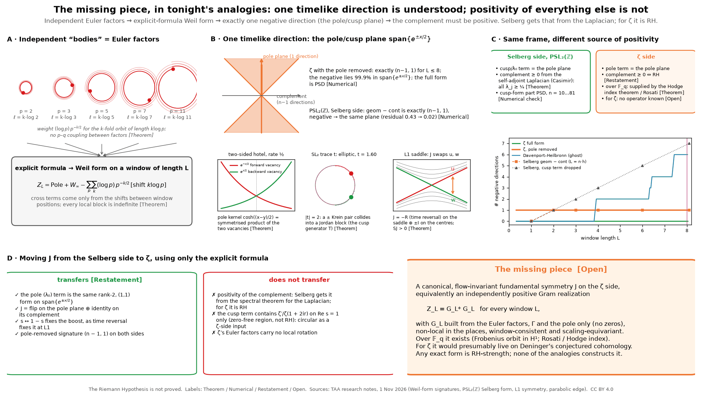</a> The missing piece in the analogies of 1 Nov 2026: one timelike direction is understood, positivity of everything else is not. Independent Euler factors (k-fold orbits of length k log p, no p–q coupling) feed the explicit-formula Weil form; with the pole removed it has exactly one negative direction, the pole/cusp plane span{e^{±x/2}}, read three ways (the symmetrised product of a forward and a backward shift vacancy at rate ½, the ± Krein collision into a Jordan block at the parabolic edge |t| = 2, the L1 saddle whose fundamental symmetry is time reversal). On the Selberg side (PSL₂(ℤ)) the same frame holds and the complement is positive because the Laplacian is self-adjoint; for ζ that complement positivity is RH. What transfers through the explicit formula is the frame, not the positivity. The missing piece is a canonical, flow-invariant J, equivalently an independently positive Gram realization Z_L = G_L*G_L built without the zeros; over 𝔽_q it exists (Rosati / Hodge index), for ζ it would presumably live on Deninger’s conjectured cohomology [Open]. <b>[Theorem + Numerical; the missing piece is Open · 3.00 / 2.20 (scores 0–4)]</b> Animation: <a href="figures/hero_v113/missing_piece_one_timelike_direction.mp4">MP4</a> · <a href="figures/hero_v113/missing_piece_one_timelike_direction.gif">GIF</a>.

<table>
<tr><td width="50%" valign="top"><a href="figures/lorentzian_frame/pole_removed_signatures.png">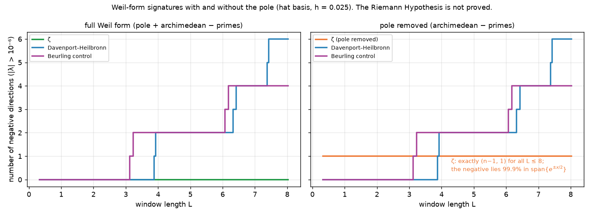</a> ζ’s Weil form with and without the pole: the full form is positive at every tested window L ≤ 8, and with the pole removed it has exactly one negative direction (n−1, 1), 99.9% in the pole plane span{e^{±x/2}}; Davenport–Heilbronn and a Beurling control gain negative directions near their off-line points, one per real off-line point and two per complex quadruple. <b>[Numerical + Theorem · 3.40 / 3.32 (scores 0–4)]</b></td><td width="50%" valign="top"><a href="figures/lorentzian_frame/selberg_lorentzian.png">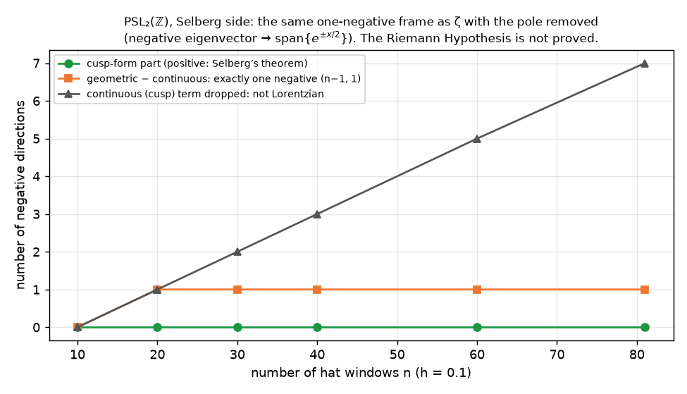</a> PSL₂(ℤ), Selberg side: the cusp-form part of the trace-formula form is positive (Selberg’s theorem, checked), geometric minus continuous has exactly one negative direction, converging to the pole plane, and dropping the continuous (cusp) term breaks the frame; the frame transfers to ζ through the explicit formula, the positivity does not. <b>[Numerical; Restatement · 3.00 / 2.20 (scores 0–4)]</b></td></tr>
<tr><td width="50%" valign="top"><a href="figures/function_field_gram/ff_weil_gram.png">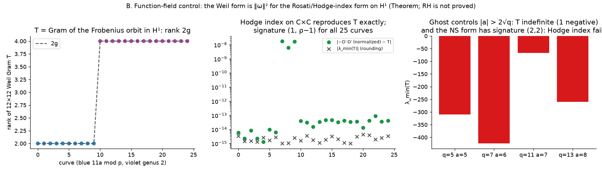</a> Over 𝔽_q the Weil form is the Gram matrix of the Frobenius orbit in H¹ for the Rosati / Hodge-index form: rank 2g and signature (1, ρ−1) on all 25 tested curves, while ghost (non-Weil) data break the Hodge index; no place-by-place positive star exists for ζ. <b>[Theorem · 3.70 (scores 0–4)]</b></td><td width="50%" valign="top"><a href="figures/lrl_jacobi/lrl_C_frame_tidal.png">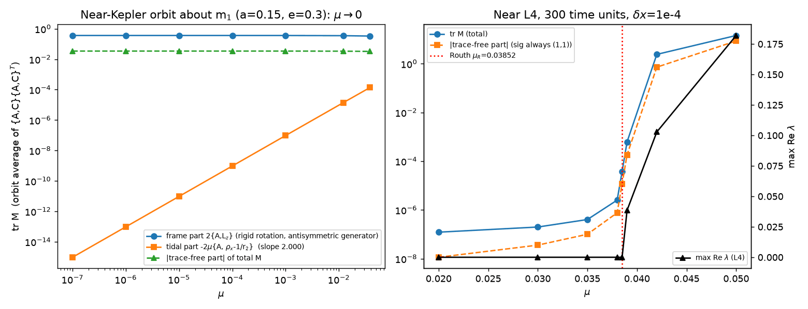</a> LRL vector against the Jacobi constant: {A, C} splits exactly into a frame (Coriolis) part, which survives μ → 0, and a tidal part ∝ μ²; near L4 the Routh instability shows only in the trace, since a traceless 2×2 form is always indefinite. <b>[Theorem + Numerical; as an analogue of trace-free positivity, Analogy · 2.60 / 1.80 (scores 0–4)]</b></td></tr>
</table>

## Previous results (v1.12)

> The Riemann Hypothesis is not proved. The v1.11 headline figure and the figures from the research notes folded into v1.12; labels and scores as in the entries.

<a href="figures/hero_v111/prime_torus_two_walls.mp4">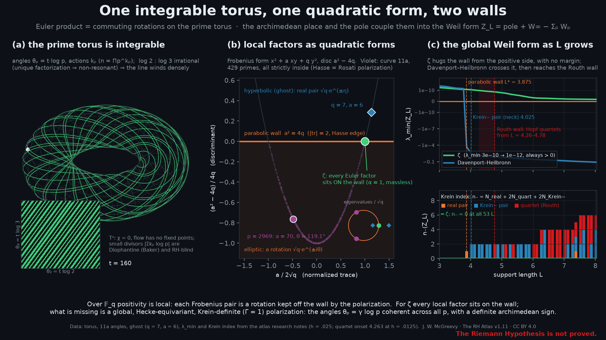</a> One integrable torus, one quadratic form, two walls: (a) the Euler product as commuting rotations on the prime torus (θ_p = t log p, a Kronecker line, non-resonant by unique factorization); (b) local factors as quadratic forms x² + a xy + q y² in the discriminant plane: the curve 11a strictly inside at all 429 primes, ζ’s Euler factors on the parabolic wall a² = 4q, a ghost (q = 7, a = 6) outside; (c) the global Weil form along the support length: ζ’s smallest eigenvalue stays positive with no margin (3·10⁻¹⁰ → 10⁻¹²), while Davenport–Heilbronn crosses the parabolic wall at L* = 3.875, opens a Krein-negative neck at 4.025 and reaches the Routh wall (Hamiltonian–Hopf quartets) from 4.263–4.775. Animation: figures/hero_v111/prime_torus_two_walls.mp4 (18 s) and .gif. <b>[Theorem + Numerical · data from the research notes]</b> · <a href="figures/hero_v111/prime_torus_two_walls.gif">GIF</a> · <a href="figures/hero_v111/prime_torus_two_walls.mp4">MP4</a>

<a href="figures/normalizations/three_normalizations.png">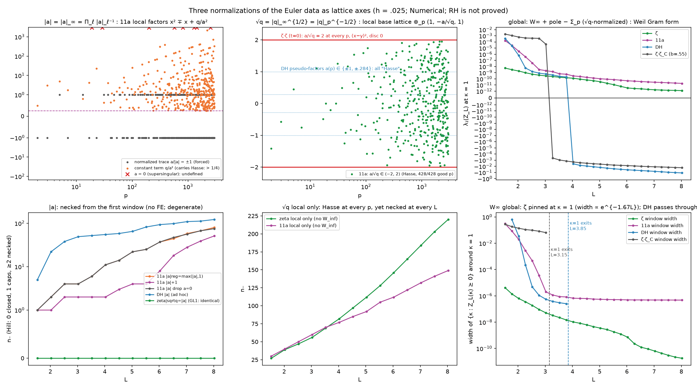</a> Three normalizations of the Euler data as lattice axes. |a| (the infinite-place norm of the trace, untied from p by the product formula) forces the trace to ±1, keeps only the sign of a² − 4q, breaks at supersingular primes and gives a Gram form that is indefinite from the first window; √q gives the local Hasse lattice, which is positive for L(11a), degenerate for ζ·ζ and blind to Davenport–Heilbronn, and without the archimedean factor every window is indefinite; √q together with W∞ is the Weil form, where ζ stays inside an exponentially pinching prime-coupling window around κ = 1 while Davenport–Heilbronn and a Beurling control leave it. The last separation is Weil positivity restated (circular). <b>[Theorem + Numerical; circular · 3.16 / 3.28 / 3.48 (scores 0–4)]</b>

<table>
<tr><td width="50%" valign="top"><a href="figures/trojans_drag/drag_growth.png">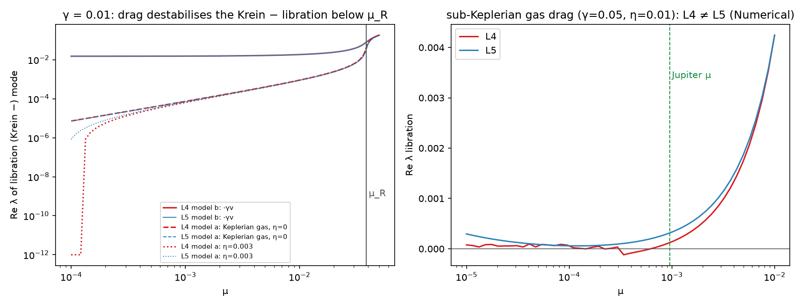</a> Drag at L4 and L5: any velocity damping destabilises the Krein-negative libration for every μ below the Routh value (Kelvin–Tait–Chetaev), with L4 and L5 exactly isospectral under symmetric damping; drag relative to a sub-Keplerian gas flow breaks the symmetry and makes L4 less unstable than L5. <b>[Theorem + Numerical · 3.40 / 2.84 (scores 0–4)]</b></td><td width="50%" valign="top"><a href="figures/trojans_drag/massive_trojans.png">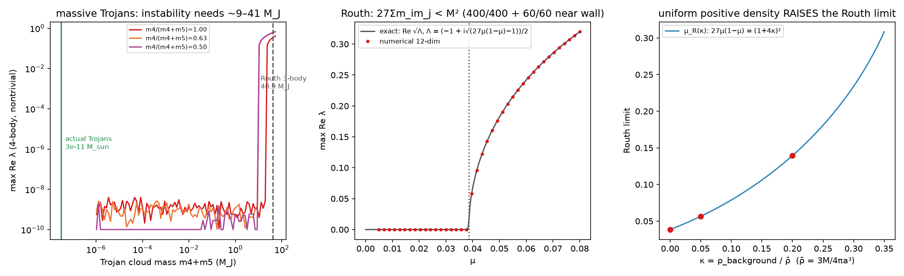</a> Massive Trojans and the Routh criterion: the generalized criterion 27(m₁m₂ + m₂m₃ + m₃m₁) < M² holds on every tested triple; Sun–Jupiter would need about 9–41 Jupiter masses of Trojans to lose stability (the actual Trojan mass is about 3·10⁻¹¹ solar masses); a uniform positive background density raises the Routh limit to 27μ(1 − μ) < (1 + 4κ)². <b>[Numerical + Theorem · 3.04 / 3.08 (scores 0–4)]</b></td></tr>
</table>

## Previous results (v1.11)

> The Riemann Hypothesis is not proved. Figures from the research notes folded into v1.11; labels and scores as in the entries.

<table>
<tr><td width="50%" valign="top"><a href="figures/krein_index/hamiltonian_krein_index_dh.png">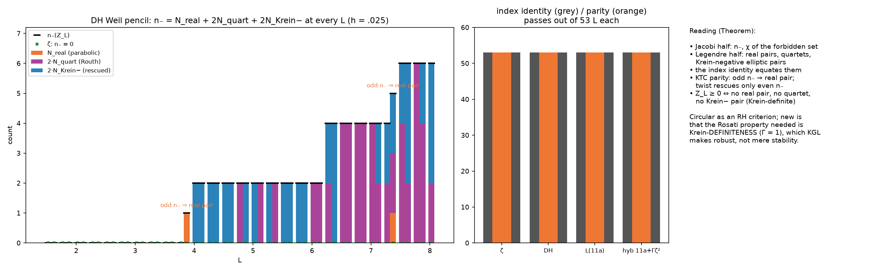</a> Hamiltonian–Krein index for the Weil pencil: Davenport–Heilbronn’s n₋(Z_L) splits as N_real + 2N_quart + 2N_Krein− at every support length (a real pair at the parabolic wall, a rescued Krein-negative window, then Routh quartets); the identity and the Kelvin–Tait–Chetaev parity hold at 212/212 pencils for ζ, Davenport–Heilbronn, L(11a) and a hybrid. Positivity ⇔ stable and Krein-definite (Γ = 1). <b>[Theorem + Numerical · 4.00 (scores 0–4; circular as a criterion)]</b></td><td width="50%" valign="top"><a href="figures/discriminant_space/observers_deuring.png">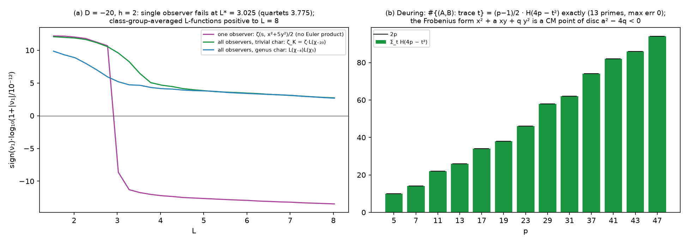</a> One observer versus all observers at discriminant −20: the Epstein zeta of the single form x² + 5y² (off-line zero 0.93297 + 15.66825i) fails positivity at L* = 3.025, while the class-group-averaged ζ_K and the genus L(χ₋₄)L(χ₅) stay positive to L = 8; Deuring’s count of curves over 𝔽_p by trace is exact. <b>[Numerical + Theorem · 2.8 / 3.1 (scores 0–4)]</b></td></tr>
<tr><td width="50%" valign="top"><a href="figures/discriminant_space/discriminant_space.png">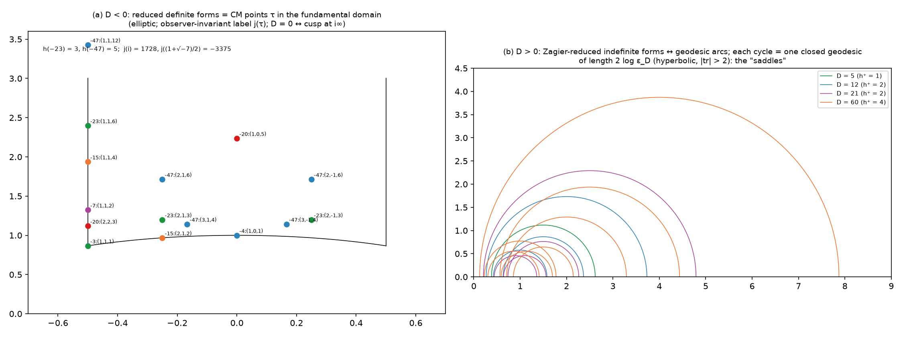</a> The space of binary quadratic forms: reduced definite forms are CM points (elliptic), D = 0 is the cusp (parabolic), Zagier-reduced indefinite forms are closed geodesics of length 2 log ε_D (hyperbolic). <b>[Theorem · 3.1 (scores 0–4)]</b></td><td width="50%" valign="top"><a href="figures/discriminant_space/prime_geodesics_sundman.png">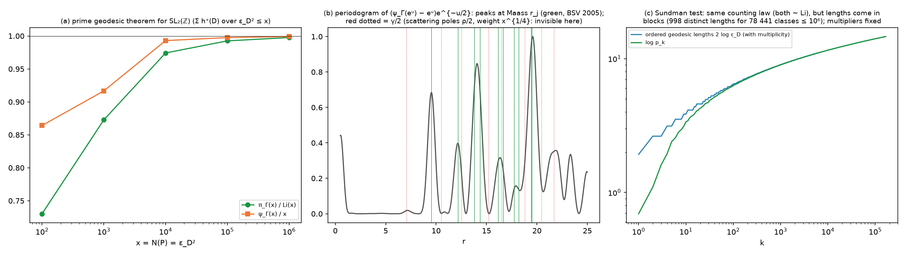</a> Prime geodesic theorem for SL₂(ℤ) (π_Γ/Li = 0.9976 at 10⁶), the periodogram peaking at the Maass eigenvalues, and the Sundman test: the counts match the primes but the lengths come in blocks (998 distinct lengths), so no time change maps them to log p. <b>[Numerical + Theorem · 2.9 (scores 0–4)]</b></td></tr>
<tr><td width="50%" valign="top"><a href="figures/discriminant_space/tree_kesten_mckay.png">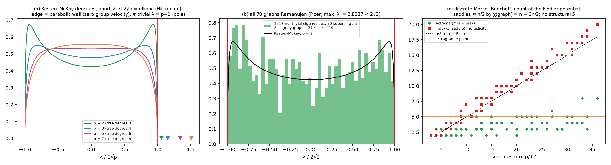</a> Hecke trees: Kesten–McKay densities with the band edge |λ| = 2√p (zero group velocity, the parabolic wall again); 70 supersingular 2-isogeny graphs, all Ramanujan; discrete Morse counts grow like n/2 (no structural five). <b>[Theorem + Analogy · 2.4 (scores 0–4)]</b></td><td width="50%" valign="top"><a href="figures/krein_index/legendre_jacobi_twist.png">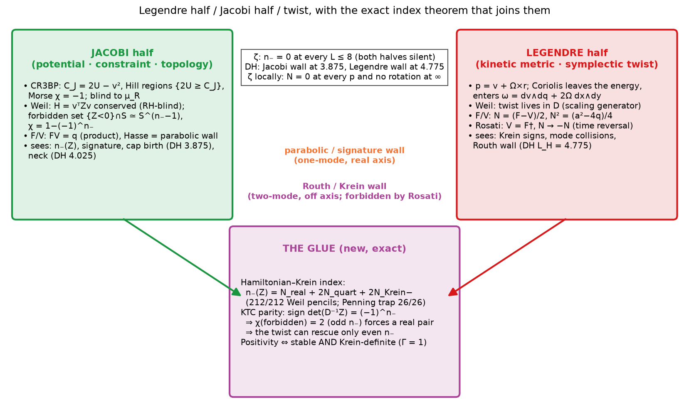</a> Jacobi (potential) half, Legendre (symplectic) half and the exact index theorem that joins them. <b>[Theorem · 4.00 (scores 0–4)]</b></td></tr>
<tr><td width="50%" valign="top"><a href="figures/krein_index/higgs_trichotomy_walls.png">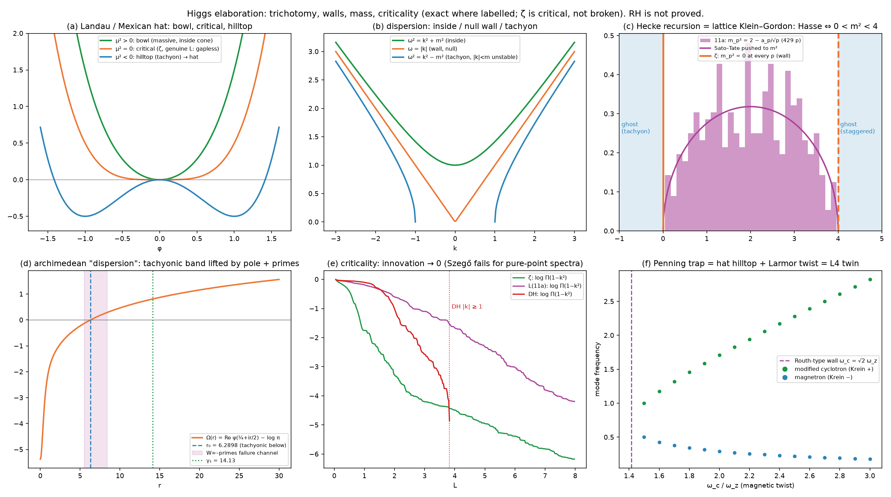</a> Mass and the walls: Landau bowl / critical / hilltop; the Hecke recursion as a lattice Klein–Gordon ladder (L(11a) masses inside the band, ζ at m² = 0); the archimedean symbol Ω(r) negative below r₀ = 6.2898; Szegő innovations; Penning-trap Krein signs. <b>[Theorem + Analogy · 3.76 / 3.64 / 2.88 (scores 0–4)]</b></td><td width="50%" valign="top"><a href="figures/legendre_jacobi/routh_vs_hasse.png">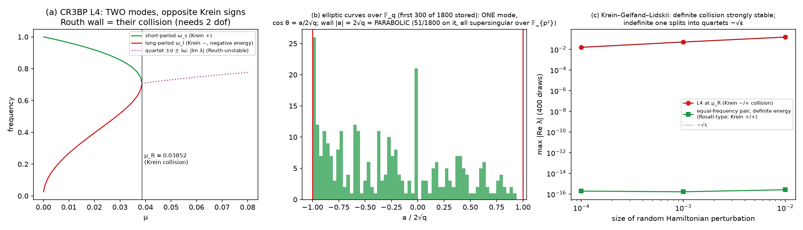</a> Routh versus Hasse: in the rotating frame the L4 Hessian is negative definite and stability comes from the Coriolis twist up to μ_R = 0.0385209; over 𝔽_q the Frobenius rotation N = (F − V)/2 with N² = (a² − 4q)/4 is kept off the wall by Rosati, so a Routh wall cannot occur. <b>[Theorem + Numerical · 4.2 (0.6·sig + 0.4·prob, each on 0–5)]</b></td></tr>
<tr><td width="50%" valign="top"><a href="figures/legendre_jacobi/fv_decomposition.png">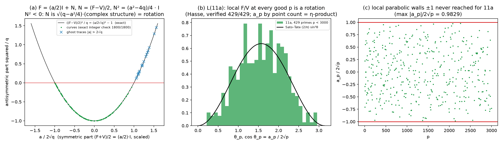</a> Frobenius and Verschiebung as rotation plus scalar: (F + V)/2 = (a/2)·I and N = (F − V)/2; ζ’s local factors carry no rotation. <b>[Theorem · 4.1 (each on 0–5)]</b></td><td width="50%" valign="top"><a href="figures/legendre_jacobi/weil_hill_regions.png">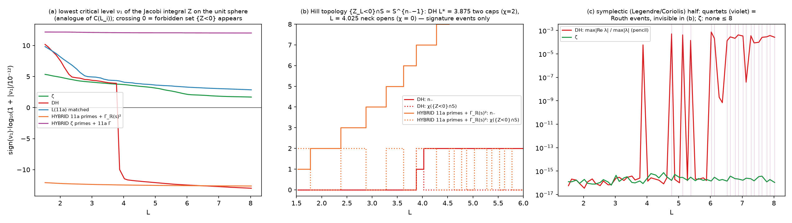</a> Hill regions of the Weil form: the conserved energy vᵀZv sees only signature events (the forbidden set and its Euler characteristic), not the Krein data. <b>[Theorem + Numerical · 3.7 (each on 0–5)]</b></td></tr>
<tr><td width="50%" valign="top"><a href="figures/legendre_jacobi/two_arms.png">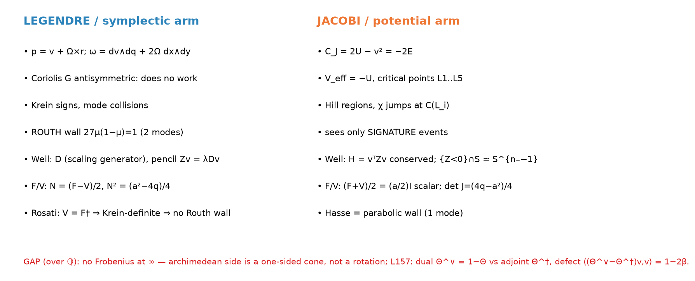</a> The two arms: Legendre (symplectic, Krein signs, Routh wall) versus Jacobi (potential, Hill regions, signature events); the gap over ℚ is that the archimedean side is a one-sided cone, not a rotation. <b>[Theorem · 3.8 (each on 0–5)]</b></td><td width="50%" valign="top"><a href="figures/archimedean_cone/symbols_one_sided_cone.png">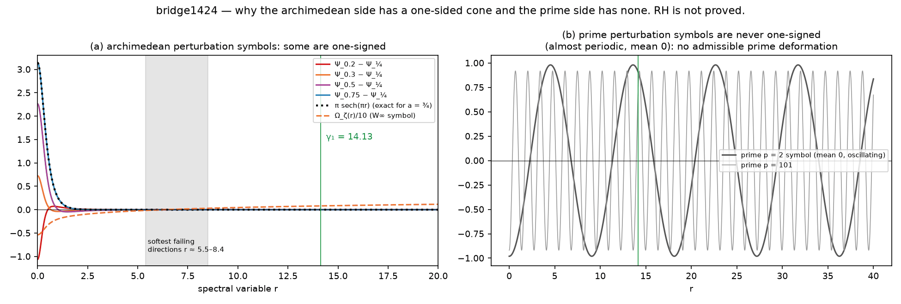</a> Why the archimedean side has a one-sided cone and the prime side has none: Re ψ(3/4 + ir/2) − Re ψ(1/4 + ir/2) = π sech(πr) > 0, while every finite prime-side symbol is a mean-zero trigonometric polynomial. <b>[Theorem · 3.4 (scores 0–4)]</b></td></tr>
<tr><td width="50%" valign="top"><a href="figures/archimedean_cone/radius_all_directions.png">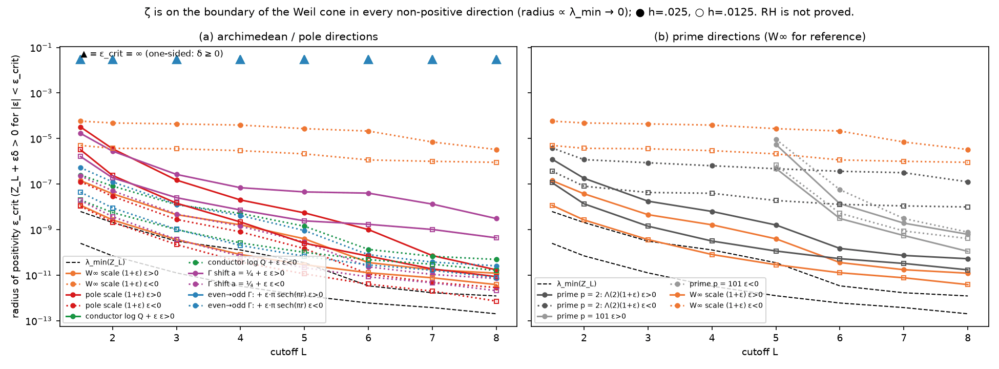</a> ζ sits on the boundary of the Weil cone in every non-positive direction: the radius of positivity decays like λ_min(Z_L). <b>[Numerical · 3.28 (scores 0–4; circular core)]</b></td><td width="50%" valign="top"><a href="figures/archimedean_cone/failure_channels.png">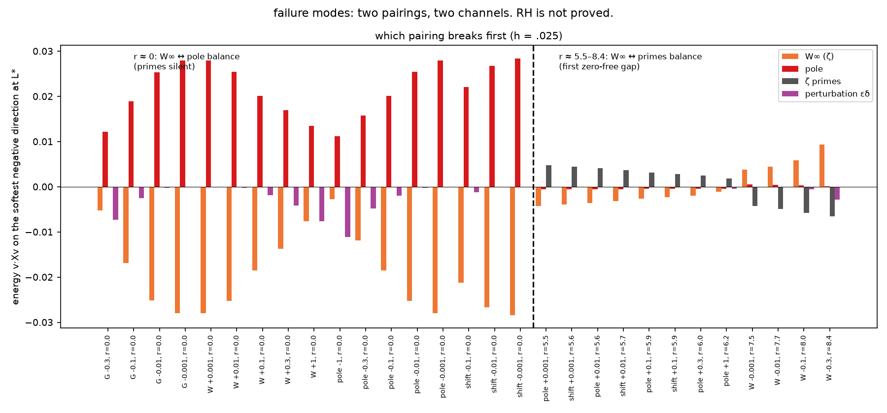</a> Two failure channels: the first negative direction sits at spectral frequency 0 (archimedean factor against the pole) or at r ≈ 5.5–8.4 (archimedean factor against the primes). <b>[Numerical · 2.96 (scores 0–4)]</b></td></tr>
<tr><td width="50%" valign="top"><a href="figures/euler_routh/beurling_control.png">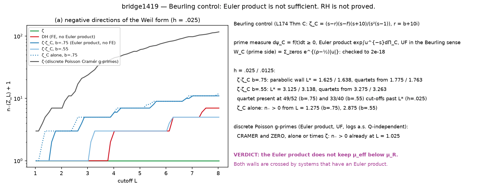</a> The Euler product is not sufficient: Beurling systems with an Euler product, non-negative prime measure and unique factorization cross both walls. <b>[Numerical · 3.68 (scores 0–4)]</b></td><td width="50%" valign="top"><a href="figures/euler_routh/fock_torus.png">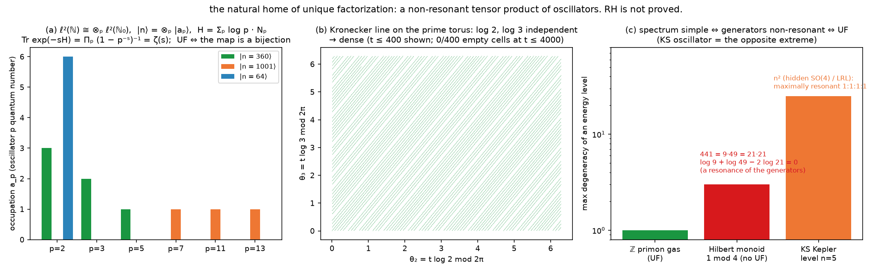</a> The natural home of unique factorization: a non-resonant tensor product of oscillators (H = Σ log p · N_p, Tr e^{−sH} = ζ), against the Hilbert monoid (441 = 9·49 = 21²) and the maximally resonant Kepler problem. <b>[Theorem · 3.4 / 3.44 (scores 0–4)]</b></td></tr>
<tr><td width="50%" valign="top"><a href="figures/euler_routh/prime_rigidity.png">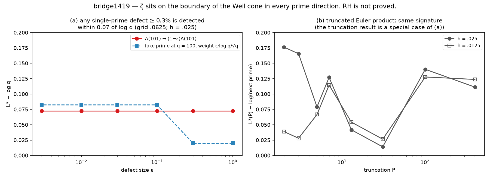</a> ζ is on the boundary of the Weil cone in every prime direction: a missing prime or a 0.3% change of one weight is detected as soon as it enters the window. <b>[Numerical · 3.16 (scores 0–4)]</b></td><td width="50%" valign="top"><a href="figures/euler_routh/ks_two_walls.png">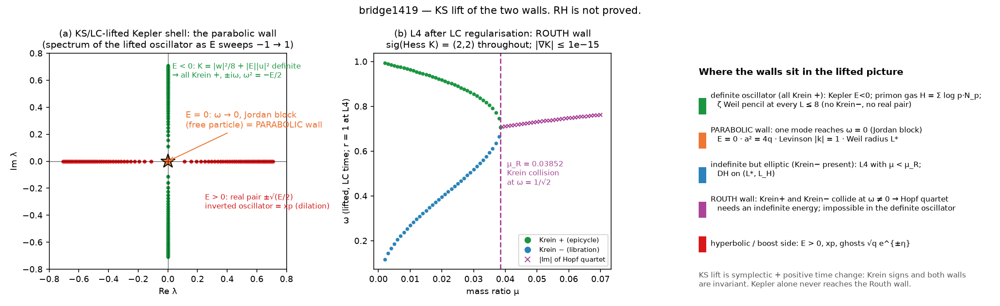</a> The KS lift of both walls: Kepler becomes a definite oscillator (only the parabolic wall), the lifted L4 keeps its Routh collision at μ_R. <b>[Theorem · 3.44 (scores 0–4)]</b></td></tr>
<tr><td width="50%" valign="top"><a href="figures/discriminant_space/melnikov_pairing.png">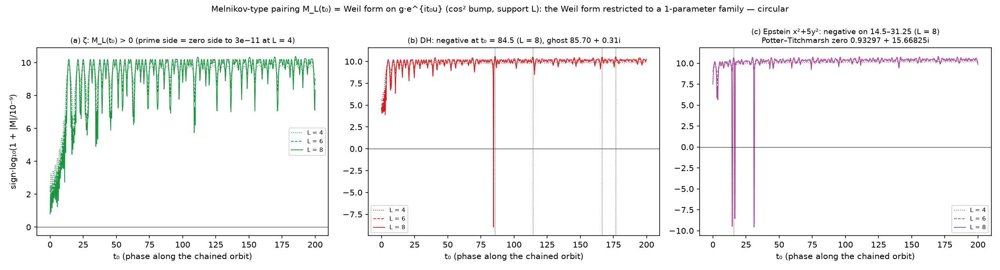</a> Saddle-chain Melnikov pairing: the Weil form on modulated bumps stays positive for ζ and turns negative near the off-line zeros of Davenport–Heilbronn and of an Epstein zeta (a zero detector, circular). <b>[Restatement + Numerical · 2.6 (scores 0–4)]</b></td><td width="50%" valign="top"><a href="figures/discriminant_space/torus_small_divisors_morse.png">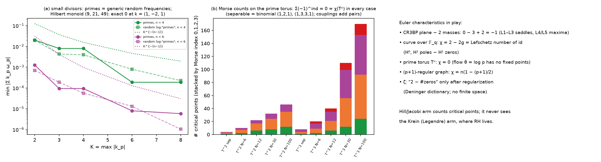</a> The prime torus: small divisors |Σ k_p log p| behave like random frequencies (Diophantine, RH-blind), and critical-point counts have alternating sum χ(Tⁿ) = 0 in every case. <b>[Numerical + Theorem · 2.3 / 2.5 (scores 0–4)]</b></td></tr>
<tr><td width="50%" valign="top"><a href="figures/thermo_dbn/kernel_entropies.png">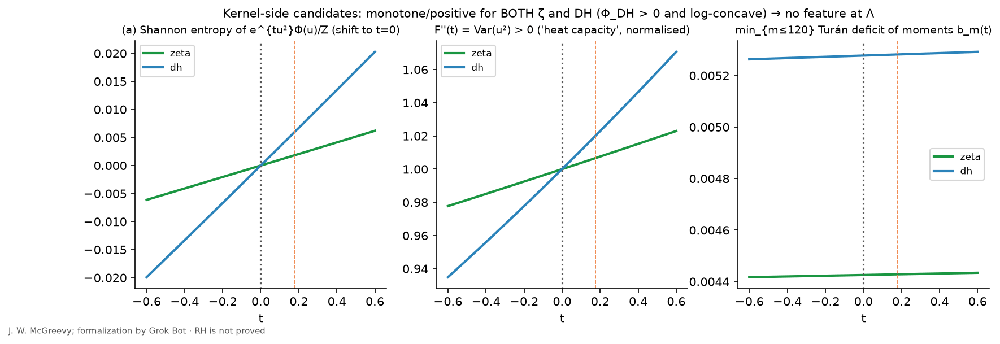</a> Real-field thermodynamics is convex for any positive kernel: Davenport–Heilbronn’s kernel Φ is positive and log-concave too, so entropy and heat capacity cannot separate ζ from a counterexample. <b>[Theorem · 3.4 (scores 0–4)]</b></td><td width="50%" valign="top"><a href="figures/thermo_dbn/zero_flow.png">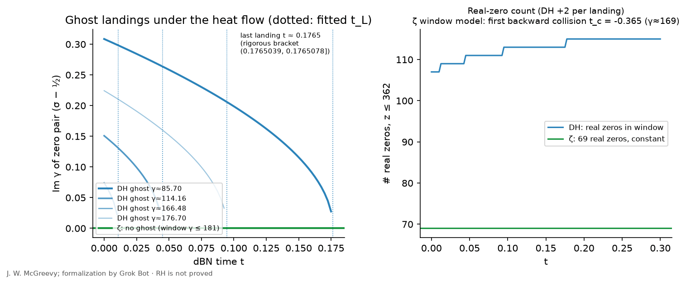</a> The de Bruijn–Newman zero flow as a log-gas with sum-of-squares entropy production while the zeros are real; its second-order lift is Calogero–Moser (Hamiltonian), so the flow is not conformally symplectic. <b>[Theorem · 3.5 / 3.2 (scores 0–4)]</b></td></tr>
</table>

## Previous results (v1.10)

> The Riemann Hypothesis is not proved. Figures from the research notes folded into v1.10; labels and scores as in the entries.

<table>
<tr><td width="50%" valign="top"><a href="figures/two_walls/two_walls_dictionary.png">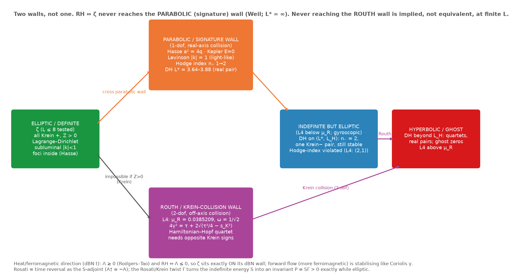</a> Two walls, not one: the parabolic (signature) wall, where a conjugate pair collides on the real axis (Hasse a² = 4q, Kepler E = 0, Levinson |k| = 1, Hodge index change; RH ⇔ ζ never reaches it), and the downstream Routh (Krein-collision) wall at μ_R = 0.0385209; Davenport–Heilbronn passes the first at L*, sits in an indefinite-but-elliptic window, then shows Hamiltonian–Hopf quartets; in the de Bruijn–Newman direction ζ sits exactly on its wall. <b>[Theorem + Numerical · 3.52 (0.6·sig + 0.4·prob, 0–4)]</b></td><td width="50%" valign="top"><a href="figures/two_walls/positivity_crosstable.png">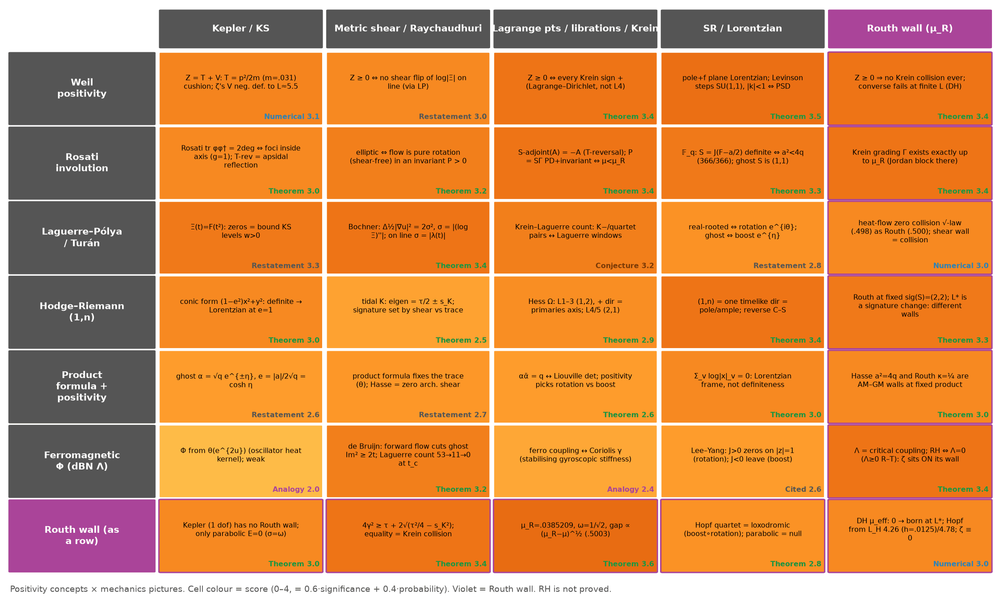</a> Positivity concepts (Weil, Rosati, Laguerre–Pólya, Hodge–Riemann, product formula, ferromagnetic Φ, Routh wall) against the mechanics pictures (Kepler/KS, shear/Raychaudhuri, Lagrange/Krein, special relativity, Routh wall): the most exact correspondence in each cell, with its label and score; every cell at 3.4 or above is a finite-dimensional theorem or an RH-equivalent restatement. <b>[Theorem / Restatement / Analogy · cells 2.0–3.6 (0.6·sig + 0.4·prob, 0–4)]</b></td></tr>
<tr><td width="50%" valign="top"><a href="figures/relativity_shear/dh_ghost_plane_2x2.png">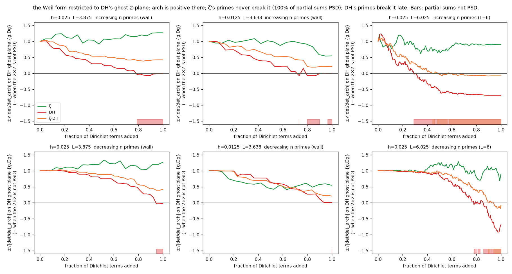</a> Davenport–Heilbronn’s ghost 2-plane: the archimedean part is positive there; ζ’s prime terms never break the 2×2 (100% of partial sums, in either order), while Davenport–Heilbronn’s own terms break it late. The ghost comes from the prime side. <b>[Numerical · 3.2 (scores 0–4)]</b></td><td width="50%" valign="top"><a href="figures/relativity_shear/levinson_boosts_rapidity.png">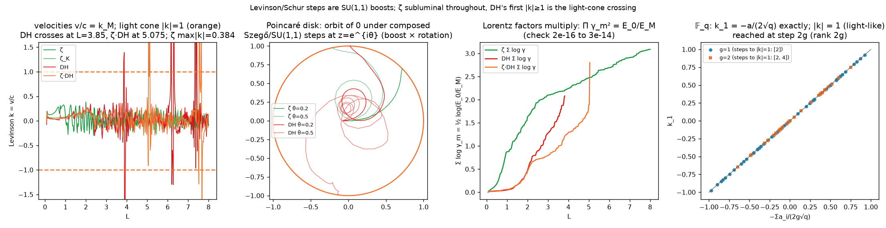</a> Levinson/Schur steps are SU(1,1) boosts: ζ stays subluminal (max |k| = 0.384 up to L = 8), Davenport–Heilbronn’s first |k| ≥ 1 is its light-cone crossing at L = 3.85, Lorentz factors multiply, and over 𝔽_q k₁ = −a/(2√q). <b>[Theorem + Numerical · 3.5, circular as a criterion (scores 0–4)]</b></td></tr>
<tr><td width="50%" valign="top"><a href="figures/positivity_cup/positivity_bowl_flat_peak.png">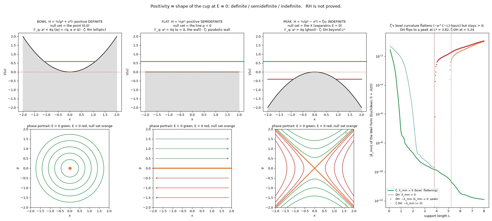</a> The positivity cup at E = 0: bowl, flat and peak are definite, semidefinite and indefinite (null set a point, a line, an X); ζ’s smallest Weil eigenvalue flattens but stays positive, while Davenport–Heilbronn flips to a peak at L* ≈ 3.82. <b>[Theorem + Numerical · 3.0 (scores 0–4)]</b></td><td width="50%" valign="top"><a href="figures/positivity_cup/ks_trichotomy_sundman.png">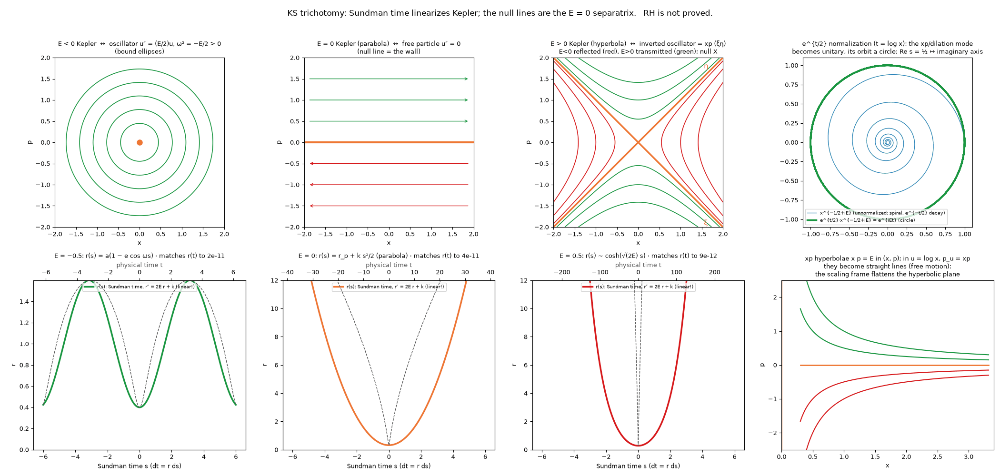</a> KS trichotomy: oscillator (E < 0), free particle (E = 0, the null line is the wall) and inverted oscillator = xp (E > 0, the null X); Sundman time makes Kepler’s radial motion linear; the e^{t/2} normalization turns the decaying Mellin spiral into the unit circle. <b>[Theorem · 3.4; normalization panel 2.8 (scores 0–4)]</b></td></tr>
<tr><td width="50%" valign="top"><a href="figures/relativity_shear/raychaudhuri_shear.png">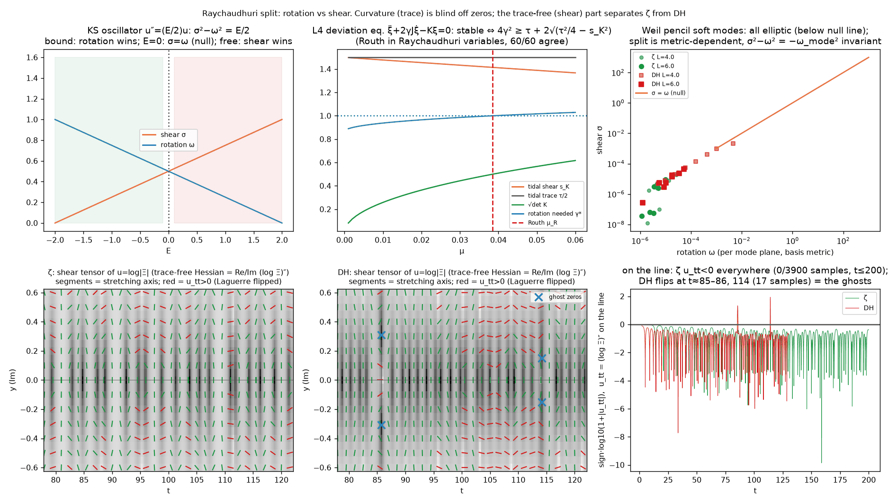</a> Shear, not curvature: σ² − ω² = E/2 for the KS oscillator; Routh stability at L4 in tidal and rotation variables; the trace-free Hessian of log|Ξ| keeps its sign on the line for ζ and flips at Davenport–Heilbronn’s ghost heights, while the curvature is blind off the zeros. <b>[Theorem + Numerical · 3.5, equivalent to Laguerre (scores 0–4)]</b></td><td width="50%" valign="top"><a href="figures/relativity_shear/dirac_sea_curvature_density.png">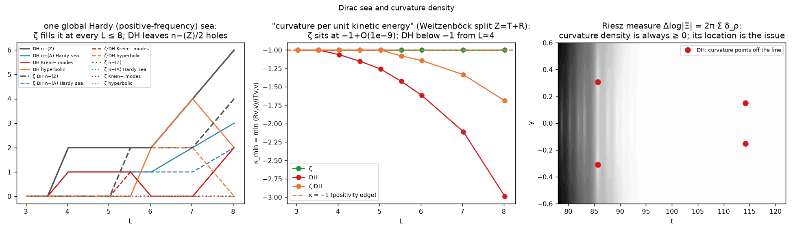</a> Dirac sea and curvature density: one global positive-frequency sea fills for ζ, Davenport–Heilbronn leaves n₋/2 holes; curvature per unit kinetic energy sits on the edge −1 for ζ and below it for Davenport–Heilbronn; the Riesz curvature density is ≥ 0 for both. <b>[Numerical + Theorem · 3.3 / 3.4, circular as a criterion (scores 0–4)]</b></td></tr>
<tr><td width="50%" valign="top"><a href="figures/relativity_shear/lagrange_point_clocks.png">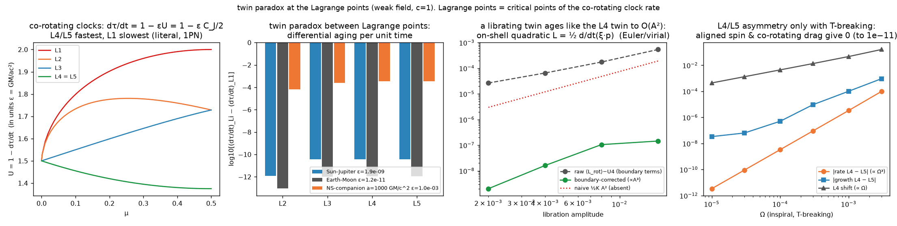</a> Twin paradox at the Lagrange points: the co-rotating clock rate is the Jacobi constant, so the Lagrange points are its critical points and L4/L5 clocks run fastest; L4 and L5 split only when time reversal is broken. <b>[Theorem + Numerical · 3.6 / 3.2 (scores 0–4)]</b></td><td width="50%" valign="top"><a href="figures/positivity_cup/single_orbit_vs_ensemble.png">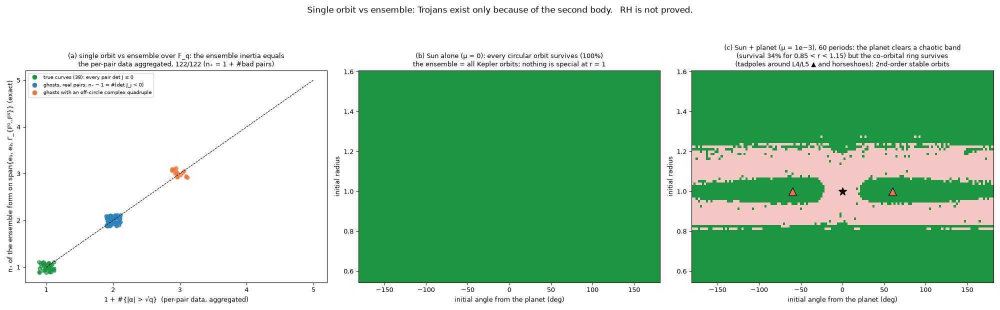</a> Single orbit vs ensemble: over 𝔽_q the ensemble inertia is the per-pair Hasse data aggregated (122/122); in the restricted three-body problem a planet clears a chaotic band but the co-orbital Trojan and horseshoe ring survives completely. <b>[Theorem + Numerical · 3.4 / 3.2 (scores 0–4)]</b></td></tr>
<tr><td width="50%" valign="top"><a href="figures/positivity_cup/frame_dependence_krein.png">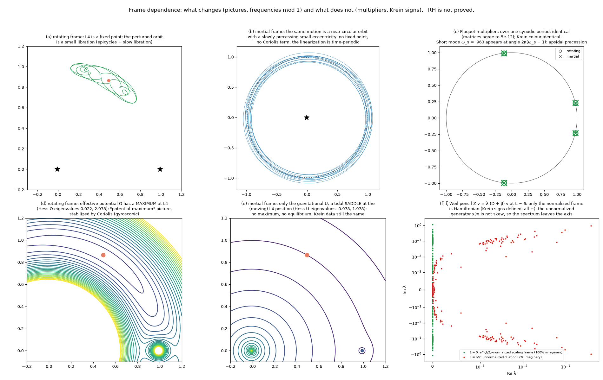</a> Frame dependence: rotating and inertial frames give the same Floquet multipliers and Krein signs (to 5e−12); only the picture changes. For ζ the Weil pencil is Hamiltonian only in the e^{t/2}-normalized frame (100% against 6.7% imaginary). <b>[Theorem + Numerical · 3.4 / 3.0 (scores 0–4)]</b></td><td width="50%" valign="top"><a href="figures/librations_krein/polarization_coherency_local_global.png">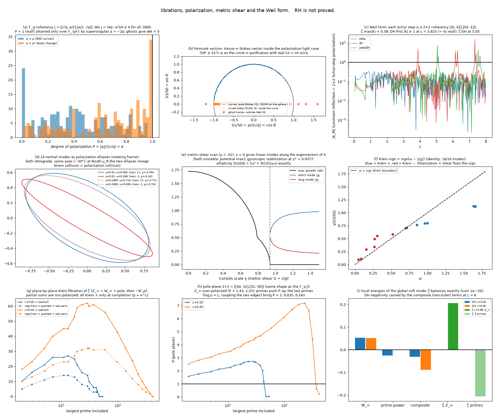</a> Librations and polarization: the genus-1 Hasse bound is a positive coherency (Stokes) matrix (1800/1800 curves); Levinson steps as 2×2 coherencies; L4 modes as polarization ellipses whose Krein collision is a polarization collision; place-by-place and pole-plane filtrations (the edge-prime reading is refuted in v1.10). <b>[Theorem + Numerical · 3.4 / 3.3; pole plane 1.6 (scores 0–4)]</b></td></tr>
<tr><td width="50%" valign="top"><a href="figures/librations_krein/l4_routh_krein_rosati_ks.png">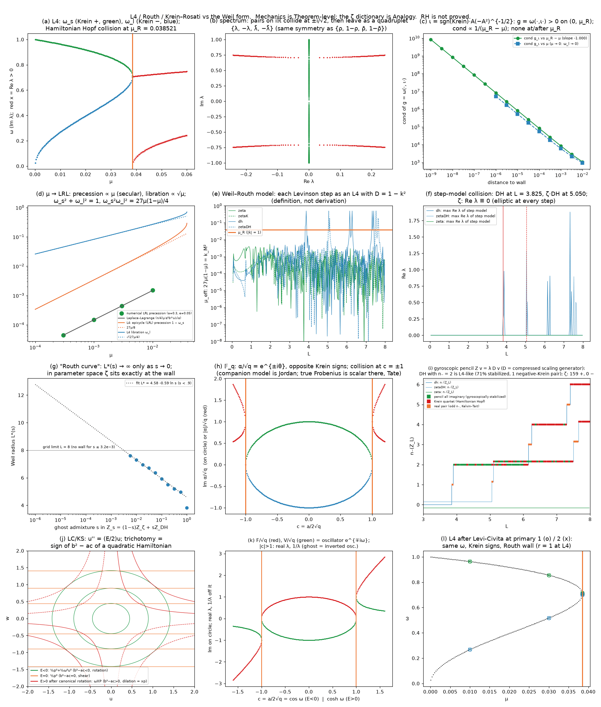</a> L4/L5 and the Weil form: Krein signs and the Routh wall at μ_R = 0.0385; a Rosati-like involution is a Krein-signed complex structure; the gyroscopic Weil pencil is all-imaginary with Krein + for ζ and L4-like for Davenport–Heilbronn; the KS lift reads the Kepler trichotomy as the sign of b² − ac, with xp on the hyperbolic side. <b>[Theorem + Numerical · 3.4 / 3.4 / 3.3 (scores 0–4)]</b></td><td width="50%" valign="top"><a href="figures/librations_krein/hill_regions_thresholds_krein.png">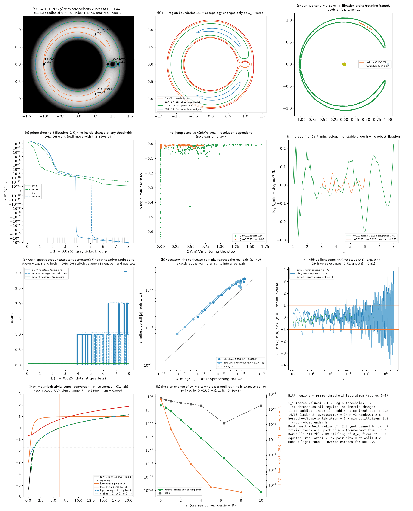</a> Hill regions and the prime-threshold filtration: every ζ threshold L = log n is regular; Krein spectroscopy; the equator crossing at a wall; the Bernoulli numbers fix the archimedean sign change r* = 2π + 0.0067; the Möbius light cone. <b>[Numerical + Theorem · 3.3 / 3.2 / 2.9; Hill-region dictionary 1.5 (scores 0–4)]</b></td></tr>
<tr><td width="50%" valign="top"><a href="figures/librations_krein/apsides_escape_directions.png">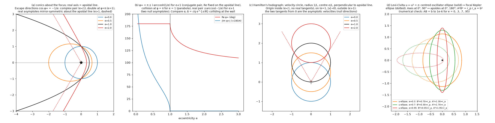</a> Apsides, escape directions, hodograph and the Levi-Civita map: the escape directions are a conjugate pair that collides on the apsidal line at e = 1 and splits into two real null asymptotes for e > 1; the Frobenius quadratic is the focal quadratic of the conic. <b>[Theorem · 3.0 (scores 0–4)]</b></td><td width="50%" valign="top"><a href="figures/weil_trichotomy/support_filtration_trichotomy.png">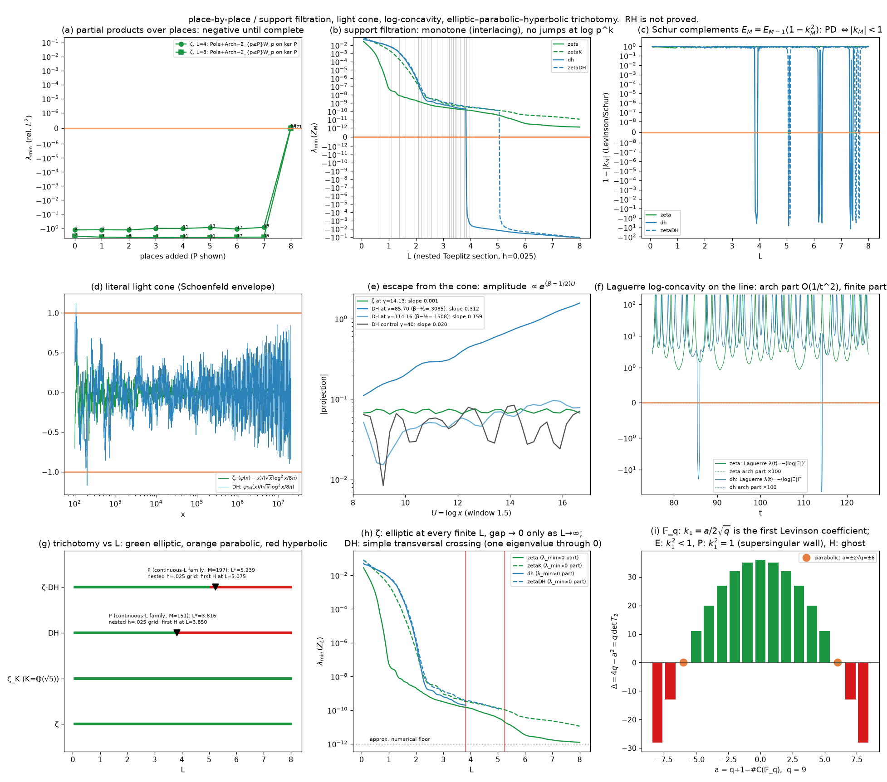</a> Place-by-place and support filtrations of the Weil form: partial products over places stay negative until every prime power ≤ e^L is present; Levinson steps; the literal light cone; Laguerre log-concavity on the line; the elliptic / parabolic / hyperbolic trichotomy with Weil radius L* ≈ 3.82 for Davenport–Heilbronn; over 𝔽_q 4q − a² = q·det T₂. <b>[Restatement + Numerical · trichotomy 3.92; local definiteness falsified 3.60 (0.6·sig (0–10) + 0.4·prob (0–1))]</b></td></tr>
<tr><td width="50%" valign="top"><a href="figures/sos_morse/missing_piece.png">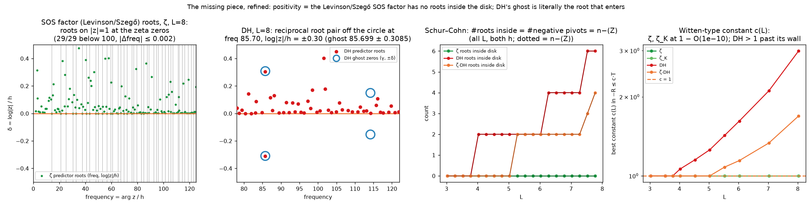</a> The missing piece, refined: the Levinson/Szegő sum-of-squares factor of the Weil form. ζ: roots on the circle at the zeros. Davenport–Heilbronn: the root that enters the disk is the off-line zero. <b>[Numerical · 3.6]</b></td><td width="50%" valign="top"><a href="figures/sos_morse/sos_constants.png">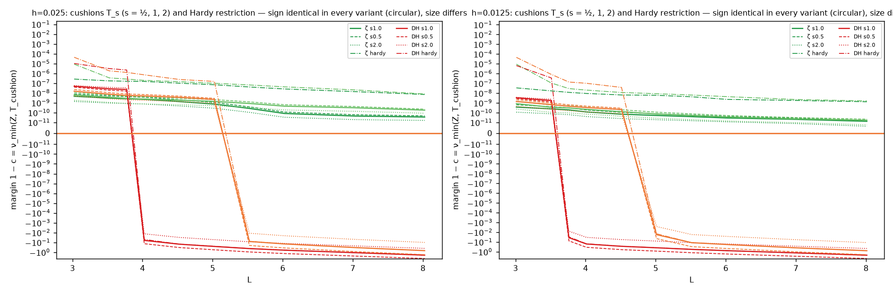</a> Witten-type best constant c(L) for several cushions: same sign in every variant (circular), ζ at 1 − O(1e-10). <b>[Restatement · 3.0]</b></td></tr>
<tr><td width="50%" valign="top"><a href="figures/sos_morse/soft_profiles.png">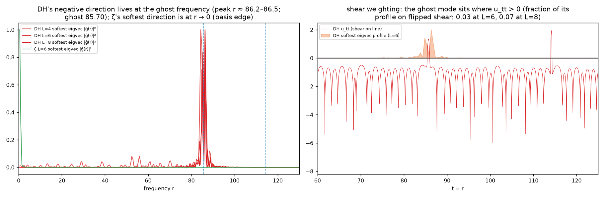</a> The negative direction of the Davenport–Heilbronn Weil form lives at the frequency of its off-line zero. <b>[Numerical · 3.2]</b></td><td width="50%" valign="top"> Morse count of the co-rotating potential: 2 − 3 = −1 = χ for every mass ratio. <b>[Theorem · 3.8]</b></td></tr>
<tr><td width="50%" valign="top"> Morse counting of log|Ξ|: off-line zeros force two extra saddles each on the critical line. <b>[Theorem · 3.4]</b></td><td width="50%" valign="top"> Spectral flow: the Morse index of the window Weil form along L. <b>[Numerical · 3.3]</b></td></tr>
<tr><td width="50%" valign="top"> Count versus stability: topology fixes the count, the gyroscopic term (positivity) decides stability. <b>[Theorem · 3.5]</b></td></tr>
</table>

## Previous results (v1.9)

> The Riemann Hypothesis is not proved. Figures from the research notes folded into v1.9; labels and route scores (0.6·significance + 0.4·probability) as in the entries.

<table>
<tr><td width="50%" valign="top"> Two-degree-of-freedom chaotic regularized xp: periodic-orbit periods drift with energy and do not lock onto k·log p; modular-surface lengths count like the primes but are logs of quadratic units; the explicit-formula sign is cohomological, not a Maslov phase; ζ’s orbit sum improves with the prime cutoff while Davenport–Heilbronn’s degrades. <b>[Numerical + Theorem + Cited · 3.9 / 4.4 / 4.4 / 3.9 (as a route to RH 2.9; adelic orbit space 3.4)]</b></td><td width="50%" valign="top"> Regularized xp: a Poincaré time change with ∂f/∂p ≠ 0 makes xp Legendre-regular; the regularized xp is the hyperbolic Sundman clock of the F/V pair; in a Deninger-type toy the Liouville law gives only ρ ↔ 1 − ρ and a positive metric gives the line; counting matches only the two leading Riemann–von Mangoldt terms. <b>[Theorem + Numerical · 4.1 / 4.4 / 4.7 / 3.8 (as a route to RH 3.1)]</b></td></tr>
</table>

## Previous results (v1.8)

> The Riemann Hypothesis is not proved. Figures from the research notes folded into v1.8; labels and route scores (0.6·significance + 0.4·probability) as in the entries.

<table>
<tr><td width="50%" valign="top"> Central-charge positivity is the Weil form: from the prime side ζ stays ≥ 0 up to L = 8, while Davenport–Heilbronn turns negative near L = 4, with no zeros used. <b>[Restatement + Numerical · route score 4.7 (as a route to RH 2.8)]</b></td><td width="50%" valign="top"> Zero-free signed energy of the heat-flowed Ξ: every ghost goes negative before it lands, ζ windows stay positive, and the Hermite form counts off-line pairs exactly. <b>[Theorem + Numerical · 4.4 (as a route to RH 3.3)]</b></td></tr>
<tr><td width="50%" valign="top"> Hofstadter gap widths are log-linear in |n| and close like (distance to the wall)^½ on the lobe side; ‖P − P&#42;‖ is a gauge quantity that spikes at every collision, not a ghost test. <b>[Numerical + Theorem · 3.6 / 3.4 / 4.4 (as a ghost detector 1.6)]</b></td><td width="50%" valign="top"> F/V on the noncommutative torus: Manin’s lobe / wall / wedge, and gap labels that hold for every zero set, so the K-theory order is ghost-blind. <b>[Theorem + Numerical · 4.7 (as a route to ζ positivity 2.8)]</b></td></tr>
<tr><td width="50%" valign="top"> The Rodgers–Tao energy is an exact Sundman clock with speed limit 4, but monotone for every real configuration; the near-collision law separates Davenport–Heilbronn from ζ. <b>[Theorem + Numerical · 4.4]</b></td><td width="50%" valign="top"> A Hardy constant for the primes is window positivity restated: ζ’s margin closes (critical), Davenport–Heilbronn crosses 1 near ℓ = 4–5, and local constants do not glue. <b>[Theorem + Numerical · 3.9]</b></td></tr>
<tr><td width="50%" valign="top"> Sundman/Levi-Civita clock: the F/V collision becomes a turning point and real τ bounces; positivity is the clock staying real, i.e. RH restated. <b>[Theorem · 4.7 (circular as a proof route, Restatement 4.4)]</b></td><td width="50%" valign="top"> Two Kepler degenerations: F = V is the circular orbit (e = 0), not the Levi-Civita centre collision (e = 1); both share the square-root map. <b>[Theorem · 4.4]</b></td></tr>
</table>

> **New in v1.13** (see [CHANGELOG.md](CHANGELOG.md)): seven sets of research notes of 1 Nov 2026 are folded in (71 concepts, 142 relations): 718 concepts and 1586 typed relations. Several of the questions were raised in external review; each answer keeps the label its test supports. **Frame [Numerical + Theorem]:** ζ’s Weil form with the pole removed is exactly (n−1, 1) for L ≤ 8, with the negative in the pole plane, and the PSL₂(ℤ) Selberg-side form with the continuous spectrum removed has the same frame; the pole kernel is a hyperbolic plane, the symmetrised product of a forward and a backward shift vacancy. **Positivity [Theorem + Restatement]:** over 𝔽_q the Weil form is a Gram matrix of the Frobenius orbit in H¹ (Rosati / Hodge index), no place-by-place positive star exists for ζ, and what transfers from the Selberg side is the frame, not the positivity (which there comes from the self-adjoint Laplacian and for ζ is RH). **Mechanics [Theorem + Numerical]:** the Hamiltonian–Krein index at all five Lagrange points, a fundamental symmetry at L1 (time reversal on the saddle), Lyapunov families and their Jordan shear −dT/dC, the parabolic edge as a ± Krein collision, and the LRL vector against the Jacobi constant (a frame part plus a tidal part ∝ μ²). The missing-piece statement is unchanged, with a one-line note. **Rank 1 is a manual pin** (Heuristic priority 0.380, unchanged); one existing priority changed (arakelov, through a new incoming relation). **The Riemann Hypothesis is not proved.**

> **New in v1.12** (see [CHANGELOG.md](CHANGELOG.md)): two sets of research notes of 31 Oct 2026 are folded in (13 concepts, 19 relations): 647 concepts and 1444 typed relations. Several of the questions were raised in external review; each answer keeps the label its test supports. **Normalizations [Theorem + Numerical; circular]:** with the normalized Euler factors as the axes of a lattice, |a| is degenerate, √q sees only local Hasse (it is blind to Davenport–Heilbronn) and only √q together with the archimedean factor separates ζ from Davenport–Heilbronn and a Beurling control, through a prime-coupling window that pinches around κ = 1 for ζ; that separation is Weil positivity restated. **Dissipation [Theorem + Numerical]:** with any loss the Weil pencil has exactly n₋(Z_L) growing modes (Ostrowski–Schneider), so robustness to dissipation is Krein-definiteness, the mechanism by which any damping destabilises the Krein-negative L4 libration; L4 and L5 stay isospectral under symmetric damping and only a circulatory gas drag separates them. **Mass [Numerical + Theorem]:** the generalized Routh criterion is verified, massive Trojans would need about 9–41 Jupiter masses, and a uniform background density raises the Routh limit. The missing-piece statement is unchanged. **Rank 1 is a manual pin** (Heuristic priority 0.380, unchanged); no existing priority changed. **The Riemann Hypothesis is not proved.**

> **New in v1.11** (see [CHANGELOG.md](CHANGELOG.md)): six sets of research notes of 31 Oct 2026 are folded in (41 concepts, 78 relations): 634 concepts and 1425 typed relations. Several of the questions were raised in external review; each answer keeps the label its test supports. The missing-piece statement is sharpened and a “Latest results (v1.11)” gallery, led by one headline figure and animation, is at the top. **The exact glue [Theorem + Numerical; circular as a criterion]:** the Hamiltonian–Krein index n₋ = N_real + 2N_quart + 2N_Krein− and the Kelvin–Tait–Chetaev parity hold at 212/212 Weil pencils, so positivity is stability plus Krein-definiteness (grading Γ = 1), not “some Γ”. **Local versus global:** ζ’s Euler factors carry no rotation (massless, on the parabolic wall), the Hecke recursion is a lattice Klein–Gordon ladder with Hasse as its passband, the archimedean side is a one-sided cone (π sech πr > 0) and ζ is rigid in every prime direction [Theorem + Numerical]; the Euler product, unique factorization and non-resonance are not sufficient (Beurling controls cross both walls) [Numerical]; genuine L-functions are critical, so a proof must be margin-free [Heuristic]. **Observability [Numerical; Conjecture]:** on the space of binary quadratic forms a single modular-invariant observable (an Epstein zeta) fails positivity while the class-group-averaged ones hold; log p enters only as the Hecke angle t log p. **RH-blind, recorded as such:** real-field thermodynamics of any positive kernel, the conserved energy and Hill regions of the Weil pencil, small divisors and Euler characteristics on the prime torus. **Rank 1 is a manual pin** (Heuristic priority 0.380, unchanged). **The Riemann Hypothesis is not proved.**

> **New in v1.10** (see [CHANGELOG.md](CHANGELOG.md)): fourteen sets of research notes of 30–31 Oct 2026 are folded in (95 concepts, 140 relations): 593 concepts and 1347 typed relations. Several of the questions were raised in external review; each answer keeps the label its test supports. The refined statement of the missing piece and a “Latest results (v1.10)” gallery are now at the top. **Positivity as geometry:** the product formula gives the Weil form its Lorentzian frame, not definiteness; the elliptic / parabolic / hyperbolic trichotomy and the Weil radius (RH ⇔ L* = ∞) [Restatement]; Levinson steps as SU(1,1) boosts, so positivity is “every step subluminal” (Schur; circular as a criterion) [Theorem]. **Where the ghost lives [Numerical]:** every local term is indefinite and the repair is collective (the edge-prime reading is refuted); on Davenport–Heilbronn’s ghost 2-plane the archimedean part is positive and the ghost comes from the prime side. **Librations and Krein signs:** L4/L5, the Routh wall and a Krein-signed Rosati-like involution [Theorem]; the gyroscopic Weil pencil (ζ all Krein +, Davenport–Heilbronn L4-like) [Numerical]; Krein sign = handedness = sign of kinetic minus potential energy [Theorem]; one global Dirac sea for ζ [Numerical; equivalent]; the separating geometric quantity is the shear of log|Ξ|, not its curvature [Theorem + Numerical; equivalent to Laguerre]. **Mechanics made literal [Theorem]:** the Frobenius quadratic as the focal quadratic of a conic; the genus-1 Hasse bound as a positive coherency matrix; Sundman time linearizes Kepler; frames and clocks never change Krein data; the Lagrange points are the critical points of the co-rotating clock rate. Also folded: the Polymath15 barrier with a certified Hermite count, the Jacobi/Maupertuis geometry of regularized xp, tropical and Hopf–Lax versions of the Weil form, the Lorentzian index, and the kinetic-minus-potential split. **Rank 1 is a manual pin** (Heuristic priority 0.380, unchanged). **The Riemann Hypothesis is not proved.**

> **New in v1.9** (see [CHANGELOG.md](CHANGELOG.md)): two sets of research notes on the regularized Berry–Keating xp Hamiltonian are folded in (Legendre regularity, Hamiltonian-plus-Liouville structure, semiclassical counting and a Deninger-type toy; then a two-degree-of-freedom chaotic regularized xp, the modular surface and the adelic orbits): 498 concepts and 1207 typed relations. Several of the questions were raised in external review; each answer is recorded only at the label its test supports. **Regularized xp [Theorem]:** bare xp has a singular Legendre map, but a Poincaré time change K = f·(xp − E) is Legendre-regular exactly when ∂f/∂p ≠ 0 on the energy shell, and the Sierra–Rodríguez-Laguna and Berry–Keating 2011 regularizations have explicit square-root Lagrangians; the regularized xp is the hyperbolic Sundman clock of the F/V pair, with the turning point at the wall. A flow that is Hamiltonian on the leaves and Liouville (conformal) transversally must be a decoupled product. In Deninger’s Theorem 4.1 the flow must be conformal **along** the leaves; in a toy model the Liouville law alone gives only the symmetry ρ ↔ 1 − ρ, and a positive metric is what puts the zeros on the line [Theorem + Numerical]. The ½ is α/2 with α = 1 put in. Every single-degree-of-freedom regularization matches only the two leading Riemann–von Mangoldt terms and has no fluctuating term S(T) [Theorem + Numerical]. **Two degrees of freedom [Numerical]:** a chaotic coupled regularized xp has periodic-orbit periods that drift with energy; they do not lock onto k·log p (50% within 0.005 against a 36% random baseline, not significant). Modular-surface geodesics count like the primes (78,441 against 78,498 below 10⁶) but their lengths are logs of quadratic units, never log p [Theorem + Numerical]. **Sign and weights:** the minus sign of the explicit formula is cohomological (zeros in H¹), not a Maslov phase; Gutzwiller’s weights would add shifted copies ζ(s + j), and the exact weights p^{−k/2} are the same half-density as the conformal weight [Numerical + Theorem]. On a compact manifold Deninger’s conditions force a finitely generated length group, so log p orbits need a non-manifold; Connes’ adele class space has exactly the right orbit data, and its global trace formula is equivalent to RH [Cited]. From the prime side alone, Davenport–Heilbronn is not a periodic-orbit sum (87% of its weight off prime powers) [Numerical]. **Rank 1 is a manual pin:** the narrowed missing piece is listed first by the author’s choice, not by its score (Heuristic priority 0.380, unchanged); every other entry follows the scored order. **The Riemann Hypothesis is not proved.**

*Animated: Frobenius F (●) and Verschiebung V (■) as the roots of x² − a·x + q (q = 5) and the norm conic deg(m − nF) = m² − a·mn + q·n² as the trace a sweeps. After J. W. McGreevy's animation “Flat Potential Oscillations” (Aug 2025, [x.com/McGreevyMD/status/1951474097990279331](https://x.com/McGreevyMD/status/1951474097990279331)); re-rendered by Grok Bot from the analysed geometry, not from the original code.*

## Two equivalent figure sets

The repository carries two sets of labelled figures. **They are equivalent:** the same five stages of the same animation, drawn from the same geometry, with the same mathematics and the same status tags. They differ only in emphasis. Each set is meant to illuminate or highlight specific aspects:

- **Concept-colour set** (`figures/animation_labelled/`). One colour per concept, the same in every frame, the overview and the GIF. Each frame has at most two callouts, plus small insets (the roots F and V, the LC energy curve, the resonance line shapes). The background is muted. This set brings out **which concept sits where**, and how the same concept comes back from stage to stage.
- **Detailed-annotation set** (`figures/animation_detailed/`). The norm conic is drawn as a full-strength colour map of deg. In the hyperbolic window it is a sign map: orange where deg > 0, purple where deg < 0. Every element has a full-text callout giving its formula, its numbers and its TAA lemma reference. The legend explains the status tags. This set brings out **the values and the sign of the form**, the closed lobe against the hyperbolic window, and the exact statement behind each label.

| Concept-colour set (`figures/animation_labelled/`) | Detailed-annotation set (`figures/animation_detailed/`) |
|---|---|
|  **Overview: original frames, five stages, sweep, legend** |  **Overview: original frames, five stages, sweep, legend** |
|  **1 · Closed lobe: definite form, Hasse** |  **1 · Closed lobe: definite form, Hasse** |
|  **2 · Approach: the lobe stretches** |  **2 · Approach: the lobe stretches** |
|  **3 · Pure wedge: a² = 4q, doubled line** |  **3 · Pure wedge: a² = 4q, doubled line** |
|  **4 · Hyperbolic window: a ghost** |  **4 · Hyperbolic window: a ghost** |
|  **5 · Half turn: S² = −I, F ↔ V** |  **5 · Half turn: S² = −I, F ↔ V** |
|  **F ↔ V sweep (static)** |  **F ↔ V sweep (static)** |
|  **Legend** |  **Legend** |
|  **F ↔ V sweep, animated** |  **F ↔ V sweep, animated** |

**How to read the figures.** In the concept-colour set, each colour is one concept: the drawn element and the box that names it share that colour, and the grey badge is the status. In the detailed set, the status tag closes each callout. In both sets, matching a picture element to a piece of mathematics is an Analogy; the mathematics on each label carries its own tag.

### Absorption vs gain: the Kramers–Kronig pair of a zero

- **[Theorem]** (Hadamard; TAA Lemma 154) On Re s = σ, each zero ρ = β + iγ contributes a Lorentzian line to Re ξ′/ξ. The line has area +π when σ > β (absorption) and −π when σ < β (gain). The dispersive partner is Im F = −sgn(σ−β)·H[Re F].
- **[Theorem given certificates]** (TAA Lemmas 154, 156) The width Γ = 2|β − ½| is the limit of the full width at half maximum as σ → ½, approached from below for a ghost. For the first Davenport–Heilbronn ghost, the certified value is Γ₁ = 0.617034364913274771106 ± 9·10⁻²².
- **[Numerical]** The bottom panels evaluate ζ and Davenport–Heilbronn directly at σ = 0.55. The ζ panel shows absorption lines only. The Davenport–Heilbronn panel shows a gain line at its first ghost.

## Figures

Eigenvalue plane vs the upper half-plane. Left: Frobenius F and Verschiebung V as roots of x² − a·x + q (q = 5), normalized by √q. Right: the fixed point τ of g_t = [[t, −1], [1, 0]] (t = a/√q) in the Poincaré disk, which equals F/√q and is the complex structure J the element preserves. Invariant circles (elliptic, harmonic oscillator) become horocycles at the F/V meeting point (parabolic, free particle) and an axis with hypercycles past it (hyperbolic, inverted oscillator); at trace √p + 1/√p the translation length is log p. Theorem-level geometry; archimedean and ghost-blind on its own. RH is not proved.

Smoothness through the meeting point: F’s speed |dF/da| blows up like |a − 2√q|^(−½), while the generator X and the trace as a function of θ² are real-analytic straight through it.

The 45° flip of the F/V ring (q = 5): the reflection R(z) = i·z̄ across y = x sends the collision √q to i√q and the real split axis to the imaginary axis, where the F ↔ V swap is the Fricke involution τ ↦ −q/τ, fixed at i√q (Theorem; static version: [flip45.png](figures/flip45/flip45.png)).

### New in v1.13

**The headline figure** (`figures/hero_v113/`, PNG, GIF and a 10-second MP4): The missing piece in the analogies of 1 Nov 2026: one timelike direction is understood, positivity of everything else is not. Independent Euler factors (k-fold orbits of length k log p, no p–q coupling) feed the explicit-formula Weil form; with the pole removed it has exactly one negative direction, the pole/cusp plane span{e^{±x/2}}, read three ways (the symmetrised product of a forward and a backward shift vacancy at rate ½, the ± Krein collision into a Jordan block at the parabolic edge &#124;t&#124; = 2, the L1 saddle whose fundamental symmetry is time reversal). On the Selberg side (PSL₂(ℤ)) the same frame holds and the complement is positive because the Laplacian is self-adjoint; for ζ that complement positivity is RH. What transfers through the explicit formula is the frame, not the positivity. The missing piece is a canonical, flow-invariant J, equivalently an independently positive Gram realization Z_L = G_L*G_L built without the zeros; over 𝔽_q it exists (Rosati / Hodge index), for ζ it would presumably live on Deninger’s conjectured cohomology [Open]. **[Theorem + Numerical; the missing piece is Open · 3.00 / 2.20 (scores 0–4)]**

Four research-note figures, shown in the “Latest results (v1.13)” gallery at the top, under the headline figure.

| File | Caption | Label |
|---|---|---|
| `figures/hero_v113/missing_piece_one_timelike_direction.png` | The missing piece in the analogies of 1 Nov 2026: one timelike direction is understood, positivity of everything else is not. Independent Euler factors (k-fold orbits of length k log p, no p–q coupling) feed the explicit-formula Weil form; with the pole removed it has exactly one negative direction, the pole/cusp plane span{e^{±x/2}}, read three ways (the symmetrised product of a forward and a backward shift vacancy at rate ½, the ± Krein collision into a Jordan block at the parabolic edge &#124;t&#124; = 2, the L1 saddle whose fundamental symmetry is time reversal). On the Selberg side (PSL₂(ℤ)) the same frame holds and the complement is positive because the Laplacian is self-adjoint; for ζ that complement positivity is RH. What transfers through the explicit formula is the frame, not the positivity. The missing piece is a canonical, flow-invariant J, equivalently an independently positive Gram realization Z_L = G_L*G_L built without the zeros; over 𝔽_q it exists (Rosati / Hodge index), for ζ it would presumably live on Deninger’s conjectured cohomology [Open] | Theorem + Numerical; the missing piece is Open |
| `figures/lorentzian_frame/pole_removed_signatures.png` | ζ’s Weil form with and without the pole: the full form is positive at every tested window L ≤ 8, and with the pole removed it has exactly one negative direction (n−1, 1), 99.9% in the pole plane span{e^{±x/2}}; Davenport–Heilbronn and a Beurling control gain negative directions near their off-line points, one per real off-line point and two per complex quadruple | Numerical + Theorem |
| `figures/lorentzian_frame/selberg_lorentzian.png` | PSL₂(ℤ), Selberg side: the cusp-form part of the trace-formula form is positive (Selberg’s theorem, checked), geometric minus continuous has exactly one negative direction, converging to the pole plane, and dropping the continuous (cusp) term breaks the frame; the frame transfers to ζ through the explicit formula, the positivity does not | Numerical; Restatement |
| `figures/function_field_gram/ff_weil_gram.png` | Over 𝔽_q the Weil form is the Gram matrix of the Frobenius orbit in H¹ for the Rosati / Hodge-index form: rank 2g and signature (1, ρ−1) on all 25 tested curves, while ghost (non-Weil) data break the Hodge index; no place-by-place positive star exists for ζ | Theorem |
| `figures/lrl_jacobi/lrl_C_frame_tidal.png` | LRL vector against the Jacobi constant: {A, C} splits exactly into a frame (Coriolis) part, which survives μ → 0, and a tidal part ∝ μ²; near L4 the Routh instability shows only in the trace, since a traceless 2×2 form is always indefinite | Theorem + Numerical; as an analogue of trace-free positivity, Analogy |

### New in v1.12

Three research-note figures, shown in the “Previous results (v1.12)” gallery near the top, under the v1.11 headline figure.

| File | Caption | Label |
|---|---|---|
| `figures/normalizations/three_normalizations.png` | Three normalizations of the Euler data as lattice axes. &#124;a&#124; (the infinite-place norm of the trace, untied from p by the product formula) forces the trace to ±1, keeps only the sign of a² − 4q, breaks at supersingular primes and gives a Gram form that is indefinite from the first window; √q gives the local Hasse lattice, which is positive for L(11a), degenerate for ζ·ζ and blind to Davenport–Heilbronn, and without the archimedean factor every window is indefinite; √q together with W∞ is the Weil form, where ζ stays inside an exponentially pinching prime-coupling window around κ = 1 while Davenport–Heilbronn and a Beurling control leave it. The last separation is Weil positivity restated (circular) | Theorem + Numerical; circular |
| `figures/trojans_drag/drag_growth.png` | Drag at L4 and L5: any velocity damping destabilises the Krein-negative libration for every μ below the Routh value (Kelvin–Tait–Chetaev), with L4 and L5 exactly isospectral under symmetric damping; drag relative to a sub-Keplerian gas flow breaks the symmetry and makes L4 less unstable than L5 | Theorem + Numerical |
| `figures/trojans_drag/massive_trojans.png` | Massive Trojans and the Routh criterion: the generalized criterion 27(m₁m₂ + m₂m₃ + m₃m₁) < M² holds on every tested triple; Sun–Jupiter would need about 9–41 Jupiter masses of Trojans to lose stability (the actual Trojan mass is about 3·10⁻¹¹ solar masses); a uniform positive background density raises the Routh limit to 27μ(1 − μ) < (1 + 4κ)² | Numerical + Theorem |

### New in v1.11

**The headline figure** (`figures/hero_v111/`, PNG, GIF and an 18-second MP4): the Euler product as commuting rotations on the prime torus; the local factors as quadratic forms in the discriminant plane (an elliptic curve strictly inside the Hasse band at every prime, ζ’s factors on the parabolic wall); and the global Weil form along the support length, where ζ stays positive with no margin while Davenport–Heilbronn crosses the parabolic wall, opens a Krein-negative neck and reaches the Routh wall [Theorem + Numerical; every plotted number comes from the research-note results]. All 23 v1.11 figures are in the “Previous results (v1.11)” gallery near the top.

| File | Caption | Label |
|---|---|---|
| `figures/hero_v111/prime_torus_two_walls.png` | One integrable torus, one quadratic form, two walls: (a) the Euler product as commuting rotations on the prime torus (θ_p = t log p, a Kronecker line, non-resonant by unique factorization); (b) local factors as quadratic forms x² + a xy + q y² in the discriminant plane: the curve 11a strictly inside at all 429 primes, ζ’s Euler factors on the parabolic wall a² = 4q, a ghost (q = 7, a = 6) outside; (c) the global Weil form along the support length: ζ’s smallest eigenvalue stays positive with no margin (3·10⁻¹⁰ → 10⁻¹²), while Davenport–Heilbronn crosses the parabolic wall at L* = 3.875, opens a Krein-negative neck at 4.025 and reaches the Routh wall (Hamiltonian–Hopf quartets) from 4.263–4.775. Animation: figures/hero_v111/prime_torus_two_walls.mp4 (18 s) and .gif | Theorem + Numerical |
| `figures/krein_index/hamiltonian_krein_index_dh.png` | Hamiltonian–Krein index for the Weil pencil: Davenport–Heilbronn’s n₋(Z_L) splits as N_real + 2N_quart + 2N_Krein− at every support length (a real pair at the parabolic wall, a rescued Krein-negative window, then Routh quartets); the identity and the Kelvin–Tait–Chetaev parity hold at 212/212 pencils for ζ, Davenport–Heilbronn, L(11a) and a hybrid. Positivity ⇔ stable and Krein-definite (Γ = 1) | Theorem + Numerical |
| `figures/discriminant_space/observers_deuring.png` | One observer versus all observers at discriminant −20: the Epstein zeta of the single form x² + 5y² (off-line zero 0.93297 + 15.66825i) fails positivity at L* = 3.025, while the class-group-averaged ζ_K and the genus L(χ₋₄)L(χ₅) stay positive to L = 8; Deuring’s count of curves over 𝔽_p by trace is exact | Numerical + Theorem |
| `figures/discriminant_space/discriminant_space.png` | The space of binary quadratic forms: reduced definite forms are CM points (elliptic), D = 0 is the cusp (parabolic), Zagier-reduced indefinite forms are closed geodesics of length 2 log ε_D (hyperbolic) | Theorem |
| `figures/discriminant_space/prime_geodesics_sundman.png` | Prime geodesic theorem for SL₂(ℤ) (π_Γ/Li = 0.9976 at 10⁶), the periodogram peaking at the Maass eigenvalues, and the Sundman test: the counts match the primes but the lengths come in blocks (998 distinct lengths), so no time change maps them to log p | Numerical + Theorem |
| `figures/discriminant_space/tree_kesten_mckay.png` | Hecke trees: Kesten–McKay densities with the band edge &#124;λ&#124; = 2√p (zero group velocity, the parabolic wall again); 70 supersingular 2-isogeny graphs, all Ramanujan; discrete Morse counts grow like n/2 (no structural five) | Theorem + Analogy |
| `figures/krein_index/legendre_jacobi_twist.png` | Jacobi (potential) half, Legendre (symplectic) half and the exact index theorem that joins them | Theorem |
| `figures/krein_index/higgs_trichotomy_walls.png` | Mass and the walls: Landau bowl / critical / hilltop; the Hecke recursion as a lattice Klein–Gordon ladder (L(11a) masses inside the band, ζ at m² = 0); the archimedean symbol Ω(r) negative below r₀ = 6.2898; Szegő innovations; Penning-trap Krein signs | Theorem + Analogy |
| `figures/legendre_jacobi/routh_vs_hasse.png` | Routh versus Hasse: in the rotating frame the L4 Hessian is negative definite and stability comes from the Coriolis twist up to μ_R = 0.0385209; over 𝔽_q the Frobenius rotation N = (F − V)/2 with N² = (a² − 4q)/4 is kept off the wall by Rosati, so a Routh wall cannot occur | Theorem + Numerical |
| `figures/legendre_jacobi/fv_decomposition.png` | Frobenius and Verschiebung as rotation plus scalar: (F + V)/2 = (a/2)·I and N = (F − V)/2; ζ’s local factors carry no rotation | Theorem |
| `figures/legendre_jacobi/weil_hill_regions.png` | Hill regions of the Weil form: the conserved energy vᵀZv sees only signature events (the forbidden set and its Euler characteristic), not the Krein data | Theorem + Numerical |
| `figures/legendre_jacobi/two_arms.png` | The two arms: Legendre (symplectic, Krein signs, Routh wall) versus Jacobi (potential, Hill regions, signature events); the gap over ℚ is that the archimedean side is a one-sided cone, not a rotation | Theorem |
| `figures/archimedean_cone/symbols_one_sided_cone.png` | Why the archimedean side has a one-sided cone and the prime side has none: Re ψ(3/4 + ir/2) − Re ψ(1/4 + ir/2) = π sech(πr) > 0, while every finite prime-side symbol is a mean-zero trigonometric polynomial | Theorem |
| `figures/archimedean_cone/radius_all_directions.png` | ζ sits on the boundary of the Weil cone in every non-positive direction: the radius of positivity decays like λ_min(Z_L) | Numerical |
| `figures/archimedean_cone/failure_channels.png` | Two failure channels: the first negative direction sits at spectral frequency 0 (archimedean factor against the pole) or at r ≈ 5.5–8.4 (archimedean factor against the primes) | Numerical |
| `figures/euler_routh/beurling_control.png` | The Euler product is not sufficient: Beurling systems with an Euler product, non-negative prime measure and unique factorization cross both walls | Numerical |
| `figures/euler_routh/fock_torus.png` | The natural home of unique factorization: a non-resonant tensor product of oscillators (H = Σ log p · N_p, Tr e^{−sH} = ζ), against the Hilbert monoid (441 = 9·49 = 21²) and the maximally resonant Kepler problem | Theorem |
| `figures/euler_routh/prime_rigidity.png` | ζ is on the boundary of the Weil cone in every prime direction: a missing prime or a 0.3% change of one weight is detected as soon as it enters the window | Numerical |
| `figures/euler_routh/ks_two_walls.png` | The KS lift of both walls: Kepler becomes a definite oscillator (only the parabolic wall), the lifted L4 keeps its Routh collision at μ_R | Theorem |
| `figures/discriminant_space/melnikov_pairing.png` | Saddle-chain Melnikov pairing: the Weil form on modulated bumps stays positive for ζ and turns negative near the off-line zeros of Davenport–Heilbronn and of an Epstein zeta (a zero detector, circular) | Restatement + Numerical |
| `figures/discriminant_space/torus_small_divisors_morse.png` | The prime torus: small divisors &#124;Σ k_p log p&#124; behave like random frequencies (Diophantine, RH-blind), and critical-point counts have alternating sum χ(Tⁿ) = 0 in every case | Numerical + Theorem |
| `figures/thermo_dbn/kernel_entropies.png` | Real-field thermodynamics is convex for any positive kernel: Davenport–Heilbronn’s kernel Φ is positive and log-concave too, so entropy and heat capacity cannot separate ζ from a counterexample | Theorem |
| `figures/thermo_dbn/zero_flow.png` | The de Bruijn–Newman zero flow as a log-gas with sum-of-squares entropy production while the zeros are real; its second-order lift is Calogero–Moser (Hamiltonian), so the flow is not conformally symplectic | Theorem |

### New in v1.10

**The first fixed-plane separation of ζ from Davenport–Heilbronn** (`figures/relativity_shear/dh_ghost_plane_2x2.png`, research notes). On span{g, Dg}, with g Davenport–Heilbronn’s first negative direction, the archimedean part is positive definite; ζ’s prime terms keep the 2×2 positive at every partial sum in either order, and Davenport–Heilbronn’s own terms break it only late, first after 73–100% of the terms (positive semidefinite at 77–97% of the partial sums) [Numerical]. All twenty-three v1.10 figures are in the “Latest results (v1.10)” gallery at the top.

| File | Caption | Label |
|---|---|---|
| `figures/two_walls/two_walls_dictionary.png` | Two walls, not one: the parabolic (signature) wall, where a conjugate pair collides on the real axis (Hasse a² = 4q, Kepler E = 0, Levinson &#124;k&#124; = 1, Hodge index change; RH ⇔ ζ never reaches it), and the downstream Routh (Krein-collision) wall at μ_R = 0.0385209; Davenport–Heilbronn passes the first at L*, sits in an indefinite-but-elliptic window, then shows Hamiltonian–Hopf quartets; in the de Bruijn–Newman direction ζ sits exactly on its wall | Theorem + Numerical |
| `figures/two_walls/positivity_crosstable.png` | Positivity concepts (Weil, Rosati, Laguerre–Pólya, Hodge–Riemann, product formula, ferromagnetic Φ, Routh wall) against the mechanics pictures (Kepler/KS, shear/Raychaudhuri, Lagrange/Krein, special relativity, Routh wall): the most exact correspondence in each cell, with its label and score; every cell at 3.4 or above is a finite-dimensional theorem or an RH-equivalent restatement | Theorem / Restatement / Analogy |
| `figures/relativity_shear/dh_ghost_plane_2x2.png` | Davenport–Heilbronn’s ghost 2-plane: the archimedean part is positive there; ζ’s prime terms never break the 2×2 (100% of partial sums, in either order), while Davenport–Heilbronn’s own terms break it late. The ghost comes from the prime side | Numerical |
| `figures/relativity_shear/levinson_boosts_rapidity.png` | Levinson/Schur steps are SU(1,1) boosts: ζ stays subluminal (max &#124;k&#124; = 0.384 up to L = 8), Davenport–Heilbronn’s first &#124;k&#124; ≥ 1 is its light-cone crossing at L = 3.85, Lorentz factors multiply, and over 𝔽_q k₁ = −a/(2√q) | Theorem + Numerical |
| `figures/positivity_cup/positivity_bowl_flat_peak.png` | The positivity cup at E = 0: bowl, flat and peak are definite, semidefinite and indefinite (null set a point, a line, an X); ζ’s smallest Weil eigenvalue flattens but stays positive, while Davenport–Heilbronn flips to a peak at L* ≈ 3.82 | Theorem + Numerical |
| `figures/positivity_cup/ks_trichotomy_sundman.png` | KS trichotomy: oscillator (E < 0), free particle (E = 0, the null line is the wall) and inverted oscillator = xp (E > 0, the null X); Sundman time makes Kepler’s radial motion linear; the e^{t/2} normalization turns the decaying Mellin spiral into the unit circle | Theorem |
| `figures/relativity_shear/raychaudhuri_shear.png` | Shear, not curvature: σ² − ω² = E/2 for the KS oscillator; Routh stability at L4 in tidal and rotation variables; the trace-free Hessian of log&#124;Ξ&#124; keeps its sign on the line for ζ and flips at Davenport–Heilbronn’s ghost heights, while the curvature is blind off the zeros | Theorem + Numerical |
| `figures/relativity_shear/dirac_sea_curvature_density.png` | Dirac sea and curvature density: one global positive-frequency sea fills for ζ, Davenport–Heilbronn leaves n₋/2 holes; curvature per unit kinetic energy sits on the edge −1 for ζ and below it for Davenport–Heilbronn; the Riesz curvature density is ≥ 0 for both | Numerical + Theorem |
| `figures/relativity_shear/lagrange_point_clocks.png` | Twin paradox at the Lagrange points: the co-rotating clock rate is the Jacobi constant, so the Lagrange points are its critical points and L4/L5 clocks run fastest; L4 and L5 split only when time reversal is broken | Theorem + Numerical |
| `figures/positivity_cup/single_orbit_vs_ensemble.png` | Single orbit vs ensemble: over 𝔽_q the ensemble inertia is the per-pair Hasse data aggregated (122/122); in the restricted three-body problem a planet clears a chaotic band but the co-orbital Trojan and horseshoe ring survives completely | Theorem + Numerical |
| `figures/positivity_cup/frame_dependence_krein.png` | Frame dependence: rotating and inertial frames give the same Floquet multipliers and Krein signs (to 5e−12); only the picture changes. For ζ the Weil pencil is Hamiltonian only in the e^{t/2}-normalized frame (100% against 6.7% imaginary) | Theorem + Numerical |
| `figures/librations_krein/polarization_coherency_local_global.png` | Librations and polarization: the genus-1 Hasse bound is a positive coherency (Stokes) matrix (1800/1800 curves); Levinson steps as 2×2 coherencies; L4 modes as polarization ellipses whose Krein collision is a polarization collision; place-by-place and pole-plane filtrations (the edge-prime reading is refuted in v1.10) | Theorem + Numerical |
| `figures/librations_krein/l4_routh_krein_rosati_ks.png` | L4/L5 and the Weil form: Krein signs and the Routh wall at μ_R = 0.0385; a Rosati-like involution is a Krein-signed complex structure; the gyroscopic Weil pencil is all-imaginary with Krein + for ζ and L4-like for Davenport–Heilbronn; the KS lift reads the Kepler trichotomy as the sign of b² − ac, with xp on the hyperbolic side | Theorem + Numerical |
| `figures/librations_krein/hill_regions_thresholds_krein.png` | Hill regions and the prime-threshold filtration: every ζ threshold L = log n is regular; Krein spectroscopy; the equator crossing at a wall; the Bernoulli numbers fix the archimedean sign change r* = 2π + 0.0067; the Möbius light cone | Numerical + Theorem |
| `figures/librations_krein/apsides_escape_directions.png` | Apsides, escape directions, hodograph and the Levi-Civita map: the escape directions are a conjugate pair that collides on the apsidal line at e = 1 and splits into two real null asymptotes for e > 1; the Frobenius quadratic is the focal quadratic of the conic | Theorem |
| `figures/weil_trichotomy/support_filtration_trichotomy.png` | Place-by-place and support filtrations of the Weil form: partial products over places stay negative until every prime power ≤ e^L is present; Levinson steps; the literal light cone; Laguerre log-concavity on the line; the elliptic / parabolic / hyperbolic trichotomy with Weil radius L* ≈ 3.82 for Davenport–Heilbronn; over 𝔽_q 4q − a² = q·det T₂ | Restatement + Numerical |
| `figures/sos_morse/missing_piece.png` | The missing piece, refined: the Levinson/Szegő sum-of-squares factor of the Weil form. ζ: roots on the circle at the zeros. Davenport–Heilbronn: the root that enters the disk is the off-line zero | Numerical |
| `figures/sos_morse/sos_constants.png` | Witten-type best constant c(L) for several cushions: same sign in every variant (circular), ζ at 1 − O(1e-10) | Restatement |
| `figures/sos_morse/soft_profiles.png` | The negative direction of the Davenport–Heilbronn Weil form lives at the frequency of its off-line zero | Numerical |
| `figures/sos_morse/cr3bp_morse.png` | Morse count of the co-rotating potential: 2 − 3 = −1 = χ for every mass ratio | Theorem |
| `figures/sos_morse/xi_morse.png` | Morse counting of log&#124;Ξ&#124;: off-line zeros force two extra saddles each on the critical line | Theorem |
| `figures/sos_morse/spectral_flow.png` | Spectral flow: the Morse index of the window Weil form along L | Numerical |
| `figures/sos_morse/count_vs_stability.png` | Count versus stability: topology fixes the count, the gyroscopic term (positivity) decides stability | Theorem |

### New in v1.9

**A chaotic two-degree-of-freedom regularized xp blurs its orbit lengths instead of locking onto log p** (`figures/regularized_xp/chaotic_two_dof_xp_orbit_lengths.png`, research notes). Coupling the Berry–Keating regularized xp (x + 1/x)(p + 1/p) to a transverse oscillator makes it chaotic from E ≈ 10, with Lyapunov exponents 0.24–0.61 rather than the uniform 1 the Riemann dynamics needs; all 35 continued periodic orbits have periods that drift with E [Numerical]. The modular surface counts like the primes, but its lengths are logs of quadratic units, and its orbit sum is uncorrelated with ζ’s S(T) [Theorem + Numerical]. The explicit-formula sign is cohomological (Riemann’s sign correlates 0.9999 with S(T), Gutzwiller’s −0.9999, a constant Maslov phase 0.957) [Numerical + Theorem]. ζ’s truncated orbit sum improves as the prime cutoff grows; Davenport–Heilbronn’s peaks and then degrades [Numerical].

| File | Caption | Label |
|---|---|---|
| `figures/regularized_xp/chaotic_two_dof_xp_orbit_lengths.png` | Length spectra against k·log p for the modular surface and the coupled regularized xp; periods and Lyapunov exponents against energy; prime geodesic theorem for the modular surface; smoothed orbit sums with the Riemann, Gutzwiller and Maslov signs against S(T); raw truncated orbit sums for ζ and Davenport–Heilbronn against the prime cutoff; Davenport–Heilbronn residual at its off-line ordinates | Numerical + Theorem |
| `figures/regularized_xp/regularized_xp_legendre_liouville_counting.png` | Closed orbits of x(p + ℓ²/p) and the Legendre-regular Lagrangian; the F/V circle and the regularized-xp hyperbola (τ = iσ); semiclassical counting against Riemann–von Mangoldt; Deninger Theorem 4.1 toy (Liouville law only, indefinite metric, positive metric); telegrapher modes after stripping the mean damping (LG = RC); a planted ghost as frequency-localized growth (circular: von Koch) | Theorem + Numerical |

### New in v1.8

**Central-charge positivity is the Weil form, and it separates ζ from Davenport–Heilbronn without zeros** (`figures/nc_torus_fv/central_charge_positivity_zeta_vs_dh.png`, research notes). On the F/V family, Z_F(r, d) = −d + F·r is a Bridgeland central charge; at the wall every line-bundle phase collapses to 0 or 1, the Polishchuk–Schwarz tilt [Theorem]. Summed over zeros with the Rosati partner 1 − ρ̄, central-charge positivity is exactly Weil’s quadratic form [Restatement]. Computed from the prime side, ζ stays ≥ 0 up to support L = 8; computed from its Dirichlet coefficients, Davenport–Heilbronn turns negative near L = 4, from its off-line quadruple at height 85.70, and its negative index is 2 [Numerical].

| File | Caption | Label |
|---|---|---|
| `figures/nc_torus_fv/central_charge_positivity_zeta_vs_dh.png` | Bridgeland phases of line bundles on the F/V family and their collapse at the wall; support constant and Hecke minimal mass; minimum eigenvalue of the Weil (central-charge) form against support L for ζ, Davenport–Heilbronn and planted ghosts; negative index | Theorem + Numerical |
| `figures/nc_torus_fv/gap_widths_and_nonnormal_residue.png` | Hofstadter gap widths against the label &#124;n&#124; (log-linear) and toward the wall (exponent ½ on the lobe side); ‖P − P*‖ of Riesz projections for ζ, Davenport–Heilbronn and planted ghosts in companion, balanced and normal models; its divergence at every collision, including ζ’s backward collision | Numerical + Theorem |
| `figures/nc_torus_fv/nc_torus_gap_labels_ghost_blind.png` | Hofstadter butterfly with the F/V fluxes; gap labelling checked on zero-built operators; lobe, wall and wedge as CM point, boundary point and closed geodesic; the K-theory labels are ghost-blind | Theorem + Numerical |
| `figures/heat_flow_energy/zero_free_signed_energy_trace.png` | Signed energy of the heat-flowed Ξ from contour integrals (no zeros located): Davenport–Heilbronn ghosts under the true heat flow, planted ghosts, ζ windows positive and decreasing, contour against direct sums, early-warning fraction against ghost height | Theorem + Numerical |
| `figures/heat_flow_energy/rodgers_tao_sundman_clock.png` | Rodgers–Tao energy as a Sundman clock (speed limit 4); backward collision times for ζ, Davenport–Heilbronn and controls; Lehmer pairs against the pair law; ghost local energy; root-free companion trace; near-collision law at t → 0 | Theorem + Numerical |
| `figures/hardy_constant/hardy_constant_primes.png` | Hardy/KLMN constant of the window Weil form for ζ, Davenport–Heilbronn, a ghost and controls; S-lemma constant for the indefinite cushion; jump-form levels below the mass; the p = 2 Vladimirov symbol and its α-derivative (the prime term); products of local constants diverge | Theorem + Numerical |
| `figures/sundman_clock/sundman_levi_civita_clock.png` | Sundman/Levi-Civita regularization (v1.7 research notes): F, V against a and in Sundman time (a turning point); the square-root factorization of the discriminant; a heat-flow ghost pair and the Calogero pair in Sundman time; iterated Turán rungs are ghost-blind | Theorem + Numerical |
| `figures/sundman_clock/two_kepler_degenerations.png` | Two Kepler degenerations on the F/V gap axis (circular orbit e = 0 is F = V; centre collision e = 1 is different) and the shared square-root map | Theorem |

### New in v1.7

**Positivity appears only when every lag is present** (`figures/narrowed_missing_piece/prime_by_prime_build.png`, research notes). Adding primes in increasing order, the partial window forms stay indefinite; the negative count peaks near log P ≈ ℓ/2, where ζ is more indefinite than sign-flipped controls, and the form enters the positive cone only for the last primes (log p ≈ ℓ) [Numerical]. Sharing the positive cushion among primes needs hundreds of times the cushion that exists [Numerical], and the sign of each prime step follows the sign of the gap excess g_p − log p, which changes infinitely often [Theorem]. The missing piece is a reason for this global cancellation [Open].

| File | Caption | Label |
|---|---|---|
| `figures/narrowed_missing_piece/prime_by_prime_build.png` | Prime-by-prime build: inertia and margin of partial sums, per-prime margin steps, onset of partial sums, per-prime allocation lower bound, step sign against the prime-gap excess | Numerical + Theorem |
| `figures/narrowed_missing_piece/levinson_light_cone.png` | Verblunsky coefficients &#124;k(ℓ)&#124; (&#124;k&#124; = 1 is the light cone) for genuine ζ, L(Δ), 11a1, sign flips and Davenport–Heilbronn; the innovation margin E/r₀ = Π(1 − k²) | Theorem + Numerical |
| `figures/narrowed_missing_piece/levinson_update_not_contracting.png` | The Levinson update is expanding for ζ, not contracting; loss of contraction warns no earlier than &#124;k&#124;; onset is non-perturbative (flat until about 2% from the critical ghost size); controls coincide with ζ until log p of the first flipped prime | Numerical |
| `figures/narrowed_missing_piece/gaussian_smoothing_ghost_blind.png` | Exact window positivity against the Gaussian (imaginary-shift, Husimi) filtered form: the filter stays positive for all ghosts and Davenport–Heilbronn; detection returns only when the hard window edge cuts the Gaussian | Numerical |
| `figures/lemma185/l185r3_stability.png` | Window thermodynamics (TAA Lemma 185 rev. 3): isotherms and mechanical instability; onsets in δ; the earlier height-79.34 warning re-examined on a longer window (an artefact) | Numerical |
| `figures/lemma185/l185r3_baro.png` | Barotropy test: the baroclinic measure for genuine ζ and a near-wall ghost; genuine ζ is baroclinic, close to an ideal gas | Numerical |
| `figures/lemma185/l185r2_dose.png` | Gluing curvature under a ghost (TAA Lemma 185 rev. 2): it responds only once positivity is lost, and the most negative K then equals λ_min(W); the Fisher curvature operator is ghost-blind except at the crossing | Numerical |

### New in v1.6.1

**Where curvature can live** (`figures/lemma184/l184r2_flat_gluing.png`, TAA Lemma 184 rev. 2). Each Euler factor is a unitary local frame [Theorem]; the connections that glue the primes, a Galois representation (Frobenius as holonomy) and ω = W⁻¹dW for the window family, are flat [Theorem]; so curvature with a sign has to come from the metric they preserve (Petersson, Weil). The window form is positive only after all primes are glued [Numerical]. That metric over Spec ℤ is the missing piece [Open].

| File | Caption | Label |
|---|---|---|
| `figures/lemma184/l184r2_flat_gluing.png` | Flat gluing connections; curvature with a sign must live in the metric | Theorem + Numerical + Open |
| `figures/lemma184/l184r2_gluing_curvature.png` | Gluing curvature K_g(p,q) on 105 prime pairs (window ℓ = 5, p ≤ 47): genuine ζ, L(Δ), 11a1 nonnegative on 91–100% of pairs, sign-flipped and permuted variants about half negative; the log-det Hessian curvature is negative for every positive-definite form (control); the symmetric/antisymmetric split of the connection moves alike under sign flips (null) | Numerical |
| `figures/lemma184/l184_quaternionic_star.png` | Same formula Cκ, opposite squares: the 45° flip is a real structure (square +1), Deninger’s ⋆ on H¹ is quaternionic (square −1); a compatible quaternionic ⋆ on a finite form is a parity condition | Theorem + Numerical |

### New in v1.6

**The shape of the new idea and the missing piece** (`figures/new_idea_map/brainstorm_map.png`; 300 dpi: [brainstorm_map_hires.png](figures/new_idea_map/brainstorm_map_hires.png)). The proved surround, the no-go boundary and recurring concepts around the new idea (positive space) and the missing piece (negative space), joined by density × density on the diagonal and its log n translates. Line style is the label: solid Theorem, dashed Restatement, dotted Analogy, red ✗ no-go. A map, not a proof [labels as marked; centre Open].

**What abuts the missing piece, in seven beats** (`abut.gif`; H.264: [abut.mp4](figures/new_idea_map/abut.mp4)). λ₂ along the window for ζ, Davenport–Heilbronn, ζ with one prime dropped and ½L(χ)L(χ̄) [Numerical]; the pole light cone and its boost [Theorem]; the 45° F/V axis swap [Restatement]; the deficit cone under the flow [Theorem]; buoyancy [Theorem locally, Analogy globally]; density × density [Restatement + Numerical]; the shape of the missing piece [Open].

**Allowed locally ≠ aligned globally** (`figures/allowed_vs_aligned/fig3_allowed_vs_aligned.png`). Unstable-mode counts of the window form for Δ (left) and 11a1 (right): only the genuine Frobenius angles keep n₋ = 0; permuted, i.i.d. Sato–Tate and adversarial-but-allowed angles fail [Numerical; consistent with GRH, not evidence for it].

**θ_p at an allowed angle, in seven beats** (`theta.gif`; H.264: [theta.mp4](figures/allowed_vs_aligned/theta.mp4)). Angles arrive prime by prime (Deligne, Sato–Tate) [Theorem]; same angles, different assignment; phases add up coherently or drift [Numerical]; positivity pins each angle [Numerical]; no tachyon for Δ [Numerical]; η²⁴ and the 1/24 [Theorem identities; Numerical no-go]; the missing piece is the alignment [Open].

| File | Caption | Label |
|---|---|---|
| `figures/allowed_vs_aligned/fig1_newton_angles.png` | 11a1 at p = 2, 3, 5, 7, 19: Newton polygon of 1 − a_pX + pX² (ordinary vs supersingular) and α/√p on the unit circle; the polygon fixes \|α\| = √p, not θ_p | Theorem + Numerical |
| `figures/allowed_vs_aligned/fig2_sato_tate.png` | The marginal is satisfied: 11a1 angles for p ≤ 3000 against the Sato–Tate density (KS distance 0.024) | Cited + Numerical |
| `figures/allowed_vs_aligned/fig3_allowed_vs_aligned.png` | Genuine vs permuted / Sato–Tate / adversarial angles for Δ and 11a1: only the genuine set keeps W ⪰ 0 | Numerical |
| `figures/allowed_vs_aligned/fig3b_pinning.png` | The pinning: the admissible width of one angle (others genuine) shrinks from 180° to about 0.03° by ℓ = 6; widths are model-dependent | Numerical |
| `figures/allowed_vs_aligned/fig4_slot_in.png` | The slot-in shape: allowed marginals plus an unknown joint law; candidates scored 0.6·sig + 0.4·prob | Open + Heuristic scores |
| `figures/allowed_vs_aligned/fig5_eta24.png` | η²⁴ = Δ and the 1/24; the one-sided weight edge is generic (11a1 has it too), not a fingerprint of 1/24 | Theorem (identities) + Numerical (no-go) |
| `figures/new_idea_map/brainstorm_map.png`, `brainstorm_map_hires.png` | Brainstorm map of the new idea and the missing piece | labels as marked |
| `figures/new_idea_map/abut.gif`, `abut.mp4` | Seven captioned beats abutting the missing piece | labels per beat |
| `figures/allowed_vs_aligned/theta.gif`, `theta.mp4` | Seven captioned beats on θ_p at an allowed angle | labels per beat |
| `figures/lemma181/l181_Q.png` | The ℚ side: a ghost drives the primitive margin negative while the pole channels stay put; E×E primitive minimum; genus by resolution; (d) a two-class diagnostic that uses the zeros | Numerical |
| `figures/lemma181/l181_genus2.png` | Genus 2 over F_q: genuine defect Grams are PSD, fakes have one negative eigenvalue; which channel fails as graphs are added | Theorem + Numerical |
| `figures/lemma181/l181_ghostQ.png` | Over ℚ, planted off-line quartets on finite sections (box, sine, bump, Legendre bases): which channel goes negative first | Numerical (diagnostic) |
| `figures/lemma182/l182_ghostcount.png` | The ghost count: lowest eigenvalues of Z_ℓ with and without a synthetic off-line pair; the Perron mode stays the pole, ghost modes oscillate at the ghost frequency | Numerical |
| `figures/lemma182/l182_poleplane.png` | The pole plane: P = 2K₊K₋ hyperbolic, null lines forced by dilation; the coupling to the primitive part stays O(1), only its ratio decays | Theorem + Numerical |
| `figures/lemma182/l182_crossings.png` | Synthetic-ghost crossing windows against log(t/2π)(0.85 + 0.14/β); Davenport–Heilbronn gains unstable modes in pairs | Numerical |
| `figures/lemma182/l182_691.png` | Irregular primes leave no signature in the ℚ window form; τ(n) ≡ σ₁₁(n) mod 691 for n ≤ 1000 | Numerical |

(J. W. McGreevy; formalization by Grok Bot.)

## Where RH is likely to live

> **⚠ RH is not proved.** The pictures locate the question; they do not answer it.

- **[Heuristic]** The pictures carry two kinds of layer: ones a hypothetical off-line zero (a “ghost”) cannot see, and ones it changes.
- **[Theorem]** Ghost-blind: the symmetry and the phase (the functional equation, the critical line, |φ| = 1 at the cusp, the circle and the π in zero counts, F and V as a dual pair with FV = q) hold just as well for the Davenport–Heilbronn function, which has off-line zeros.
- **[Theorem]** Ghost-sensitive: positivity (the closed lobe of a definite form, unequal resonance widths, gain lines, the hyperbolic window) changes sign when a ghost is present; Davenport–Heilbronn shows it numerically **[Numerical]**.
- **[Numerical, rigorous]** The ghost-sensitive layer can be seen from the prime side. Davenport–Heilbronn's ghosts are detected from its coefficients, Γ-factor and functional equation, with no zero list (TAA Lemma 155). Its zero list for 2 < t < 135 is certified complete: 79 zeros, 75 on the line plus 4 off it (TAA Lemma 156).
- **[Restatement]** “V = F† for a positive form” is the RH-type statement for curves (Hasse); for ζ it is a restatement, not a proof.
- **[Theorem]** For ζ, RH is equivalent to Weil positivity (Weil's criterion).
- **[Open]** The one positivity input with no known construction for ζ is the arithmetic Hodge-index / Rosati sign, labelled MP4 in TAA Lemma 151.
- **[Heuristic]** So RH is likely to live in the ghost-sensitive layer: in supplying that positivity, not in more symmetry or phase.

| File (in both figure folders) | Stage |
|---|---|
| `overview.png` | Original frames (credited), the five stages, the F ↔ V sweep and the legend |
| `stage1_closed_lobes.png` | Closed lobe: definite form, a² < 4q, V = F̄, Hasse; Legendre tangents; LC ellipse; equal resonance widths |
| `stage2_approach.png` | Approach to degeneracy |
| `stage3_pure_wedge.png` | Pure wedge: double line a² = 4q (at atan(1/√5) ≈ 24°, not 45°) |
| `stage4_hyperbolic_window.png` | Hyperbolic window: an indefinite block (a ghost); Davenport–Heilbronn; split resonance widths; LC hyperbola |
| `stage5_half_turn.png` | The 180° half turn: S² = −I, Hardy Z sign flip, F ↔ V swap |
| `fv_sweep.png`, `fv_sweep.gif` | F and V on the circle of radius √q as the trace a sweeps |
| `legend.png` | Concept-colour set: one row per concept (colour, line style, meaning, math, status, references). Detailed set: the status tags and how to read them |

Most PNGs have a PDF twin. The detailed overview is PNG only. The Kramers–Kronig figure is in `figures/kk/`. All figures are ordinary files in the repository (no Git LFS).

> ## ⚠ The Riemann Hypothesis is NOT proved here.
> This repository is a map, not a proof. It classifies known theorems, criteria, analogies and open problems by how they bear on RH, and it states precisely which pieces are still missing.

## What this is

The RH Atlas is a structured catalogue of 718 concepts from number theory, algebraic geometry, spectral theory and physics that have been proposed as routes to, restatements of, or analogies for the Riemann Hypothesis. There are 1586 typed relations between them (same mechanism as, special case of, analogue of, implies, equivalent to RH, corrects, lives in, fails for). It grew out of the research programme *Thermodynamics of Arithmetic Action* (TAA). References of the form “TAA Lemma N” point to that lemma series; The published volumes listed below collect the earlier lemmas; later lemmas (beyond Lemma 118) are not yet published.

Every entry says in plain words what the concept is, gives its precise core statement, carries a label for how well established it is, and records corrections and cautions where a tempting claim turns out to be false.

## The organizing split

Most beautiful structure around ζ turns out not to decide RH. The atlas sorts structures by one question: **would this still hold if ζ had a zero off the critical line?**

- **Phase / unitarity is ghost-blind.** Functional equations, unit-modulus scattering phases |φ| = 1, cocycles, Hecke operators and cusp-form positivity hold just as well for functions that *do* have zeros off the line, such as the Davenport–Heilbronn function. A “ghost” here means a hypothetical off-line zero, which shows up as a negative-norm direction of the Weil form.
- **The sign of a spectral weight is ghost-sensitive.** Whether a certain quadratic form is positive (the Weil form, the Rosati form, Re ξ′/ξ to the right of the line) does change when an off-line zero is present. For ζ, that sign *is* RH.

So the useful question about any idea is whether it touches the sign, or only the phase.

## How entries are ordered

Every list in the atlas runs in **descending priority**, with `#rank · priority` shown in each header. Priority comes from a scoring layer that is labelled **Heuristic**: the scores are judgment calls, shown component by component so you can disagree with any of them. For each concept:

- **Gap significance:** how closely it bears on one of the ten missing pieces (1.0 if it *is* one, then 0.8, 0.5, 0.2 by distance in the relation graph). The nearest gap is named.
- **Sensitivity:** does it hold for ζ (is it necessary for, or implied by, RH)?
- **Specificity:** does it *fail* for the fakes (the Davenport–Heilbronn function and ghost-zero models)? Ghost-blind structure scores near 0.
- **Tractability:** the chance that working on it gives provable progress.
- **Evidence:** the weight of its label (shown, not in the composite).

  **priority = 0.6 · (gap significance × √(sensitivity · specificity)) + 0.4 · tractability**

A concept ranks high only if it is both true for ζ and false for the fakes. The full rules and tie-breaks are in [scores.md](scores.md).

**One manual exception.** Rank 1 is a pin, not a score: the missing piece [Open], narrowed in v1.7 to a structural reason for the global cancellation in the prime-to-sequence map (a per-prime ferromagnetic sign is refuted in the tested families), is listed first by an editorial decision of the author, kept since v1.5. Its own Heuristic priority is 0.380. Every other entry sits where the priority puts it.

## Label legend

| Label | Meaning |
|---|---|
| Theorem | Proved (in the literature or in a TAA lemma). |
| Restatement | Equivalent to RH or to a known result; a reformulation, not progress. |
| Analogy | A structural parallel, not a mathematical identity. |
| Conjecture | Believed but unproved. |
| Open | An unsolved problem or a missing object. |
| Numerical | Computed evidence (some computer-certified), not a proof. |
| Heuristic | A plausible reading or judgment call. |
| Cited | Taken from the literature. Citations marked “to verify” have not yet been checked against the source. |

## Top 15 concepts by rank

| # | priority | concept | label | quadrant |
|---|---|---|---|---|
| 1 | 0.380 | [Narrowed missing piece (Open): a structural reason for the global cancellation in the prime-to-sequence map (the explicit formula’s balance); a per-prime ferromagnetic sign is refuted in the tested families](ATLAS.md#ferromagnetic-phi-missing-piece) | Open | RH-sharp |
| 2 | 0.720 | [Weil positivity criterion](ATLAS.md#weil-positivity) | Cited | RH-sharp |
| 3 | 0.720 | [Davenport–Heilbronn function](ATLAS.md#davenport-heilbronn) | Theorem | RH-sharp |
| 4 | 0.720 | [Connes trace formula](ATLAS.md#connes-trace) | Cited | RH-sharp |
| 5 | 0.720 | [Kähler triple (ω, J, g) = polarization; elliptic ⇔ positive form preserved](ATLAS.md#kahler-triple-polarization) | Theorem | RH-sharp |
| 6 | 0.720 | [ψ(x) − x (explicit formula, deviation from the pole)](ATLAS.md#psi-minus-x) | Cited | RH-sharp |
| 7 | 0.720 | [Two Verschiebungs: pairing dual V^∨ vs positive adjoint V†](ATLAS.md#two-verschiebungs-dual-vs-adjoint) | Theorem | RH-sharp |
| 8 | 0.720 | [Frobenius-graph lattice on E×E (relative counts = intersections with Δ)](ATLAS.md#frobenius-graph-lattice) | Theorem | RH-sharp |
| 9 | 0.720 | [Lagarias/Hinkkanen criterion](ATLAS.md#lagarias) | Cited | RH-sharp |
| 10 | 0.720 | [Kähler identities → Serre/Deninger–Singhof unitarity → MP4 in degree 1 ⇔ the flow preserves a leafwise Hodge splitting](ATLAS.md#kahler-identities-foliated) | Theorem | RH-sharp |
| 11 | 0.720 | [Primitive part V₀ = U^⊥](ATLAS.md#primitive-part) | Theorem | RH-sharp |
| 12 | 0.720 | [Definite cup square / Krein one-liner](ATLAS.md#definite-cup-square) | Theorem | RH-sharp |
| 13 | 0.700 | [Missing: Deninger's conjectured cohomology for Spec ℤ, stated as axioms MP0–MP4 (no coined name)](ATLAS.md#mp-flow-h1) | Open | RH-sharp |
| 14 | 0.700 | [Missing: arithmetic Castelnuovo object (positive involution on a space where the Weil distribution is a &#124;·&#124;²)](ATLAS.md#mp-castelnuovo) | Open | RH-sharp |
| 15 | 0.700 | [Missing: H¹ on the square of the scaling site (Connes–Consani s(f,f) ≤ 0)](ATLAS.md#mp-h1-square) | Open | RH-sharp |

Ties at the same priority are broken by gap significance, then by number of relations (counted in this public edition), then alphabetically by id.

## The ten missing pieces

These are the objects that would have to exist for a positivity proof of RH along the lines of the function-field case (all labelled Open):

1. arithmetic Castelnuovo object (positive involution on a space where the Weil distribution is a |·|²)
2. surface + ample class + Riemann–Roch for Spec ℤ (D8)
3. flow-relative H¹ for Spec ℤ
4. quadratic Riemann–Roch + “ampleness ⇒ effectivity” on the square
5. an inequality consequence of automorphy (SC-E / HS-1)
6. a BRST-type complex Q with H(Q) = U^⊥ positive (PM-3)
7. H¹ on the square of the scaling site (Connes–Consani s(f,f) ≤ 0)
8. a Néron–Severi strictly larger than U containing the Frobenius classes Ψ_λ
9. passivity of ξ′/ξ from a zero-free mechanism (Lagarias margin)
10. RR/GRR on an arithmetic Spec ℤ × Spec ℤ producing the sign (RG-5, “the missing row”)

Each is stated precisely in [ATLAS.md](ATLAS.md#missing-pieces), with what is proved around it and the tests (against the Davenport–Heilbronn function and ghost models) it must pass.

## Published volumes (Thermodynamics of Arithmetic Action)

- Arithmetic Unitarity I (v2): https://ai.vixra.org/abs/2610.0045
- Arithmetic Unitarity IVa: https://ai.vixra.org/abs/2610.0056
- Arithmetic Unitarity IVb: https://ai.vixra.org/abs/2610.0055
- Arithmetic Unitarity V: https://ai.vixra.org/abs/2610.0059

## Lemmas

- [Lemma 159: The arithmetic equation of state](lemmas/lemma159_arithmetic_equation_of_state.pdf) (J. W. McGreevy; formalization by Grok Bot). RH is not proved.

## How to cite

J. W. McGreevy, *The RH Atlas: A Systematic Accounting of the Structures in Mathematics and Physics That Touch the Riemann Hypothesis, Classified by Positivity, Sign and Unitarity*, version 1.13 (1 Nov 2026), https://github.com/mcgreevymd/riemann-hypothesis-atlas

## Files

| File | What it is |
|---|---|
| `README.md` | This overview. |
| `ATLAS.md` | The full atlas in readable form: missing pieces, diagnostic quadrants, every concept by primary axis (all in priority order), and an index by rank. |
| `atlas.json` | The machine-readable atlas (source of truth for this repository). |
| `scores.md` | The scoring method behind the ordering. |
| `CHANGELOG.md` | Version history. |
| `build_public_md.py` | Regenerates `ATLAS.md` from `atlas.json`: `python3 build_public_md.py`. |
| `figures/` | `animation_labelled/` (concept-colour set), `animation_detailed/` (detailed-annotation set), `kk/` (Kramers–Kronig figure), `fixed_point/` (eigenvalue plane vs upper half-plane), `flip45/` (the 45° flip), `new_idea_map/` (brainstorm map and the abut animation), `allowed_vs_aligned/` (Frobenius-angle figures and the θ animation), `lemma181/`, `lemma182/`, `lemma184/`, `lemma185/` (figures from TAA Lemmas 181, 182, 184 and 185), `narrowed_missing_piece/` (research-note figures for the v1.7 narrowing), `heat_flow_energy/`, `nc_torus_fv/`, `hardy_constant/` and `sundman_clock/` (research-note figures for v1.8, shown in the “Previous results (v1.8)” gallery near the top), `regularized_xp/` (research-note figures for v1.9, shown in the “Previous results (v1.9)” gallery near the top), `weil_trichotomy/`, `librations_krein/`, `positivity_cup/` , `relativity_shear/`, `sos_morse/` and `two_walls/` (research-note figures for v1.10, shown in the “Previous results (v1.10)” gallery near the top), `hero_v111/` (the v1.11 headline figure: PNG, GIF, MP4), `krein_index/`, `legendre_jacobi/`, `discriminant_space/`, `euler_routh/`, `archimedean_cone/` and `thermo_dbn/` (research-note figures for v1.11, shown in the “Previous results (v1.11)” gallery near the top; the v1.11 headline figure stays at the top), `normalizations/` and `trojans_drag/` (research-note figures for v1.12, shown in the “Previous results (v1.12)” gallery near the top), `hero_v113/` (the v1.13 headline figure: PNG, GIF and MP4, at the top), `lorentzian_frame/`, `function_field_gram/` and `lrl_jacobi/` (research-note figures for v1.13, shown in the “Latest results (v1.13)” gallery at the top). |
| `LICENSE` | Creative Commons Attribution 4.0 International (CC BY 4.0), full legal text. |
| `q.py` | Command-line query tool: `python3 q.py rosati`, `python3 q.py --axis ghost-blind`, `python3 q.py --list`, `python3 q.py --quadrant RH-sharp`, `python3 q.py --missing`. Python 3, standard library only. |

## License

© 2026 J. W. McGreevy. Formalization by Grok Bot.

The RH Atlas (text, data and figures) is licensed under the [Creative Commons Attribution 4.0 International License (CC BY 4.0)](https://creativecommons.org/licenses/by/4.0/); see [LICENSE](LICENSE). You may share and adapt it for any purpose if you give appropriate credit, link to the license, and indicate if changes were made. Suggested credit: “J. W. McGreevy, The RH Atlas, v1.13, CC BY 4.0”.
